# Модуль 00 · Just enough: CLI, Git, Docker, Make

**Длительность:** ~1 нед. · **Статус и DoD:** см. [ROADMAP](../../ROADMAP.md)

## Бизнес-вопрос

> Как за одну команду поднять воспроизводимое рабочее окружение, в котором будет жить весь курс?

## Цели

- уверенно работать в терминале, git и docker compose
- понимать каждый сервис слоя core и уметь его диагностировать
- скачать датасет и убедиться, что он соответствует описанию

## Темы

- CLI: навигация, пайпы, grep/sed/jq, права, процессы
- Git: ветки, коммиты, PR, .gitignore, секреты вне git
- Docker: образ vs контейнер, слои, тома, сети, healthcheck; Compose: include, profiles, depends_on
- Makefile как единая точка входа; uv и lock-файлы (внутри контейнера)
- S3-модель хранения: бакеты, ключи, path-style; зачем Iceberg REST-каталог

## Инструменты

Docker Compose, Make, git, Silo (S3), Postgres, Lakekeeper, контейнер workspace

## Маршрут прохождения

Теория и практика идут вперемешку: прочитал урок → сразу применил в задаче. Статусы: ✅ сделано ·
🟨 сейчас · ⬜ впереди · 📝 урок ещё будет написан. Уроки 01–05 переписаны 2026-09-28 в новом
формате — если читал старые версии, пролистай их ещё раз: там больше «как устроено внутри».

```mermaid
flowchart LR
    T1["📖 01 Образы<br/>и compose"] --> L1["🧪 00.1 · 1<br/>Карта сервисов"]
    L1 --> T2["📖 02 Порядок<br/>запуска"] --> L2["🧪 00.1 · 2<br/>Порядок запуска"]
    L2 --> T3["📖 03 Сети"] --> L31["🧪 3.1<br/>localhost"]
    L31 --> T4["📖 04 S3 и Iceberg<br/>📖 05 check_stack.py"] --> L32["🧪 3.2<br/>endpoint"]
    L32 --> L33["🧪 3.3<br/>чужой проект"] --> L34["🧪 3.4<br/>ключи S3"] --> L35["🧪 3.5<br/>порты"]
    L35 --> T6["📖 06 Тома"] --> L4["🧪 00.1 · 4<br/>Тома"]
    L4 --> T7["📖 07 Dockerfile"] --> L5["🧪 00.1 · 5<br/>Образ"]
    L5 --> L02["🧪 00.2<br/>Сломать и починить"] --> L03["🧪 00.3<br/>Датасет"] --> HW["🏁 Домашка<br/>+ шпаргалка"]
    classDef done fill:#2e7d32,color:#fff,stroke:#1b5e20
    classDef now fill:#f9a825,color:#000,stroke:#f57f17
    class T1,L1,T2,L2,T3,L31,T4,L32 done
    class L33 now
```

| # | Шаг | Что | Статус |
|---|---|---|---|
| 1 | 📖 [01 · Образы, контейнеры и compose-файл](theory/01_docker_and_compose_basics.md) · [карта](maps/compose-anatomy.canvas) | урок | ✅ |
| 2 | 🧪 [Лаба 00.1](labs/00.1_compose_anatomy/README.md) · Task 1 | карта сервисов | ✅ |
| 3 | 📖 [02 · Порядок запуска](theory/02_startup_order.md) · [карта](maps/startup-order.canvas) | урок | ✅ |
| 4 | 🧪 [Лаба 00.1](labs/00.1_compose_anatomy/README.md) · Task 2 | порядок запуска | ✅ |
| 5 | 📖 [03 · Сети Docker](theory/03_networking.md) · [карта](maps/networking.canvas) | урок | ✅ |
| 6 | 🧪 [Лаба 00.1](labs/00.1_compose_anatomy/README.md) · 3.1 | «чужой» localhost | ✅ |
| 7 | 📖 [04 · S3, Parquet, Iceberg, каталог](theory/04_s3_iceberg_catalog.md) · [карта](maps/storage-and-catalog.canvas) · [05 · check_stack.py](theory/05_python_check_stack.md) · [карта](maps/check-stack.canvas) | уроки | ✅ |
| 8 | 🧪 [Лаба 00.1](labs/00.1_compose_anatomy/README.md) · 3.2 | неверный endpoint | ✅ |
| 9 | 🧪 [Лаба 00.1](labs/00.1_compose_anatomy/README.md) · 3.3 | чужой проект в нашей сети (урок 03, шаги 6, 8, 9) | 🟨 |
| 10 | 🧪 [Лаба 00.1](labs/00.1_compose_anatomy/README.md) · 3.4 | откуда ключи S3 у Iceberg (урок 04) | ⬜ |
| 11 | 🧪 [Лаба 00.1](labs/00.1_compose_anatomy/README.md) · 3.5 | публикация портов (урок 03, шаги 4–5) | ⬜ |
| 12 | 📖 06 · Тома и состояние | урок | 📝 |
| 13 | 🧪 [Лаба 00.1](labs/00.1_compose_anatomy/README.md) · Task 4 | состояние и тома | ⬜ |
| 14 | 📖 07 · Dockerfile и слои образа | урок | 📝 |
| 15 | 🧪 [Лаба 00.1](labs/00.1_compose_anatomy/README.md) · Task 5 | образ workspace | ⬜ |
| 16 | 🧪 [Лаба 00.2 — сломать и починить](labs/00.2_break_and_fix/README.md) | 5 сценариев сбоев, мини-постмортемы | ⬜ |
| 17 | 🧪 [Лаба 00.3 — знакомство с датасетом](labs/00.3_dataset_profiling/README.md) | схема, grain, расхождения с документацией | ⬜ |
| 18 | 🏁 `homework.md` по [шаблону](../../templates/homework.md) + `cheatsheet.md` | домашка-чекпоинт и шпаргалка своими словами | ⬜ |

## Материалы модуля

| Что | Где |
|---|---|
| 🧠 Карточки для повторения | [flashcards.md](flashcards.md) — плагин Spaced Repetition |
| 🗺️ Карты | [maps/](maps/) — Canvas; свои рисунки Excalidraw клади туда же (ПКМ по папке → *Create new drawing*) |
| 📚 Термины | [glossary/](../../glossary/README.md) — общий словарь курса |
| ✍️ Шпаргалка | `cheatsheet.md` — пишешь сам по итогам лабы 00.1 |
| 📓 Заметки | [notes.md](notes.md) |

## Мини-проект (вклад в capstone)

Шпаргалка `cheatsheets/docker-compose.md` + заметка «как устроено моё окружение».

## Ресурсы

- [Surfalytics: just enough CLI / Git / Docker](https://github.com/surfalytics/analytics-course/tree/main/00_prerequisites)
- [Data-Learn: How to get git](https://github.com/Data-Learn/data-engineering/blob/master/how-to/How%20to%20get%20git.md)
- [Docker Compose docs](https://docs.docker.com/compose/)

## Книга и видео

Полная таблица с пояснениями, зачем читать и что пропустить — в [карте чтения](../../reading_map.md#00--just-enough-cli-git-docker-make).

- 📖 Клеппман, гл. 10 — первый раздел, пакетная обработка утилитами Unix
- 🎬 [Zoomcamp `01-docker-terraform`](https://github.com/DataTalksClub/data-engineering-zoomcamp/tree/main/01-docker-terraform) — часть Docker/Postgres

## Домашка-чекпоинт

После всех лаб — `homework.md` по [шаблону](../../templates/homework.md).

## Заметки

Конспект, тезисы по книге и выводы — в [`notes.md`](notes.md).
