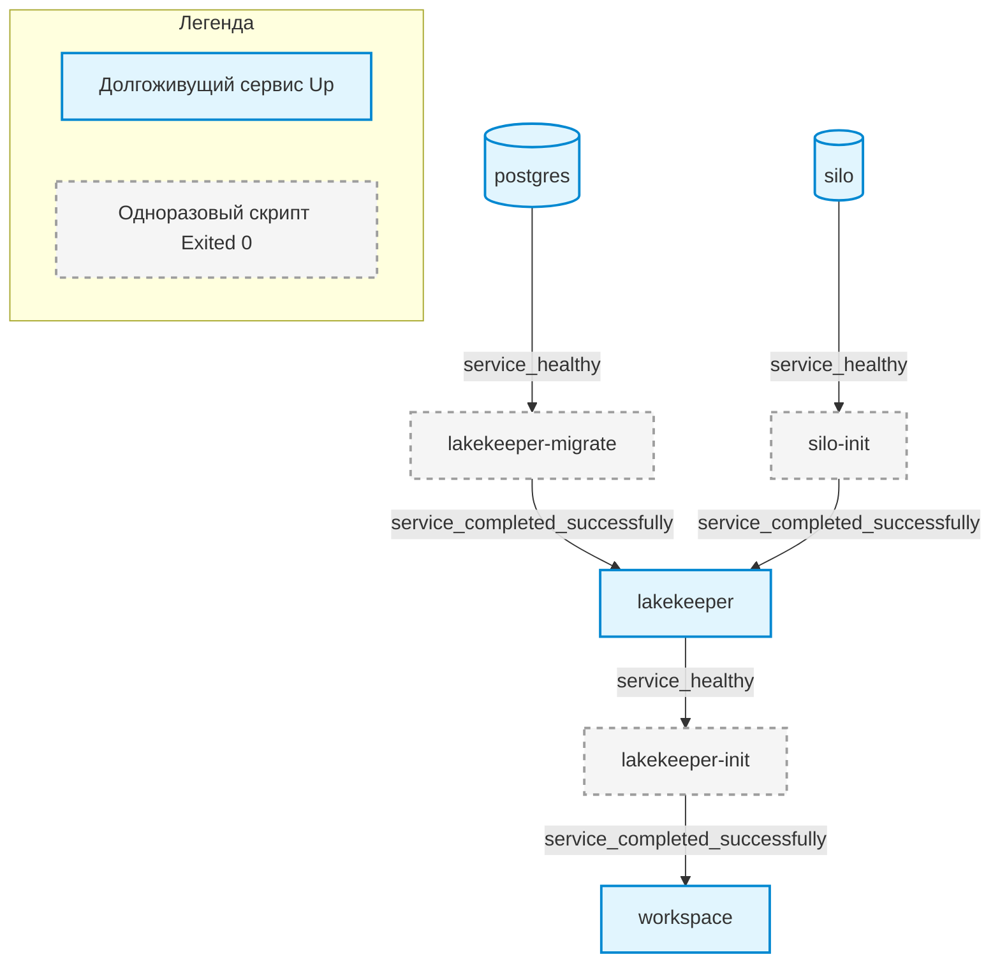

# Лаба 00.1 · Анатомия слоя core

**Модуль:** [00 · Just enough](../../README.md) · **Дата начала:** 2026-09-26 · **Статус:**  🟨

## Objective

Понять каждую строку [`infra/docker/core.yaml`](../../../../infra/docker/core.yaml) настолько,
чтобы суметь пересобрать слой с нуля и диагностировать любой его сбой. Всё дальнейшее в курсе
(Spark, Kafka, Dagster) — это новые сервисы в таких же compose-файлах.

## Key Terms

_(заполни своими словами по ходу лабы)_

- **Образ / контейнер / слой образа**
    / Образ — это упакованная программа вместе со всем, что ей нужно: файлы ОС, библиотеки, сама программа и команда запуска по умолчанию. Образ только для чтения и сам по себе ничего не делает. Данные не кладут в образ, иначе пришлось бы его пересобирать при каждом изменении данных
    / Контейнер = образ + команда запуска. Изменения в контейнере исчезают вместе с ним. Но их можно сохранить в томах
    / Слой образа - это результат выполнения инструкций в Dockerfile (RUN, COPY…). Каждая инструкция добавляет слой поверх предыдущего. Слои кэшируются: если слой не изменился, Docker его не пересобирает. Но если меняется одни слой, то пересобираются все слои после него
- **Том (named volume) vs bind mount** —
- **Healthcheck** —
- **`depends_on` + `condition`** —
- **One-shot (init) контейнер** —
- **Сеть compose, встроенный DNS** —
- **Публикация порта (`ports`)** —
- **Vended credentials (STS)** —

## Prerequisites

- Теория к лабе — [`theory/`](../../README.md#маршрут-прохождения) модуля (темы 01–07)
- `make up` выполнен, `make check` — все OK
- Прочитано: [Compose file reference — services](https://docs.docker.com/reference/compose-file/services/),
  [Networking in Compose](https://docs.docker.com/compose/how-tos/networking/),
  [infra/README.md](../../../../infra/README.md)

## Tasks

### Task 1. Карта сервисов

**Expected result / Definition of Done:**
- Таблица ниже заполнена для всех 7 сервисов (включая одноразовые `*-init`, `*-migrate`)
- Mermaid-диаграмма зависимостей `depends_on` с подписями условий на стрелках

| Сервис | Образ | Зачем нужен | Порты (хост → контейнер) | Тома / монтирования | Зависит от (условие) | Долгоживущий или one-shot |
|---|---|---|---|---|---|---|
| lakekeeper | quay.io/lakekeeper/catalog:v0.13.6 | REST-каталог для Apache Iceberg (серверная часть). | 127.0.0.1:8181 → 8181 | Нет | • lakekeeper-migrate (completed)<br>• silo-init (completed) | Долгоживущий (unless-stopped) |
| lakekeeper-init | curlimages/curl:8.22.0 | Скрипт первоначальной настройки каталога через API (вызов init.sh). | Нет | /home/.../lakekeeper → /init (bind, read_only) | • lakekeeper (healthy) | One-shot (restart: 'no') |
| lakekeeper-migrate | quay.io/lakekeeper/catalog:v0.13.6 | Запуск миграций базы данных для каталога. | Нет | Нет | • postgres (healthy) | One-shot (restart: 'no') |
| postgres | postgres:17.11 | Реляционная СУБД для хранения метаданных. Вторая база retail_oltp | 127.0.0.1:5432 → 5432 | • postgres-data → /var/lib/.../data (volume)<br>• /home/.../postgres/init → /docker-entrypoint-initdb.d (bind) | Нет | Долгоживущий (unless-stopped) |
| silo | pgsty/silo:RELEASE... | S3-совместимое объектное хранилище (форк MinIO) и его консоль. | 127.0.0.1:9000 → 9000<br>127.0.0.1:9001 → 9001 | • silo-data → /data (volume) | Нет | Долгоживущий (unless-stopped) |
| silo-init | pgsty/silo:RELEASE... | Создание бакетов (landing, warehouse) в хранилище через утилиту mc. | Нет | Нет | • silo (healthy) | One-shot (restart: 'no') |
| workspace | debd/workspace:local | Все Python-инструменты курса + образ собирается локально | 127.0.0.1:8888 → 8888 | • /home/.../DE_BigData_Learn → /workspace (bind) | • lakekeeper-init (completed) | Долгоживущий (unless-stopped) |





**Steps:**
1. Прочитай `core.yaml` и `compose.yaml` целиком.
2. Посмотри итоговую конфигурацию после подстановки переменных и `include`:
   `docker compose --env-file .env -f infra/docker/compose.yaml config` (осторожно: в выводе пароли — не коммить его).
3. Сверь с `make ps` — какие контейнеры в статусе `Exited (0)` и почему это нормально.

### Task 2. Порядок запуска

**Expected result / Definition of Done:**
- Письменно: предсказанный порядок старта всех сервисов и почему именно такой
  Step 1: postgres, silo; Step 2: silo-init, lakekeeper-migrate; Step 3: lakekeeper; Step 4: lakekeeper-init; Step 5: workspace. Каждый шаг ждёт, пока предыдущий станет healthy (для долгоживущих) или завершится с кодом 0 (для одноразовых)
- Предсказание сверено с реальностью (команды и вывод приложены)

| Параметр	| Что задаёт	| Влияет на «+5 с»? |
|---|---|---|
| interval: 5s	| 	как часто проверять;	|  первая проверка — через interval после старта	✅ да, это ответ	| 
| timeout: 10s	| 	сколько ждать ответа одной проверки	| 	❌ нет, проверка укладывается в миллисекунды|---|---|---|
| retries: 10	| сколько неудач подряд до статуса unhealthy	| 	❌ нет, первая же проверка успешна|---|---|---|
| start_period: 5s	| 	льготное время: неудачи в этот период не считаются в retries	| 	❌ не сдвигает момент проверки, только прощает ранние неудачи	| 


Healthcheck (проверка здоровья) — это встроенный в Docker инструмент, который позволяет автоматически проверять, работает ли приложение внутри контейнера должным образом, а не просто запущен ли сам контейнер.


  Команды (2026-09-27): в терминале 1 —
  `docker events --filter label=com.docker.compose.project=debd --filter type=container --format '{{.Time}} {{.Actor.Attributes.name}} {{.Action}}'`,
  в терминале 2 — `make down && make up`. Вывод (служебные события `create`/`attach`/`exec_*` убраны,
  время — секунды от первого события):

  ```text
  +0s   silo                start
  +0s   postgres            start
  +5s   silo                health_status: healthy
  +5s   postgres            health_status: healthy
  +6s   lakekeeper-migrate  start
  +6s   silo-init           start
  +6s   lakekeeper-migrate  die        # Exited (0)
  +6s   silo-init           die        # Exited (0)
  +7s   lakekeeper          start
  +12s  lakekeeper          health_status: healthy
  +12s  lakekeeper-init     start
  +13s  lakekeeper-init     die        # Exited (0)
  +13s  workspace           start
  ```

  Сравнение: порядок совпал с предсказанием, весь стек поднимается за ~13 с. Шаг 2 оказался
  одновременным, но это совпадение, а не правило: у postgres и silo одинаковый `interval: 5s`,
  поэтому первая успешная проверка у обоих пришлась на 5-ю секунду. Docker запускает каждый
  сервис, как только выполнены **его собственные** зависимости, а не «шагами». Будь у silo
  interval 2s, `silo-init` стартовал бы на ~3 секунды раньше `lakekeeper-migrate`.
  Самое долгое ожидание — healthcheck: 5 с у postgres/silo и 5 с у lakekeeper; сами одноразовые
  задачи выполняются меньше секунды.

  История healthcheck Silo — `docker inspect debd-silo-1 --format '{{json .State.Health}}'`:
  статус `healthy`, `FailingStreak: 0`, в `Log` — записи раз в 5 секунд (`interval`), у каждой
  `ExitCode: 0` и вывод `The cluster 'local' is ready` (это ответ команды `mc ready local`).
  Docker хранит только последние 5 проверок.

- Ответы: чем `service_healthy` отличается от `service_completed_successfully`? Что будет, если у
  `lakekeeper` убрать зависимость от `lakekeeper-migrate`? Зачем `make up` использует `--wait`?

  1. **`service_healthy` vs `service_completed_successfully`.** `service_healthy` ждёт, пока
     долгоживущий сервис пройдёт healthcheck, то есть реально готов отвечать. `service_completed_successfully`
     ждёт, пока одноразовая задача завершится с кодом 0. Для `lakekeeper-migrate` `service_healthy`
     не подходит: у него нет healthcheck, и он не работает постоянно — сделал миграции и вышел.
     Состояния «healthy» у него просто не бывает, зависимые сервисы ждали бы вечно.
  2. **Без зависимости от `lakekeeper-migrate`.** Пустой будет не S3, а база `lakekeeper` в Postgres:
     в ней ещё нет служебных таблиц каталога. `lakekeeper` и `lakekeeper-migrate` стартуют
     одновременно — это гонка: иногда миграции успеют первыми, иногда Lakekeeper упадёт с ошибкой,
     и `restart: unless-stopped` будет его перезапускать. Ошибка коварная: проявляется только на
     чистой установке, потому что при следующих запусках база уже размечена.
  3. **Зачем `--wait`.** Кто кого ждёт между контейнерами, решает `depends_on`. `--wait` — для того,
     кто запустил `make up` (я, `make check`, CI): команда вернёт управление, только когда все
     сервисы healthy, а одноразовые завершились, и завершится с ошибкой, если что-то не поднялось.
     Без него `make up && make check` запускал бы проверку сразу после старта контейнеров,
     а `make up` «успешно» завершался бы даже при сломанном стеке.
  4. **Бонус: почему `pg_isready`.** Запущенный процесс ≠ готовая база: сам Postgres может ещё не
     отвечать, хотя контейнер уже работает, и обращение к базе приведёт к ошибке. Пример из нашего
     стека: при первом старте Postgres запускается временно, выполняет `01-databases.sql` и
     перезапускается — процесс есть, но соединения он не принимает. `pg_isready` проверяет именно
     готовность принимать соединения.


**Steps:**
1. Запиши предсказание.
2. `make down`, затем в одном терминале `docker events --filter label=com.docker.compose.project=debd`,
   в другом — `make up`. Сравни.

<details><summary>Подсказка</summary>

Смотри на события `start`, `health_status`, `die` и их порядок во времени.
</details>

### Task 3. Сети и DNS

Теория: [03 · Сети](../../theory/03_networking.md),
[04 · S3 и Iceberg](../../theory/04_s3_iceberg_catalog.md),
[05 · Разбор check_stack.py](../../theory/05_python_check_stack.md).
Ниже — практика на применение. В README записывай только решения, предсказания и объяснения.

**3.1. Предскажи и проверь: «чужой» localhost.**
Не запуская, предскажи, что покажет каждая команда и почему:
`curl -s -o /dev/null -w '%{http_code}\n' localhost:9000/minio/health/live` — с хоста и из `make shell`;
то же с `silo:9000`. Потом проверь.

**Definition of Done:** таблица 4 ячеек «предсказание / факт», объяснение каждого расхождения.

Предсказание:

| Откуда запускаю                                  | Адрес localhost:9000 | Адрес silo:9000 |
| ------------------------------------------------ | -------------------- | --------------- |
| С хоста: обычный терминал                        | 200                  | 000             |
| Из контейнера: сначала make shell, потом команда | 000                  | 200             |

Фактически:

| Откуда запускаю                                  | Адрес localhost:9000 | Адрес silo:9000 |
| ------------------------------------------------ | -------------------- | --------------- |
| С хоста: обычный терминал                        | 200                  | 000             |
| Из контейнера: сначала make shell, потом команда | 000                  | 200             |

Мои предсказания сбылись, так как порт 9000 прописан для хоста (localhost = 127.0.0.1), а silo виден только из сети контейнера. В ячейке «контейнер + localhost» получился 000, потому что localhost там означает сам контейнер workspace, а в нём на порту 9000 никто не слушает. Правило 127.0.0.1:9000 работает только на хосте.

**3.2. Найди и почини: неверный endpoint.**
Внутри `make shell` запусти smoke-тест с подменённым адресом:
`S3_ENDPOINT=http://localhost:9000 python scripts/check_stack.py`.
Сначала предскажи, какие из 3 проверок упадут, а какие нет, — и почему именно так.

**Definition of Done:** предсказание записано *до* запуска; объяснено, почему упавшие упали, а
прошедшие прошли, хотя endpoint «сломан» (подсказка: кто ещё знает адрес Silo, кроме переменной?).

```text
OK    Postgres: базы lakekeeper, retail_oltp
FAIL  S3 (Silo): бакеты landing, warehouse: EndpointConnectionError: Could not connect to the endpoint URL: "http://localhost:9000/"
OK    Iceberg (Lakekeeper) + DuckDB: запись/чтение таблицы
```

> Предсказание до запуска записано не было. Ниже — разбор результата, выполненный с ментором по моей просьбе.

Каждая проверка берёт адрес из своего источника, поэтому подмена `S3_ENDPOINT` задевает только одну из них:

| Проверка | Откуда берёт адрес | Задела ли подмена | Итог |
|---|---|---|---|
| Postgres | `POSTGRES_HOST` (= `postgres`) | Нет: `S3_ENDPOINT` не используется | OK |
| S3 (Silo) | `S3_ENDPOINT` → `http://localhost:9000` | Да | FAIL |
| Iceberg + DuckDB | Каталог: `ICEBERG_CATALOG_URI`; S3 — из ответа Lakekeeper | Нет | OK |

1. **Postgres прошёл**, потому что к S3 он не относится: `check_postgres` подключается к
   `POSTGRES_HOST` и читает список баз. Переменную `S3_ENDPOINT` эта проверка не читает.
2. **S3 упал с `EndpointConnectionError`.** `check_s3` создаёт `s3fs.S3FileSystem` с
   `endpoint_url` из `S3_ENDPOINT`. Внутри контейнера `workspace` `localhost` — это сам
   `workspace` (см. 3.1), а на его порту 9000 никто не слушает. TCP-соединение отклоняется
   (connection refused), и botocore превращает это в `EndpointConnectionError`. Ошибка
   именно сетевая: до проверки ключей или бакетов дело не дошло. С хоста тот же адрес сработал
   бы, потому что туда опубликован порт `127.0.0.1:9000`.
3. **Iceberg прошёл, хотя пишет Parquet в тот же Silo.** `check_iceberg_and_duckdb` не читает
   `S3_ENDPOINT`: ей нужен только адрес каталога (`ICEBERG_CATALOG_URI` =
   `http://lakekeeper:8181/catalog`) и имя warehouse. Адрес S3 знает сам Lakekeeper: в
   [`init.sh`](../../../../infra/docker/lakekeeper/init.sh) warehouse создан со
   `storage-profile` `"endpoint": "http://silo:9000"`. При загрузке и создании таблицы каталог
   возвращает клиенту config с `s3.endpoint = http://silo:9000/` и временными ключами (STS), и
   PyIceberg пишет файлы уже по этому адресу. DuckDB подключается через `ATTACH ... ENDPOINT`,
   и это тоже адрес каталога, а не S3, так что настройки для S3 он получает оттуда же.
   **Кроме переменной, адрес Silo знает каталог**, и клиенты Iceberg берут его у каталога.

**Вывод: в стеке два независимых пути к S3.**
- *Прямой* (s3fs, boto3, dlt → `landing`): адрес и ключи из переменных окружения клиента.
  Ошибка в них ломает только этих клиентов.
- *Через каталог* (PyIceberg, DuckDB, позже Spark/Trino → Iceberg-таблицы): адрес и ключи
  выдаёт Lakekeeper из storage-profile. Переменные клиента для этого пути не нужны.

Практическое следствие: если в будущем пайплайне неверен `S3_ENDPOINT`, загрузка сырых файлов в
`landing` упадёт, а Iceberg-таблицы продолжат читаться и писаться. Зелёные проверки Iceberg не
доказывают, что прямой доступ к S3 исправен, поэтому в smoke-тесте нужны обе проверки.
Обратное тоже верно: если у Lakekeeper в storage-profile неверный endpoint, сломаются все
Iceberg-клиенты сразу, какие бы переменные ни стояли у них самих. Чинить это нужно в
warehouse каталога, а не в `.env` клиентов.

**3.3. Спроектируй: чужой проект в нашей сети.**
Создай вне `core.yaml` отдельный compose-файл
`modules/00_just_enough/labs/00.1_compose_anatomy/nettest.yaml` с **другим** именем проекта и одним сервисом на образе `curlimages/curl:8.22.0`, который обращается к `http://lakekeeper:8181/health` и завершается. Запусти его, не трогая `core.yaml` и Makefile.

**Definition of Done:** `docker compose -f .../nettest.yaml up --exit-code-from <сервис>`
печатает JSON-ответ Lakekeeper (`"health":"ok"`), и `echo $?` после него даёт `0`. В README:
(1) какой ошибкой падает `up` без твоей настройки сети на этой машине и почему именно такой;
(2) что было бы на машине без VPN; (3) какие ключи в compose это решают и что делает каждый.
После проверки — `down`, чтобы не остался мусор.

**Steps:**
1. Убедись, что стек поднят: `make ps` — `lakekeeper` в статусе `healthy`.
2. Создай `nettest.yaml` с ключом `name:`, одним сервисом, `image:`, `command:` в форме списка
   и `restart: "no"` (урок 03, шаг 9). Блок `networks` пока **не** добавляй.
3. С хоста, из корня репозитория:
   `docker compose -f modules/00_just_enough/labs/00.1_compose_anatomy/nettest.yaml up --exit-code-from <сервис>`.
   Запиши ошибку дословно.
4. Найди в уроке 03 (шаги 6 и 8.3), какая ветка дерева решений сработала, и добавь в файл
   нужный блок `networks`.
5. Повтори команду из шага 3, затем `echo $?`. Нужны JSON с `"health":"ok"` и `0`.
6. `docker compose -f …/nettest.yaml down`, затем проверь, что сеть `debd_default` на месте:
   `docker network ls | grep debd`.
7. Запиши в README ответы (1)–(3).

**3.4. Предскажи и проверь: откуда ключи S3 у Iceberg.**
Предскажи результат трёх проверок в
`env -u AWS_ACCESS_KEY_ID -u AWS_SECRET_ACCESS_KEY python scripts/check_stack.py` (в `make shell`).

**Definition of Done:** предсказание до запуска; объяснение результата через `sts-enabled` в
[`init.sh`](../../../../infra/docker/lakekeeper/init.sh); ответ, чем это лучше раздачи
root-ключей Silo каждому клиенту.

**Steps:**
1. Запиши в README предсказание: OK или FAIL для каждой из трёх проверок и почему.
2. `make shell`, затем команда из условия. `env -u ИМЯ` запускает программу без этой переменной.
3. Сравни с предсказанием. Для объяснения перечитай урок 04, шаги 5–6, и `storage-profile`
   в `init.sh`.
4. Запиши объяснение и ответ про root-ключи.

**3.5. Обоснуй: публикация портов.**
Ответы: что изменится, если в `ports` убрать `127.0.0.1:` (кто сможет подключиться к Postgres и
почему `ufw` здесь не спасает)? Нужен ли `ports` у `postgres`, чтобы `lakekeeper` до него достучался?
Зачем в `core.yaml` явная подсеть?

**Definition of Done:** ответы + одна команда, подтверждающая твой ответ про адрес привязки
(например, `ss -ltn` на хосте или `docker port`).

**Steps:**
1. Ответь письменно на три вопроса, опираясь на урок 03, шаги 4–6. `core.yaml` не меняй.
2. На хосте выполни одну из команд из DoD и найди в выводе адрес, на котором слушают наши порты.
3. Вставь команду и нужные строки вывода в README рядом с ответом.

### Task 4. Состояние и тома

Теория: [06 · Тома и состояние](../../theory/06_volumes_and_state.md).

**Expected result / Definition of Done:**
- Эксперимент: создал бакет `scratch` в консоли Silo (http://localhost:9001) → `make restart` → бакет на месте
- Ответы: где физически лежат данные Postgres и Silo (`docker volume inspect`)? Чем `make down`
  отличается от `make clean`? Почему `postgres/init/01-databases.sql` выполняется только один раз?
  А `lakekeeper/init.sh` — при каждом `make up`, и почему это безопасно?
- Ответ: почему данные датасета (`data/`) переживут `make clean`, а бакеты — нет?

**Steps:**
1. Запиши предсказание: будет ли бакет `scratch` на месте после `make restart` и почему.
2. Открой http://localhost:9001 (логин и пароль — `S3_ACCESS_KEY` / `S3_SECRET_KEY` из `.env`),
   создай бакет `scratch`.
3. `make restart`, снова открой консоль и проверь бакет.
4. Найди, где лежит том Silo, и загляни в него через одноразовый контейнер (урок 06, шаг 3,
   «Попробуй сам»). Сделай то же для тома Postgres.
5. Найди в логах Postgres и `lakekeeper-init` следы того, выполнялась ли инициализация
   (урок 06, шаг 6).
6. Ответь на вопросы. `make clean` **не** запускай: он понадобится в сценарии 5 лабы 00.2.
   Ответ про `data/` дай рассуждением по таблице из урока 06, шаг 2.

### Task 5. Образ workspace

Теория: [07 · Dockerfile и слои образа](../../theory/07_dockerfile_and_layers.md).

**Expected result / Definition of Done:**
- Ответы с опорой на [`Dockerfile`](../../../../infra/docker/workspace/Dockerfile) и `docker history debd/workspace:local`:
  1. Почему `COPY pyproject.toml uv.lock` и `uv sync` идут до монтирования кода, а не после?
  2. Почему venv в `/opt/venv`, а не в `/workspace/.venv`?
  3. Зачем аргументы `UID`/`GID`? Что будет с правами на файлы в `data/` без них?
  4. Какой слой образа самый тяжёлый и почему образ весит ~2,4 ГБ?
- Эксперимент: добавил пакет (например, `rich`) через `make uv ARGS="add --group dev rich"`,
  пересобрал `make build`, убедился, что он доступен в `make shell`, откатил изменения (`git restore`)

**Steps:**
1. Открой Dockerfile и сопоставь каждую инструкцию с разбором в уроке 07, шаг 1.
2. `docker history debd/workspace:local --format '{{.Size}}\t{{.CreatedBy}}' | cut -c1-90` —
   найди самый тяжёлый слой.
3. Загляни внутрь образа командой из урока 07, шаг 5 («где место внутри workspace»), и найди
   большие папки. Для каждой реши, нужна ли она работающему контейнеру.
4. Ответь на вопросы 1–4.
5. Эксперимент: `make uv ARGS="add --group dev rich"` → `git diff --stat` (какие файлы
   изменились) → `make build` (какие шаги не `CACHED`) → `make up` →
   `make shell` → `python -c "import rich; print(rich.__name__)"`.
6. Откат: `git restore pyproject.toml uv.lock` → `make build` → `make up`. Проверь, что
   `git status` не показывает этих файлов, а `import rich` снова падает.

## Результат

_(таблица, диаграмма, ответы, ключевые выводы)_

## Выводы и вопросы

- 

По итогам лабы — шпаргалка [`cheatsheet.md`](../../README.md#маршрут-прохождения) модуля своими словами (пункт DoD модуля).
