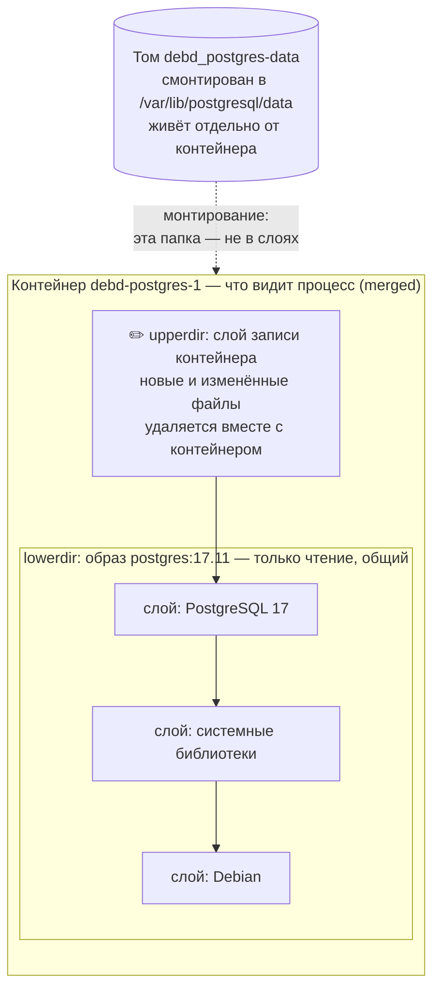
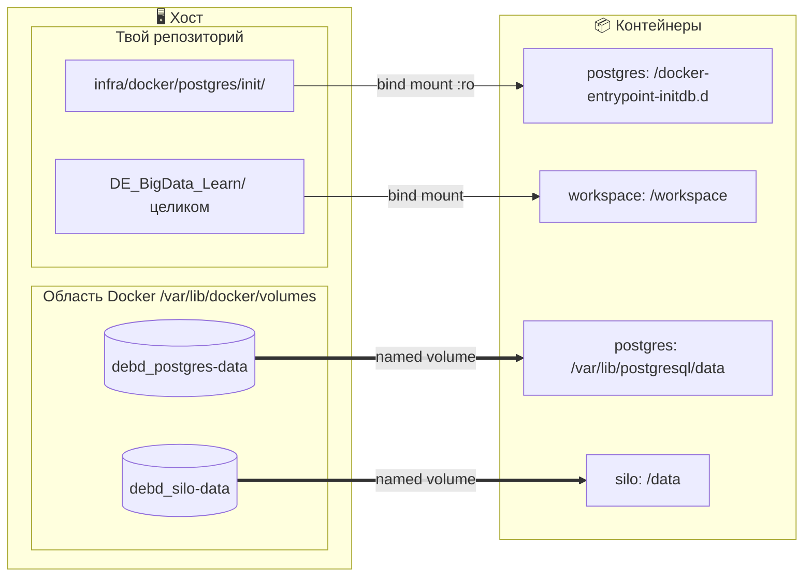
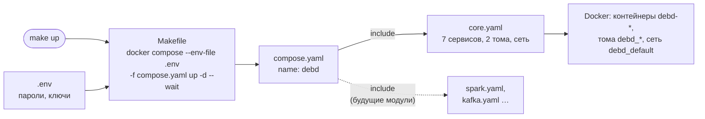
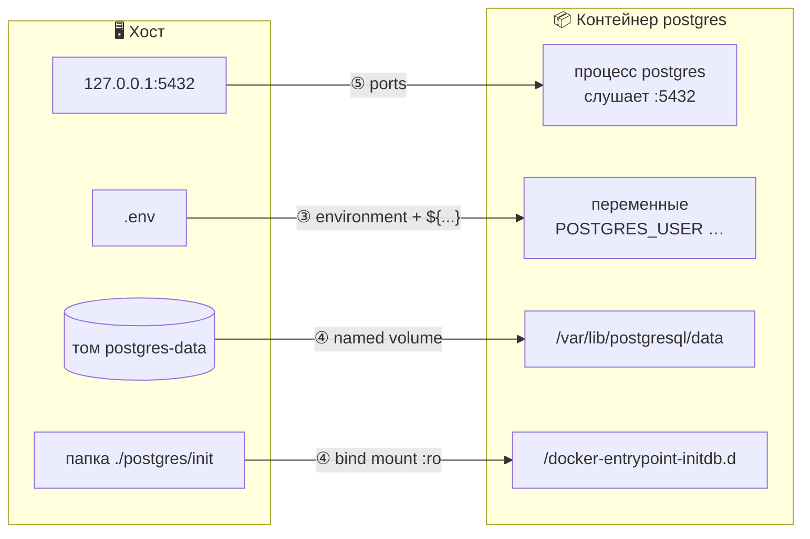
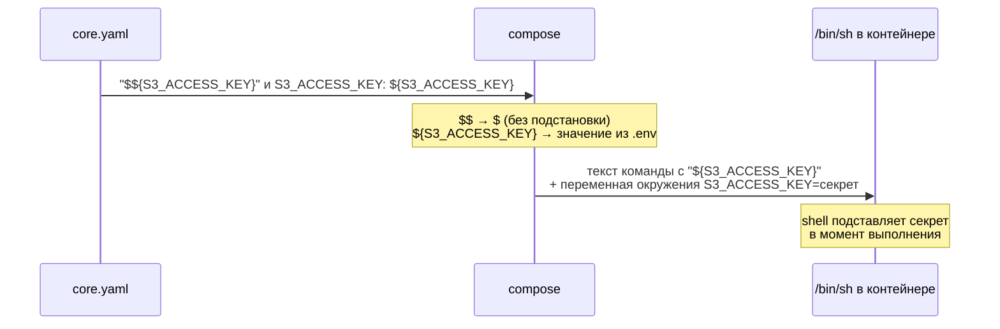
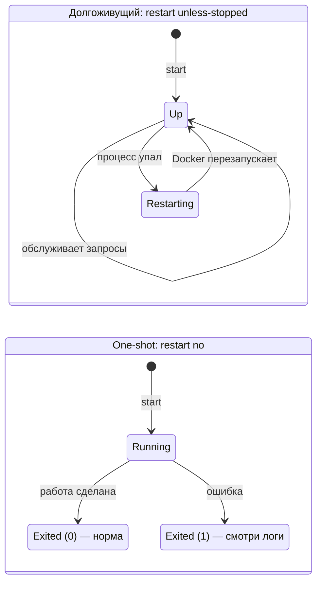
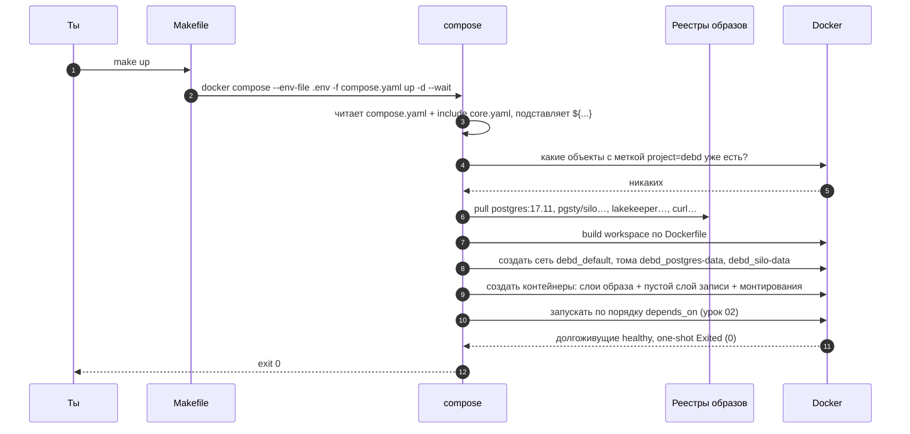

# 01 · Образы, контейнеры и compose-файл: из чего собран наш стек

> [!info] Урок одной фразой
> Образ — неизменяемая заготовка программы. Контейнер — запущенная из неё программа со своим
> «черновиком», который исчезает вместе с контейнером. Всё, что надо сохранить, выносят в тома.
> Compose — план, по которому Docker собирает и поддерживает весь стек одной командой.

> [!todo] Чек-лист: после урока ты сможешь
> - [ ] прочитать любой сервис в `core.yaml` и сказать, что он делает, откуда берёт образ, данные и
>   настройки;
> - [ ] предсказать, какие данные переживут `make restart`, а какие нет;
> - [ ] объяснить, чем `${VAR}` отличается от `$${VAR}`, и зачем нужны `x-`-якоря;
> - [ ] отличить нормальный `Exited (0)` одноразового контейнера от поломки (задача 1).

**Нужно для:** лаба [00.1](../labs/00.1_compose_anatomy/README.md), задача 1.
**Карта урока:** [compose-anatomy.canvas](../maps/compose-anatomy.canvas).

---

## Шаг 0. Азбука: какую проблему решает Docker

Любая программа — не один файл. Postgres — это сам сервер, десятки системных библиотек
определённых версий, файлы настроек, пользователь `postgres` и ожидаемая структура папок.
Если ставить всё это прямо на компьютер, начинаются знакомые беды: две программы хотят разные
версии одной библиотеки; у коллеги «работает», у тебя — нет; удалить программу начисто
невозможно, потому что её файлы разбросаны по всей системе.

Docker решает это так: программа **вместе со всем окружением** упаковывается в один
неизменяемый пакет — **образ**. Из образа запускается **контейнер**: обычный процесс Linux,
которому ядро показывает не файлы твоей системы, а файлы образа, и выдаёт отдельную сеть (урок
[03](03_networking.md)). Программа внутри думает, что она одна на своём компьютере с ровно теми
библиотеками, которые ей нужны.

Весь модуль держится на одной аналогии «офисное здание». В уроке 03 она описывала сеть, здесь —
то, из чего состоят сами кабинеты.

| В Docker | В аналогии «офисное здание» | Подробнее |
|---|---|---|
| Образ | Типовой проект кабинета: мебель, техника, инструкции. Сам проект не меняется | [образ](../../../glossary/docker-image.md) |
| Слой образа | Лист проекта: «стены», «+ мебель», «+ техника». Листы накладываются друг на друга | [слой](../../../glossary/image-layer.md) |
| Контейнер | Реальный кабинет, обставленный по проекту, в котором работает сотрудник | [контейнер](../../../glossary/container.md) |
| Слой записи контейнера | Бумаги на столе сотрудника: при сносе кабинета их выбрасывают | [контейнер](../../../glossary/container.md) |
| Том (volume) | Сейф в архиве здания: переживает снос кабинета | [том](../../../glossary/volume.md) |
| Bind mount | Окно в твою собственную папку: что меняешь там, видно в кабинете | [bind mount](../../../glossary/bind-mount.md) |
| Compose-файл | План этажа: какие кабинеты, по каким проектам, как связаны | |
| `docker compose up` | Прораб: сверяет этаж с планом и достраивает то, чего не хватает | |
| One-shot контейнер | Подрядчик: пришёл, сделал работу, ушёл | |
| Код выхода | Отметка подрядчика в акте: `0` — сделано, остальное — проблема | [код выхода](../../../glossary/exit-code.md) |

> [!tip] Как читать урок
> Наведи мышь на ссылку термина — всплывёт карточка. Блоки «Попробуй сам» выполняй сразу:
> записывать результат не нужно, это чтобы увидеть механизм своими глазами.

---

## Шаг 1. Что такое образ?

**Проблема.** Окружение программы нужно передать с машины на машину так, чтобы оно было
**одинаковым до байта**, а скачивать и хранить его было дёшево.

**Как устроено: образ — стопка слоёв.** Образ собирается по рецепту — `Dockerfile`. Каждая
инструкция рецепта (`RUN apt-get install ...`, `COPY файл ...`) выполняется и записывает только
**изменения** файловой системы по сравнению с предыдущим шагом. Этот набор изменений и есть
**слой**. Образ — это стопка слоёв плюс метаданные: какую команду запускать, какие переменные
окружения выставить, какой порт программа слушает.

Посмотрим на образ Postgres (`docker image history postgres:17.11`, снизу вверх — в порядке
сборки):

```text
78.8MB  # debian.sh … 'trixie'            ← слой 1: базовая ОС Debian
15.9MB  RUN apt-get update; apt-get …     ← системные утилиты
 25.6MB RUN … locales                     ← локали
 327MB  RUN … postgresql-17 …             ← сам PostgreSQL
16.9kB  COPY docker-entrypoint.sh …       ← скрипт запуска
   0B   VOLUME [/var/lib/postgresql/data] ← метаданные, не файлы
   0B   ENTRYPOINT ["docker-entrypoint.sh"]
   0B   CMD ["postgres"]
```

Всего ~454 МБ. Строки `0B` — не файлы, а записи в метаданных: они ничего не весят.

**Почему слои, а не один архив.** Слой однозначно определяется своим содержимым (у каждого есть
контрольная сумма), поэтому:

- **Слои переиспользуются.** Если два образа построены на одном Debian, слой Debian на диске и
  при скачивании хранится один раз.
- **Скачивается только разница.** Вышла новая версия Postgres — изменились верхние слои, нижние
  уже есть на диске.
- **Слои неизменяемы.** Их нельзя поправить «на месте», можно только собрать новый образ. Так
  гарантируется, что образ одинаков у всех.

**Имя образа** говорит, откуда его скачать и какую версию:

```text
quay.io / lakekeeper/catalog : v0.13.6
   ①            ②                ③
```

| Метка | Часть | Смысл |
|---|---|---|
| ① | реестр (registry) | сервер, где хранятся образы. Не указан (`postgres:17.11`) — значит Docker Hub |
| ② | репозиторий | название образа в реестре |
| ③ | тег | метка версии |

> [!warning] Ловушка: тег `latest`
> Тег — это не версия, а **подвижная метка**: автор образа может в любой момент перевесить её
> на другую сборку. `latest` — просто тег по умолчанию, никакой гарантии «последней версии» он
> не даёт. Сегодня стек работает, завтра `docker pull` скачает под тем же именем другой образ, и
> стек сломается без единого изменения в git. Поэтому у нас **все теги фиксированные**
> (`postgres:17.11`, а не `postgres` или `postgres:17`).

> [!example]- Попробуй сам: из чего состоит образ
> ```bash
> docker image history postgres:17.11 --format '{{.Size}}\t{{.CreatedBy}}' | cut -c1-80
> docker image ls --format '{{.Repository}}:{{.Tag}}\t{{.Size}}' | grep -E 'postgres|lakekeeper|silo|workspace'
> ```
> **Увидишь:** слои Postgres с размерами (сверху — последние) и размеры образов нашего стека.
> Самый большой — `debd/workspace:local`: в нём все Python-инструменты курса (урок 07).

---

## Шаг 2. Что такое контейнер и куда девается то, что он пишет?

**Проблема.** Образ неизменяем, а программе нужно писать файлы: Postgres создаёт базы, DuckDB
скачивает расширения, ты создаёшь файлы в `/tmp`. Нужно дать контейнеру писать, не трогая
образ, общий для многих контейнеров.

**Как устроено: слой записи поверх образа.** Контейнер не копирует образ. Docker (драйвер
хранения `overlay2`) собирает для контейнера файловую систему из трёх частей:

1. **Нижние слои (lowerdir)** — слои образа, только чтение, общие для всех контейнеров этого
   образа.
2. **Верхний слой (upperdir)** — пустая папка, личная для контейнера. Сюда попадают все
   изменения.
3. **Объединённый вид (merged)** — то, что видит процесс: слои, наложенные друг на друга, как
   прозрачные плёнки. Файл из верхнего слоя закрывает одноимённый файл из нижних.

Правила записи:

- **Создать файл** → он появляется в верхнем слое.
- **Изменить файл образа** → Docker сначала копирует файл в верхний слой целиком, потом
  изменяет копию. Это называется **copy-on-write** («копировать при записи»). Оригинал в образе
  не меняется.
- **Удалить файл образа** → в верхнем слое создаётся метка-«заглушка» (whiteout), которая
  прячет файл. Сам файл в образе остаётся.



**Что из этого следует.**

- **Из одного образа — много контейнеров.** Каждый получает свой пустой верхний слой. У нас
  `lakekeeper` и `lakekeeper-migrate` — два контейнера из одного образа
  `quay.io/lakekeeper/catalog:v0.13.6` с разными командами (`serve` и `migrate`).
- **Верхний слой живёт, пока живёт контейнер.** `docker stop` лишь останавливает процесс —
  слой остаётся, и после `start` файлы на месте. А `make down` **удаляет** контейнеры, и их
  верхние слои удаляются вместе с ними. `make restart` = `down` + `up`, значит, всё записанное в
  верхний слой теряется.
- **Данные нельзя держать в верхнем слое.** Их выносят в [тома](../../../glossary/volume.md)
  (шаг 3): том подключается в папку контейнера и хранится отдельно.
- **Данные нельзя класть и в образ.** Образ неизменяем: чтобы обновить данные, его пришлось бы
  пересобирать.

> [!example]- Попробуй сам: что workspace успел записать в свой слой
> ```bash
> docker diff debd-workspace-1 | head
> ```
> **Увидишь:** строки `A` (added, добавлено) и `C` (changed, изменено), например
> `A /home/dev/.duckdb/extensions/…/iceberg.duckdb_extension`. Это расширения, которые DuckDB
> скачал при `make check`. Они лежат в верхнем слое, поэтому после `make restart` DuckDB скачает
> их заново. Мелочь, но это ровно тот механизм, из-за которого теряются данные.
>
> Где слой лежит на диске хоста:
> `docker inspect debd-postgres-1 --format '{{index .GraphDriver.Data "UpperDir"}}'`.

---

## Шаг 3. Куда девать данные: тома и bind mount

**Проблема.** Данные Postgres и Silo должны пережить пересоздание контейнеров, обновление
образов и `make restart`. А код, который ты правишь в VS Code, должен сразу быть виден внутри
контейнера, без пересборки образа.

**Как устроено: монтирование.** Ключ `volumes:` у сервиса говорит Docker: «папку внутри
контейнера возьми не из слоёв, а из другого места». Linux умеет **подменить содержимое папки**
другим хранилищем. Процесс пишет в `/var/lib/postgresql/data` как в обычную папку, а файлы
физически попадают в хранилище снаружи и в верхний слой контейнера не попадают вовсе.

Источников два:

| Вид | Запись | Где лежат данные | Кто управляет | Зачем у нас |
|---|---|---|---|---|
| **Named volume** | `postgres-data:/var/lib/postgresql/data` | `/var/lib/docker/volumes/debd_postgres-data/` | Docker | данные БД и S3: должны жить долго и не мешаться в репозитории |
| **Bind mount** | `./postgres/init:/docker-entrypoint-initdb.d:ro` | твоя папка на хосте | ты | код и конфиги, которые правишь в редакторе |

Как отличить на глаз — по левой части:

```text
postgres-data:/var/lib/postgresql/data          ← слева имя без / → named volume
./postgres/init:/docker-entrypoint-initdb.d:ro  ← слева путь ./ ../ / → bind mount
      ①                  ②                  ③
```

| Метка | Смысл |
|---|---|
| ① | откуда: имя тома или путь на хосте |
| ② | куда: папка внутри контейнера |
| ③ | режим: `ro` — только чтение, контейнер не сможет изменить файлы |



**Что из этого следует.**

- Относительный путь bind mount (`./`, `../`) считается **от папки compose-файла**
  (`infra/docker/`), а не от папки, где ты запустил команду. Поэтому `../..` у workspace — это
  корень репозитория.
- Named volume нужно объявить в секции `volumes:` верхнего уровня файла. Compose добавит к имени
  префикс проекта: `postgres-data` → `debd_postgres-data`.
- workspace монтирует весь репозиторий в `/workspace`. Файл, изменённый в VS Code, сразу виден в
  `make shell`, и наоборот. Этим же объясняется, почему `data/` переживает всё: это обычная
  папка на твоём диске.
- Тома удаляются только явно: `make clean` (`down -v`). Где они лежат, почему `make down` их не
  трогает и почему init-скрипт Postgres выполняется один раз — урок 06 к задаче 4.

> [!note] Деталь: VOLUME в образе
> В истории образа Postgres есть строка `VOLUME [/var/lib/postgresql/data]`. Так автор образа
> помечает папку, где хранятся данные. Если её не смонтировать, Docker создаст **анонимный том**
> со случайным именем, и найти его потом трудно. Мы монтируем туда именованный том, поэтому
> анонимный не создаётся.

---

## Шаг 4. Зачем compose и как он думает

**Проблема.** Семь контейнеров, у каждого образ, переменные, порты, тома, сеть, порядок
запуска. Запускать их вручную `docker run ...` с десятком флагов и помнить порядок невозможно.

**Как устроено: описание желаемого состояния.** Compose-файл описывает **что должно быть**, а
не **что сделать**. `docker compose up` работает как прораб с планом:

1. Читает план: подставляет переменные, склеивает файлы из `include`.
2. Смотрит, что уже есть в Docker: находит «свои» контейнеры, сети и тома по
   [меткам](03_networking.md) `com.docker.compose.project=debd` и `com.docker.compose.service=<сервис>`.
3. Для каждого сервиса сравнивает план с реальностью. У каждого контейнера есть метка
   `config-hash` — отпечаток его настроек. Отпечаток совпадает и контейнер работает — не
   трогать. Изменился — пересоздать. Контейнера нет — создать.
4. Запускает то, что нужно, в порядке зависимостей (урок [02](02_startup_order.md)).

Такой подход называется **декларативным**: повторный `up` без изменений в файле ничего не
пересоздаёт. Поменял одну строку у одного сервиса — пересоздастся только он.

> [!example]- Попробуй сам: повторный `make up`
> ```bash
> make up
> make ps
> ```
> **Увидишь:** долгоживущие сервисы остались `Up` с прежним временем работы, их не пересоздали.
> А у `silo-init` и `lakekeeper-init` статус `Exited (0) N seconds ago`: compose **заново
> запустил** завершившиеся one-shot контейнеры, потому что по плану они должны отработать.
> Поэтому их скрипты обязаны быть идемпотентными (шаг 8).

**У нас compose всегда вызывается через Makefile**, который подставляет нужные флаги:

```make
COMPOSE := docker compose --env-file .env -f infra/docker/compose.yaml
```

- `--env-file .env` — откуда брать значения для `${...}` (шаг 6);
- `-f infra/docker/compose.yaml` — какой файл читать.

Корневой файл [`compose.yaml`](../../../infra/docker/compose.yaml) короткий:

```yaml
name: debd          # имя проекта: префикс всех объектов
include:
  - core.yaml       # подключить файл слоя как часть ЭТОГО же проекта
```

`include` **склеивает** файлы в один проект. Слои Spark, Kafka и Dagster позже добавятся новыми
строками `include`, и `make up` будет поднимать их вместе с core. Имя проекта становится
префиксом всех объектов:

| Объект | Имя в Docker | Схема |
|---|---|---|
| Контейнер | `debd-silo-1` | `<проект>-<сервис>-<номер копии>` |
| Сеть | `debd_default` | `<проект>_<сеть>` |
| Том | `debd_postgres-data` | `<проект>_<том>` |



---

## Шаг 5. Анатомия сервиса

Сервис — это описание одного «кабинета»: из какого проекта его обставить и как связать со
зданием. Разберём `postgres` из [`core.yaml`](../../../infra/docker/core.yaml):

```yaml
services:
  postgres:                          # ① имя сервиса = DNS-имя в сети (урок 03)
    image: postgres:17.11            # ② из какого образа
    environment:                     # ③ переменные окружения внутри контейнера
      POSTGRES_USER: ${POSTGRES_USER}
    volumes:                         # ④ что куда смонтировать (шаг 3)
      - postgres-data:/var/lib/postgresql/data
      - ./postgres/init:/docker-entrypoint-initdb.d:ro
    ports:                           # ⑤ вход с хоста (урок 03)
      - "127.0.0.1:5432:5432"
    healthcheck: {...}               # ⑥ как проверить готовность (урок 02)
    restart: unless-stopped          # ⑦ политика перезапуска (шаг 8)
```



**Переменные окружения (③)** — это пары «имя=значение», которые операционная система передаёт
процессу при запуске. Программа читает их, как аргументы настройки. Образ Postgres, например,
при первом запуске читает `POSTGRES_USER` и `POSTGRES_PASSWORD` и создаёт такого пользователя.
Так один и тот же образ настраивается по-разному без пересборки.

Остальные ключи, которые встречаются в `core.yaml`:

| Ключ | Что делает | Где у нас |
|---|---|---|
| `build:` | собрать образ из Dockerfile, а не скачивать | `workspace` |
| `command:` | заменить аргументы запуска (CMD образа) | `lakekeeper`: `["serve"]` |
| `entrypoint:` | заменить саму запускаемую программу (ENTRYPOINT образа) | `silo-init`, `lakekeeper-init`: `/bin/sh` |
| `working_dir:` | рабочая папка процесса внутри контейнера | `workspace`: `/workspace` |
| `depends_on:` | кого и чего ждать перед стартом | урок [02](02_startup_order.md) |

**ENTRYPOINT и CMD.** Команда, которую выполняет контейнер, склеивается из двух частей образа:
ENTRYPOINT — **что** запустить, CMD — **с какими аргументами**. `entrypoint:` и `command:` в
compose заменяют соответствующую часть:

| Сервис | ENTRYPOINT | CMD | Что запустится |
|---|---|---|---|
| `lakekeeper` | из образа: `/home/nonroot/lakekeeper` | `command: ["serve"]` | `/home/nonroot/lakekeeper serve` |
| `lakekeeper-migrate` | из образа: `/home/nonroot/lakekeeper` | `command: ["migrate"]` | `/home/nonroot/lakekeeper migrate` |
| `lakekeeper-init` | `entrypoint: /bin/sh` | `command: ["/init/init.sh"]` | `/bin/sh /init/init.sh` |

Отсюда видно, почему `lakekeeper` и `lakekeeper-migrate` — два сервиса из одного образа: одна
программа, два режима работы. Подробнее о том, как образ сам достраивает команду, — урок 03,
шаг 9.

> [!example]- Попробуй сам: что реально запускает контейнер
> ```bash
> docker inspect debd-lakekeeper-1 --format '{{json .Config.Entrypoint}} {{json .Config.Cmd}}'
> ```
> **Увидишь:** `["/home/nonroot/lakekeeper"] ["serve"]`.

---

## Шаг 6. Переменные: `${...}` и `$${...}`

**Проблема.** Пароли нельзя писать в `core.yaml`: файл лежит в git, и секрет утечёт вместе с
репозиторием. Их держат в `.env` (он в `.gitignore`), а в compose-файл подставляют.

**Как устроено: подстановок две, и они происходят в разное время.**

1. **Compose, при чтении файла.** Каждое `${ИМЯ}` заменяется значением из `.env` (или из
   окружения, где запущен compose). Это происходит **до** создания контейнеров.
2. **Shell внутри контейнера, при выполнении команды.** Если команду выполняет `/bin/sh`, он
   тоже умеет подставлять `${ИМЯ}` — но из переменных окружения **контейнера**.

Чтобы compose **не** подставлял значение, а оставил `${ИМЯ}` для shell, `$` удваивают:
`$${ИМЯ}`. Compose превращает `$$` в `$` и больше ничего не делает.

| Запись в файле | Кто подставляет | Результат |
|---|---|---|
| `${POSTGRES_USER}` | compose, при чтении файла | значение из `.env` |
| `${HOST_UID:-1000}` | compose | значение из `.env`, а если его нет — `1000` |
| `$${S3_ACCESS_KEY}` | compose делает `${S3_ACCESS_KEY}`, затем подставляет **shell в контейнере** | секрет не попадает в текст команды |

Пример из `silo-init`:

```yaml
command:
  - -c
  - |
    mc alias set local http://silo:9000 "$${S3_ACCESS_KEY}" "$${S3_SECRET_KEY}"
environment:
  S3_ACCESS_KEY: ${S3_ACCESS_KEY}    # compose кладёт секрет в окружение контейнера
```



**Зачем так сложно.** Текст команды контейнера сохраняется в его метаданных и виден в
`docker inspect` любому, у кого есть доступ к Docker. С `$$` там остаётся `${S3_ACCESS_KEY}`, а
не сам ключ. (Переменные окружения `docker inspect` тоже показывает, так что это защита от
случайной утечки, например при копировании команды в чат, а не от злоумышленника.)

> [!example]- Попробуй сам: команда silo-init без секретов
> ```bash
> docker inspect debd-silo-init-1 --format '{{json .Config.Cmd}}'
> ```
> **Увидишь:** `"mc alias set local http://silo:9000 \"${S3_ACCESS_KEY}\" …"` — в тексте
> команды имя переменной, а не ключ.

Проверить итоговый файл после всех подстановок и `include`:
`docker compose --env-file .env -f infra/docker/compose.yaml config`.

> [!warning] Ловушка: вывод `config` содержит пароли
> Подстановка уже выполнена, поэтому в выводе все секреты открытым текстом. Не коммить его и не
> вставляй в README.

---

## Шаг 7. YAML: якоря, многострочные строки, кавычки

Compose-файл написан на YAML. Три возможности YAML встречаются в `core.yaml`, и без них файл
читается с трудом.

**Якоря `&` и `*`: описать один раз, вставить много раз.** Lakekeeper и его миграции должны
подключаться к одной и той же базе. Если продублировать настройки, рано или поздно их поправят
в одном месте и забудут в другом. YAML позволяет дать блоку имя (`&имя`) и вставить его копию в
другом месте (`*имя`):

```yaml
x-lakekeeper-env: &lakekeeper-env        # ① ключ x-… compose игнорирует; & ставит якорь
  LAKEKEEPER__PG_DATABASE_URL_READ: postgresql://…@postgres:5432/lakekeeper
  …
services:
  lakekeeper-migrate:
    environment: *lakekeeper-env         # ② * вставляет блок по имени
  lakekeeper:
    environment: *lakekeeper-env
```

Ключи с префиксом `x-` compose пропускает: это «черновик» для повторяющихся кусков. Подстановку
`*` выполняет сам парсер YAML ещё до compose, так что оба сервиса гарантированно получают
одинаковые настройки.

**Многострочные строки.** Длинную команду удобно писать на нескольких строках. YAML даёт два
режима:

| Запись | Что получится | Где у нас |
|---|---|---|
| `\|` | текст как есть, переводы строк сохраняются | shell-скрипт в `silo-init`: каждая строка — отдельная команда |
| `>` | строки склеиваются через пробел в одну | `jupyter lab …` в `workspace`: одна длинная команда |

**Кавычки у `"no"`.** По старому стандарту YAML 1.1 слова `no`, `yes`, `off`, `on` означают
логические `false`/`true`, а не строки. Compose ожидает у `restart` строку, а разные
инструменты (yamllint, старые парсеры) читают голое `no` по-разному. `restart: "no"` в кавычках
однозначно строка — так и пиши.

---

## Шаг 8. Долгоживущие и одноразовые контейнеры

**Проблема.** Одни задачи работают постоянно (база данных обслуживает запросы), другие нужно
выполнить один раз перед стартом (создать бакеты, разметить базу, настроить каталог). Если
смешать их в одном контейнере, основной сервис усложнится, а по статусу будет не понять, какая
часть сломалась.

**Как устроено.** Контейнер живёт, пока живёт его главный процесс. Когда процесс завершается,
контейнер переходит в статус `Exited (N)`, где N — **[код выхода](../../../glossary/exit-code.md)**
процесса: `0` означает успех, любое другое число — ошибку. Дальше решает **политика
перезапуска** `restart:`:

| Значение | Поведение |
|---|---|
| `"no"` | не перезапускать никогда |
| `on-failure` | перезапускать только при ненулевом коде выхода |
| `unless-stopped` | перезапускать всегда, кроме случая, когда остановил ты сам |
| `always` | перезапускать всегда, даже после ручной остановки — при рестарте Docker |



| | Долгоживущий | One-shot (init) |
|---|---|---|
| У нас | `postgres`, `silo`, `lakekeeper`, `workspace` | `silo-init`, `lakekeeper-migrate`, `lakekeeper-init` |
| Задача | постоянно обслуживать запросы | один раз подготовить и выйти |
| `restart` | `unless-stopped` | `"no"` — иначе Docker бесконечно перезапускал бы завершившуюся задачу |
| Нормальный статус в `make ps` | `Up (healthy)` | `Exited (0)` |

**Что из этого следует.**

- `Exited (0)` у init-контейнера — не поломка, а «подрядчик сдал работу». Тревожный сигнал —
  `Exited (1)` и другие ненулевые коды: причина в `make logs S=<сервис>`.
- Отдельный контейнер для подготовки даёт три вещи: основной сервис остаётся простым, шаг
  подготовки виден отдельно в статусе и логах, а другие сервисы могут дождаться его успешного
  завершения (урок [02](02_startup_order.md)).
- **One-shot запускается при каждом `make up`** (шаг 4). Поэтому init-скрипты пишут
  **[идемпотентными](../../../glossary/idempotency.md)**: повторный запуск ничего не ломает и не
  создаёт дублей. `mc mb --ignore-existing` создаёт бакет, только если его нет;
  `lakekeeper/init.sh` сначала проверяет, есть ли уже warehouse.

---

## Сборка целиком: что происходит при `make up` на чистой машине



Сломай любое звено, и ты знаешь симптом:

| Где сломано | Шаг на схеме | Симптом |
|---|---|---|
| Нет `.env` или переменной в нём | 3 | `variable is not set. Defaulting to a blank string` |
| Тег образа не существует | 5 | `manifest unknown` / `not found` при pull |
| Ошибка в Dockerfile | 6 | `make up` падает на сборке workspace |
| Опечатка в пути bind mount | 9 | в контейнере пустая папка или ошибка монтирования |
| Init-скрипт упал | 10 | `Exited (1)`, `up --wait` завершается ошибкой |

---

## Шпаргалка

| Хочу                                       | Как                                                                                      |
| ------------------------------------------ | ---------------------------------------------------------------------------------------- |
| Узнать слои и размер образа                | `docker image history <образ>`, `docker image ls`                                        |
| Увидеть, что контейнер записал в свой слой | `docker diff <контейнер>`                                                                |
| Понять, что реально запускает контейнер    | `docker inspect <контейнер> --format '{{json .Config.Entrypoint}} {{json .Config.Cmd}}'` |
| Итоговый compose после подстановок         | `docker compose --env-file .env -f infra/docker/compose.yaml config` (не коммитить!)     |
| Статус всех контейнеров проекта            | `make ps`                                                                                |
| Логи сервиса                               | `make logs S=<сервис>`                                                                   |
| Сохранить данные между пересозданиями      | named volume: `имя:/путь` + секция `volumes:`                                            |
| Пробросить папку проекта в контейнер       | bind mount: `./путь:/путь[:ro]`                                                          |
| Спрятать секрет от compose-подстановки     | `$${VAR}` + `environment: VAR: ${VAR}`                                                   |

## Типичные ошибки

| Симптом | Причина | Как проверить | Как чинить |
|---|---|---|---|
| `variable is not set. Defaulting to a blank string` | нет `.env` или переменной; compose запущен в обход Makefile | `grep VAR .env` | `make init`, запускать через `make` |
| После пересоздания пропали данные | писались в слой записи, а не в том | `docker diff <контейнер>` | смонтировать том в эту папку |
| Init-контейнер `Exited (1)` | скрипт упал | `make logs S=<сервис>` | чинить скрипт по логу |
| Стек сломался без изменений в git | подвижный тег (`latest`) — скачался другой образ | `docker image ls` — дата образа | фиксированный тег |
| Bind mount смонтировал пустую папку | путь считается от compose-файла, а не от терминала | `docker inspect <контейнер> --format '{{json .Mounts}}'` | поправить путь относительно `infra/docker/` |
| Init-скрипт при повторном `make up` падает «уже существует» | скрипт не идемпотентный | запустить `make up` дважды | проверки «уже есть?», флаги вроде `--ignore-existing` |

---

## Проверь себя

Карточки для интервального повторения — в [flashcards.md](../flashcards.md).

> [!question] 1. Ты зашёл в `make shell`, создал файл `/tmp/x.txt`, затем выполнил `make restart`. Файл на месте? А если бы вместо `make restart` был `docker restart debd-workspace-1`?
> > [!success]- Ответ
> > После `make restart` — нет: `down` удаляет контейнер вместе со слоем записи, где лежал файл,
> > а `up` создаёт новый контейнер с пустым слоем. После `docker restart` — да: контейнер тот же,
> > процесс просто перезапущен, и слой записи сохранился. Файл пережил бы оба варианта, если бы
> > лежал в `/workspace` (bind mount).

> [!question] 2. Почему `lakekeeper` и `lakekeeper-migrate` — два сервиса, если у них один образ?
> > [!success]- Ответ
> > Одна программа, два режима: `migrate` размечает базу и выходит, `serve` работает постоянно.
> > Разделение позволяет запускать сервер только после успешных миграций (урок 02) и видеть
> > результат миграций отдельным статусом.

> [!question] 3. Чем отличается `postgres-data:/var/lib/postgresql/data` от `./postgres/init:/docker-entrypoint-initdb.d:ro`?
> > [!success]- Ответ
> > Первое — named volume: хранилище в области Docker, переживает пересоздание контейнеров,
> > удаляется только `down -v`. Второе — bind mount: папка из репозитория (путь от папки
> > compose-файла), только для чтения.

> [!question] 4. В `make ps` у `silo-init` статус `Exited (0) 5 seconds ago`, хотя стек подняли вчера. Это проблема?
> > [!success]- Ответ
> > Нет. Это one-shot: при каждом `make up` compose запускает его заново, он создаёт бакеты
> > (`--ignore-existing` — идемпотентно) и выходит с кодом 0.

> [!question] 5. В `silo-init` заменили `"$${S3_ACCESS_KEY}"` на `"${S3_ACCESS_KEY}"`. Сломается ли что-нибудь?
> > [!success]- Ответ
> > Работать будет: compose подставит значение из `.env` прямо в текст команды. Но ключ окажется
> > в метаданных контейнера — в `docker inspect … .Config.Cmd` его будет видно открытым текстом.

> [!question] 6. Коллега поменял в `core.yaml` только healthcheck у `silo` и выполнил `make up`. Какие контейнеры пересоздадутся?
> > [!success]- Ответ
> > Только `silo`: у него изменился отпечаток настроек (`config-hash`). Остальные долгоживущие
> > останутся как есть, one-shot запустятся заново, как при любом `up`.
