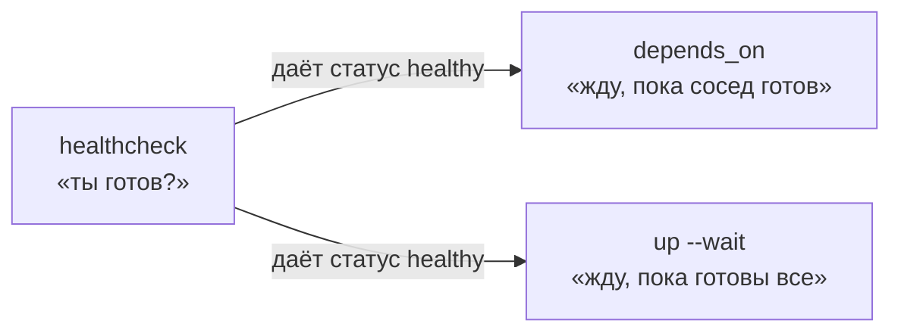
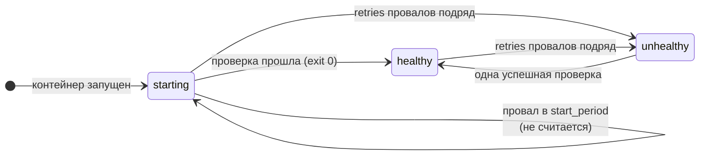
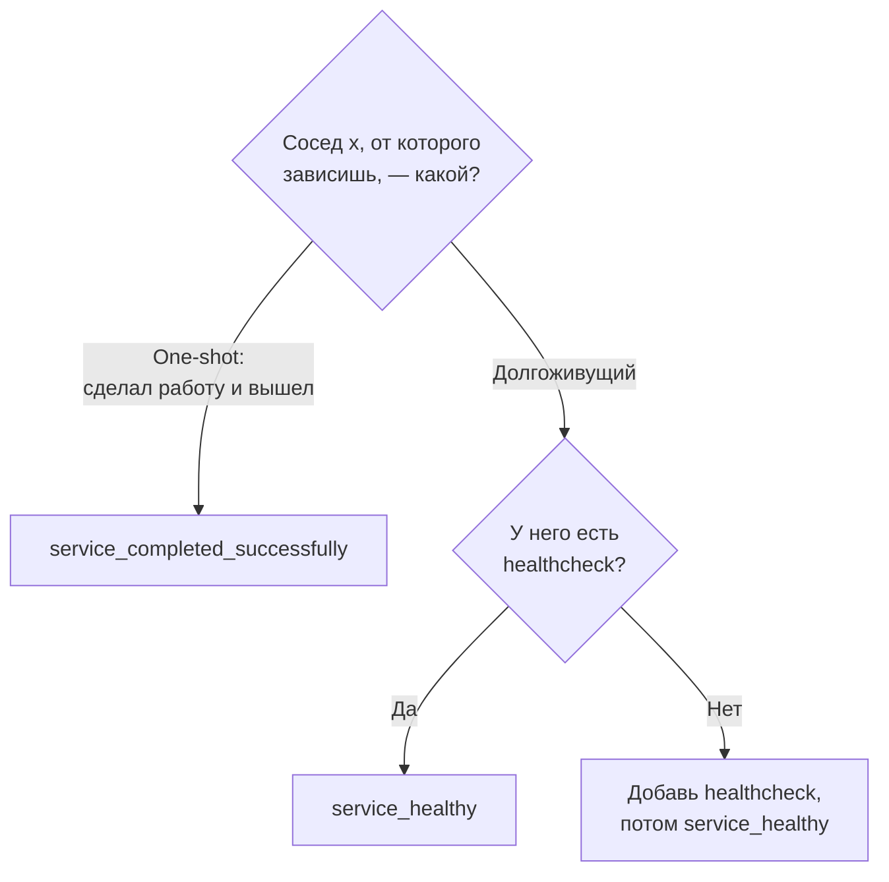
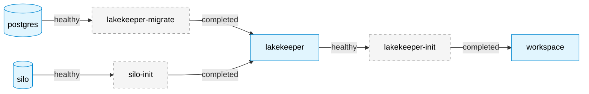
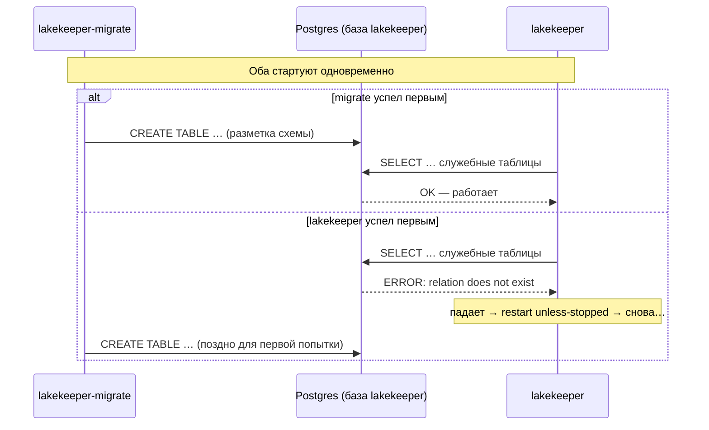
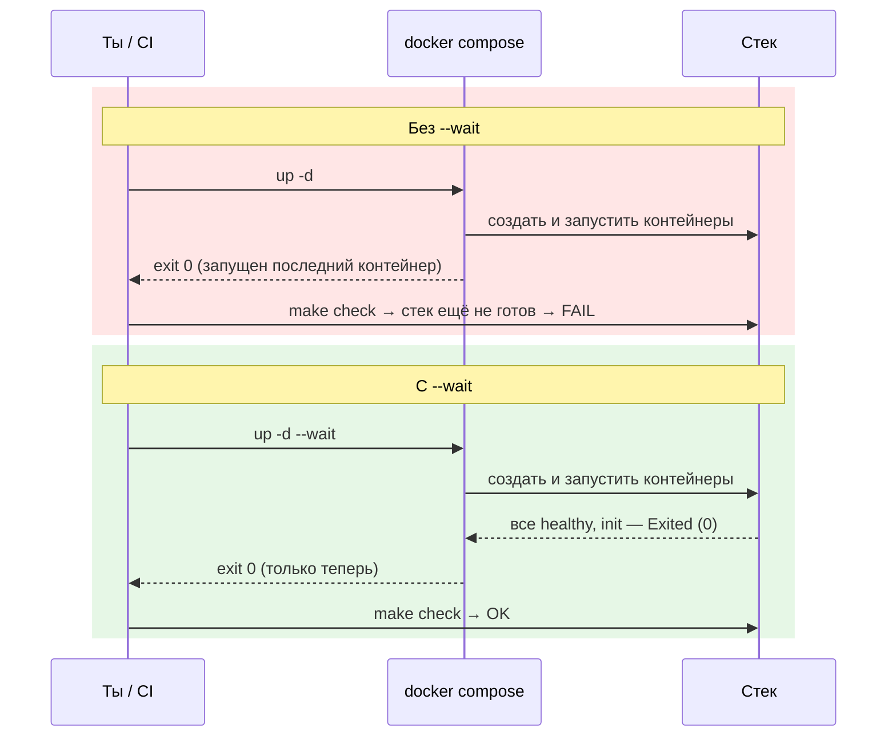
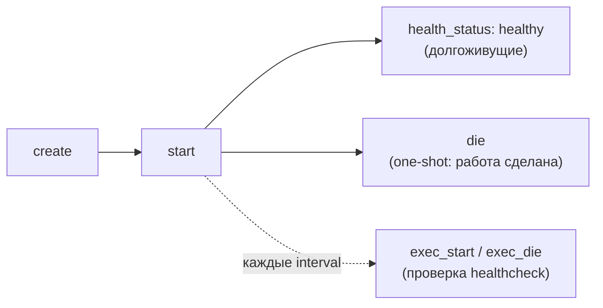
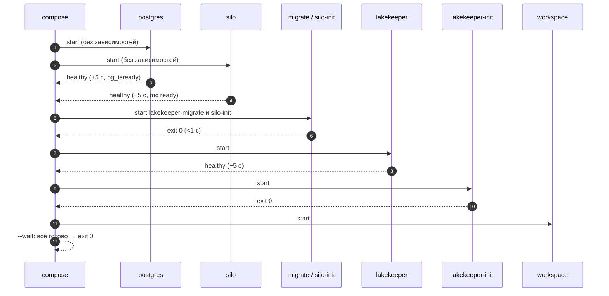

# 02 · Порядок запуска: как стек поднимается и не спотыкается

> [!info] Урок одной фразой
> «Контейнер запущен» не значит «сервис готов». Docker узнаёт о готовности через healthcheck,
> контейнеры ждут друг друга через `depends_on`, а ты и скрипты ждёте весь стек через `up --wait`.

> [!todo] Чек-лист: после урока ты сможешь
> - [ ] предсказать порядок и примерное время запуска любого compose-стека по его файлу;
> - [ ] выбрать правильное условие `depends_on` и объяснить, что будет с неправильным;
> - [ ] написать healthcheck, который проверяет готовность, а не наличие процесса;
> - [ ] понять по `docker events` и `.State.Health`, где застрял запуск (задача 2).

> [!tip] Визуализация темы
> - Интерактивная страница: [visuals/startup_order.html](../visuals/startup_order.html). Шкала времени `make up`: поменяй условие `depends_on` и посмотри, где появляется гонка,
>   ожидание или ошибка `up`.
> - Видео с озвучкой (3:49): [startup_order.mp4](../visuals/startup_order.mp4) — «запущен ≠ готов», healthcheck и ловушка с сокетом, `depends_on`, живая шкала `make up`, гонка и `up --wait`.

**Нужно для:** лаба [00.1](../labs/00.1_compose_anatomy/README.md), задача 2.
**Карта урока:** [startup-order.canvas](../maps/startup-order.canvas).

---

## Шаг 0. Азбука: три вопроса запуска

Когда стек поднимается, нужно ответить на три разных вопроса. Их легко смешать, поэтому для
каждого в Docker свой механизм:

| Вопрос | Механизм | Кто спрашивает |
|---|---|---|
| Как понять, что сервис **готов** работать? | **healthcheck** | Docker, регулярно |
| Кого контейнер должен **дождаться** перед стартом? | **`depends_on` + `condition`** | compose, при запуске каждого контейнера |
| Когда **человеку или скрипту** можно пользоваться стеком? | **`up --wait`** | ты, `make check`, CI |



Аналогия продолжает «офисное здание» из уроков [01](01_docker_and_compose_basics.md) и
[03](03_networking.md): утро, офис открывается.

| В Docker | В аналогии | Подробнее |
|---|---|---|
| Контейнер запущен | Сотрудник пришёл в здание | |
| Сервис готов | Сотрудник включил компьютер и может принимать звонки | |
| Healthcheck | Вахтёр каждые 5 секунд звонит в кабинет: «Работаете?» | [healthcheck](../../../glossary/healthcheck.md) |
| `depends_on: service_healthy` | «Не начинать, пока бухгалтерия не ответит вахтёру „да“» | [depends_on](../../../glossary/depends-on.md) |
| `depends_on: service_completed_successfully` | «Не начинать, пока подрядчик не сдаст работу с отметкой 0» | [код выхода](../../../glossary/exit-code.md) |
| `up --wait` | Директор открывает двери клиентам, только когда вахтёр доложил: все на местах | |
| Гонка (race condition) | Двое начали одновременно, и результат зависит от того, кто успел первым | [гонка](../../../glossary/race-condition.md) |

---

## Шаг 1. Почему «запущен» — ещё не «готов»

**Проблема.** Docker считает контейнер запущенным (`Up`), как только стартовал его главный
процесс. Но у серверной программы между «процесс стартовал» и «принимаю запросы» проходит время,
иногда заметное. Если в этот промежуток к ней обратится сосед, он получит ошибку.

**Как устроено у Postgres при самом первом запуске.** Скрипт запуска образа
(`docker-entrypoint.sh`) проходит несколько фаз:

1. `initdb` создаёт пустой кластер баз в папке данных (том `debd_postgres-data`).
2. Запускается **временный сервер**, который слушает только локальный unix-сокет, но **не
   TCP-порт 5432**: к нему нельзя подключиться из других контейнеров. Так скрипты инициализации
   выполняются без помех извне.
3. Выполняются скрипты из `/docker-entrypoint-initdb.d/`. У нас это `01-databases.sql`: он
   создаёт базы `lakekeeper` и `retail_oltp`.
4. Временный сервер останавливается.
5. Запускается **настоящий сервер**, который слушает TCP 5432. Только теперь Lakekeeper может
   подключиться по адресу `postgres:5432`.

Всё это время контейнер в статусе `Up`. При следующих запусках фаз 1–4 нет: папка данных уже
заполнена, и сервер сразу стартует настоящим.

```mermaid
gantt
    title Postgres при первом старте (замер со скриптом на 6 с)
    dateFormat s
    axisFormat +%Ss
    section Docker
    Контейнер Up                          :active, r, 0, 14s
    section Postgres
    initdb                                :crit, a, 0, 1s
    Временный сервер: только сокет, init-скрипты :crit, b, 1, 6s
    Настоящий сервер: TCP 5432            :done, c, 7, 7s
```

Lakekeeper устроен проще, но и у него есть пауза. Он стартует за доли секунды. Потом он
подключается к базе и проверяет, что её схема на месте.

**Что из этого следует.** Зависимым сервисам нужен способ узнать не «процесс есть», а «можно
обращаться». Этот способ — healthcheck.

---

## Шаг 2. Healthcheck: как Docker узнаёт, что сервис готов

**Как устроено.** Healthcheck — команда, которую Docker **периодически выполняет внутри
контейнера**, как если бы ты делал `docker exec`. Результат определяется по коду выхода команды:
`0` — проверка прошла, любой другой код — провал. По истории проверок Docker ведёт статус
здоровья контейнера.

```yaml
healthcheck:
  test: ["CMD", "/home/nonroot/lakekeeper", "healthcheck"]   # ①
  interval: 5s                                               # ②
  timeout: 10s                                               # ③
  retries: 10                                                # ④
  start_period: 5s                                           # ⑤
```

| Метка | Параметр | Что задаёт | По умолчанию |
|---|---|---|---|
| ① | `test` | команда проверки. `CMD` — запустить программу напрямую; `CMD-SHELL` — через `/bin/sh -c` | из образа |
| ② | `interval` | пауза между проверками; первая — через `interval` после старта | 30s |
| ③ | `timeout` | сколько ждать одну проверку; дольше — считается провалом | 30s |
| ④ | `retries` | сколько провалов подряд нужно для статуса `unhealthy` | 3 |
| ⑤ | `start_period` | льготное время на старт: провалы в этот период не засчитываются в `retries` | 0s |

**`CMD` или `CMD-SHELL`.** `CMD` запускает программу с аргументами как есть, без shell. Это
надёжно, но shell-возможности не работают: подстановка `${...}`, `||`, `&&`, пайпы. У postgres
в команде есть `${POSTGRES_USER}`, поэтому там `CMD-SHELL`. Подставит её shell внутри контейнера
из его переменных окружения.

**Как меняется статус.**



**Когда происходят проверки.** Возьмём `lakekeeper` (`interval: 5s`, `start_period: 5s`) и
допустим, что сервис готов сразу:

```text
время   0s ─────────── 5s ─────────── 10s ─────────── 15s ──▶
        │ start        │ проверка 1   │ проверка 2    │ проверка 3
        │              │ exit 0       │ exit 0        │ exit 0
статус  starting ──────┴▶ healthy ───────────────────────────────
        └─ start_period ┘
```

- Первая проверка — через `interval` после старта. Поэтому даже мгновенно готовый сервис
  становится `healthy` не раньше 5-й секунды. Именно это ты видел в задаче 2.
- `timeout` и `retries` не влияют на время, пока проверки проходят.
- `start_period` **не сдвигает** момент проверки, а только прощает ранние провалы. Он нужен
  сервисам с долгим стартом: без него они успели бы стать `unhealthy`, ещё не закончив запуск.

**Сколько ждать до `unhealthy`.** Если сервис не поднимается совсем, статус станет `unhealthy`
после `retries` провалов подряд, то есть примерно через `interval × retries` (плюс
`start_period`). У postgres это 5 с × 10 = ~50 секунд.

> [!example]- Попробуй сам: история проверок
> ```bash
> docker inspect debd-silo-1 --format '{{json .State.Health}}' | python3 -m json.tool | head -20
> ```
> **Увидишь:** `Status: healthy`, `FailingStreak: 0` (провалов подряд) и `Log` — последние
> **5** проверок: время начала и конца, `ExitCode: 0` и вывод команды (`The cluster 'local' is
> ready`). Docker хранит только пять последних записей.

---

## Шаг 3. Хорошая проверка проверяет готовность, а не процесс

**Проблема.** Healthcheck полезен ровно настолько, насколько точно он отвечает на вопрос
«можно ли к сервису обращаться **так, как обращаются соседи**?». Проверка, которая проходит
раньше, чем сервис реально готов, хуже отсутствия проверки: она создаёт ложную уверенность.

**Наши проверки:**

| Сервис | Команда | Что проверяет |
|---|---|---|
| postgres | `pg_isready -U ${POSTGRES_USER} -d postgres` | сервер принимает подключения |
| silo | `mc ready local` | кластер хранилища готов обслуживать запросы |
| lakekeeper | `lakekeeper healthcheck` | сервер отвечает и видит свою базу |

**Как работает `pg_isready`.** Он пытается начать подключение к серверу и по ответу сообщает
состояние кодом выхода:

| Код | Значение |
|---|---|
| 0 | сервер принимает подключения |
| 1 | сервер отвечает, но отклоняет подключения (например, ещё запускается) |
| 2 | ответа нет |
| 3 | попытка не состоялась (ошибка параметров) |

**Тонкость: куда именно подключается проверка.** Если у `pg_isready` не указан `-h` (хост),
он подключается через **локальный unix-сокет** внутри контейнера, а не по TCP. А теперь вспомни
шаг 1: во время первой инициализации временный сервер слушает **только сокет**. Значит, наша
проверка может ответить «готов», когда соседи по TCP подключиться ещё не могут.

Это не теория. Замер на одноразовом Postgres с init-скриптом на 6 секунд (опрос раз в секунду):

```text
t=1s  сокет=2  tcp=2     ← initdb, сервер ещё не запущен
t=2s  сокет=0  tcp=2     ← временный сервер: сокет «готов», TCP нет
…
t=6s  сокет=0  tcp=2
t=7s  сокет=0  tcp=0     ← настоящий сервер: готов по-настоящему
```

Пять секунд проверка через сокет врала. У нас `01-databases.sql` выполняется за доли секунды,
поэтому окно маленькое и проблема почти не проявляется. Но стоит init-скрипту стать тяжелее
(например, в модуле 04 при загрузке справочников в `retail_oltp`), и на чистой установке
`lakekeeper-migrate` получит отказ в подключении. Как сделать проверку честной — вопрос 5 в
«Проверь себя».

> [!important] Запомни
> Проверяй сервис **тем же путём, каким к нему обращаются соседи**. Соседи Postgres ходят по
> TCP — значит, и проверка должна идти по TCP.

---

## Шаг 4. `depends_on`: кого и чего ждать

**Проблема.** Healthcheck даёт статус, но сам по себе запуск не упорядочивает. Нужно сказать
compose: «запускай этот контейнер, только когда выполнено условие у такого-то соседа».

**Как устроено.** При `up` compose строит **граф зависимостей** из всех `depends_on` и для
каждого контейнера ждёт, пока выполнятся **его** условия:

```yaml
lakekeeper:
  depends_on:
    lakekeeper-migrate:
      condition: service_completed_successfully   # ждать выхода с кодом 0
    silo-init:
      condition: service_completed_successfully
```

| Условие | Ждёт | Для кого |
|---|---|---|
| `service_started` (по умолчанию, запись `depends_on: [x]`) | контейнер `x` запущен | почти бесполезно: «запущен» ≠ «готов» |
| `service_healthy` | healthcheck `x` стал `healthy` | долгоживущие сервисы с healthcheck |
| `service_completed_successfully` | `x` завершился с кодом 0 | one-shot контейнеры |



**Что будет, если условие не выполнится.** Если сосед завершился с ненулевым кодом или стал
`unhealthy`, compose **не запустит** зависимый контейнер, а `up` завершится ошибкой вида
`dependency failed to start: container … is unhealthy` или `… exited (1)`. Это правильное
поведение: лучше честно упасть на старте, чем поднять сервис, который будет сыпать ошибками.

> [!warning] Ловушка: one-shot через `service_healthy`
> Для one-shot пиши только `service_completed_successfully`. У one-shot контейнера нет
> healthcheck, и он не живёт постоянно. Статуса `healthy` у него не
> бывает, поэтому зависимый сервис с `service_healthy` не запустится никогда, а `up` упадёт с
> ошибкой.

### Граф нашего стека



Синие — долгоживущие (ждут их `healthy`), серые пунктирные — одноразовые (ждут их `completed`).
Читать граф так: стрелка «A → B» означает «B ждёт A».

### Нет общих «шагов» — есть только свои зависимости

Замер из задачи 2 (`make down && make up`):

```mermaid
gantt
    title make up — как стартует стек
    dateFormat s
    axisFormat +%Ss
    section postgres
    starting             :p1, 0, 5s
    healthy              :done, p2, 5, 8s
    section silo
    starting             :s1, 0, 5s
    healthy              :done, s2, 5, 8s
    section lakekeeper-migrate
    ждёт postgres        :m0, 0, 6s
    migrate              :crit, m1, 6, 1s
    section silo-init
    ждёт silo            :i0, 0, 6s
    mc mb                :crit, i1, 6, 1s
    section lakekeeper
    ждёт migrate + silo-init :l0, 0, 7s
    starting             :l1, 7, 5s
    healthy              :done, l2, 12, 1s
    section lakekeeper-init
    ждёт lakekeeper      :k0, 0, 12s
    init.sh              :crit, k1, 12, 1s
    section workspace
    ждёт lakekeeper-init :w0, 0, 13s
```



Compose не выполняет запуск «ступеньками». Каждый контейнер стартует в тот момент, когда
выполнены **его собственные** условия. `silo-init` и `lakekeeper-migrate` стартовали
одновременно лишь потому, что у `silo` и `postgres` одинаковый `interval: 5s`, и оба стали
`healthy` на 5-й секунде. Будь у `silo` `interval: 2s`, `silo-init` стартовал бы на ~3 секунды
раньше.

Самое долгое на схеме — ожидание healthcheck (по 5 с), а не сама работа: one-shot-задачи
выполняются меньше чем за секунду. Отсюда полезное следствие: **время запуска стека в основном
определяется `interval`**.

---

## Шаг 5. Что будет без зависимости: гонка

**Проблема.** Допустим, у `lakekeeper` убрали `depends_on: lakekeeper-migrate`. Тогда оба
контейнера стартуют одновременно, как только станет здоров Postgres. Результат зависит от того,
кто окажется быстрее. Ситуация, в которой исход определяется случайным порядком событий,
называется **[гонкой](../../../glossary/race-condition.md)** (race condition).

**Как это разворачивается.**



Во второй ветке Lakekeeper падает, Docker перезапускает его по `restart: unless-stopped`, и
через несколько попыток он, скорее всего, поднимется. Но `up --wait` к этому моменту может уже
вернуть ошибку, а в логах останутся пугающие трейсы.

> [!warning] Ловушка: проявляется только на чистой установке
> Проверяй запуск на чистой установке: `make clean` и `make up`. При повторных запусках база
> уже размечена, и Lakekeeper стартует успешно в любом порядке. Поэтому такие ошибки живут
> незамеченными месяцами и всплывают у нового человека в команде или в CI, где всё поднимается
> с нуля.

---

## Шаг 6. `up --wait`: чтобы ждал и тот, кто запустил

**Проблема.** `depends_on` упорядочивает контейнеры между собой, но не касается того, кто
запустил команду. `docker compose up -d` (`-d` — в фоне) ждёт только условия из `depends_on`.
Он возвращает управление, когда **запущен** последний контейнер. Сервис, которого никто не ждёт,
может в этот момент быть ещё в `starting` или упасть через секунду. `up` об этом не узнает и
вернёт 0. Скрипт `make up && make check` запустит проверку на неготовом стеке.

**Как устроено `--wait`.** С этим флагом `up` не возвращает управление, пока каждый сервис не
придёт в конечное состояние. Долгоживущий сервис должен стать `healthy`, а без healthcheck —
`running`. One-shot должен завершиться с кодом 0. Если что-то стало `unhealthy` или упало, `up`
возвращает **ненулевой код выхода**. Сколько ждать максимум, задаёт `--wait-timeout`.



**Что из этого следует.** В нашем Makefile `up` всегда с `--wait`, поэтому `make up && make
check` надёжен: проверка стартует только на готовом стеке, а сломанный стек остановит цепочку
на `make up`. Для CI (модуль 12) это обязательно.

---

## Шаг 7. Как наблюдать за запуском: `docker events`

**Как устроено.** Демон Docker публикует поток событий обо всём, что происходит с объектами:
создание, запуск, смена статуса здоровья, завершение. `docker events` подписывается на этот
поток и печатает события в реальном времени.

```bash
docker events --filter label=com.docker.compose.project=debd --filter type=container \
  --format '{{.Time}} {{.Actor.Attributes.name}} {{.Action}}'
```

- `--filter label=…` — только контейнеры нашего проекта (метка из урока 01, шаг 4);
- `--filter type=container` — без событий сетей и томов;
- `--format` — время, имя, действие.

| Событие | Смысл |
|---|---|
| `create` | контейнер создан |
| `start` | главный процесс запущен |
| `health_status: healthy` / `unhealthy` | изменился статус healthcheck |
| `die` | процесс завершился (код — в атрибуте `exitCode` события) |
| `exec_create` / `exec_start` / `exec_die` | команда внутри контейнера — в том числе **каждая** проверка healthcheck |



События `exec_*` подтверждают шаг 2: healthcheck — это обычный `exec` внутри контейнера.

---

## Сборка целиком: запуск стека с нуля



| Где сломано | Шаг на схеме | Симптом |
|---|---|---|
| Postgres не поднимается | 3 | через ~50 с `unhealthy`; `up` падает: `dependency failed to start` |
| Миграции упали | 6 | `lakekeeper-migrate exited (1)`; Lakekeeper не стартует |
| Нет `depends_on` на migrate | 7 | гонка: на чистой установке Lakekeeper перезапускается |
| Healthcheck проверяет не тот путь | 3 | `healthy` раньше срока, зависимый сервис получает отказ |
| `service_healthy` на one-shot | 10–11 | `up` падает, workspace не стартует |
| Нет `--wait` | 13 | `up` возвращает 0 до готовности, `make check` падает |

---

## Шпаргалка

| Хочу | Как |
|---|---|
| Ждать долгоживущего соседа | `depends_on: x: condition: service_healthy` + healthcheck у `x` |
| Ждать one-shot | `depends_on: x: condition: service_completed_successfully` |
| Использовать `${...}` или `\|\|` в проверке | `test: ["CMD-SHELL", "…"]` |
| Дать медленному сервису время на старт | `start_period: 30s` |
| Посмотреть историю проверок | `docker inspect <контейнер> --format '{{json .State.Health}}'` |
| Смотреть запуск в реальном времени | `docker events --filter label=com.docker.compose.project=debd` |
| Дождаться готового стека в скрипте | `up -d --wait` (у нас — `make up`) |
| Проверить запуск на чистой установке | `make clean && make up` |

## Типичные ошибки

| Симптом | Причина | Как проверить | Как чинить |
|---|---|---|---|
| На чистой машине сервис падает, при повторном `up` работает | гонка: нет `depends_on` с нужным условием | `make clean && make up`, логи сервиса | добавить `depends_on` с условием |
| `dependency failed to start: container … is unhealthy` | healthcheck не проходит | `docker inspect … .State.Health` → `Log` | чинить сервис или команду проверки |
| `up` падает на one-shot зависимости | `service_healthy` вместо `service_completed_successfully` | `depends_on` в файле | сменить условие |
| Проверка всегда проваливается, хотя сервис работает | нужен `CMD-SHELL`, или утилиты нет в образе | `Log` в `.State.Health` — вывод ошибки | `CMD-SHELL` / другая команда |
| Сосед `healthy`, а зависимый получает отказ | проверка идёт не тем путём, что соседи | повторить подключение соседа вручную | проверять тем же путём (TCP, тот же порт) |
| `make up` вернул 0, а `make check` упал | `up` без `--wait` | Makefile | добавить `--wait` |

---

## Проверь себя

Карточки для интервального повторения — в [flashcards.md](../flashcards.md).

> [!question] 1. У `silo` поменяли `interval: 5s` на `interval: 2s`. Кто стартует раньше, чем сейчас?
> > [!success]- Ответ
> > Только `silo-init`: он ждёт лишь `silo`, а тот станет `healthy` на ~2-й секунде.
> > `lakekeeper` всё равно ждёт ещё `lakekeeper-migrate`, а тот ждёт `postgres` (~5 с). Поэтому
> > дальше по цепочке ничего не ускорится.

> [!question] 2. `workspace` зависит от `lakekeeper-init` с условием `service_healthy`. Что произойдёт при `make up`?
> > [!success]- Ответ
> > `lakekeeper-init` — one-shot без healthcheck, статуса `healthy` у него не будет. Compose не
> > запустит `workspace`, `up --wait` завершится ошибкой. Нужно `service_completed_successfully`.

> [!question] 3. У сервиса `retries: 3`, `interval: 5s`, `start_period` не задан, сервис так и не поднялся. Через сколько он станет `unhealthy`?
> > [!success]- Ответ
> > Около 15 секунд: три провала подряд на 5-й, 10-й и 15-й секунде.

> [!question] 4. `make up` без `--wait` завершился с кодом 0. Значит ли это, что стек работает?
> > [!success]- Ответ
> > Нет. Без `--wait` код 0 означает только «условия `depends_on` выполнены, все контейнеры
> > запущены». Готовность сервисов, которых никто не ждёт, не проверялась.

> [!question] 5. Как изменить healthcheck Postgres, чтобы он не отвечал «готов» во время первой инициализации?
> > [!success]- Ответ
> > Подключаться по TCP, как соседи: `pg_isready -h 127.0.0.1 -U ${POSTGRES_USER} -d postgres`.
> > Временный сервер слушает только сокет (`listen_addresses=''`), поэтому по TCP проверка
> > пройдёт, лишь когда запустится настоящий сервер.

> [!question] 6. Почему время запуска нашего стека ~13 секунд, хотя вся полезная работа занимает меньше 3?
> > [!success]- Ответ
> > Цепочка содержит два последовательных ожидания healthcheck по `interval: 5s`: сначала
> > postgres/silo, потом lakekeeper. Первая проверка всегда происходит через `interval` после
> > старта, даже если сервис готов сразу.
