# 03 · Сети Docker: как контейнеры находят друг друга

> [!info] Урок одной фразой
> У каждого compose-проекта своя «офисная» сеть со своим справочником имён. Внутри сети
> контейнеры зовут друг друга по именам. С хоста в сеть попадают только через опубликованные
> порты. Чужой проект нашу сеть не видит, пока его явно туда не посадят.

> [!todo] Чек-лист: после урока ты сможешь
> - [ ] предсказать, сработает ли адрес (`localhost:9000`, `silo:9000`) с хоста и из контейнера, и
>   объяснить почему;
> - [ ] по коду выхода curl понять, на каком этапе оборвалось соединение;
> - [ ] безопасно опубликовать порт и объяснить, почему `ufw` его не закроет;
> - [ ] подключить отдельный compose-проект к нашей сети (задача 3.3).

**Нужно для:** лаба [00.1](../labs/00.1_compose_anatomy/README.md),
задачи 3.1, 3.3, 3.5. **Карта урока:** [networking.canvas](../maps/networking.canvas).

---

## Шаг 0. Азбука: что вообще делает сеть

Любая сеть решает одну задачу: **доставить кусок данных от одной программы к другой**. Данные
режутся на **пакеты** — небольшие порции по полтора килобайта. На каждом пакете, как на
конверте, написаны два адреса: откуда и куда. Адрес состоит из двух частей:

- **[IP-адрес](../../../glossary/ip-address.md)** — номер *устройства* (`172.28.0.3`). По нему сеть
  решает, в какую машину или контейнер везти пакет.
- **[Порт](../../../glossary/port.md)** — номер *программы* на этом устройстве (`9000`). В одном
  контейнере Silo работают две службы: S3 API на 9000 и веб-консоль на 9001. IP у них общий,
  а порт позволяет системе понять, какой из них отдать пакет.

Но люди и конфиги оперируют не номерами, а **именами** (`silo`, `pypi.org`). Поэтому до отправки
первого пакета программа спрашивает у службы **[DNS](../../../glossary/dns.md)**: «какой IP у этого
имени?». Итак, любое обращение вида `curl http://silo:9000/...` проходит три этапа:

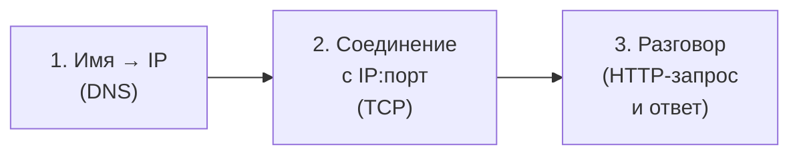

Этот конвейер пригодится в конце урока: у каждого этапа свой вид поломки и свой код ошибки.

Весь урок держится на одной аналогии. Прочитай таблицу: дальше каждая схема — это она.

| В сети | В аналогии «офисное здание» | Подробнее |
|---|---|---|
| Хост (твой Debian) | Здание | |
| Сеть Docker `debd_default` | Офис на этаже со своей внутренней АТС | [bridge-сеть](../../../glossary/bridge-network.md) |
| Контейнер | Кабинет со своим телефоном | [namespace](../../../glossary/network-namespace.md) |
| IP-адрес `172.28.0.3` | Номер телефона кабинета | [IP-адрес](../../../glossary/ip-address.md) |
| Порт `9000` | Добавочный: какая служба в кабинете ответит | [порт](../../../glossary/port.md) |
| DNS | Справочник офиса: имя → номер | [DNS](../../../glossary/dns.md) |
| `localhost` | «Позвонить самому себе» | [localhost](../../../glossary/localhost.md) |
| `ports:` в compose | Переадресация на ресепшене здания | [публикация порта](../../../glossary/port-publishing.md) |
| `ufw` | Охранник у главного входа | [файрвол](../../../glossary/firewall.md) |
| Подсеть `172.28.0.0/24` | Диапазон номеров, выделенный офису | [подсеть](../../../glossary/subnet.md) |
| Другой compose-проект | Другой офис со своей АТС и своим справочником | |

> [!tip] Как читать урок в Obsidian
> Наведи мышь на ссылку термина — всплывёт его карточка. Блоки «Попробуй сам» выполняй сразу:
> записывать результат не нужно, это чтобы увидеть механизм своими глазами.

---

## Шаг 1. Где живут контейнеры?

**Проблема.** Контейнеры должны разговаривать друг с другом: Lakekeeper — с Postgres,
workspace — с Silo. При этом контейнеры разных проектов не должны мешать друг другу: если у
двух проектов есть сервис `postgres`, их нельзя путать. Нужна отдельная сеть на каждый проект.

**Как устроено.** Docker строит сеть прямо внутри хоста, из виртуальных устройств ядра Linux:

1. На хосте создаётся **мост** (bridge) — виртуальный коммутатор, «коробка с розетками». Он
   виден в системе как интерфейс `br-aba673a07129`. Мосту выдаётся первый адрес подсети,
   `172.28.0.1`: он станет **шлюзом**, то есть дверью из сети наружу.
2. Для каждого контейнера создаётся **виртуальный кабель `veth`** с двумя концами. Один конец
   помещают внутрь контейнера, там он называется `eth0`. Другой втыкают в мост на хосте, там он
   виден как `vethb84be47` и подобные.
3. Контейнер получает на `eth0` свободный адрес из подсети: `172.28.0.2`, `.3` и так далее.
   Внутри контейнера прописывается маршрут «всё, что не в `172.28.0.*`, отправляй на шлюз
   `172.28.0.1`».

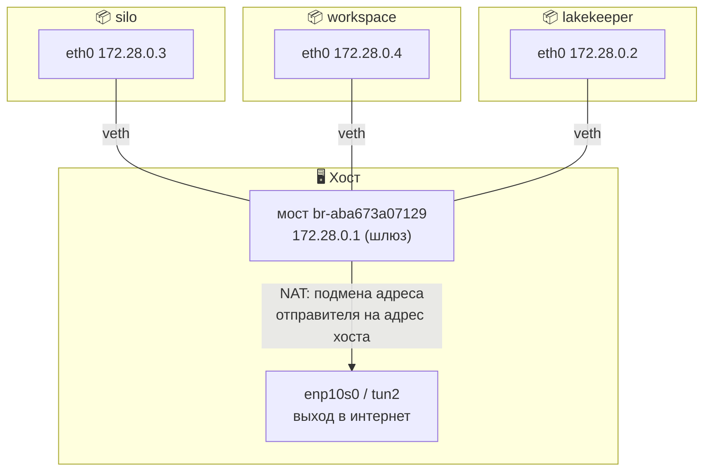

Когда workspace отправляет пакет в Silo, пакет по кабелю попадает в мост, а мост как обычный
коммутатор передаёт его в кабель Silo. Когда workspace ходит в интернет (`pip install`), пакет
уходит на шлюз, хост подменяет в нём адрес отправителя на свой и отправляет дальше. Это та же
техника **NAT**, что и в домашнем роутере. Поэтому контейнеры выходят в интернет, хотя их
адреса `172.28.x.x` снаружи никому не известны.

Compose делает всё это автоматически. Для каждого проекта он создаёт сеть
**`<проект>_default`** и подключает к ней все сервисы файла. Наш проект называется `debd`,
поэтому сеть — `debd_default`.

**Что из этого следует.**

- Все сервисы одного compose-файла сразу видят друг друга: они включены в один коммутатор.
- Контейнеры другого проекта включены в *другой* мост и напрямую до наших не дотянутся.
- IP-адрес выдаётся при подключении контейнера к сети. После пересоздания контейнер может
  получить другой адрес, поэтому **опираться на IP в конфигах нельзя**.
- На Linux хост и сам подключён к мосту (у него адрес `172.28.0.1`), поэтому может обратиться к
  контейнеру по IP напрямую. Но этот адрес нестабилен и работает только на этой машине. Для
  входа с хоста правильный путь — опубликованный порт (шаг 4).

> [!example]- Попробуй сам: кто сидит в нашем офисе и как они подключены
> ```bash
> docker network inspect debd_default \
>   --format '{{range .Containers}}{{.Name}} {{.IPv4Address}}{{"\n"}}{{end}}'
> ip -br link | grep -E 'br-|veth'
> curl -s -o /dev/null -w '%{http_code}\n' http://172.28.0.3:9000/minio/health/live
> ```
> **Увидишь:**
> - четыре долгоживущих контейнера с адресами `172.28.0.x/24`. One-shot контейнеров
>   (`silo-init` и др.) в списке нет: они завершились, и их кабели отключены;
> - мост `br-aba673a07129` и несколько `veth` — хостовые концы виртуальных кабелей;
> - `200`: хост действительно достаёт до Silo по IP, потому что сам подключён к мосту.

> [!warning] Ловушка: IP в конфиге
> Захардкоженный `http://172.28.0.3:9000` проработает до первого `make restart`, после которого
> адреса могут перетасоваться. Всегда пиши **имя сервиса**: `http://silo:9000`. Как имя
> превращается в адрес — следующий шаг.

---

## Шаг 2. Как контейнер находит соседа по имени?

**Проблема.** Адреса контейнеров меняются, а конфиги должны работать всегда. Нужен справочник,
который в любой момент знает актуальный адрес по постоянному имени.

**Как устроено.** В каждой сети, созданной пользователем или compose, у Docker есть встроенный
DNS-сервер. Работает он так:

1. При создании контейнера Docker записывает в его файл `/etc/resolv.conf` строку
   `nameserver 127.0.0.11`. Все программы в контейнере — curl, Python, Postgres-клиент — читают
   этот файл, чтобы узнать, у кого спрашивать адреса имён.
2. Адрес `127.0.0.11` принадлежит не отдельному контейнеру, а самому Docker: запросы на него
   перехватывает демон Docker.
3. Демон знает, в каких сетях состоит спрашивающий контейнер и кто ещё в этих сетях есть. Если
   имя принадлежит соседу, он сразу отвечает его текущим адресом. У каждого контейнера
   несколько имён: имя сервиса (`silo`), имя контейнера (`debd-silo-1`) и короткий ID.
4. Если имя не из сети (`pypi.org`), демон пересылает вопрос DNS-серверу хоста и возвращает
   его ответ.

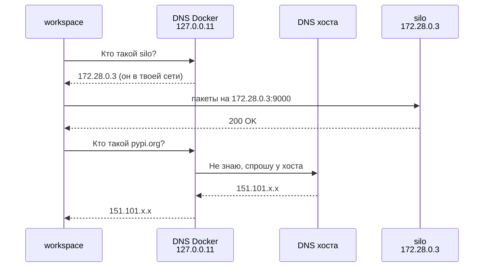

**Что из этого следует.**

- DNS отвечает про соседей **только по сетям спрашивающего**. Именно это делает сети
  изолированными по именам: контейнер другого проекта спросит про `lakekeeper` и получит «не
  знаю», хотя Lakekeeper запущен на той же машине.
- Справочник всегда актуален: пересоздали Silo, он получил новый IP, и следующий запрос имени
  `silo` вернёт уже новый адрес.
- **Хост этим DNS не пользуется.** У хоста свой `/etc/resolv.conf`, в нём свой резолвер
  `127.0.0.53`, который про контейнеры ничего не знает. Поэтому имя `silo` на хосте не работает.

> [!example]- Попробуй сам: справочник изнутри и снаружи
> В `make shell`:
> ```bash
> cat /etc/resolv.conf        # nameserver 127.0.0.11 и комментарий ExtServers: host(127.0.0.53)
> getent hosts silo postgres  # имя → адрес
> ```
> **Увидишь:** `172.28.0.3  silo`, `172.28.0.5  postgres`. Комментарий `ExtServers` в
> `resolv.conf` — это и есть пункт 4: к кому Docker пересылает чужие имена.
>
> Теперь на хосте: `getent hosts silo; echo $?`. Выведется пусто, а код будет `2`: имя не
> найдено.
>
> Все имена контейнера: `docker inspect debd-silo-1 --format '{{json .NetworkSettings.Networks.debd_default.DNSNames}}'`
> → `["debd-silo-1","silo","e6c9be1c2be2"]`.

---

## Шаг 3. Что такое localhost для контейнера?

**Проблема.** Привычка с обычного компьютера: «сервис запущен тут же — значит, он на
`localhost`». В контейнерах эта привычка ломается. Чтобы понять почему, нужно знать, как
контейнер изолирован.

**Как устроено.** Изоляцию обеспечивает механизм ядра Linux — **[сетевой
namespace](../../../glossary/network-namespace.md)**. Ядро даёт каждому контейнеру собственный
комплект сетевых объектов:

- свои интерфейсы: `eth0` (конец виртуального кабеля) и `lo` (loopback, «петля»);
- свою таблицу маршрутов;
- свою таблицу занятых портов: кто какой порт слушает.

Адрес `127.0.0.1` (`localhost`) всегда принадлежит интерфейсу `lo` **того namespace, в котором
выполняется команда**. Пакет, отправленный на `lo`, никуда не уходит: ядро сразу возвращает его
в тот же namespace. Посмотрим, что происходит, когда в контейнере workspace выполняют
`curl localhost:9000`:

1. `localhost` → `127.0.0.1`: это «я сам».
2. Ядро ищет в таблице портов **namespace workspace**, кто слушает порт 9000. Silo слушает 9000
   в *своём* namespace, в соседнем «кабинете», а в workspace на 9000 никого нет.
3. Раз слушателя нет, ядро немедленно отвечает отказом: TCP-пакет RST. curl сообщает
   *connection refused* и завершается с кодом 7.

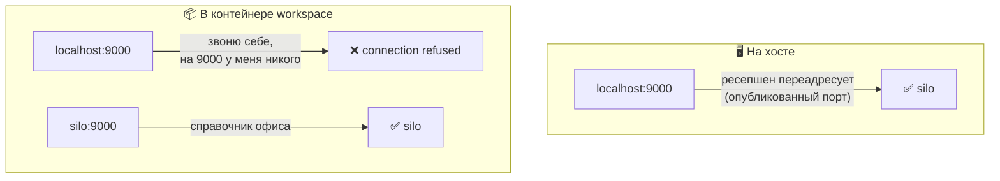

**Что из этого следует.**

- Внутри контейнера к соседу обращаются **только по имени сервиса**.
- Два контейнера могут слушать один и тот же порт: у каждого своя таблица портов. Поэтому
  Postgres в двух разных проектах может слушать 5432 одновременно.
- Отказ приходит **мгновенно**: это признак того, что адрес живой, а порт на нём пустой. Если
  бы пакеты уходили в пустоту, curl ждал бы до таймаута (шаг 7).

> [!example]- Попробуй сам: «позвонить себе» из контейнера
> В `make shell`:
> ```bash
> curl -s localhost:9000/minio/health/live; echo "exit=$?"
> ```
> **Увидишь:** `exit=7` сразу, без ожидания.

**Все четыре варианта сразу** (это и есть задача 3.1):

| Откуда | `localhost:9000` | `silo:9000` |
|---|---|---|
| Хост | ✅ опубликованный порт (шаг 4) | ❌ хост не спрашивает DNS Docker (шаг 2) |
| Контейнер в `debd_default` | ❌ это сам контейнер (этот шаг) | ✅ DNS Docker |

---

## Шаг 4. Как попасть в контейнер с хоста?

**Проблема.** Браузер, DBeaver и curl на хосте работают вне сети Docker. Имён контейнеров они
не знают, а IP контейнеров нестабильны. Нужен постоянный адрес на самом хосте, который
переправляет обращения в контейнер. Это и есть **[публикация
порта](../../../glossary/port-publishing.md)**.

```yaml
ports:
  - "127.0.0.1:9000:9000"
#    ①          ②    ③
```

| Метка | Часть | Смысл |
|---|---|---|
| ① | `127.0.0.1` | на каком адресе **хоста** принимать подключения |
| ② | `9000` | порт хоста |
| ③ | `9000` | порт **контейнера**, куда переправлять |

**Как устроено.** Docker устанавливает переадресацию двумя способами одновременно:

1. **Процесс `docker-proxy`.** Для каждой публикации Docker запускает маленькую программу,
   которая слушает ①:② на хосте. Приняв подключение, она сама открывает соединение с
   контейнером на `172.28.0.3:9000` и перекачивает данные в обе стороны. Именно поэтому
   `ss -ltn` показывает, что порт `127.0.0.1:9000` на хосте «слушается»: его держит
   `docker-proxy`.
2. **Правило iptables DNAT** (Destination NAT — подмена адреса назначения). Для пакетов,
   приходящих из сети, ядро прямо на входе переписывает адрес назначения с `<хост>:9000` на
   `172.28.0.3:9000`. Такой пакет доходит до контейнера, минуя `docker-proxy`. Этот путь важен в
   шаге 5.

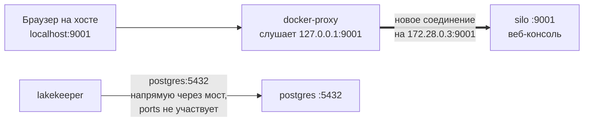

**Что из этого следует.**

1. **`ports` нужен только для входа с хоста.** Контейнеры одной сети ходят друг к другу по
   мосту напрямую: `docker-proxy` и DNAT в этом не участвуют.
2. **Внутри стека важен только порт контейнера ③.** Если поменять публикацию Postgres на
   `"127.0.0.1:15432:5432"`, изменится лишь то, где `docker-proxy` слушает на хосте. Lakekeeper
   этого не заметит: он подключается к `postgres:5432`, то есть к порту, который Postgres
   слушает в своём namespace.
3. **② и ③ не обязаны совпадать.** Хостовый 8080 занят open-webui, поэтому новый сервис,
   слушающий 8080 в контейнере, публикуют как `"127.0.0.1:8090:8080"`. Внутри контейнера он
   так и работает на 8080, а с хоста к нему заходят на 8090.
4. Порт хоста — ресурс общий на всю машину. Два контейнера не могут опубликовать один и тот же
   ②: второй упадёт с ошибкой `port is already allocated`.

> [!example]- Попробуй сам: какие двери открыты на хосте и кто их держит
> ```bash
> docker port debd-silo-1                       # 9000/tcp -> 127.0.0.1:9000 …
> ss -ltn | grep -E ':(5432|9000|9001|8181|8888)\b'
> ps -eo args | grep docker-proxy | grep 8181   # … -host-ip 127.0.0.1 -host-port 8181
>                                               #     -container-ip 172.28.0.2 -container-port 8181
> ```
> **Увидишь:** все наши порты слушают только `127.0.0.1`, а у `docker-proxy` в аргументах
> прямо написано, куда он переправляет подключения.

---

## Шаг 5. Почему `127.0.0.1` в ports так важен (и почему `ufw` не спасает)

**Проблема.** У хоста несколько **[интерфейсов](../../../glossary/network-interface.md)**, то есть
несколько «входов» с разными адресами: кабель `enp10s0` (`192.168.88.200`), VPN `tun2`,
loopback `lo` (`127.0.0.1`). Когда программа начинает слушать порт, она указывает, на каком
адресе: на одном конкретном или на всех сразу (`0.0.0.0`). От этого зависит, кто сможет к ней
подключиться.

**Как устроено.** Часть ① в `ports` — это и есть адрес, на котором слушать:

- `"127.0.0.1:5432:5432"` — слушать только на loopback. Пакеты на `127.0.0.1` могут
  отправлять лишь программы на этой же машине: снаружи адрес `127.0.0.1` означает «сам
  отправитель», поэтому дойти до нашего хоста такой пакет не может.
- `"5432:5432"` (без IP) — то же, что `0.0.0.0:5432:5432`: слушать на **всех** интерфейсах.
  К Postgres сможет подключиться любой, кто видит хост: ноутбук в той же Wi-Fi-сети, соседи по
  LAN, участники VPN-сети.

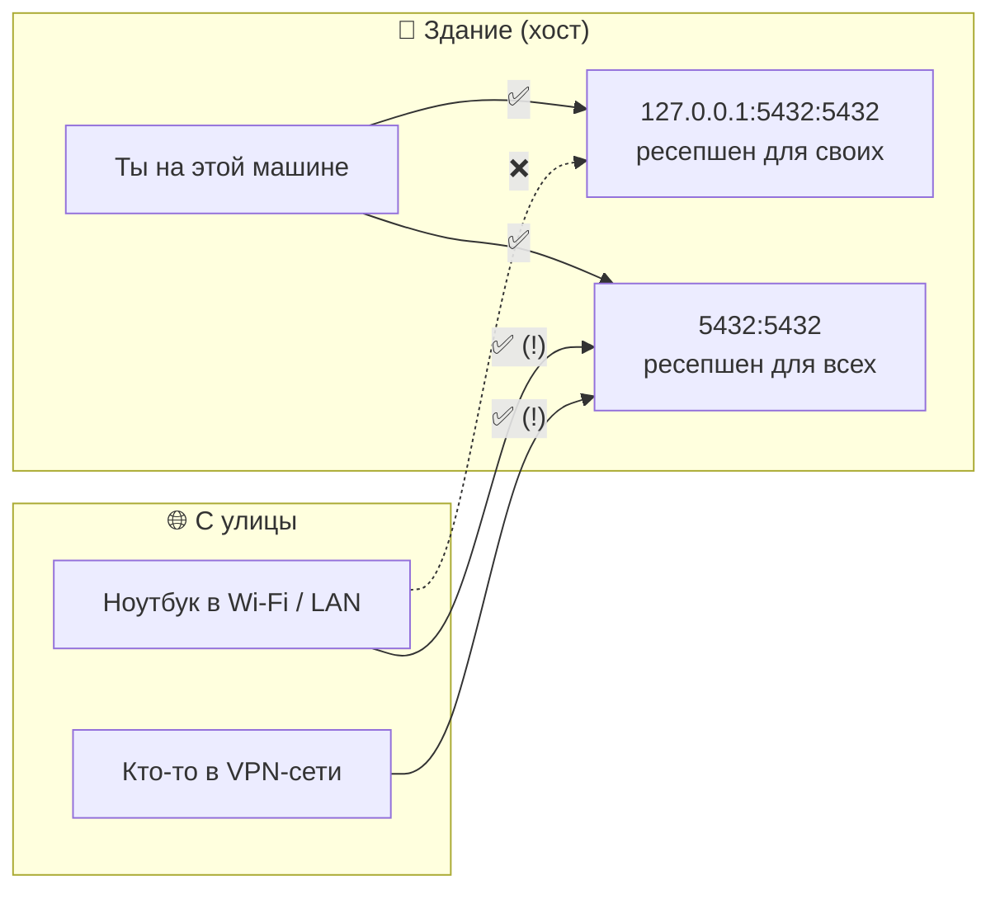

«Но у меня включён `ufw`, он закрывает все входящие!» — не закрывает, и вот почему. Каждый
входящий пакет ядро прогоняет через **[цепочки iptables](../../../glossary/firewall.md)** в строгом
порядке:

1. **`PREROUTING`** — первая остановка, до всяких решений. Здесь Docker поставил правило DNAT:
   пакет на `:5432` получает новый адрес назначения `172.28.0.5:5432`.
2. **Маршрутизация.** Ядро смотрит, кому адресован пакет. Адресат теперь контейнер, а не сам
   хост, значит пакет нужно *переслать* дальше.
3. Пакеты для самого хоста идут в цепочку **`INPUT`**, пересылаемые — в **`FORWARD`**. `ufw`
   держит свои запреты в `INPUT`. Наш пакет идёт через `FORWARD`, где стоят разрешающие правила
   Docker, и до запретов `ufw` не доходит.

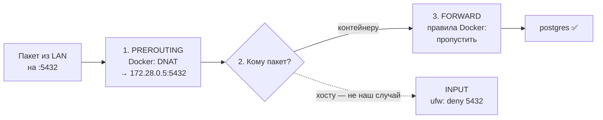

**Что из этого следует.** `ufw` защищает программы, которые работают на самом хосте. Порты,
опубликованные Docker, он не защищает: адрес пакета переписывается раньше, чем пакет доходит
до правил `ufw`. Единственная надёжная защита на уровне compose — не открывать порт наружу
вовсе, то есть писать `127.0.0.1:`.

> [!danger] Классическая утечка
> База с паролем `change-me`, опубликованная как `5432:5432`, видна всей сети, хотя `ufw`
> «закрыт». Поэтому в нашем проекте правило: **порты — только на `127.0.0.1`**.

---

## Шаг 6. Откуда сеть берёт адреса и при чём тут VPN

**Проблема.** Новой сети нужна [подсеть](../../../glossary/subnet.md) — диапазон адресов, из которого
раздаются IP контейнерам. Подсеть должна быть **свободной**. Если она совпадёт с
диапазоном, который уже используется на хосте (домашняя сеть, VPN), хост перестанет понимать,
куда отправлять пакеты для этих адресов: в мост Docker или в кабель.

**Как устроено: таблица маршрутов.** Куда отправить пакет, хост решает по **[таблице
маршрутов](../../../glossary/route.md)**: это список правил «адреса такие-то → через такой-то
интерфейс». Если подходят несколько правил, побеждает **самое точное**, то есть с большим
числом после `/`. Вот фрагмент таблицы этого хоста (`ip route`):

```text
default     via 192.168.88.1 dev enp10s0   ← /0: все адреса — обычный выход через роутер
0.0.0.0/1   via 10.33.0.2 dev tun2         ← /1: адреса 0.x … 127.x — в VPN
128.0.0.0/1 via 10.33.0.2 dev tun2         ← /1: адреса 128.x … 255.x — в VPN
172.28.0.0/24 dev br-aba673a07129          ← /24: наша сеть Docker — в мост
```

Здесь виден приём, которым VPN «забирает» весь трафик. Два маршрута `/1` вместе покрывают все
адреса, и каждый из них точнее, чем `default` (`/0`). Поэтому весь трафик идёт в VPN, хотя
обычный маршрут не удалён: при отключении VPN всё вернётся как было.

**Почему Docker отказывается создавать сеть.** Когда подсеть не задана, Docker выбирает её сам
из своего запаса (`172.17.x.x`–`172.31.x.x` и другие) и отбрасывает всё, что пересекается с
существующими маршрутами. Но маршрут `0.0.0.0/1` покрывает весь запас целиком:

```text
Все адреса:  0.0.0.0 ──────────────── 128.0.0.0 ──────────────── 255.255.255.255
VPN:         [======== 0.0.0.0/1 ========][======= 128.0.0.0/1 =======]
Запас Docker:          172.17–31.x.x  ← целиком внутри 0.0.0.0/1: «занято»
```

Свободного кандидата нет, и создание **любой** новой сети без явной подсети завершается
ошибкой:

```text
could not find an available, non-overlapping IPv4 address pool among the defaults
to assign to the network
```

**Решение в [`core.yaml`](../../../infra/docker/core.yaml)** — задать подсеть вручную. Тогда
Docker не выбирает из запаса и проверку не выполняет:

```yaml
networks:
  default:                    # сеть, куда compose подключает все сервисы файла
    ipam:                     # IP Address Management — настройки адресов
      config:
        - subnet: 172.28.0.0/24   # 256 адресов 172.28.0.0 – 172.28.0.255
```

Почему после этого всё работает, хотя VPN по-прежнему «забирает» все адреса? Docker добавляет
маршрут `172.28.0.0/24 → мост`. Он точнее, чем VPN-ный `/1`, поэтому пакеты для контейнеров
уходят в мост, а весь остальной трафик — в VPN. Правило «побеждает самый точный» работает на
нас.

**Что из этого следует.**

- На этой машине **каждая** новая сеть требует явной подсети или должна быть уже
  существующей сетью. Это касается и сети нового compose-проекта (задача 3.3).
- Явная подсеть не должна совпадать с реальными сетями, куда ходит хост. Если бы офисная сеть
  была `172.28.0.0/24`, маршрут в мост перехватил бы её адреса, и офисные серверы стали бы
  недоступны.

> [!example]- Попробуй сам: увидеть маршруты и отказ Docker
> На хосте:
> ```bash
> ip route | grep -E '/1 |172.28'
> docker network create zz_probe; docker network rm zz_probe 2>/dev/null
> ```
> **Увидишь:** два маршрута `/1` через `tun2` и наш `/24` через мост. Затем ту самую ошибку
> `could not find an available ... address pool`: сеть не создана, удалять нечего.

---

## Шаг 7. Как читать результат curl

**Проблема.** Запрос не прошёл. Прежде чем чинить, нужно понять, **на каком этапе** он
оборвался. Этапы мы видели в шаге 0: имя → соединение → разговор. curl точно сообщает этап, но
разными числами, которые легко перепутать.

**Как устроено: два разных числа.**

- **HTTP-код** (`200`, `404`, `500`) — ответ *сервера* на третьем этапе, в разговоре. Его
  печатает `-w '%{http_code}'`. Если разговор не состоялся, потому что сломался первый или
  второй этап, сервер ничего не ответил, и curl печатает `000`.
- **Код выхода** (`echo $?` сразу после команды) — итог работы *самого curl*. `0` — всё
  прошло. Другие числа означают, на каком этапе curl сдался.

Что происходит на каждом этапе и как выглядит сбой:

| Этап | Что делает curl | Как ломается | Код выхода |
|---|---|---|---|
| 1. Имя → IP | спрашивает DNS | справочник не знает имя | **6** Could not resolve host |
| 2. Соединение | шлёт TCP-пакет SYN на IP:порт и ждёт ответа | ядро адресата отвечает RST: «на порту никого» — мгновенно | **7** Failed to connect |
| 2. Соединение | то же | ответа нет вообще: пакеты молча отбрасывает файрвол или они уходят не туда — curl ждёт до таймаута | **28** Timeout |
| 3. Разговор | шлёт HTTP-запрос, читает ответ | сервер ответил ошибкой (404, 500) | **0** (!) — или **22** с флагом `-f` |

Последняя строка важна. Для curl ответ «404» — это успешно завершённый разговор: сервер
ответил, и curl добросовестно этот ответ получил. Поэтому без `-f` код выхода будет 0. Флаг `-f`
(fail) просит считать HTTP-ошибку провалом и вернуть 22. В проверках и скриптах `-f` нужен
почти всегда.

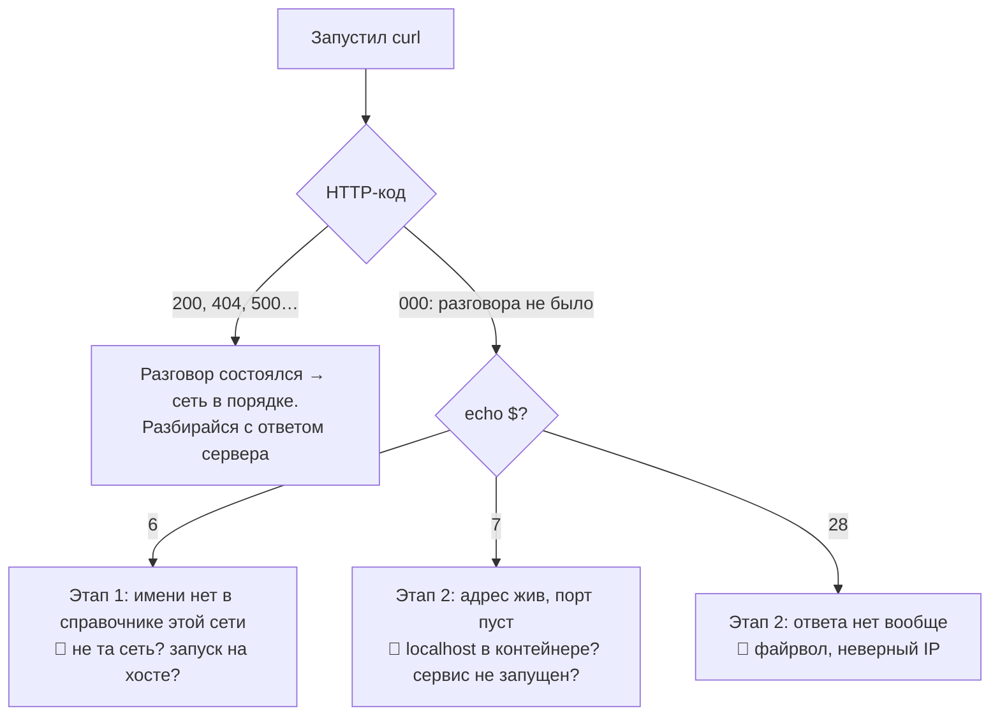

Флаги, которые встречаются в курсе:

| Флаг | Смысл |
|---|---|
| `-s` | тихо: без прогресс-бара |
| `-f` | HTTP-ошибка → код выхода 22 |
| `-o /dev/null` | тело ответа выбросить |
| `-w '%{http_code}\n'` | напечатать HTTP-код |

> [!example]- Попробуй сам: сломать каждый этап
> В `make shell`:
> ```bash
> curl -s nosuchhost:9000; echo "exit=$?"                        # 6 — этап 1
> curl -s localhost:9000;  echo "exit=$?"                        # 7 — этап 2, мгновенно
> curl -s silo:9000/nope -o /dev/null; echo "exit=$?"            # 0 — сервер ответил ошибкой
> curl -sf silo:9000/nope -o /dev/null; echo "exit=$?"           # 22 — то же, но с -f
> ```

---

## Шаг 8. Два проекта — два офиса

Это ядро задачи 3.3.

### 8.1. Имя проекта и как compose узнаёт «свои» объекты

**Проблема.** На одной машине живут контейнеры, сети и тома многих проектов. По команде `down`
compose должен удалить только своё и не тронуть чужое.

**Как устроено.** У каждого проекта есть **имя**. Compose делает с ним две вещи:

1. Ставит имя **префиксом** к названиям объектов: контейнер `debd-silo-1`, сеть
   `debd_default`, том `debd_postgres-data`.
2. Вешает на каждый объект **метку** `com.docker.compose.project=debd`. По этой метке он потом
   находит свои объекты для `ps`, `down` и `logs`. Этой же меткой мы фильтровали
   `docker events` в задаче 2.

Откуда берётся имя (сверху — главнее):

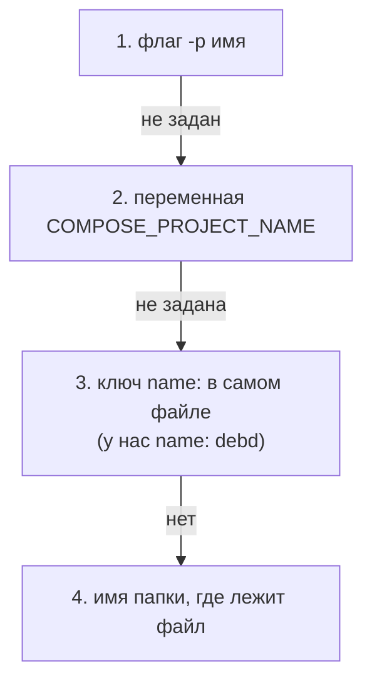

Надёжнее всего `name:` в файле: имя хранится в самом файле и не зависит от того, из какой
папки и с какими флагами его запускают.

> [!warning] Ловушка: одно имя на два файла
> Compose определяет «свои» объекты по метке с именем проекта. Если два разных файла объявят
> одно имя, compose сочтёт их одним проектом: `down` одного удалит контейнеры другого, а `up`
> предупредит об «orphan containers» — контейнерах проекта, которых нет в текущем файле.

### 8.2. По умолчанию офисы изолированы

Новый проект получает **свой** мост и свою сеть `<новый_проект>_default`. Встроенный DNS
отвечает только про соседей по сетям спрашивающего (шаг 2). Поэтому контейнер нового проекта
спросит «кто такой `lakekeeper`?» и получит «не знаю»: Lakekeeper в другой сети.

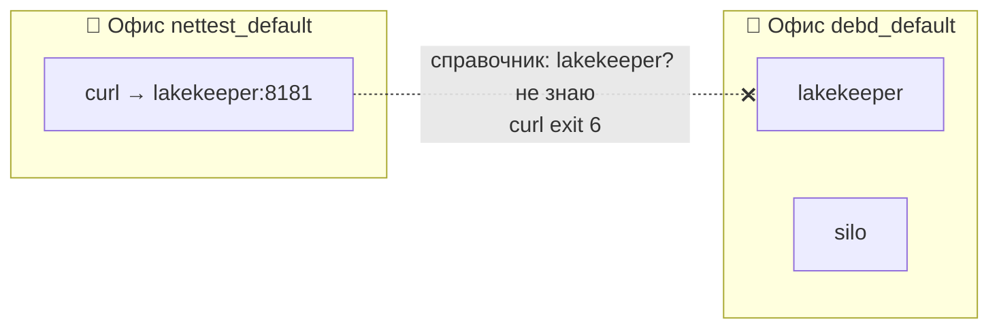

Изоляция — полезное поведение по умолчанию: проекты не видят друг друга, пока их явно не
свяжут.

### 8.3. Что случится при `up` нового проекта

Все ветки проверены на этой машине:

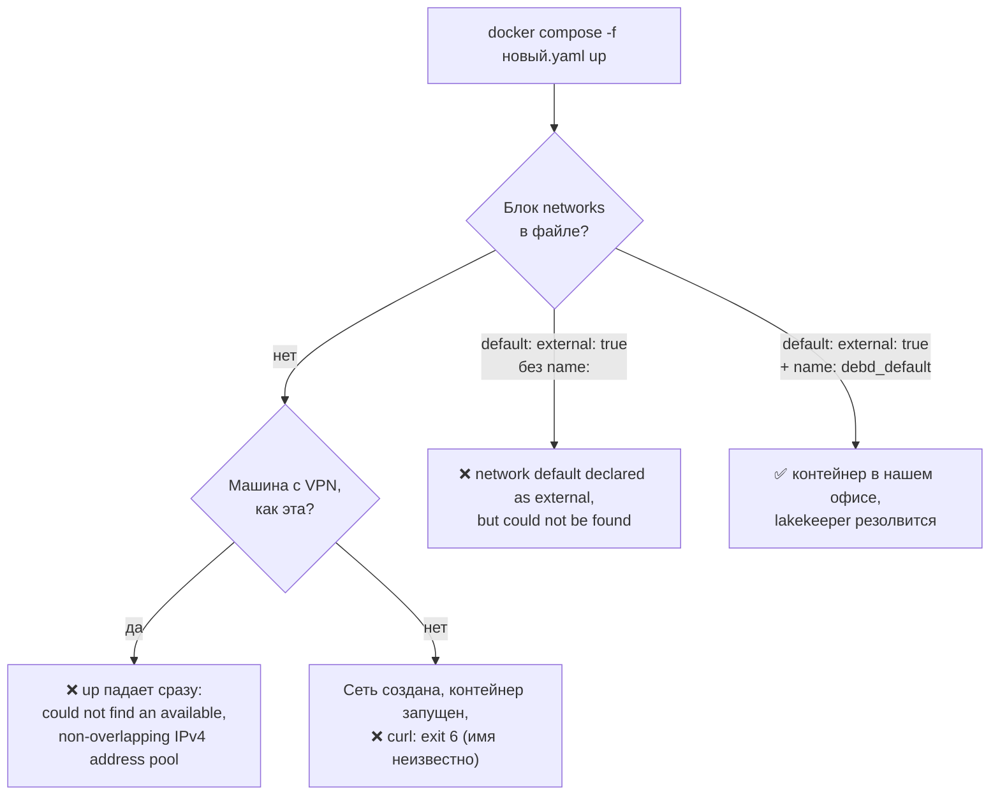

Почему ветки такие:

- **Без блока `networks`** compose пытается *создать* сеть `<проект>_default`. На этой машине
  это упирается в VPN (шаг 6): упадёт уже `up`, и до curl дело не дойдёт. На машине без VPN
  сеть создастся, но это будет отдельный офис, и DNS не узнает имя.
- **`external: true` без `name:`** говорит: «не создавай сеть, возьми готовую». Какую? Для
  внешних сетей compose **не добавляет префикс проекта**, ведь сеть чужая, и её имя не зависит
  от нашего проекта. Если `name:` не задан, берётся имя ключа — `default`. Сети с именем
  `default` в Docker нет, отсюда ошибка.
- **`external: true` + `name: debd_default`** — «возьми готовую сеть с этим точным именем».

### 8.4. Посадить сотрудника в наш офис: `external` + `name`

```yaml
networks:
  default:                 # ① сеть, куда compose сажает все сервисы ЭТОГО файла
    name: debd_default     # ② точное имя сети в Docker
    external: true         # ③ сеть чужая: не создавать и не удалять
```

| Ключ | Что делает | Что будет без него |
|---|---|---|
| ① `default` | Переопределяет сеть по умолчанию: все сервисы файла автоматически попадут в неё | Пришлось бы описывать сеть и подключать её к каждому сервису вручную |
| ② `name:` | Задаёт точное имя сети в Docker | Compose искал бы сеть `default` и упал |
| ③ `external: true` | Compose не создаёт сеть, а подключается к существующей. Нет её — `up` падает. `down` её не удаляет | Compose попытался бы создать новую сеть и упёрся бы в VPN |

Пункт ③ защищает хозяина сети. Сеть `debd_default` принадлежит проекту `debd`. Если бы гость
при своём `down` удалил её, он сломал бы весь наш стек. С `external: true` гость только
подключается и отключается.

На этой машине есть и бонус: новая сеть не создаётся, поэтому проблема с VPN исчезает сама.

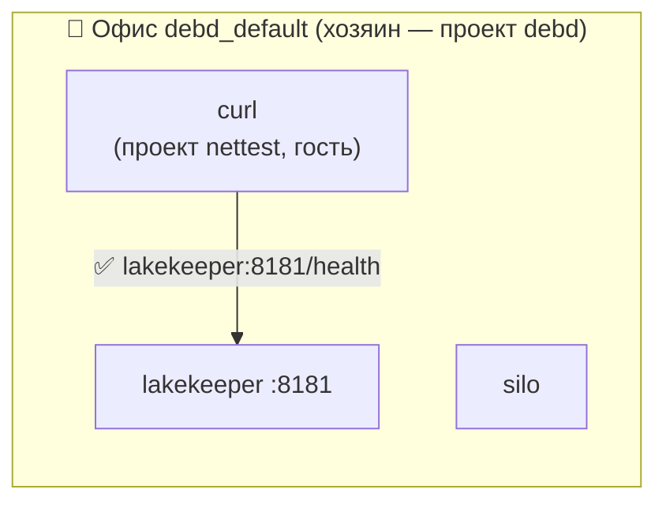

**`external` против `include`** — оба приёма дают общую сеть, но устроены по-разному.
`include` (так подключены слои в нашем `compose.yaml`) склеивает несколько файлов в **один**
проект: у всех сервисов одно имя проекта, одна сеть, один `down`. `external` оставляет проекты
**независимыми**: у каждого своё имя, свой жизненный цикл, а общая только сеть.

| | `include` | `external`-сеть |
|---|---|---|
| Сколько проектов | один (файлы склеиваются) | несколько независимых |
| Общая сеть | автоматически | по явной настройке |
| `down` | удаляет всё вместе | каждый проект отдельно; чужую сеть не трогает |
| Когда применять | части одной системы (наши слои) | временные или сторонние проекты рядом с нашим |

---

## Шаг 9. Одноразовый сервис на curl и честный код выхода

### 9.1. Что запускает контейнер: ENTRYPOINT и CMD

**Как устроено.** Команда, которую контейнер выполняет при старте, складывается из двух частей
образа:

- **ENTRYPOINT** — «программа-запускатель», неизменная часть;
- **CMD** — аргументы по умолчанию, которые передаются запускателю.

Ключ `command:` в compose заменяет CMD, а `entrypoint:` заменяет ENTRYPOINT. У образа
`curlimages/curl:8.22.0` ENTRYPOINT = `/entrypoint.sh`, CMD = `curl`. Сам скрипт делает одно:
если первый аргумент начинается с `-` или не является командой, он дописывает `curl` в начало.
Поэтому:

| В compose | Что выполнится |
|---|---|
| ничего | `/entrypoint.sh curl` → `curl` |
| `command: ["-sf", "http://x:1/y"]` | `/entrypoint.sh -sf http://x:1/y` → `curl -sf http://x:1/y` |
| `entrypoint: /bin/sh` + `command: ["/init/init.sh"]` | `/bin/sh /init/init.sh` — так устроен наш `lakekeeper-init` |

Команду лучше писать в **форме списка** (`["-sf", "http://..."]`). Каждый элемент уходит
программе отдельным аргументом как есть, и проблем с пробелами и кавычками не возникает.

```yaml
services:
  probe:
    image: curlimages/curl:8.22.0
    command: ["-sf", "http://адрес:порт/путь"]   # = curl -sf http://адрес:порт/путь
    restart: "no"                                # сделал дело — выходит, не перезапускать
```

### 9.2. Почему обычный `up` врёт о результате

```bash
docker compose -f путь/к/файлу.yaml up --exit-code-from probe
echo $?                                    # код выхода up
docker compose -f путь/к/файлу.yaml down   # уборка: контейнер и сеть проекта
```

**Проблема.** Задача `up` — поднять сервисы. С точки зрения compose, завершение контейнера,
даже с ошибкой, — обычное событие в жизни сервиса, а не провал самой команды `up`. Поэтому
обычный `up` возвращает 0, хотя curl внутри вышел с кодом 6. Для проверки это худший исход:
тест сломан, а выглядит зелёным.

**Как устроено `--exit-code-from probe`.** Флаг меняет смысл команды: «жди, пока завершится
сервис `probe`, останови остальное и **верни его код выхода как свой**». Заодно он включает
`--abort-on-container-exit`: при выходе контейнера compose останавливает весь проект и не ждёт
вечно.

`up` без `-d` показывает вывод контейнера с префиксом (`probe-1 | {"health":"ok",...}`) и
завершается вместе с ним. `-f` указывает, какой файл использовать.

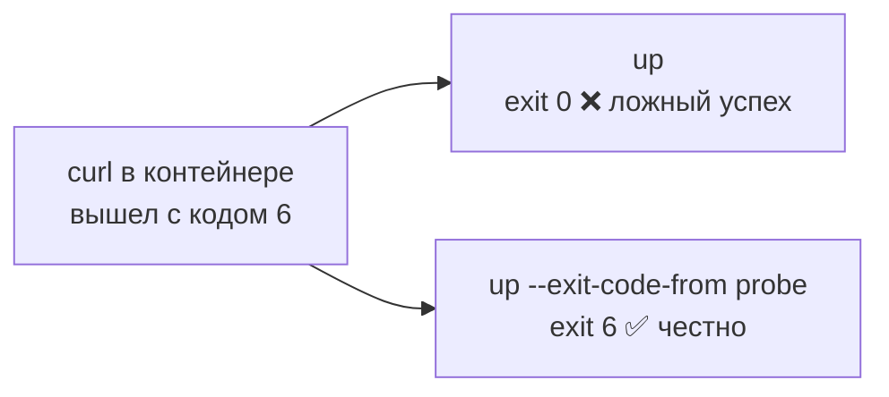

> [!warning] Ловушка
> Обычный `up` возвращает `0`, даже если контейнер упал (проверено: curl вышел с кодом 6, а
> `up` вернул 0). Для проверок и CI `--exit-code-from` обязателен.

---

## Сборка целиком: путь одного запроса

Один запрос из гостевого проекта к Lakekeeper, от начала до конца:

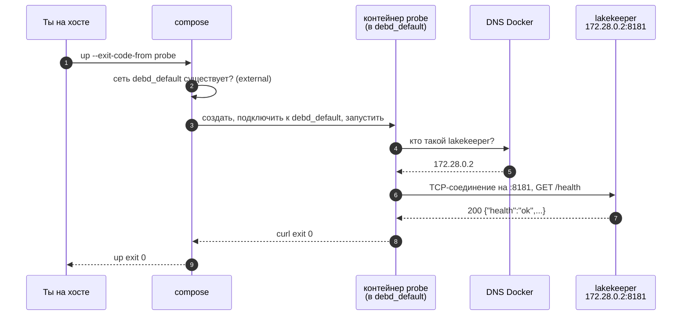

Сломай любое звено, и ты заранее знаешь симптом:

| Где сломано | Шаг на схеме | Симптом |
|---|---|---|
| Сети нет (стек `debd` не поднят) | 2 | `up` падает: `network debd_default declared as external, but could not be found` |
| Нет блока `networks` в гостевом файле | 2 | на этой машине — ошибка пула адресов; без VPN — curl exit 6 на шаге 4 |
| Опечатка в имени сервиса | 4 | curl exit 6 |
| Lakekeeper остановлен | 4 | curl exit 6: остановленный контейнер отключён от сети и пропадает из справочника |
| Неверный порт в URL | 6 | curl exit 7 |
| Неверный путь в URL, флаг `-f` | 7 | curl exit 22 |
| Нет `--exit-code-from` | 9 | `up` вернёт 0 при любом исходе curl |

---

## Шпаргалка

| Хочу | Как |
|---|---|
| Обратиться к сервису из контейнера | `http://<имя_сервиса>:<порт_контейнера>` |
| Обратиться к сервису с хоста | `http://localhost:<порт_хоста>` (нужен `ports`) |
| Опубликовать порт безопасно | `"127.0.0.1:<хост>:<контейнер>"` |
| Узнать IP контейнеров сети | `docker network inspect <сеть>` |
| Проверить имя из контейнера | `getent hosts <имя>` |
| Проверить, где слушает порт | `ss -ltn`, `docker port <контейнер>` |
| Подключить чужой проект к нашей сети | `networks: default: {name: debd_default, external: true}` |
| Честный код выхода one-shot | `up --exit-code-from <сервис>` |
| Понять, где оборвался curl | HTTP-код `000`? → `echo $?`: 6 имя, 7 порт, 28 тишина |

## Типичные ошибки

| Симптом | Причина | Как проверить | Как чинить |
|---|---|---|---|
| curl exit 7 на `localhost:X` из контейнера | localhost — это сам контейнер | `getent hosts <сервис>` | `<сервис>:<порт>` |
| `Could not resolve host: silo` на хосте | хост не спрашивает DNS Docker | `getent hosts silo; echo $?` → 2 | `localhost:<опубликованный порт>` |
| `Could not resolve host` из другого проекта | другая сеть, другой справочник | `docker network inspect debd_default` — контейнера нет в списке | `external`-сеть + `name:` |
| `could not find an available ... address pool` | VPN занял все адреса маршрутами `/1` | `ip route \| grep '/1 '` | явная `subnet` или существующая сеть |
| `network default declared as external, but could not be found` | `external: true` без `name:` | — | добавить `name: debd_default` |
| `port is already allocated` | порт хоста ② уже занят | `ss -ltn \| grep :<порт>` | другой порт хоста: `127.0.0.1:<новый>:<контейнер>` |
| Postgres виден из LAN при включённом ufw | `ports` без `127.0.0.1`, DNAT обходит INPUT | `ss -ltn` → `0.0.0.0:5432` | `"127.0.0.1:5432:5432"` |
| Работало по IP, после рестарта — нет | IP захардкожен | — | имя сервиса |
| Проверка «прошла», хотя контейнер упал | `up` без `--exit-code-from` | `echo $?` после `up` | добавить флаг |

---

## Проверь себя

Карточки для интервального повторения — в [flashcards.md](../flashcards.md).

> [!question] 1. В `ports` у postgres поменяли `5432:5432` на `15432:5432`. Что сломается у `lakekeeper`?
> > [!success]- Ответ
> > Ничего. Публикация меняет лишь то, где `docker-proxy` слушает на хосте. Lakekeeper ходит на
> > `postgres:5432` через мост, по порту, который Postgres слушает в своём namespace. Изменится
> > только адрес для клиентов на хосте: `localhost:15432`.

> [!question] 2. Из `make shell` выполнили `curl localhost:8181/health`. Какой будет код выхода и почему он придёт мгновенно?
> > [!success]- Ответ
> > `7` (Failed to connect). `localhost` в workspace — это loopback namespace самого workspace.
> > Ядро не находит слушателя порта 8181 в этом namespace и сразу отвечает RST, поэтому ждать
> > таймаута не приходится. Нужно `lakekeeper:8181`.

> [!question] 3. Новый compose-проект без блока `networks` обращается к `silo:9000`. Что будет на машине без VPN? А на этой?
> > [!success]- Ответ
> > Без VPN: compose создаст отдельную сеть, контейнер запустится, но встроенный DNS отвечает
> > только про соседей по сети — curl вернёт 6. На этой машине `up` упадёт раньше: маршруты VPN
> > `/1` покрывают весь запас подсетей Docker — `could not find an available ... address pool`.

> [!question] 4. Почему `external: true` без `name:` не подключит к `debd_default`?
> > [!success]- Ответ
> > К внешним сетям compose не добавляет префикс проекта: сеть чужая. Без `name:` он ищет сеть
> > с именем ключа — `default`. Такой нет: `network default declared as external, but could not be found`.

> [!question] 5. Коллега опубликовал Jupyter как `"8888:8888"` и говорит: «Не страшно, у меня ufw». Что ответишь?
> > [!success]- Ответ
> > Без IP порт слушает `0.0.0.0` — все интерфейсы. Пакет из LAN в `PREROUTING` получает DNAT на
> > адрес контейнера, после маршрутизации идёт через `FORWARD` и в `INPUT`, где стоят правила ufw,
> > не попадает. Jupyter без токена будет открыт всей сети. Нужно `"127.0.0.1:8888:8888"`.

> [!question] 6. Почему сеть `debd_default` работает, хотя VPN маршрутом `0.0.0.0/1` «забрал» и адреса `172.28.x.x`?
> > [!success]- Ответ
> > Docker добавил маршрут `172.28.0.0/24 → мост`. Из подходящих маршрутов побеждает самый
> > точный: `/24` точнее `/1`. Поэтому пакеты для контейнеров уходят в мост, остальные — в VPN.
