# 04 · S3, Parquet, Iceberg и каталог: как устроено хранилище курса

> [!info] Урок одной фразой
> Данные лежат файлами Parquet в объектном хранилище S3 (у нас Silo). Iceberg — опись, которая
> превращает кучу файлов в таблицу с версиями. Каталог Lakekeeper хранит, где лежит актуальная
> опись каждой таблицы, и выдаёт клиентам временный пропуск в хранилище.

> [!todo] После урока ты сможешь
> - объяснить, почему в S3 нет папок и что это значит для работы с файлами;
> - рассказать, из каких файлов состоит Iceberg-таблица и как запись создаёт новую версию;
> - проследить, откуда клиент берёт адрес S3 и ключи на каждом из двух путей доступа;
> - предсказать, что сломается при ошибке в переменных клиента или в настройках каталога
>   (задачи 3.2 и 3.4).

**Нужно для:** лаба [00.1](../labs/00.1_compose_anatomy/README.md), задачи 3.2 и 3.4.
Подробно эти темы разбираются в модуле 03, здесь — всё, что нужно, чтобы понимать слой core.
**Карта урока:** [storage-and-catalog.canvas](../maps/storage-and-catalog.canvas).

---

## Шаг 0. Азбука: зачем такая конструкция

Классическая база данных (Postgres) хранит данные в своих файлах, в своём формате, и читать их
может только она сама. Для аналитики на сотнях миллионов строк у такого подхода два минуса:
хранение на дисках сервера дорогое и плохо растёт, а данные заперты внутри одной программы.

**Lakehouse** («озеро + хранилище») разделяет эти роли:

- **хранение** — дешёвое объектное хранилище (S3), куда помещается сколько угодно файлов;
- **формат** — открытые стандарты (Parquet для файлов, Iceberg для таблиц), которые понимает
  любая программа;
- **вычисления** — любые движки (DuckDB, Spark, Trino), которые читают одни и те же таблицы.

Чтобы это работало, нужны три слоя, и урок разбирает их по очереди:

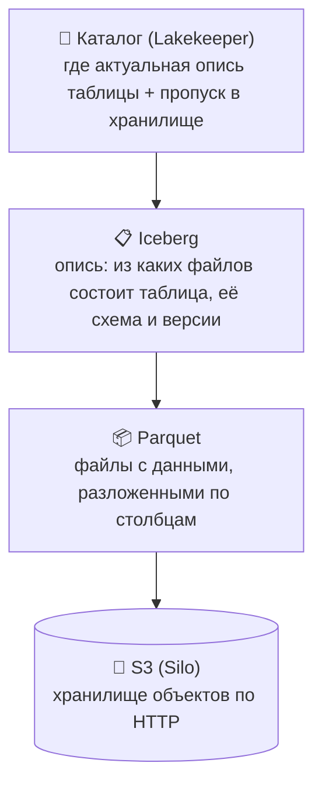

Аналогия этого урока — **склад**:

| В технологии | В аналогии «склад» | Подробнее |
|---|---|---|
| S3 (Silo) | Огромный склад коробок; работает через окошко выдачи (HTTP) | [S3](../../../glossary/s3.md) |
| Бакет | Зал склада: `landing`, `warehouse` | [S3](../../../glossary/s3.md) |
| Ключ объекта | Полная надпись на коробке: `freshretail/2026-09-28/sales.parquet` | [S3](../../../glossary/s3.md) |
| Файл Parquet | Коробка, где данные разложены по столбцам, а снаружи наклеена этикетка с min/max | [Parquet](../../../glossary/parquet.md) |
| Iceberg-таблица | Опись: «таблица sales, версия 2 = вот эти коробки» | [Iceberg](../../../glossary/iceberg.md) |
| Snapshot | Одна версия описи | [snapshot](../../../glossary/snapshot.md) |
| Каталог (Lakekeeper) | Картотека у входа: «sales → актуальная опись №00002» | [каталог](../../../glossary/iceberg-catalog.md) |
| Root-ключ Silo | Мастер-ключ от склада. Хранится только у завхоза (каталога) | |
| Vended credentials (STS) | Временный пропуск на час, который картотека выписывает посетителю | [vended credentials](../../../glossary/vended-credentials.md) |

---

## Шаг 1. S3: хранилище объектов

**Проблема.** Нужно хранить терабайты файлов дёшево и надёжно, и чтобы к ним могли обращаться
десятки программ с разных машин. Обычная файловая система привязана к одному серверу и плохо
масштабируется.

**Как устроено.** S3 — это протокол, придуманный Amazon: хранилище **объектов** (файлов),
разложенных по **бакетам**, с доступом по HTTP. Silo (поддерживаемый форк MinIO) реализует тот
же протокол у нас локально. Поэтому код, который работает с Silo, почти без изменений заработает
с AWS S3.

```text
Silo
├── landing/                                      ← бакет
│   └── freshretail/2026-09-28/sales.parquet      ← объект; всё имя целиком — ключ
└── warehouse/                                    ← бакет
    └── lakehouse/01a0e9c7-…/data/00000-….parquet
```

Три отличия от файловой системы, которые влияют на всю дальнейшую работу:

1. **Папок нет.** Ключ `freshretail/2026-09-28/sales.parquet` — одна строка, в которой просто
   есть символы `/`. Консоль Silo и библиотеки рисуют их как папки для удобства. «Список файлов
   в папке» на самом деле означает «найди все ключи, начинающиеся с этого префикса», и на
   миллионах объектов это медленно.
2. **Объект меняют только целиком.** Нельзя дописать строку в конец файла или поправить байт
   в середине: можно только положить новый объект целиком (под тем же или другим ключом).
3. **Всё — HTTP-запросы.** Каждая операция — обычный запрос по сети:

| Операция | HTTP | Где у нас |
|---|---|---|
| Список бакетов | `GET /` | `fs.ls("")` в `check_s3` |
| Положить объект | `PUT /бакет/ключ` | запись Parquet |
| Прочитать объект | `GET /бакет/ключ` | чтение таблицы |
| Удалить | `DELETE /бакет/ключ` | `purge_table` |

**Что нужно любому клиенту S3.** Чтобы отправить такой запрос, клиенту нужны четыре настройки:

| Настройка | Зачем | У нас |
|---|---|---|
| **endpoint** | адрес сервера, куда слать запросы | `http://silo:9000` |
| **ключи** (access key + secret key) | подписать запрос, чтобы сервер узнал, кто спрашивает | из `.env` |
| **region** | в AWS — регион хранения; у локального S3 условный | `local-01` |
| **path-style** | как вписать бакет в адрес: `silo:9000/бакет/ключ` (path-style) или `бакет.silo:9000/ключ` (как в AWS). Локальному S3 нужен path-style: имени `warehouse.silo` в DNS нет | `true` |

Почти все клиенты (boto3, s3fs, DuckDB, Spark) сами читают стандартные переменные окружения
`AWS_ACCESS_KEY_ID`, `AWS_SECRET_ACCESS_KEY`, `AWS_REGION`. Поэтому в коде ключи не пишут.

> [!example]- Попробуй сам: бакеты через Python
> В `make shell`:
> ```bash
> python -c "import os,s3fs; print(s3fs.S3FileSystem(endpoint_url=os.environ['S3_ENDPOINT']).ls(''))"
> ```
> **Увидишь:** `['landing', 'warehouse']`. Их создал `silo-init`. Ключи s3fs взял из `AWS_*`
> сам, в команде их нет.

### Root-ключ: кто его знает и зачем

Ключ из `.env` (`S3_ACCESS_KEY` / `S3_SECRET_KEY`) — это **root**, ключ администратора Silo
с полным доступом ко всему. Посмотрим, куда он расходится:

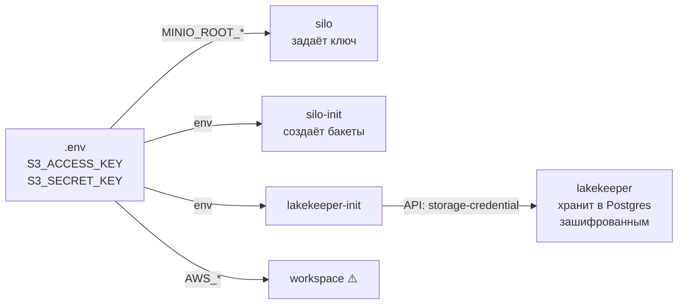

| Кто | Как получил | Нужен ли root |
|---|---|---|
| `silo` | сам задаёт его (`MINIO_ROOT_*`) | да |
| `silo-init` | переменные окружения | да: создаёт бакеты |
| `lakekeeper-init` | переменные окружения | только чтобы передать каталогу |
| `lakekeeper` | получил от `lakekeeper-init` через API, хранит в своей базе в Postgres, зашифрованным ключом `LAKEKEEPER_ENCRYPTION_KEY` | да: выпускает по нему временные ключи (шаг 5) |
| `workspace` | `AWS_*` | нет. Для прямой работы с `landing` хватило бы пользователя с правами на один бакет. Root здесь — учебное упрощение |

> [!warning] Ловушка: секрет живёт не только в переменных
> Root-ключ хранится ещё и **в данных** сервиса — в базе Lakekeeper. Когда ищешь, где мог
> утечь секрет, или меняешь его, смотри не только на `environment`, но и на то, куда сервисы
> его сохранили.

---

## Шаг 2. Parquet: как данные лежат в файле

**Проблема.** Аналитический запрос обычно читает **немного столбцов, но очень много строк**:
`SELECT sum(sales) FROM t` на 116 миллионах строк нужен один столбец из десяти. Если хранить
строку за строкой, как Postgres, придётся прочитать с диска все десять.

**Как устроено: колоночный формат.** Parquet хранит данные **по столбцам**:

```text
Строчное хранение (Postgres):              Колоночное хранение (Parquet):
┌──────┬───────┬──────┬───────┐            ┌──────┐ ┌───────┐ ┌──────┐ ┌───────┐
│store │ sku   │ hour │ sales │ ← читаем   │store │ │ sku   │ │ hour │ │▓sales▓│ ← читаем
│store │ sku   │ hour │ sales │ ← всё      │ ...  │ │ ...   │ │ ...  │ │▓ ... ▓│ только
│store │ sku   │ hour │ sales │ ←          │      │ │       │ │      │ │▓     ▓│ этот столбец
└──────┴───────┴──────┴───────┘            └──────┘ └───────┘ └──────┘ └───────┘
```

Внутри файл устроен так:

1. Строки делятся на **группы строк** (row groups) — куски по сотне тысяч или миллиону строк.
2. Внутри группы каждый столбец лежит отдельным **куском** (column chunk) и **сжат**. Однотипные
   значения подряд (одни номера магазинов, одни даты) сжимаются в разы лучше, чем
   перемешанные строки.
3. У каждого куска записана **статистика**: минимум, максимум, число пустых значений.
4. В конце файла лежит **футер**: схема (имена и типы столбцов) и указатели на все куски со
   статистикой.

**Что из этого следует.**

- Читатель сначала берёт маленький футер, а потом читает **только нужные столбцы**.
- По статистике можно **пропускать** целые группы строк. Запрос `WHERE store = 900` пропустит
  группу, у которой `max(store) = 500`, даже не читая её.
- Файл неизменяем (как и объекты S3): чтобы «поменять строку», пишут новый файл.

**Arrow** — родственный формат, но для **памяти**, а не для диска. Прочитанные из Parquet данные
лежат в памяти в виде Arrow-таблиц. PyIceberg, DuckDB и Polars умеют передавать друг другу
Arrow-таблицы без копирования и преобразования, поэтому это их общий язык.

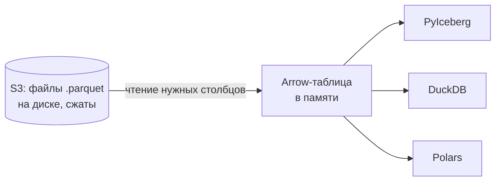

---

## Шаг 3. Iceberg: как куча файлов становится таблицей

**Проблема.** В S3 лежит тысяча Parquet-файлов. Как понять, что это одна таблица? Какая у неё
схема? Какие файлы актуальны, а какие остались от удалённых данных? Что увидит читатель, если
писатель положил половину файлов и упал? Как двум писателям не затереть работу друг друга? И
всё это без «списка файлов в папке», который в S3 медленный (шаг 1).

**Как устроено: дерево метаданных.** Iceberg — открытый стандарт, описывающий, какие файлы
метаданных лежат рядом с данными и что в них записано. Таблица — это дерево:

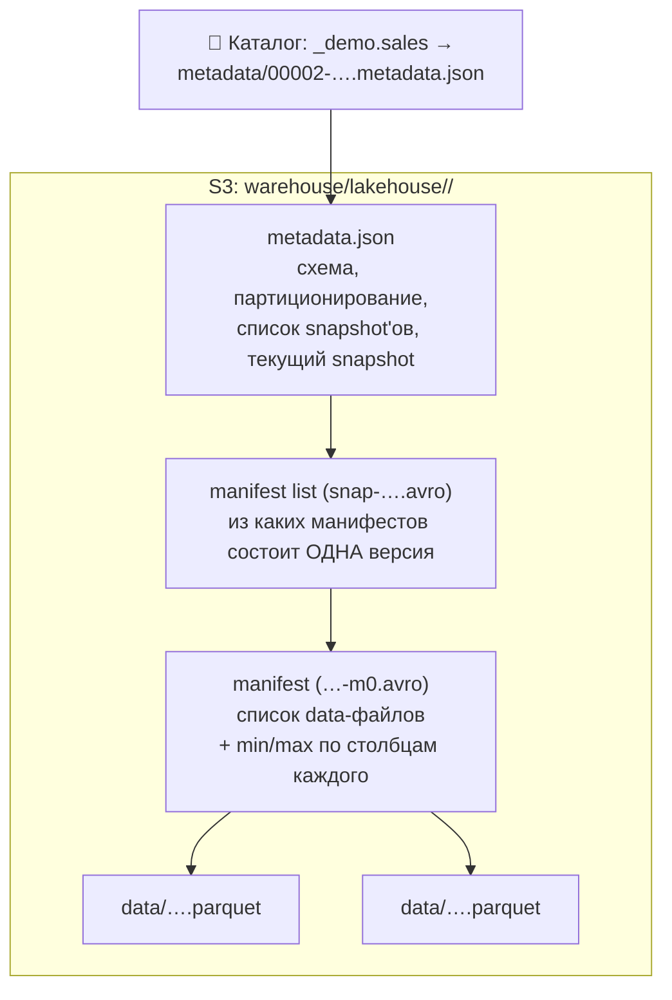

| Уровень | Что хранит | Зачем |
|---|---|---|
| `metadata.json` | схему, настройки, **список всех snapshot'ов** и какой из них текущий | точка входа в таблицу |
| manifest list | список манифестов одного snapshot'а | собрать версию из частей |
| manifest | список data-файлов со статистикой по столбцам | найти нужные файлы **без листинга S3** и отсечь лишние по min/max |
| data-файлы | сами строки в Parquet | данные |

**Как запись создаёт новую версию.** Файлы в Iceberg никогда не изменяются. Каждая запись:

1. Пишет **новые** data-файлы.
2. Пишет **новые** manifest, manifest list и `metadata.json`, в которых новый snapshot = старые
   файлы + новые.
3. Просит каталог **атомарно** переключить указатель: «было `00001-…`, стало `00002-…`». Каталог
   соглашается, только если указатель всё ещё `00001-…`. Если другой писатель успел раньше, это
   конфликт: клиент перечитывает свежую версию и пробует снова.

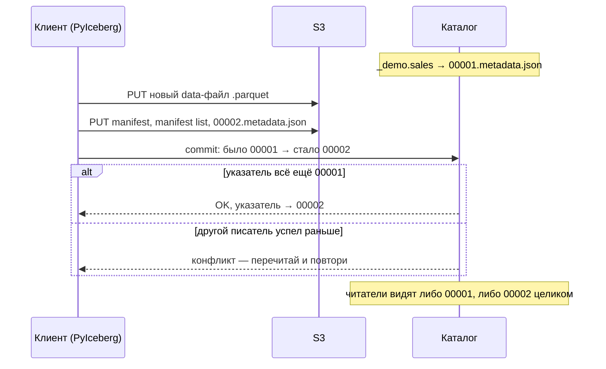

**Что из этого следует.**

- **Атомарность.** Пока указатель не переключён, читатели видят старую версию целиком. Запись
  видна либо вся, либо никак, и «половины записи» не бывает. Вместе с защитой от конфликтов это
  даёт транзакции (ACID) поверх простого хранилища файлов.
- **Time travel.** Старые snapshot'ы перечислены в `metadata.json`, а их файлы не удалены.
  Поэтому можно прочитать таблицу «как она была» или откатить указатель назад.
- **В S3 бывают файлы, не входящие в таблицу.** Это файлы старых версий (пока их не очистили)
  или записи, которая упала до commit: файлы легли в S3, а указатель не переключился. Правду о
  составе таблицы знают только метаданные, а не листинг бакета.
- **Путь таблицы в S3 — по её ID, а не по имени.** Переименование таблицы меняет только запись
  в каталоге, а не файлы.

> [!example]- Попробуй сам: две записи — две версии
> В `make shell` запусти `python` и вставь:
> ```python
> import os, pyarrow as pa, s3fs
> from pyiceberg.catalog import load_catalog
> c = load_catalog("lh", type="rest", uri=os.environ["ICEBERG_CATALOG_URI"],
>                  warehouse=os.environ["ICEBERG_WAREHOUSE"])
> c.create_namespace_if_not_exists("_demo")
> t = c.create_table("_demo.sales", schema=pa.schema([("store", pa.int32()), ("sales", pa.float64())]))
> t.append(pa.table({"store": pa.array([1, 2], pa.int32()), "sales": [10.0, 20.0]}))
> t.append(pa.table({"store": pa.array([3], pa.int32()), "sales": [30.0]}))
> print([s.snapshot_id for s in t.snapshots()])
> print(t.scan().to_arrow().num_rows, t.scan(snapshot_id=t.snapshots()[0].snapshot_id).to_arrow().num_rows)
> fs = s3fs.S3FileSystem(endpoint_url=os.environ["S3_ENDPOINT"])
> for f in sorted(fs.find(t.location().removeprefix("s3://"))): print(f.split("/", 3)[-1])
> c.purge_table("_demo.sales"); c.drop_namespace("_demo")
> ```
> **Увидишь:**
> - два snapshot'а; `3` строки сейчас и `2` в первой версии — это time travel;
> - в S3 **2** data-файла, **3** `metadata.json` (`00000` — пустая таблица, `00001`, `00002`),
>   **2** манифеста `…-m0.avro` и **2** manifest list `snap-….avro`;
> - путь начинается с `lakehouse/<uuid таблицы>/`, а не с `_demo/sales`.
>
> Последняя строка удаляет таблицу вместе с файлами.

---

## Шаг 4. Каталог Lakekeeper: картотека у входа

**Проблема.** Iceberg-таблица — дерево файлов, но кто-то должен помнить **имя таблицы** и
**где её текущий `metadata.json`**. Этот «кто-то» должен атомарно переключать указатель (шаг 3),
причём для всех клиентов сразу. Файлом в S3 это надёжно не сделать: S3 не умеет «поменяй,
только если там всё ещё старое значение».

**Как устроено.** Каталог — сервер, который хранит таблицу соответствий
`namespace.таблица → путь к текущему metadata.json` в **транзакционной базе данных** (у
Lakekeeper это база `lakekeeper` в нашем Postgres). Атомарное переключение указателя — обычная
транзакция Postgres.

Клиенты разговаривают с каталогом по стандартному HTTP API — спецификации **Iceberg REST**.
Поэтому любой движок, поддерживающий эту спецификацию (PyIceberg, DuckDB, Spark, Trino),
работает с любым REST-каталогом (Lakekeeper, Polaris, Nessie и др.).

- **Namespace** — группа таблиц, аналог схемы в Postgres. Полное имя: `namespace.table`,
  например `_smoke.ping`.

| Адрес | Что это | Кто пользуется |
|---|---|---|
| `http://lakekeeper:8181/catalog` | Iceberg REST API (`ICEBERG_CATALOG_URI`) | PyIceberg, DuckDB |
| `http://lakekeeper:8181/management/v1` | API управления Lakekeeper | `init.sh` |
| `http://localhost:8181/ui` | веб-интерфейс | ты, с хоста |

> [!example]- Попробуй сам: каталог — это просто HTTP
> На хосте:
> ```bash
> curl -s 'http://localhost:8181/catalog/v1/config?warehouse=lakehouse' | python3 -m json.tool | head -20
> ```
> **Увидишь:** `defaults.prefix` — ID warehouse, который клиенты будут подставлять во все
> адреса, и список `endpoints`: `GET /v1/{prefix}/namespaces/{namespace}/tables/{table}`,
> `POST …/transactions/commit` и т.д. Это и есть весь «протокол» Iceberg REST: PyIceberg и DuckDB
> внутри отправляют ровно такие запросы.

### Warehouse: связка каталога с хранилищем

**Warehouse** — именованная связка «каталог ↔ конкретное хранилище». Каталог может обслуживать
несколько хранилищ, и warehouse говорит, куда класть таблицы и чем открывать доступ. Warehouse
`lakehouse` создаёт [`init.sh`](../../../infra/docker/lakekeeper/init.sh):

```json
"storage-profile": {                   // ГДЕ хранить
  "type": "s3",
  "bucket": "warehouse",               // бакет для таблиц
  "key-prefix": "lakehouse",           // префикс ключей
  "endpoint": "http://silo:9000",      // адрес S3, который знает каталог
  "sts-endpoint": "http://silo:9000",  // куда обращаться за временными ключами
  "region": "local-01",
  "path-style-access": true,
  "sts-enabled": true                  // выдавать клиентам временные ключи
},
"storage-credential": {                // ЧЕМ открывать: root-ключи Silo
  "access-key-id": "…", "secret-access-key": "…"
}
```

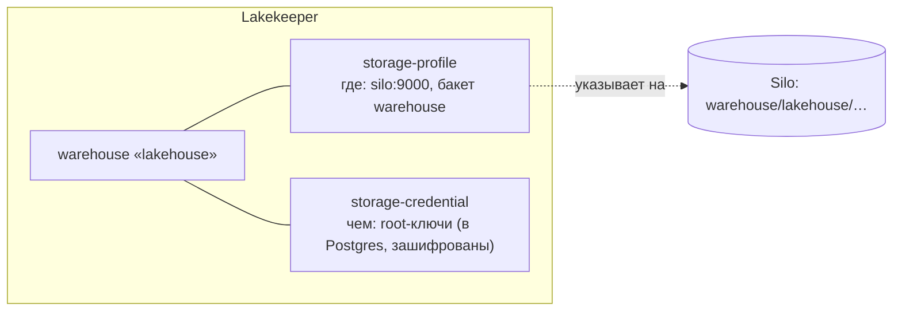

> [!example]- Попробуй сам: профиль хранилища без секретов
> ```bash
> curl -s http://localhost:8181/management/v1/warehouse | python3 -m json.tool | grep -E '"(name|endpoint|bucket|sts-enabled|sts-token-validity-seconds|storage-credential-type)"'
> ```
> **Увидишь:** `endpoint: http://silo:9000/`, `sts-enabled: true`,
> `sts-token-validity-seconds: 3600` и `storage-credential-type`. Сами ключи API не отдаёт.

---

## Шаг 5. Vended credentials: каталог выдаёт временный пропуск

**Проблема.** Клиенту нужно читать и писать файлы таблицы в S3. Если раздать root-ключ каждому
клиенту (ноутбукам, Spark, BI-серверу), он окажется в десятке мест, и утечка из любого даст
полный доступ ко всему хранилищу. А при смене ключа придётся перенастраивать всех.

**Как устроено.** «Vended» значит «выданные»: клиент не хранит ключи к S3, а **получает от
каталога** на время работы с конкретной таблицей. Выдачу обеспечивает **STS** (Security Token
Service) — служба S3, которая по постоянному ключу выдаёт **временный**: с ограниченным сроком
жизни (у нас 3600 секунд) и, при необходимости, урезанными правами. Запрос «выдай мне временные
ключи» называется **AssumeRole**.

По шагам, при `loadTable` или `createTable`:

1. Клиент обращается к каталогу, зная только **адрес каталога** и имя warehouse.
2. Каталог находит таблицу и её warehouse. Раз в storage-profile `sts-enabled: true`, он
   отправляет в Silo запрос AssumeRole, подписанный root-ключом.
3. Silo возвращает временную тройку: access key, secret key и **session token**.
4. Каталог отвечает клиенту метаданными таблицы и блоком **config**: адрес S3 из
   storage-profile и временные ключи.
5. Клиент применяет config и идёт в S3 уже с ним.

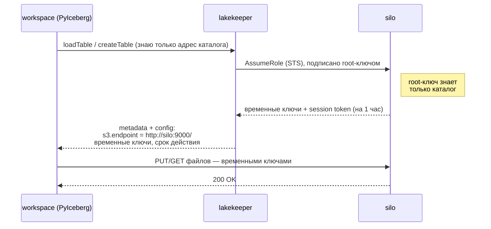

| Ключ config | Значение |
|---|---|
| `s3.endpoint` | адрес S3 из storage-profile: `http://silo:9000/` |
| `s3.access-key-id`, `s3.secret-access-key`, `s3.session-token` | временные ключи от STS |
| `s3.session-token-expires-at-ms`, `expiration-time` | когда ключи истекут |
| `client.refresh-credentials-endpoint` | куда обратиться за новыми ключами, когда эти истекут |

**Что из этого следует.**

- Клиенту Iceberg для работы с таблицами **не нужны собственные адрес S3 и ключи**: всё это он
  получает от каталога. Нужен только адрес каталога.
- Root-ключ знает одно место — каталог. Истёкший временный ключ бесполезен, поэтому утечка
  временного ключа гораздо менее опасна.
- Переезд хранилища (другой адрес, другой бакет, AWS вместо Silo) — это правка одного
  storage-profile, а не всех клиентов.

> [!example]- Попробуй сам: что клиент получил от каталога
> В `make shell` (секреты отфильтрованы):
> ```bash
> python -c "
> import os, pyarrow as pa
> from pyiceberg.catalog import load_catalog
> c = load_catalog('lh', type='rest', uri=os.environ['ICEBERG_CATALOG_URI'],
>                  warehouse=os.environ['ICEBERG_WAREHOUSE'])
> c.create_namespace_if_not_exists('_peek')
> t = c.create_table('_peek.t', schema=pa.schema([('id', pa.int64())]))
> print({k: v for k, v in t.io.properties.items() if not any(s in k for s in ('secret', 'key', 'token'))})
> print('ключи получены:', [k for k in t.io.properties if k.startswith('s3.') and ('key' in k or 'token' in k)])
> c.purge_table('_peek.t'); c.drop_namespace('_peek')
> "
> ```
> **Увидишь:** `s3.endpoint: http://silo:9000/`, `expiration-time`,
> `client.refresh-credentials-endpoint` и имена полученных ключей: `s3.access-key-id`,
> `s3.secret-access-key`, `s3.session-token`. Ничего из этого PyIceberg не передавали —
> всё пришло от каталога.

---

## Шаг 6. Два пути к S3 в нашем стеке

Сведём шаги 1 и 5. В стеке есть **два независимых пути** к одному и тому же Silo:

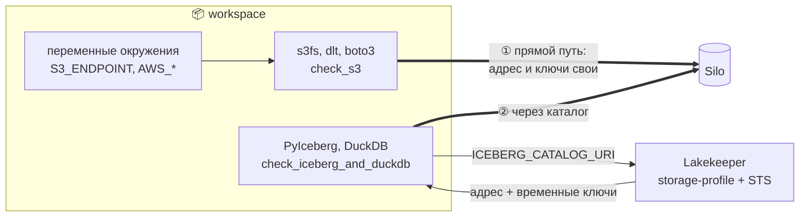

| | ① Прямой путь | ② Через каталог |
|---|---|---|
| Что | сырые файлы в `landing` | Iceberg-таблицы в `warehouse` |
| Кто так ходит | s3fs, dlt, boto3, `check_s3` | PyIceberg, DuckDB, позже Spark, Trino |
| Откуда адрес S3 | переменная клиента `S3_ENDPOINT` | storage-profile каталога |
| Откуда ключи | переменные клиента `AWS_*` | временные ключи от каталога (STS) |
| Ошибка в переменных клиента ломает | этот путь | ничего: переменные не используются |
| Ошибка в storage-profile ломает | ничего | всех Iceberg-клиентов сразу |

### Разобранный пример: подмена `S3_ENDPOINT` (задача 3.2)

В задаче 3.2 в workspace подменили `S3_ENDPOINT=http://localhost:9000`:

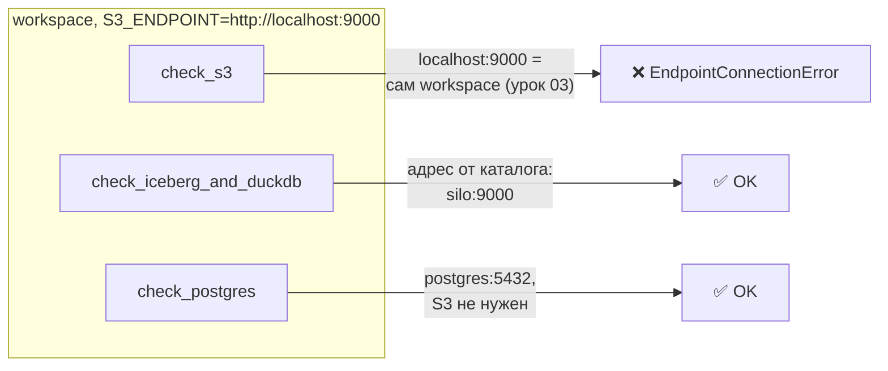

Упал только прямой путь. Практический вывод: зелёная проверка Iceberg **не доказывает**, что
прямой доступ к S3 исправен, и наоборот. Поэтому в smoke-тесте нужны обе проверки.

> [!warning] Ловушка: скрытая зависимость от DNS
> Адрес из storage-profile (`silo:9000`) должен резолвиться у **каждого** клиента каталога.
> DuckDB на хосте подключится к каталогу через `localhost:8181`, получит config с
> `s3.endpoint = http://silo:9000/` и не сможет прочитать файлы: хост не знает DNS Docker (урок
> [03](03_networking.md), шаг 2). Каталог доступен, а данные — нет.

---

## Шаг 7. DuckDB и каталог

DuckDB — аналитическая СУБД, которая работает **внутри процесса** программы, без отдельного
сервера. Она умеет подключать Iceberg REST-каталог как базу данных:

```sql
INSTALL iceberg; LOAD iceberg;   -- ① расширение для таблиц Iceberg
INSTALL httpfs;  LOAD httpfs;    -- ② доступ к S3 и HTTP
ATTACH 'lakehouse' AS lh (       -- ③ подключить warehouse как базу lh
    TYPE iceberg,
    ENDPOINT 'http://lakekeeper:8181/catalog',   -- ④ адрес КАТАЛОГА, не S3
    AUTHORIZATION_TYPE 'none');                  -- ⑤ наш Lakekeeper без логина
SELECT count(*) FROM lh._smoke.ping;
```

| Метка | Что делает |
|---|---|
| ①② | расширения скачиваются при первом `INSTALL` и ложатся в `~/.duckdb` — в слой записи контейнера (урок 01, шаг 2) |
| ③ | `lh` становится именем базы: таблицы доступны как `lh.<namespace>.<table>` |
| ④ | адрес каталога; адрес S3 и ключи DuckDB, как и PyIceberg, получит от каталога |
| ⑤ | в проде здесь был бы OAuth-токен |

Один и тот же набор таблиц читают разные движки через один каталог. Это главная идея
lakehouse: **один открытый формат, много движков**.

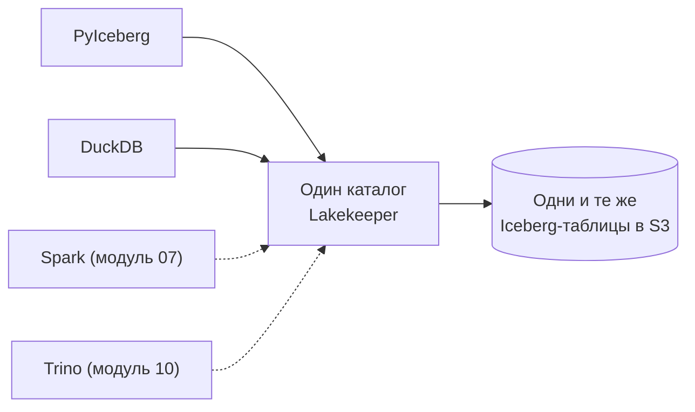

---

## Сборка целиком: одна запись в Iceberg-таблицу

`table.append(data)` из `check_stack.py`, от начала до конца:

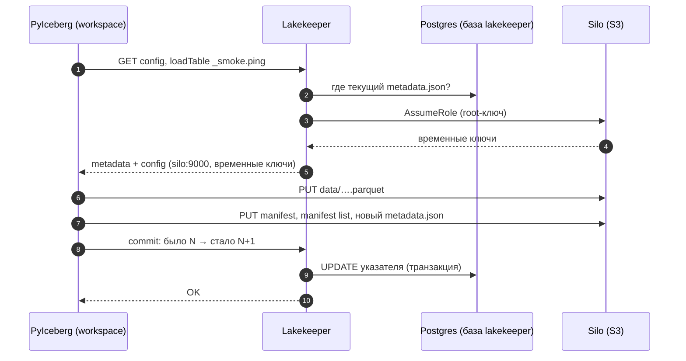

| Где сломано | Шаг на схеме | Симптом |
|---|---|---|
| Неверный `ICEBERG_CATALOG_URI` | 1 | ошибка подключения к каталогу (DNS, connection refused) |
| Postgres недоступен | 2 | каталог отвечает ошибкой 5xx |
| Неверный root-ключ в storage-credential | 3 | каталог не может выпустить временные ключи |
| Неверный endpoint в storage-profile | 6 | ошибка подключения к S3 у **всех** Iceberg-клиентов |
| Клиент не резолвит адрес из storage-profile | 6 | каталог работает, файлы не читаются (DuckDB на хосте) |
| Падение между 7 и 8 | 8 | в S3 остались файлы вне таблицы; таблица не изменилась |

---

## Шпаргалка

| Хочу | Как |
|---|---|
| Список бакетов | `s3fs.S3FileSystem(endpoint_url=os.environ['S3_ENDPOINT']).ls('')` |
| Подключиться к каталогу из Python | `load_catalog("lh", type="rest", uri=…CATALOG_URI, warehouse=…WAREHOUSE)` |
| Версии таблицы | `table.snapshots()`; чтение версии — `table.scan(snapshot_id=…)` |
| Где лежит таблица | `table.location()`, `table.metadata_location` |
| Что клиент получил от каталога | `table.io.properties` (не печатай секреты!) |
| Подключить каталог в DuckDB | `ATTACH 'lakehouse' AS lh (TYPE iceberg, ENDPOINT '…/catalog', AUTHORIZATION_TYPE 'none')` |
| Настройки warehouse | `curl http://localhost:8181/management/v1/warehouse` |
| Сменить адрес S3 для всех таблиц | storage-profile warehouse, а не `.env` клиентов |

## Типичные ошибки

| Симптом | Причина | Как проверить | Как чинить |
|---|---|---|---|
| `check_s3` падает, Iceberg работает | ошибка в `S3_ENDPOINT` / `AWS_*` клиента | `env \| grep -E 'S3_\|AWS_'` в `make shell` | поправить переменные клиента |
| Все Iceberg-клиенты падают на чтении файлов | неверный endpoint в storage-profile | `curl …/management/v1/warehouse` | поправить warehouse в каталоге |
| DuckDB на хосте видит таблицы, но не читает данные | хост не резолвит `silo` из config | `getent hosts silo` на хосте | читать из контейнера |
| В бакете больше файлов, чем в таблице | старые snapshot'ы или запись упала до commit | `table.snapshots()`, манифесты | обслуживание таблицы (модуль 03) |
| `NoSuchBucket` | бакет не создан | список бакетов | `silo-init` / `mc mb` |
| Конфликт при commit | параллельный писатель успел раньше | лог клиента | повторить запись (клиенты делают это сами) |

---

## Проверь себя

Карточки для интервального повторения — в [flashcards.md](../flashcards.md).

> [!question] 1. В бакете `warehouse` лежат 10 Parquet-файлов таблицы, но `SELECT count(*)` видит данные только из 7. Как такое возможно?
> > [!success]- Ответ
> > Текущий snapshot ссылается только на 7 файлов. Остальные 3 — от старых версий
> > (перезаписанные или удалённые строки) или от записи, упавшей до commit: файлы легли в S3,
> > а указатель в каталоге не переключился. Состав таблицы определяют метаданные, а не листинг.

> [!question] 2. Почему DuckDB на хосте не прочитает Iceberg-таблицу, даже если `localhost:8181` доступен?
> > [!success]- Ответ
> > Каталог вернёт config с `s3.endpoint = http://silo:9000/` из storage-profile, а хост не
> > резолвит имя `silo`: он не пользуется DNS Docker.

> [!question] 3. Хранилище переехало с `silo:9000` на `s3.amazonaws.com`. Что нужно поменять для таблиц Iceberg, а что — для загрузки в `landing`?
> > [!success]- Ответ
> > Для Iceberg — storage-profile (и storage-credential) warehouse в Lakekeeper: одно место.
> > Для `landing` — `S3_ENDPOINT` и ключи у каждого клиента прямого пути.

> [!question] 4. Почему Iceberg переключает указатель через каталог, а не просто перезаписывает файл «current» в S3?
> > [!success]- Ответ
> > Переключение должно быть атомарным «поменяй, только если там всё ещё старое значение»,
> > иначе два писателя затрут друг друга. S3 такой операции не даёт, а транзакция в базе
> > каталога (Postgres) — даёт.

> [!question] 5. Утёк временный ключ, выданный каталогом PyIceberg-клиенту. Чем это лучше утечки root-ключа?
> > [!success]- Ответ
> > Временный ключ истекает (у нас через час) и может иметь урезанные права. Root-ключ даёт
> > полный доступ ко всему хранилищу бессрочно, пока его не сменят, — а сменить его надо будет
> > везде, где он хранится.

> [!question] 6. Зачем Parquet хранит min/max по каждому куску столбца?
> > [!success]- Ответ
> > Чтобы пропускать данные, не читая их: запрос `WHERE store = 900` не станет читать группу
> > строк с `max(store) = 500`. Iceberg хранит такую же статистику в манифестах и отсекает
> > целые файлы.
