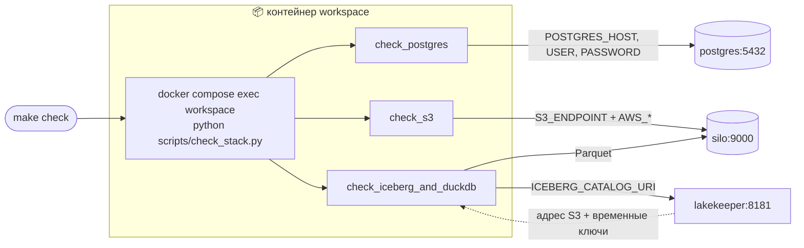
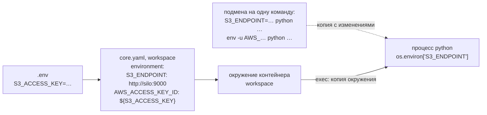
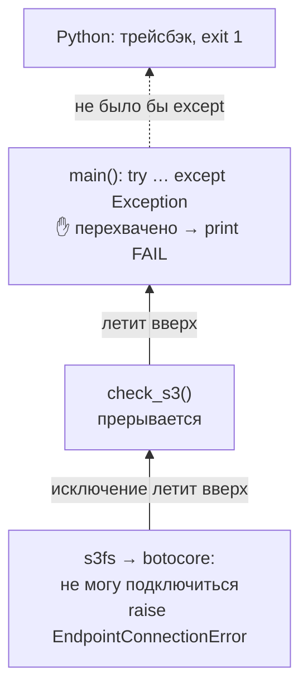
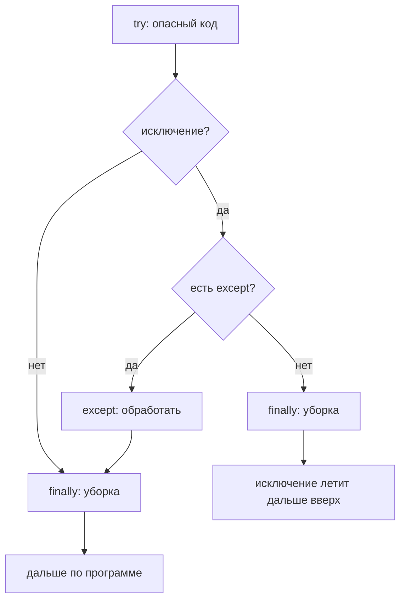
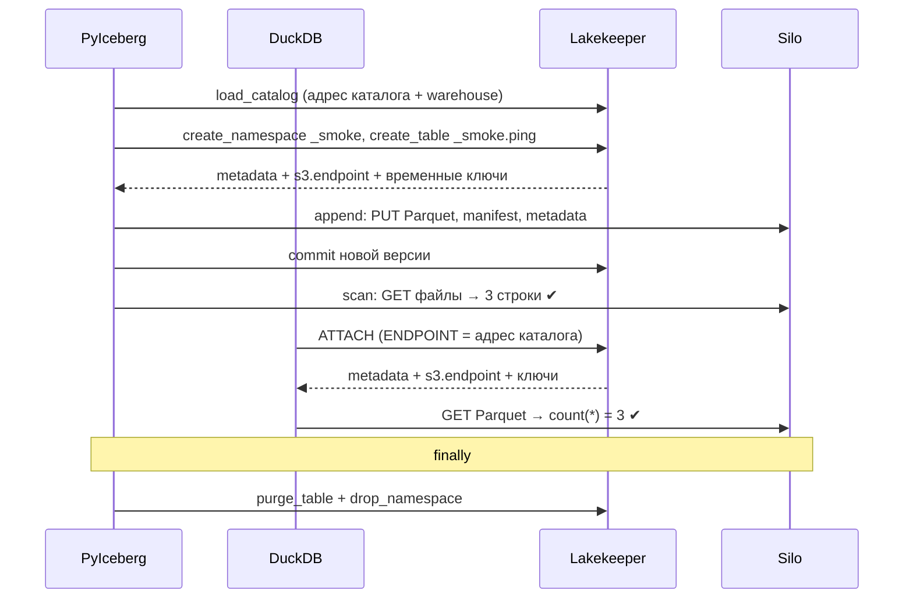
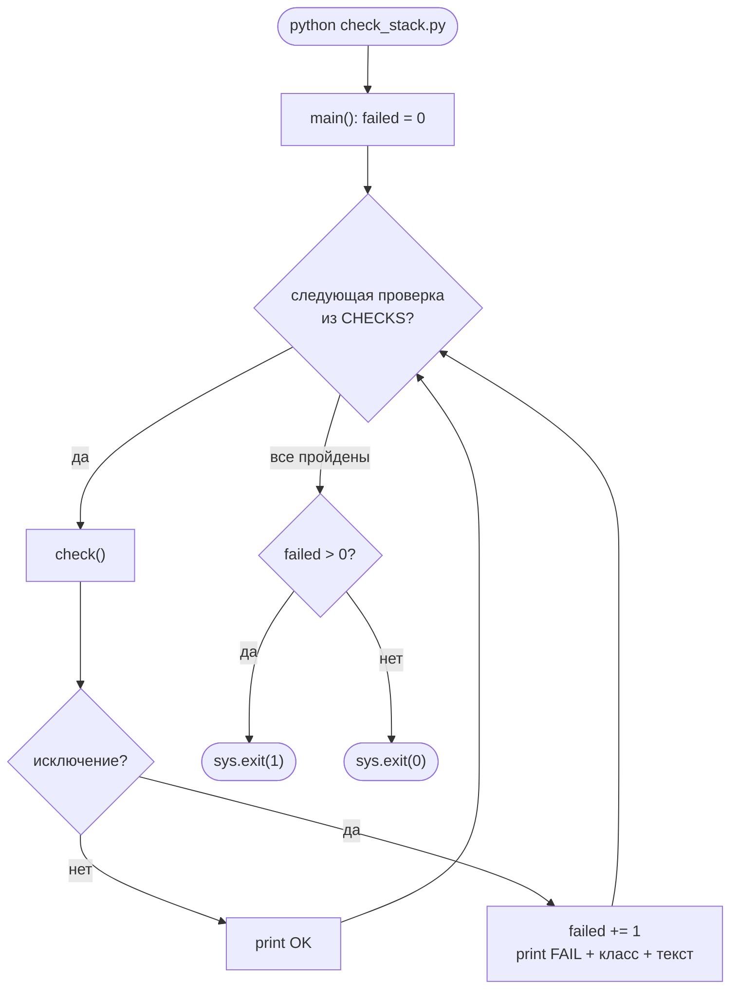
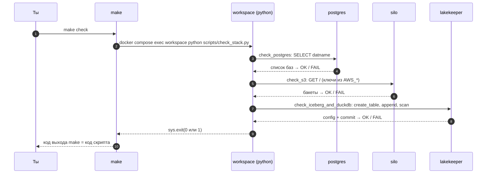

# 05 · Python для чтения скриптов курса: разбор `check_stack.py`

> [!info] Урок одной фразой
> `check_stack.py` — утренний обход стека: три независимые проверки, адреса и пароли берутся из
> переменных окружения, найденная проблема записывается как `FAIL`, обход продолжается, а в
> конце выставляется итог: код выхода 0 или 1.

> [!todo] После урока ты сможешь
> - прочитать любой служебный скрипт курса и сказать, что он делает и откуда берёт настройки;
> - предсказать, как поведёт скрипт при подмене или удалении переменной окружения;
> - по строке `FAIL` понять, какая проверка упала, на каком этапе и почему;
> - объяснить, как работают исключения, `try/except/finally` и код выхода (задачи 3.2, 3.4).

**Нужно для:** лаба [00.1](../labs/00.1_compose_anatomy/README.md), задачи 3.2 и 3.4.
Технологии (S3, Iceberg, каталог, DuckDB) — в уроке [04](04_s3_iceberg_catalog.md).
**Карта урока:** [check-stack.canvas](../maps/check-stack.canvas).

---

## Шаг 0. Азбука: как Python выполняет скрипт

**Скрипт** — текстовый файл с инструкциями. Команда `python scripts/check_stack.py` запускает
интерпретатор, который читает файл **сверху вниз** и выполняет инструкцию за инструкцией.
Инструкции `import` подключают библиотеки, `def` **объявляют** функции (но ещё не выполняют их),
присваивания `ИМЯ = значение` создают переменные. Настоящая работа начинается в самом конце, где
вызывается `main()`.

**Значения и типы.** Всё, с чем работает Python, — значения определённого типа. В скрипте
встречаются:

| Тип | Пример | Что это |
|---|---|---|
| `str` — строка | `"http://silo:9000"`, `f"{NAMESPACE}.ping"` | текст |
| `int` — целое | `0`, `3` | число |
| `bool` | `True`, `False` | истина / ложь |
| `None` | `None` | «ничего», отсутствие значения |
| `list` — список | `[1, 2, 3]` | упорядоченный изменяемый набор |
| `tuple` — кортеж | `("Postgres", check_postgres)` | упорядоченный неизменяемый набор; удобен для пар |
| `set` — множество | `{"landing", "warehouse"}` | набор уникальных значений без порядка |
| `dict` — словарь | `{"S3_ENDPOINT": "http://silo:9000"}` | пары «ключ → значение» |
| функция | `check_postgres` | тоже значение: её можно положить в список и вызвать позже |

**Переменная** — имя, привязанное к значению: после `failed = 0` имя `failed` указывает на
число 0.

Аналогия урока продолжает «офисное здание»:

| В скрипте | В аналогии «утренний обход» | Подробнее |
|---|---|---|
| `check_stack.py` | Инспектор с чек-листом из трёх пунктов | [smoke-тест](../../../glossary/smoke-test.md) |
| Переменные окружения | Справочник на стене: адреса и пароли. Инспектор их не помнит, а читает | [переменная окружения](../../../glossary/environment-variable.md) |
| Функция-проверка | Пункт чек-листа: «зайти в бухгалтерию и убедиться, что…» | |
| Исключение | Сигнал тревоги, который передаётся вверх по начальству, пока кто-то его не примет | [исключение](../../../glossary/exception.md) |
| `try/except` | Начальник, который принимает тревогу и записывает её в журнал | |
| `finally` | «Уходя, выключи свет» — при любом исходе | |
| Код выхода | Итоговая отметка в журнале: 0 — всё в порядке, 1 — были проблемы | [код выхода](../../../glossary/exit-code.md) |

---

## Шаг 1. Зачем скрипт и где он работает

[`scripts/check_stack.py`](../../../scripts/check_stack.py) — **[smoke-тест](../../../glossary/smoke-test.md)**:
быстрая проверка «стек вообще живой?». Название пришло из электроники: включили новую плату и
смотрят, не пошёл ли дым. Бизнес-логику такой тест не проверяет. Он проверяет, что каждый
компонент отвечает и что компоненты работают **вместе**.

`make check` выполняет `docker compose exec workspace python scripts/check_stack.py`, то есть
запускает скрипт **внутри контейнера `workspace`**. Отсюда две вещи, без которых скрипт не
работает: он находится в сети `debd_default`, где резолвятся имена `postgres`, `silo`,
`lakekeeper` (урок 03), и получает переменные окружения `workspace` из `core.yaml` (шаг 2).



| Проверка | Что проверяет | Куда ходит | Какие переменные читает |
|---|---|---|---|
| Postgres | есть базы `lakekeeper`, `retail_oltp` | `postgres:5432` | `POSTGRES_*` |
| S3 | есть бакеты `landing`, `warehouse` | Silo напрямую (путь ①, урок 04) | `S3_ENDPOINT`, `AWS_*` |
| Iceberg + DuckDB | таблицу можно создать, записать 3 строки и прочитать двумя движками | Lakekeeper, через него Silo (путь ②) | `ICEBERG_CATALOG_URI`, `ICEBERG_WAREHOUSE` |

---

## Шаг 2. Откуда скрипт берёт настройки: переменные окружения

**Проблема.** Скрипт должен работать в разных окружениях: у тебя, в CI, в проде. Адреса и
пароли там разные. Если записать их в код, код придётся править под каждое окружение, а пароли
попадут в git.

**Как устроено.** У каждого процесса в Linux есть **[окружение](../../../glossary/environment-variable.md)**:
набор пар «имя=значение». Запуская процесс, родитель передаёт ему **копию** своего окружения,
возможно с изменениями. Цепочка у нас такая:

1. `.env` → compose подставляет значения в `core.yaml` (урок 01, шаг 6).
2. Секция `environment:` сервиса `workspace` → Docker создаёт контейнер с этим окружением.
3. `docker compose exec` запускает в контейнере процесс `python` и передаёт ему окружение
   контейнера.
4. Python складывает окружение в словарь **`os.environ`**. Скрипт читает оттуда:
   `os.environ["S3_ENDPOINT"]` → `"http://silo:9000"`.



**Подмена окружения для одной команды.** Поскольку дочерний процесс получает копию, в shell её
можно изменить только для одного запуска:

| Запись | Смысл |
|---|---|
| `ИМЯ=значение команда` | запустить команду с **заменённой** переменной |
| `env -u ИМЯ команда` | запустить команду **без** этой переменной: её нет вовсе, а не пустая строка |

Окружение самого shell при этом не меняется: следующая команда снова видит прежние значения.

**Что из этого следует.**

- В скрипте **нет ни одного адреса или пароля**. Подменишь окружение — скрипт пойдёт по другому
  адресу без правки кода. Так мы ломали `S3_ENDPOINT` в задаче 3.2.
- Если переменной нет вовсе, `os.environ["ИМЯ"]` выбрасывает исключение **`KeyError`**
  (шаг 4). Запусти скрипт на хосте — там этих переменных нет.
- Многие библиотеки читают окружение **сами**. s3fs (через библиотеку botocore) ищет
  `AWS_ACCESS_KEY_ID`, `AWS_SECRET_ACCESS_KEY`, `AWS_REGION`, хотя в коде `check_s3` о них ни
  слова.

> [!example]- Попробуй сам: окружение скрипта
> В `make shell`:
> ```bash
> env | grep -E '^(POSTGRES_HOST|S3_ENDPOINT|ICEBERG_)'      # что получит скрипт
> python -c "import os; print(os.environ['S3_ENDPOINT'])"   # http://silo:9000
> S3_ENDPOINT=http://example python -c "import os; print(os.environ['S3_ENDPOINT'])"
> python -c "import os; print(os.environ['S3_ENDPOINT'])"   # снова http://silo:9000
> ```
> **Увидишь:** подмена действует ровно на одну команду.

---

## Шаг 3. Функции: объявить, вызвать, передать

**Как устроено.** `def` **объявляет** функцию: связывает имя с блоком кода, но не выполняет его.
Код выполняется при **вызове** — когда после имени стоят скобки.

```python
def check_s3() -> None:    # ① объявление: имя check_s3 → блок кода ниже
    ...                     # тело функции, отступ 4 пробела

check_s3                    # ② сама функция как значение: ничего не выполняется
check_s3()                  # ③ вызов: выполняется тело
```

- Отступ (4 пробела) — часть синтаксиса Python: он показывает, какие строки входят в тело
  функции, цикла или условия.
- `-> None` — **подсказка типа** для читателя и линтера: функция ничего не возвращает. На
  выполнение подсказки не влияют.
- `return значение` — вернуть результат вызывающему; без `return` функция возвращает `None`.

**Функция — тоже значение**, поэтому её можно положить в список, не вызывая, и вызвать позже:

```python
CHECKS = [
    ("Postgres: базы lakekeeper, retail_oltp", check_postgres),   # функция без скобок
    ("S3 (Silo): бакеты landing, warehouse", check_s3),
    ("Iceberg (Lakekeeper) + DuckDB: …", check_iceberg_and_duckdb),
]
for name, check in CHECKS:     # каждая пара распаковывается в две переменные
    check()                    # вызов — здесь, под присмотром try (шаг 7)
```

> [!warning] Ловушка: скобки в списке
> `("Postgres", check_postgres())` со скобками вызовет проверку **сразу при создании списка** —
> вне всякого `try`. Если она упадёт, скрипт завершится с трейсбэком ещё до первой строки `OK`.
> А в список попадёт результат вызова — `None`, и `check()` потом упадёт с `TypeError: 'NoneType'
> object is not callable`.

---

## Шаг 4. Исключения: как Python сообщает о проблеме

**Проблема.** Где-то глубоко внутри библиотеки s3fs не удалось подключиться к серверу. Как
сообщить об этом коду, который вызвал проверку, через пять уровней вложенных вызовов? Возвращать
«код ошибки» из каждой функции утомительно, и его легко забыть проверить.

**Как устроено.** Python использует **[исключения](../../../glossary/exception.md)**:

1. Код, обнаруживший проблему, **выбрасывает** исключение (`raise`): объект определённого класса
   (`KeyError`, `AssertionError`, `EndpointConnectionError`…) с текстом.
2. Выполнение текущей функции **немедленно прерывается**. Исключение передаётся вызвавшей
   функции, потом её вызывающей, и так вверх по цепочке вызовов.
3. Если на пути встретится `try … except`, подходящий по классу, исключение **перехватывается**
   и дальше не идёт.
4. Если никто не перехватил, программа завершается, печатает **трейсбэк** (цепочку вызовов, по
   которой шло исключение) и возвращает код выхода 1.



**Конструкции для работы с исключениями:**

```python
try:
    опасный_код()             # если здесь исключение — дальше в try не идём
except Exception as exc:      # перехватить исключение любого класса в переменную exc
    обработать(exc)
finally:
    уборка()                  # выполнится ВСЕГДА: и при успехе, и при исключении
```



Ещё два механизма, связанных с исключениями:

- **`assert условие, "текст"`** — «условие должно быть истинным, иначе выбрось `AssertionError`
  с этим текстом». Удобный способ превратить «не то, что ожидали» в провал проверки.
- **`with ресурс as имя:`** — после блока ресурс **гарантированно** закрывается, даже если внутри
  было исключение. `with psycopg.connect(dsn) as conn:` закроет соединение с базой при любом
  исходе. По сути это встроенные `try/finally`.

> [!example]- Попробуй сам: прочитать трейсбэк
> В `make shell`:
> ```bash
> python -c "import os; os.environ['NOPE']"; echo "exit=$?"
> ```
> **Увидишь:** `Traceback (most recent call last):`, несколько строк `File …, line …` — путь
> исключения, последняя строка — `KeyError: 'NOPE'`, и `exit=1`. Читай трейсбэк **снизу вверх**:
> последняя строка говорит, *что* случилось, строки выше — *где*.

---

## Шаг 5. Множества, генераторы и распаковка

**Множества и их разность.** Проверки устроены одинаково: «что должно быть» минус «что есть» =
«чего не хватает».

```python
missing = {"lakekeeper", "retail_oltp"} - dbs
```

```text
нужно:      {"lakekeeper", "retail_oltp"}
есть (dbs): {"postgres", "lakekeeper", "template0", "template1"}
─────────────────────────────────────────────────────────
нужно - есть = {"retail_oltp"}    ← этого не хватает
```

**Истинность.** В условиях (`if`, `assert`, `not`) Python считает «ложью» пустые значения:
`0`, `""`, `[]`, `set()`, `None`. Всё остальное — «истина». Поэтому `assert not missing`
читается как «пропавших нет»: пустое `missing` — ложь, `not` превращает её в истину.

**Генератор множества** (set comprehension) — множество, собранное циклом в одну строку:

```python
{r[0] for r in rows}    # для каждой строки r взять первый столбец r[0], сложить в множество
```

**Распаковка** — разложить набор по переменным:

```python
name, check = ("Postgres…", check_postgres)   # name = "Postgres…", check = функция
(rows,) = (3,)                                # кортеж из одного элемента → rows = 3
```

`fetchone()` в DuckDB возвращает строку результата кортежем, даже если в ней одно значение.
`(rows,) = …` достаёт это значение и заодно проверяет, что оно ровно одно.

**f-строки.** В строке с префиксом `f` выражения в `{}` подставляются в текст:
`f"{NAMESPACE}.ping"` → `"_smoke.ping"`. Имена КАПСОМ (`NAMESPACE`, `CHECKS`) по соглашению
означают константы.

---

## Шаг 6. Разбор проверок

### Проверка 1 — Postgres

```python
def check_postgres() -> None:
    dsn = (
        f"host={os.environ['POSTGRES_HOST']} dbname=postgres "      # ① host=postgres
        f"user={os.environ['POSTGRES_USER']} password={os.environ['POSTGRES_PASSWORD']}"
    )
    with psycopg.connect(dsn) as conn:                               # ②
        dbs = {r[0] for r in conn.execute("select datname from pg_database")}   # ③
    missing = {"lakekeeper", "retail_oltp"} - dbs                    # ④
    assert not missing, f"нет баз данных: {missing}"                 # ⑤
```

| Метка | Что происходит |
|---|---|
| ① | собирается **DSN** (Data Source Name) — строка подключения. Две f-строки подряд в скобках Python склеивает в одну |
| ② | драйвер psycopg подключается по TCP к `postgres:5432`; `with` закроет соединение |
| ③ | `pg_database` — системная таблица со списком баз; из каждой строки берётся имя |
| ④ | каких нужных баз нет |
| ⑤ | нет каких-то — `AssertionError` с их списком |

Базы создаёт `postgres/init/01-databases.sql`: `lakekeeper` для каталога, `retail_oltp` —
учебная OLTP-база (модули 04 и 08).

### Проверка 2 — S3 (прямой путь)

```python
def check_s3() -> None:
    fs = s3fs.S3FileSystem(endpoint_url=os.environ["S3_ENDPOINT"])   # ① адрес — из переменной
    buckets = set(fs.ls(""))                                          # ② GET / → список бакетов
    missing = {"landing", "warehouse"} - buckets
    assert not missing, f"нет бакетов: {missing}"
```

- ① Клиенту явно передаётся только адрес. Ключи s3fs найдёт сам в `AWS_*` (шаг 2).
- ② `ls("")` — список бакетов, HTTP-запрос `GET /` к Silo, подписанный ключами.
- Каталог здесь не участвует: это путь ① из урока 04.

### Проверка 3 — Iceberg + DuckDB (путь через каталог)

```python
def check_iceberg_and_duckdb() -> None:
    catalog = load_catalog(
        "lakehouse",                                  # локальное имя подключения
        type="rest",                                  # тип каталога — Iceberg REST
        uri=os.environ["ICEBERG_CATALOG_URI"],        # http://lakekeeper:8181/catalog
        warehouse=os.environ["ICEBERG_WAREHOUSE"],    # lakehouse
    )
```

Передаются **только адрес каталога и имя warehouse**. Об S3 здесь нет ни слова: адрес и
временные ключи придут от каталога (урок 04, шаг 5).

```python
    catalog.create_namespace_if_not_exists(NAMESPACE)   # namespace "_smoke" (идемпотентно)
    if catalog.table_exists(TABLE):                     # остаток прошлого упавшего запуска?
        catalog.purge_table(TABLE)                      # удалить запись в каталоге и файлы в S3
```

Скрипт сам наводит порядок перед работой: если прошлый запуск упал до уборки, таблица могла
остаться. Это та же [идемпотентность](../../../glossary/idempotency.md): повторный запуск
безопасен.

```python
    data = pa.table({"id": pa.array([1, 2, 3], pa.int64()), "msg": ["a", "b", "c"]})
    table = catalog.create_table(TABLE, schema=data.schema)
```

- Arrow-таблица в памяти: 3 строки, столбцы `id` (int64) и `msg` (строка).
- `create_table` — запрос к каталогу. Lakekeeper создаёт первый `metadata.json` и отвечает
  метаданными **и config с `s3.endpoint` и временными ключами**.

```python
    try:
        table.append(data)                                                  # ①
        assert table.scan().to_arrow().num_rows == 3, "PyIceberg прочитал не 3 строки"  # ②

        con = duckdb.connect()                                              # ③
        con.execute("INSTALL iceberg; LOAD iceberg; INSTALL httpfs; LOAD httpfs;")
        con.execute(
            f"ATTACH '{os.environ['ICEBERG_WAREHOUSE']}' AS lh "
            f"(TYPE iceberg, ENDPOINT '{os.environ['ICEBERG_CATALOG_URI']}', "
            "AUTHORIZATION_TYPE 'none')"
        )
        (rows,) = con.execute(f"select count(*) from lh.{TABLE}").fetchone()  # ④
        assert rows == 3, f"DuckDB прочитал {rows} строк вместо 3"
    finally:
        catalog.purge_table(TABLE)                                          # ⑤
        catalog.drop_namespace(NAMESPACE)
```

| Метка | Что происходит |
|---|---|
| ① | PyIceberg пишет Parquet и манифесты в S3 **по адресу от каталога**, потом commit новой версии |
| ② | чтение таблицы обратно в Arrow; `num_rows` — число строк |
| ③ | DuckDB в памяти процесса, расширения, подключение того же каталога (урок 04, шаг 7) |
| ④ | второй, **независимый** движок читает ту же таблицу: адрес S3 и ключи тоже от каталога |
| ⑤ | уборка в `finally` — выполнится и при успехе, и при провале |

Почему здесь `try/finally` **без** `except`? Функции нужно убрать за собой, но **не** скрывать
ошибку: исключение после `finally` полетит дальше в `main()`, и та напечатает `FAIL`. Если бы
здесь был `except`, проблема была бы «проглочена», и проверка всегда считалась бы успешной.



---

## Шаг 7. `main()`: обход, журнал и код выхода

```python
def main() -> int:
    failed = 0
    for name, check in CHECKS:
        try:
            check()                                   # ① вызвать очередную проверку
            print(f"OK    {name}")                    # ② дошли сюда — исключения не было
        except Exception as exc:                      # ③ проверка выбросила исключение
            failed += 1
            print(f"FAIL  {name}: {type(exc).__name__}: {exc}")
    return 1 if failed else 0                         # ④


if __name__ == "__main__":                            # ⑤
    sys.exit(main())                                  # ⑥
```

| Метка | Что происходит |
|---|---|
| ① | вызов функции из списка (шаг 3) |
| ② | «прошла» = функция завершилась молча, без исключения |
| ③ | «упала» = выбросила исключение. `type(exc).__name__` — имя класса ошибки. `failed += 1` — то же, что `failed = failed + 1` |
| ④ | условное выражение: 1, если были провалы, иначе 0 |
| ⑤ | `__name__` равно `"__main__"`, когда файл **запущен** как программа, а не импортирован другим модулем. Так один файл может быть и программой, и библиотекой |
| ⑥ | завершить процесс с кодом, который вернула `main()` |

**Что из этого следует.**

- Каждая проверка вызывается внутри **своего** `try`, поэтому падение одной не останавливает
  остальные. Ты сразу видишь полную картину, а не только первую проблему.
- Итоговый [код выхода](../../../glossary/exit-code.md) скрипта становится кодом выхода
  `make check`. По нему `&&` в shell, Makefile и CI понимают, прошла ли проверка:
  `make up && make check && echo готово`.



---

## Шаг 8. Как читать строку `FAIL`

```text
FAIL  S3 (Silo): бакеты landing, warehouse: EndpointConnectionError: Could not connect to …
      └────────────── name ─────────────┘  └──── класс ошибки ───┘  └──── текст ошибки ───┘
      какая проверка                        на каком этапе сломалось  подробности: адрес и т.п.
```

Класс ошибки подсказывает этап — так же, как код выхода curl в уроке 03. Таблица проверена на
нашем стеке:

| Класс ошибки | Проверка | Этап | Значит |
|---|---|---|---|
| `KeyError: 'ИМЯ'` | любая | ещё до сети | переменной нет в окружении: запуск вне `workspace` или удалена |
| `EndpointConnectionError: Could not connect to the endpoint URL` | S3 | соединение | по адресу S3 никто не отвечает: неверный `S3_ENDPOINT` или Silo лежит |
| `NoCredentialsError: Unable to locate credentials` | S3 | до отправки запроса | клиенту нечем подписать запрос: ключей не нашлось ни в аргументах, ни в окружении |
| `PermissionError: … signature … does not match` | S3 | ответ сервера | ключи есть, но неверные |
| `OperationalError: … password authentication failed` | Postgres | ответ сервера | неверный пароль или пользователь |
| `OperationalError: connection … failed` | Postgres | соединение | база недоступна или неверный `POSTGRES_HOST` |
| `AssertionError: нет баз данных / бакетов: {…}` | любая | после ответа | сервис работает, но init не создал объекты |

---

## Сборка целиком: `make check`



| Где сломано | Шаг | Что увидишь |
|---|---|---|
| Стек не поднят | 2 | `service "workspace" is not running`, скрипт не стартует |
| Postgres недоступен | 3–4 | `FAIL Postgres: OperationalError`, остальные проверки идут дальше |
| Неверный `S3_ENDPOINT` | 5–6 | `FAIL S3: EndpointConnectionError`; Iceberg — OK (путь через каталог) |
| Каталог не отвечает | 7–8 | `FAIL Iceberg: …` (ошибка подключения к каталогу) |
| Любой FAIL | 10 | `make check` возвращает ненулевой код, `&&`-цепочка останавливается |

---

## Шпаргалка

| Хочу | Как |
|---|---|
| Прочитать переменную окружения | `os.environ["ИМЯ"]` (нет — `KeyError`); `os.environ.get("ИМЯ", "умолчание")` |
| Запустить команду с другой переменной | `ИМЯ=значение команда` |
| Запустить команду без переменной | `env -u ИМЯ команда` |
| Проверить условие в тесте | `assert условие, "текст"` |
| Гарантированно убрать за собой | `try: … finally: уборка()` или `with` |
| Не дать одной проверке остановить остальные | каждая в своём `try/except` |
| Вернуть код выхода из скрипта | `sys.exit(код)` |
| Прочитать трейсбэк | снизу вверх: последняя строка — что, выше — где |

## Типичные ошибки

| Симптом | Причина | Как проверить | Как чинить |
|---|---|---|---|
| Все проверки `FAIL: KeyError` | скрипт запущен вне `workspace` | где запускаешь: хост или `make shell` | `make check` |
| Скрипт падает с трейсбэком до первой строки `OK` | исключение вне `try`: например, функция вызвана при создании списка | трейсбэк, последняя строка | вызывать внутри `try` |
| Проверка всегда `OK`, хотя сервис сломан | `except` проглатывает ошибку | есть ли `except` без повторного `raise` | `try/finally` без `except` или `raise` в `except` |
| `TypeError: 'NoneType' object is not callable` | в список положили результат вызова, а не функцию | скобки в `CHECKS` | убрать скобки |
| `make check` вернул 0, хотя был `FAIL` | `main()` не вернула код или не вызван `sys.exit` | `echo $?` | `sys.exit(main())` |

---

## Проверь себя

Карточки для интервального повторения — в [flashcards.md](../flashcards.md).

> [!question] 1. Что выведет `check_stack.py`, если запустить его на хосте, а не в контейнере (допустим, Python и библиотеки есть)?
> > [!success]- Ответ
> > Три `FAIL` с `KeyError`: на хосте нет переменных `POSTGRES_HOST`, `S3_ENDPOINT`,
> > `ICEBERG_CATALOG_URI`. Даже если их задать, хост не резолвит имена `postgres`, `silo`,
> > `lakekeeper` (урок 03). Код выхода — 1.

> [!question] 2. В `CHECKS` написали `("Postgres", check_postgres())` со скобками. Что изменится?
> > [!success]- Ответ
> > Проверка выполнится сразу при создании списка, вне `try`. Упадёт — весь скрипт завершится
> > трейсбэком до вывода остальных проверок. Пройдёт — в список попадёт `None`, и `check()` потом
> > упадёт с `TypeError`.

> [!question] 3. Почему `check_iceberg_and_duckdb` использует `try/finally` без `except`?
> > [!success]- Ответ
> > Ошибку нужно не «проглотить», а передать в `main()`, чтобы та напечатала `FAIL`. `finally`
> > нужен только для уборки временной таблицы, которая выполнится при любом исходе.

> [!question] 4. Скрипт напечатал три `OK`. Какой будет `echo $?`?
> > [!success]- Ответ
> > `0`: `failed` остался нулём, `main()` вернула 0, `sys.exit(0)`.

> [!question] 5. В `main()` убрали `try/except` вокруг `check()`. Что изменится при падении второй проверки?
> > [!success]- Ответ
> > Исключение из `check_s3` пролетит через `main()` до верха: Python напечатает трейсбэк и
> > завершится с кодом 1. Первая проверка успеет вывести `OK`, третья не запустится вовсе.

> [!question] 6. Почему `check_s3` передаёт в s3fs адрес, но не ключи, и всё равно работает?
> > [!success]- Ответ
> > s3fs (через botocore) сам ищет ключи в стандартных переменных окружения
> > `AWS_ACCESS_KEY_ID` / `AWS_SECRET_ACCESS_KEY`, которые `core.yaml` задаёт контейнеру
> > `workspace`.
