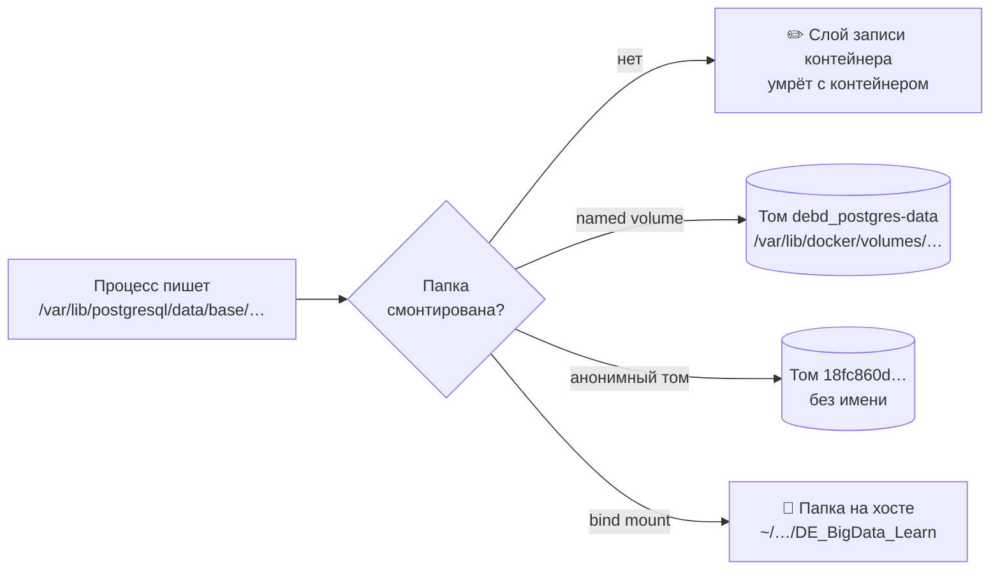
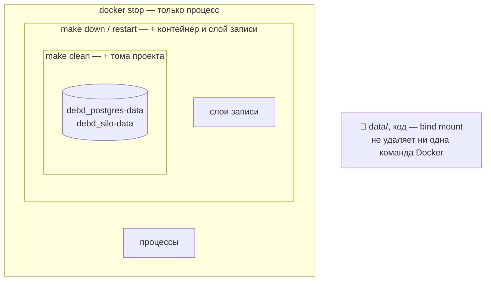
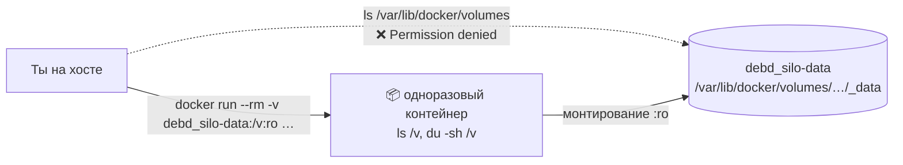
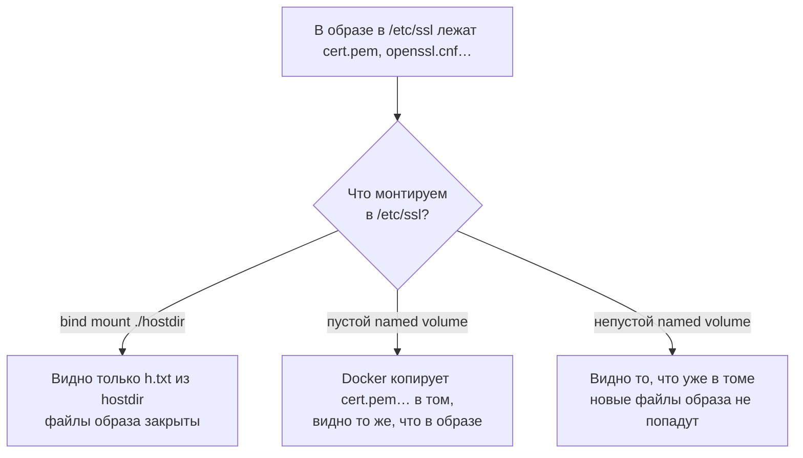
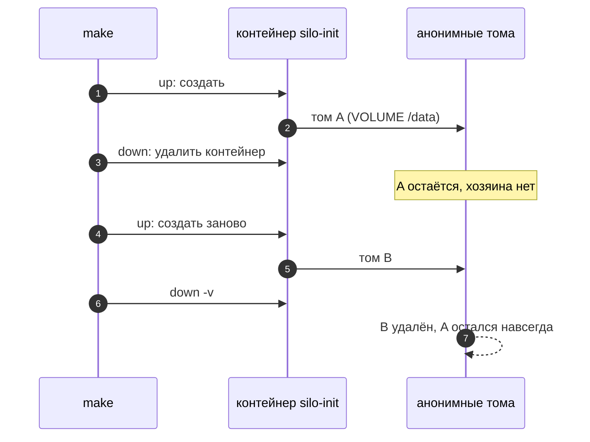
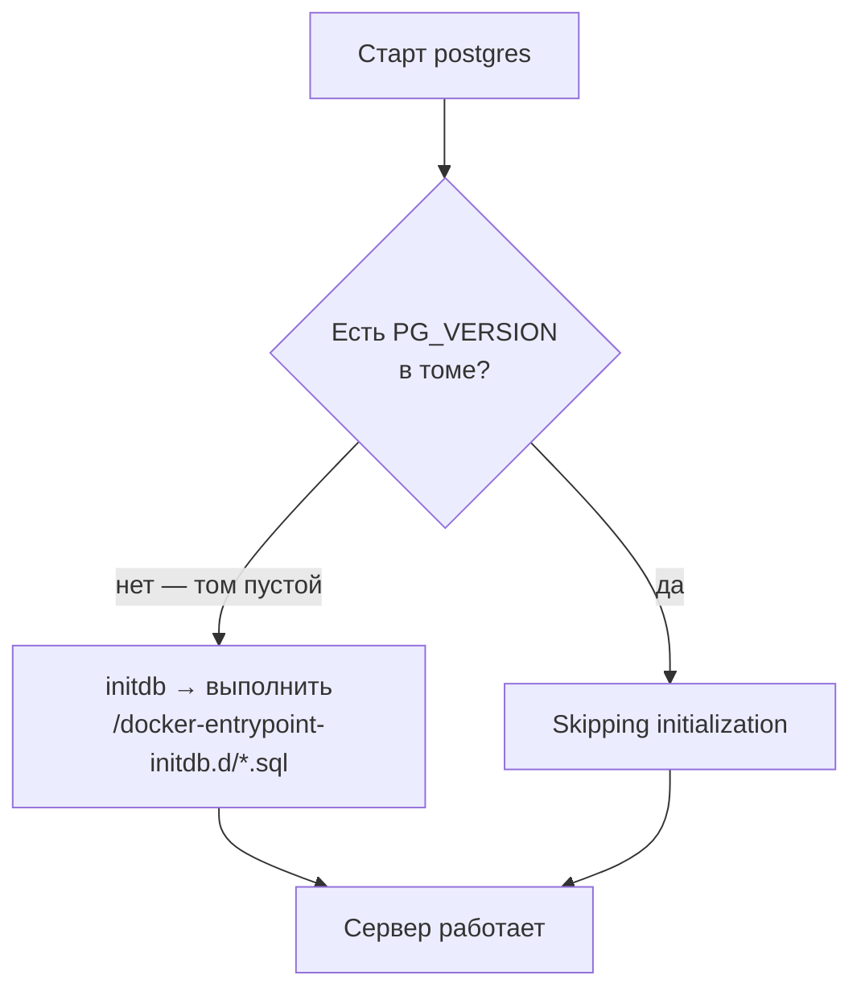
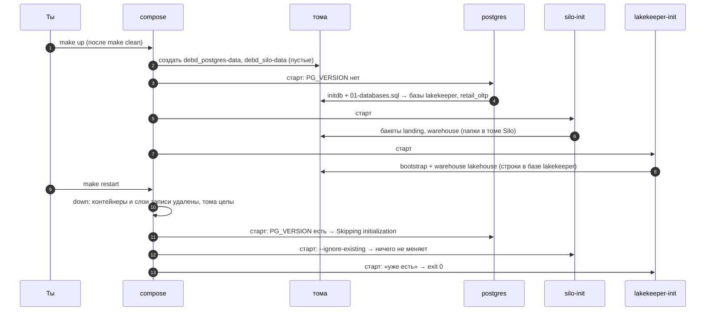

# 06 · Тома и состояние: что переживёт перезапуск, а что нет

> [!info] Урок одной фразой
> Кабинет можно снести и обставить заново за секунду: всё, что лежало на столе, выбросят.
> Уцелеет только то, что убрали в сейф архива (том) или что лежит у тебя дома и видно через окно
> (bind mount). Сейфы открывают только при сносе всего этажа с флагом `-v`. Поэтому стек
> можно смело перезапускать, а удалять данные — только осознанно.

> [!todo] Чек-лист: после урока ты сможешь
> - [ ] для любой команды (`docker stop`, `make down`, `make restart`, перезагрузка, `make clean`)
>   предсказать, какие данные стека уцелеют, и объяснить почему;
> - [ ] найти, где физически лежит том, и заглянуть внутрь, не ломая права;
> - [ ] предсказать, что увидит контейнер в папке, куда смонтирован том или папка хоста;
> - [ ] найти «осиротевшие» анонимные тома и безопасно их удалить;
> - [ ] объяснить, почему одни init-скрипты выполняются один раз, а другие — при каждом `make up`
>   (задача 4).

> [!tip] Визуализация темы
> - Интерактивная страница: [visuals/volumes_state.html](../visuals/volumes_state.html). Выполняй `make down`, `make clean`, `docker volume prune` в любом порядке и смотри,
>   какие данные остались.
> - Видео с озвучкой (3:51): [volumes_state.mp4](../visuals/volumes_state.mp4) — четыре места записи, что переживает каждая команда, накрытие папки монтированием, анонимные тома-сироты, два вида инициализации.

**Нужно для:** лаба [00.1](../labs/00.1_compose_anatomy/README.md), задача 4.
**Карта урока:** [volumes-and-state.canvas](../maps/volumes-and-state.canvas).

---

## Шаг 0. Азбука: что такое «состояние»

**Состояние** — всё, что программа накопила за время работы и что нельзя получить заново из
её кода. Например, строки в базе, объекты в бакете, созданный warehouse каталога, скачанный
датасет.
Код и образ можно пересобрать по рецепту. Состояние пересобрать нельзя: оно появилось из-за
того, что происходило, пока система работала.

Docker построен на идее, что контейнеры **одноразовые**. Compose при любом удобном случае
удаляет контейнер и создаёт новый из образа: поменялась строка в `core.yaml`, вышел новый образ,
ты сделал `make down`. Это удобно, потому что пересозданный контейнер всегда в чистом,
предсказуемом виде. Но отсюда жёсткое правило: **состояние не должно жить внутри контейнера**.
Его выносят туда, откуда удаление контейнера его не заберёт.

Урок продолжает аналогию «офисное здание» из уроков [01](01_docker_and_compose_basics.md) и
[03](03_networking.md). В уроке 01 были кабинеты и сейфы, здесь разберём, как устроен архив.

| В Docker | В аналогии «офисное здание» | Подробнее |
|---|---|---|
| Слой записи контейнера | Бумаги на столе: выбрасывают при сносе кабинета | [контейнер](../../../glossary/container.md) |
| Named volume | Именной сейф в архиве здания: переживает снос кабинета | [том](../../../glossary/volume.md) |
| Анонимный том | Сейф без таблички: создан «на всякий случай», хозяина потом не найти | [анонимный том](../../../glossary/anonymous-volume.md) |
| Bind mount | Окно в твою собственную квартиру: что лежит там, видно в кабинете | [bind mount](../../../glossary/bind-mount.md) |
| `/var/lib/docker/volumes/` | Помещение архива: ключ только у коменданта (root) | |
| `make down` | Снести кабинеты, сейфы не трогать | |
| `make clean` (`down -v`) | Снести кабинеты и вскрыть сейфы этого этажа | |
| Init-скрипт | Инструкция «обставить кабинет впервые» | [идемпотентность](../../../glossary/idempotency.md) |
| `restart: unless-stopped` | Комендант после ночного отключения света включает кабинеты обратно | |

> [!tip] Как читать урок
> Наведи мышь на ссылку термина — всплывёт карточка. Блоки «Попробуй сам» выполняй сразу:
> записывать результат не нужно, это чтобы увидеть механизм своими глазами.

---

## Шаг 1. Где в нашем стеке живёт состояние?

**Проблема.** Чтобы предсказать, что потеряется при перезапуске, нужно сначала знать, где что
лежит. У контейнера есть четыре места, куда может попасть файл, и у каждого свой срок жизни.

**Как устроено.** Когда процесс в контейнере пишет файл, ядро смотрит, к какой папке
относится путь. Если папка смонтирована (ключ `volumes:` сервиса), файл уходит в источник
монтирования. Если нет — в слой записи контейнера (урок 01, шаг 2). Источников монтирования
три, итого четыре места:

1. **Слой записи** (upperdir). Личная папка контейнера на диске хоста. Живёт ровно столько,
   сколько контейнер, и удаляется вместе с ним.
2. **Named volume**. Папка в `/var/lib/docker/volumes/<имя>/_data`, у неё есть имя, по которому
   compose её находит. Живёт, пока её не удалят явно.
3. **Анонимный том**. Такая же папка, но с именем из 64 случайных hex-символов. Появляется сам,
   если образ объявил папку томом, а ты туда ничего не смонтировал (шаг 5).
4. **Bind mount**. Обычная папка на твоём диске. Docker ею не владеет и никогда её не удаляет.



**У нас.** Состояние стека распределено так:

| Что | Сервис | Куда пишется | Вид |
|---|---|---|---|
| Базы `lakekeeper` и `retail_oltp` | postgres | `/var/lib/postgresql/data` → `debd_postgres-data` | named volume |
| Бакеты `landing`, `warehouse` и объекты в них | silo | `/data` → `debd_silo-data` | named volume |
| Warehouse `lakehouse`, таблицы Iceberg (метаданные) | lakekeeper | в базе `lakekeeper`, то есть в томе Postgres | named volume (через Postgres) |
| Датасет, код, ноутбуки, кэш Hugging Face | workspace | `/workspace` → корень репозитория | bind mount |
| Расширения DuckDB, история bash | workspace | `/home/dev/…` | слой записи |
| Ничего полезного | silo-init | `/data` → `18fc860d…` | анонимный том (шаг 5) |

Обрати внимание на строку Lakekeeper: у самого сервиса нет ни одного тома. Он **хранит
состояние в чужом сервисе**, в Postgres. Поэтому сам контейнер Lakekeeper можно пересоздавать
сколько угодно: всё, что он знает, лежит в базе. Так устроены почти все сервисы в DE: сервер
приложения держат без состояния (stateless), а состояние отдают базе или объектному хранилищу.

**Что из этого следует.**

- Чтобы понять судьбу данных сервиса, смотри не на сам сервис, а на то, **куда он пишет**.
- Сервис без томов не обязательно без состояния: оно может жить в соседнем сервисе.
- Всё, что лежит в слое записи, считай временным. Расширения DuckDB — не беда: скачаются
  заново. А вот база без тома — потеря всех данных при первом `make down`.

> [!example]- Попробуй сам: что у каких контейнеров смонтировано
> ```bash
> docker ps -a --filter label=com.docker.compose.project=debd \
>   --format '{{.Names}}\t{{.Mounts}}'
> ```
> **Увидишь:** у postgres — `debd_postgres-data` и путь до `postgres/init`, у silo —
> `debd_silo-data`, у lakekeeper и lakekeeper-migrate — пусто, у silo-init — длинный hex-номер.
> Длинные пути в выводе обрезаются, полностью их покажет
> `docker inspect <контейнер> --format '{{json .Mounts}}'`.

---

## Шаг 2. Что переживает каждая команда?

**Проблема.** Команд, которые что-то останавливают, много, и выглядят они похоже. Одни только
приостанавливают процесс, другие удаляют контейнер, третьи удаляют данные. Перепутать
`make down` и `make clean` — значит потерять все таблицы.

**Как устроено.** Каждая команда затрагивает объекты Docker на своей глубине. Представь
матрёшку: процесс внутри контейнера, контейнер со слоем записи, тома рядом с ним.

- **`docker stop` / `docker compose stop`** останавливает **процесс**. Контейнер остаётся со
  статусом `Exited`, его слой записи цел. `start` запустит тот же контейнер, и все файлы
  будут на месте.
- **`make down`** (`compose down`) **удаляет контейнеры** и сеть проекта. Слои записи удаляются
  вместе с контейнерами. Тома compose не трогает, потому что удаление данных — отдельное
  решение, которое нельзя принимать «заодно».
- **`make restart`** — это `down` + `up`: старые контейнеры удалены, созданы новые из образов,
  к ним подключены **те же** тома.
- **Перезагрузка хоста.** Контейнеры не удаляются, их процессы просто прекращаются вместе с
  системой. После загрузки демон Docker сам запускает контейнеры с политикой
  `restart: unless-stopped` или `always`. Это те же контейнеры, со своими слоями записи.
- **`make clean`** (`down -v`) удаляет контейнеры **и тома** проекта: именованные из секции
  `volumes:` и анонимные у текущих контейнеров. Bind mount не удаляется никогда: это твоя папка,
  а не объект Docker.

| Команда | Процесс | Контейнер и слой записи | Named volume | Bind mount (`data/`) | Образ |
|---|---|---|---|---|---|
| `docker stop` / `start` | ⏹ → ▶ | ✅ | ✅ | ✅ | ✅ |
| Перезагрузка хоста | ⏹ → ▶ (unless-stopped) | ✅ | ✅ | ✅ | ✅ |
| `make down` | ⏹ | ❌ | ✅ | ✅ | ✅ |
| `make restart` | ⏹ → ▶ | ❌ → новый | ✅ | ✅ | ✅ |
| `make clean` | ⏹ | ❌ | ❌ | ✅ | ✅ |
| `docker image rm` | — | — | ✅ | ✅ | ❌ (скачается / соберётся) |

✅ — уцелеет, ❌ — удалится.



**Что из этого следует.**

- `make restart` безопасен для данных: всё важное у нас в томах и bind mount.
- `make clean` — единственная команда курса, после которой пропадут таблицы и бакеты. Поэтому
  в Makefile она спрашивает подтверждение.
- После `make clean` + `make up` стек снова рабочий, но **пустой**: init-контейнеры создадут
  базы, бакеты и warehouse заново (шаг 6), а загруженные данные придётся загружать снова.

> [!warning] Ловушка: после перезагрузки `depends_on` не работает
> Если после перезагрузки что-то ведёт себя странно, сделай `make restart`: тогда compose
> поднимет стек по правилам. Порядок запуска из урока [02](02_startup_order.md) соблюдает
> **compose**, когда ты выполняешь `up`. После перезагрузки контейнеры поднимает **демон
> Docker**, а он про `depends_on` ничего не знает.
>
> У нас после перезагрузки все четыре долгоживущих контейнера стартовали в пределах одной
> сотой секунды. Одноразовые контейнеры (`restart: "no"`) при этом
> не запускаются вовсе. У нас это обошлось: база и бакеты уже есть в томах, Postgres успел
> подняться, и Lakekeeper подключился без ошибок (`RestartCount` = 0). Не успей Postgres,
> Lakekeeper упал бы, и политика `unless-stopped` перезапускала бы его, пока сосед не готов.

> [!example]- Попробуй сам: чем stop отличается от down
> ```bash
> docker exec debd-workspace-1 touch /tmp/marker
> docker stop debd-workspace-1 && docker start debd-workspace-1
> docker exec debd-workspace-1 ls /tmp/marker    # файл на месте
> make restart
> docker exec debd-workspace-1 ls /tmp/marker    # No such file or directory
> ```
> **Увидишь:** после `stop`/`start` файл есть, после `make restart` его нет. **Почему:**
> `stop` не трогает контейнер, а `down` внутри `restart` удаляет его вместе со слоем записи,
> где лежал `/tmp/marker`.
>
> А вот доказательство, что перезагрузка не пересоздаёт контейнеры:
> `docker inspect debd-postgres-1 --format 'created={{.Created}} started={{.State.StartedAt}}'`.
> Если ты перезагружал машину после последнего `make up`, `created` будет раньше `started`.

---

## Шаг 3. Где том лежит физически и как заглянуть внутрь?

**Проблема.** Том — это не магия, а папка на диске. Иногда нужно посмотреть, что в ней, сколько
она весит или сделать копию. Но просто открыть её с хоста не получится.

**Как устроено.** Драйвер томов `local` (он используется по умолчанию) создаёт для каждого тома
папку `/var/lib/docker/volumes/<имя>/_data`. При старте контейнера Docker монтирует эту папку в
нужный путь внутри контейнера. Это тот же механизм, что у bind mount, только папку выбирает и
создаёт сам Docker.

Папка `/var/lib/docker` принадлежит root и закрыта для остальных пользователей. Причина в том,
что внутри лежат файлы всех контейнеров с правами их владельцев внутри контейнеров, в том числе
root. Поэтому `ls /var/lib/docker/volumes` от твоего пользователя вернёт `Permission denied`.
Ставить `sudo` ради этого не нужно: правильный способ — **заглянуть через контейнер**.
Запускаешь одноразовый контейнер, монтируешь в него том только для чтения и выполняешь там
`ls` или `du`.



**Что внутри наших томов.**

- `debd_silo-data` — файлы S3. Silo хранит каждый бакет как **папку** в `/data`, а служебные
  данные — в `.minio.sys`. Бакет, созданный в веб-консоли, — это новая папка в томе.
- `debd_postgres-data` — каталог данных PostgreSQL: `base/` (сами базы), `pg_wal/` (журнал
  изменений), `PG_VERSION` (файл с номером версии, он понадобится в шаге 6) и другие.

**Что из этого следует.**

- Размер тома — это размер папки. Смотреть его удобно через `docker system df -v`.
- Копировать файлы работающей базы как папку ненадёжно: Postgres в этот момент пишет в них, и
  копия может оказаться несогласованной. Для бэкапа Postgres есть `pg_dump`, для S3 — `mc mirror`.
- Флаг `:ro` при осмотре обязателен: так ты точно ничего не испортишь.

> [!example]- Попробуй сам: заглянуть в тома
> ```bash
> docker volume inspect debd_silo-data --format '{{.Mountpoint}}'
> docker run --rm --network none -v debd_silo-data:/v:ro \
>   --entrypoint ls pgsty/silo:RELEASE.2026-09-03T13-18-01Z -la /v
> docker run --rm --network none -v debd_postgres-data:/v:ro \
>   --entrypoint sh postgres:17.11 -c 'cat /v/PG_VERSION; du -sh /v'
> docker system df -v | grep -E 'VOLUME NAME|debd_'
> ```
> **Увидишь:** путь `/var/lib/docker/volumes/debd_silo-data/_data`; в томе Silo — папки
> `.minio.sys`, `landing`, `warehouse`; в томе Postgres — версия `17` и размер около 80 МБ.
> Образы берём те, что уже скачаны для стека, а `--network none` не даёт контейнеру создать
> сеть (на этой машине это важно, см. урок 03, шаг 6).

---

## Шаг 4. Что видит контейнер в смонтированной папке?

**Проблема.** В образе в папке уже могут лежать файлы. Что будет с ними, когда в эту же папку
смонтируют том или папку хоста? Ответ разный для двух видов монтирования, и от него зависит,
почему что-то «пропадает» или «не обновляется».

**Как устроено.** Монтирование в Linux **накрывает** папку. Пока источник смонтирован, процесс
видит только его содержимое. Файлы образа в этой папке становятся невидимыми: они никуда не
делись, просто закрыты сверху. Разница в том, что Docker делает **до** монтирования:

1. **Bind mount** монтируется как есть. Что лежит в папке хоста, то контейнер и видит. Файлы
   образа закрыты.
2. **Named volume, который пустой**, Docker сначала **заполняет копией** содержимого этой папки
   из образа, а потом монтирует. Контейнер видит те же файлы, что были в образе, но уже в томе.
3. **Named volume, в котором уже что-то есть**, монтируется как есть. Копирование происходит
   только один раз, при первом подключении пустого тома.



**У нас это видно на workspace.** Dockerfile кладёт `pyproject.toml` и `uv.lock` в
`/workspace` образа (урок 07). В compose в `/workspace` смонтирован весь репозиторий через bind
mount. В итоге файлы из образа закрыты, и ты видишь живые файлы с диска, а не их копии на момент
сборки. Правишь `pyproject.toml` в VS Code, и в контейнере сразу виден новый файл.

**Что из этого следует.**

- Всё, что образ кладёт в папку, куда потом монтируется bind mount, в работающем контейнере
  **недоступно**. Если программе нужны файлы из образа, их кладут вне точек монтирования.
  Именно из-за этого правила выбирают, где в образе держать виртуальное окружение Python (урок 07).
- Если автор образа обновил файлы в папке тома, **старый том их не получит**: копирование
  выполняется только в пустой том. Это частая причина «обновил образ, а конфиг старый».
- Копирование из образа делает только Docker при монтировании named volume. Bind mount
  ничего не копирует, папка хоста не меняется.

> [!example]- Попробуй сам: файлы образа под bind mount
> ```bash
> docker run --rm --network none --entrypoint ls debd/workspace:local -la /workspace
> docker exec debd-workspace-1 ls /workspace | head -5
> ```
> **Увидишь:** в самом образе в `/workspace` лежат только `pyproject.toml` и `uv.lock`. В
> работающем контейнере там весь репозиторий: `AGENTS.md`, `Makefile`, `data`, `modules`…
> **Почему:** в первой команде ничего не смонтировано, во второй bind mount закрыл папку образа.

---

## Шаг 5. Анонимные тома: откуда берутся сейфы без табличек

**Проблема.** В `docker volume ls` на этой машине больше десятка томов с именами вида
`18fc860d375d…`. Они занимают место, и непонятно, чьи они и можно ли их удалить.

**Как устроено.** Автор образа может объявить в Dockerfile инструкцию `VOLUME /путь`. Этим он
говорит: «в этой папке будут данные, не пишите их в слой записи». Docker выполняет это
буквально. Если при создании контейнера в эту папку ничего не смонтировано, он **сам создаёт
том со случайным именем** и монтирует его туда. Это и есть
[анонимный том](../../../glossary/anonymous-volume.md).

Образ Silo объявляет `VOLUME /data`. Сервис `silo` монтирует туда `silo-data`, поэтому
анонимный том не нужен. А `silo-init` построен на том же образе, но ничего в `/data` не
монтирует: ему это и не нужно, он лишь вызывает `mc mb`. Docker всё равно создаёт для него
анонимный том.

Дальше начинается накопление:

1. `make up` создаёт `silo-init` с анонимным томом A.
2. `make down` удаляет контейнер. Анонимный том A compose **оставляет**, потому что `down` без
   `-v` тома не трогает. У тома A больше нет хозяина.
3. Следующий `make up` создаёт новый контейнер `silo-init` и новый анонимный том B.
4. `make clean` (`down -v`) удалит том B, потому что он подключён к текущему контейнеру. Том A
   не удалится: compose про него уже не знает.



**Что из этого следует.**

- Анонимные тома копятся после каждого цикла `down`/`up` у сервисов, чей образ объявляет
  `VOLUME`, если туда ничего не смонтировано. У нас это `silo-init`. Том пустой и ничего не
  весит, но засоряет список.
- Найти сирот можно фильтром `dangling=true`: это тома, не подключённые ни к одному контейнеру.
- `docker volume prune` удаляет неподключённые **анонимные** тома. Флаг `-a` удаляет
  **все** неподключённые тома, в том числе именованные. На этой машине так пропал бы, например,
  том `open-webui_open-webui` (1,1 ГБ): его контейнер сейчас не существует, но данные нужны.

> [!danger] `docker volume prune -a` — только если точно понимаешь, что удаляешь
> Перед любым `prune` смотри список томов. «Неподключённый» не значит «ненужный». Том остановленного и удалённого проекта тоже не
> подключён. Список: `docker volume ls -f dangling=true`.

> [!example]- Попробуй сам: найти сирот
> ```bash
> docker inspect debd-silo-init-1 --format '{{range .Mounts}}{{.Name}} → {{.Destination}}{{end}}'
> docker image inspect pgsty/silo:RELEASE.2026-09-03T13-18-01Z --format '{{json .Config.Volumes}}'
> docker volume ls -f dangling=true
> docker system df -v | sed -n '/Local Volumes/,/Build cache/p'
> ```
> **Увидишь:** у `silo-init` анонимный том в `/data`; в образе Silo — `{"/data":{}}`; список
> висящих томов с hex-именами; в `docker system df -v` у них `LINKS 0` и, как правило, `0B`.

---

## Шаг 6. Почему одна инициализация выполняется один раз, а другая — каждый раз

**Проблема.** Свежему стеку нужна первичная настройка: создать базы, бакеты, warehouse. Но
`make up` запускается сотни раз. Настройка не должна ни ломать уже созданное, ни создавать
дубли. Есть два способа этого добиться, и в нашем стеке работают оба.

### Способ 1. «Только в пустую папку»: init-скрипты Postgres

**Как устроено.** Официальный образ Postgres запускает не сам сервер, а скрипт
`docker-entrypoint.sh`. При старте он проверяет, есть ли в каталоге данных файл `PG_VERSION`:

1. **Файла нет** — каталог пустой, это первый запуск. Скрипт создаёт кластер (`initdb`),
   временно поднимает сервер, выполняет по алфавиту все файлы из `/docker-entrypoint-initdb.d`
   (у нас `01-databases.sql`), останавливает сервер и запускает его уже насовсем.
2. **Файл есть** — база уже инициализирована. Скрипт пишет в лог
   `Database directory appears to contain a database; Skipping initialization` и сразу запускает
   сервер. Папка `/docker-entrypoint-initdb.d` не читается вовсе.

`PG_VERSION` лежит в томе `debd_postgres-data`, а том переживает всё, кроме `make clean`.
Поэтому `01-databases.sql` выполнился один раз, 23 сентября, и больше не выполнится, пока том
не удалят.



**Что из этого следует.** Если сейчас дописать в `01-databases.sql` третью базу, ничего не
произойдёт: скрипт не будет прочитан. Есть два пути: создать базу вручную
(`CREATE DATABASE` через `psql`) или удалить том через `make clean` и потерять всё остальное.
Такие скрипты годятся только для первичной разметки, а не для последующих изменений.

### Способ 2. «Проверь и сделай»: идемпотентные init-контейнеры

**Как устроено.** `silo-init` и `lakekeeper-init` запускаются при **каждом** `make up`: они
одноразовые, и compose создаёт их заново вместе со всем стеком. Поэтому их команды написаны
[идемпотентно](../../../glossary/idempotency.md), то есть повторный запуск даёт тот же результат,
что и первый:

- `silo-init`: `mc mb --ignore-existing local/landing local/warehouse`. Флаг
  `--ignore-existing` превращает «бакет уже есть» из ошибки в норму.
- `lakekeeper-init` (`init.sh`): сначала спрашивает у API, выполнен ли bootstrap и есть ли
  warehouse, и делает POST, только если нет. Если warehouse уже есть, скрипт выходит с кодом 0.

Где эти скрипты хранят «память» о том, что уже сделано? Нигде в себе: они каждый раз
**спрашивают у состояния**, которое лежит в томах. Бакеты — папки в `debd_silo-data`, warehouse
— строка в базе `lakekeeper` в `debd_postgres-data`.

| | Postgres initdb.d | silo-init, lakekeeper-init |
|---|---|---|
| Когда выполняется | только если том пуст | при каждом `make up` |
| Как избегает повтора | проверяет файл `PG_VERSION` | спрашивает «уже есть?» перед каждым действием |
| Правка скрипта применится | только после `make clean` | при следующем `make up` |
| Что будет без защиты | — | ошибка «уже существует», exit ≠ 0, стек не поднимется |

Последняя строка — главное. Одноразовые контейнеры связаны с остальными через
`service_completed_successfully` (урок 02). Если бы `mc mb` без `--ignore-existing` падал на
существующем бакете, `silo-init` завершился бы с ненулевым кодом, и Lakekeeper **никогда** бы
не стартовал после первого запуска.

> [!warning] Ловушка: сообщение не равно действию
> Верь коду выхода и состоянию хранилища, а не тексту сообщения. В логе `silo-init` каждый
> раз пишет `Bucket created successfully`, хотя бакеты существуют с 23 сентября. С флагом
> `--ignore-existing` `mc` печатает одно и то же в обоих случаях.

> [!example]- Попробуй сам: следы обеих стратегий в логах
> ```bash
> docker logs debd-postgres-1 2>&1 | grep -E 'Skipping|ready to accept'
> docker logs debd-lakekeeper-init-1
> docker logs debd-silo-init-1
> ```
> **Увидишь:** у Postgres после каждого старта — `Skipping initialization`; у lakekeeper-init —
> `уже bootstrapped` и `warehouse 'lakehouse' уже существует`; у silo-init —
> `Bucket created successfully` (см. ловушку выше).

---

## Сборка целиком: жизнь стека с нуля до перезапуска

Проследим, где появляется состояние при первом запуске после `make clean` и что с ним будет при
`make restart`.



Сломай любое звено, и ты заранее знаешь симптом:

| Где сломано | Шаг на схеме | Симптом |
|---|---|---|
| У postgres нет тома | 11 | после `make restart` баз нет: новый контейнер получил пустой анонимный том |
| Опечатка в `01-databases.sql` | 4 | Postgres падает на первом старте. `PG_VERSION` к этому моменту уже создан, поэтому при перезапуске init пропускается, и баз так и нет |
| Правка `01-databases.sql` на существующем томе | 11 | ничего не меняется: скрипт не читается |
| `mc mb` без `--ignore-existing` | 12 | `silo-init` exit ≠ 0, `make up` падает, Lakekeeper не стартует |
| `init.sh` без проверки «уже есть» | 13 | повторный POST warehouse отвечает ошибкой, `curl -f` → exit 22, `lakekeeper-init` падает |
| `make clean` вместо `make down` | 10 | стек поднимется пустым: все таблицы и файлы в бакетах потеряны |

---

## Шпаргалка

| Хочу | Как |
|---|---|
| Остановить, сохранив всё | `docker stop <контейнер>` или `make down` (тома целы) |
| Удалить данные стека | `make clean` — осознанно, с подтверждением |
| Список томов проекта | `docker volume ls --filter label=com.docker.compose.project=debd` |
| Где лежит том | `docker volume inspect <том> --format '{{.Mountpoint}}'` |
| Заглянуть в том | `docker run --rm --network none -v <том>:/v:ro --entrypoint ls <образ> -la /v` |
| Размер томов | `docker system df -v` |
| Что смонтировано у контейнера | `docker inspect <контейнер> --format '{{json .Mounts}}'` |
| Какие папки образ объявил томами | `docker image inspect <образ> --format '{{json .Config.Volumes}}'` |
| Найти осиротевшие тома | `docker volume ls -f dangling=true` |
| Удалить осиротевшие анонимные | `docker volume prune` (без `-a`!) |
| Создать базу после первого старта | `psql` + `CREATE DATABASE`, а не правка `initdb.d` |

## Типичные ошибки

| Симптом | Причина | Как проверить | Как чинить |
|---|---|---|---|
| После `make restart` пропал файл в `/tmp` или `~` контейнера | он лежал в слое записи | `docker diff <контейнер>` | класть нужное в том или в `/workspace` |
| Новая строка в `01-databases.sql` не сработала | том уже инициализирован, скрипт пропущен | `docker logs debd-postgres-1 \| grep Skipping` | `CREATE DATABASE` вручную или `make clean` |
| После `make clean` пропали таблицы и бакеты | `down -v` удалил тома | `docker volume ls` — томов нет | загрузить данные заново; впредь `make down` |
| Обновил образ, а в томе старые файлы | копирование из образа только в пустой том | `docker volume inspect`, дата `CreatedAt` | удалить том или обновить файлы в нём вручную |
| Файлы, которые образ кладёт в папку, «исчезли» | их закрыл bind mount | `docker run --rm <образ> ls <папка>` без монтирования | класть файлы образа вне точек монтирования |
| `ls /var/lib/docker/volumes` → Permission denied | папка принадлежит root | `ls -ld /var/lib/docker` | смотреть через одноразовый контейнер с `:ro` |
| В `docker volume ls` куча hex-имён | анонимные тома от `VOLUME` в образах | `docker volume ls -f dangling=true` | `docker volume prune` |
| Init-контейнер падает на втором `make up` | операция не идемпотентна: «уже существует» | `docker logs <init-контейнер>` | проверка «уже есть?» или флаг вроде `--ignore-existing` |
| После перезагрузки сервис ругается на соседа | демон стартует всё сразу, без `depends_on` | `docker inspect … .State.StartedAt` у всех — одно время | `make restart` |

---

## Проверь себя

Карточки для интервального повторения — в [flashcards.md](../flashcards.md).

> [!question] 1. Коллега убрал у postgres строку `postgres-data:/var/lib/postgresql/data` и сделал `make up`. Всё заработало. Что случится после `make restart`?
> > [!success]- Ответ
> > Все базы пропадут. Образ Postgres объявляет `VOLUME` на этой папке, поэтому данные попали в
> > анонимный том. `down` удалит контейнер, а при следующем `up` Docker создаст новый контейнер
> > с новым пустым анонимным томом. Старый том останется на диске сиротой. Postgres увидит
> > пустую папку без `PG_VERSION`, заново выполнит init-скрипты, и базы окажутся пустыми.

> [!question] 2. Ты создал в веб-консоли Silo бакет `tmp` и сделал `make clean` → `make up`. Какие бакеты будут в Silo и почему?
> > [!success]- Ответ
> > Только `landing` и `warehouse`. `make clean` удалил том `debd_silo-data`, где бакеты были
> > папками. При `up` том создался пустым, а `silo-init` создал заново только бакеты из своей
> > команды. Про `tmp` не знает ни один скрипт.

> [!question] 3. Почему `lakekeeper-init` можно запускать при каждом `make up`, а `CREATE DATABASE lakekeeper;` из `01-databases.sql` — нельзя?
> > [!success]- Ответ
> > `init.sh` перед каждым действием проверяет, сделано ли оно уже, поэтому повтор ничего не
> > меняет и завершается с кодом 0. Голый `CREATE DATABASE` на существующей базе падает с
> > ошибкой `already exists`. Postgres защищается от повтора иначе: выполняет initdb.d только
> > на пустом томе.

> [!question] 4. Почему датасет в `data/` переживает `make clean`?
> > [!success]- Ответ
> > `data/` — часть репозитория, который смонтирован в workspace через bind mount. Это обычная
> > папка на хосте, а не объект Docker. `down -v` удаляет только тома, которыми управляет
> > Docker, и никогда не трогает папки хоста.

> [!question] 5. Перед чисткой диска ты хочешь выполнить `docker volume prune -a -f`. Что может пойти не так?
> > [!success]- Ответ
> > `-a` удаляет все неподключённые тома, в том числе именованные, а `-f` не спрашивает
> > подтверждения. Удалятся тома всех остановленных или удалённых проектов, например
> > `open-webui_open-webui` с данными другой программы. Если стек `debd` в этот момент опущен
> > через `make down`, пропадут и `debd_postgres-data` с `debd_silo-data`. Безопаснее
> > `docker volume prune` без `-a`, после просмотра списка `dangling=true`.

> [!question] 6. После перезагрузки машины `docker ps` показывает workspace `Up`, а `lakekeeper-init` — `Exited` со вчерашней датой. Это поломка?
> > [!success]- Ответ
> > Нет. После перезагрузки демон Docker запускает только контейнеры с политикой
> > `unless-stopped`/`always`. У одноразовых стоит `restart: "no"`, поэтому их никто не
> > перезапускает. Они и не нужны: всё, что они создавали, уже лежит в томах.
