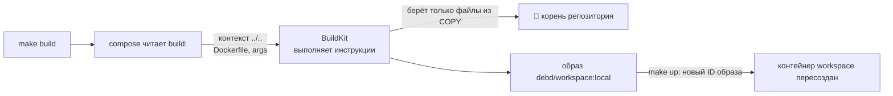
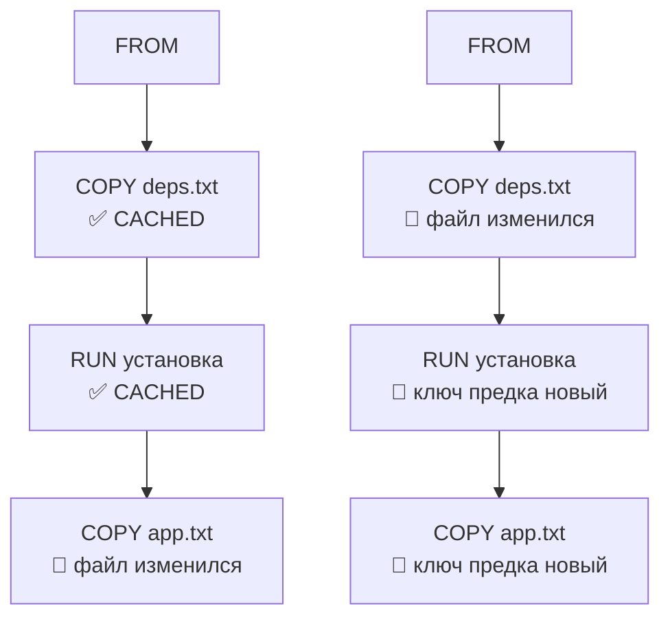
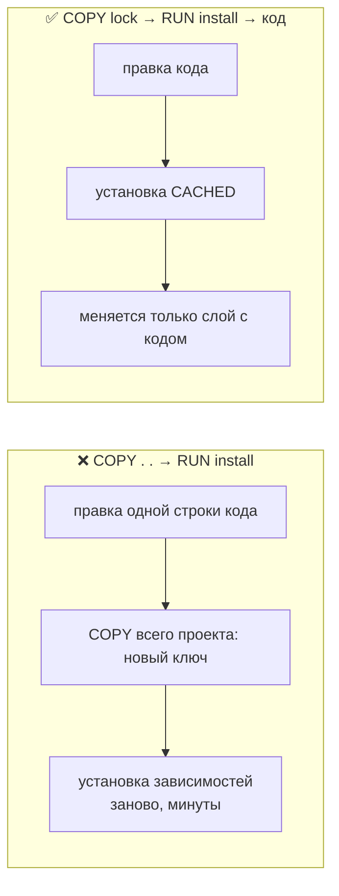
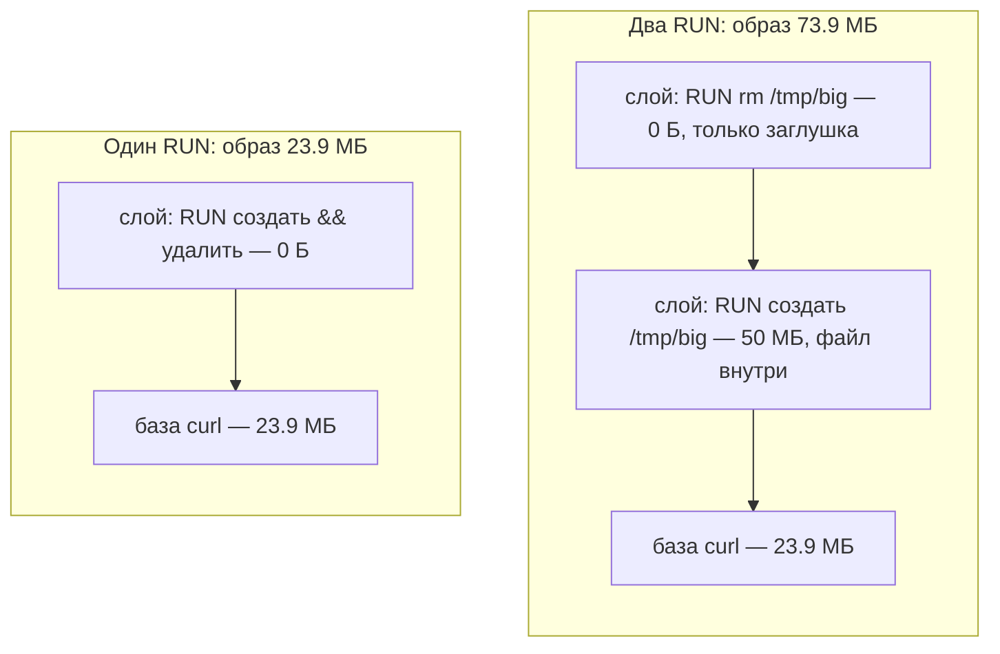
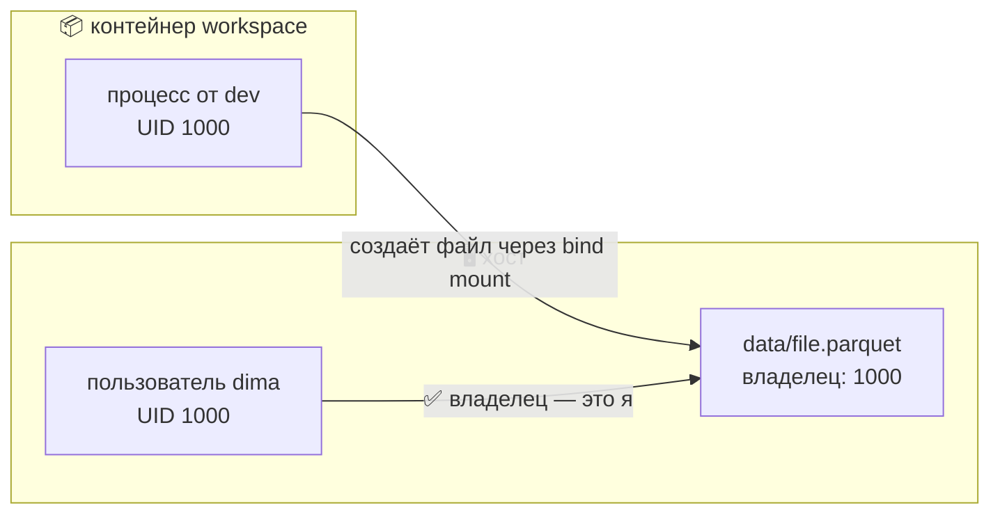
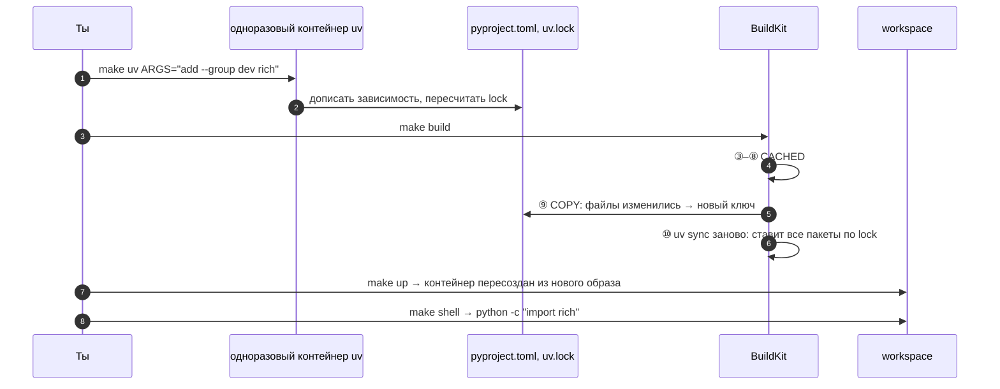
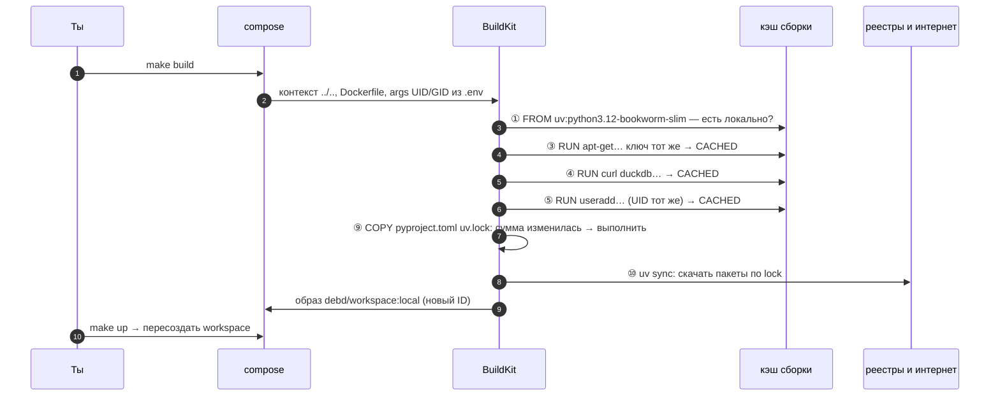

# 07 · Dockerfile и слои образа: как собирается наш workspace

> [!info] Урок одной фразой
> Dockerfile — техзадание для бригады: по пунктам, сверху вниз, каждый пункт даёт новый лист
> проекта (слой). Готовые листы бригада хранит в архиве и повторно не чертит, пока не
> изменился пункт или всё, что выше него. Поэтому редко меняющееся ставят наверх, а лист,
> однажды добавленный в проект, из него уже не вырвать: образ только растёт.

> [!todo] Чек-лист: после урока ты сможешь
> - [ ] прочитать любой Dockerfile и сказать, что делает каждая строка и какая даст слой с файлами;
> - [ ] предсказать, какие шаги пересоберутся после правки файла, и расставить инструкции так,
>   чтобы сборка была быстрой;
> - [ ] найти, из-за чего образ тяжёлый, и объяснить, почему `rm` в отдельном `RUN` не помогает;
> - [ ] объяснить, зачем в образе пользователь с твоим UID и что будет с правами без него;
> - [ ] добавить Python-пакет в workspace правильным путём (задача 5).

> [!tip] Визуализация темы
> Видео с озвучкой (2:51): [visuals/dockerfile_layers.mp4](../visuals/dockerfile_layers.mp4) — слои
> workspace, каскад кэша, порядок инструкций, почему образ только растёт, UID.

**Нужно для:** лаба [00.1](../labs/00.1_compose_anatomy/README.md), задача 5.
**Карта урока:** [dockerfile-layers.canvas](../maps/dockerfile-layers.canvas).

---

## Шаг 0. Азбука: что значит «собрать образ»

В уроке [01](01_docker_and_compose_basics.md) образ был готовой стопкой слоёв, которую скачивают
из реестра. Postgres, Silo, Lakekeeper мы так и берём: кто-то уже собрал образ, мы указываем
его имя и тег. Но для workspace готового образа нет: в нём должны быть **наши** Python-пакеты
ровно тех версий, что записаны в `uv.lock`. Поэтому workspace мы **собираем сами**.

Сборка — это исполнение рецепта: Docker берёт базовый образ, по очереди выполняет инструкции
[Dockerfile](../../../glossary/dockerfile.md) и после каждой фиксирует изменения файловой
системы как новый [слой](../../../glossary/image-layer.md). Результат получает имя
`debd/workspace:local` и дальше ведёт себя как любой скачанный образ.

Аналогия «офисное здание» продолжается: в уроке 01 образ был типовым проектом кабинета, здесь
разберём, как этот проект чертят.

| В Docker | В аналогии «офисное здание» | Подробнее |
|---|---|---|
| Dockerfile | Техзадание бригаде: пункты по порядку | [Dockerfile](../../../glossary/dockerfile.md) |
| Инструкция (`RUN`, `COPY`…) | Один пункт техзадания | |
| Слой | Лист проекта, начерченный по пункту | [слой](../../../glossary/image-layer.md) |
| `FROM` | «Берём за основу типовой проект такой-то» | |
| Контекст сборки | Папка материалов, переданная бригаде | [контекст сборки](../../../glossary/build-context.md) |
| Кэш сборки | Архив готовых листов: если пункт не менялся, лист берут из архива | [кэш сборки](../../../glossary/build-cache.md) |
| `ARG` | Параметр заказа: известен только на время стройки | |
| `ENV` | Табличка на стене: остаётся в кабинете навсегда | [переменная окружения](../../../glossary/environment-variable.md) |
| `USER` | Чьё имя на пропуске сотрудника | [UID и GID](../../../glossary/uid-gid.md) |
| `make build` | Заказать бригаде проект | |

> [!tip] Как читать урок
> Наведи мышь на ссылку термина — всплывёт карточка. Блоки «Попробуй сам» выполняй сразу:
> записывать результат не нужно, это чтобы увидеть механизм своими глазами. Экспериментальные
> образы собирай во временной папке (`mktemp -d`), а не в репозитории.

---

## Шаг 1. Как читать Dockerfile?

**Проблема.** Dockerfile — короткий, но плотный файл: каждая строка что-то меняет в образе или в
том, как будет запускаться контейнер. Чтобы понять, откуда в workspace берутся `python`,
`duckdb` и пользователь `dev`, нужно знать, что делает каждая инструкция.

**Как устроено.** Docker читает файл сверху вниз. Каждая строка начинается с инструкции
заглавными буквами, дальше её аргументы. Строка, оканчивающаяся на `\`, продолжается на
следующей. Инструкции делятся на два вида:

- **Меняющие файлы** — `RUN`, `COPY`, `ADD`. Они дают слой с реальным содержимым и весом.
- **Меняющие метаданные** — всё остальное. Они записывают настройку в описание образа, и в
  истории у них размер `0B`.

| Инструкция | Что делает | Слой с файлами? |
|---|---|---|
| `FROM образ:тег` | берёт готовый образ за основу; всё дальше строится поверх | — (слои базы) |
| `ARG ИМЯ=значение` | параметр сборки; виден только во время сборки | нет |
| `RUN команда` | выполняет команду оболочки во временном контейнере и сохраняет изменения | **да** |
| `COPY откуда куда` | копирует файлы из контекста сборки в образ | **да** |
| `ADD` | как `COPY`, но умеет скачивать URL и распаковывать архивы; без нужды не используют | **да** |
| `ENV ИМЯ=значение` | переменная окружения: и для следующих шагов сборки, и в каждом контейнере | нет |
| `WORKDIR /путь` | текущая папка для следующих инструкций и для контейнера; создаёт её, если нет | почти нет |
| `USER имя` | от чьего имени выполняются следующие `RUN` и процесс контейнера | нет |
| `ENTRYPOINT`, `CMD` | команда запуска контейнера (урок 03, шаг 9) | нет |
| `EXPOSE`, `VOLUME`, `LABEL` | документация порта, объявление тома (урок 06, шаг 5), метки | нет |

**У нас.** Весь [`Dockerfile`](../../../infra/docker/workspace/Dockerfile) workspace, с
разметкой:

```dockerfile
FROM ghcr.io/astral-sh/uv:python3.12-bookworm-slim          # ①

ARG UID=1000                                                 # ②
ARG GID=1000

RUN apt-get update \                                         # ③
    && apt-get install -y --no-install-recommends git make curl postgresql-client \
    && rm -rf /var/lib/apt/lists/*

ARG DUCKDB_VERSION=1.5.5                                     # ④
RUN curl -fsSL -o /tmp/duckdb.gz "https://github.com/…/duckdb_cli-linux-amd64.gz" \
    && gunzip -c /tmp/duckdb.gz > /usr/local/bin/duckdb \
    && chmod +x /usr/local/bin/duckdb \
    && rm /tmp/duckdb.gz

RUN groupadd -g ${GID} dev && useradd -m -u ${UID} -g ${GID} -s /bin/bash dev \   # ⑤
    && mkdir -p /opt/venv && chown dev:dev /opt/venv

USER dev                                                     # ⑥
ENV UV_PROJECT_ENVIRONMENT=/opt/venv \                       # ⑦
    UV_LINK_MODE=copy \
    UV_COMPILE_BYTECODE=1 \
    PATH=/opt/venv/bin:$PATH

WORKDIR /workspace                                           # ⑧
COPY --chown=dev:dev pyproject.toml uv.lock ./               # ⑨
RUN uv sync --frozen --no-install-project                    # ⑩
```

| Метка | Что происходит | Подробности |
|---|---|---|
| ① | основа: Debian bookworm-slim + Python 3.12 + утилита `uv` | готовый образ от авторов uv |
| ② | параметры сборки UID и GID, по умолчанию 1000 | шаг 6 |
| ③ | системные пакеты: git, make, curl, клиент `psql` | шаг 5: почему `rm` в той же строке |
| ④ | бинарник DuckDB CLI фиксированной версии | версия — параметром, чтобы менять в одном месте |
| ⑤ | пользователь `dev` с заданными UID/GID и папка под venv | шаг 6 |
| ⑥ | всё дальше выполняется от `dev`, а не от root | шаг 6 |
| ⑦ | настройки uv и `PATH`: `python` найдётся в `/opt/venv/bin` | шаг 7 |
| ⑧ | рабочая папка `/workspace` | урок 06, шаг 4: её закроет bind mount |
| ⑨ | в образ попадают **только** два файла описания зависимостей | шаг 4 |
| ⑩ | uv ставит пакеты ровно по `uv.lock` в `/opt/venv` | шаг 7 |

В Dockerfile нет `CMD` и `ENTRYPOINT`, поэтому они наследуются от базового образа: `CMD` там
`["/usr/local/bin/uv"]`. Но compose задаёт свою команду (`jupyter lab …`), и она заменяет
унаследованную (урок 03, шаг 9).

> [!example]- Попробуй сам: каждая инструкция в истории образа
> ```bash
> docker history debd/workspace:local --format '{{.Size}}\t{{.CreatedBy}}' | cut -c1-90
> docker image inspect debd/workspace:local --format '{{json .Config.Cmd}} {{.Config.User}} {{.Config.WorkingDir}}'
> ```
> **Увидишь:** сверху — наши инструкции (от `RUN uv sync` до `ARG UID`), ниже — слои базового
> образа uv и Debian. У `ENV`, `USER`, `ARG`, `WORKDIR` размер `0B`. В метаданных — `CMD` от
> базового образа, пользователь `dev` и папка `/workspace`. Перед нашими `RUN` в истории
> написано `|3 UID=1000 GID=1000 DUCKDB_VERSION=…`: это параметры, с которыми выполнялся шаг.

---

## Шаг 2. Кто и откуда собирает образ: compose, `build:` и контекст

**Проблема.** В `COPY pyproject.toml uv.lock ./` нет полного пути. Откуда Docker знает, в какой
папке искать эти файлы? И кто вообще запускает сборку?

**Как устроено.** Сборку делает компонент Docker под названием **BuildKit**. Ему передают две
вещи: Dockerfile и **[контекст сборки](../../../glossary/build-context.md)** — папку, из
которой `COPY` имеет право брать файлы. Все пути-источники в `COPY` считаются **от корня
контекста**, и выйти за его пределы (`COPY ../secret …`) нельзя: BuildKit видит только эту
папку.

У нас сборку описывает блок `build:` сервиса workspace в `core.yaml`:

```yaml
workspace:
  build:
    context: ../..                                   # ① контекст: корень репозитория
    dockerfile: infra/docker/workspace/Dockerfile    # ② рецепт, путь от контекста
    args:                                            # ③ значения для ARG
      UID: ${HOST_UID:-1000}
      GID: ${HOST_GID:-1000}
  image: debd/workspace:local                        # ④ имя готового образа
```

| Метка | Смысл |
|---|---|
| ① | путь от папки compose-файла (`infra/docker/`), `../..` — корень репозитория. Поэтому `COPY pyproject.toml` находит файл в корне |
| ② | где лежит Dockerfile, путь от контекста |
| ③ | значения для `ARG UID` и `ARG GID`. Берутся из `.env`, а если там пусто — 1000 |
| ④ | под каким именем сохранить результат. Без `image:` compose придумал бы имя сам |

`make build` вызывает `docker compose … build workspace`. Compose читает блок `build:` и отдаёт
BuildKit контекст и Dockerfile. BuildKit передаёт из контекста не всю папку, а только файлы,
которые упомянуты в `COPY`, и только изменившиеся с прошлой сборки. Поэтому 110 МБ датасета в
`data/` сборку не замедляют: в выводе `transferring context` будут байты, а не мегабайты.

**Когда compose собирает образ сам.** `make up` собирает workspace только если образа
`debd/workspace:local` **ещё нет**. Если образ есть, `up` использует его как есть, даже если ты
поменял Dockerfile или `uv.lock`. Пересборку нужно заказать явно: `make build`. После неё
`make up` заметит, что у образа новый ID, и пересоздаст контейнер workspace.



**Что из этого следует.**

- Чем больше контекст, тем внимательнее надо быть с `COPY . .`: такая строка потащит в образ
  всё, включая `.env` с паролями и `data/`. Для этого существует файл `.dockerignore`, список
  исключений из контекста. У нас он не нужен: мы копируем два конкретных файла.
- Поправил Dockerfile или зависимости и забыл `make build` → работаешь со старым образом.

> [!warning] Ловушка: `make up` не пересобирает
> Изменения в `pyproject.toml` сразу видны в `/workspace` через bind mount, и кажется, что
> «всё обновилось». Но пакеты стоят в `/opt/venv` **образа**, а образ не пересобирался. Итог —
> `ModuleNotFoundError` на пакет, который вроде бы добавлен.

---

## Шаг 3. Кэш сборки: когда шаг не выполняется заново

**Проблема.** Шаг `uv sync` скачивает и распаковывает больше гигабайта пакетов. Если выполнять
его при каждой сборке, любая мелкая правка стоила бы минут ожидания. Docker должен понимать,
какие шаги можно не повторять.

**Как устроено.** Перед выполнением каждой инструкции BuildKit вычисляет её **ключ кэша** и
ищет в [кэше сборки](../../../glossary/build-cache.md) готовый слой с таким ключом. Ключ
складывается из:

1. **ключа предыдущего шага**. Поэтому ключ каждого шага зависит от всех шагов выше;
2. **текста инструкции** с подставленными значениями `ARG`;
3. **для `COPY` и `ADD` — контрольных сумм содержимого** копируемых файлов.

Если слой с таким ключом найден, шаг помечается `CACHED` и не выполняется. Если нет, шаг
выполняется. Раз его ключ новый, у всех шагов ниже ключи тоже новые, поэтому **всё, что ниже,
выполняется заново**. Кэш ломается каскадом, сверху вниз.



Слева правка затронула только последний шаг, справа — первый, и пересобралось всё.

Из состава ключа следуют две неочевидные вещи:

- **Для `RUN` смотрят только на текст команды, а не на результат.** `RUN apt-get update`
  однажды закэшируется и больше не выполнится, хотя в интернете давно новые списки пакетов.
  Поэтому `apt-get update` всегда пишут в одном `RUN` с `apt-get install` (шаг ③ у нас):
  иначе новый `install` мог бы взять закэшированные устаревшие списки.
- **Для `COPY` важно содержимое, а не дата файла.** `touch pyproject.toml` меняет только дату,
  и кэш не ломается.

Кэш можно выключить: `docker compose build --no-cache workspace`. Это нужно редко, например
чтобы заставить `apt-get` скачать свежие обновления безопасности.

> [!example]- Попробуй сам: каскад кэша на игрушечном образе
> ```bash
> D=$(mktemp -d) && cd "$D"
> echo v1 > deps.txt; echo code1 > app.txt
> cat > Dockerfile <<'EOF'
> FROM curlimages/curl:8.22.0
> COPY deps.txt /app/
> RUN echo "ставлю зависимости" && sleep 3
> COPY app.txt /app/
> EOF
> b() { docker build --progress plain -t zz-cache . 2>&1 | grep -E '^#[0-9]+ \[[0-9]|CACHED$'; }
> b                                  # первая сборка: всё выполняется
> echo code2 > app.txt;  echo '--- правка app';  b
> echo v2 > deps.txt;    echo '--- правка deps'; b
> touch deps.txt;        echo '--- touch';       b
> docker image rm zz-cache; cd - && rm -rf "$D"
> ```
> **Увидишь:** после правки `app.txt` шаги 2 и 3 — `CACHED`, выполнился только последний `COPY`.
> После правки `deps.txt` снова ждёшь 3 секунды: `RUN` выполнился, потому что изменился шаг
> выше. После `touch` всё `CACHED`: дата не входит в ключ.

---

## Шаг 4. Порядок инструкций: редко меняющееся — наверх

**Проблема.** Раз кэш ломается каскадом, одна и та же сборка может занимать секунду или десять
минут в зависимости от того, в каком порядке стоят инструкции.

**Как устроено.** Правило выводится прямо из шага 3: чем ниже инструкция, тем чаще она
выполняется заново, потому что её пересобирает правка любого шага выше. Значит, наверх ставят
то, что меняется **реже** и выполняется **дольше**, а вниз — то, что меняется часто.

Для проекта на Python частота изменений такая:

| Что | Как часто меняется | Сколько стоит пересборка |
|---|---|---|
| Системные пакеты (`apt-get`) | раз в месяцы | десятки секунд |
| Список Python-зависимостей (`pyproject.toml`, `uv.lock`) | раз в неделю–модуль | минуты, гигабайт скачивания |
| Код проекта | каждые несколько минут | копирование, секунды |

Отсюда классический порядок: система → **файлы зависимостей → установка зависимостей** →
код. Файлы зависимостей копируют **отдельно и раньше** кода именно для того, чтобы правка кода
не ломала кэш дорогой установки.



**У нас код вообще не копируется в образ.** Он приходит в контейнер через bind mount
репозитория в `/workspace` (урок 06, шаг 4). Образ отвечает только за **окружение**: систему,
инструменты, Python-пакеты. Код живёт на диске и виден в контейнере сразу, без сборки. Поэтому в
Dockerfile последние шаги — копирование двух файлов описания зависимостей и установка по ним.

**Что из этого следует.** Пересборка workspace нужна только при изменении окружения: Dockerfile,
`pyproject.toml`, `uv.lock` или `.env` с `HOST_UID`. Правка скриптов, ноутбуков, dbt-моделей
пересборки не требует.

---

## Шаг 5. Почему образ только растёт

**Проблема.** В шаге ③ после `apt-get install` стоит `rm -rf /var/lib/apt/lists/*`, а в шаге ④
удаляется `/tmp/duckdb.gz`. Зачем удалять в той же строке, а не отдельным `RUN rm` в конце?

**Как устроено.** Слой хранит **изменения** относительно слоёв ниже (урок 01, шаг 2). Удаление
файла в следующем слое не стирает его из предыдущего, а лишь кладёт сверху метку-«заглушку»
(whiteout), которая прячет файл из вида. Сам файл по-прежнему лежит в нижнем слое, скачивается
и занимает место. Поэтому размер образа равен **сумме всех слоёв**, и ничто, сделанное позже,
его не уменьшит.



Если же создать и удалить временный файл **в одном `RUN`**, в слой попадает только итог команды,
а файла в итоге нет. Отсюда правило: всё временное (скачанные архивы, списки пакетов, кэши
менеджеров пакетов) убирают **в том же `RUN`, где оно появилось**.

**Кэши — скрытый вес образа.** Менеджеры пакетов (`apt`, `pip`, `uv`) по умолчанию сохраняют
скачанные файлы в свою папку кэша, чтобы при следующей установке не качать их заново. На машине
разработчика это удобно. В образе это мёртвый груз: кэш едет вместе с образом, хотя пакеты уже
установлены. Способы избавиться:

| Способ | Как выглядит | Что делает |
|---|---|---|
| Удалить в том же `RUN` | `… && rm -rf /var/lib/apt/lists/*` | кэш не попадает в слой |
| Выключить кэш | `pip install --no-cache-dir`, `uv sync --no-cache` или `ENV UV_NO_CACHE=1` | кэш не создаётся |
| Кэш-монтирование BuildKit | `RUN --mount=type=cache,target=<папка кэша> …` | кэш живёт между сборками вне образа: и образ лёгкий, и пересборка быстрая |

**Как искать тяжёлое.** Два инструмента дополняют друг друга. `docker history` показывает, какой
**слой** тяжёлый. Потом внутри образа `du` показывает, какие **папки** занимают место.
Запускать `du` удобно в одноразовом контейнере без сети.

> [!example]- Попробуй сам: удаление в отдельном слое
> ```bash
> docker build -q -t zz-layers:two - <<'EOF'
> FROM curlimages/curl:8.22.0
> RUN head -c 50000000 /dev/urandom > /tmp/big
> RUN rm /tmp/big
> EOF
> docker build -q -t zz-layers:one - <<'EOF'
> FROM curlimages/curl:8.22.0
> RUN head -c 50000000 /dev/urandom > /tmp/big && rm /tmp/big
> EOF
> docker image ls --format '{{.Repository}}:{{.Tag}}\t{{.Size}}' | grep -E 'zz-layers|curlimages'
> docker history zz-layers:two --format '{{.Size}}\t{{.CreatedBy}}' | head -3
> docker image rm zz-layers:one zz-layers:two
> ```
> **Увидишь:** `zz-layers:two` весит 73.9 МБ, `zz-layers:one` — 23.9 МБ, как исходный образ.
> В истории `two`: слой `rm` — `0B`, слой с созданием файла — `50MB`. `docker build -` берёт
> Dockerfile из стандартного ввода, без контекста: `COPY` в таком образе невозможен.

> [!example]- Попробуй сам: где место внутри workspace
> ```bash
> docker run --rm --network none --entrypoint sh debd/workspace:local \
>   -c 'du -xh -d 2 / 2>/dev/null | sort -h | tail -12'
> ```
> **Увидишь:** самые большие папки образа. Сопоставь их со слоями из `docker history`: это и есть
> вопрос 4 задачи 5. Для каждой большой папки спроси себя, нужна ли она работающему контейнеру.

---

## Шаг 6. ARG, ENV и USER: параметры, окружение и чьи это файлы

### 6.1. ARG и ENV

**Проблема.** Одни значения нужны только на время сборки (какую версию DuckDB скачать, какой
UID дать пользователю). Другие должны действовать в каждом контейнере (куда uv ставит пакеты,
где искать `python`). Для этого две разные инструкции.

**Как устроено.**

- **`ARG`** — параметр сборки. Значение по умолчанию пишут в Dockerfile, а переопределяют
  снаружи: `docker build --build-arg UID=1001` или `args:` в compose. Параметр виден в
  инструкциях ниже своего объявления, но **в готовом образе его нет**: контейнер про `UID` не
  знает. Во время сборки каждый `RUN` ниже объявления получает все объявленные `ARG` как
  переменные окружения, **даже если сам их не упоминает**. Поэтому значения `ARG` входят в ключ
  кэша каждого такого `RUN`: в истории это видно как `|2 UID=1000 GID=1000` перед `apt-get`.
  Смена `UID` пересоберёт всё, начиная с первого `RUN` после `ARG UID`, то есть у нас с
  `apt-get` (шаг ③), хотя установка системных пакетов от UID не зависит. Проверено на
  игрушечном образе: `RUN echo "не использую UID"` при смене значения выполнился заново.
- **`ENV`** — переменная окружения. Действует на все следующие инструкции сборки **и** на каждый
  процесс в каждом контейнере из этого образа. Переопределить её при запуске можно через
  `environment:` в compose.

> [!danger] Секреты не передают через ARG и ENV
> Значения `ARG`, использованные в `RUN`, видны в `docker history` (та самая строка
> `|3 UID=1000 GID=1000 …`). `ENV` видна в `docker image inspect` и в любом контейнере. Пароль,
> переданный так, получит каждый, у кого есть образ. Секреты в контейнер попадают при запуске,
> через `environment:` из `.env`, как у нас.

### 6.2. USER и UID: чьи файлы

**Проблема.** Workspace пишет файлы в `/workspace`, а это твоя папка на хосте (bind mount).
Кто будет владельцем этих файлов на хосте? Если ошибиться, ты не сможешь их редактировать в
VS Code или, наоборот, контейнер не сможет писать в `data/`.

**Как устроено.** Ядро Linux не знает имён пользователей. Для него владелец файла и процесса —
это **число**, [UID](../../../glossary/uid-gid.md) (и GID для группы). Имена — это просто
строчки в файле `/etc/passwd`, и у хоста и у контейнера **свои** `/etc/passwd`. Поэтому:

1. Процесс в контейнере работает от какого-то UID. По умолчанию это 0, то есть root, если в
   образе нет `USER`.
2. Когда он создаёт файл в bind mount, ядро записывает владельцем **это число**.
3. На хосте то же число означает того пользователя, у которого такой UID в хостовом
   `/etc/passwd`. А права проверяются по числам, а не по именам.

Проверено на этой машине: один и тот же файл, созданный в bind mount из трёх контейнеров.

| Процесс в контейнере | UID | Что получилось на хосте |
|---|---|---|
| root | 0 | файл владельца `root`: ты его видишь, но не можешь изменить без `sudo` |
| `curl_user` из образа curl | 100 | `Permission denied`: папка твоя, а UID 100 на хосте — чужой, писать нельзя |
| `dev` из workspace | 1000 | файл твой: у тебя на хосте тоже UID 1000 |



**У нас.** Шаг ⑤ создаёт пользователя `dev` с UID и GID из аргументов, а шаг ⑥ переключается на
него. `make init` записывает в `.env` твои `id -u` и `id -g`, compose передаёт их в `args:`.
В итоге UID процесса в контейнере совпадает с твоим, и файлы в `data/`, `modules/`, ноутбуки
принадлежат тебе на хосте.

Две детали шага ⑤:

- `/opt/venv` создаётся ещё от root, потому что `USER dev` стоит ниже. Поэтому сразу
  `chown dev:dev /opt/venv`: иначе `uv sync`, который выполняется уже от `dev`, не смог бы туда
  писать.
- `COPY --chown=dev:dev` по той же причине. `COPY` по умолчанию создаёт файлы от root, даже
  после `USER dev`.

> [!example]- Попробуй сам: кто ты в контейнере и чьи файлы
> ```bash
> id                                                          # на хосте
> docker exec debd-workspace-1 id
> docker exec debd-workspace-1 stat -c '%u:%g %n' /workspace/Makefile /workspace/data
> grep HOST_ .env
> ```
> **Увидишь:** на хосте и в контейнере одинаковый `uid=1000`, только имена разные (`dima` и
> `dev`). Файлы репозитория в контейнере принадлежат `1000:1000`.

---

## Шаг 7. uv в образе: `/opt/venv` и `uv sync`

**Проблема.** Python-пакеты нужно поставить так, чтобы они были точно тех версий, что у всех, не
пересекались с системным Python и не пропадали при монтировании репозитория.

**Как устроено.** [uv](https://docs.astral.sh/uv/) — менеджер пакетов Python. Он работает с
двумя файлами проекта: `pyproject.toml`, где ты пишешь, **что** нужно (`duckdb>=1.5`), и
`uv.lock`, где записано, **что именно** поставить: точные версии всех пакетов и их зависимостей
с контрольными суммами. Пакеты ставятся в **виртуальное окружение (venv)** — отдельную папку со
своим `python` и своими пакетами.

Разберём шаг ⑩ и переменные из шага ⑦:

| Что | Смысл |
|---|---|
| `uv sync` | привести venv в точное соответствие с `uv.lock`: поставить недостающее, удалить лишнее |
| `--frozen` | взять `uv.lock` как есть и не пытаться его обновить. В образе lock-файл только читается |
| `--no-install-project` | поставить зависимости, но не сам проект. Наш проект — не пакет, а набор скриптов |
| `UV_PROJECT_ENVIRONMENT=/opt/venv` | где создать venv. По умолчанию uv создал бы `.venv` рядом с `pyproject.toml`, то есть в `/workspace/.venv` |
| `UV_LINK_MODE=copy` | копировать файлы пакетов в venv, а не делать ссылки на кэш uv |
| `UV_COMPILE_BYTECODE=1` | заранее скомпилировать `.py` в `.pyc`, чтобы первый импорт в контейнере был быстрее |
| `PATH=/opt/venv/bin:$PATH` | `python`, `dbt`, `jupyter` находятся в venv без `activate` |

Почему venv не в `/workspace/.venv`, где его создал бы uv по умолчанию? Вспомни урок 06, шаг 4:
bind mount **закрывает** папку образа. Всё, что сборка положила бы в `/workspace`, в работающем
контейнере станет невидимым. Ровно это и происходит с `pyproject.toml` и `uv.lock`, которые
копирует шаг ⑨: в контейнере ты видишь не их, а файлы с диска.

**Как правильно добавить пакет.** Пакеты ставятся при сборке, поэтому путь всегда один:

1. `make uv ARGS="add --group dev rich"` запускает uv в **одноразовом** контейнере (на хосте uv
   не нужен). uv дописывает пакет в `pyproject.toml` и обновляет `uv.lock`. Флаг `--no-sync`
   Makefile подставляет сам: ставить пакет в этот одноразовый контейнер бессмысленно.
2. `make build` пересобирает образ. Файлы шага ⑨ изменились, поэтому ⑨ и ⑩ выполняются заново.
   Всё выше — `CACHED`.
3. `make up` видит новый образ и пересоздаёт контейнер workspace.



> [!warning] Ловушка: `pip install` внутри контейнера
> `make shell` → `pip install rich` сработает, но пакет попадёт в слой записи контейнера. После
> `make restart` он исчезнет, а в `pyproject.toml` и `uv.lock` его не будет. У коллеги на чистой
> сборке код упадёт. Пакеты добавляют только через `make uv` + `make build`.

> [!example]- Попробуй сам: откуда берётся python
> ```bash
> docker exec debd-workspace-1 sh -c 'which python dbt duckdb uv; python -V; echo $UV_PROJECT_ENVIRONMENT'
> ```
> **Увидишь:** `python` и `dbt` из `/opt/venv/bin`, `duckdb` и `uv` из `/usr/local/bin`.

---

## Сборка целиком: `make build` после правки `uv.lock`



Сломай любое звено, и ты заранее знаешь симптом:

| Где сломано | Шаг на схеме | Симптом |
|---|---|---|
| Поменял `HOST_UID` в `.env` | 2, 4 | пересборка с шага ③: все `RUN` после `ARG UID` получили новое значение, ключи новые |
| `uv.lock` не соответствует `pyproject.toml` | 8 | `--frozen` не проверяет соответствие: поставится то, что в lock, а нового пакета не будет |
| Нет интернета | 8 | `uv sync` падает с ошибкой сети, сборка останавливается, старый образ остаётся |
| Опечатка в URL DuckDB | 5 | `curl -f` → exit 22, `RUN` падает, сборка останавливается |
| Забыл `make build` | — | в контейнере старые пакеты: `ModuleNotFoundError` |
| Забыл `make up` после сборки | 10 | контейнер работает на старом образе, пока не пересоздан |

---

## Шпаргалка

| Хочу | Как |
|---|---|
| Пересобрать workspace | `make build` |
| Пересобрать без кэша | `docker compose --env-file .env -f infra/docker/compose.yaml build --no-cache workspace` |
| Увидеть, какие шаги из кэша | `… build --progress plain workspace`, строки `CACHED` |
| Слои образа и их размер | `docker history <образ>` |
| Какие папки тяжёлые | `docker run --rm --network none --entrypoint sh <образ> -c 'du -xh -d 2 / \| sort -h \| tail'` |
| Команда, пользователь, папка образа | `docker image inspect <образ> --format '{{json .Config}}'` |
| Добавить Python-пакет | `make uv ARGS="add --group <группа> <пакет>"` → `make build` → `make up` |
| Параметр сборки | `ARG` в Dockerfile + `args:` в compose |
| Переменная для контейнера | `ENV` в Dockerfile или `environment:` в compose |
| Убрать временные файлы из образа | удалять в том же `RUN`, где они появились |

## Типичные ошибки

| Симптом | Причина | Как проверить | Как чинить |
|---|---|---|---|
| `ModuleNotFoundError` на добавленный пакет | образ не пересобран | `grep <пакет> uv.lock`; `docker image ls` — дата образа | `make build` → `make up` |
| Пакет, поставленный через `pip install`, пропал | он был в слое записи | `docker diff debd-workspace-1` | `make uv ARGS="add …"` → `make build` |
| Правка кода запускает долгую переустановку зависимостей | код копируется до установки зависимостей | `build --progress plain` — что не `CACHED` | файлы зависимостей копировать и ставить раньше кода |
| Образ огромный, хотя временные файлы удаляются | `rm` в отдельном `RUN` | `docker history` — большой слой ниже `rm` | удалять в том же `RUN` |
| Образ тяжёлый без видимой причины | в слое остался кэш менеджера пакетов | `du` внутри образа | `--no-cache` / кэш-монтирование |
| `apt-get install` не находит пакет или ставит старый | закэширован отдельный `RUN apt-get update` | Dockerfile: `update` в своём `RUN` | `update && install` в одном `RUN` |
| `COPY failed: … not found` | файла нет в контексте или путь не от корня контекста | `context:` в compose | путь от корня контекста, файл внутри него |
| Файлы, созданные в контейнере, на хосте принадлежат root | процесс контейнера работает от root | `ls -ln` на хосте; `docker exec <c> id` | `USER` с UID хоста |
| `Permission denied` при записи в bind mount | UID процесса в контейнере — чужой на хосте | `docker exec <c> id` против `id` на хосте | передать UID/GID через `ARG` |
| Пароль виден в `docker history` | передан через `ARG`/`ENV` в Dockerfile | `docker history --no-trunc` | секреты — только `environment:` при запуске |

---

## Проверь себя

Карточки для интервального повторения — в [flashcards.md](../flashcards.md).

> [!question] 1. В Dockerfile поменяли строку `ARG DUCKDB_VERSION=1.5.5` на `1.5.6`. Какие шаги выполнятся при `make build`?
> > [!success]- Ответ
> > `FROM`, `ARG UID/GID` и `RUN apt-get` — из кэша: они выше и не зависят от этого параметра.
> > Со строки `RUN curl … duckdb` ключ новый, потому что в текст команды подставляется новое
> > значение. Дальше каскад: `useradd`, `COPY`, `uv sync` выполнятся заново, хотя сами не
> > изменились. Поэтому такие параметры лучше держать как можно ниже в файле или отдельными
> > шагами после тяжёлых установок.

> [!question] 2. Коллега предлагает ради порядка заменить `COPY pyproject.toml uv.lock ./` на `COPY . .`. Что станет со сборкой?
> > [!success]- Ответ
> > В образ поедет весь репозиторий, включая `.env` с паролями и 110 МБ `data/`. Ключ кэша
> > `COPY` будет меняться при правке любого файла, поэтому `uv sync` станет выполняться при
> > каждой сборке. Причём скопированный код всё равно будет закрыт bind mount в `/workspace`,
> > то есть никакой пользы.

> [!question] 3. Почему `RUN rm -rf /home/dev/.cache` в конце Dockerfile не уменьшит образ?
> > [!success]- Ответ
> > Файлы кэша уже лежат в слое, созданном шагом, где они появились. Новый слой только положит
> > заглушки, которые прячут их из вида. Размер образа — сумма слоёв, поэтому он не
> > уменьшится. Удалять или не создавать кэш нужно в том же `RUN`.

> [!question] 4. На машине коллеги UID пользователя 1001, а `.env` он скопировал у тебя, с `HOST_UID=1000`. Что он заметит?
> > [!success]- Ответ
> > Процесс в контейнере будет работать от UID 1000, а репозиторий на хосте принадлежит 1001.
> > Для ядра это чужой пользователь, поэтому запись в `data/` и другие папки даст
> > `Permission denied`, если права папок не открыты для всех. Лечится так: вписать в `.env`
> > значения `id -u` и `id -g` (`make init` готовый `.env` не перезаписывает), затем
> > `make build` и `make up`.

> [!question] 5. Ты добавил пакет через `make uv`, сделал `make build`, но в `make shell` пакета нет. Что проверишь?
> > [!success]- Ответ
> > Работающий контейнер создан из старого образа: сборка создаёт новый образ, но не трогает
> > существующие контейнеры. Нужен `make up` (или `make restart`), чтобы compose пересоздал
> > workspace. Проверка: `docker inspect debd-workspace-1 --format '{{.Image}}'` против
> > `docker image inspect debd/workspace:local --format '{{.Id}}'`.

> [!question] 6. Почему в шаге ③ `apt-get update` и `apt-get install` стоят в одном `RUN`?
> > [!success]- Ответ
> > Ключ кэша `RUN` — только текст команды. Отдельный `RUN apt-get update` однажды попадёт в кэш
> > и больше не выполнится, а новый `install` будет работать со списками пакетов недельной или
> > месячной давности: пакеты не найдутся или поставятся устаревшие. В одном `RUN` обновление
> > списков всегда выполняется вместе с установкой.
