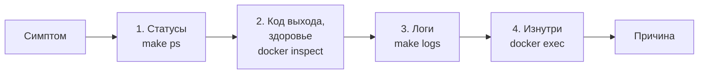
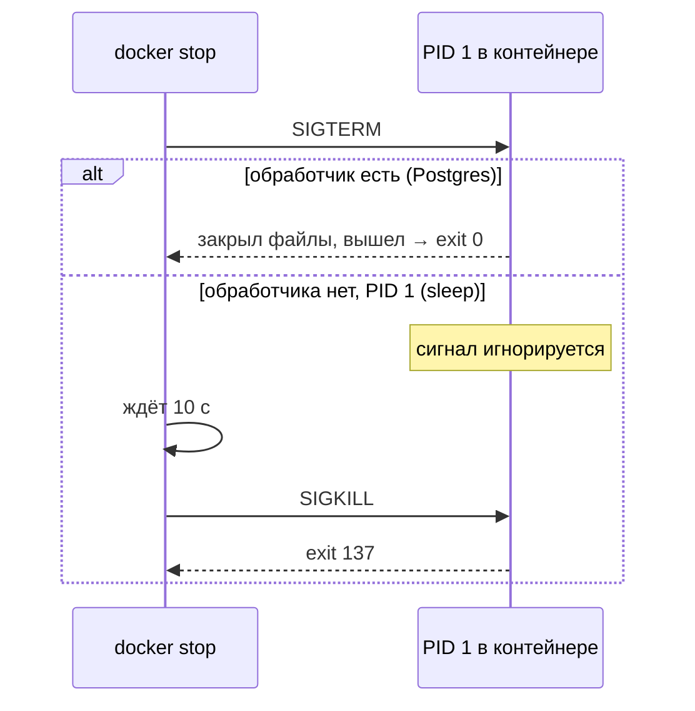
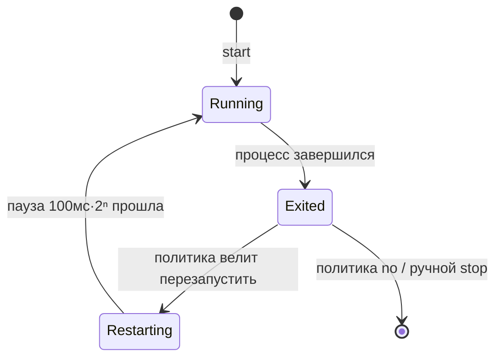
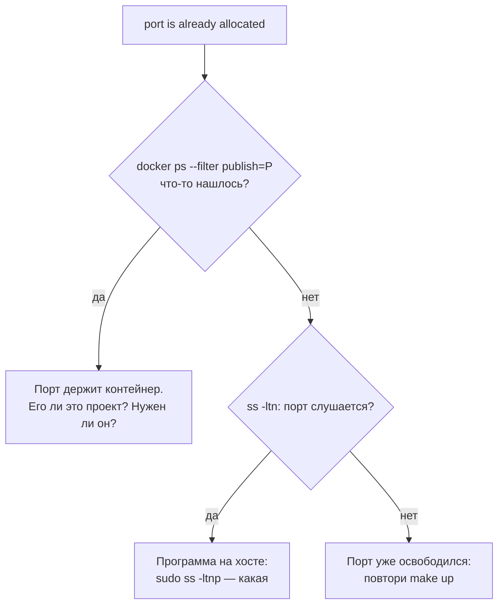
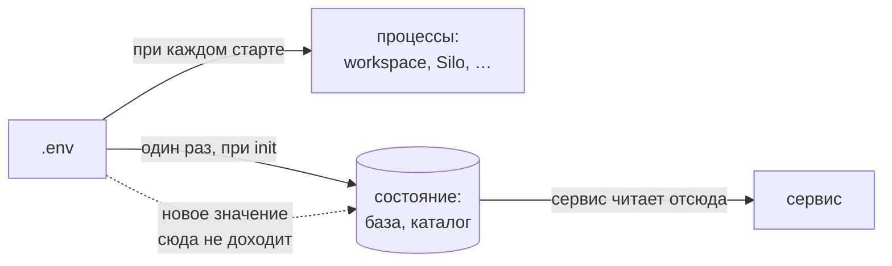
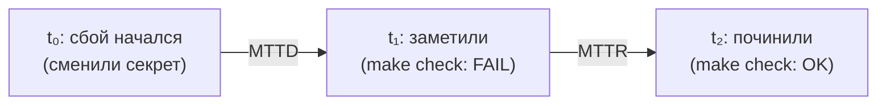
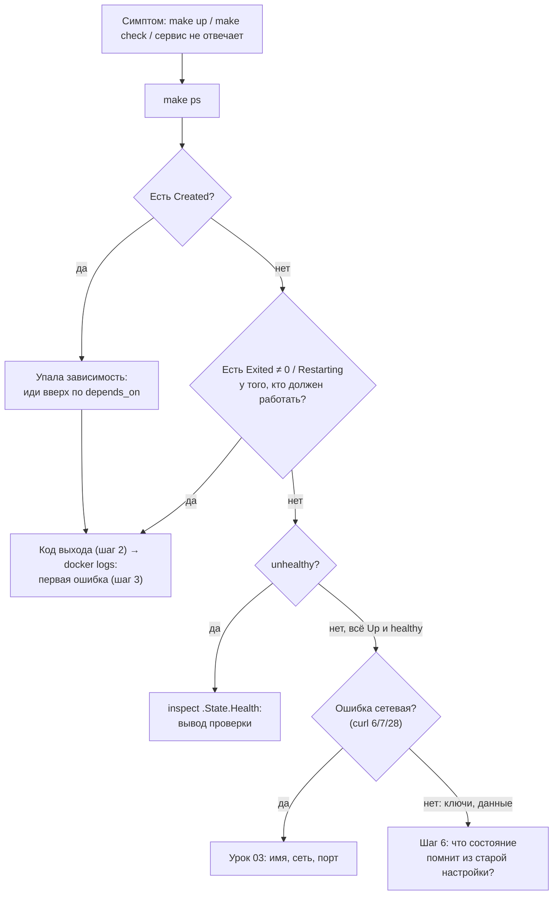

# 08 · Диагностика: от симптома к причине

> [!info] Урок одной фразой
> Когда в здании гаснет свет в одном кабинете, дежурный не меняет лампочки наугад. Он идёт по
> маршруту: табло на входе (статусы) → журнал смены (логи) → карточка кабинета (inspect) →
> заглянуть внутрь (exec). Симптом — это то, что видно, причина — то, что надо чинить, и между
> ними почти всегда несколько шагов. После починки он пишет отчёт, чтобы такое не повторилось.

> [!todo] Чек-лист: после урока ты сможешь
> - [ ] по статусу в `make ps` и коду выхода понять, что случилось с контейнером;
> - [ ] найти лог нужного контейнера, в том числе завершившегося, и вычитать в нём первую ошибку;
> - [ ] предсказать, что Docker сделает с упавшим контейнером при каждой политике `restart`;
> - [ ] найти, кто занял порт, и прочитать ошибки `make up`;
> - [ ] найти состояние, которое «помнит» старую настройку, и изменить его через API;
> - [ ] оформить сбой как постмортем с MTTD и MTTR (лаба 00.2).

> [!tip] Визуализация темы
> Интерактивная страница: [visuals/diagnostics_tree.html](../visuals/diagnostics_tree.html). Дерево решений с шестью инцидентами: выполни команду, прочитай вывод, выбери ответ
> и найди причину.

**Нужно для:** лаба [00.2](../labs/00.2_break_and_fix/README.md), все сценарии.
**Карта урока:** [diagnostics.canvas](../maps/diagnostics.canvas).

---

## Шаг 0. Азбука: симптом, причина и маршрут поиска

**Симптом** — то, что ты наблюдаешь: `make check` печатает `FAIL`, Jupyter не открывается,
`make up` завершился ошибкой.

**Причина (root cause)** — то, что нужно исправить, чтобы симптом
исчез и не вернулся. Между ними обычно цепочка. Iceberg-проверка падает (симптом). Она падает, потому что
Lakekeeper не может записать в S3. Lakekeeper не может записать, потому что у него неверный ключ.
Ключ неверный, потому что его поменяли в `.env`, а в каталоге остался старый (причина).

Главная ошибка новичка — чинить симптом: перезапускать всё подряд, пока не заработает. Иногда
помогает, но причина остаётся, и сбой вернётся в самый неподходящий момент. Поэтому
диагностику ведут **по маршруту**: от общего к частному, и на каждом шаге отвечают на один
вопрос.



Аналогия «офисное здание» продолжается: в этом уроке ты дежурный инженер.

| В Docker | В аналогии «офисное здание» | Подробнее |
|---|---|---|
| `make ps` | Табло на входе: какие кабинеты открыты, какие закрыты | |
| Код выхода | Отметка в журнале, с какой причиной сотрудник ушёл | [код выхода](../../../glossary/exit-code.md) |
| Логи | Журнал смены кабинета | |
| `docker inspect` | Карточка кабинета у коменданта: всё, что о нём известно | |
| `docker exec` | Зайти в кабинет и посмотреть самому | |
| Политика `restart` | Инструкция коменданту: что делать, если сотрудник ушёл | [политика перезапуска](../../../glossary/restart-policy.md) |
| Сигнал SIGTERM / SIGKILL | Вежливая просьба уйти / вывести под руки | [сигнал](../../../glossary/signal.md) |
| Постмортем | Отчёт дежурного: что было, почему, что сделать | [постмортем](../../../glossary/postmortem.md) |

> [!tip] Как читать урок
> Наведи мышь на ссылку термина — всплывёт карточка. Сбои в блоках «Попробуй сам» устраивай
> на **одноразовых** контейнерах с именами `zz-…`, а не на стеке. Стек ты сломаешь в лабе 00.2,
> осознанно и по одному сценарию.

---

## Шаг 1. Что говорит статус в `make ps`?

**Проблема.** Первое, что нужно понять: какой контейнер не в порядке. Колонка `STATUS` в
`make ps` отвечает на это одной строкой, если знать, как её читать.

**Как устроено.** Docker хранит для каждого контейнера состояние: работает ли процесс, с каким
кодом он завершился, перезапускает ли его Docker, что говорит healthcheck. `make ps` (это
`docker compose ps -a`) сводит всё это в строку. Флаг `-a` важен: без него завершившиеся
контейнеры не показываются, а они часто и есть виновники.

| Статус | Что значит | Нормально ли |
|---|---|---|
| `Up 5 minutes (healthy)` | процесс работает, healthcheck проходит | ✅ |
| `Up 5 minutes` | работает, healthcheck не задан (у нас workspace) | ✅ |
| `Up 3 seconds (health: starting)` | работает, healthcheck ещё не прошёл ни разу | ⏳ подожди |
| `Up 2 minutes (unhealthy)` | работает, но проверка провалилась `retries` раз подряд | ❌ сервис не отвечает как надо |
| `Exited (0) …` | процесс завершился успешно | ✅ для one-shot, ❌ для долгоживущего |
| `Exited (1) …`, `Exited (3) …` | завершился с ошибкой, число — код выхода (шаг 2) | ❌ |
| `Exited (137) …` | убит сигналом SIGKILL | смотря кто убил (шаг 2) |
| `Restarting (1) …` | упал с кодом 1, Docker перезапускает его по политике `restart` | ❌ падает в цикле (шаг 4) |
| `Created` | контейнер создан, но не запускался: ждал зависимость, которая не выполнилась | ❌ ищи упавшую зависимость |

**Что из этого следует.**

- `Created` у сервиса почти всегда означает, что упал кто-то, кого он ждал через `depends_on`.
  Смотреть нужно не на него, а вверх по графу зависимостей (урок 02).
- `Exited (0)` у `silo-init` — норма, у `postgres` — поломка. Статус читают вместе с ролью
  сервиса.
- Статус показывает **текущее** состояние. Сервис, который упал и перезапустился, будет `Up`.
  Историю показывают `RestartCount` в inspect и логи.

> [!example]- Попробуй сам: карточка контейнера целиком
> ```bash
> make ps
> docker inspect debd-postgres-1 --format '{{json .State}}' | python3 -m json.tool | head -20
> docker inspect debd-postgres-1 --format 'exit={{.State.ExitCode}} restarts={{.RestartCount}} oom={{.State.OOMKilled}} started={{.State.StartedAt}}'
> ```
> **Увидишь:** в `.State` — `Status`, `ExitCode`, `OOMKilled`, `StartedAt`, `FinishedAt` и
> блок `Health` с последними проверками. `python3 -m json.tool` только форматирует JSON для
> чтения, его можно запускать и на хосте: это стандартная библиотека Python, ничего ставить
> не нужно.

---

## Шаг 2. Что означает код выхода контейнера?

**Проблема.** `Exited (137)` и `Exited (1)` выглядят одинаково тревожно, но означают разное:
в одном случае процесс убили снаружи, в другом он сам сообщил об ошибке. От этого зависит, где
искать причину.

**Как устроено.** Код выхода контейнера — это код выхода его главного процесса (PID 1). Числа
делятся на три группы:

1. **0–124 — ответ самой программы.** 0 — успех, остальное программа выбирает сама: `curl`
   возвращает 6 и 7 (урок 03), Python при необработанном исключении — 1.
2. **125–127 — Docker или оболочка не смогли запустить программу.** До её кода дело не дошло.
3. **128 + N — процесс убит сигналом номер N.** Сигнал — это короткое уведомление от ядра
   процессу. Важных два: **SIGTERM** (15) — «пожалуйста, завершись», его программа может
   перехватить и аккуратно закрыться; **SIGKILL** (9) — ядро убивает процесс немедленно, без
   права на последнее слово.

| Код | Что случилось | Где искать |
|---|---|---|
| 0 | успешно завершился | — |
| 1, 2, 3… | программа сообщила об ошибке | логи контейнера |
| 125 | ошибка самого Docker: нет образа, порт занят, неверный флаг | вывод команды `docker` / `make up` |
| 126 | файл найден, но его нельзя запустить (нет прав на исполнение) | `entrypoint`, `command`, права файла |
| 127 | команда не найдена | опечатка в `command`, нет программы в образе |
| 137 | 128 + 9: SIGKILL | `OOMKilled` в inspect; `docker kill`; `docker stop`, не дождавшийся выхода |
| 143 | 128 + 15: завершился по SIGTERM | обычно это штатный `docker stop` |

**Как работает `docker stop`.** Docker отправляет главному процессу SIGTERM и ждёт 10 секунд.
Если процесс за это время не вышел, Docker отправляет SIGKILL. Поэтому `137` после `docker stop`
— признак программы, которая не обрабатывает SIGTERM.

У процесса с PID 1 есть особенность. Ядро **не применяет к нему действие сигнала по
умолчанию**: если программа сама не написала обработчик SIGTERM, сигнал просто игнорируется.
Обычная программа от SIGTERM умирает, а та же программа в роли PID 1 его не замечает. Поэтому
`sleep` в контейнере останавливается ровно 10 секунд и выходит с кодом 137. Серьёзные серверы
(Postgres, Silo, Lakekeeper) обработчик пишут и при `stop` выходят быстро и с кодом 0. Флаг
`--init` (или `init: true` в compose) ставит в PID 1 крошечный процесс `tini`, который
пересылает сигналы программе как обычному процессу.



> [!warning] Ловушка: 137 — не всегда «кто-то убил»
> Проверь `OOMKilled` в `docker inspect`. Если там `true`, процесс убило ядро за превышение
> памяти. Это не внешняя
> команда, а нехватка ресурсов, и лечится по-другому: меньше данных за раз или больше памяти.

> [!example]- Попробуй сам: коды выхода на одноразовых контейнерах
> ```bash
> I=curlimages/curl:8.22.0
> docker run --rm --network none --entrypoint sh $I -c 'exit 3'; echo "exit 3   → $?"
> docker run --rm --network none --entrypoint sh $I -c 'nosuchcmd' 2>/dev/null; echo "нет команды → $?"
> docker run --rm --network none --entrypoint /etc/hosts $I 2>/dev/null; echo "не исполняемый → $?"
> docker run --rm --network none no/such-image:1 2>/dev/null; echo "нет образа → $?"
> docker run -d --name zz-sleep --network none --entrypoint sleep $I 300 >/dev/null
> time docker stop zz-sleep; docker inspect zz-sleep --format 'stop без init → {{.State.ExitCode}}'; docker rm zz-sleep
> docker run -d --name zz-init --init --network none --entrypoint sleep $I 300 >/dev/null
> time docker stop zz-init; docker inspect zz-init --format 'stop с --init → {{.State.ExitCode}}'; docker rm zz-init
> ```
> **Увидишь:** `3`, `127`, `126`, `125`. Первый `docker stop` идёт 10 секунд и даёт `137`,
> второй мгновенный и даёт `143`: `tini` передал SIGTERM, и `sleep` умер от него как обычный
> процесс.

---

## Шаг 3. Как читать логи

**Проблема.** Статус и код выхода говорят, **что** случилось. **Почему** — почти всегда
написано в логе. Но логов много, и строка с причиной легко теряется среди сотни строк
последствий.

**Как устроено.** Всё, что главный процесс контейнера пишет в стандартный вывод (stdout) и
поток ошибок (stderr), Docker сохраняет в файл на хосте. Лог принадлежит **контейнеру**, а не
процессу: он переживает остановку и `Exited`, но удаляется вместе с контейнером при `make down`.
Поэтому логи упавшего контейнера нужно читать **до** `make down` или `make restart`.

| Команда | Что делает |
|---|---|
| `make logs S=lakekeeper` | последние 200 строк и дальше в реальном времени (`-f`). Выход — Ctrl+C |
| `docker logs debd-lakekeeper-init-1` | весь лог контейнера и выход, без ожидания |
| `docker logs --since 10m <контейнер>` | только за последние 10 минут |
| `docker logs <контейнер> 2>&1 \| grep -iE 'error\|fatal\|panic'` | только строки с ошибками. `2>&1` нужен, потому что многие программы пишут ошибки в stderr |
| `docker compose … logs` без `S=` | логи всех сервисов вперемешку с префиксом имени |

Как искать причину в длинном логе:

1. **Ищи первую ошибку, а не последнюю.** Последние строки — обычно последствия: «не могу
   подключиться», «завершаюсь». Первая ошибка по времени ближе всего к причине.
2. **Смотри на время.** Строки до момента сбоя и после него — разные истории. `--since`
   помогает отрезать старое.
3. **Читай уровень.** Lakekeeper пишет логи в JSON, у каждой строки есть поле `"level"`: `INFO`,
   `WARN`, `ERROR`. Postgres пишет `LOG`, `WARNING`, `ERROR`, `FATAL`.
4. **Читай логи по графу зависимостей.** Если упал `lakekeeper-init`, проверь и `lakekeeper`:
   init-скрипт мог упасть, потому что сервер ответил ошибкой.

> [!warning] Ловушка: `make logs` «завис»
> Для завершившегося контейнера используй `docker logs <контейнер>` или выйди из `make logs`
> по Ctrl+C. `make logs` вызывает `logs -f`, то есть ждёт новых строк. Для завершившегося контейнера
> (`lakekeeper-init`, `silo-init`) новые строки не появятся никогда, и команда будет ждать
> вечно. Это не зависание.

> [!example]- Попробуй сам: лог завершившегося контейнера и фильтр по уровню
> ```bash
> docker logs debd-lakekeeper-init-1
> docker logs debd-lakekeeper-1 2>&1 | grep -E '"level":"(WARN|ERROR)"' | tail -3
> docker logs --since 1h debd-postgres-1 2>&1 | tail -5
> ```
> **Увидишь:** у init — две строки «уже есть»; у Lakekeeper — как минимум предупреждение
> `Authentication is disabled`; у Postgres — последние строки запуска.

---

## Шаг 4. Что Docker делает с упавшим контейнером: политики `restart`

**Проблема.** Сервер может упасть сам: кончилась память, сосед был недоступен, внутренняя
ошибка. Кто-то должен решить, поднимать ли его снова. Это решает **политика перезапуска** —
ключ `restart:` сервиса.

**Как устроено.** Политику исполняет демон Docker, а не compose. Когда главный процесс
контейнера завершается, демон смотрит на политику и код выхода:

| Политика | Упал сам с кодом ≠ 0 | Вышел сам с кодом 0 | Остановлен тобой (`docker stop`) | После перезагрузки / рестарта демона |
|---|---|---|---|---|
| `no` (у нас one-shot) | не трогать | не трогать | не трогать | не запускать |
| `on-failure[:N]` | перезапустить (не больше N раз) | не трогать | не трогать | не полагайся: для серверов не используют |
| `always` | перезапустить | перезапустить | не трогать до рестарта демона | запустить, даже если ты его остановил |
| `unless-stopped` (у нас серверы) | перезапустить | перезапустить | не трогать | запустить, только если ты его не останавливал |

Ручная остановка всегда уважается: если ты сам сделал `docker stop`, Docker не станет
поднимать контейнер обратно через секунду. Разница между `always` и `unless-stopped` проявится
только после перезагрузки: `always` поднимет и то, что ты остановил, `unless-stopped` — нет.

**Защита от бесконечного цикла.** Если контейнер падает сразу после старта, Docker не
перезапускает его мгновенно. Он делает паузу и удваивает её после каждого падения: 100 мс,
200 мс, 400 мс и так далее, вплоть до минуты. Пока идёт пауза, статус — `Restarting`. Счётчик
`RestartCount` в inspect показывает, сколько раз это уже было. Если контейнер проработал
больше 10 секунд, пауза сбрасывается.



**Что из этого следует.**

- `Restarting` и растущий `RestartCount` — признак падения в цикле. Причина — в логе, и в нём
  будет несколько одинаковых попыток подряд.
- Перезапуск лечит **временные** сбои: сосед ещё не готов, сеть моргнула. Постоянную причину
  (неверный пароль, нет базы) он не лечит, а только прячет: сервис бесконечно
  перезапускается и кажется «почти работающим».
- One-shot контейнеры у нас с `restart: "no"`: если `silo-init` упал, повтор не поможет,
  нужно чинить причину.

> [!example]- Попробуй сам: падение в цикле
> ```bash
> docker run -d --name zz-crash --network none --restart unless-stopped \
>   --entrypoint sh curlimages/curl:8.22.0 -c 'echo старт; sleep 2; exit 1'
> sleep 12
> docker ps -a --filter name=zz-crash --format '{{.Status}}'
> docker inspect zz-crash --format 'restarts={{.RestartCount}} exit={{.State.ExitCode}}'
> docker logs zz-crash
> docker rm -f zz-crash
> ```
> **Увидишь:** `Restarting (1) …` или `Up 1 second`, около пяти перезапусков за 12 секунд и
> столько же строк `старт` в логе: один контейнер, один лог, несколько жизней.

---

## Шаг 5. Почему не поднялся `make up`

**Проблема.** `make up` завершился ошибкой. Он поднимает семь контейнеров, и нужно понять,
какой из них виноват и на каком этапе.

**Как устроено.** `make up` — это `up -d --wait` (урок 02). Compose создаёт контейнеры,
запускает их по графу `depends_on` и ждёт, пока все долгоживущие станут здоровыми, а одноразовые
завершатся. Сбой на любом этапе даёт свою ошибку:

| Сообщение `make up` | Что случилось | Что делать |
|---|---|---|
| `service "X" didn't complete successfully: exit N` | one-shot `X` завершился с кодом N, все, кто его ждал, остались `Created` | `docker logs debd-X-1` |
| `dependency failed to start: container X is unhealthy` | healthcheck `X` провалился `retries` раз подряд | `docker inspect … .State.Health`, логи `X` |
| `Bind for 127.0.0.1:P failed: port is already allocated` | порт хоста P уже кто-то занял | найти, кто держит порт (ниже) |
| `network … declared as external, but could not be found` | нет сети (урок 03) | поднять проект-хозяина сети |
| `could not find an available, non-overlapping IPv4 address pool` | новая сеть без подсети на машине с VPN (урок 03) | задать `subnet` |

**Кто занял порт.** Порт хоста — общий ресурс машины (урок 03, шаг 4). Держать его может
другой контейнер или обычная программа на хосте. Проверяют в таком порядке:

1. `docker ps --filter publish=8888` — какой **контейнер** опубликовал этот порт. Покажет имя
   контейнера, даже из чужого проекта.
2. `ss -ltn | grep ':8888 '` — слушает ли кто-то порт вообще.
3. Если это не контейнер, `sudo ss -ltnp | grep ':8888 '` покажет имя процесса. Без `sudo`
   колонка процессов для чужих процессов пуста, а `docker-proxy` работает от root.



**Что из этого следует.** Перед тем как что-то останавливать, выясни, что это: занявший порт
контейнер может быть нужен. Вариантов починки два: освободить порт или опубликовать свой
сервис на другом порту хоста (`127.0.0.1:<другой>:<порт контейнера>`, урок 03).

> [!example]- Попробуй сам: упавший one-shot и занятый порт без риска для стека
> ```bash
> D=$(mktemp -d) && cat > "$D/compose.yaml" <<'EOF'
> name: zzdiag
> services:
>   init:
>     image: curlimages/curl:8.22.0
>     network_mode: none
>     entrypoint: ["/bin/sh", "-c", "echo 'init: делаю работу'; exit 3"]
>     restart: "no"
>   app:
>     image: curlimages/curl:8.22.0
>     network_mode: none
>     entrypoint: ["sleep", "300"]
>     depends_on:
>       init:
>         condition: service_completed_successfully
> EOF
> docker compose -f "$D/compose.yaml" up -d --wait; echo "up exit=$?"
> docker compose -f "$D/compose.yaml" ps -a --format '{{.Service}}\t{{.Status}}'
> docker compose -f "$D/compose.yaml" down; rm -rf "$D"
>
> docker run -d --rm --name zz-p1 -p 127.0.0.1:18999:80 --entrypoint sleep curlimages/curl:8.22.0 300
> docker run -d --rm --name zz-p2 -p 127.0.0.1:18999:80 --entrypoint sleep curlimages/curl:8.22.0 300; echo "exit=$?"
> docker ps --filter publish=18999 --format '{{.Names}}\t{{.Ports}}'
> docker rm -f zz-p1
> ```
> **Увидишь:** `service "init" didn't complete successfully: exit 3`, `up exit=1`, у `app` —
> `Created`, у `init` — `Exited (3)`. Во второй части: `Bind for 127.0.0.1:18999 failed: port
> is already allocated`, код 125 и имя `zz-p1` как владельца порта. `network_mode: none` и
> публикация через стандартную сеть `bridge` нужны, чтобы не создавать новых сетей (урок 03, шаг 6).

---

## Шаг 6. Состояние, которое помнит старую настройку

**Проблема.** Ты поменял значение в `.env`, сделал `make restart`, а часть стека по-прежнему
ведёт себя по-старому. Перезапуск не помогает, `make clean` помог бы, но уничтожит данные.

**Как устроено.** Настройка из `.env` попадает в стек двумя путями:

1. **Читается при каждом старте.** Переменная из `environment:` передаётся процессу, когда
   контейнер создаётся. Поменял `.env` → `make restart` → процесс получил новое значение. Так
   работают `POSTGRES_PASSWORD` у клиентов, `AWS_ACCESS_KEY_ID` у workspace, root-ключи Silo.
2. **Скопирована в состояние однажды.** Init-скрипт прочитал значение и **записал его** в
   базу, том или каталог (урок 06, шаг 6). Дальше сервис берёт значение оттуда, а не из `.env`.
   Идемпотентный init при повторном запуске видит «уже есть» и **не перезаписывает**. Поэтому
   новое значение до состояния не доходит.

Состояние и конфигурация разошлись. Это называют **дрейфом конфигурации**: файл говорит одно,
работающая система помнит другое.



Примеры такого состояния у нас:

| Что | Где записано | Кто записал |
|---|---|---|
| Пользователь и пароль Postgres | в самой базе (`pg_authid`) в томе | entrypoint Postgres при первом старте. `POSTGRES_PASSWORD` дальше игнорируется |
| Warehouse `lakehouse`: бакет, endpoint, ключи S3 | в базе `lakekeeper` | `lakekeeper/init.sh` при первом `make up` |
| Бакеты | в томе Silo | `silo-init` |

**Как такое чинить без потери данных.** Изменить состояние тем способом, который для этого
предусмотрел сервис: для Postgres — `ALTER USER … PASSWORD`, для Lakekeeper — его
**Management API**. `make clean` тоже «чинит», но вместе с проблемой выбрасывает все данные.

### Management API Lakekeeper

Lakekeeper управляется по HTTP: `init.sh` делает именно это, вызывая `curl` с методами `GET` и
`POST`. Полный список возможностей описан в спецификации **OpenAPI** — машиночитаемом
описании всех адресов API, их параметров и формата JSON. Читать её удобно в **Swagger UI**:
это веб-страница, которая строится из спецификации и позволяет посмотреть и даже отправить
каждый запрос.

- Swagger UI: http://localhost:8181/swagger-ui/ (с хоста, через опубликованный порт).
- Спецификация: `http://lakekeeper:8181/api-docs/management/v1/openapi.json` (из workspace).

Как читать описание операции в Swagger UI:

| Что на странице | Что значит |
|---|---|
| `GET /management/v1/warehouse` | метод и путь. Полный адрес — `http://lakekeeper:8181` + путь |
| `{warehouse_id}` в пути | на это место подставляется значение, например ID warehouse |
| Request body, Schema | какой JSON отправить в теле `POST`; Example value — готовый образец |
| Responses | коды ответа: 2xx — успех, 4xx — ошибка в запросе, 5xx — ошибка сервера |

Запрос с JSON-телом из командной строки строится так же, как в `init.sh`:

```bash
curl -sf -X POST "http://lakekeeper:8181/<путь>" \
  -H 'Content-Type: application/json' \
  -d '{"ключ": "значение"}'
```

`-X POST` — метод, `-H` — заголовок, говорящий серверу, что в теле JSON, `-d` — само тело.
`-f` превращает ответ 4xx/5xx в код выхода 22 (урок 03, шаг 7). Значения секретов в команду
лучше подставлять из переменных окружения (`"$S3_SECRET_KEY"`), а не печатать руками: команды
сохраняются в истории оболочки.

> [!example]- Попробуй сам: что каталог помнит о warehouse
> В `make shell`:
> ```bash
> curl -s lakekeeper:8181/management/v1/warehouse | python -m json.tool | head -30
> curl -s lakekeeper:8181/api-docs/management/v1/openapi.json \
>   | python -c 'import json,sys; [print(m.upper(), p) for p, ops in json.load(sys.stdin)["paths"].items() if "warehouse" in p for m in ops]'
> ```
> **Увидишь:** warehouse `lakehouse` с его `id` и `storage-profile` (бакет, endpoint, STS).
> Секретного ключа в ответе нет: каталог хранит его зашифрованным и наружу не отдаёт. Вторая
> команда печатает все операции API со словом `warehouse` в пути: среди них есть операции
> чтения, удаления и обновления частей warehouse. Какая нужна в сценарии 1 лабы, выбери сам.

---

## Шаг 7. Постмортем: что записать после починки

**Проблема.** Сбой починен, но знание о нём живёт только у того, кто чинил. Через месяц тот же
сбой повторится, и всё придётся выяснять заново. Нужна короткая запись, из которой видно, что
произошло и что сделать, чтобы не повторилось.

**Как устроено.** **Постмортем** — разбор инцидента по фиксированному шаблону. Главный принцип
— **без поиска виноватых** (blameless): вопрос не «кто ошибся», а «что в системе позволило
ошибке случиться и не быть замеченной». Если ответ «человек был невнимателен», значит, разбор
не закончен: невнимательным может быть кто угодно, а защиту можно встроить в систему.

Две метрики времени показывают, где система слабая:

- **MTTD** (Mean Time To Detect) — время от начала проблемы до момента, когда её заметили.
  Большое MTTD значит, что не хватает проверок и алертов.
- **MTTR** (Mean Time To Restore/Repair) — время от обнаружения до восстановления работы.
  Большое MTTR значит, что диагностика медленная: непонятные логи, нет инструкций.

«Mean» — среднее по многим инцидентам. Для одного инцидента пишут просто время обнаружения и
время восстановления.



**Причина и триггер — не одно и то же.** Триггер — событие, которое запустило сбой: «поменяли
секрет в `.env`». Причина — свойство системы, из-за которого это событие привело к сбою: «секрет
скопирован в каталог один раз, и ничто не синхронизирует его с `.env`». Чинить триггер
бесполезно, секреты менять надо. Чинить нужно причину.

Находить причину помогает приём **«5 почему»**: задавай вопрос «почему?» к каждому ответу,
пока не дойдёшь до того, что можно изменить в системе.

Шаблон записи — в [`ops/incidents.md`](../../../ops/incidents.md). Для мини-постмортемов лабы
00.2 используется короткая форма из README лабы: что сделал, симптом, диагностика, причина,
починка, вывод.

> [!warning] Ловушка: «Как починил: перезапустил»
> Не закрывай разбор словами «перезапустил, и заработало». Значит, причина не найдена. Перезапуск сбросил симптом,
> например гонку при старте, но не объяснил, почему она возникла. Такой постмортем не готов.

---

## Сборка целиком: маршрут диагностики

Весь урок в одной схеме — дерево решений, по которому идёшь при любом сбое стека.



| Если на этом шаге ошибся | Что получишь |
|---|---|
| Смотришь `docker ps` без `-a` | не видишь завершившийся контейнер-виновника |
| Сделал `make restart` до чтения логов | логи упавшего контейнера удалены вместе с ним |
| Читаешь последнюю ошибку, а не первую | чинишь последствие |
| Остановил контейнер, занявший порт, не выяснив, что это | сломал чужую программу |
| Починил через `make clean` | данные потеряны, причина (дрейф) осталась |

---

## Шпаргалка

| Хочу | Как |
|---|---|
| Все контейнеры и их статусы | `make ps` |
| Код выхода, рестарты, OOM | `docker inspect <c> --format 'exit={{.State.ExitCode}} restarts={{.RestartCount}} oom={{.State.OOMKilled}}'` |
| Почему unhealthy | `docker inspect <c> --format '{{json .State.Health}}' \| python3 -m json.tool` |
| Лог работающего сервиса | `make logs S=<сервис>` (Ctrl+C — выход) |
| Лог завершившегося контейнера | `docker logs debd-<сервис>-1` |
| Только ошибки | `docker logs <c> 2>&1 \| grep -iE 'error\|fatal'` |
| Кто держит порт | `docker ps --filter publish=<порт>`, затем `ss -ltn`, `sudo ss -ltnp` |
| Зайти внутрь | `docker exec -it <c> sh` |
| API Lakekeeper | http://localhost:8181/swagger-ui/ |
| Остановить быстро и правильно | программа должна обрабатывать SIGTERM; иначе `init: true` |

## Типичные ошибки

| Симптом | Причина | Как проверить | Как чинить |
|---|---|---|---|
| Сервис `Created`, не стартует | упала его зависимость | `make ps`: кто `Exited ≠ 0` выше по графу | чинить зависимость |
| `Exited (137)` без твоего участия | нехватка памяти | `OOMKilled: true` в inspect | меньше данных за раз, больше памяти |
| `docker stop` идёт 10 секунд | PID 1 не обрабатывает SIGTERM | `docker inspect` → `ExitCode 137` после stop | `init: true` или обработчик сигнала |
| `Restarting`, растёт `RestartCount` | постоянная ошибка при старте | `docker logs`: повторяющиеся попытки | устранить причину, а не перезапускать |
| `make logs` не возвращает управление | `-f` ждёт новых строк от завершившегося контейнера | — | Ctrl+C или `docker logs` |
| Лог упавшего контейнера пропал | после сбоя сделан `make down`/`restart` | — | читать логи до перезапуска |
| `port is already allocated` | порт хоста занят | `docker ps --filter publish=<порт>` | освободить порт или другой порт хоста |
| После правки `.env` и `make restart` всё по-старому | значение скопировано в состояние при init | сравнить `.env` с тем, что вернёт API/база | обновить состояние через API сервиса |

---

## Проверь себя

Карточки для интервального повторения — в [flashcards.md](../flashcards.md).

> [!question] 1. `make ps` показывает `lakekeeper` в статусе `Created`. Где ты будешь искать причину в первую очередь?
> > [!success]- Ответ
> > Не в самом Lakekeeper: `Created` значит, что его процесс ни разу не запускался. Compose ждал
> > зависимость. Смотреть нужно вверх по графу: `lakekeeper-migrate` и `silo-init`. У того из
> > них, кто `Exited` с ненулевым кодом, читать `docker logs`.

> [!question] 2. Контейнер завершился с кодом 127. Что ты проверишь?
> > [!success]- Ответ
> > 127 — команда не найдена. Опечатка в `command`/`entrypoint` или нужной программы нет в
> > образе. До кода самой программы дело не дошло, поэтому её логи искать бессмысленно.

> [!question] 3. Ты сделал `docker stop debd-postgres-1`. Поднимет ли его Docker сам через несколько секунд? А после перезагрузки машины?
> > [!success]- Ответ
> > Через несколько секунд — нет: ручная остановка уважается любой политикой. После перезагрузки
> > тоже нет: у postgres `unless-stopped`, а ты его остановил вручную. С `always` он поднялся бы
> > после перезагрузки.

> [!question] 4. Сервис с `restart: unless-stopped` не может подключиться к базе с неверным паролем. Что ты увидишь в `make ps` и поможет ли политика?
> > [!success]- Ответ
> > `Restarting` и растущий `RestartCount`, в логе — одна и та же ошибка авторизации раз за
> > разом, с увеличивающимися паузами. Политика не поможет: пароль не исправится от
> > перезапуска. Она лечит только временные сбои.

> [!question] 5. После смены пароля Postgres в `.env` и `make restart` Lakekeeper не может подключиться к базе. Почему, если Lakekeeper получил новый пароль?
> > [!success]- Ответ
> > Пароль пользователя Postgres хранится в самой базе, в томе. Entrypoint Postgres записал его
> > при первом старте, а при следующих `POSTGRES_PASSWORD` игнорирует, потому что база уже
> > инициализирована. Клиенты пришли с новым паролем, база помнит старый. Чинить через
> > `ALTER USER`, а не `make clean`.

> [!question] 6. В постмортеме написано: «Причина: Дима поменял секрет и не обновил каталог». Что не так?
> > [!success]- Ответ
> > Это поиск виноватого и триггер, а не причина. Причина — свойство системы: секрет
> > копируется в каталог один раз, и ничто не сверяет его с `.env`, а проверки не говорят,
> > где именно расхождение. Действия должны менять систему: инструкция по ротации, проверка
> > или скрипт, обновляющий credential через API.
