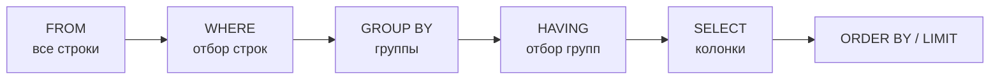
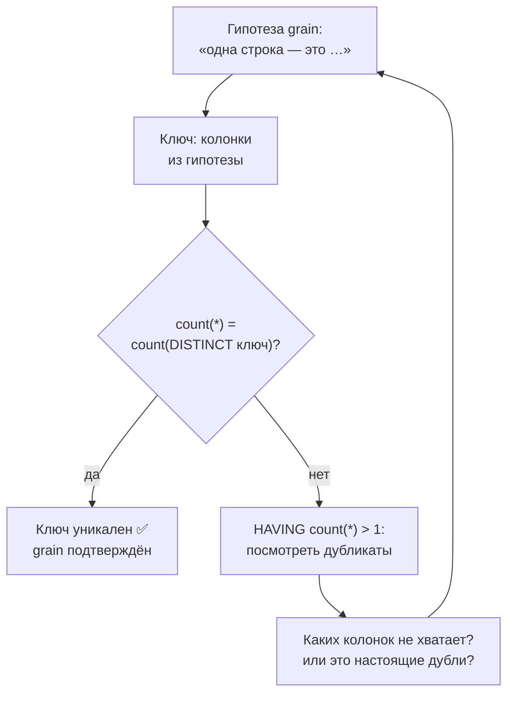
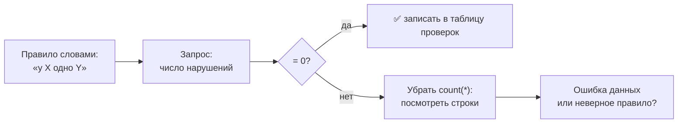
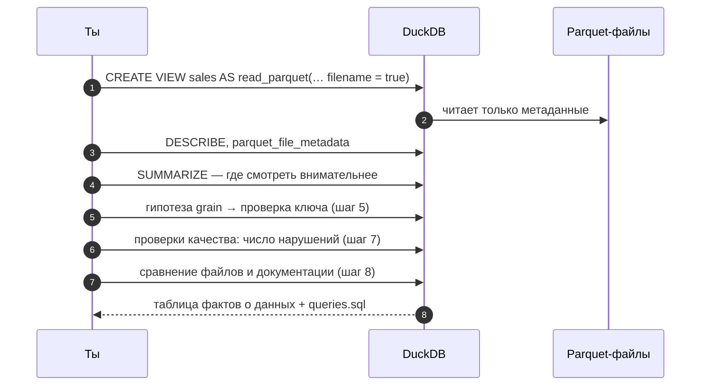

# 09 · DuckDB и профилирование датасета: как познакомиться с данными

> [!info] Урок одной фразой
> Тебе передали архив чужой бухгалтерии с описью. Прежде чем строить на нём отчёты, ты его
> проверяешь.
>
> Что считается одной записью? Нет ли двойных? Все ли поля заполнены? Сходятся ли
> итоги с детализацией? Совпадает ли опись с тем, что лежит в коробках? DuckDB — лупа, через
> которую это делается прямо по Parquet-файлам, без загрузки в базу.

> [!todo] Чек-лист: после урока ты сможешь
> - [ ] открыть Parquet-файлы в DuckDB и узнать их схему, объём и диапазоны значений;
> - [ ] сформулировать grain таблицы и доказать запросом, что ключ уникален;
> - [ ] работать с колонками-массивами: длина, элемент по номеру, сумма, разворот в строки;
> - [ ] написать проверку качества так, чтобы она возвращала число нарушений;
> - [ ] сравнить два файла между собой запросом (лаба 00.3).

**Нужно для:** лаба [00.3](../labs/00.3_dataset_profiling/README.md), все задачи.
**Карта урока:** [duckdb-profiling.canvas](../maps/duckdb-profiling.canvas).

---

## Шаг 0. Азбука: что такое профилирование и почему с него начинают

**Профилирование данных** — систематическое знакомство с набором данных до того, как на нём
что-то строить. Причина простая: каждое неверное предположение о данных превращается в ошибку
пайплайна. Предположил, что строка — это «продажа за день», а она «товар в магазине за день», —
и все суммы в витрине станут неверными. Предположил, что дубликатов нет, — и выручка задвоится.
Ошибки такого рода не дают исключений: пайплайн работает, а цифры неправильные.

Документация к данным — тоже предположение, только чужое. Её пишут один раз, а данные потом
дописывают, фильтруют, режут на части. Поэтому профилирование всегда сверяет документацию с
фактом, а не верит ей.

**DuckDB** — встраиваемая аналитическая СУБД: она не требует сервера и читает Parquet, CSV и
Iceberg напрямую с диска или из S3. У нас она стоит в workspace двумя способами: как CLI
`duckdb` и как Python-пакет. Для профилирования удобнее CLI: пишешь SQL и сразу видишь таблицу.

| В профилировании | В аналогии «архив бухгалтерии» | Подробнее |
|---|---|---|
| Parquet-файл | Коробка с карточками | [Parquet](../../../glossary/parquet.md) |
| Строка | Одна карточка | |
| Grain (зерно) | Что описывает одна карточка: «товар в магазине за день» | [grain](../../../glossary/grain.md) |
| Естественный ключ | Поля, по которым карточку можно однозначно найти | [естественный ключ](../../../glossary/natural-key.md) |
| Колонка-массив | Карточка с вкладышем на 24 строки | |
| Документация датасета | Опись, приложенная к архиву | |
| Проверка качества | Сверка: сколько карточек нарушают правило | [профилирование](../../../glossary/data-profiling.md) |
| Train / eval | Две коробки: по одной учатся, по другой проверяют | [train / eval split](../../../glossary/train-eval-split.md) |

> [!tip] Как читать урок
> Все запросы проверены на нашем датасете. Примеры специально выбраны **не те**, что спрашивает
> лаба: урок показывает приём, а применить его к вопросу лабы — твоя задача.

---

## Шаг 1. Как работать в DuckDB CLI

**Проблема.** Нужна среда, где можно быстро написать запрос, посмотреть результат и сохранить
удачные запросы в файл.

**Как устроено.** `make sql` запускает `duckdb` внутри workspace. Текущая папка — `/workspace`,
то есть корень репозитория, поэтому пути к файлам пишутся от него: `data/raw/…`. База
открывается **в памяти**: всё, что ты создашь (представления, таблицы), исчезнет при выходе.
Сами Parquet-файлы DuckDB только читает и не меняет.

Ввод устроен так:

- SQL-запрос заканчивается **точкой с запятой**. Без неё CLI считает, что запрос продолжается,
  и ждёт следующую строку (приглашение меняется на `‣`).
- Строки, начинающиеся с точки, — **команды самого CLI**, а не SQL. Точка с запятой им не нужна.
- `--` начинает комментарий до конца строки.
- Выход — `.quit` или Ctrl+D.

| Команда CLI | Что делает |
|---|---|
| `.timer on` | печатать время каждого запроса |
| `.mode line` | выводить каждую колонку на отдельной строке. Удобно для широких строк |
| `.mode duckbox` | обычный табличный вывод (по умолчанию) |
| `.maxrows 50` | сколько строк результата показывать |
| `.read путь/к/файлу.sql` | выполнить все запросы из файла |
| `.tables` | список созданных таблиц и представлений |

**Файл запросов.** Лаба просит сохранять запросы в `queries.sql`. Удобный ритм: пишешь запрос в
VS Code в этом файле, копируешь в CLI, смотришь результат. Файл лежит в репозитории, поэтому
виден и на хосте, и в контейнере. Весь файл можно выполнить разом: `.read
modules/00_just_enough/labs/00.3_dataset_profiling/queries.sql`.

Запустить один запрос без интерактивного режима можно и с хоста:

```bash
docker exec -w /workspace debd-workspace-1 duckdb -c "SELECT 42;"
```

> [!warning] Ловушка: порядок строк без `ORDER BY`
> Если важен порядок, пиши `ORDER BY`. SQL не обещает никакого порядка строк, если его не
> задали. DuckDB читает файлы параллельно, и `SELECT * FROM sales LIMIT 1` вернёт то строку из
> `train`, то из `eval`. Проверено: два одинаковых запроса подряд дали строки из разных файлов.

---

## Шаг 2. Как прочитать Parquet и узнать схему

**Проблема.** Данные лежат в двух Parquet-файлах. Их нужно читать как одну таблицу и узнать,
какие в ней колонки и типы.

**Как устроено.** Функция `read_parquet` превращает файлы в таблицу прямо в запросе:

```sql
SELECT count(*) FROM read_parquet('data/raw/freshretailnet_50k/data/*.parquet');
--                                 ①                              ②
```

| Метка | Смысл |
|---|---|
| ① | путь от текущей папки `/workspace` |
| ② | `*` — шаблон (glob): все файлы, подходящие под маску, читаются как одна таблица |

Полезные параметры: `filename = true` добавляет колонку `filename` с путём файла, из которого
пришла строка. Так можно сравнивать файлы между собой в одном запросе.

Чтобы не повторять длинный вызов, создают **представление** (view) — сохранённый запрос с
именем. Данные оно не копирует: при каждом обращении DuckDB снова читает файлы.

```sql
CREATE VIEW sales AS
SELECT * FROM read_parquet('data/raw/freshretailnet_50k/data/*.parquet', filename = true);
```

Почему это быстро, хотя файлы весят больше 100 МБ? Parquet хранит данные **по колонкам** и
держит в метаданных число строк и статистику (урок 04, шаг 2). `count(*)` DuckDB берёт из
метаданных, не читая данные, а запрос по трём колонкам читает только эти три колонки.

Схему узнают двумя способами:

- `DESCRIBE sales;` — имя и тип каждой колонки.
- `SELECT * FROM parquet_file_metadata('data/raw/freshretailnet_50k/data/*.parquet');` —
  метаданные самих файлов: число строк, число row group.

Типы, которые встретятся:

| Тип DuckDB | Что это |
|---|---|
| `BIGINT`, `INTEGER` | целые числа (8 и 4 байта) |
| `DOUBLE` | число с плавающей точкой |
| `VARCHAR` | строка |
| `DATE` | дата без времени |
| `DOUBLE[]`, `BIGINT[]` | **список** (массив) значений этого типа в одной ячейке |

> [!warning] Ловушка: дата, которая строка
> Перед вычислениями с датой приводи тип: `dt::DATE`. Колонка `dt` хранится как `VARCHAR`.
> Сравнение и `min/max` для строк вида `2024-03-28` работают правильно только потому, что формат
> «год-месяц-день» сортируется как текст так же, как по времени. Арифметика с датами не работает
> вовсе. Разница двух дат — целое число дней:
> `DATE '2024-04-30' - DATE '2024-04-01' + 1` → `30`.

> [!example]- Попробуй сам: первые шаги
> В `make sql`:
> ```sql
> .timer on
> CREATE VIEW sales AS SELECT * FROM read_parquet('data/raw/freshretailnet_50k/data/*.parquet', filename = true);
> DESCRIBE sales;
> SELECT file_name, num_rows, num_row_groups FROM parquet_file_metadata('data/raw/freshretailnet_50k/data/*.parquet');
> .mode line
> SELECT * FROM sales LIMIT 1;
> .mode duckbox
> ```
> **Увидишь:** 19 колонок плюс `filename`, у двух из них тип-массив; два файла с числом строк
> в каждом; одну строку целиком, колонку за колонкой.

---

## Шаг 3. Как быстро увидеть всю картину: `SUMMARIZE`

**Проблема.** Хочется сразу по всем колонкам знать: минимум, максимум, сколько разных значений,
сколько пропусков. Писать для этого по запросу на колонку долго.

**Как устроено.** `SUMMARIZE <запрос или таблица>` возвращает по строке на каждую колонку со
статистикой: `min`, `max`, `approx_unique`, `avg`, `std`, квартили `q25/q50/q75`, `count` и
`null_percentage`. Он читает все данные, поэтому на нашем объёме идёт около секунды.

```sql
SELECT column_name, column_type, min, max, approx_unique, null_percentage
FROM (SUMMARIZE SELECT store_id, dt, avg_temperature FROM sales);
```

Что смотреть в выводе:

- **`min` / `max`** — первая проверка диапазонов. Температура от 12 до 32 правдоподобна, а
  отрицательная цена или скидка больше 100% — повод разобраться.
- **`null_percentage`** — доля пропусков.
- **`approx_unique`** — **приблизительное** число разных значений.

> [!warning] Ловушка: `approx_unique` — оценка, а не счёт
> Для выводов используй точный `count(DISTINCT store_id)`. Для скорости `SUMMARIZE` не считает
> разные значения точно, а оценивает их алгоритмом HyperLogLog. На нашем датасете он показывает
> для `store_id` 1066, хотя магазинов ровно 898. `SUMMARIZE` годится, чтобы понять,
> куда смотреть, а не для итоговых чисел.

---

## Шаг 4. Агрегаты, группировка и фильтры

**Проблема.** Почти все вопросы профилирования — это «сколько»: сколько строк, сколько разных
магазинов, сколько строк нарушают правило, сколько строк у каждого значения.

**Как устроено.** Агрегатная функция сворачивает много строк в одно значение:

| Функция | Что считает |
|---|---|
| `count(*)` | число строк |
| `count(col)` | число строк, где `col` **не** NULL. Отсюда пропуски: `count(*) - count(col)` |
| `count(DISTINCT col)` | число разных значений |
| `count(DISTINCT (a, b))` | число разных **пар** значений |
| `min`, `max`, `avg`, `sum` | как обычно |
| `any_value(col)` | любое одно значение из группы |

`GROUP BY` разбивает строки на группы с одинаковыми значениями и считает агрегат в каждой.
`GROUP BY ALL` — сокращение DuckDB: группировать по всем колонкам `SELECT`, которые не являются
агрегатом.

Фильтровать можно на двух этапах, и это разные вещи:

- **`WHERE`** отбирает **строки до** группировки.
- **`HAVING`** отбирает **группы после** неё, поэтому в нём можно использовать агрегаты.



Это порядок выполнения, а не порядок записи. Из него следует, почему в `WHERE` нельзя написать
`count(*) > 1`: группы ещё не построены.

**Счётчики с условием.** `count(*) FILTER (WHERE условие)` считает только строки, где условие
истинно. Так одна строка результата отвечает на несколько вопросов сразу:

```sql
SELECT count(*)                                   AS rows,
       count(*) - count(precpt)                   AS precpt_nulls,
       count(*) FILTER (WHERE precpt < 0)         AS precpt_negative
FROM sales;
```

**CTE.** Если запрос сложный, его режут на шаги с именами через `WITH`:

```sql
WITH per_store AS (
    SELECT store_id, count(*) AS n FROM sales GROUP BY store_id
)
SELECT min(n), max(n), count(*) AS stores FROM per_store;
```

`per_store` — временная таблица, которая живёт только в этом запросе. Читается сверху вниз,
как рецепт.

> [!warning] Ловушка: колонка вне `GROUP BY`
> В агрегатном запросе ставь каждую колонку в `GROUP BY` или внутрь агрегата.
> `SELECT typeof(dt), min(dt) FROM sales;` падает с `Binder Error: column "dt" must appear in the
> GROUP BY clause`. Если значение одинаково во всех строках, оберни его: `any_value(typeof(dt))`.

---

## Шаг 5. Grain и ключ: что такое одна строка

**Проблема.** Главный вопрос о любой таблице — что описывает одна её строка. От ответа зависит
всё: как соединять таблицы, что суммировать, как искать дубликаты.

**Как устроено.** **[Grain](../../../glossary/grain.md)** (зерно, гранулярность) — описание
одной строки одним предложением в терминах предметной области. Например: «одна строка — это
заказ», «одна строка — это позиция заказа», «одна строка — это показания датчика за минуту». Grain
задаётся набором колонок, значения которых **вместе** определяют строку однозначно. Этот набор
называют **[естественным ключом](../../../glossary/natural-key.md)**: он состоит из
настоящих полей данных, а не из искусственного номера строки.

Grain формулируют как **гипотезу** и проверяют запросом. Проверка устроена так: если набор
колонок — ключ, то групп по нему ровно столько же, сколько строк, и ни в одной группе нет
больше одной строки. Два эквивалентных способа:

```sql
-- способ 1: сравнить число строк и число разных комбинаций
SELECT count(*) AS rows, count(DISTINCT (store_id, dt)) AS combos FROM sales;

-- способ 2: найти сами дубликаты
SELECT store_id, dt, count(*) AS n
FROM sales
GROUP BY ALL
HAVING count(*) > 1
ORDER BY n DESC
LIMIT 5;
```

На нашем датасете гипотеза «одна строка — магазин за день» не проходит. Строк 4,85 млн, а
разных пар (магазин, день) — 87 тысяч. У одной пары бывает больше 160 строк. Значит, в ключ
входит ещё что-то. Что именно — задача 2 лабы. Способ 2 полезнее: он показывает, **какие**
строки дублируются, и по ним видно, какой колонки не хватает в ключе.

**Ожидаемое и фактическое число строк.** Когда ключ найден, полезно посчитать, сколько строк
**было бы**, если бы каждая комбинация значений присутствовала: перемножить числа разных
значений каждой колонки ключа. Если фактических строк меньше, какие-то комбинации отсутствуют.
Это не обязательно ошибка, но про это нужно знать: например, сумма по такой таблице
не покажет нули там, где строк нет.



> [!warning] Ловушка: ключ в одном файле — не ключ в двух
> Проверяй уникальность ключа на объединении файлов. Если таблица собрана из нескольких
> файлов, ключ может быть уникален внутри каждого, но повторяться между файлами. При сравнении
> файлов добавляй `filename` в `GROUP BY`.

---

## Шаг 6. Колонки-массивы

**Проблема.** Две колонки датасета — массивы по ячейке на час. С ними нельзя обращаться как с
обычным числом: нужно уметь взять элемент, посчитать длину и сумму, развернуть массив в строки.

**Как устроено.** Тип `DOUBLE[]` в DuckDB называется **LIST** — упорядоченный список значений
внутри одной ячейки. Основные операции:

| Выражение | Результат | Комментарий |
|---|---|---|
| `[10, 20, 30][1]` | `10` | **нумерация с 1**, а не с 0, как в Python |
| `[10, 20, 30][-1]` | `30` | отрицательный номер — с конца |
| `len(lst)` | число элементов | |
| `list_sum(lst)`, `list_max(lst)`, `list_min(lst)` | сумма, максимум, минимум элементов | |
| `list_position(lst, x)` | номер первого элемента, равного `x` (с 1) | |
| `list_filter(lst, lambda x: x > 0)` | только элементы, где условие истинно | `lambda x: …` — функция от элемента |
| `list_transform(lst, lambda x: x * 10)` | применить выражение к каждому элементу | |
| `unnest(lst)` | развернуть: одна строка на каждый элемент | |
| `generate_subscripts(lst, 1)` | номера элементов 1, 2, 3… рядом с `unnest` | |

> [!warning] Ловушка: нумерация с 1
> Помни, что массивы в DuckDB нумеруются с 1. В Python `lst[0]` — первый элемент. В DuckDB
> `lst[1]`. Если элементы массива что-то
> обозначают по номеру (час, день недели), а значение у тебя на единицу «съехало», проверь,
> откуда считаешь. Номер с 0 получают как `generate_subscripts(lst, 1) - 1`.

**Разворот массива в строки.** `unnest` превращает одну строку с массивом из N элементов в N
строк. Остальные колонки копируются в каждую. Чтобы знать, какой это был элемент, рядом
ставят `generate_subscripts`:

```sql
SELECT generate_subscripts(hours_sale, 1) - 1 AS pos0,   -- номер элемента с 0
       unnest(hours_sale)                     AS value
FROM sales
WHERE store_id = 0 AND product_id = 38 AND dt = '2024-04-01'
  AND filename LIKE '%train%';
```

Результат — 24 строки `pos0, value` для одной исходной строки. Что означает номер элемента,
проверь по описанию датасета: это вопрос задачи 1. Дальше развёрнутые строки можно
группировать по `pos0`, как любые другие. Развернуть **весь** датасет — это 4,85 млн × 24 ≈
116 млн строк. DuckDB с этим справится, но запрос будет заметно дольше обычного.

**Сравнение дробных чисел.** Сумма элементов массива и итоговая колонка — это числа `DOUBLE`, а
дробные числа в компьютере хранятся приближённо. Например, `0.1 + 0.2` в типе `DOUBLE` не равно
`0.3` точно. Поэтому дробные значения сравнивают **с допуском**:

```sql
SELECT 0.1::DOUBLE + 0.2::DOUBLE = 0.3::DOUBLE              AS exact,  -- false
       abs((0.1::DOUBLE + 0.2::DOUBLE) - 0.3) < 1e-9          AS approx; -- true
```

Допуск подбирают под точность данных: если значения записаны с точностью до сотых, разница
меньше `1e-6` — это шум округления, а не расхождение.

> [!example]- Попробуй сам: массив одной строки
> ```sql
> SELECT hours_sale,
>        len(hours_sale)                                   AS n,
>        list_sum(hours_sale)                              AS total,
>        list_filter(hours_sale, lambda x: x > 0)          AS nonzero
> FROM sales
> WHERE store_id = 0 AND product_id = 38 AND dt = '2024-04-01' AND filename LIKE '%train%';
> ```
> **Увидишь:** массив из 24 чисел, его длину, сумму и только ненулевые элементы — их два.
> Старый синтаксис лямбды `x -> x > 0` ещё работает, но DuckDB 1.5 выводит предупреждение о
> том, что он устарел.

---

## Шаг 7. Проверки качества: каждая — число нарушений

**Проблема.** «Данные выглядят нормально» — не результат. Нужна проверка, которую можно
повторить и которая даёт однозначный ответ.

**Как устроено.** Хорошая проверка качества формулируется как **правило** и записывается как
запрос, возвращающий **число строк, нарушающих правило**. Ноль — правило выполняется. Не ноль —
есть что разбирать, и тот же запрос без `count(*)` покажет конкретные строки. Такая форма
удобна тем, что позже, в модуле 09, её почти без изменений превращают в автоматический тест.

Типы правил и шаблоны запросов к ним:

| Тип правила | Пример правила | Шаблон запроса |
|---|---|---|
| Полнота | в колонке нет NULL | `count(*) - count(col)` |
| Диапазон | значение в допустимых пределах | `count(*) FILTER (WHERE col < a OR col > b)` |
| Формат | у массива нужная длина | `count(*) FILTER (WHERE len(lst) <> N)` |
| Согласованность | итог равен сумме деталей | `count(*) FILTER (WHERE abs(total - list_sum(lst)) > 1e-6)` |
| Уникальность | ключ не повторяется | шаг 5 |
| Функциональная зависимость | у каждого X ровно одно значение Y | `GROUP BY X HAVING count(DISTINCT Y) > 1` |

**Функциональная зависимость** — правило вида «X однозначно определяет Y»: у каждого заказа
один покупатель, у каждого города одна страна. Если оно нарушено, справочник, построенный из
этих данных, получит противоречивые строки. Пример на нашем датасете, **не** из лабы:
«у магазина в один день одна средняя температура» (погода не может зависеть от товара).

```sql
SELECT count(*) AS violations
FROM (
    SELECT store_id, dt
    FROM sales
    GROUP BY store_id, dt
    HAVING count(DISTINCT avg_temperature) > 1
);
```

Результат — `0`: правило выполняется. Подзапрос в скобках находит нарушающие группы, внешний
запрос их считает.



Последний ромб важен. Нарушение не всегда означает плохие данные: иногда неверно само правило.
Например, «влажность не больше 100» верно, только если она записана в процентах, а не в долях. Решение, что
это — дефект данных или особенность, принимают, перечитав документацию.

---

## Шаг 8. Сравнение файлов и документации

**Проблема.** Датасет разбит на два файла, и в описании к нему указаны числа, которые с фактом
не совпадают. Нужно понять, откуда расхождение.

**Как устроено.** Два инструмента: группировка по `filename` и операции над множествами.

**Группировка по файлу.** Любой агрегат можно посчитать по каждому файлу отдельно. Чтобы
выводить имя файла без длинного пути, его обрезают регулярным выражением:

```sql
SELECT regexp_extract(filename, '[^/]+$') AS file,   -- всё после последнего «/»
       count(*)                           AS rows,
       count(DISTINCT city_id)            AS cities
FROM sales
GROUP BY file;
```

**Операции над множествами.** Сравнивают **наборы значений** двух запросов:

| Операция | Результат |
|---|---|
| `A UNION B` | значения, которые есть хотя бы в одном |
| `A INTERSECT B` | значения, которые есть в обоих |
| `A EXCEPT B` | значения, которые есть в A, но нет в B |

```sql
SELECT DISTINCT city_id FROM sales WHERE filename LIKE '%eval%'
EXCEPT
SELECT DISTINCT city_id FROM sales WHERE filename LIKE '%train%';
```

Пустой результат означает, что городов, которых нет в train, в eval нет. `EXCEPT` несимметричен:
`A EXCEPT B` и `B EXCEPT A` отвечают на разные вопросы, проверяй оба направления.

**Train / eval split.** Датасеты для машинного обучения обычно делят на части:
**[train](../../../glossary/train-eval-split.md)** — на ней модель учится, и **eval** (или
test) — на ней проверяют качество прогноза. Делят двумя способами: **случайно**, когда строки
раскладываются по частям без учёта времени, или **по времени**, когда eval — это период после
train. Для прогнозирования продаж правильный второй способ: модель должна предсказывать
будущее, которого не видела. Поэтому, сравнивая файлы, смотри на периоды, магазины и товары:
по ним видно, как делили датасет. А документация часто описывает только одну из частей.

**Что важно для пайплайна, а что для бенчмарка.** Разделение на train и eval нужно
исследователям, чтобы честно сравнивать модели. Для пайплайна аналитики это просто два
куска одной истории продаж. Значит, их загружают вместе, а сведения о том, как и почему
датасет разделён, сохраняют в документации, иначе их будет некому объяснить.

> [!example]- Попробуй сам: файлы по отдельности
> ```sql
> SELECT regexp_extract(filename, '[^/]+$') AS file, count(*) AS rows,
>        min(dt) AS first_dt, max(dt) AS last_dt
> FROM sales GROUP BY file ORDER BY file;
> ```
> **Увидишь:** два файла, число строк и период каждого. Что из этого следует для расхождений с
> документацией, — задача 3 лабы.

---

## Сборка целиком: порядок профилирования нового датасета

Каждый следующий шаг опирается на предыдущий, поэтому порядок важен.



| Если пропустить шаг | Что сломается дальше |
|---|---|
| 3 (схема) | не заметишь, что дата — строка, и арифметика с датами упадёт |
| 5 (grain и ключ) | суммы в витрине задвоятся или соединения размножат строки |
| 6 (качество) | дефекты всплывут уже в витрине, где их труднее найти |
| 7 (сравнение с документацией) | в отчётах будут числа из описи, а не из данных |

---

## Шпаргалка

| Хочу | Как |
|---|---|
| Открыть CLI | `make sql` (папка — `/workspace`) |
| Читать все файлы как одну таблицу | `read_parquet('…/*.parquet', filename = true)` |
| Короткое имя для запроса | `CREATE VIEW sales AS …` |
| Схема | `DESCRIBE sales;` |
| Статистика по колонкам | `SUMMARIZE SELECT … FROM sales;` |
| Точное число разных | `count(DISTINCT col)`, для пар `count(DISTINCT (a, b))` |
| Пропуски | `count(*) - count(col)` |
| Счётчик с условием | `count(*) FILTER (WHERE …)` |
| Найти дубликаты ключа | `GROUP BY ключ HAVING count(*) > 1` |
| «У X одно Y» | `GROUP BY X HAVING count(DISTINCT Y) > 1` |
| Элемент массива | `lst[1]` — первый, нумерация с 1 |
| Развернуть массив с номером | `generate_subscripts(lst, 1), unnest(lst)` |
| Сравнить дробные | `abs(a - b) < 1e-6` |
| Значения A, которых нет в B | `SELECT … EXCEPT SELECT …` |
| Выполнить файл запросов | `.read путь/queries.sql` |

## Типичные ошибки

| Симптом | Причина | Как проверить | Как чинить |
|---|---|---|---|
| CLI не выполняет запрос, ждёт ввода | нет `;` в конце | приглашение `‣` | дописать `;` |
| `No files found that match the pattern` | путь не от `/workspace` | `ls data/raw/…` в `make shell` | путь от корня репозитория |
| `Binder Error: … must appear in the GROUP BY clause` | колонка вне агрегата и вне `GROUP BY` | — | добавить в `GROUP BY` или `any_value()` |
| Число разных значений «не сходится» | взято `approx_unique` из `SUMMARIZE` | `count(DISTINCT …)` | считать точно |
| Значение по номеру массива «съехало» на один | нумерация с 1 | `[10,20,30][1]` → `10` | учесть сдвиг |
| Равенство сумм даёт `false` на «одинаковых» числах | погрешность `DOUBLE` | `abs(a - b)` | сравнивать с допуском |
| Арифметика с `dt` падает | `dt` — `VARCHAR` | `DESCRIBE` | `dt::DATE` |
| `LIMIT` возвращает разные строки | нет `ORDER BY` | — | задать порядок |
| Ключ уникален, а после объединения файлов — нет | дубликаты между файлами | `GROUP BY ключ, filename` | проверять на объединении |
| Предупреждение `Deprecated lambda arrow` | старый синтаксис `x -> …` | — | `lambda x: …` |

---

## Проверь себя

Карточки для интервального повторения — в [flashcards.md](../flashcards.md).

> [!question] 1. `count(*)` вернул 1000, `count(DISTINCT (a, b))` вернул 1000. Что ты можешь утверждать? А если второе число 900?
> > [!success]- Ответ
> > При 1000 пара `(a, b)` уникальна: ни одна комбинация не повторяется, значит, это кандидат
> > в ключ. При 900 какие-то комбинации повторяются, и строк-дублей в сумме 100 сверх
> > уникальных. Увидеть их можно через `GROUP BY a, b HAVING count(*) > 1`.

> [!question] 2. Почему в `WHERE` нельзя написать `count(*) > 1`, а в `HAVING` можно?
> > [!success]- Ответ
> > `WHERE` выполняется до группировки и отбирает отдельные строки. Групп ещё нет, считать
> > `count(*)` не по чему. `HAVING` выполняется после `GROUP BY` и отбирает уже готовые группы
> > с посчитанными агрегатами.

> [!question] 3. В массиве из 24 элементов ты хочешь элемент, который в описании назван «нулевым». Как его взять в DuckDB?
> > [!success]- Ответ
> > `lst[1]`: в DuckDB нумерация с единицы. В общем случае элемент с номером k (считая с 0)
> > — это `lst[k + 1]`.

> [!question] 4. Проверка правила «у каждого магазина одна `management_group_id`» вернула 897 нарушений из 898 магазинов. Это плохие данные?
> > [!success]- Ответ
> > Скорее неверное правило. Запрос был `GROUP BY store_id HAVING count(DISTINCT
> > management_group_id) > 1`, и почти у каждого магазина групп несколько. В карточке датасета
> > `management_group_id` стоит в начале иерархии **товаров**
> > (`management_group_id > first_category_id > … > product_id`), а не магазинов. Значит, она
> > описывает товар, и в одном магазине естественно встречаются товары разных групп. Прежде
> > чем объявлять данные грязными, сверь правило с документацией.

> [!question] 5. `A EXCEPT B` пустой. Значит ли это, что в A и B одинаковые значения?
> > [!success]- Ответ
> > Нет. Пустой результат значит только, что всё из A есть в B. В B могут быть значения,
> > которых нет в A. Нужно проверить и `B EXCEPT A`.

> [!question] 6. Датасет для прогноза продаж разделили на train и eval случайно, без учёта времени. Чем это плохо?
> > [!success]- Ответ
> > Модель на обучении увидит дни, которые идут после дней из eval, то есть «подсмотрит
> > будущее». Оценка качества получится завышенной, а на настоящих будущих данных модель
> > сработает хуже. Для временных рядов eval должен идти по времени после train.
