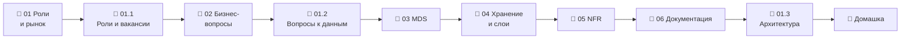

# Модуль 01 · Роль инженера данных и архитектура решения

**Длительность:** ~1 нед. · **Статус и DoD:** см. [ROADMAP](../../ROADMAP.md)

## Бизнес-вопрос

> Какие решения принимает сеть на основе данных и какая архитектура нужна, чтобы на них отвечать?

## Цели

- понимать роли в data-команде и место DE; знать, что требует рынок
- сформулировать бизнес-вопросы к FreshRetail и доказать запросами, что данные на них отвечают
- спроектировать и задокументировать целевую архитектуру capstone с числами и обоснованиями

## Темы

- роли: DA, BI, AE, DE, DS, ML Eng — границы и пересечения; как читать вакансии
- бизнес-вопрос → метрика → проверка осуществимости; смешанные факторы; скрытый спрос
- Modern Data Stack: ingestion → storage → transform → orchestration → serving; ETL vs ELT
- системы записи vs производные данные
- warehouse vs lake vs lakehouse; слои bronze/silver/gold; batch vs streaming; lambda vs kappa
- нефункциональные требования (Клеппман, гл. 1): надёжность, масштабируемость, сопровождаемость;
  параметры нагрузки и перцентили; свежесть и SLO
- документация архитектуры: Mermaid, уровни схем, ADR

## Инструменты

Mermaid (диаграммы в markdown), DuckDB (EDA и проверка вопросов), Python (замер перцентилей)

## Маршрут прохождения

Сначала урок, потом задачи лабы по нему. Статусы: ✅ сделано · 🟨 сейчас · ⬜ впереди.

| # | Шаг | Что | Статус |
|---|---|---|---|
| 1 | 📖 [01 · Роли в data-команде и рынок](theory/01_data_roles_and_market.md) · [карта](maps/roles-and-market.canvas) | урок | ⬜ |
| 2 | 🧪 [Лаба 01.1 — роли и рынок вакансий](labs/01.1_roles_and_market/README.md) | чья задача, 10 вакансий, `interview/market.md` | ⬜ |
| 3 | 📖 [02 · Бизнес-вопросы](theory/02_business_questions.md) · [карта](maps/business-questions.canvas) | урок | ⬜ |
| 4 | 🧪 [Лаба 01.2 — бизнес-вопросы к данным](labs/01.2_business_questions/README.md) | кандидаты, проверка запросами, карточки в `capstone/README.md` | ⬜ |
| 5 | 📖 [03 · Modern Data Stack](theory/03_modern_data_stack.md) · [карта](maps/modern-data-stack.canvas) | урок | ⬜ |
| 6 | 📖 [04 · Warehouse, lake, lakehouse и слои](theory/04_storage_architectures.md) · [карта](maps/storage-architectures.canvas) | урок | ⬜ |
| 7 | 📖 [05 · Нефункциональные требования](theory/05_nonfunctional_requirements.md) · [карта](maps/nfr.canvas) | урок | ⬜ |
| 8 | 📖 [06 · Как описать архитектуру](theory/06_architecture_docs.md) · [карта](maps/architecture-docs.canvas) | урок | ⬜ |
| 9 | 🧪 [Лаба 01.3 — целевая архитектура](labs/01.3_architecture/README.md) | схемы, слои, ADR, NFR с замерами → `capstone/architecture.md` | ⬜ |
| 10 | 🏁 [Домашка-чекпоинт](homework.md) | 7 вопросов к данным и одно предсказание | ⬜ |

> [!note] Изменение плана модуля
> В исходном плане лаба 01.1 была «EDA датасета: гранулярность, ключи, пропуски, иерархии». Это
> полностью сделано в лабе 00.3, поэтому исследование данных перенесено туда, где оно нужно для
> решения: в лабе 01.2 каждый бизнес-вопрос проверяется запросами. Лаба 01.1 теперь про роли и
> рынок вакансий — пункт DoD модуля, у которого раньше не было своей лабы.

## Чек-лист самоконтроля

Отмечай пункт, только когда можешь сделать это **без подсказки**. Подробные чек-листы — в начале
каждого урока.

**Роли** ([01](theory/01_data_roles_and_market.md))
- [ ] По описанию задачи называю роль через потребителя результата
- [ ] По тексту вакансии определяю настоящую роль и ядро навыков

**Вопросы и метрики** ([02](theory/02_business_questions.md))
- [ ] Перехожу от расплывчатого вопроса к решению, метрике, разрезу, частоте и сигналу
- [ ] Агрегирую доли из сумм, а не средним долей
- [ ] Называю ограничения FreshRetail и объясняю скрытый спрос
- [ ] Проверяю смешанный фактор сравнением внутри однородных срезов

**Архитектура** ([03](theory/03_modern_data_stack.md), [04](theory/04_storage_architectures.md))
- [ ] Рисую путь данных по этапам MDS с инструментами курса
- [ ] Объясняю, почему ELT, и когда оправдан ETL
- [ ] Отличаю систему записи от производных данных
- [ ] Сравниваю warehouse, lake и lakehouse и называю цену lakehouse
- [ ] Раскладываю FreshRetail по bronze/silver/gold с grain каждого слоя
- [ ] Выбираю батч или поток по требованию к свежести; объясняю lambda и kappa

**Требования и документация** ([05](theory/05_nonfunctional_requirements.md), [06](theory/06_architecture_docs.md))
- [ ] Описываю нагрузку параметрами и замеряю p50/p95/p99
- [ ] Записываю SLO с процентом и периодом
- [ ] Рисую схему в Mermaid без ошибок синтаксиса
- [ ] Пишу ADR с альтернативами и последствиями

**Закрытие модуля**
- [ ] Лабы 01.1–01.3 выполнены по Definition of Done
- [ ] [Домашка](homework.md) сдана, ошибки разобраны
- [ ] Тезисы по Клеппману, гл. 1, — в [`notes.md`](notes.md)

## Материалы модуля

| Что | Где |
|---|---|
| 🧠 Карточки для повторения | [flashcards.md](flashcards.md) |
| 🗺️ Карты | [maps/](maps/) |
| 📚 Термины | [glossary/](../../glossary/README.md) — раздел «Роли, аналитика и архитектура» |
| 📓 Заметки | [notes.md](notes.md) |

## Мини-проект (вклад в capstone)

- [`capstone/README.md`](../../capstone/README.md) — карточки бизнес-вопросов (лаба 01.2)
- [`capstone/architecture.md`](../../capstone/architecture.md) — схемы, слои, NFR, ADR (лаба 01.3)
- [`interview/market.md`](../../interview/market.md) — обзор рынка (лаба 01.1)

## Ресурсы

- [Data-Learn: модуль 1 — роль аналитики](https://github.com/Data-Learn/data-engineering/blob/master/DE-101%20Modules/Module01/readme.md)
- [Fundamentals of Data Engineering (Reis, Housley) — гл. 1–3](https://www.oreilly.com/library/view/fundamentals-of-data/9781098108298/)
- [Mermaid: flowchart](https://mermaid.js.org/syntax/flowchart.html)
- [ADR: шаблон Майкла Найгарда](https://github.com/joelparkerhenderson/architecture-decision-record)

## Книга и видео

Полная таблица с пояснениями, зачем читать и что пропустить — в [карте чтения](../../reading_map.md#01--роль-de-и-архитектура-решения).

- 📖 Клеппман, гл. 1 — надёжность, масштабируемость, сопровождение, перцентили (урок 05)
- 📖 Клеппман, гл. 12 — системы записи и производные данные, lambda и kappa (уроки 03–04)
- 🎬 [Zoomcamp `02-workflow-orchestration`](https://github.com/DataTalksClub/data-engineering-zoomcamp/tree/main/02-workflow-orchestration) — вступление про Data Lake

## Домашка-чекпоинт

После всех лаб — [`homework.md`](homework.md).

## Заметки

Конспект, тезисы по книге и выводы — в [`notes.md`](notes.md).
