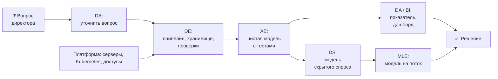
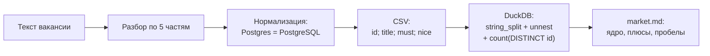
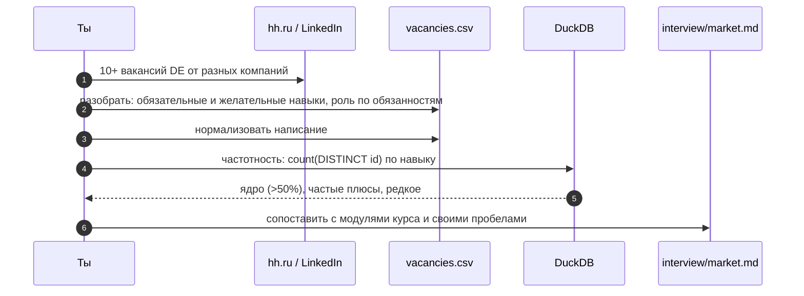

# 01 · Роли в data-команде: кто что делает и где место инженера данных

> [!info] Урок одной фразой
> Данные в компании похожи на фабрику-кухню сети ресторанов. Кто-то строит кухню и линии
> поставок, кто-то готовит полуфабрикаты, кто-то собирает блюда под заказ, кто-то придумывает
> новые рецепты. Инженер данных строит кухню и линии поставок: если они не работают, не
> работает никто. Роли различаются тем, **что** человек производит и **для кого**, а не набором
> инструментов.

> [!todo] Чек-лист: после урока ты сможешь
> - [ ] по описанию задачи сказать, чья она: DE, AE, DA/BI, DS, MLE или платформы;
> - [ ] объяснить, что именно производит инженер данных и чем его результат отличается от
>   результата аналитика;
> - [ ] по тексту вакансии понять, какую роль на самом деле ищут, даже если она названа иначе;
> - [ ] собрать выборку вакансий и посчитать частотность навыков запросом (лаба 01.1).

**Нужно для:** лаба [01.1](../labs/01.1_roles_and_market/README.md), все задачи.
**Карта урока:** [roles-and-market.canvas](../maps/roles-and-market.canvas).

---

## Шаг 0. Азбука: зачем компании отдельные люди для данных

У сети из 898 магазинов каждый день появляются миллионы фактов: что продано, в какой час, что
кончилось на полке, какая была скидка и погода. Сами по себе эти факты ничего не стоят. Ценность
появляется, когда кто-то на их основе **принимает решение**: завезти больше товара 38 в магазин 214
по пятницам, отменить неработающую акцию, перенести поставку на утро.

Между сырым фактом и решением лежит длинная цепочка работы. Данные надо собрать из десятков
систем, сохранить, очистить, свести в понятные таблицы, посчитать показатели, показать их
человеку и иногда построить прогноз. Один человек всю цепочку не вытянет: каждый её участок
требует своих знаний. Поэтому в data-команде несколько ролей, и каждая отвечает за свой участок.

Весь модуль держится на одной аналогии: **фабрика-кухня сети ресторанов**. Она снабжает
десятки ресторанов, получает продукты от поставщиков, обрабатывает их и выдаёт готовые блюда.

| В данных | В аналогии «фабрика-кухня» | Подробнее |
|---|---|---|
| Источники (кассы, склад, API погоды) | Поставщики продуктов | |
| Сырые данные | Продукты в том виде, в каком их привезли | |
| Очищенные таблицы | Полуфабрикаты: вымыто, нарезано, разложено | |
| Витрина, отчёт, дашборд | Готовое блюдо на раздаче | [витрина](../../../glossary/data-mart.md) |
| Бизнес-вопрос | Заказ из ресторана | |
| Инженер данных (DE) | Строит кухню, линии поставок и холодильники | [роли](../../../glossary/data-roles.md) |
| Analytics engineer (AE) | Пишет техкарты полуфабрикатов, по которым готовят все | |
| Аналитик / BI (DA) | Собирает блюдо под конкретный заказ и подаёт его | |
| Data scientist (DS) | Технолог: придумывает новый рецепт (прогноз, модель) | |
| ML engineer (MLE) | Ставит рецепт технолога на поток | |
| Платформенная команда | Инженеры здания: электричество, вода, вентиляция | |

> [!tip] Как читать урок
> Наведи мышь на ссылку термина — всплывёт его карточка. Блоки «Попробуй сам» выполняй сразу:
> записывать результат не нужно.

---

## Шаг 1. Путь от вопроса до решения

**Проблема.** Роли трудно понять по отдельности: «DE пишет пайплайны», «аналитик строит
дашборды» — это определения через инструменты, и они ничего не объясняют. Роль понятна, только
если видеть, **какой кусок общей работы** она закрывает.

**Как устроено.** Проследим один вопрос от появления до решения. Директор по закупкам спрашивает:
«Почему в магазинах вечером пустые полки в категории 5 и сколько мы на этом теряем?»

1. **Аналитик** уточняет вопрос. «Пустые полки» — это часы, когда товара нет в наличии. «Теряем» —
   продажи, которые могли бы случиться. «Вечером» — после 18:00. Он ищет готовые таблицы, где
   есть наличие по часам. Если их нет, он идёт к инженерам.
2. **Инженер данных** выясняет, откуда взять почасовое наличие: из складской системы, кассы
   или из файлов, которые выгружает поставщик. Он строит **пайплайн** — автоматическую
   цепочку, которая каждую ночь забирает данные, складывает их в хранилище и проверяет, что
   они пришли целиком.
3. **Analytics engineer** превращает сырые таблицы в чистую модель: одна строка — товар в
   магазине за час, с понятными названиями колонок, с тестами. Этой моделью потом пользуются
   все аналитики, а не каждый собирает своё.
4. **Аналитик** считает показатель «доля вечерних часов без товара» по категориям и магазинам и
   строит дашборд.
5. **Data scientist** замечает, что «потерянные продажи» напрямую не наблюдаются: когда товара
   нет, его не покупают, и сколько хотели бы купить, неизвестно. Он строит модель, которая
   оценивает этот скрытый спрос.
6. **ML engineer** ставит модель на поток: она каждый день пересчитывает прогноз и отдаёт его в
   систему автозаказа.
7. **Директор** принимает решение: увеличить вечерние поставки в 40 магазинах.



**Что из этого следует.**

- Работа инженера данных стоит **в начале** цепочки. Его результат — не ответ на вопрос, а
  **надёжный поток данных**, на котором другие строят ответы. Если пайплайн сломался ночью,
  утром у всех остальных пустые дашборды.
- Поэтому у DE свои критерии качества: данные пришли вовремя (свежесть), целиком (полнота),
  без дублей и в ожидаемом формате. Об этих требованиях — урок 05.
- Один и тот же человек в маленькой компании может закрывать три-четыре шага. Роли — это
  участки работы, а не обязательно разные люди.

---

## Шаг 2. Шесть ролей и их границы

**Проблема.** Названия ролей пересекаются, и компании называют их по-разному. Чтобы
ориентироваться, нужно знать, чем роли **отличаются по сути**: что производят, кто
потребитель результата и как измеряется успех.

**Как устроено.** Хорошо различает роли вопрос «что лежит у тебя в результате работы в конце
недели?».

| Роль | Что производит | Потребитель | Главные инструменты | Успех — это |
|---|---|---|---|---|
| **Data engineer** | пайплайны, хранилище, платформу для данных | AE, DA, DS, другие системы | Python, SQL, оркестратор, Spark, Kafka, облако, Docker | данные приходят вовремя, целиком, дёшево |
| **Analytics engineer** | чистые модели и витрины в хранилище, тесты, документацию | DA, BI, бизнес | SQL, dbt, git | у всей компании одна правда о «выручке» |
| **Data analyst / BI** | ответы на вопросы, отчёты, дашборды | менеджеры, директора | SQL, BI-инструменты, Excel | решение принято на основе цифр |
| **Data scientist** | модели, эксперименты, исследования | бизнес, продукт | Python, статистика, ML-библиотеки | прогноз точнее, эксперимент доказал эффект |
| **ML engineer** | модель, работающую в продакшене | продукт, другие сервисы | Python, MLOps-инструменты, контейнеры | модель стабильно отвечает под нагрузкой |
| **Платформенный / DevOps** | инфраструктуру: серверы, сети, доступы, CI/CD | все инженеры | Kubernetes, Terraform, облако | всё работает и безопасно |

Границы проходят там, где меняется **потребитель** результата:

- **DE ↔ AE.** DE доставляет данные в хранилище и отвечает за то, что они там есть. AE берёт
  их оттуда и превращает в модели для бизнеса. Граница — слой сырых данных. В нашем курсе
  модуль 04 (загрузка) — это работа DE, модуль 05 (dbt) — работа AE.
- **AE ↔ DA.** AE строит переиспользуемые модели для многих вопросов. DA отвечает на конкретный
  вопрос. Если два аналитика по-разному считают выручку, это проблема AE.
- **DS ↔ MLE.** DS доказывает, что модель работает, на исторических данных. MLE делает так,
  чтобы она работала каждый день на новых.
- **DE ↔ платформа.** Платформа даёт серверы и Kubernetes. DE решает, что на них запускать для
  данных. В нашем курсе модуль 00 — это работа платформы, только в миниатюре.

**Почему появился analytics engineer.** Ещё десять лет назад трансформацией данных занимались
DE, на Python и Spark. Когда хранилища стали мощными, а инструменты вроде dbt позволили
описывать трансформации на SQL с тестами и версионированием, эту работу смогли взять на себя
люди с сильным SQL и пониманием бизнеса. Так от DE отделилась роль AE, а DE сосредоточились на
загрузке, инфраструктуре и масштабе.

> [!warning] Ловушка: роль по названию вакансии
> Компании называют роли непоследовательно. «Data engineer» в одной вакансии — это человек,
> который пишет на dbt витрины (по сути AE). В другой — тот, кто администрирует Kafka-кластер
> (близко к платформе). «Аналитик данных» иногда строит пайплайны. Определяй роль по списку
> обязанностей и по тому, кто потребитель результата, а не по заголовку.

---

## Шаг 3. Что делает инженер данных на практике

**Проблема.** «Строит пайплайны» — слишком общая формулировка. Чтобы понимать, чему учиться,
нужно знать, из каких конкретных задач состоит неделя инженера данных.

**Как устроено.** Работа DE раскладывается по жизненному циклу данных. Эту схему предлагают Рейс
и Хаусли в книге *Fundamentals of Data Engineering*: данные **порождаются** в источниках,
**загружаются**, **хранятся**, **преобразуются** и **отдаются** потребителям. Поверх всех этапов
идут сквозные заботы: безопасность, управление данными, DataOps, оркестрация.

| Этап | Типичная задача DE | Модуль курса |
|---|---|---|
| Источники | договориться с владельцем кассовой системы о формате выгрузки | 04, 08 |
| Загрузка | забирать файлы и изменения из БД каждую ночь, не теряя и не дублируя строки | 04, 08 |
| Хранение | выбрать формат и партиционирование, чтобы запросы были быстрыми и дешёвыми | 03 |
| Преобразование | собрать тяжёлую витрину на Spark, когда SQL не справляется | 05, 07 |
| Отдача | поднять хранилище для дашбордов с ответом за секунду | 10 |
| Оркестрация | расписание, зависимости, повторы при сбоях | 06 |
| Качество и наблюдаемость | проверки, алерты, SLA, разбор инцидентов | 09 |
| Управление данными | каталог, права доступа, персональные данные | 11 |
| DataOps | CI/CD, тесты, инфраструктура как код | 12 |

Из этой таблицы видно, почему курс устроен именно так: каждый модуль — один этап жизненного цикла.

**Что из этого следует.** Большую часть времени DE не пишет новое, а поддерживает существующее:
разбирает упавшие пайплайны, отвечает на вопросы «почему вчерашних данных нет», меняет загрузку
под новый формат источника. Поэтому навыки диагностики из урока 08 модуля 00 и надёжность из
урока 05 этого модуля так же важны, как знание инструментов.

> [!example]- Попробуй сам: какие этапы жизненного цикла уже работают в нашем стеке
> ```bash
> make ps
> ls capstone/
> ```
> **Увидишь:** работают хранение (Silo, Postgres, Lakekeeper) и рабочее место (workspace). В
> `capstone/` есть папки под загрузку, трансформацию, оркестрацию, стриминг, качество и отдачу.
> Сейчас они пустые: их заполнят модули 04–10.

---

## Шаг 4. Как читать вакансию

**Проблема.** Вакансия — это неструктурированный текст, где вперемешку идут обязанности,
требования, «будет плюсом» и рассказ о компании. Чтобы сравнить десяток вакансий и понять,
что на самом деле требуется, текст нужно разобрать по одной схеме.

**Как устроено.** У любой вакансии есть пять частей, и каждая отвечает на свой вопрос:

| Часть | Вопрос | Что в ней искать |
|---|---|---|
| Обязанности | какую роль ищут на самом деле | глаголы: «строить пайплайны», «писать витрины», «администрировать кластер» |
| Обязательные требования | без чего не возьмут | инструменты и опыт, названные без оговорок |
| «Будет плюсом» | что отличит тебя от других | часто — следующий шаг развития роли |
| Стек компании | с чем работать каждый день | облако, хранилище, оркестратор |
| Контекст | масштаб и зрелость | объёмы данных, размер команды, домен |

При подсчёте навыков важны три правила:

1. **Нормализация.** «PostgreSQL», «Postgres» и «PG» — один навык. «Airflow» и «Apache Airflow» —
   тоже. Без приведения к одному написанию частоты расползутся по синонимам.
2. **Разделение обязательных и желательных.** Навык, который в 8 вакансиях стоит в «плюсах», и
   навык, который в 8 вакансиях обязателен, — разные сигналы. Считай их отдельно.
3. **Считать вакансии, а не упоминания.** Если в одной вакансии Python упомянут трижды, это
   одна вакансия с Python. Поэтому считают `count(DISTINCT id)`.

**Сколько вакансий нужно.** Десять — минимум, чтобы увидеть ядро: навыки, которые встречаются
больше чем в половине вакансий. Редкие навыки на такой выборке — шум. Выводы вида «Kafka нужна
в 30% вакансий» на выборке из 10 означают «в трёх вакансиях», и это стоит писать прямо.

**Как превратить разбор в данные.** Удобно вести таблицу: строка — вакансия, в колонке
навыков — список через `;`. Такую таблицу DuckDB читает как CSV, а функции `string_split` и
`unnest` превращают список в строки, по которым уже можно считать (урок 09 модуля 00, шаг 6).



> [!example]- Попробуй сам: частотность навыков на трёх выдуманных вакансиях
> В `make sql`:
> ```sql
> CREATE TABLE vacancies AS SELECT * FROM (VALUES
>     (1, 'Middle DE',     'SQL; Python; Airflow; Spark; Kafka'),
>     (2, 'DE (retail)',   'sql; python; dbt; ClickHouse; Airflow'),
>     (3, 'Data Engineer', 'Python; Spark; AWS; Airflow; Docker')
> ) AS t(id, title, skills);
>
> WITH s AS (
>     SELECT id, lower(trim(unnest(string_split(skills, ';')))) AS skill
>     FROM vacancies
> )
> SELECT skill,
>        count(DISTINCT id)                                                  AS vacancies,
>        round(100.0 * count(DISTINCT id) / (SELECT count(*) FROM vacancies)) AS pct
> FROM s
> GROUP BY skill
> ORDER BY vacancies DESC, skill;
> ```
> **Увидишь:** `airflow` и `python` в 100% вакансий, `spark` и `sql` в 67%. `lower` и `trim`
> склеили `SQL` и `sql`, ` Python` и `Python`: без них это были бы разные навыки. Для лабы
> такую таблицу удобно держать в CSV и читать через `read_csv('…/vacancies.csv', delim = ',')`.

> [!warning] Ловушка: выборка из одного источника
> Десять вакансий одной компании или одного города покажут стек этой компании, а не рынок.
> Бери вакансии разных компаний и, если можешь, разных доменов: ритейл, финтех, продукт.

---

## Сборка целиком: от вакансии к плану обучения



| Если пропустить шаг | Что получишь |
|---|---|
| 1 — вакансии из одной компании | стек одной компании вместо рынка |
| 2 — не разделить обязательное и желательное | «плюсы» выглядят как требования, план перегружен |
| 3 — не нормализовать | один навык размазан по трём строкам, частоты занижены |
| 4 — считать упоминания | навыки из длинных вакансий кажутся важнее |
| 6 — не сопоставить с курсом | цифры есть, а что делать с ними — непонятно |

---

## Шпаргалка

| Хочу | Как |
|---|---|
| Понять, чья задача | кто потребитель результата и что лежит в результате |
| Понять роль в вакансии | читать обязанности (глаголы), а не заголовок |
| Разобрать вакансию | обязанности · обязательное · плюсы · стек · контекст |
| Посчитать навыки | `string_split` + `unnest` + `count(DISTINCT id)` |
| Не размазать навык | `lower(trim(…))` + словарь синонимов |
| Прочитать CSV | `read_csv('путь.csv')` |

## Типичные ошибки

| Симптом | Причина | Как проверить | Как чинить |
|---|---|---|---|
| Учишь всё подряд из вакансий | не выделено ядро | доля вакансий по навыку | сначала навыки, которые есть в >50% |
| Один навык в топе трижды под разными именами | нет нормализации | `SELECT DISTINCT skill` | привести к одному написанию |
| «Data engineer» в вакансии — а работа про дашборды | роль по заголовку | раздел обязанностей | определять роль по глаголам |
| Выводы «Kafka нужна всем» по 10 вакансиям | малая выборка | число вакансий в знаменателе | писать абсолютные числа рядом с процентами |
| Длинные вакансии перевешивают | считаются упоминания | `count(*)` против `count(DISTINCT id)` | считать вакансии |

---

## Проверь себя

Карточки для интервального повторения — в [flashcards.md](../flashcards.md).

> [!question] 1. Задача: «Собрать в dbt витрину продаж по дням с тестами на уникальность и отдать её аналитикам». Чья это задача и почему?
> > [!success]- Ответ
> > Analytics engineer. Результат — переиспользуемая модель в хранилище, потребители — аналитики.
> > Данные уже лежат в хранилище, значит, загрузку (работу DE) кто-то сделал раньше.

> [!question] 2. Ночью кассовая система поменяла формат выгрузки, и утром у всех пустые дашборды. Кто должен это чинить и почему именно он?
> > [!success]- Ответ
> > Инженер данных: сломалась загрузка, его участок. Сначала он восстанавливает поток, затем
> > добавляет проверку формата и алерт, чтобы следующее изменение источника обнаружилось
> > ночью, а не утром у потребителей.

> [!question] 3. Вакансия «Data Engineer»: «писать SQL-модели в dbt, строить отчёты в Superset, общаться с бизнесом». Какую роль ищут?
> > [!success]- Ответ
> > Смесь AE и BI-аналитика. Ни загрузки данных, ни инфраструктуры в обязанностях нет.
> > Роль определяют глаголы обязанностей и потребитель результата, а не заголовок.

> [!question] 4. Чем отличается вклад DS от вклада MLE в одну и ту же модель прогноза спроса?
> > [!success]- Ответ
> > DS доказывает на исторических данных, что модель прогнозирует лучше текущего способа. MLE
> > делает так, чтобы она каждый день получала свежие данные, считалась вовремя и отдавала
> > прогноз другой системе. Первый отвечает за то, что модель верна, второй — за то, что
> > она работает.

> [!question] 5. В выборке из 12 вакансий Kubernetes встречается в трёх, и все три — в разделе «будет плюсом». Как это записать в `market.md`?
> > [!success]- Ответ
> > «Kubernetes: 3 из 12 (25%), только как желательный навык». Это не ядро. Учить его стоит
> > после навыков, которые обязательны в большинстве вакансий. Абсолютное число рядом с
> > процентом нужно, чтобы читатель видел размер выборки.

> [!question] 6. Почему в маленькой компании роли DE, AE и DA часто совмещает один человек, а в большой — нет?
> > [!success]- Ответ
> > В маленькой компании мало источников и вопросов, и цепочку от загрузки до отчёта успевает
> > пройти один человек. С ростом объёма каждый участок требует глубины: сотни источников,
> > десятки аналитиков с общими моделями, нагрузка на хранилище. Тогда участки отдают разным
> > людям, чтобы каждый делал свой хорошо.
