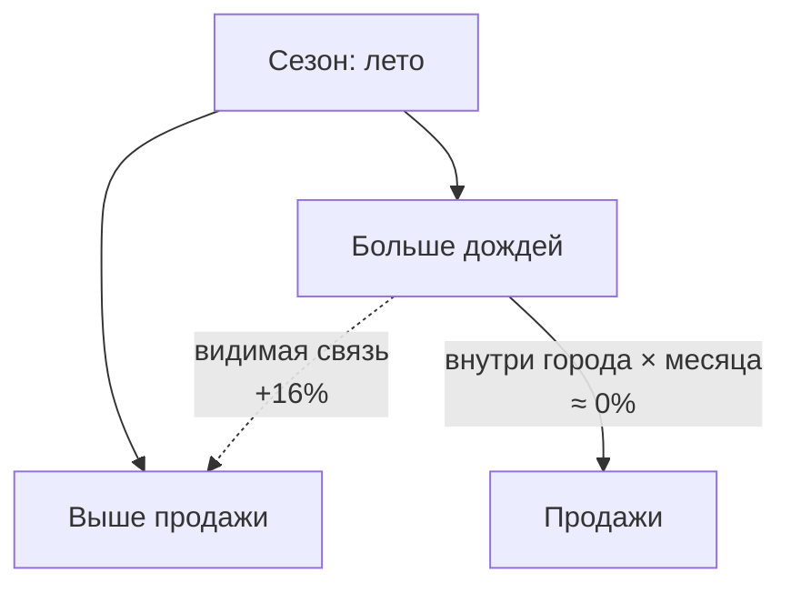
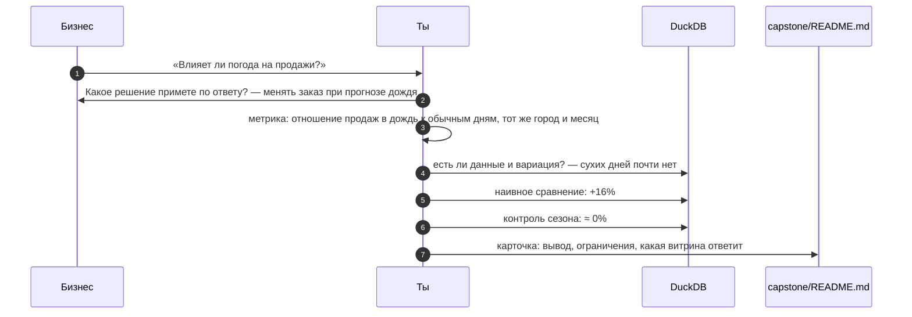

# 02 · Бизнес-вопросы: как превратить «хочу понимать продажи» в задачу для данных

> [!info] Урок одной фразой
> Заказ «приготовьте что-нибудь вкусное» кухня выполнить не может, а «борщ на 40 порций к
> 12:00» — может. С данными так же: вопрос становится задачей, когда за ним стоит решение,
> показатель с формулой и проверка, что продукты для блюда вообще есть на складе. Половина
> вопросов отсеивается на последнем шаге, и лучше узнать это до того, как строить пайплайн.

> [!todo] Чек-лист: после урока ты сможешь
> - [ ] переформулировать расплывчатый вопрос через решение, которое он поддерживает;
> - [ ] записать метрику формулой из колонок датасета и выбрать правильный способ агрегации;
> - [ ] назвать, на какие вопросы наш датасет ответить не может, и почему;
> - [ ] проверить осуществимость вопроса запросом, не попав в ловушку смешанных факторов;
> - [ ] оформить вопрос карточкой для `capstone/README.md` (лаба 01.2).

**Нужно для:** лаба [01.2](../labs/01.2_business_questions/README.md), все задачи.
**Карта урока:** [business-questions.canvas](../maps/business-questions.canvas).

---

## Шаг 0. Азбука: зачем начинать с вопроса

Первый принцип курса — «сначала бизнес-вопрос, потом инструмент». Причина практическая.
Пайплайн, хранилище и витрины — дорогие вещи: их строят неделями и поддерживают годами. Если
строить их «на всякий случай», получается хранилище, в котором лежит всё, и при этом ни один
нужный ответ не получается без недели ручной работы. Вопрос задаёт **требования**: какие
данные нужны, с какой детальностью, как часто обновлять, как быстро отвечать.

**Бизнес-вопрос** — вопрос, ответ на который меняет действие компании. «Сколько мы продали
вчера» — это не бизнес-вопрос, а отчёт: он ничего не меняет, пока кто-то не сравнит его с
планом. «В каких магазинах вечером кончаются товары категории 5 и сколько их довезти» — бизнес-вопрос: на
него есть действие, изменить поставки.

| В данных | В аналогии «фабрика-кухня» | Подробнее |
|---|---|---|
| Решение | Ради чего ресторан делает заказ: банкет, обед, меню недели | |
| Бизнес-вопрос | Заказ ресторана | [бизнес-вопрос](../../../glossary/business-question.md) |
| Метрика | Точная техкарта: что, сколько граммов, при какой температуре | [метрика](../../../glossary/metric.md) |
| Разрез (измерение) | Для какого ресторана, на какой день, для какого зала | |
| Данные датасета | Что реально лежит на складе | |
| Проверка осуществимости | Заглянуть на склад до того, как обещать блюдо | |
| Смешанный фактор | Блюдо стало вкуснее, но потому что поменяли поставщика, а не рецепт | [смешанный фактор](../../../glossary/confounder.md) |
| Скрытый спрос | Сколько гостей ушло, потому что блюдо закончилось | [скрытый спрос](../../../glossary/censored-demand.md) |

---

## Шаг 1. Из чего состоит хороший вопрос

**Проблема.** Вопросы от бизнеса приходят расплывчатыми: «хотим понимать продажи», «как у нас с
наличием», «влияет ли погода». Если взяться за такой вопрос как есть, ответ тоже получится
расплывчатым: десять графиков, из которых не следует ни одного действия.

**Как устроено.** Расплывчатый вопрос превращают в задачу, отвечая на пять подвопросов по
порядку. Порядок важен: каждый следующий опирается на предыдущий.

1. **Какое решение?** Кто примет решение и какое. «Директор по закупкам решит, менять ли
   объём вечерних поставок». Если решения нет, вопрос либо любопытство, либо отчёт.
2. **Какая метрика?** Число, которое покажет, принимать ли решение. Записывается формулой из
   колонок (шаг 2).
3. **В каком разрезе?** По каким измерениям смотреть метрику: магазин, город, категория, час,
   день недели. Разрез задаёт, где можно действовать: если поставки планируют по магазинам,
   метрика по городу бесполезна.
4. **За какой период и как часто?** История для анализа и частота обновления. Решение о
   поставках на завтра требует обновления раз в сутки, стратегия на квартал — раз в месяц.
5. **Что считать сигналом?** Порог, после которого действуют: «если доля пустых вечерних часов
   больше 30%». Без порога каждый читает график по-своему.


| Расплывчато | Точно |
|---|---|
| Влияет ли погода? | Растут ли продажи категории X в дождливые дни настолько, чтобы увеличивать заказ на день с прогнозом дождя? |
| Работают ли акции? | На сколько процентов растут продажи товара в дни скидки по сравнению с днями без скидки у того же товара в том же магазине? |
| Как с наличием? | В каких магазинах и категориях доля вечерних часов без товара выше 30%? |

**Что из этого следует.** Хорошо сформулированный вопрос сразу говорит инженеру, что строить:
какие колонки нужны, какой grain у витрины, как часто её обновлять. Именно поэтому критерий 1
рубрики capstone требует для каждого вопроса указать витрину или дашборд, которые на него
отвечают.

---

## Шаг 2. Метрика: формула, а не слова

**Проблема.** «Доля пустых полок» звучит понятно, но два аналитика посчитают её по-разному и
получат разные числа. Один поделит пустые часы на все часы, другой усреднит доли по
магазинам. Спор о цифрах на совещании почти всегда оказывается спором об определении метрики.

**Как устроено.** **[Метрика](../../../glossary/metric.md)** — число с однозначным определением.
Определение включает:

- **формулу из колонок данных**: числитель, знаменатель, фильтры;
- **единицы**: штуки, доля, проценты, часы;
- **способ агрегации** по разрезам: можно ли просто сложить значения магазинов, чтобы получить город.

Последний пункт — главный источник ошибок. Метрики бывают трёх типов по поведению при
агрегации:

| Тип | Пример | Как агрегировать |
|---|---|---|
| **Аддитивная** | продажи в штуках | складывать по любым разрезам |
| **Полуаддитивная** | остаток на складе | складывать по магазинам, но не по дням: остаток на понедельник + остаток на вторник — бессмыслица |
| **Неаддитивная** | доля, среднее, процент | нельзя складывать и нельзя усреднять; пересчитывать из сумм числителя и знаменателя |

**Ловушка среднего от долей.** Доля пустых часов по сети — это не среднее долей по городам.
Правильно: сложить пустые часы всех строк и поделить на все часы. Среднее по городам даёт
маленькому городу такой же вес, как огромному. На нашем датасете:

| Способ | Результат |
|---|---|
| сумма пустых часов / все часы (верно) | 19,75% |
| среднее долей по 18 городам | 20,19% |

Разница небольшая, но строк в городах от 6 тысяч до 2,5 миллиона. Самый маленький город весит в
этом среднем столько же, сколько самый большой. На другой метрике или другом разрезе такая
ошибка легко даёт разницу в разы. Заодно цифра 19,75% сходится с заявлением карточки
датасета, что около 20% данных приходится на отсутствие товара.

```sql
-- доля часов 6:00–22:00 без товара: верный способ — из сумм
SELECT 100.0 * sum(stock_hour6_22_cnt) / (16.0 * count(*)) AS oos_pct FROM sales;
```

Здесь 16 — число часов в окне 6:00–22:00, а `stock_hour6_22_cnt` — сколько из них товара не было.

> [!warning] Ловушка: в наших данных нет денег
> По карточке датасета `sale_amount` — продажи «после глобальной нормализации», умноженные на
> неизвестный коэффициент. Цен нет вовсе, только скидка. Значит, «выручка», «потери в рублях» и
> «средний чек» из этих данных не посчитать. Сравнивать можно только относительные величины:
> доли, отношения, изменения в процентах.

---

## Шаг 3. На что данные ответить не могут

**Проблема.** Вопрос может быть отличным, а данных для него нет. Обнаружить это после того, как
построен пайплайн, — потерянные недели. Поэтому до работы надо честно перечислить ограничения
датасета.

**Как устроено.** Ограничения находят, проходя по колонкам и описанию и задавая вопрос «чего
здесь нет?». Для FreshRetailNet-50K:

| Чего нет | Почему важно | Какие вопросы отпадают |
|---|---|---|
| Цен и денег, продажи нормированы | нельзя перейти к выручке и прибыли | «сколько теряем в рублях», маржинальность |
| Названий товаров и магазинов, ID анонимизированы | нельзя связать с внешним миром | «как продаётся молоко бренда X» |
| Покупателей и чеков | нет связи товаров в одной покупке | анализ корзины, лояльность |
| Длинной истории: 97 дней, март–июль | годовую сезонность не увидеть | «как продажи меняются зимой» |
| Остатков в штуках, только флаг «есть/нет» по часам | не видно, сколько не хватило | «сколько штук довезти» напрямую |

### Скрытый спрос: продажи — это не спрос

Самое важное ограничение датасета, ради которого он и создан. Когда товара нет на полке, его
не покупают. Продажа равна нулю не потому, что никто не хотел, а потому, что нечего было
купить. Значит, **наблюдаемые продажи — это нижняя граница спроса**, а в часы без товара
настоящий спрос неизвестен. Такой спрос называют
**[цензурированным](../../../glossary/censored-demand.md)**: часть значений обрезана сверху
ограничением, которое не связано с желанием покупателей.

Проверим, что это видно в данных. Сгруппируем строки по числу часов без товара за день:

| Сколько часов из 16 товара не было | Строк | Средние продажи за 6:00–22:00 |
|---|---|---|
| 0 — весь день в наличии | 2,71 млн | 0,943 |
| 1–7 часов | 1,29 млн | 1,245 |
| 8 и больше | 0,84 млн | 0,601 |

Неожиданно: дни с коротким отсутствием продаются **лучше**, чем дни с полным наличием. Причина
обратная: товар кончается, **потому что** его хорошо покупают. Популярные позиции раскупают к
вечеру, а непопулярные стоят весь день. А вот при долгом отсутствии продажи уже падают:
товара просто не было большую часть дня.

**Что из этого следует.**

- Связь двух величин в данных не говорит, что одна вызывает другую. Здесь продажи влияют на
  отсутствие, а не наоборот.
- Вопрос «сколько продаж мы теряем из-за пустых полок» в лоб не решается: потерянные продажи
  не наблюдаются. Их можно только **оценить** моделью, и это задача DS, а не одного запроса.
- В витринах надо хранить флаг наличия рядом с продажами. Иначе любой, кто посчитает «средние
  продажи товара», получит заниженный спрос и неверный заказ.

---

## Шаг 4. Проверка осуществимости и смешанные факторы

**Проблема.** Даже если колонки есть, вопрос может оказаться неразрешимым: данных слишком мало,
нет вариации, или простое сравнение даёт ложный ответ. Это проверяют быстрым исследованием
данных — **EDA** (exploratory data analysis) — до того, как вопрос попадёт в план.

**Как устроено.** Проверка отвечает на три вопроса.

1. **Есть ли данные?** Нужные колонки, нужный период, достаточно строк в каждой группе.
2. **Есть ли вариация?** Чтобы сравнивать «дождь» и «без дождя», нужны оба случая. Если
   сухих дней почти нет, сравнивать не с чем.
3. **Не обманывает ли простое сравнение?** Если две группы отличаются не только тем, что
   сравнивается, разница может объясняться другим фактором.

### Разобранный пример: влияет ли дождь на продажи

**Первый взгляд.** Разобьём строки по количеству осадков:

```sql
SELECT CASE WHEN precpt = 0 THEN '0 сухо'
            WHEN precpt < 5 THEN '1 слабый'
            ELSE '2 сильный' END AS rain,
       count(*)                   AS rows,
       round(avg(sale_amount), 3) AS avg_sale
FROM sales GROUP BY 1 ORDER BY 1;
```

| Осадки | Строк | Средние продажи |
|---|---|---|
| 0 — сухо | 8 353 | 0,749 |
| меньше 5 | 3,60 млн | 0,973 |
| 5 и больше | 1,24 млн | 1,128 |

Сразу два открытия. Сухих дней почти нет: 8 тысяч строк из 4,85 миллиона. Значит, «дождь против
сухой погоды» сравнивать не с чем, и сравнивать надо «сильный дождь против слабого». И второе:
в сильный дождь продажи выше на 16%. Вывод «дождь увеличивает продажи» напрашивается, но
проверим, чем ещё отличаются дождливые дни.

**Ищем смешанный фактор.** Посмотрим осадки и продажи по месяцам:

| Месяц | Средние осадки | Средние продажи |
|---|---|---|
| март | 2,53 | 0,843 |
| апрель | 3,14 | 0,901 |
| май | 2,22 | 1,032 |
| июнь | 6,34 | 1,123 |
| июль | 5,28 | 1,077 |

В июне и июле дождей больше, и продажи тоже выше, потому что продажи весь период растут. То есть
дождливые дни — это в основном летние дни, а летом продают больше независимо от погоды. Месяц
влияет и на дождь, и на продажи. Такой фактор называют
**[смешанным](../../../glossary/confounder.md)** (confounder): он создаёт видимость связи
между двумя величинами, которые сами друг на друга могут не влиять.

**Сравниваем подобное с подобным.** Чтобы убрать влияние сезона и города, сравним дождливые и
нормальные дни **внутри одного города и одного месяца**, а потом усредним отношение:

```sql
WITH d AS (
    SELECT city_id, month(dt::DATE) AS m,
           avg(sale_amount) FILTER (WHERE precpt >= 5) AS wet,
           avg(sale_amount) FILTER (WHERE precpt < 5)  AS dry
    FROM sales GROUP BY ALL
)
SELECT count(*)                           AS pairs,
       count(*) FILTER (WHERE wet > dry)  AS wet_higher,
       round(avg(wet / dry), 3)           AS avg_ratio
FROM d WHERE wet IS NOT NULL AND dry IS NOT NULL;
```

Результат: 57 пар «город × месяц», среднее отношение **0,998**. Внутри одного города и месяца
сильный дождь почти не меняет продажи. Наивные +16% почти целиком оказались сезоном.



**Что из этого следует.**

- Простое сравнение групп верно, только если группы отличаются **одним** фактором. Чтобы так
  было, сравнивают внутри однородных срезов: тот же магазин, тот же товар, тот же период.
- Это не доказательство, что дождь не влияет вовсе: эффект может прятаться в отдельных
  категориях или часах. Но вопрос «увеличивать ли заказ при прогнозе дождя по всей сети»
  после такой проверки ставится иначе.
- Поиск смешанных факторов — обязательная часть проверки любого вопроса «влияет ли X на Y».
  Для промо типичные смешанные факторы — праздники и сезон, для наличия — популярность товара.

> [!example]- Попробуй сам: повторить разобранный пример
> В `make sql`:
> ```sql
> CREATE VIEW sales AS SELECT * FROM read_parquet('data/raw/freshretailnet_50k/data/*.parquet');
> SELECT month(dt::DATE) AS m, round(avg(precpt), 2) AS avg_precpt,
>        round(avg(sale_amount), 3) AS avg_sale
> FROM sales GROUP BY 1 ORDER BY 1;
> ```
> Затем выполни оба запроса из шага выше. **Увидишь:** пять месяцев с ростом продаж, наивные
> +16% и отношение около 1,0 после сравнения внутри города и месяца.

---

## Шаг 5. Карточка вопроса: от вопроса к витрине

**Проблема.** Вопросы, записанные одной строкой, через месяц забываются: непонятно, что
имелось в виду, какая метрика и что из неё следует. А модулям 05 и 10 нужно знать, какие
витрины и дашборды строить.

**Как устроено.** Каждый вопрос записывают **карточкой** с фиксированными полями. Поля повторяют
шаги этого урока, поэтому карточка одновременно и проверка, что вопрос продуман до конца.

```markdown
### В1. <вопрос одним предложением>

- **Решение:** кто и что решит по ответу
- **Метрика:** формула из колонок; единицы; как агрегировать
- **Разрез и период:** измерения; история; частота обновления
- **Сигнал:** порог, после которого действуют
- **Данные:** нужные колонки; ограничения (шаг 3)
- **Проверка осуществимости:** запрос (ссылка на `queries.sql`) и что он показал
- **Ответит:** витрина (grain одной строки) или дашборд
```

Последнее поле связывает вопрос с архитектурой. **Grain витрины** выводится из разреза: если
метрику смотрят по магазину и дню, витрине нужна строка «магазин × день», и тогда по ней можно
посчитать и магазин, и город. Если смотрят по часам, строка должна быть «магазин × товар × час».

**Что из этого следует.** Набор карточек — это техническое задание на весь capstone. По полю
«Данные» видно, что загружать (модуль 04), по полю «Ответит» — какие модели строить в dbt
(модуль 05) и какие дашборды (модуль 10), по полю «Частота» — расписание оркестратора
(модуль 06).

---

## Сборка целиком: один вопрос от идеи до карточки



| Если пропустить шаг | Что получишь |
|---|---|
| 2 — не спросить о решении | ответ есть, действия нет |
| 3 — метрика словами | разные числа у разных людей |
| 4 — не проверить вариацию | сравнение с группой из восьми тысяч строк |
| 5 — без контроля смешанного фактора | «дождь +16% к продажам» и лишние закупки |
| 7 — нет поля «Ответит» | непонятно, что строить в модулях 05 и 10 |

---

## Шпаргалка

| Хочу | Как |
|---|---|
| Уточнить вопрос | решение → метрика → разрез → период → сигнал |
| Записать метрику | формула из колонок, единицы, способ агрегации |
| Агрегировать долю | сумма числителя / сумма знаменателя, не среднее долей |
| Проверить вариацию | `count(*)` в каждой сравниваемой группе |
| Убрать смешанный фактор | сравнивать внутри однородных срезов (`GROUP BY` по фактору) |
| Выбрать grain витрины | из разреза метрики, на уровень детальнее самого мелкого |

## Типичные ошибки

| Симптом | Причина | Как проверить | Как чинить |
|---|---|---|---|
| Десять графиков, ни одного решения | вопрос без решения | спросить «что сделаете по ответу?» | переформулировать через решение |
| У двух людей разные цифры | метрика без формулы | сравнить SQL | одно определение в карточке |
| Доля по сети не сходится с суммой по магазинам | усреднены доли | сумма числителя / сумма знаменателя | пересчитать из сумм |
| «X увеличивает Y на 16%», а эффекта нет | смешанный фактор | сравнить внутри срезов | контроль сезона, города, товара |
| Средние продажи товара занижены | в среднее вошли часы без товара | доля строк с `stock_hour6_22_cnt > 0` | хранить флаг наличия, считать отдельно |
| Вопрос в рублях | в данных нет цен | карточка датасета | относительные метрики |

---

## Проверь себя

Карточки для интервального повторения — в [flashcards.md](../flashcards.md).

> [!question] 1. Директор просит «дашборд по продажам». Какие два вопроса ты задашь первыми?
> > [!success]- Ответ
> > Какое решение он примет, глядя на дашборд, и что будет сигналом к действию. Без ответа на
> > них непонятно, какие метрики, разрезы и частоту обновления выбирать.

> [!question] 2. Доли пустых часов по двум магазинам — 10% (100 часов из 1000) и 50% (5 из 10). Какая доля по двум магазинам вместе?
> > [!success]- Ответ
> > 105 / 1010 ≈ 10,4%, а не среднее 30%. Доля неаддитивна: её пересчитывают из сумм числителя
> > и знаменателя. Маленький магазин не должен весить столько же, сколько большой.

> [!question] 3. Почему средние продажи товара в днях без пустых полок ниже, чем в днях с коротким отсутствием?
> > [!success]- Ответ
> > Обратная причинность: товар кончается, потому что его хорошо покупают. Популярные позиции
> > раскупают к вечеру, непопулярные стоят весь день. Отсутствие — следствие продаж, а не
> > их причина.

> [!question] 4. Можно ли по нашему датасету ответить, сколько рублей сеть теряет из-за пустых полок?
> > [!success]- Ответ
> > Нет, по двум причинам. В данных нет цен, а продажи нормированы неизвестным коэффициентом.
> > И потерянные продажи не наблюдаются: в часы без товара спрос скрыт. Можно оценить
> > относительную долю потерь моделью скрытого спроса, но не рубли.

> [!question] 5. Продажи товара в дни скидки на 40% выше, чем без скидки. Какие смешанные факторы ты проверишь?
> > [!success]- Ответ
> > Праздники и выходные: скидки часто ставят на них, а в эти дни продажи выше и без скидки.
> > Сезон и тренд: акции могли прийтись на период общего роста. Магазин и товар: скидки могли
> > давать в больших магазинах. Сравнивать нужно тот же товар в том же магазине в близкие дни.

> [!question] 6. Метрику смотрят по городу и дню, но иногда хотят увидеть отдельный магазин. Какой grain выбрать для витрины?
> > [!success]- Ответ
> > «Магазин × день». Из него агрегацией получается город × день, а обратно — из города в
> > магазин — разложить нельзя. Grain выбирают по самому детальному разрезу, который понадобится.
