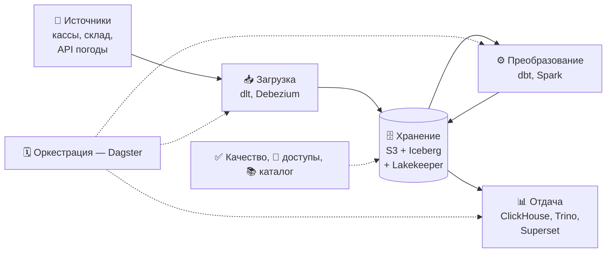
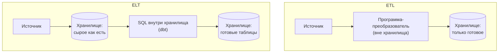
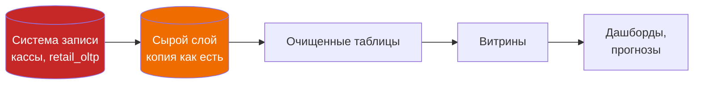
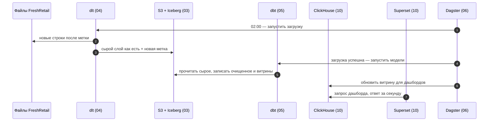

# 03 · Modern Data Stack: путь данных от источника до дашборда

> [!info] Урок одной фразой
> Фабрика-кухня устроена как конвейер: приёмка от поставщиков → склад → заготовочный цех →
> раздача, а над всем этим стоит шеф с расписанием. Modern Data Stack — тот же конвейер для
> данных, собранный из отдельных взаимозаменяемых инструментов: каждый делает один этап, а
> между этапами данные лежат в общем хранилище. Главная идея — сначала привезти и сохранить
> как есть, а обрабатывать потом, на месте.

> [!todo] Чек-лист: после урока ты сможешь
> - [ ] назвать пять этапов пути данных и инструмент нашего курса для каждого;
> - [ ] объяснить, чем ELT отличается от ETL и почему современные стеки выбирают ELT;
> - [ ] отличить систему записи от производных данных и объяснить, почему производные можно
>   пересчитать, а систему записи — нет;
> - [ ] нарисовать путь данных FreshRetail через наш стек (лаба 01.3).

**Нужно для:** лаба [01.3](../labs/01.3_architecture/README.md), задача 1.
**Карта урока:** [modern-data-stack.canvas](../maps/modern-data-stack.canvas).

---

## Шаг 0. Азбука: из чего состоит любая система данных

Какой бы ни была компания, данные в ней проходят одни и те же этапы. Они где-то **появляются**
(касса пробила чек), их **забирают** в аналитическое хранилище, там **хранят**, **преобразуют**
в удобный вид и **отдают** людям и программам. Кто-то должен **запускать** всё это по
расписанию и следить, чтобы этапы шли в правильном порядке.

**Modern Data Stack** (MDS) — подход, при котором каждый этап закрывается отдельным
специализированным инструментом, а все они работают вокруг одного хранилища. Он появился
около 2016–2020 годов, когда облачные хранилища стали дешёвыми и мощными. До этого был
популярен другой подход: одна большая платформа от одного поставщика, которая делала всё.

| В данных | В аналогии «фабрика-кухня» | Подробнее |
|---|---|---|
| Источник | Поставщик продуктов | |
| Ingestion (загрузка) | Приёмка: машина приехала, продукты разгрузили | |
| Storage (хранение) | Склад и холодильники | |
| Transformation (преобразование) | Заготовочный цех: мыть, резать, смешивать | |
| Serving (отдача) | Раздача: блюда для ресторанов | |
| Orchestration (оркестрация) | Шеф с расписанием: что и в каком порядке готовить | |
| ETL | Резать продукты прямо в машине поставщика, на склад везти уже нарезанное | [ETL и ELT](../../../glossary/etl-elt.md) |
| ELT | Разгрузить всё как есть, резать уже на своей кухне | [ETL и ELT](../../../glossary/etl-elt.md) |
| Система записи | Накладная поставщика: единственный оригинал | [система записи](../../../glossary/system-of-record.md) |
| Производные данные | Блюда и полуфабрикаты: можно приготовить заново, если есть продукты | [система записи](../../../glossary/system-of-record.md) |

---

## Шаг 1. Пять этапов пути данных

**Проблема.** Без общей схемы этапов каждый новый инструмент выглядит как отдельная вселенная:
dlt, dbt, Dagster, Trino, Superset. Схема показывает, какую дыру закрывает инструмент и с кем
он стыкуется.

**Как устроено.** Пройдём путь одной строки «магазин 214, товар 38, 1 апреля, продажи по
часам» от кассы до дашборда.

1. **Источник.** Строка появляется в учётной системе сети: кассы пишут продажи, склад — наличие.
   Это операционная база, она обслуживает работу магазинов, и аналитические запросы к ней
   мешали бы кассам. Поэтому данные из неё забирают.
2. **Загрузка (ingestion).** Программа забирает новые строки из источника и кладёт их в
   хранилище **без изменений**. Её задача — ничего не потерять и не задвоить, а также
   запоминать, докуда уже загружено, чтобы в следующий раз брать только новое.
3. **Хранение (storage).** Данные лежат в дешёвом и надёжном хранилище в формате, удобном для
   аналитики. У нас это S3 (Silo), Parquet-файлы и Iceberg-таблицы с каталогом Lakekeeper
   (урок 04 модуля 00).
4. **Преобразование (transformation).** SQL-модели превращают сырые строки в чистые таблицы:
   типы приведены, массивы развёрнуты, дубли убраны, показатели посчитаны.
5. **Отдача (serving).** Готовые витрины отдаются потребителям: в дашборд, в быстрое
   хранилище для отчётов, в модель прогноза, в другую систему.

Поверх этапов работает **оркестрация**: она запускает загрузку в 02:00, преобразование после
неё, перезапускает упавшее и показывает, что сломалось. И есть **сквозные заботы** на всех
этапах: качество данных, безопасность и доступы, каталог «где что лежит».



Обрати внимание на двойную стрелку между хранением и преобразованием. Преобразование берёт
данные из хранилища и **кладёт результат обратно** туда же, только в другие таблицы. Это
ключевая черта современного стека, о ней шаг 2.

| Этап | Инструмент курса | Модуль |
|---|---|---|
| Источники | файлы FreshRetail, Postgres `retail_oltp`, публичный API | 04, 08 |
| Загрузка пакетами | dlt | 04 |
| Загрузка изменений в реальном времени | Debezium, Redpanda (Kafka) | 08 |
| Хранение | Silo (S3), Iceberg, Lakekeeper | 00, 03 |
| Преобразование | dbt (SQL), Spark (тяжёлое) | 05, 07 |
| Оркестрация | Dagster | 06 |
| Отдача | ClickHouse, Trino, Superset | 10 |
| Качество | dbt tests, Soda, Elementary | 09 |
| Каталог и доступы | OpenMetadata | 11 |

**Что из этого следует.**

- Инструменты MDS **взаимозаменяемы на своём этапе**. dlt можно заменить на Airbyte, Dagster —
  на Airflow, ClickHouse — на другое быстрое хранилище. Остальной стек при этом не меняется,
  потому что все стыкуются через общее хранилище и стандартные форматы.
- Обратная сторона: инструментов много, и кто-то должен их связать, обновлять и следить за
  ними. Это и есть значительная часть работы DE.

> [!example]- Попробуй сам: что уже стоит на этапе хранения
> ```bash
> make ps
> docker exec debd-workspace-1 python -c \
>   "import os, s3fs; fs = s3fs.S3FileSystem(endpoint_url=os.environ['S3_ENDPOINT']); print(fs.ls('')); print(fs.ls('landing'))"
> docker exec debd-workspace-1 sh -c \
>   'curl -s "lakekeeper:8181/catalog/v1/config?warehouse=lakehouse" | python -m json.tool | head -8'
> ```
> **Увидишь:** бакеты `landing` и `warehouse`, причём `landing` пустой: загрузка ещё не
> построена, её сделаешь в модуле 04. Каталог отвечает своим config с `prefix` — ID
> warehouse. Этапы загрузки, преобразования и отдачи пока не существуют: стек — это
> склад, к которому ещё не подвели конвейер.

---

## Шаг 2. ETL и ELT: где преобразовывать

**Проблема.** Данные почти всегда нужно преобразовать: привести типы, развернуть, почистить,
соединить. Вопрос — **где** это делать: по дороге в хранилище или уже внутри него. От ответа
зависит, что будет, когда правила преобразования поменяются или в них найдётся ошибка.

**Как устроено.** Два порядка тех же трёх букв: E — extract (забрать), T — transform
(преобразовать), L — load (загрузить).

**[ETL](../../../glossary/etl-elt.md)**: забрать → преобразовать отдельной программой → загрузить
в хранилище уже готовое. Так работали классические хранилища 1990–2010-х: место в хранилище было
дорогим, вычислительной мощности в нём мало, поэтому туда клали только нужное и в готовом виде.

**ELT**: забрать → загрузить **как есть** → преобразовать внутри хранилища, его же движком
(SQL). Стало возможным, когда хранение подешевело, а движки хранилищ стали достаточно быстрыми,
чтобы самим перемалывать сырые данные.



Разница проявляется, когда что-то идёт не так.

- **Нашли ошибку в преобразовании.** В ELT сырые данные лежат в хранилище, поэтому исправляешь
  SQL и пересчитываешь витрины за любой период. В ETL сырых данных нет: нужно заново забирать
  их из источника, а источник мог их уже удалить или изменить.
- **Появился новый вопрос.** В ELT нужная колонка, скорее всего, уже есть в сырых данных, хотя
  раньше её никто не использовал. В ETL её отбросили при загрузке, потому что «не нужна».
- **Кто пишет преобразования.** В ELT это SQL, и его может писать AE или аналитик. В ETL — код
  на Python или Java в отдельной программе, которую пишет инженер.

| | ETL | ELT |
|---|---|---|
| Где преобразование | отдельная программа до хранилища | внутри хранилища, SQL |
| Сырые данные в хранилище | нет | да |
| Ошибка в правилах | перезабрать из источника | пересчитать из сырых |
| Кто пишет преобразования | инженер, код | AE, аналитик, SQL |
| Когда всё ещё нужен | персональные данные нельзя хранить сырыми; очень дорогое хранение | почти всегда по умолчанию |

**У нас — ELT.** dlt в модуле 04 загрузит файлы FreshRetail в Iceberg без изменений, dbt в
модуле 05 преобразует их SQL-моделями. Исключение будет одно: маскирование персональных данных
в модуле 11 делается до записи, потому что хранить их сырыми нельзя. Это и есть случай, когда
кусочек ETL оправдан.

> [!warning] Ловушка: «загрузим только нужные колонки»
> Загружай сырой слой **целиком**. Место в S3 стоит дёшево, а повторная загрузка из источника —
> дорого. Загрузка только сегодняшних колонок превращает ELT обратно в ETL. Через месяц появится
> вопрос про погоду, а `precpt` при загрузке выбросили.

---

## Шаг 3. Системы записи и производные данные

**Проблема.** В хранилище появятся десятки таблиц: сырые, очищенные, витрины, агрегаты,
прогнозы. Нужно понимать, какие из них можно спокойно удалить и пересчитать, а какие
потерять нельзя ни в коем случае.

**Как устроено.** Клеппман (гл. 12) делит все данные на два вида.

- **[Система записи](../../../glossary/system-of-record.md)** (system of record, source of truth)
  — место, где факт записан **впервые и в оригинале**. Если там что-то изменилось, это и есть
  правда. Касса записала продажу — касса и есть система записи для продаж. Потерять систему
  записи — потерять факты навсегда.
- **Производные данные** (derived data) — всё, что получено из систем записи
  преобразованием: кэши, индексы, витрины, агрегаты, модели. Их можно удалить и **пересчитать
  заново**, если сохранились исходные данные и код преобразования.



Аналитическое хранилище почти целиком состоит из производных данных. Но у него есть одна
особенность: **сырой слой часто становится системой записи для аналитики**. Источники хранят
историю недолго: кассовая система может удалять чеки старше года, складская — перезаписывать
остатки. Если сырой слой хранит всё, что когда-либо было загружено, восстановить эти данные
больше неоткуда.

**Что из этого следует.**

- **Код преобразований + сырой слой = всё хранилище.** Если они сохранены, любую витрину можно
  пересобрать. Поэтому код живёт в git, а сырой слой защищают сильнее всего остального.
- Витрины можно смело перестраивать при изменении логики, а не «аккуратно чинить на месте».
  Это делает изменения дешёвыми и предсказуемыми.
- Ровно та же логика, что в модуле 00, урок 06: образ можно пересобрать, состояние в томе —
  нет. Здесь «образ» — это код dbt, а «состояние» — сырой слой.

> [!example]- Попробуй сам: производную таблицу можно пересчитать в любой момент
> В `make sql`:
> ```sql
> CREATE TABLE raw AS
>     SELECT * FROM read_parquet('data/raw/freshretailnet_50k/data/train.parquet') WHERE store_id = 0;
> CREATE TABLE hourly AS
>     SELECT store_id, product_id, dt::DATE AS sale_date,
>            generate_subscripts(hours_sale, 1) - 1 AS hour, unnest(hours_sale) AS sale
>     FROM raw;
> SELECT (SELECT count(*) FROM raw) AS raw_rows, (SELECT count(*) FROM hourly) AS hourly_rows;
> DROP TABLE hourly;   -- «потеряли» производную таблицу
> ```
> **Увидишь:** 6 660 сырых строк и 159 840 почасовых. После `DROP` выполни тот же
> `CREATE TABLE hourly …` ещё раз — таблица вернётся точно такой же. А если удалить `raw`, а
> исходного файла не будет, `hourly` уже не восстановить. Это ELT в миниатюре: загрузили как
> есть, преобразовали SQL внутри хранилища.

---

## Шаг 4. Пакетная загрузка и загрузка изменений

**Проблема.** Данные можно забирать из источника по-разному: раз в сутки целиком, раз в час
только новое или каждое изменение сразу, как оно произошло. От этого зависит свежесть данных и
нагрузка на источник.

**Как устроено.** Три основных способа:

| Способ | Как работает | Свежесть | Нагрузка на источник | У нас |
|---|---|---|---|---|
| **Полная выгрузка** | каждый раз забрать всю таблицу | часы | высокая, растёт с объёмом | справочники в модуле 04 |
| **Инкрементальная** | забрать строки, изменённые после последней загрузки (по дате или ID) | минуты–часы | низкая | продажи в модуле 04 |
| **CDC** (change data capture) | читать журнал изменений БД и передавать каждое изменение | секунды | минимальная | Debezium в модуле 08 |

Инкрементальная загрузка держится на **метке**: загрузчик запоминает, до какой даты или ID он
уже дошёл, и в следующий раз спрашивает «дай всё после этого». Если метку потерять, загрузчик
либо пропустит данные, либо загрузит их второй раз. Поэтому загрузку делают идемпотентной: её
повтор не создаёт дублей (модуль 00, урок 06).

**Что из этого следует.** Способ загрузки выбирают по вопросу: если решение принимается раз в
сутки (заказ на завтра), секундная свежесть не нужна, и сложный CDC — лишние затраты. Когда
нужна свежесть в минутах, речь уже о потоковой обработке, о ней урок 04.

---

## Сборка целиком: путь строки FreshRetail через наш будущий стек



| Где сломано | Шаг | Симптом |
|---|---|---|
| Источник изменил формат | 2 | загрузка падает или пишет мусор в сырой слой |
| Потеряна метка загрузки | 3 | дыра в данных или дубли |
| Нет зависимости «загрузка → модели» | 4 | dbt считает витрины по вчерашним данным |
| Ошибка в SQL модели | 5 | витрина неверная; лечится исправлением SQL и пересчётом из сырого |
| Быстрое хранилище не обновлено | 6 | дашборд показывает старое |

---

## Шпаргалка

| Хочу | Как |
|---|---|
| Вспомнить этапы | источник → загрузка → хранение → преобразование → отдача; над ними оркестрация |
| Выбрать ETL или ELT | по умолчанию ELT; ETL — когда сырое хранить нельзя |
| Понять, можно ли удалить таблицу | производная — да, если есть сырое и код; система записи — нет |
| Выбрать способ загрузки | по нужной свежести: сутки → пакет, минуты → инкремент, секунды → CDC |

## Типичные ошибки

| Симптом | Причина | Как проверить | Как чинить |
|---|---|---|---|
| Новый вопрос, а колонки в хранилище нет | при загрузке отбросили «ненужное» | сравнить схему источника и сырого слоя | грузить сырой слой целиком |
| Ошибку в витрине не исправить без перезагрузки из источника | нет сырого слоя (ETL) | есть ли таблицы «как есть» | хранить сырой слой, преобразовывать SQL |
| Витрину боятся пересоздавать | не ясно, что она производная | от чего она строится | код в git, пересчёт из сырого |
| Удалили старые сырые данные «для экономии» | сырой слой не считали системой записи | хранит ли источник историю | защищать сырой слой, не чистить без политики |
| Дубли после повторного запуска загрузки | загрузка неидемпотентна | `count(*)` против `count(DISTINCT ключ)` | метка + merge по ключу |

---

## Проверь себя

Карточки для интервального повторения — в [flashcards.md](../flashcards.md).

> [!question] 1. В витрине продаж обнаружили ошибку: месяц считали неверно из-за часового пояса. Как её исправить в ELT и как в ETL?
> > [!success]- Ответ
> > В ELT: исправить SQL модели и пересчитать витрину из сырого слоя за весь период. В ETL сырых
> > данных нет: придётся заново забирать историю из источника, если он её ещё хранит, и
> > прогонять через исправленную программу.

> [!question] 2. Почему сырой слой в аналитическом хранилище часто называют системой записи, хотя это копия?
> > [!success]- Ответ
> > Источники хранят историю недолго или перезаписывают её. Сырой слой хранит всё, что
> > когда-либо было загружено, и после очистки источника он остаётся единственным оригиналом
> > старых данных. Пересчитать его не из чего.

> [!question] 3. Решение о поставках принимается раз в сутки в 06:00. Какой способ загрузки продаж выбрать и почему не CDC?
> > [!success]- Ответ
> > Инкрементальную загрузку раз в сутки ночью. Свежесть в секундах никому не нужна: решение
> > принимается один раз утром. CDC добавил бы брокер сообщений, коннекторы и мониторинг без
> > пользы для этого вопроса.

> [!question] 4. Какую роль в стеке играет общее хранилище и почему благодаря ему инструменты взаимозаменяемы?
> > [!success]- Ответ
> > Все этапы читают и пишут в одно хранилище в стандартных форматах (Parquet, Iceberg). Загрузчик
> > не знает, кто будет преобразовывать, а dbt не знает, кто загрузил. Поэтому замена одного
> > инструмента не затрагивает остальные, пока он пишет в те же таблицы в том же формате.

> [!question] 5. Где в нашем курсе оправдан ETL, а не ELT, и почему?
> > [!success]- Ответ
> > При работе с персональными данными в модуле 11. Хранить их сырыми в аналитическом
> > хранилище нельзя, поэтому маскирование выполняется до записи. Это преобразование по
> > дороге, то есть ETL.
