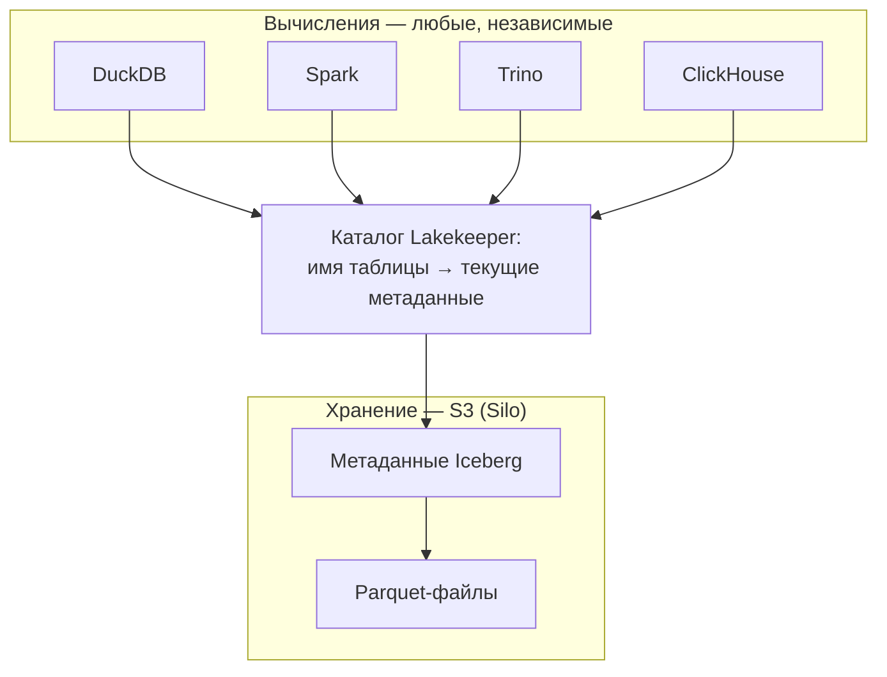
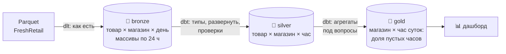
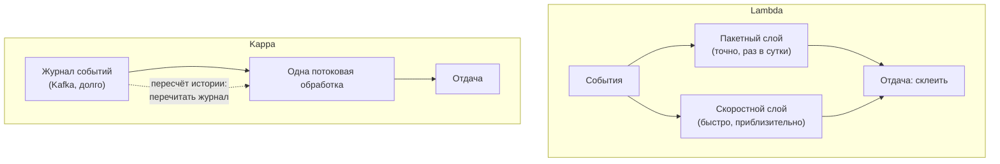
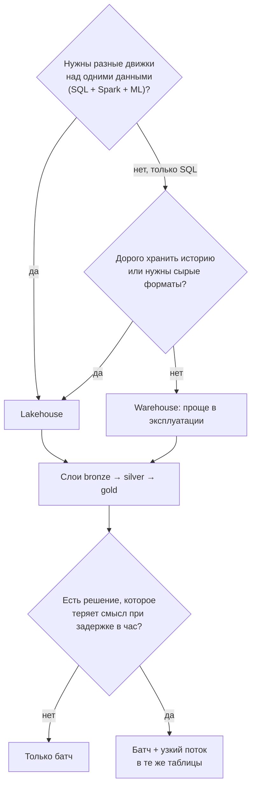

# 04 · Где и как хранить: warehouse, lake, lakehouse и слои bronze/silver/gold

> [!info] Урок одной фразой
> Склад фабрики-кухни можно устроить по-разному. Холодильная камера ресторана (warehouse)
> принимает только разобранное и подписанное — порядок идеальный, но всё, что не по описи, не
> примут. Огромный сарай (lake) примет что угодно, но через год в нём ничего не найти.
> Lakehouse — сарай с полками, описью и замками: дешёвый как сарай, порядок как в камере. А
> внутри склада продукты проходят три зоны: как привезли, подготовлено, готово к раздаче.

> [!todo] Чек-лист: после урока ты сможешь
> - [ ] объяснить, чем warehouse, data lake и lakehouse различаются устройством, а не названием;
> - [ ] обосновать, почему в курсе выбран lakehouse, и назвать, чем за это платим;
> - [ ] разложить данные FreshRetail по слоям bronze, silver и gold с grain каждого слоя;
> - [ ] выбрать между батчем и стримингом по требованию к свежести;
> - [ ] объяснить разницу архитектур lambda и kappa (лаба 01.3).

**Нужно для:** лаба [01.3](../labs/01.3_architecture/README.md), задачи 1 и 2.
**Карта урока:** [storage-architectures.canvas](../maps/storage-architectures.canvas).

---

## Шаг 0. Азбука: что значит «хранилище для аналитики»

Аналитическое хранилище отличается от операционной базы (как Postgres у касс) задачей. Касса
делает миллионы маленьких операций: записать один чек, найти один товар. Аналитика делает мало
больших: просуммировать продажи всех магазинов за три месяца. Для больших запросов нужны
**колоночное хранение** (читать только нужные колонки), дешёвое место для истории за годы и
движок, который умеет параллельно перемалывать миллиарды строк. Как именно объединить эти
три вещи — и есть выбор архитектуры хранилища.

| В данных | В аналогии «склад фабрики-кухни» | Подробнее |
|---|---|---|
| Data warehouse | Холодильная камера с описью: только разобранное, строго по полкам | [warehouse, lake, lakehouse](../../../glossary/warehouse-lake-lakehouse.md) |
| Data lake | Большой сарай: свалить можно что угодно | [warehouse, lake, lakehouse](../../../glossary/warehouse-lake-lakehouse.md) |
| Lakehouse | Сарай с полками, описью и замками | [lakehouse](../../../glossary/lakehouse.md) |
| Bronze | Зона приёмки: как привезли, с накладной | [medallion](../../../glossary/medallion.md) |
| Silver | Заготовочная: вымыто, нарезано, разложено по контейнерам | [medallion](../../../glossary/medallion.md) |
| Gold | Раздача: готовые блюда под заказы ресторанов | [medallion](../../../glossary/medallion.md) |
| Батч | Готовить партиями по расписанию | [батч и стриминг](../../../glossary/batch-streaming.md) |
| Стриминг | Готовить каждое блюдо сразу, как пришёл заказ | [батч и стриминг](../../../glossary/batch-streaming.md) |

---

## Шаг 1. Data warehouse: порядок ценой гибкости

**Проблема.** Аналитикам нужны быстрые ответы и одинаковые цифры у всех. Для этого данные
должны лежать в продуманных таблицах с проверенными типами и связями.

**Как устроено.** **Data warehouse** (хранилище данных) — СУБД, специально созданная для
аналитики: Snowflake, BigQuery, ClickHouse, Greenplum. Хранение и вычисления устроены как
одно целое: данные записываются во внутреннем формате СУБД, и прочитать их можно только
через её движок. Схема таблиц задаётся **до** записи: в таблицу с колонкой `DATE` строку
`"вчера"` не положить. Это называют **schema-on-write** — схема проверяется при записи.

**Что из этого следует.**

- ➕ Быстрые запросы, транзакции, права доступа на уровне таблиц, понятный SQL.
- ➖ Данные заперты во внутреннем формате: Spark или Python-модель читают их только через
  движок СУБД, а он для таких задач часто медленный и дорогой.
- ➖ Всё, что не вписывается в таблицы, — JSON, логи, изображения, — хранить неудобно или
  нельзя.
- ➖ Хранение и вычисления продаются вместе, поэтому хранить годы сырой истории дорого.

---

## Шаг 2. Data lake: дёшево и гибко, но болото

**Проблема.** Компании захотели хранить **всё**: сырые выгрузки, логи, файлы, историю за годы,
— и обрабатывать это не только SQL, но и Spark, и Python. Warehouse для этого слишком дорогой
и негибкий.

**Как устроено.** **Data lake** (озеро данных) — просто файлы в дешёвом объектном хранилище
(S3, раньше HDFS) в открытых форматах: CSV, JSON, Parquet. Никакой СУБД нет: любой движок
читает файлы напрямую. Схема применяется **при чтении** (**schema-on-read**): что лежит в файле,
то и лежит, а читающий сам решает, как это понимать.

**Что из этого следует.**

- ➕ Дёшево: место в S3 стоит в разы меньше, чем в warehouse. Любой формат и любой движок.
- ➖ Нет транзакций. Если запись 100 файлов упала на 60-м, читатель увидит половину данных.
- ➖ Нет понятия «таблица». Какие файлы относятся к таблице, какая версия актуальна, кто
  поменял схему — всё держится на соглашениях об именах папок.
- ➖ Через пару лет без жёсткой дисциплины озеро превращается в **болото** (data swamp):
  тысячи папок, никто не знает, какие данные верные и что можно удалить.

---

## Шаг 3. Lakehouse: озеро с таблицами

**Проблема.** Хочется дешевизны и открытости озера, но с транзакциями, схемами и версиями,
как в warehouse.

**Как устроено.** **[Lakehouse](../../../glossary/lakehouse.md)** добавляет поверх файлов в S3
**табличный формат** — слой метаданных, который превращает набор файлов в таблицу. Ты уже
видел его в модуле 00, урок 04: Iceberg хранит рядом с Parquet-файлами метаданные — какие
файлы входят в таблицу, какая схема, какие версии были. Каталог (Lakekeeper) хранит указатель
на текущую версию и переключает его атомарно. Получается:

- **транзакции**: запись становится видна целиком или не видна вовсе, потому что указатель
  переключается одной операцией;
- **схема и её эволюция**: таблица знает свои колонки и умеет их добавлять без переписывания
  файлов;
- **версии** (time travel): можно прочитать таблицу на вчерашний момент;
- **открытость**: файлы остаются Parquet в S3, их читают DuckDB, Spark, Trino, ClickHouse — все
  через один каталог.

Хранение (S3) и вычисления (любой движок) разделены, и это главное архитектурное свойство
lakehouse.

| | Warehouse | Data lake | Lakehouse |
|---|---|---|---|
| Где лежат данные | внутренний формат СУБД | файлы в S3 | Parquet в S3 + метаданные Iceberg |
| Схема | при записи | при чтении | при записи, с эволюцией |
| Транзакции | да | нет | да |
| Какие движки читают | только свой | любые | любые, через каталог |
| Цена хранения истории | высокая | низкая | низкая |
| Сложность эксплуатации | низкая: всё в одной СУБД | средняя | выше: каталог, форматы, движки отдельно |

**Чем за это платим.** Lakehouse — не бесплатный выигрыш. Вместо одной СУБД нужно содержать
хранилище, каталог, табличный формат и несколько движков и следить, чтобы версии были
совместимы. Мелкие файлы надо периодически объединять (compaction), старые версии — удалять. В
warehouse всё это делает поставщик. Поэтому для небольшой компании с одним SQL-движком
облачный warehouse часто проще и дешевле в людях.

**У нас — lakehouse**, по трём причинам. Курс учит разным движкам (DuckDB, Spark, Trino,
ClickHouse) над одними данными, и это возможно только при разделённом хранении. Всё работает
локально без облачных подписок. А навыки lakehouse — Iceberg, каталог, партиционирование —
сейчас востребованы и переносятся на облачные варианты.



---

## Шаг 4. Слои bronze, silver, gold

**Проблема.** Если сырые и готовые данные лежат вперемешку, непонятно, каким таблицам
доверять. Аналитик берёт сырую таблицу с дублями, другой — очищенную, и цифры расходятся.
Нужна договорённость, где что лежит и какую степень доверия даёт каждое место.

**Как устроено.** **[Медальонная архитектура](../../../glossary/medallion.md)** (medallion)
делит хранилище на три слоя по степени обработки. Данные текут только в одну сторону:
bronze → silver → gold.

1. **Bronze — сырые данные как есть.** Точная копия источника плюс служебные колонки: когда
   загружено, из какого файла. Ничего не исправляется и не удаляется. Это сырой слой ELT и
   «система записи для аналитики» из урока 03. Grain — как у источника.
2. **Silver — очищенные и выровненные.** Типы приведены (`dt` стала `DATE`), дубли убраны,
   массивы развёрнуты, названия колонок понятны, проверки пройдены. Grain выбирают
   удобный для многих задач, обычно самый детальный. Это общий фундамент: на нём строят всё
   остальное.
3. **Gold — витрины под вопросы.** Агрегированные таблицы, которые отвечают на конкретные
   бизнес-вопросы: «доля пустых часов по магазину и часу». Grain — из разреза метрики (урок 02,
   шаг 5). Gold читают дашборды и аналитики.

**На наших данных** это выглядит так:

| Слой | Таблица (пример) | Grain одной строки | Строк для магазина 0 |
|---|---|---|---|
| Bronze | `sales` — как в Parquet, массивы по 24 часа | товар × магазин × день | 6 660 |
| Silver | `sales_hourly` — массивы развёрнуты, `dt` → `DATE`, флаг наличия — `BOOLEAN` | товар × магазин × час | 159 840 |
| Gold | `store_hour_oos` — доля пустых часов | магазин × час суток | 24 |

Обрати внимание, как меняется число строк: silver детальнее bronze в 24 раза (массив развернули
в часы), gold — компактный ответ на один вопрос.



**Что из этого следует.**

- **Доверие растёт к gold.** Gold-таблицы протестированы и задокументированы, их можно отдавать
  бизнесу. Bronze читают только инженеры, когда что-то расследуют.
- **Ошибку лечат в слое, где она возникла, и пересчитывают слои ниже по течению.** Если неверно
  развёрнуты часы, правят silver-модель и пересчитывают silver и gold из bronze.
- **Названия слоёв условны.** В dbt принято `staging / intermediate / marts` (наше правило из
  AGENTS.md: префиксы `stg_`, `int_`, `fct_`, `dim_`). Это та же идея другими словами: staging ≈
  silver по одной таблице источника, intermediate — промежуточные соединения, marts ≈ gold.

> [!example]- Попробуй сам: три слоя в миниатюре
> В `make sql` (база в памяти, всё исчезнет при выходе):
> ```sql
> CREATE SCHEMA bronze; CREATE SCHEMA silver; CREATE SCHEMA gold;
> CREATE TABLE bronze.sales AS
>     SELECT * FROM read_parquet('data/raw/freshretailnet_50k/data/train.parquet') WHERE store_id = 0;
> CREATE TABLE silver.sales_hourly AS
>     SELECT store_id, product_id, dt::DATE AS sale_date,
>            generate_subscripts(hours_sale, 1) - 1 AS hour,
>            unnest(hours_sale)                     AS sale,
>            unnest(hours_stock_status) = 1         AS out_of_stock
>     FROM bronze.sales;
> CREATE TABLE gold.store_hour_oos AS
>     SELECT store_id, hour,
>            round(100.0 * count(*) FILTER (WHERE out_of_stock) / count(*), 1) AS oos_pct
>     FROM silver.sales_hourly GROUP BY ALL;
> SELECT schema_name, table_name, estimated_size AS rows FROM duckdb_tables() ORDER BY schema_name;
> SELECT * FROM gold.store_hour_oos WHERE hour IN (8, 14, 20) ORDER BY hour;
> ```
> **Увидишь:** 6 660, 159 840 и 24 строки в трёх слоях. В gold у магазина 0 товара нет в 6%
> случаев в 8 часов, в 19% — в 14 часов, в 41% — в 20 часов. К вечеру полки пустеют. В курсе те
> же слои будут Iceberg-таблицами в Lakekeeper, а модели — в dbt.

> [!warning] Ловушка: чистка в bronze
> Не чисти данные при загрузке в bronze: клади их как есть. Если в bronze что-то выброшено,
> ошибку в правилах чистки нельзя исправить пересчётом.

---

## Шаг 5. Батч и стриминг

**Проблема.** Некоторым решениям достаточно данных за вчера, другим нужны данные за последние
секунды: заметить, что товар кончился, пока покупатели в магазине. Это два разных способа
обработки с разной ценой.

**Как устроено.**

- **[Батч](../../../glossary/batch-streaming.md)** (пакетная обработка): данные копятся, а потом
  обрабатываются **ограниченными порциями** по расписанию. «Взять все продажи за вчера и
  посчитать витрину». У порции есть начало и конец, поэтому можно пересчитать её целиком,
  повторить при сбое, сравнить итог с ожидаемым.
- **Стриминг** (потоковая обработка): каждое событие обрабатывается **сразу при появлении**, а
  поток не заканчивается никогда. «Как только касса пробила чек, обновить счётчик продаж
  магазина». Задержка — секунды.

Цена стриминга — сложность. Поток бесконечен, поэтому нельзя «посчитать всё и сравнить итог».
События приходят не по порядку: чек, пробитый в 18:59, может дойти в 19:02, и надо решить, к
какому часу его отнести. Процесс работает круглосуточно, его надо мониторить и перезапускать без
потери и задвоения событий. Об этом модуль 08.

| | Батч | Стриминг |
|---|---|---|
| Порция данных | ограниченная: «за вчера» | бесконечный поток событий |
| Задержка | минуты–сутки | секунды |
| Повтор при сбое | перезапустить порцию | восстановить позицию в потоке без потерь и дублей |
| Сложность | низкая | высокая |
| Когда нужен | отчёты, планирование, обучение моделей | алерты, мониторинг, реакция в реальном времени |

**Правило выбора.** Начинают с батча. Стриминг добавляют, только когда есть решение, которое
**теряет смысл** при задержке в час. Для FreshRetail: заказ поставок на завтра — батч; сигнал
«в магазине 214 кончился товар 38, а до закрытия 5 часов» — кандидат в стриминг.

---

## Шаг 6. Lambda и kappa: как совместить батч и стриминг

**Проблема.** Если нужны и точные исторические витрины, и свежие цифры за последние минуты,
кто-то должен отвечать за обе части и за то, чтобы их цифры сходились.

**Как устроено.** Две классические архитектуры.

**[Lambda](../../../glossary/lambda-kappa.md).** Два параллельных конвейера над одними
событиями. **Пакетный слой** раз в сутки точно пересчитывает всю историю. **Скоростной слой**
потоком считает приблизительные цифры за время с последнего пакета. **Слой отдачи** склеивает
результаты: история из пакета, «сегодня» из потока. Плюс — точность истории. Минус — одну и ту
же логику приходится писать и поддерживать **дважды**, на двух разных движках, и цифры двух
слоёв регулярно расходятся.

**Kappa.** Один потоковый конвейер на всё. Все события хранятся в долговечном журнале (Kafka)
достаточно долго. Обычная работа — потоковая. Если логику поменяли, запускают **ту же**
потоковую программу с начала журнала и пересчитывают историю. Плюс — одна кодовая база.
Минус — пересчёт истории через поток медленнее и требует хранить журнал долго.



**Где здесь lakehouse.** Современный lakehouse размывает границу. Поток может писать прямо в
Iceberg-таблицы небольшими порциями каждые несколько секунд или минут, а батч читает те же
таблицы. Получается одно хранилище для обоих режимов, без отдельного скоростного слоя. В модуле
08 мы так и сделаем: Debezium и Flink будут писать изменения `retail_oltp` в lakehouse, а
витрины останутся пакетными.

**Что из этого следует.** Для capstone основа — батч, а стриминг — одна-две узкие задачи, где
свежесть действительно меняет решение. Это ни lambda, ни kappa в чистом виде: так сейчас
устроено большинство реальных систем.

---

## Сборка целиком: как выбрать архитектуру хранения



| Если ошибиться | Что получишь |
|---|---|
| Lake без табличного формата | полузаписанные данные видны читателям, болото через год |
| Warehouse для всего | дорогая сырая история, Spark и ML читают медленно |
| Нет слоёв | у разных людей разные цифры, ошибку не исправить пересчётом |
| Стриминг «на всякий случай» | сложность и круглосуточный мониторинг без пользы |
| Lambda без нужды | две реализации одной логики, цифры расходятся |

---

## Шпаргалка

| Хочу | Как |
|---|---|
| Различить warehouse и lakehouse | где лежат данные: внутри СУБД или Parquet в S3 + метаданные |
| Понять, на каком слое таблица | bronze — как есть; silver — чисто, детально; gold — под вопрос |
| Выбрать grain silver | самый детальный из полезных (у нас — час) |
| Выбрать grain gold | из разреза метрики вопроса |
| Батч или поток | теряет ли решение смысл при задержке в час |
| Lambda vs kappa | два конвейера (пакет + поток) vs один поток с перечитыванием журнала |

## Типичные ошибки

| Симптом | Причина | Как проверить | Как чинить |
|---|---|---|---|
| Читатель видит половину записи | файлы без табличного формата | есть ли метаданные / каталог | Iceberg + каталог |
| Ошибку чистки нельзя исправить | чистили в bronze | хранит ли bronze данные как есть | bronze — без изменений |
| Дашборд читает bronze | нет договорённости о слоях | откуда берёт данные дашборд | дашборды — только из gold |
| Gold не отвечает на новый разрез | grain gold слишком грубый | grain gold против нужного разреза | новая gold-модель из silver |
| Цифры батча и потока не сходятся | lambda: логика написана дважды | сравнить код двух слоёв | одна логика, поток пишет в те же таблицы |

---

## Проверь себя

Карточки для интервального повторения — в [flashcards.md](../flashcards.md).

> [!question] 1. Запись 100 Parquet-файлов в озеро упала на 60-м. Что увидит читатель в data lake и что в lakehouse?
> > [!success]- Ответ
> > В data lake — 60 новых файлов, то есть половину данных: таблица — это просто папка. В
> > lakehouse — старую версию целиком: новые файлы не попали в метаданные, и каталог не
> > переключил указатель. Транзакционность даёт атомарное переключение указателя.

> [!question] 2. Почему lakehouse позволяет читать одни данные из DuckDB, Spark и ClickHouse, а warehouse — нет?
> > [!success]- Ответ
> > В lakehouse данные — открытые Parquet-файлы в S3 с открытыми метаданными Iceberg, и любой
> > движок, знающий формат, читает их через каталог. В warehouse данные во внутреннем формате
> > СУБД, и читать их может только её движок.

> [!question] 3. Ты нашёл ошибку: часы в silver развёрнуты со сдвигом на один. Какие слои надо пересчитать и из чего?
> > [!success]- Ответ
> > Исправить silver-модель и пересчитать silver и всё gold, что от неё зависит, из bronze.
> > Bronze трогать не нужно: в нём данные как есть, без ошибки.

> [!question] 4. Какой grain у bronze, silver и gold для вопроса «доля пустых часов по магазину и часу суток»?
> > [!success]- Ответ
> > Bronze: товар × магазин × день, как в источнике. Silver: товар × магазин × час, самый
> > детальный. Gold: магазин × час суток — разрез метрики.

> [!question] 5. Заказ поставок формируется раз в сутки. Нужен ли для него стриминг? А для чего в FreshRetail он мог бы быть оправдан?
> > [!success]- Ответ
> > Для заказа — нет: решение принимается раз в сутки, батча достаточно. Стриминг оправдан для
> > сигнала «товар кончился сейчас, а до закрытия много часов»: через час его ценность падает,
> > покупатели уже ушли.

> [!question] 6. Главный недостаток lambda-архитектуры и как его избегает kappa?
> > [!success]- Ответ
> > В lambda одна логика реализована дважды — в пакетном и потоковом слое, на разных движках, и
> > их цифры расходятся. В kappa один потоковый код. Историю пересчитывают, перечитывая
> > долговечный журнал событий той же программой.
