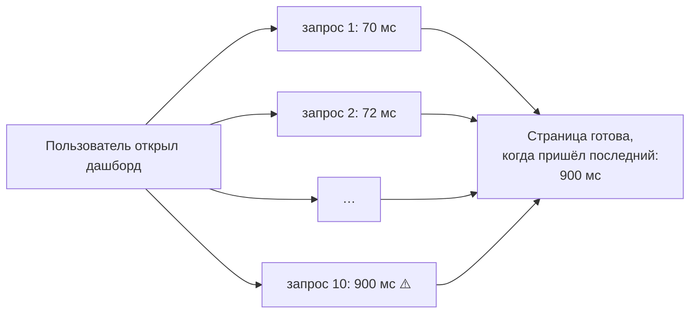
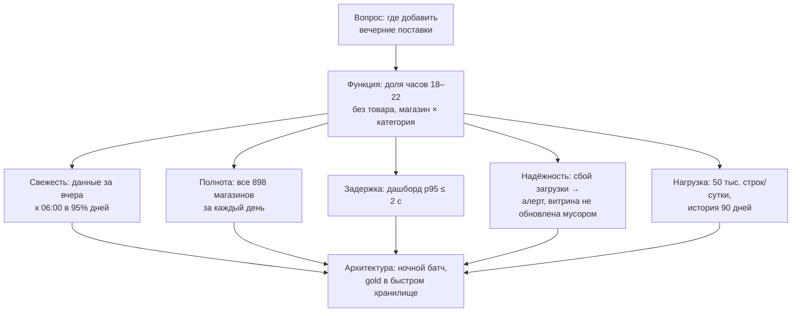

# 05 · Нефункциональные требования: надёжность, масштабируемость, сопровождаемость

> [!info] Урок одной фразой
> Функциональное требование к кухне — «готовить борщ». Нефункциональные — какой ценой. Борщ
> готов к 12:00, даже если заболел повар (надёжность). Кухня выдержит банкет на 300 человек, а
> не только обычный обед (масштабируемость). Новый повар разберётся в техкартах за день
> (сопровождаемость).
>
> Без них система «работает» на демо и разваливается в жизни. Описывают их не словами «быстро и надёжно», а числами.

> [!todo] Чек-лист: после урока ты сможешь
> - [ ] отличить сбой компонента от отказа системы и назвать приёмы, которые не дают первому
>   стать вторым;
> - [ ] описать нагрузку на систему параметрами, а не словом «большая»;
> - [ ] посчитать p50, p95, p99 по замерам и объяснить, почему среднее обманывает;
> - [ ] сформулировать требования к данным: свежесть, полнота, корректность;
> - [ ] записать NFR своей архитектуры с числами (лаба 01.3).

> [!tip] Визуализация темы
> Интерактивная страница [latency_percentiles.html](../visuals/latency_percentiles.html). Добавь медленные запросы и посмотри, как
> двигаются среднее, p50, p95 и p99, и как хвост усиливается на странице из N запросов.

**Нужно для:** лаба [01.3](../labs/01.3_architecture/README.md), задача 3.
**Карта урока:** [nfr.canvas](../maps/nfr.canvas).

---

## Шаг 0. Азбука: что такое нефункциональные требования

**Функциональные требования** говорят, **что** система делает: «посчитать долю пустых часов по
магазинам». **[Нефункциональные](../../../glossary/nfr.md)** (NFR, non-functional requirements)
говорят, **насколько хорошо**: за сколько секунд, насколько свежие данные, что будет, если упадёт
диск. Две системы с одинаковыми функциями могут различаться по NFR в сотни раз по цене и
сложности. Витрина с обновлением раз в сутки и та же витрина с обновлением раз в минуту — это
разные архитектуры.

Клеппман в главе 1 выделяет три главных NFR: надёжность, масштабируемость и удобство
сопровождения. Для систем данных к ним добавляются требования к самим данным.

| В системе | В аналогии «фабрика-кухня» | Подробнее |
|---|---|---|
| Сбой (fault) | Сломалась одна плита | [надёжность](../../../glossary/reliability.md) |
| Отказ (failure) | Ресторан не получил обед | [надёжность](../../../glossary/reliability.md) |
| Параметры нагрузки | Сколько заказов в час, какого размера, в какие часы пик | [масштабируемость](../../../glossary/scalability.md) |
| Задержка (latency) | Сколько ждёт ресторан от заказа до блюда | [перцентиль](../../../glossary/percentile.md) |
| p99 | Как долго ждут самые неудачливые 1% заказов | [перцентиль](../../../glossary/percentile.md) |
| Сопровождаемость | Новый повар разбирается в техкартах за день, а не за месяц | |
| Свежесть данных | Сколько часов назад приготовлены блюда на раздаче | [свежесть](../../../glossary/data-freshness.md) |

---

## Шаг 1. Надёжность: сбой не должен стать отказом

**Проблема.** Что-то ломается всегда: диски, сеть, код, люди. Система, которая работает только
когда ничего не ломается, не работает.

**Как устроено.** Клеппман разделяет два понятия.

- **Сбой** (fault) — отклонение **одного компонента** от нормы: упал контейнер, источник
  прислал файл неполным, в SQL-модели ошибка.
- **Отказ** (failure) — система в целом **перестала давать результат** пользователю: утром
  дашборд пуст или показывает неверные цифры.

**[Надёжность](../../../glossary/reliability.md)** — способность продолжать работать правильно,
несмотря на сбои. Цель не в том, чтобы сбоев не было, это невозможно, а в том, чтобы сбой не
превращался в отказ. Такие системы называют **отказоустойчивыми**.

Сбои бывают трёх видов, и защищаются от них по-разному:

| Вид сбоя | Пример у нас | Как защищаются |
|---|---|---|
| **Аппаратный** | отказал диск хоста с томами | копии данных (репликация, бэкапы); в облаке — S3 сам хранит несколько копий |
| **Программный** | ошибка в коде загрузчика, которая проявляется только на пустом файле | тесты, изоляция процессов, повторы (retry), алерты |
| **Человеческий** | `make clean` вместо `make down`; правка `.env`, забытая в каталоге | песочница для экспериментов, откат, понятные инструменты, проверки после изменения |

По статистике, на которую ссылается Клеппман, ошибки людей в конфигурации — самая частая
причина отказов, чаще железа. Поэтому самые полезные приёмы направлены на то, чтобы ошибку
человека было **трудно совершить и легко исправить**.

**В системах данных есть четвёртый вид — плохие данные.** Источник прислал файл с
задвоенными строками или пустой колонкой. Ни один компонент не упал, все пайплайны зелёные, а
дашборд показывает неверные цифры. Это самый коварный отказ: его никто не замечает, пока
бизнес не примет решение по неверным данным. Защита — проверки качества на каждом слое
(модуль 09) и правило «лучше не обновить витрину, чем обновить её мусором».

**Что из этого следует.** Приёмы надёжности, которые ты уже видел в модуле 00:

- **идемпотентность** — повтор операции после сбоя не создаёт дублей (урок 06);
- **healthcheck и `depends_on`** — сервис не стартует, пока сосед не готов (урок 02);
- **политика перезапуска** — временный сбой лечится автоматически (урок 08);
- **сырой слой** — ошибку в логике лечат пересчётом, а не перезагрузкой (урок 03 этого модуля).

---

## Шаг 2. Масштабируемость: сначала опиши нагрузку

**Проблема.** «Система масштабируется» — пустая фраза. Масштабируется по какому параметру и до
какого значения? Пайплайн, который спокойно переваривает данные за день, может задохнуться при
перезагрузке истории за год.

**Как устроено.** **[Масштабируемость](../../../glossary/scalability.md)** — способность системы
справляться с **ростом нагрузки**. Обсуждать её можно, только сначала описав нагрузку
**параметрами нагрузки** (load parameters): числами, от которых зависит работа системы.

Для систем данных типичные параметры такие:

| Параметр | Что значит | FreshRetail сейчас |
|---|---|---|
| Объём в сутки | сколько новых строк и байт приходит | 50 000 строк «товар × магазин × день», ≈ 1,2 МБ Parquet |
| Детальность | во сколько строк разворачивается сырьё | ×24: 1,2 млн почасовых строк в сутки |
| История | сколько хранить и пересчитывать | 97 дней, 4,85 млн строк, ~115 МБ |
| Число потребителей | сколько запросов к витринам одновременно | единицы (ты) |
| Требуемая свежесть | через сколько после события данные доступны | сутки |

Из таблицы видно, что наша нагрузка небольшая. Курс специально увеличит её в модуле 07
(синтетическое масштабирование ×10), чтобы почувствовать, где начинаются проблемы.

Когда параметры известны, можно задать вопрос двумя способами:

1. Нагрузка выросла, ресурсы те же. Как изменится производительность?
2. Нагрузка выросла. Сколько ресурсов надо добавить, чтобы производительность не упала?

**Два способа масштабирования.**

- **Вертикальное** (scale up) — более мощная машина: больше памяти, ядер. Просто, но у одной
  машины есть предел и цена растёт быстрее мощности.
- **Горизонтальное** (scale out) — больше машин, работа делится между ними. Предела почти нет,
  но система становится распределённой со всеми её сложностями: сеть, частичные отказы,
  согласованность. Spark в модуле 07 — горизонтальное масштабирование.

**Практическое правило.** Не масштабируй горизонтально раньше времени. DuckDB на одной машине
обрабатывает сотни миллионов строк. Распределённая система нужна, когда данные или вычисления
действительно не помещаются на одну машину.

---

## Шаг 3. Производительность: почему среднее обманывает

**Проблема.** «Запрос дашборда в среднем идёт 70 мс» звучит хорошо. Но пользователь не
испытывает «среднее». Он испытывает конкретные запросы, и если каждый десятый идёт 3 секунды,
дашборд для него «тормозит», а среднее почти не изменилось.

**Как устроено.** Время ответа — не одно число, а **распределение**: один и тот же запрос
каждый раз выполняется немного по-разному. Мешают другие процессы, холодный кэш, сборка мусора,
сеть. Поэтому замеряют **много раз** и описывают распределение
**[перцентилями](../../../glossary/percentile.md)**.

**Перцентиль p** — значение, быстрее которого выполнились p% запросов. Чтобы его найти,
замеры сортируют по возрастанию и берут значение на позиции p% от начала.

- **p50 (медиана)** — половина запросов быстрее, половина медленнее. «Типичный» опыт.
- **p95** — 95% быстрее, 5% медленнее. Опыт заметной части пользователей.
- **p99** — 1% самых медленных. **Хвост распределения** (tail latency).

Почему не среднее? Среднее чувствительно к выбросам и при этом их прячет. 99 запросов по 10 мс
и один на 10 секунд дают среднее 110 мс. Ни один запрос так не выполнялся, а выброс в 10 секунд
по среднему не увидеть. Медиана честно скажет «типично 10 мс», а p99 — «но бывает 10 секунд».

**Почему хвост важен.** Дашборд обычно делает несколько запросов параллельно и показывается,
только когда пришли **все**. Если у каждого запроса 1% шанс оказаться медленнее p99, то из 10
параллельных запросов хотя бы один медленный будет в 1 − 0,99¹⁰ ≈ 9,6% случаев. Редкий для
одного запроса хвост становится частым для страницы. Это называют **усилением хвостовой
задержки** (tail latency amplification).



**Замер на нашем стеке.** Один и тот же запрос — продажи по городам за один день — 100 раз
подряд:

| Показатель | Значение |
|---|---|
| p50 | 70,7 мс |
| p95 | 79,2 мс |
| p99 | 85,1 мс |
| максимум | 97,2 мс — самый первый запуск |
| среднее | 71,8 мс |

Максимум — это первый запуск: файлы ещё не в кэше операционной системы, DuckDB ещё не прочитал
метаданные. Это **холодный старт**, и его тоже надо учитывать: первый пользователь утром
получит именно его. Поэтому при замерах первые запуски либо отбрасывают как прогрев, либо
описывают отдельно.

> [!example]- Попробуй сам: замерить p50/p95/p99 запроса
> С хоста (вставь целиком):
> ```bash
> docker exec -i debd-workspace-1 python - <<'EOF'
> import time, statistics, duckdb
> q = """SELECT city_id, sum(sale_amount)
>        FROM read_parquet('data/raw/freshretailnet_50k/data/*.parquet')
>        WHERE dt = '2024-05-01' GROUP BY city_id"""
> con = duckdb.connect()
> t = []
> for _ in range(100):
>     s = time.perf_counter()
>     con.execute(q).fetchall()
>     t.append((time.perf_counter() - s) * 1000)          # миллисекунды
> qs = statistics.quantiles(t, n=100, method="inclusive")  # 99 границ: qs[49] = p50
> print(f"p50={qs[49]:.1f} p95={qs[94]:.1f} p99={qs[98]:.1f} "
>       f"max={max(t):.1f} mean={statistics.mean(t):.1f} first={t[0]:.1f} ms")
> EOF
> ```
> **Увидишь:** числа порядка 70–100 мс, `first` близко к максимуму. `time.perf_counter()` —
> точный таймер для замеров, `statistics.quantiles(…, n=100)` делит распределение на 100 частей
> и возвращает 99 границ: элемент с индексом 49 — p50, 94 — p95, 98 — p99.

> [!warning] Ловушка: перцентиль больше максимума
> Для замеров задержки пиши `statistics.quantiles(…, method="inclusive")`. Тогда перцентиль
> никогда не выходит за пределы измеренных значений. Метод по умолчанию — `exclusive`: он
> **экстраполирует** за крайние точки. Если замеров меньше 100, его p99 бывает больше самого
> большого замера. На 20 замерах с разбросом ±5 мс превышение доходит до 10 мс. На наших 100
> замерах он дал p99 = 97,1 мс при максимуме 97,2: у самого края, но ещё внутри.

---

## Шаг 4. Удобство сопровождения

**Проблема.** Большая часть стоимости системы приходится не на создание, а на годы поддержки:
починить, обновить, добавить источник, передать новому человеку. Систему, в которой страшно
что-то менять, перестают менять, и она устаревает.

**Как устроено.** Клеппман раскладывает сопровождаемость на три свойства.

1. **Удобство эксплуатации** (operability) — дежурному легко понять, что происходит, и
   вернуть систему в строй. Это мониторинг и алерты, понятные логи, инструкции на типичные
   сбои, предсказуемое поведение. В модуле 00 это `make check`, `make ps` и урок 08.
2. **Простота** (simplicity) — в системе нет **случайной сложности**: сложности, которая не
   нужна для задачи, а появилась из-за неудачных решений. Пример случайной сложности — lambda-
   архитектура там, где хватило бы батча. Главный инструмент простоты — хорошие абстракции:
   слои bronze/silver/gold, Makefile как единая точка входа, один каталог для всех движков.
3. **Развиваемость** (evolvability) — систему легко менять под новые требования. Новый вопрос
   — новая gold-модель из существующего silver, без переделки загрузки. Новый источник — новый
   bronze-конвейер, без изменения остальных.

**Что из этого следует.** Решения курса, которые прямо работают на сопровождаемость:

- инфраструктура в compose-файлах — воспроизводимость;
- код трансформаций в git — история и откат;
- фиксированные версии образов — никаких внезапных обновлений;
- тесты на данные — изменения не ломают незаметно.

---

## Шаг 5. Требования к данным: свежесть, полнота, корректность

**Проблема.** Для пайплайна «работает» значит не «процесс не упал», а «данные правильные и
вовремя». У данных свои NFR, и их тоже нужно записать числами.

**Как устроено.** Основные требования к данным:

| Требование | Вопрос | Пример формулировки |
|---|---|---|
| **[Свежесть](../../../glossary/data-freshness.md)** (freshness) | насколько данные отстают от реальности | витрина содержит данные за вчера к 06:00 |
| **Полнота** (completeness) | все ли данные пришли | за каждый день есть строки по всем 898 магазинам |
| **Корректность** (accuracy) | правильны ли значения | доля пустых часов в gold совпадает с пересчётом из silver |
| **Доступность** (availability) | можно ли пользоваться | дашборд отвечает в рабочие часы |

Чтобы требования можно было проверять, их записывают в виде трёх понятий. Подробно они
разбираются в модуле 09, здесь — основа.

- **SLI** (service level indicator) — **измеряемый показатель**: «время между концом суток и
  появлением их данных в витрине».
- **SLO** (service level objective) — **цель** для показателя: «≤ 6 часов в 95% дней за месяц».
- **SLA** (service level agreement) — **договорённость** с потребителем, что будет при
  нарушении SLO: «если данные опоздали, аналитики получают уведомление до 07:00».

Цель записывают не как «всегда», а с процентом и периодом. «Всегда свежие» недостижимо и
непроверяемо, а «в 95% дней за месяц» — измеряется и оставляет место для неизбежных сбоев.

> [!example]- Попробуй сам: свежесть и полнота как запрос
> В `make sql`:
> ```sql
> CREATE VIEW sales AS SELECT * FROM read_parquet('data/raw/freshretailnet_50k/data/*.parquet');
> SELECT max(dt::DATE) AS last_day,
>        (SELECT count(DISTINCT store_id) FROM sales WHERE dt = (SELECT max(dt) FROM sales)) AS stores_last_day
> FROM sales;
> ```
> **Увидишь:** последний день данных и число магазинов в нём. Первое — показатель свежести:
> в работающем пайплайне его сравнивают с текущей датой. Второе — показатель полноты: его
> сравнивают с ожидаемыми 898.

---

## Сборка целиком: NFR для одной витрины

Разберём, как записать требования к витрине «доля пустых вечерних часов по магазинам» из
урока 02.



Из этих чисел выводится архитектура. Свежесть «к 06:00» означает ночной батч, стриминг не
нужен. Задержка p95 ≤ 2 с при небольшом объёме достижима даже без отдельного быстрого
хранилища. Полнота требует проверки «все магазины пришли» перед публикацией витрины.

| Если не записать NFR | Что получишь |
|---|---|
| Свежесть | одни ждут данные к утру, другие думают, что они в реальном времени |
| Полнота | витрина без половины магазинов выглядит как падение продаж |
| Задержку перцентилем | «в среднем быстро», а дашборд у половины тормозит |
| Параметры нагрузки | неизвестно, выдержит ли система рост ×10 |
| Поведение при сбое | витрина обновляется мусором, и никто не знает об этом |

---

## Шпаргалка

| Хочу | Как |
|---|---|
| Описать нагрузку | объём в сутки, детальность, история, потребители, свежесть — числами |
| Замерить задержку | 100+ запусков, `statistics.quantiles(t, n=100, method="inclusive")` |
| Взять перцентили | `qs[49]` — p50, `qs[94]` — p95, `qs[98]` — p99 |
| Записать цель | SLI (что меряем) + SLO (порог, процент, период) |
| Проверить свежесть | `max(дата)` против текущей даты |
| Проверить полноту | число сущностей за период против ожидаемого |

## Типичные ошибки

| Симптом | Причина | Как проверить | Как чинить |
|---|---|---|---|
| «В среднем быстро», а пользователи жалуются | задержка описана средним | p95, p99 | цели по перцентилям |
| p99 больше максимума | метод `exclusive` экстраполирует | сравнить с `max(t)` | `method="inclusive"` |
| Первый утренний запрос медленный | холодный старт | `t[0]` против p50 | описывать отдельно, прогревать |
| Пайплайн зелёный, цифры неверные | плохие данные — тоже отказ | проверки качества | тесты на каждом слое, не публиковать мусор |
| Горизонтальное масштабирование «на будущее» | нет параметров нагрузки | сколько данных на самом деле | сначала одна машина, замеры |
| Требование «всегда свежие» | цель без процента и периода | — | «≤ N часов в 95% дней за месяц» |

---

## Проверь себя

Карточки для интервального повторения — в [flashcards.md](../flashcards.md).

> [!question] 1. Ночью упал контейнер загрузчика, политика перезапуска подняла его, загрузка прошла с опозданием на 10 минут, утром всё на месте. Это сбой или отказ?
> > [!success]- Ответ
> > Сбой без отказа. Компонент отклонился от нормы, но система в целом дала результат вовремя.
> > Именно так выглядит отказоустойчивость: политика перезапуска и идемпотентная загрузка не
> > дали сбою стать отказом.

> [!question] 2. Все пайплайны зелёные, но в витрине продажи за вчера вдвое выше обычного: источник прислал файл дважды. Какой это вид сбоя и что должно было его поймать?
> > [!success]- Ответ
> > Плохие данные. Ни один компонент не упал, поэтому мониторинг процессов его не видит. Поймать
> > должны проверки качества: уникальность ключа в bronze или silver и сравнение объёма с
> > обычным. При провале проверки витрину не обновляют.

> [!question] 3. 99 запросов по 10 мс и один на 5 секунд. Каковы среднее и медиана, и что из них честнее описывает опыт пользователя?
> > [!success]- Ответ
> > Среднее ≈ 60 мс (5990 / 100), медиана 10 мс. Ни один запрос не шёл 60 мс, так что среднее
> > не описывает ничей опыт. Медиана описывает типичный запрос, а p99 покажет 5-секундный хвост.
> > Нужны оба перцентиля, а не среднее.

> [!question] 4. Дашборд делает 20 запросов параллельно. У каждого 1% шанс быть медленнее p99. Как часто страница будет медленной?
> > [!success]- Ответ
> > 1 − 0,99²⁰ ≈ 18%, почти каждое пятое открытие. Страница ждёт самого медленного запроса,
> > поэтому редкий хвост одного запроса становится частым для страницы.

> [!question] 5. Запиши требование к свежести витрины, по которой утром в 07:00 формируют заказ, так, чтобы его можно было проверить.
> > [!success]- Ответ
> > SLI: момент появления в витрине данных за вчерашние сутки. SLO: не позже 06:00 в 95% дней
> > за календарный месяц. Процент и период делают цель измеримой и оставляют место для
> > неизбежных сбоев.

> [!question] 6. Почему lambda-архитектура там, где хватает батча, — пример случайной сложности?
> > [!success]- Ответ
> > Она добавляет второй конвейер, второй движок и согласование цифр, которых задача не требует:
> > решение принимается раз в сутки. Эта сложность не решает задачу, а только усложняет
> > сопровождение — это и есть случайная сложность.
