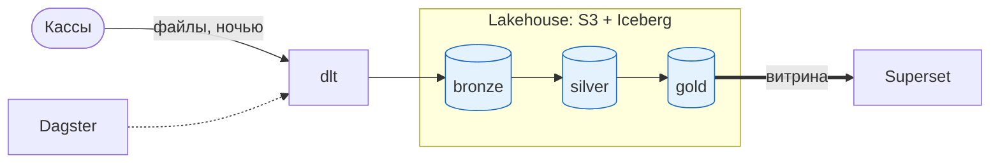
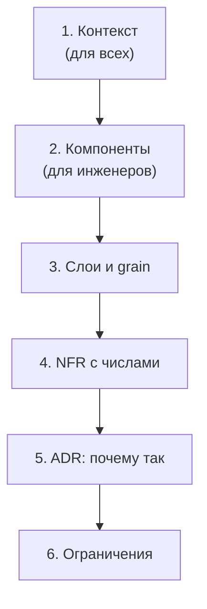
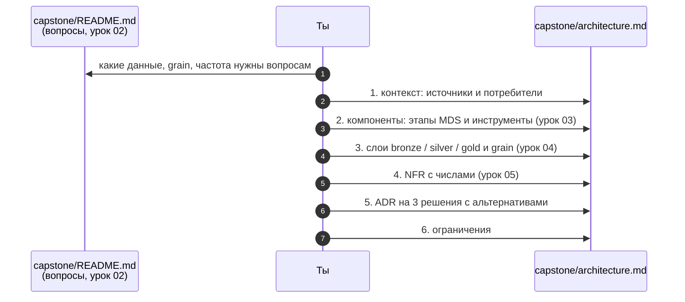

# 06 · Как описать архитектуру: схема в Mermaid и записи решений

> [!info] Урок одной фразой
> План кухни на стене нужен, чтобы новый повар за минуту понял, откуда приходят продукты и куда
> уходят блюда. А журнал решений — чтобы через год не спорить заново, почему плиты газовые, а
> не индукционные. Архитектурная документация — это схема (что есть и как связано) и записи
> решений (почему так, а не иначе). Обе живут в репозитории рядом с кодом.

> [!todo] Чек-лист: после урока ты сможешь
> - [ ] выбрать уровень детализации схемы под читателя;
> - [ ] нарисовать в Mermaid схему с узлами разной формы, подписями стрелок и группами;
> - [ ] записать архитектурное решение в формате ADR с альтернативами и последствиями;
> - [ ] собрать `capstone/architecture.md` по структуре (лаба 01.3).

**Нужно для:** лаба [01.3](../labs/01.3_architecture/README.md), все задачи.
**Карта урока:** [architecture-docs.canvas](../maps/architecture-docs.canvas).

---

## Шаг 0. Азбука: зачем документировать архитектуру

Архитектура живёт в головах тех, кто её строил. Пока они рядом, всё работает. Когда приходит
новый человек, когда через полгода надо что-то поменять или когда на собеседовании просят
«расскажите архитектуру своего проекта», оказывается, что объяснить её быстро нельзя, а
причины решений забыты.

Документация решает две разные задачи, и для каждой свой инструмент:

1. **Что есть.** Компоненты и потоки данных между ними. Это **схема**: её читают за минуту.
2. **Почему так.** Какие были варианты, что выбрали и чем за это платим. Это **записи
   решений** (ADR): их читают, когда хотят что-то изменить.

| В документации | В аналогии «фабрика-кухня» | Подробнее |
|---|---|---|
| Контекстная схема | План района: фабрика, поставщики, рестораны | |
| Схема компонентов | План цехов внутри фабрики | |
| Mermaid | Чертёж, записанный текстом: его можно править как документ | [Mermaid](../../../glossary/mermaid.md) |
| ADR | Запись в журнале: «выбрали газовые плиты, потому что…» | [ADR](../../../glossary/adr.md) |
| Альтернативы в ADR | Какие ещё плиты рассматривали и почему не взяли | |
| Последствия в ADR | Что теперь придётся делать из-за выбора | |

---

## Шаг 1. Уровни детализации: одна схема — один читатель

**Проблема.** Схема, на которой есть всё — каждый сервис, порт, таблица и стрелка, —
нечитаема. Схема, на которой три прямоугольника, бесполезна инженеру. Нужно выбирать
детализацию под того, кто будет читать.

**Как устроено.** Распространённый подход — **модель C4** Саймона Брауна: несколько схем
разного масштаба, как карты местности разного масштаба. Для наших целей хватает двух уровней.

1. **Контекст** (context). Система — один прямоугольник. Вокруг — внешние источники и
   потребители: кассы, склад, API погоды, аналитики, система автозаказа. Отвечает на вопрос
   «откуда данные приходят и кому уходят». Читатель — кто угодно, включая бизнес.
2. **Компоненты** (containers в терминах C4). Система раскрыта: этапы загрузки, хранения,
   преобразования, отдачи, оркестрации, конкретные инструменты и слои. Отвечает на вопрос «как
   данные проходят через систему». Читатель — инженер.

Правила, которые делают схему читаемой:

- **Одна схема — одна мысль.** Поток данных отдельно, развёртывание по контейнерам отдельно.
- **Поток слева направо.** Источники слева, потребители справа: так читают тексты, так же
  читают и схемы.
- **Подписи на стрелках** говорят, **что** передаётся и **как**: «файлы Parquet, ночью»,
  «CDC, секунды».
- **Группы** объединяют узлы одного этапа или одного слоя.
- **Легенда**, если цвет или форма что-то значат.

---

## Шаг 2. Mermaid: схема как текст

**Проблема.** Схема в графическом редакторе — картинка: её нельзя поправить в той же правке,
что и код, нельзя увидеть изменения в `git diff`, и она быстро устаревает. Нужна схема, которая
хранится как текст рядом с кодом.

**Как устроено.** **[Mermaid](../../../glossary/mermaid.md)** — язык описания диаграмм текстом.
Блок кода с языком `mermaid` превращается в картинку в Obsidian, VS Code, GitHub и GitLab. Все
схемы в уроках курса нарисованы так.

Для архитектуры чаще всего нужна **flowchart** — схема из узлов и стрелок. Разберём синтаксис
по частям.

**Заголовок и направление.** Первая строка задаёт тип и направление: `LR` — слева направо,
`TB` — сверху вниз.

```text
flowchart LR
```

**Узлы.** У узла есть ID (латиница, без пробелов) и подпись. Форма задаётся скобками:

| Запись | Форма | Для чего |
|---|---|---|
| `A["Текст"]` | прямоугольник | процесс, сервис |
| `A[("Текст")]` | цилиндр | хранилище, база |
| `A(["Текст"])` | овал | внешний участник: человек, система |
| `A{"Текст"}` | ромб | решение, развилка |
| `A[["Текст"]]` | двойной прямоугольник | подпрограмма, внешний инструмент |

Подпись лучше всегда брать в двойные кавычки: тогда в ней можно писать пробелы, скобки и
кириллицу. Перенос строки в подписи — `<br/>`.

**Стрелки.**

| Запись | Вид |
|---|---|
| `A --> B` | сплошная стрелка |
| `A -->\|"подпись"\| B` | стрелка с подписью |
| `A -.-> B` | пунктирная: управление, необязательная связь |
| `A ==> B` | жирная: главный поток |
| `A --- B` | линия без стрелки |

**Группы.** `subgraph` объединяет узлы в рамку с заголовком. Внутри группы можно задать своё
направление.

```text
subgraph STORE["Хранение"]
    direction TB
    S3[("S3")]
    CAT["Каталог"]
end
```

**Цвета.** Класс задаётся один раз и применяется к нескольким узлам:

```text
classDef raw fill:#ef6c00,color:#fff
class B1,B2 raw
```

**Комментарии** начинаются с `%%` и не отображаются.

**Собранный пример:**



> [!example]- Попробуй сам: нарисовать и сломать схему
> Создай заметку в Obsidian (или `.md` файл в VS Code с предпросмотром Markdown) и вставь
> собранный пример выше в блок, который начинается строкой `` ```mermaid ``. Потом сломай его по очереди:
> - убери кавычки в `ING["dlt"]` и напиши подпись `dlt (загрузка)` без кавычек;
> - напиши ID с пробелом: `my node["x"]`;
> - убери `end` после `subgraph`.
>
> **Увидишь:** вместо схемы — сообщение об ошибке синтаксиса. В первом случае скобки в
> подписи без кавычек читаются как начало новой формы узла. Отсюда правило: подписи — в
> кавычках, ID — латиницей без пробелов, у каждого `subgraph` — свой `end`.

> [!warning] Ловушка: слово `end` в подписи
> Слово `end` в Mermaid закрывает группу. Узел с ID или подписью `end` без кавычек ломает
> схему. Кавычки в подписях защищают и от этого.

---

## Шаг 3. ADR: записать, почему так

**Проблема.** Через полгода кто-то спросит: «Почему у нас Iceberg в S3, а не просто
ClickHouse? Давайте переделаем». Если причин никто не помнит, начинается спор с нуля, и
возможно, решение поменяют, не зная, ради чего его принимали.

**Как устроено.** **[ADR](../../../glossary/adr.md)** (architecture decision record) — короткая
запись об одном архитектурном решении. Формат предложил Майкл Найгард. Одна запись — одно
решение, записи не переписывают: если решение изменилось, пишут новую запись, а старую помечают
как заменённую. Так сохраняется история рассуждений.

Структура записи:

| Раздел | Что писать |
|---|---|
| **Заголовок** | решение одной фразой: «Lakehouse на Iceberg вместо warehouse» |
| **Статус** | предложено / принято / заменено записью N |
| **Контекст** | какая задача и какие требования (NFR из урока 05) заставили принимать решение |
| **Варианты** | 2–3 альтернативы, у каждой — плюсы и минусы применительно к контексту |
| **Решение** | что выбрали |
| **Последствия** | что становится проще, что сложнее, какие риски и что придётся делать |

Самое ценное — **варианты и последствия**. Решение без альтернатив выглядит как «так
получилось». Решение без последствий скрывает цену: кто-то потом удивится, что надо
настраивать compaction файлов.

**Пример ADR** (решение, уже принятое в курсе):

```markdown
### ADR-1. Lakehouse на Iceberg вместо warehouse

**Статус:** принято

**Контекст.** Курс работает с одними данными из разных движков: DuckDB, Spark, Trino,
ClickHouse. Всё должно работать локально, без облачных подписок. История — от 97 дней, с
ростом ×10 в модуле 07.

**Варианты.**
1. *Warehouse (ClickHouse как единственное хранилище).* ➕ одна СУБД, быстрые запросы.
   ➖ Spark и Python читают данные только через движок ClickHouse; учить разные движки
   над одними данными нельзя.
2. *Data lake (Parquet в S3 без табличного формата).* ➕ дёшево, открыто.
   ➖ нет транзакций и версий; полузаписанные данные видны читателям.
3. *Lakehouse (Parquet + Iceberg + REST-каталог).* ➕ открытые файлы для любых движков,
   транзакции, версии. ➖ больше компонентов: каталог, обслуживание файлов.

**Решение.** Вариант 3: Silo (S3) + Iceberg + Lakekeeper.

**Последствия.** Нужно сопровождать каталог и его базу в Postgres; периодически объединять
мелкие файлы и удалять старые версии; ClickHouse используется только как быстрый слой отдачи
для дашбордов (модуль 10).
```

**Что из этого следует.** Хорошие темы для ADR — решения, которые дорого менять: формат и место
хранения, способ загрузки (батч или CDC), оркестратор, слоистость. Не нужны ADR на мелочи:
название колонки или версию библиотеки.

---

## Шаг 4. Структура `architecture.md`

**Проблема.** Схема, требования и решения, разбросанные по разным файлам, не складываются в
картину. Нужен один документ, который отвечает на все вопросы об архитектуре по порядку.

**Как устроено.** Документ строится от общего к частному, так же как схемы:

```markdown
# Архитектура аналитической платформы

## 1. Контекст
Схема: источники → платформа → потребители. 2–3 предложения о задаче.

## 2. Компоненты и поток данных
Схема по этапам: загрузка, хранение (слои), преобразование, отдача, оркестрация.
Таблица: компонент → инструмент → модуль курса.

## 3. Слои данных
Таблица: слой → таблицы (примеры) → grain → кто читает.

## 4. Нефункциональные требования
Параметры нагрузки с числами; свежесть, полнота, задержка (SLO); как переживаем сбои.

## 5. Решения (ADR)
ADR-1, ADR-2, ADR-3 …

## 6. Известные ограничения
Что система сознательно не умеет и почему.
```

Раздел 6 часто пропускают, а он показывает зрелость автора. «Данные обновляются раз в сутки,
поэтому дашборд не подходит для реакции внутри дня», «нет цен, поэтому нет метрик в рублях» —
это честные границы системы, а не недостатки, которые надо прятать. Критерий 10 рубрики
capstone прямо требует решения с альтернативами и известные ограничения.



---

## Сборка целиком: от вопросов к документу



| Если пропустить шаг | Что получишь |
|---|---|
| 1 — не опираться на вопросы | архитектура «вообще», без связи с задачами |
| 3 — схема без уровней | один нечитаемый рисунок на всё |
| 5 — NFR словами | «быстро и надёжно», которое нельзя проверить |
| 6 — ADR без альтернатив | решения выглядят случайными, их легко отменить без понимания |
| 7 — нет ограничений | читатель ждёт от системы того, чего она не умеет |

---

## Шпаргалка

| Хочу | Как |
|---|---|
| Схема слева направо | `flowchart LR` |
| Хранилище | `ID[("подпись")]` |
| Внешний участник | `ID(["подпись"])` |
| Стрелка с подписью | `A -->\|"что и как"\| B` |
| Управление / оркестрация | `A -.-> B` |
| Группа | `subgraph ID["заголовок"]` … `end` |
| Цвет для нескольких узлов | `classDef имя fill:#…` + `class A,B имя` |
| Комментарий | `%% текст` |
| Записать решение | ADR: контекст → варианты → решение → последствия |

## Типичные ошибки

| Симптом | Причина | Как проверить | Как чинить |
|---|---|---|---|
| Вместо схемы — ошибка синтаксиса | подпись со скобками без кавычек | найти узел с `(` в подписи | все подписи в `"…"` |
| Схема ломается после добавления группы | нет `end` | посчитать `subgraph` и `end` | закрыть каждую группу |
| ID с пробелом | `my node` | — | латиница без пробелов: `my_node` |
| Схему никто не может прочитать | всё на одной схеме | сколько узлов (>20 — много) | разбить по уровням |
| Решения переделывают без понимания | нет ADR | есть ли «почему» в документации | ADR на дорогие решения |
| ADR из одного варианта | альтернативы не рассмотрены | раздел «Варианты» | 2–3 реальные альтернативы |

---

## Проверь себя

Карточки для интервального повторения — в [flashcards.md](../flashcards.md).

> [!question] 1. Директору нужно понять, откуда платформа берёт данные и кому их отдаёт. Какой уровень схемы ему показать?
> > [!success]- Ответ
> > Контекст: платформа одним прямоугольником, вокруг источники и потребители. Компоненты,
> > инструменты и слои ему не нужны и только помешают.

> [!question] 2. Почему узел `ING[dlt (загрузка)]` ломает схему, а `ING["dlt (загрузка)"]` — нет?
> > [!success]- Ответ
> > Без кавычек Mermaid читает `(` внутри подписи как начало синтаксиса другой формы узла и не
> > может разобрать строку. Кавычки делают подпись просто текстом.

> [!question] 3. Решение поменялось: вместо ночного батча для одной витрины нужен CDC. Что делать с ADR, где был выбран батч?
> > [!success]- Ответ
> > Не переписывать его. Написать новый ADR о CDC для этой витрины с контекстом, почему
> > требования изменились, а у старого поставить статус «заменено ADR-N». История рассуждений
> > сохраняется.

> [!question] 4. Что важнее всего в ADR и почему?
> > [!success]- Ответ
> > Варианты и последствия. Варианты показывают, что выбор был осознанным и почему отвергнуты
> > альтернативы. Последствия показывают цену решения, о которой иначе узнают случайно.

> [!question] 5. Зачем в `architecture.md` раздел «Известные ограничения», если он показывает слабые места?
> > [!success]- Ответ
> > Он задаёт границы применения: читатель не будет ждать от системы того, на что она не
> > рассчитана. Это честность и зрелость, а не слабость. Рубрика capstone прямо требует его в
> > критерии 10.
