# Модуль 02 · SQL и моделирование данных

**Длительность:** ~2 нед. · **Статус и DoD:** см. [ROADMAP](../../ROADMAP.md)

## Бизнес-вопрос

> Какая модель данных позволит быстро и однозначно отвечать на вопросы сети?

## Цели

- писать аналитический SQL уверенно: соединения без размножения, итоги, окна, разворот массивов
- спроектировать звёздную схему для FreshRetail и обосновать место каждой колонки
- понимать OLTP и OLAP, нормализацию, SCD и альтернативы Kimball
- объяснять скорость запроса планом

## Темы

- JOIN (в том числе SEMI/ANTI) и размножение строк; NULL; CASE и FILTER; GROUPING SETS, ROLLUP; даты
- оконные функции: PARTITION BY, ORDER BY, рамки ROWS/RANGE, ранжирование, QUALIFY, острова
- UNNEST массивов, PIVOT/UNPIVOT, запись в Parquet
- OLTP vs OLAP, построчное и колоночное хранение, нормализация 1NF–3NF и денормализация
- Kimball: процесс → grain → измерения → факты; виды фактов; суррогатные ключи; календарь
- SCD 0/1/2, Data Vault, One Big Table
- план запроса: EXPLAIN ANALYZE, pushdown, честный замер

## Инструменты

DuckDB (CLI и Python), Postgres (сравнение OLTP и OLAP), Mermaid `erDiagram`

## Маршрут прохождения

Сначала урок, потом задачи лабы по нему. Статусы: ✅ сделано · 🟨 сейчас · ⬜ впереди.

```mermaid
flowchart LR
    T1["📖 01 SQL"] --> L1a["🧪 02.1<br/>задачи 1–5"] --> T2["📖 02 Окна"] --> L1b["🧪 02.1<br/>задачи 6–15"]
    L1b --> T3["📖 03 Разворот"] --> L2["🧪 02.2<br/>почасовая таблица"]
    L2 --> T4["📖 04 OLTP/OLAP"] --> T5["📖 05 Kimball"] --> L3["🧪 02.3<br/>звезда"]
    L3 --> T6["📖 06 SCD"] --> T7["📖 07 План"] --> L4["🧪 02.4<br/>EXPLAIN"]
    L4 --> L5["🧪 02.5<br/>эссе"] --> L6["🧪 02.6<br/>3 ответа"] --> HW["🏁 Домашка"]
```

| # | Шаг | Что | Статус |
|---|---|---|---|
| 1 | 📖 [01 · Аналитический SQL](theory/01_analytical_sql.md) · [карта](maps/analytical-sql.canvas) | урок | ⬜ |
| 2 | 🧪 [Лаба 02.1](labs/02.1_window_functions/README.md) · задачи 1–5 | соединения, NULL, итоги, размножение | ⬜ |
| 3 | 📖 [02 · Оконные функции](theory/02_window_functions.md) · [карта](maps/window-functions.canvas) | урок | ⬜ |
| 4 | 🧪 [Лаба 02.1](labs/02.1_window_functions/README.md) · задачи 6–15 | окна, QUALIFY, острова | ⬜ |
| 5 | 📖 [03 · Массивы и разворот](theory/03_arrays_and_unpivot.md) · [карта](maps/arrays-and-unpivot.canvas) | урок | ⬜ |
| 6 | 🧪 [Лаба 02.2 — почасовая гранулярность](labs/02.2_hourly_grain/README.md) | 116,4 млн строк, проверки, Parquet | ⬜ |
| 7 | 📖 [04 · OLTP, OLAP, нормализация](theory/04_oltp_olap_normalization.md) · [карта](maps/oltp-olap.canvas) | урок | ⬜ |
| 8 | 📖 [05 · Звёздная схема](theory/05_kimball_star_schema.md) · [карта](maps/kimball.canvas) | урок | ⬜ |
| 9 | 🧪 [Лаба 02.3 — звёздная схема](labs/02.3_star_schema/README.md) | место колонок, ER, DDL, загрузка | ⬜ |
| 10 | 📖 [06 · SCD, Data Vault, OBT](theory/06_scd_and_alternatives.md) · [карта](maps/scd-alternatives.canvas) | урок | ⬜ |
| 11 | 📖 [07 · План запроса](theory/07_query_plans.md) · [карта](maps/query-plans.canvas) | урок | ⬜ |
| 12 | 🧪 [Лаба 02.4 — EXPLAIN ANALYZE](labs/02.4_explain_analyze/README.md) | одна задача тремя способами | ⬜ |
| 13 | 🧪 [Лаба 02.5 — эссе о моделировании](labs/02.5_modeling_essay/README.md) | OLTP/OLAP, Kimball/DV/OBT, SCD | ⬜ |
| 14 | 🧪 [Лаба 02.6 — 3 бизнес-вопроса](labs/02.6_business_answers/README.md) | мини-проект поверх звезды | ⬜ |
| 15 | 🏁 [Домашка-чекпоинт](homework.md) | 7 вопросов и одно предсказание | ⬜ |

> [!note] Изменение плана модуля
> В исходном плане было 4 лабы. Эссе и мини-проект из DoD модуля получили свои лабы 02.5 и 02.6.
> Лаба 02.4 сравнивает не произвольную задачу, а долю часов без товара по трём источникам —
> так в ней одновременно тренируются планы, сверка результатов и честный замер.

## Чек-лист самоконтроля

Отмечай пункт, только когда можешь сделать это **без подсказки**. Подробные чек-листы — в начале
каждого урока.

**SQL** ([01](theory/01_analytical_sql.md), [02](theory/02_window_functions.md), [03](theory/03_arrays_and_unpivot.md))
- [ ] До соединения проверяю уникальность ключа справа и ловлю размножение
- [ ] Пишу фильтры, корректные к `NULL`; отличаю итог `GROUPING SETS` от `NULL` через `grouping()`
- [ ] Задаю окно тремя частями и выбираю рамку `ROWS` или `RANGE` осознанно
- [ ] Решаю топ-N, накопительный итог, скользящее среднее, долю и острова
- [ ] Разворачиваю массивы с номером элемента и проверяю разворот тремя сверками

**Моделирование** ([04](theory/04_oltp_olap_normalization.md), [05](theory/05_kimball_star_schema.md), [06](theory/06_scd_and_alternatives.md))
- [ ] Объясняю OLTP и OLAP через построчное и колоночное хранение и свой замер
- [ ] Нахожу нарушения 1NF–3NF и объясняю, почему аналитика денормализует
- [ ] Прохожу 4 шага Кимбалла и решаю место атрибута проверкой зависимости
- [ ] Выбираю тип SCD для атрибута и соединяю факт с SCD2-измерением без удвоения
- [ ] Сравниваю Kimball, Data Vault и OBT по слоям

**Производительность** ([07](theory/07_query_plans.md))
- [ ] Читаю `EXPLAIN ANALYZE`: Projections, Filters, строки у соединения
- [ ] Сравниваю варианты запроса честно: одинаковый результат, p50, объяснение планом

**Закрытие модуля**
- [ ] Лабы 02.1–02.6 выполнены по Definition of Done
- [ ] [Домашка](homework.md) сдана, ошибки разобраны
- [ ] Тезисы по Клеппману, гл. 2–3, — в [`notes.md`](notes.md)

## Материалы модуля

| Что | Где |
|---|---|
| 🧠 Карточки для повторения | [flashcards.md](flashcards.md) |
| 🗺️ Карты | [maps/](maps/) |
| 📚 Термины | [glossary/](../../glossary/README.md) — раздел «SQL и моделирование» |
| 🎬 Визуализации | [Оконные функции и рамки](visuals/window_frames.html) · [SCD2 и версия на дату](visuals/scd2_timeline.html) |
| 📓 Заметки | [notes.md](notes.md) |

## Мини-проект (вклад в capstone)

SQL-ответы на 3 бизнес-вопроса из модуля 01 поверх своей звёздной схемы — лаба 02.6; уточнённое
поле «Ответит» в карточках [`capstone/README.md`](../../capstone/README.md).

## Ресурсы

- [Data-Learn: модуль 2 — базы данных и SQL](https://github.com/Data-Learn/data-engineering/blob/master/DE-101%20Modules/Module02/readme.md)
- [The Data Warehouse Toolkit (Kimball) — гл. 1–4](https://www.kimballgroup.com/data-warehouse-business-intelligence-resources/books/data-warehouse-dw-toolkit/)
- [DuckDB SQL docs](https://duckdb.org/docs/stable/sql/introduction) ·
  [окна](https://duckdb.org/docs/stable/sql/functions/window_functions) ·
  [QUALIFY](https://duckdb.org/docs/stable/sql/query_syntax/qualify) ·
  [PIVOT](https://duckdb.org/docs/stable/sql/statements/pivot)
- [Mermaid: erDiagram](https://mermaid.js.org/syntax/entityRelationshipDiagram.html)

## Книга и видео

Полная таблица с пояснениями, зачем читать и что пропустить — в [карте чтения](../../reading_map.md#02--sql-и-моделирование-данных).

- 📖 Клеппман, гл. 2 — модели данных, декларативные запросы (уроки 04, 07)
- 📖 Клеппман, гл. 3 — OLTP vs OLAP, звезда и снежинка, колоночное хранение (уроки 04, 05)
- 🎬 [Zoomcamp `04-analytics-engineering`](https://github.com/DataTalksClub/data-engineering-zoomcamp/tree/main/04-analytics-engineering) — видео про моделирование данных

## Домашка-чекпоинт

После всех лаб — [`homework.md`](homework.md).

## Заметки

Конспект, тезисы по книге и выводы — в [`notes.md`](notes.md).
