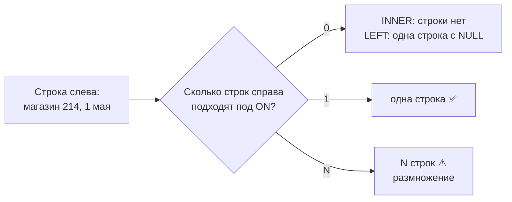
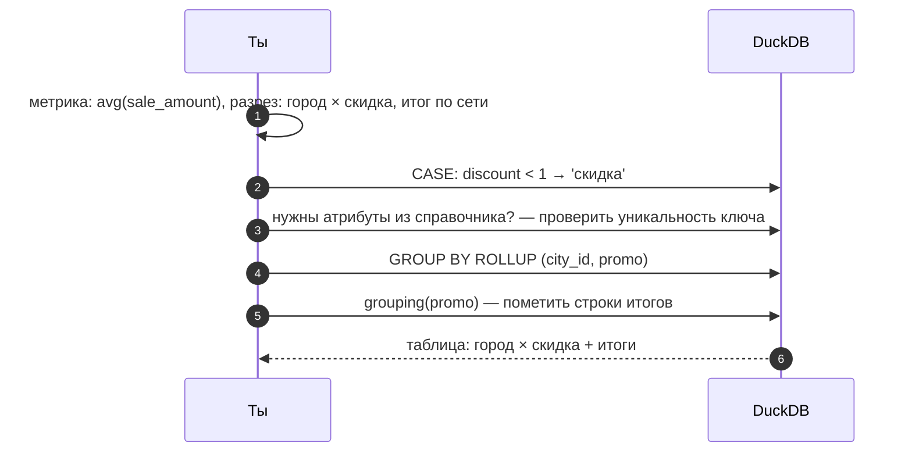

# 01 · Аналитический SQL: соединения, NULL и многоуровневые итоги

> [!info] Урок одной фразой
> Аналитический запрос — это сборка ответа из нескольких справочников и журнала событий. Если
> соединить их по неполному ключу, строки размножатся, и сумма вырастет в сотни раз без единой
> ошибки. Если забыть, что `NULL` — это «неизвестно», а не «пусто», часть строк молча пропадёт
> из фильтра. Урок про эти две ловушки и про то, как одним запросом получить итоги сразу на
> нескольких уровнях.

> [!todo] Чек-лист: после урока ты сможешь
> - [ ] выбрать тип соединения под вопрос, включая «есть ли» и «нет ли» в другой таблице;
> - [ ] заранее увидеть, размножит ли соединение строки, и проверить это запросом;
> - [ ] написать фильтр, который правильно обращается с `NULL`;
> - [ ] получить итоги по нескольким уровням одним запросом (`GROUPING SETS`, `ROLLUP`) и
>   отличить строку итога от строки с настоящим `NULL`;
> - [ ] работать с датами: приведение, части даты, разница (лаба 02.1, задачи 1–5).

**Нужно для:** лаба [02.1](../labs/02.1_window_functions/README.md), задачи 1–5.
**Карта урока:** [analytical-sql.canvas](../maps/analytical-sql.canvas).

---

## Шаг 0. Азбука: модуль 02 и его аналогия

В модуле 00 (урок 09) ты уже освоил основу: `SELECT`, агрегаты, `GROUP BY`, `HAVING`, `WITH`,
операции над множествами. Модуль 02 надстраивает над этим аналитический SQL и учит
проектировать таблицы, по которым такие запросы пишутся просто.

Весь модуль держится на аналогии **«кассовая лента и справочники»**. В любом магазине есть
**журнал событий** — кассовая лента: что, где, когда и сколько продано. И есть **справочники**:
список магазинов с городами, список товаров с категориями, календарь с праздниками. Почти любой
аналитический вопрос — это «возьми события из журнала, подтяни к ним нужное из справочников и
посчитай».

| В SQL | В аналогии «кассовая лента и справочники» | Подробнее |
|---|---|---|
| Таблица событий (продажи по дням) | Кассовая лента | [таблица фактов](../../../glossary/fact-table.md) |
| Таблица-справочник (магазины) | Справочник магазинов | [измерение](../../../glossary/dimension.md) |
| `JOIN` | Найти для строки ленты её карточку в справочнике | [JOIN](../../../glossary/join.md) |
| Ключ соединения | Номер магазина, по которому ищут карточку | |
| Размножение строк (fan-out) | В справочнике у магазина 268 карточек — строка ленты переписана 268 раз | [размножение строк](../../../glossary/fan-out.md) |
| `NULL` | «Неизвестно»: в ячейке не записано ничего | |
| `GROUPING SETS` | Итоги сразу по магазинам, по городам и по всей сети | |

Все примеры — на представлении `sales` над FreshRetailNet-50K:

```sql
CREATE VIEW sales AS SELECT * FROM read_parquet('data/raw/freshretailnet_50k/data/*.parquet');
```

---

## Шаг 1. Соединения: что именно делает `JOIN`

**Проблема.** Ответ почти всегда требует данных из нескольких таблиц: продажи лежат в одной,
формат магазина — в другой, праздники — в третьей. Их надо сопоставить построчно, и способ
сопоставления меняет результат.

**Как устроено.** `JOIN` берёт каждую строку левой таблицы и ищет в правой **все** строки,
для которых выполняется условие `ON`. Каждая найденная пара даёт строку результата. Отсюда
главное правило: **сколько совпадений нашлось, столько строк и получится**. Ноль, одна или
двести — решает правая таблица.

Типы соединения различаются тем, что делать со строками без пары:

| Тип | Что в результате | Вопрос, на который отвечает |
|---|---|---|
| `INNER JOIN` | только пары, нашедшие друг друга | «продажи вместе с атрибутами магазина» |
| `LEFT JOIN` | все строки слева; без пары — справа `NULL` | «все товары и их продажи, даже нулевые» |
| `FULL JOIN` | все строки обеих таблиц | сверка двух списков |
| `SEMI JOIN` | строки слева, у которых **есть** пара; правые колонки не добавляются, строки не множатся | «магазины, где был хоть один праздник» |
| `ANTI JOIN` | строки слева, у которых **нет** пары | «товары, которых нет в справочнике» |
| `CROSS JOIN` | каждая с каждой | календарь × магазины: все ожидаемые комбинации |

`SEMI` и `ANTI` в DuckDB пишутся прямо так: `FROM a SEMI JOIN b ON …`. В других СУБД то же
самое делают через `WHERE EXISTS (…)` и `WHERE NOT EXISTS (…)`.



**`USING` и `ON`.** Если колонки ключа называются одинаково, `JOIN … USING (store_id, dt)`
короче, чем `ON a.store_id = b.store_id AND a.dt = b.dt`, и оставляет в результате одну колонку
вместо двух.

---

## Шаг 2. Размножение строк: самая дорогая ошибка аналитика

**Проблема.** Соединение по неполному ключу не даёт ни ошибок, ни предупреждений. Запрос
работает, числа получаются — только в разы больше правильных.

**Как устроено.** Рассмотрим реальный случай. Хотим подтянуть к продажам погоду и делаем
«справочник погоды» на уровне города и дня:

```sql
CREATE TABLE city_weather AS SELECT DISTINCT city_id, dt, precpt FROM sales;
```

Кажется, что у города в один день одна погода. Но в датасете осадки записаны **для каждого
магазина отдельно**: внутри одного города в один день встречается до 268 разных значений
`precpt`. Значит, `DISTINCT city_id, dt, precpt` даёт не одну строку на город-день, а до 268.
Соединяем:

```sql
SELECT count(*) FROM sales s JOIN city_weather w USING (city_id, dt) WHERE s.city_id = 0;
```

| | Строк |
|---|---|
| Продаж в городе 0 | 2 503 667 |
| После соединения с «погодой города» | 435 483 192 |

Каждая продажа нашла в среднем 174 «погоды» своего города и дня и переписалась 174 раза. Любая
сумма продаж после такого соединения вырастет в 174 раза.

Это называют **[размножением строк](../../../glossary/fan-out.md)** (fan-out). Причина всегда
одна: **ключ соединения не уникален в правой таблице**.

**Как защищаться.** Перед соединением проверь, что правая таблица уникальна по ключу
соединения. Это та же проверка grain, что в модуле 00 (урок 09, шаг 5):

```sql
SELECT count(*) AS rows, count(DISTINCT (city_id, dt)) AS keys FROM city_weather;
```

Если `rows > keys`, соединение размножит строки. Второй способ — сравнить число строк до и после
соединения: при соединении «многие к одному» оно не должно меняться.

**Что из этого следует.**

- Погода в FreshRetail — атрибут **магазина и дня**, а не города. Соединять её нужно по
  `(store_id, dt)`. Это пригодится в уроке 05, когда будем решать, куда её положить в
  звёздной схеме.
- Соединение «многие к одному» (продажи → справочник) безопасно, только если «один» правда
  один. Ответственность за это — на том, кто строит справочник.

> [!example]- Попробуй сам: поймать размножение на одном дне
> В `make sql`:
> ```sql
> CREATE VIEW sales AS SELECT * FROM read_parquet('data/raw/freshretailnet_50k/data/*.parquet');
> CREATE TABLE city_weather AS SELECT DISTINCT city_id, dt, precpt FROM sales;
> SELECT count(*) AS rows, count(DISTINCT (city_id, dt)) AS keys FROM city_weather;
> SELECT (SELECT count(*) FROM sales WHERE city_id = 0 AND dt = '2024-05-01') AS before,
>        count(*) AS after
> FROM sales s JOIN city_weather w USING (city_id, dt)
> WHERE s.city_id = 0 AND s.dt = '2024-05-01';
> ```
> **Увидишь:** `rows` во много раз больше `keys`, а `after` во много раз больше `before`. Теперь
> замени `city_weather` на `DISTINCT store_id, dt, precpt` и соединяй `USING (store_id, dt)`:
> `before` и `after` совпадут.

---

## Шаг 3. NULL: «неизвестно», а не «пусто»

**Проблема.** `NULL` в SQL ведёт себя не так, как ноль или пустая строка, и из-за этого
фильтры молча теряют строки.

**Как устроено.** `NULL` означает «значение неизвестно». Любое сравнение с неизвестным даёт
не `true` и не `false`, а тоже **неизвестно** (`NULL`). Поэтому в SQL **трёхзначная логика**:
истина, ложь и неизвестно. `WHERE` пропускает только строки, где условие — истина. Строки с
«неизвестно» отбрасываются так же, как с «ложью».

| Выражение | Результат | Почему |
|---|---|---|
| `NULL = NULL` | `NULL` | два неизвестных не обязательно равны |
| `NULL <> 1` | `NULL` | неизвестно, отличается ли |
| `NULL IS NULL` | `true` | правильный способ проверить |
| `NULL + 1` | `NULL` | арифметика с неизвестным даёт неизвестное |
| `count(col)` | не считает `NULL` | агрегаты пропускают `NULL` |
| `count(*)` | считает все строки | |

Классическая ловушка: «все строки, где `x` не равен 1».

```sql
SELECT count(*) FILTER (WHERE x <> 1) AS ne1, count(*) AS n
FROM (VALUES (1), (2), (NULL)) t(x);   -- ne1 = 1, n = 3
```

Строка с `NULL` не попала ни в `x = 1`, ни в `x <> 1`. Правильно:
`WHERE x <> 1 OR x IS NULL` или `WHERE x IS DISTINCT FROM 1`. Последнее сравнивает `NULL` как
обычное значение: `NULL IS DISTINCT FROM 1` — истина, `NULL IS DISTINCT FROM NULL` — ложь.

**Откуда берутся NULL у нас.** В исходных колонках FreshRetail пропусков нет (это проверялось в
лабе 00.3). Но `NULL` появляются сами: `LEFT JOIN` без пары, `lag()` для первой строки ряда
(урок 02), строки итогов в `GROUPING SETS` (шаг 5). Поэтому правила работы с `NULL` нужны даже на
полных данных.

**`coalesce`** подставляет значение вместо `NULL`: `coalesce(sale_amount, 0)`. Делать это стоит
осознанно. Для продаж «не было строки» и «продали ноль» — разные вещи.

---

## Шаг 4. CASE и условная агрегация

**Проблема.** Часто нужно разложить строки по группам, которых нет в данных: «будни/выходные»,
«дождь сильный/слабый», «скидка есть/нет». И посчитать по ним метрики в одной строке, а не в
нескольких.

**Как устроено.** `CASE` вычисляет значение по условиям, проверяя их сверху вниз и
останавливаясь на первом истинном:

```sql
CASE WHEN discount < 1 THEN 'скидка'      -- 1.0 по карточке = без скидки
     ELSE 'без скидки' END AS promo
```

Если ни одно условие не истинно и `ELSE` нет, результат — `NULL`.

Условную агрегацию — метрики по нескольким группам в одной строке — делают двумя способами:

```sql
SELECT store_id,
       avg(sale_amount) FILTER (WHERE discount < 1)  AS avg_promo,
       avg(sale_amount) FILTER (WHERE discount = 1)  AS avg_regular,
       sum(CASE WHEN holiday_flag = 1 THEN sale_amount ELSE 0 END) AS holiday_sales
FROM sales GROUP BY store_id;
```

`FILTER` — короче и понятнее. `sum(CASE … ELSE 0 END)` — переносимый вариант, работает в любой
СУБД. Обрати внимание на `ELSE 0` в `sum` и его отсутствие в `avg`. В среднем строки без скидки
должны **выпасть**: `NULL` агрегат пропускает. Если превратить их в нули, среднее занизится.

---

## Шаг 5. Итоги на нескольких уровнях: GROUPING SETS и ROLLUP

**Проблема.** Отчёту нужны продажи по городу и празднику, итог по каждому городу и итог по
сети. Три разных `GROUP BY` и `UNION ALL` между ними — длинно и трижды читает данные.

**Как устроено.** `GROUPING SETS` перечисляет несколько группировок в одном запросе. DuckDB
считает каждую и складывает результаты в одну таблицу. В колонках, по которым конкретная
группировка **не** группировала, ставится `NULL`.

```sql
SELECT city_id, holiday_flag, round(sum(sale_amount)) AS s
FROM sales WHERE city_id < 2
GROUP BY GROUPING SETS ((city_id, holiday_flag), (city_id), ())
ORDER BY city_id NULLS LAST, holiday_flag NULLS LAST;
```

| city_id | holiday_flag | s | Что это |
|---|---|---|---|
| 0 | 0 | 1 583 382 | город 0, обычные дни |
| 0 | 1 | 1 011 122 | город 0, праздники |
| 0 | NULL | 2 594 504 | **итог** по городу 0 |
| 1 | 0 | 26 081 | |
| 1 | 1 | 18 172 | |
| 1 | NULL | 44 253 | итог по городу 1 |
| NULL | NULL | 2 638 758 | **итог** по двум городам |

`()` — пустой набор: группировка «ни по чему», то есть общий итог.

**Сокращения.** `ROLLUP (a, b)` = `GROUPING SETS ((a, b), (a), ())`: иерархия сверху вниз,
удобна для «город → магазин → всё». `CUBE (a, b)` = все комбинации:
`((a, b), (a), (b), ())`.

> [!warning] Ловушка: NULL итога и NULL данных
> Добавляй рядом с итогами `grouping(holiday_flag) AS is_total`. Функция `grouping(col)`
> возвращает 1, если колонка свёрнута в итог, и 0, если значение настоящее. В строке итога по
> городу `holiday_flag` = `NULL`, потому что по нему не группировали. Настоящий `NULL` в данных
> тоже показал бы `NULL`, и без `grouping` эти строки не отличить.

---

## Шаг 6. Даты: приведение, части и разница

**Проблема.** Почти каждый аналитический вопрос режет данные по времени: по месяцам, дням недели,
неделям. В FreshRetail дата хранится строкой, и без приведения типов ни одна из этих операций
не работает.

**Как устроено.** Сначала строку превращают в дату: `dt::DATE`. Дальше доступны функции:

| Выражение | Результат для `DATE '2024-05-01'` | Для чего |
|---|---|---|
| `year(d)`, `month(d)`, `day(d)` | 2024, 5, 1 | части даты |
| `dayofweek(d)` | 3 (0 — воскресенье) | будни и выходные |
| `isodow(d)` | 3 (1 — понедельник, 7 — воскресенье) | то же по стандарту ISO, удобнее |
| `date_trunc('week', d)::DATE` | 2024-04-29 | начало недели (понедельник). Без `::DATE` вернёт метку времени `2024-04-29 00:00:00` |
| `date_trunc('month', d)::DATE` | 2024-05-01 | начало месяца |
| `d - DATE '2024-03-28'` | 34 | разница в днях — целое число |
| `d + INTERVAL 7 DAY` | 2024-05-08 | сдвиг |
| `strftime(d, '%Y-%m')` | `'2024-05'` | дата в строку по шаблону |

`date_trunc` — главный инструмент для «по неделям» и «по месяцам»: он обрезает дату до начала
периода, и по результату удобно группировать.

> [!warning] Ловушка: день недели с нуля или с единицы
> Для выходных пиши `isodow(d) IN (6, 7)`. `isodow` считает с понедельника = 1, а `dayofweek` —
> с воскресенья = 0. Если перепутать их, «выходные» окажутся пятницей и субботой.

> [!example]- Попробуй сам: даты и уровни итогов
> ```sql
> SELECT dt::DATE AS d, isodow(dt::DATE) AS dow, date_trunc('week', dt::DATE) AS week_start
> FROM sales WHERE store_id = 0 AND product_id = 38 ORDER BY d LIMIT 3;
>
> SELECT city_id, holiday_flag, grouping(holiday_flag) AS is_total, round(sum(sale_amount)) AS s
> FROM sales WHERE city_id < 2
> GROUP BY ROLLUP (city_id, holiday_flag)
> ORDER BY city_id NULLS LAST, holiday_flag NULLS LAST;
> ```
> **Увидишь:** 28 марта 2024 — четверг (`dow` = 4), неделя начинается 25 марта. Во втором
> запросе — те же семь строк, что в таблице шага 5, плюс колонка `is_total`, где 1 стоит ровно у
> строк итогов.

---

## Сборка целиком: один отчёт от вопроса до запроса

Вопрос: «Средние продажи в дни со скидкой и без по городам, с итогом по сети».



| Где сломано | Шаг | Симптом |
|---|---|---|
| Справочник не уникален по ключу | 3 | суммы больше в разы, ошибок нет |
| `CASE` без `ELSE` | 2 | часть строк в группе `NULL` |
| Фильтр `<>` по колонке с `NULL` | 2 | строки пропали из обеих веток |
| Нет `grouping()` | 5 | итог и настоящий `NULL` неотличимы |

---

## Шпаргалка

| Хочу | Как |
|---|---|
| Строки слева, у которых есть пара | `a SEMI JOIN b ON …` / `WHERE EXISTS` |
| Строки слева без пары | `a ANTI JOIN b ON …` / `WHERE NOT EXISTS` |
| Проверить, что соединение не размножит | `count(*) = count(DISTINCT ключ)` в правой таблице |
| Сравнить с `NULL` | `IS NULL`, `IS DISTINCT FROM` |
| Метрики по группам в одной строке | `agg(x) FILTER (WHERE …)` |
| Итоги по уровням | `GROUPING SETS`, `ROLLUP`, `CUBE` + `grouping()` |
| Неделя, месяц | `date_trunc('week' \| 'month', d)` |
| Выходные | `isodow(d) IN (6, 7)` |

## Типичные ошибки

| Симптом | Причина | Как проверить | Как чинить |
|---|---|---|---|
| Сумма после `JOIN` в разы больше | ключ не уникален справа | `count(*)` против `count(DISTINCT ключ)` | соединять по полному ключу или агрегировать справочник |
| Строки «пропали» из фильтра | сравнение с `NULL` | `count(*) FILTER (WHERE col IS NULL)` | `IS DISTINCT FROM` или явный `OR … IS NULL` |
| Среднее занижено | `CASE … ELSE 0` внутри `avg` | сравнить с `FILTER` | `FILTER` или `CASE` без `ELSE` |
| В отчёте лишняя строка с `NULL` | строка итога от `GROUPING SETS` | `grouping(col)` | пометить или отфильтровать итоги |
| Ошибка функции даты | `dt` — строка | `typeof(dt)` | `dt::DATE` |
| Выходные — пятница и суббота | `dayofweek` с воскресенья = 0 | день недели известной даты | `isodow` |

---

## Проверь себя

Карточки для интервального повторения — в [flashcards.md](../flashcards.md).

> [!question] 1. В справочнике товаров случайно две строки с `product_id = 38`. Что станет с суммой продаж товара 38 после `JOIN` продаж со справочником?
> > [!success]- Ответ
> > Удвоится: каждая строка продаж найдёт две пары. Ошибки не будет. Защита — проверка
> > уникальности справочника по ключу до соединения и сравнение числа строк до и после.

> [!question] 2. Нужны товары из справочника, у которых не было ни одной продажи. Какое соединение и почему не `LEFT JOIN … WHERE sale_amount = 0`?
> > [!success]- Ответ
> > `ANTI JOIN` (или `LEFT JOIN … WHERE s.product_id IS NULL`). Условие `sale_amount = 0` ищет
> > строки продаж с нулём, а у товара без продаж строк нет вовсе, справа будут `NULL`.

> [!question] 3. `WHERE discount <> 1` — какие строки не попадут в результат, кроме `discount = 1`?
> > [!success]- Ответ
> > Строки, где `discount` = `NULL`: сравнение даёт «неизвестно», и `WHERE` их отбрасывает. В
> > исходных данных FreshRetail `NULL` нет, но после `LEFT JOIN` они могут появиться.

> [!question] 4. Чем `ROLLUP (city_id, store_id)` отличается от `CUBE (city_id, store_id)`?
> > [!success]- Ответ
> > `ROLLUP` даёт иерархию: город × магазин, город, всё. `CUBE` — все комбинации, включая итог
> > по магазину без города. Для иерархии «город → магазин» нужен `ROLLUP`: итог по магазину
> > без города не нужен, магазин и так принадлежит одному городу.

> [!question] 5. Почему погоду из FreshRetail нельзя соединять с продажами по `(city_id, dt)`?
> > [!success]- Ответ
> > Осадки записаны на уровне магазина и дня: в одном городе в один день до 268 разных значений.
> > Соединение по городу и дню размножит каждую продажу на число магазинов города с разной
> > погодой. Соединять нужно по `(store_id, dt)`.
