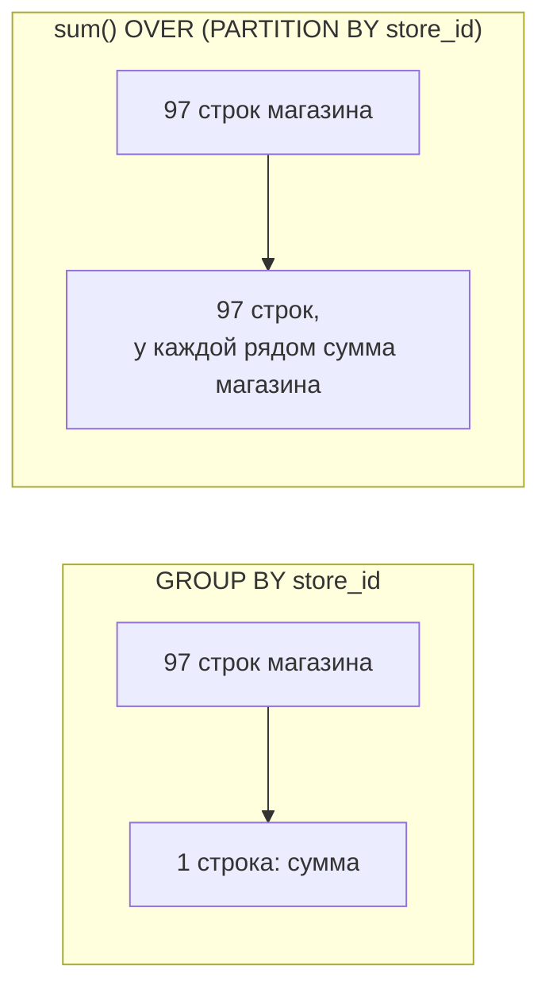
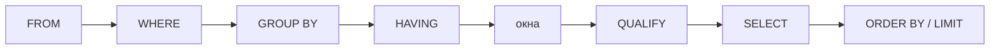
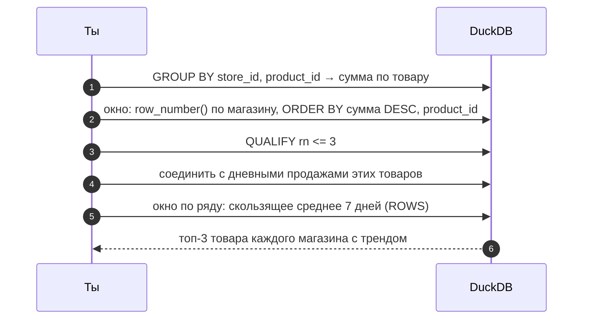

# 02 · Оконные функции: считать по соседям, не теряя строк

> [!info] Урок одной фразой
> `GROUP BY` складывает строки кассовой ленты в стопки и оставляет от каждой стопки одну
> бумажку с итогом. Оконная функция кладёт рядом с каждой строкой линейку. Строка остаётся на
> месте, а по линейке видно соседей: вчерашние продажи, сумму с начала месяца, место товара в
> рейтинге магазина. Вся сила окон — в трёх настройках линейки: по каким группам, в каком
> порядке и какой длины.

> [!todo] Чек-лист: после урока ты сможешь
> - [ ] объяснить, чем окно отличается от `GROUP BY`, и выбрать одно из двух под задачу;
> - [ ] задать окно тремя частями: `PARTITION BY`, `ORDER BY`, рамка;
> - [ ] выбрать между `row_number`, `rank` и `dense_rank` при равных значениях;
> - [ ] посчитать изменение к прошлому дню, накопительный итог, скользящее среднее и долю от итога;
> - [ ] отфильтровать результат окна через `QUALIFY`;
> - [ ] найти серии подряд идущих событий («острова») (лаба 02.1, задачи 6–15).

> [!tip] Визуализация темы
> Интерактивная страница [window_frames.html](../visuals/window_frames.html). Собери `PARTITION BY`, `ORDER BY` и рамку,
> щёлкни строку и посмотри её окно. Данные — товар 38 в магазинах 0 и 1.

**Нужно для:** лаба [02.1](../labs/02.1_window_functions/README.md), задачи 6–15.
**Карта урока:** [window-functions.canvas](../maps/window-functions.canvas).

---

## Шаг 0. Азбука: зачем окна, если есть GROUP BY

Вопросы «как изменились продажи товара к вчерашнему дню» или «какое место у товара в рейтинге
своего магазина» не решаются через `GROUP BY`. Чтобы сравнить сегодня со вчера, нужна строка
сегодня **и** значение вчера рядом с ней. А `GROUP BY` схлопывает строки: после группировки
каждой строки дня уже нет, есть только итог.

**Оконная функция** считает значение по набору строк — **окну**, — связанному с текущей
строкой, и записывает результат **в эту же строку**. Число строк не меняется.

| В SQL | В аналогии «кассовая лента» | Подробнее |
|---|---|---|
| `GROUP BY` | сложить ленту в стопки, оставить по бумажке с итогом | |
| Оконная функция | линейка у каждой строки: видно соседей, строка на месте | [оконная функция](../../../glossary/window-function.md) |
| `PARTITION BY` | разрезать ленту на куски: по магазину, по товару | |
| `ORDER BY` в окне | в каком порядке лежат строки в куске | |
| Рамка (frame) | длина линейки: «все до меня», «7 последних» | |
| `QUALIFY` | после подсчёта по линейке оставить нужные строки | |
| Остров (island) | несколько дней подряд с одним и тем же событием | |



---

## Шаг 1. Устройство окна: три части

**Проблема.** Окно надо описать точно: каких соседей видит строка. От этого зависит, что
посчитает функция.

**Как устроено.** Окно записывается после функции словом `OVER (…)` и состоит из трёх частей,
каждая необязательна:

```sql
sum(sale_amount) OVER (
    PARTITION BY store_id, product_id   -- ① на какие группы резать
    ORDER BY dt                          -- ② в каком порядке внутри группы
    ROWS BETWEEN 6 PRECEDING AND CURRENT ROW   -- ③ какие строки из группы брать
)
```

| Часть | Что делает | Если не указать |
|---|---|---|
| ① `PARTITION BY` | делит строки на независимые группы; окно никогда не выходит за границу группы | вся таблица — одна группа |
| ② `ORDER BY` | упорядочивает строки внутри группы; нужен для «предыдущей», «до меня», рейтинга | порядка нет |
| ③ Рамка | какие строки группы входят в окно относительно текущей | зависит от ② (шаг 3) |

**Порядок выполнения.** Окна считаются **после** `WHERE`, `GROUP BY` и `HAVING`, но **до**
`ORDER BY` всего запроса. Отсюда два следствия. Окно видит только строки, прошедшие `WHERE`.
И окно можно применять к результату группировки: `sum(sum(x)) OVER ()` — сумма сумм групп.

**Именованное окно.** Если одно окно нужно нескольким функциям, его описывают один раз:

```sql
SELECT dt, lag(sale_amount) OVER w, sum(sale_amount) OVER w
FROM sales WHERE store_id = 0 AND product_id = 38
WINDOW w AS (ORDER BY dt);
```

---

## Шаг 2. Функции ранжирования

**Проблема.** «Топ-3 товара в каждом магазине», «первая продажа ряда», «последнее значение» — всё
это задачи на номер строки внутри группы. Но что делать, если у двух товаров одинаковые продажи?

**Как устроено.** Три функции нумеруют строки по `ORDER BY` окна и отличаются только
обращением с равными значениями:

| x | `row_number()` | `rank()` | `dense_rank()` |
|---|---|---|---|
| 20 | 1 | 1 | 1 |
| 20 | 2 | 1 | 1 |
| 10 | 3 | 3 | 2 |
| 5 | 4 | 4 | 3 |

- **`row_number`** — всегда разные номера. Кто из двух равных получит 1, а кто 2, **не
  определено**: при следующем запуске может поменяться. Подходит, когда нужна ровно одна строка
  из группы, например последняя версия записи.
- **`rank`** — равные получают одинаковый номер, следующий номер пропускается (после двух
  первых сразу третий). Так считают места в спорте.
- **`dense_rank`** — равные получают одинаковый номер, пропусков нет. Подходит для «топ-3
  уровня продаж»: товаров может быть больше трёх.

**Детерминированность.** Если результат `row_number` должен быть одинаковым при каждом запуске,
добавь в `ORDER BY` окна колонку, которая разбивает ничьи: `ORDER BY s DESC, product_id`.

Другие полезные функции этого семейства:

| Функция | Что даёт |
|---|---|
| `ntile(4)` | номер четверти (квартиля): делит группу на 4 равные по числу строк части |
| `percent_rank()` | относительное место от 0 до 1 |
| `cume_dist()` | доля строк, которые не больше текущей |

---

## Шаг 3. Рамка: какие строки видит функция

**Проблема.** Накопительный итог, скользящее среднее за 7 дней и сумма по всему ряду — это одна
функция `sum`, но с разными рамками. Если не понимать, какая рамка стоит по умолчанию, легко
получить неверный результат.

**Как устроено.** Рамка задаётся границами относительно текущей строки:

| Граница | Значение |
|---|---|
| `UNBOUNDED PRECEDING` | первая строка группы |
| `N PRECEDING` | N строк назад |
| `CURRENT ROW` | текущая строка |
| `N FOLLOWING` | N строк вперёд |
| `UNBOUNDED FOLLOWING` | последняя строка группы |

И единицей измерения:

- **`ROWS`** — физические строки. `ROWS BETWEEN 6 PRECEDING AND CURRENT ROW` — ровно 7 строк.
- **`RANGE`** — по значению `ORDER BY`. Строки с одинаковым значением ключа сортировки входят в
  рамку **все вместе**. `RANGE BETWEEN INTERVAL 6 DAY PRECEDING AND CURRENT ROW` — все строки за
  последние 7 календарных дней, сколько бы их ни было.

**Рамка по умолчанию — главная ловушка окон.**

- Если в окне **нет** `ORDER BY`, рамка — вся группа.
- Если `ORDER BY` **есть**, рамка по умолчанию —
  `RANGE BETWEEN UNBOUNDED PRECEDING AND CURRENT ROW`. Это `RANGE`, а не `ROWS`, поэтому строки с
  одинаковым ключом сортировки попадают в рамку друг друга.

| x | `sum(x) OVER (ORDER BY x)` | `sum(x) OVER (ORDER BY x ROWS UNBOUNDED PRECEDING)` |
|---|---|---|
| 5 | 5 | 5 |
| 10 | 15 | 15 |
| 20 | **55** | 35 |
| 20 | 55 | 55 |

У первой из двух строк с `x = 20` «накопительный итог» по умолчанию уже включает вторую:
`RANGE` считает их одним значением. Если в ключе сортировки бывают повторы, а нужен итог по
строкам, пиши `ROWS` явно.

> [!warning] Ловушка: `last_value` возвращает текущую строку
> Для `last_value` задавай рамку до конца ряда:
> `ROWS BETWEEN UNBOUNDED PRECEDING AND UNBOUNDED FOLLOWING`. Рамка по умолчанию видит строки
> только **до текущей**. Поэтому `last_value(x) OVER (ORDER BY dt)` без рамки возвращает саму
> текущую строку.

**`ROWS` и пропуски дат.** «7 строк назад» равно «7 дней назад», только если в ряду нет
пропущенных дней. В FreshRetail каждый из 50 000 рядов «магазин × товар» содержит ровно 97 дней
подряд, без пропусков. Поэтому `ROWS` и `RANGE` по датам дают одно и то же. На данных, где строки
бывают не каждый день, скользящее окно за 7 дней надо задавать через `RANGE` с `INTERVAL`.

---

## Шаг 4. Функции смещения и частые шаблоны

**Проблема.** Большая часть оконных задач в аналитике — это пять-шесть повторяющихся шаблонов.
Их стоит знать наизусть.

**Как устроено.** Функции смещения берут значение из другой строки окна:

| Функция | Что возвращает |
|---|---|
| `lag(x)` / `lag(x, n)` | значение `x` на 1 (или n) строк раньше; для первой строки — `NULL` |
| `lead(x)` / `lead(x, n)` | на 1 (или n) строк позже |
| `lag(x, 1, 0)` | третий аргумент — значение вместо `NULL` |
| `first_value(x)` | первое значение в рамке |
| `last_value(x)` | последнее в рамке (см. ловушку выше) |

**Шаблоны.** Все примеры — для одного ряда «магазин 0 × товар 38»; для всех рядов сразу
добавь `PARTITION BY store_id, product_id`.

| Задача | Выражение |
|---|---|
| Изменение к прошлому дню | `x - lag(x) OVER (ORDER BY dt)` |
| Накопительный итог | `sum(x) OVER (ORDER BY dt ROWS UNBOUNDED PRECEDING)` |
| Скользящее среднее 7 дней | `avg(x) OVER (ORDER BY dt ROWS BETWEEN 6 PRECEDING AND CURRENT ROW)` |
| Доля от итога группы | `x / sum(x) OVER (PARTITION BY store_id)` |
| Номер в рейтинге | `row_number() OVER (PARTITION BY store_id ORDER BY x DESC)` |
| Сравнение с максимумом группы | `x / max(x) OVER (PARTITION BY store_id)` |

```sql
SELECT dt, sale_amount,
       lag(sale_amount)                                                  OVER w AS prev,
       sum(sale_amount)                                                  OVER (w ROWS UNBOUNDED PRECEDING) AS running,
       round(avg(sale_amount) OVER (w ROWS BETWEEN 6 PRECEDING AND CURRENT ROW), 3) AS ma7
FROM sales WHERE store_id = 0 AND product_id = 38
WINDOW w AS (ORDER BY dt)
ORDER BY dt LIMIT 4;
```

| dt | sale_amount | prev | running | ma7 |
|---|---|---|---|---|
| 2024-03-28 | 0.1 | NULL | 0.1 | 0.1 |
| 2024-03-29 | 0.1 | 0.1 | 0.2 | 0.1 |
| 2024-03-30 | 0.0 | 0.1 | 0.2 | 0.067 |
| 2024-03-31 | 0.1 | 0.0 | 0.30000000000000004 | 0.075 |

Заметь две вещи. Первые шесть значений `ma7` считаются по неполному окну: в первой строке это
среднее одного дня. Если неполное окно не подходит, его отбрасывают условием на номер строки.
И `0.30000000000000004` — та самая погрешность `DOUBLE` из модуля 00: сравнивай такие суммы с
допуском или округляй для вывода.

**Доля от итога после группировки.** Окно можно навесить на агрегат: сначала `GROUP BY`
считает сумму каждого товара, потом окно без `PARTITION BY` складывает эти суммы.

```sql
SELECT product_id, round(sum(sale_amount), 1) AS s,
       round(100 * sum(sale_amount) / sum(sum(sale_amount)) OVER (), 1) AS pct
FROM sales WHERE store_id = 0
GROUP BY product_id ORDER BY s DESC LIMIT 3;
```

Топ-3 товара магазина 0 дают 5,9%, 5,4% и 5,3% его продаж.

---

## Шаг 5. QUALIFY: фильтр по результату окна

**Проблема.** «Оставь только топ-1 товар в каждом магазине» — нужно отфильтровать по
`row_number() = 1`. Но в `WHERE` оконные функции использовать нельзя: `WHERE` выполняется
**до** окон.

**Как устроено.** Классический способ — подзапрос: посчитать окно внутри, отфильтровать снаружи.
`QUALIFY` делает то же короче. Это фильтр, который выполняется **после** окон:



```sql
SELECT store_id, product_id, round(sum(sale_amount), 1) AS s
FROM sales WHERE store_id < 3
GROUP BY store_id, product_id
QUALIFY row_number() OVER (PARTITION BY store_id ORDER BY s DESC) = 1
ORDER BY store_id;
```

| store_id | product_id | s |
|---|---|---|
| 0 | 117 | 461.7 |
| 1 | 300 | 765.7 |
| 2 | 300 | 495.1 |

`QUALIFY` есть в DuckDB, Snowflake, BigQuery, ClickHouse. В Postgres его нет, там пишут
подзапрос. Подзапрос понятен везде, поэтому знать надо оба.

> [!warning] Ловушка: `QUALIFY` и `GROUP BY ALL`
> С `QUALIFY` перечисляй колонки группировки явно. В DuckDB 1.5 `QUALIFY` нельзя сочетать с
> `GROUP BY ALL`: запрос падает с
> `Binder Error: Combining QUALIFY with GROUP BY ALL is not supported yet`.

---

## Шаг 6. Острова: серии подряд идущих событий

**Проблема.** «Сколько дней подряд товар был полностью распродан», «самая длинная серия дней
без продаж». Это задачи на **острова** (gaps and islands): найти непрерывные куски одинаковых
событий.

**Как устроено.** Приём держится на разнице двух номеров:

1. `row_number() OVER (ORDER BY d)` нумерует все дни подряд: 1, 2, 3, …
2. `row_number() OVER (PARTITION BY событие ORDER BY d)` нумерует дни **внутри каждого вида
   события** отдельно.
3. Пока событие идёт без перерыва, оба номера растут на 1 одновременно, и их разница
   **постоянна**. Как только серия прерывается, первый номер «убегает» вперёд, и у следующей
   серии разница другая.
4. Значит, разница номеров — идентификатор острова. Дальше острова группируют обычным `GROUP BY`.

| d | oos | номер всех | номер внутри oos | разница |
|---|---|---|---|---|
| 05-01 | 0 | 1 | 1 | 0 |
| 05-02 | 1 | 2 | 1 | **1** |
| 05-03 | 1 | 3 | 2 | **1** |
| 05-04 | 0 | 4 | 2 | 2 |
| 05-05 | 1 | 5 | 3 | **2** |
| 05-06 | 1 | 6 | 4 | **2** |
| 05-07 | 1 | 7 | 5 | **2** |

Для `oos = 1` получились два острова: разница 1 — два дня (02–03 мая), разница 2 — три дня
(05–07 мая).

```sql
WITH marked AS (
    SELECT d, oos,
           row_number() OVER (ORDER BY d)
         - row_number() OVER (PARTITION BY oos ORDER BY d) AS island
    FROM t
)
SELECT island, min(d) AS start_d, max(d) AS end_d, count(*) AS len
FROM marked WHERE oos = 1
GROUP BY island ORDER BY start_d;
```

На реальных данных к обоим `row_number` добавляют `PARTITION BY store_id, product_id`, чтобы
острова считались внутри каждого ряда, а не через границу двух товаров.

> [!example]- Попробуй сам: острова на семи днях
> В `make sql`:
> ```sql
> CREATE TABLE t AS SELECT * FROM (VALUES
>     (DATE '2024-05-01', 0), (DATE '2024-05-02', 1), (DATE '2024-05-03', 1),
>     (DATE '2024-05-04', 0), (DATE '2024-05-05', 1), (DATE '2024-05-06', 1),
>     (DATE '2024-05-07', 1)) v(d, oos);
> SELECT d, oos,
>        row_number() OVER (ORDER BY d) AS rn_all,
>        row_number() OVER (PARTITION BY oos ORDER BY d) AS rn_grp,
>        row_number() OVER (ORDER BY d) - row_number() OVER (PARTITION BY oos ORDER BY d) AS island
> FROM t ORDER BY d;
> ```
> Затем выполни запрос с `WITH marked` из шага выше. **Увидишь:** таблицу номеров как в уроке и
> два острова длиной 2 и 3 дня.

---

## Сборка целиком: «топ-3 товара магазина и их тренд»



| Где сломано | Шаг | Симптом |
|---|---|---|
| Нет `product_id` в `ORDER BY` окна | 2 | при равных суммах топ меняется от запуска к запуску |
| `rank` вместо `row_number` | 2 | у магазина больше трёх строк в топ-3 |
| `WHERE rn <= 3` вместо `QUALIFY` | 3 | ошибка: окно в `WHERE` нельзя |
| Нет `PARTITION BY` в окне тренда | 5 | среднее «перетекает» с одного товара на другой |
| Рамка по умолчанию вместо `ROWS` | 5 | накопительный итог вместо скользящего среднего |

---

## Шпаргалка

| Хочу | Как |
|---|---|
| Значение вчера | `lag(x) OVER (PARTITION BY ряд ORDER BY dt)` |
| Накопительный итог | `sum(x) OVER (… ORDER BY dt ROWS UNBOUNDED PRECEDING)` |
| Скользящее среднее N | `avg(x) OVER (… ROWS BETWEEN N-1 PRECEDING AND CURRENT ROW)` |
| Доля от итога | `x / sum(x) OVER (PARTITION BY группа)` |
| Топ-N в группе | `QUALIFY row_number() OVER (PARTITION BY г ORDER BY x DESC, id) <= N` |
| Последнее значение ряда | `last_value(x) OVER (… ROWS BETWEEN UNBOUNDED PRECEDING AND UNBOUNDED FOLLOWING)` |
| Острова | `row_number() OVER (ORDER BY d) - row_number() OVER (PARTITION BY событие ORDER BY d)` |
| Одно окно на много функций | `WINDOW w AS (…)` и `OVER w` |

## Типичные ошибки

| Симптом | Причина | Как проверить | Как чинить |
|---|---|---|---|
| Окно в `WHERE` — ошибка | `WHERE` выполняется до окон | — | `QUALIFY` или подзапрос |
| Топ-1 разный от запуска к запуску | ничьи в `ORDER BY` окна | есть ли равные значения | добавить колонку-разбивку |
| Накопительный итог «прыгает» на повторах | рамка по умолчанию `RANGE` | повторы ключа сортировки | `ROWS UNBOUNDED PRECEDING` |
| `last_value` = текущее значение | рамка до текущей строки | — | рамка до `UNBOUNDED FOLLOWING` |
| Значения перетекают между товарами | нет `PARTITION BY` | первая строка ряда: `lag` не `NULL` | добавить `PARTITION BY` |
| `Combining QUALIFY with GROUP BY ALL` | ограничение DuckDB 1.5 | — | перечислить колонки `GROUP BY` |
| Скользящее среднее «за 7 дней» за 9 дней | пропуски дат + `ROWS` | число строк в ряду против дней | `RANGE … INTERVAL` |

---

## Проверь себя

Карточки для интервального повторения — в [flashcards.md](../flashcards.md).

> [!question] 1. Нужно оставить у каждого магазина ровно один самый продаваемый товар, даже при равенстве сумм. Какая функция и что добавить в ORDER BY?
> > [!success]- Ответ
> > `row_number()`: только она гарантирует одну строку на группу. В `ORDER BY` окна добавить
> > `product_id` после суммы, чтобы при равенстве выбор был одинаковым при каждом запуске.

> [!question] 2. Почему `sum(x) OVER (ORDER BY x)` на значениях 5, 10, 20, 20 даёт 55 у первой двадцатки?
> > [!success]- Ответ
> > При `ORDER BY` рамка по умолчанию — `RANGE … CURRENT ROW`. `RANGE` включает все строки с
> > тем же значением ключа сортировки, поэтому обе двадцатки входят в рамку друг друга.
> > `ROWS UNBOUNDED PRECEDING` дал бы 35.

> [!question] 3. Почему нельзя написать `WHERE row_number() OVER (…) = 1`?
> > [!success]- Ответ
> > `WHERE` выполняется до вычисления окон, номеров строк ещё нет. Фильтровать по окну можно
> > через `QUALIFY` (после окон) или во внешнем запросе над подзапросом.

> [!question] 4. В ряду данных пропущены выходные. Чем `ROWS BETWEEN 6 PRECEDING AND CURRENT ROW` отличается от «7 календарных дней»?
> > [!success]- Ответ
> > `ROWS` берёт 7 строк, а с пропусками они охватывают больше 7 дней. Для календарного окна
> > нужно `RANGE BETWEEN INTERVAL 6 DAY PRECEDING AND CURRENT ROW`. В FreshRetail пропусков
> > нет — все 50 000 рядов по 97 дней, — поэтому там они совпадают.

> [!question] 5. Как устроен приём «острова»? Почему разница двух номеров постоянна внутри серии?
> > [!success]- Ответ
> > Один номер считает все дни, другой — только дни с данным событием. Пока событие идёт
> > подряд, оба растут на 1 за день, и разница не меняется. Перерыв увеличивает только первый
> > номер, и следующая серия получает другую разницу. Разница и есть идентификатор острова.
