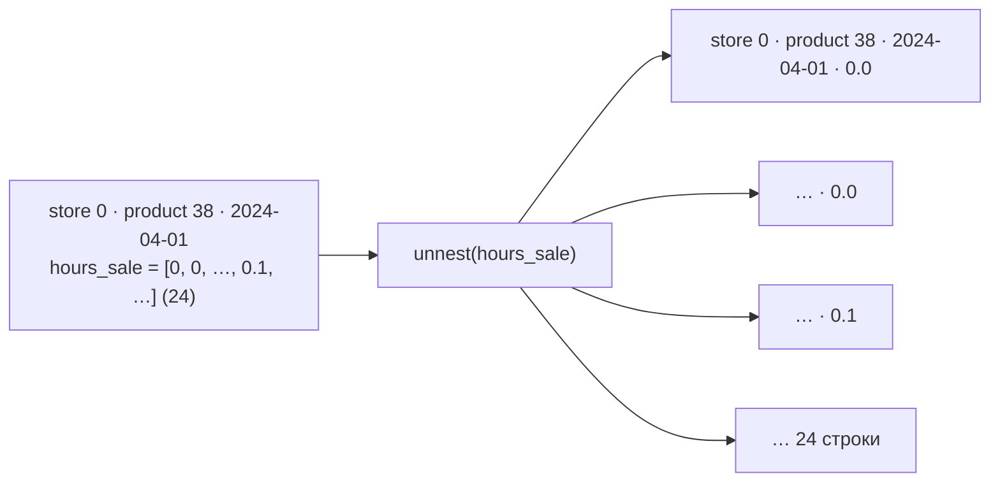
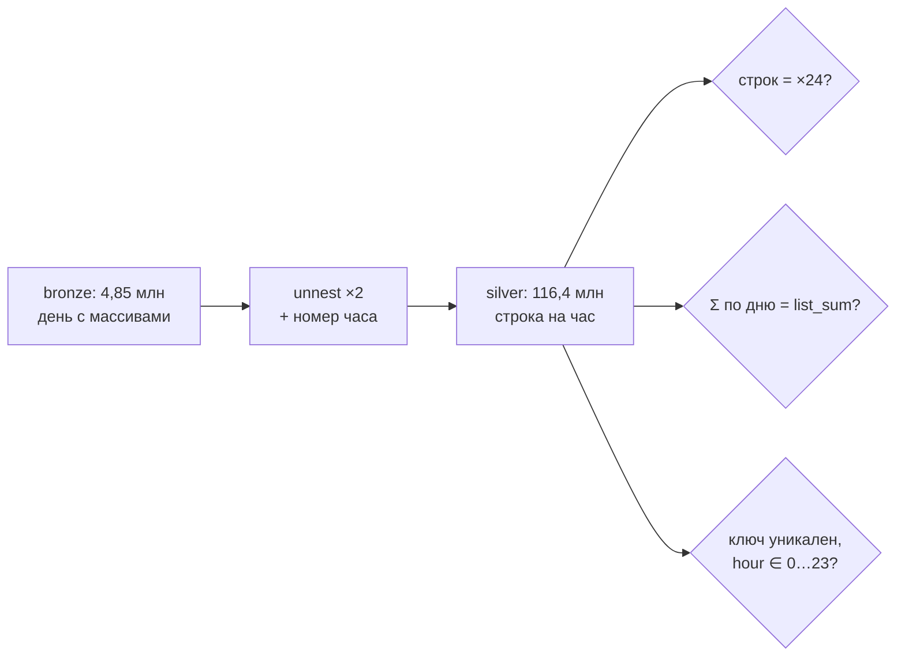
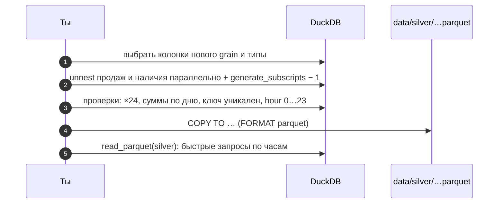

# 03 · Массивы и разворот: из «день с вкладышем» в «строка на час»

> [!info] Урок одной фразой
> В кассовой ленте FreshRetail одна строка — это день товара в магазине. К ней приколот
> вкладыш на 24 клеточки: продажи по часам и наличие по часам. Чтобы анализировать часы,
> вкладыш разрезают на 24 отдельные строки. Строк становится в 24 раза больше. Но места на диске
> почти не прибавляется. Обратная операция — свести строки в колонки —
> нужна для отчётов «товар × день недели».

> [!todo] Чек-лист: после урока ты сможешь
> - [ ] объяснить, как `unnest` превращает одну строку в несколько и что происходит с остальными колонками;
> - [ ] развернуть два массива параллельно, сохранив номер элемента, и не перепутать часы;
> - [ ] проверить, что разворот ничего не потерял и не исказил;
> - [ ] сохранить результат в Parquet, в том числе с разбиением по папкам;
> - [ ] переложить колонки в строки (`UNPIVOT`) и строки в колонки (`PIVOT`) (лаба 02.2).

**Нужно для:** лаба [02.2](../labs/02.2_hourly_grain/README.md), все задачи.
**Карта урока:** [arrays-and-unpivot.canvas](../maps/arrays-and-unpivot.canvas).

---

## Шаг 0. Азбука: широкая и длинная форма

Одни и те же данные можно хранить в двух формах.

- **Широкая** (wide): одна строка на объект, много однотипных значений — в колонках или в
  массиве. В FreshRetail строка «товар × магазин × день» несёт массив `hours_sale` из 24
  значений. Компактно и удобно для «показать день».
- **Длинная** (long): одна строка на одно значение, рядом колонка «что это за значение». Строка
  «товар × магазин × день × час» несёт одно число продаж. Неудобно глазами, но удобно для SQL:
  любая группировка по часу — обычный `GROUP BY hour`.

Переход из широкой в длинную называют **разворотом** (unpivot, explode, melt), обратный —
**сворачиванием** (pivot). В модуле 01 (урок 04) разворот массивов в часы — это шаг из bronze в
silver.

| В SQL | В аналогии «день с вкладышем» | Подробнее |
|---|---|---|
| LIST `DOUBLE[]` | вкладыш на 24 клеточки, приколотый к строке дня | |
| `unnest` | разрезать вкладыш: одна клеточка — одна новая строка | [разворот](../../../glossary/unpivot.md) |
| `generate_subscripts` | номер клеточки, чтобы знать, какой это час | |
| `UNPIVOT` | несколько колонок одной строки → несколько строк | [разворот](../../../glossary/unpivot.md) |
| `PIVOT` | строки → колонки: «дни недели по горизонтали» | [разворот](../../../glossary/unpivot.md) |

---

## Шаг 1. Как работает unnest

**Проблема.** Массив в ячейке нельзя сгруппировать по элементам: `GROUP BY` видит массив
целиком. Надо превратить элементы в строки.

**Как устроено.** `unnest(list)` в списке `SELECT` — функция, которая **размножает строку**.
Для строки с массивом из N элементов она возвращает N строк. В каждой из них — один элемент
массива, а все остальные колонки (`store_id`, `dt`, …) **копируются** без изменений.



Порядок элементов сохраняется, но **номера элемента сам `unnest` не даёт**. Чтобы знать, какой
это час, рядом ставят `generate_subscripts(list, 1)`: она возвращает номера 1, 2, …, N в том
же порядке. Нумерация с единицы, а часы — с нуля, поэтому `- 1`. Что номер элемента означает час,
ты проверял в лабе 00.3.

```sql
SELECT store_id, product_id, dt::DATE AS sale_date,
       generate_subscripts(hours_sale, 1) - 1 AS hour,
       unnest(hours_sale)                     AS sale
FROM sales WHERE store_id = 0 AND product_id = 38 AND dt = '2024-04-01';
```

Другой способ получить номер — табличная форма с `WITH ORDINALITY`:

```sql
SELECT x, i FROM unnest(['a', 'b', 'c']) WITH ORDINALITY AS t(x, i);   -- i = 1, 2, 3
```

Она удобна, когда разворачивается одиночный массив в `FROM`. Для массивов внутри строк таблицы
привычнее `generate_subscripts` в `SELECT`.

---

## Шаг 2. Два массива параллельно

**Проблема.** В строке два массива: продажи по часам и наличие по часам. Нужно получить строку
на час, где рядом стоят продажа **этого** часа и наличие **этого** часа.

**Как устроено.** Если в одном `SELECT` несколько `unnest`, DuckDB разворачивает их
**параллельно**, как застёжку-молнию: первый элемент первого массива — с первым элементом
второго, второй — со вторым. Это ровно то, что нужно для часов.

```sql
SELECT generate_subscripts(hours_sale, 1) - 1 AS hour,
       unnest(hours_sale)         AS sale,
       unnest(hours_stock_status) AS oos_flag
FROM …
```

Если массивы разной длины, короткий дополняется `NULL`:

```sql
SELECT unnest([1, 2, 3]) AS a, unnest(['x', 'y']) AS b;
-- (1, x), (2, y), (3, NULL)
```

У нас оба массива всегда по 24 элемента (это одна из проверок лабы 00.3), поэтому `NULL` не
появятся. Но если в данных встретится массив другой длины, такая строка даст `NULL` в часах, и
это надо заметить проверкой, а не полагаться на «всегда 24».

> [!warning] Ловушка: разворачивать по отдельности и соединять
> Разворачивай массивы параллельным `unnest` в одном `SELECT`. Это проще и безопаснее.
> Развернуть каждый массив в своём подзапросе и соединить по ключу и номеру часа — правильно, но
> вдвое дороже. Если забыть номер часа в ключе соединения, каждый час продаж соединится с каждым
> часом наличия. Строк станет в 24 раза больше, чем нужно (урок 01, шаг 2).

**Близкие функции.** `list_zip(a, b)` склеивает два массива в массив пар без разворота.
`range(24)` даёт список 0…23, а `generate_series(start, stop, step)` — список значений, в том
числе дат. Они нужны, когда номера или даты надо **создать**, а не извлечь.

---

## Шаг 3. Проверка разворота: ничего не потеряно

**Проблема.** Разворот меняет grain таблицы и число строк в 24 раза. Если ошибиться в номере
часа, в выборе массива или потерять часть строк, никакой ошибки не будет, а все почасовые
выводы станут неверными.

**Как устроено.** Разворот проверяют тремя сверками. Каждая — запрос, который должен вернуть
ожидаемое число или ноль нарушений (модуль 00, урок 09, шаг 7):

1. **Число строк.** Строк после разворота ровно `строки до × 24`. Для всего датасета:
   4 850 000 × 24 = 116 400 000.
2. **Сумма сходится.** Сумма почасовых продаж по каждому дню равна сумме элементов исходного
   массива этого дня. Проверяют группировкой развёрнутой таблицы обратно к дню и сравнением с
   `list_sum(hours_sale)` — с допуском, это `DOUBLE`.
3. **Новый ключ уникален.** У развёрнутой таблицы grain «товар × магазин × день × час». Значит,
   `count(DISTINCT (store_id, product_id, sale_date, hour))` = `count(*)`, а `hour` принимает
   ровно значения 0…23.



---

## Шаг 4. Сохранить результат: COPY в Parquet

**Проблема.** Разворачивать 116 млн строк при каждом запросе незачем. Результат надо сохранить
как таблицу silver-слоя. В модуле 03 это будет Iceberg-таблица в Lakekeeper, а сейчас — файл
Parquet.

**Как устроено.** `COPY (запрос) TO 'путь' (FORMAT parquet)` выполняет запрос и пишет результат
в файл. Колоночный формат хранит одну колонку подряд, поэтому одинаковые значения рядом хорошо
сжимаются (модуль 00, урок 04).

Замер полного разворота на нашем стеке:

| | Строк | Размер |
|---|---|---|
| Исходные Parquet (массивы) | 4 850 000 | 115 МБ |
| Развёрнутый Parquet: магазин, товар, дата, час, продажа, флаг наличия | 116 400 000 | 51 МБ |

Время записи — около 1,5 секунды. Строк стало в 24 раза больше, а файл получился **меньше**
исходного. Причина в сжатии: в развёрнутой таблице колонки `store_id`, `product_id`,
`sale_date` состоят из длинных серий одинаковых значений, `hour` повторяет 0…23, а продажи — в
основном нули. Колоночное сжатие кодирует такие серии почти бесплатно. В исходном файле, кроме
того, лежат ещё 14 колонок, которых в развёрнутой таблице нет.

**Типы.** Сжатие помогает, но узкий тип тоже экономит место и память при запросах. Час
умещается в `TINYINT` (−128…127), флаг наличия — в `BOOLEAN`. Приведение делают прямо в
запросе: `CAST(… AS TINYINT)`, `unnest(hours_stock_status) = 1`.

**Разбиение по папкам.** Параметр `PARTITION_BY` раскладывает строки по подпапкам по значению
колонки:

```sql
COPY (SELECT …, month(dt::DATE) AS m FROM …)
TO 'data/silver/demo' (FORMAT parquet, PARTITION_BY (m));
-- data/silver/demo/m=3/data_0.parquet, m=4/…, …
```

Читают такую папку с `hive_partitioning = true`: колонка `m` восстанавливается из имени папки,
а запрос с `WHERE m = 5` читает только одну папку. Как выбирать колонку разбиения и почему
слишком мелкое разбиение вредит, — модуль 03.

> [!example]- Попробуй сам: развернуть один магазин и проверить
> В `make sql`:
> ```sql
> CREATE VIEW sales AS SELECT * FROM read_parquet('data/raw/freshretailnet_50k/data/*.parquet');
> CREATE TABLE hourly AS
>     SELECT store_id, product_id, dt::DATE AS sale_date,
>            CAST(generate_subscripts(hours_sale, 1) - 1 AS TINYINT) AS hour,
>            unnest(hours_sale)              AS sale,
>            unnest(hours_stock_status) = 1  AS out_of_stock
>     FROM sales WHERE store_id = 0;
> SELECT (SELECT count(*) FROM sales WHERE store_id = 0) * 24 AS expected, count(*) AS actual,
>        min(hour), max(hour)
> FROM hourly;
> ```
> **Увидишь:** `expected` = `actual` = 159 840, часы от 0 до 23. Проверку сумм по дню из шага 3
> составь сам: это задача лабы.

---

## Шаг 5. UNPIVOT и PIVOT: колонки в строки и обратно

**Проблема.** Разворачивать приходится не только массивы. Погода лежит в четырёх колонках
(`precpt`, `avg_temperature`, `avg_humidity`, `avg_wind_level`), а графику «все показатели
погоды» удобнее одна колонка «показатель» и одна «значение». И наоборот: отчёт «средние продажи
по дням недели» хочется видеть с днями по горизонтали.

**Как устроено.**

- **`UNPIVOT`** превращает перечисленные колонки в пары строк «имя колонки — значение». Остальные
  колонки копируются.
- **`PIVOT`** делает обратное: значения одной колонки становятся названиями новых колонок, а в
  ячейки кладётся агрегат.

```sql
UNPIVOT (SELECT DISTINCT store_id, dt, precpt, avg_temperature, avg_humidity, avg_wind_level
         FROM sales WHERE store_id = 0 AND dt = '2024-05-01')
ON precpt, avg_temperature, avg_humidity, avg_wind_level
INTO NAME metric VALUE value;
```

| store_id | dt | metric | value |
|---|---|---|---|
| 0 | 2024-05-01 | precpt | 2.2958 |
| 0 | 2024-05-01 | avg_temperature | 19.66 |
| 0 | 2024-05-01 | avg_humidity | 73.45 |
| 0 | 2024-05-01 | avg_wind_level | 1.18 |

```sql
PIVOT (SELECT store_id, isodow(dt::DATE) AS dow, sale_amount FROM sales WHERE store_id < 2)
ON dow USING round(avg(sale_amount), 3)
GROUP BY store_id ORDER BY store_id;
```

| store_id | 1 | 2 | 3 | 4 | 5 | 6 | 7 |
|---|---|---|---|---|---|---|---|
| 0 | 1.018 | 1.064 | 0.958 | 0.856 | 0.99 | 1.333 | 1.404 |
| 1 | 1.054 | 1.143 | 1.022 | 0.978 | 1.097 | 1.35 | 1.426 |

Сразу видно, что в выходные (6 и 7) продажи выше, чем в будни.

**Когда что использовать.** Хранить и считать удобнее в длинной форме: она не зависит от того,
сколько показателей или дней недели. Широкая форма — для **отображения**: финальный отчёт,
сводная таблица. Поэтому `PIVOT` обычно последний шаг запроса, а не способ хранения.

> [!warning] Ловушка: PIVOT по колонке с меняющимися значениями
> Перечисляй значения в `PIVOT` явно: `ON dow IN (1, 2, 3, 4, 5, 6, 7)`. `PIVOT … ON колонка`
> без перечня создаёт по колонке на каждое встреченное значение. Если завтра в данных появится
> новое значение, у результата появится новая колонка. Всё, что ожидало фиксированный набор
> колонок, сломается.

---

## Сборка целиком: silver-таблица почасовых продаж



| Где сломано | Шаг | Симптом |
|---|---|---|
| Нет `- 1` у номера | 2 | часы 1…24, «полночь» пропала, вечер сдвинут |
| Массивы развёрнуты отдельно и соединены без номера | 2 | строк в 24 раза больше нужного |
| Проверки пропущены | 3 | ошибка всплывёт в почасовом дашборде |
| Флаг оставлен `BIGINT` | 2 | лишнее место и путаница «1 — это есть или нет?» |

---

## Шпаргалка

| Хочу | Как |
|---|---|
| Массив → строки | `unnest(list)` в `SELECT` |
| Номер элемента | `generate_subscripts(list, 1)` (с 1) или `unnest(…) WITH ORDINALITY` |
| Два массива параллельно | два `unnest` в одном `SELECT` |
| Создать список чисел / дат | `range(n)`, `generate_series(a, b, шаг)` |
| Колонки → строки | `UNPIVOT … ON колонки INTO NAME имя VALUE значение` |
| Строки → колонки | `PIVOT … ON колонка IN (…) USING агрегат GROUP BY …` |
| Сохранить в Parquet | `COPY (запрос) TO 'файл.parquet' (FORMAT parquet)` |
| Разбить по папкам | `(FORMAT parquet, PARTITION_BY (колонка))` |
| Прочитать разбитое | `read_parquet('папка/*/*.parquet', hive_partitioning = true)` |

## Типичные ошибки

| Симптом | Причина | Как проверить | Как чинить |
|---|---|---|---|
| Часы 1…24 | `generate_subscripts` с 1 | `min(hour)`, `max(hour)` | `- 1` |
| Строк в 24 раза больше ожидаемого | соединение развёрнутых массивов без номера | `count(*)` против строк × 24 | параллельный `unnest` |
| `NULL` в части часов | массивы разной длины | `len(list)` по строкам | исправить данные или отфильтровать |
| Суммы по часам не сходятся с днём | перепутан массив или сравнение без допуска | `abs(Σ − list_sum) > 1e-6` | правильный массив, допуск |
| После `PIVOT` поменялся набор колонок | `ON` без перечня значений | — | `ON колонка IN (…)` |

---

## Проверь себя

Карточки для интервального повторения — в [flashcards.md](../flashcards.md).

> [!question] 1. В `SELECT` два `unnest` — по массиву из 24 и из 24 элементов. Сколько строк получится из одной исходной и почему не 576?
> > [!success]- Ответ
> > 24. Несколько `unnest` в одном `SELECT` разворачиваются параллельно: элемент к элементу,
> > а не каждый с каждым. Число 576 получилось бы при соединении двух развёрнутых таблиц без номера
> > часа в ключе.

> [!question] 2. Почему развёрнутый на 116 млн строк файл меньше исходного на 4,85 млн?
> > [!success]- Ответ
> > Колоночное сжатие: магазин, товар и дата идут длинными сериями одинаковых значений, час
> > повторяет 0…23, продажи в основном нули. Такие серии кодируются почти бесплатно. И в
> > развёрнутом файле нет 14 из 19 колонок исходного.

> [!question] 3. Какими тремя проверками убедиться, что разворот корректен?
> > [!success]- Ответ
> > Строк ровно ×24. Сумма почасовых значений по каждому дню равна `list_sum` исходного
> > массива (с допуском). Новый ключ «товар × магазин × день × час» уникален, а час принимает
> > значения 0…23.

> [!question] 4. Почему хранить лучше в длинной форме, а `PIVOT` делать в конце?
> > [!success]- Ответ
> > Длинная форма не зависит от числа показателей или категорий: новый день недели или
> > показатель — это новые строки, а не новые колонки, и запросы не меняются. Широкая форма
> > удобна для глаз, поэтому её строят на последнем шаге для отображения.
