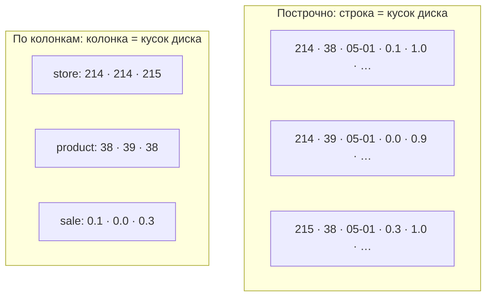
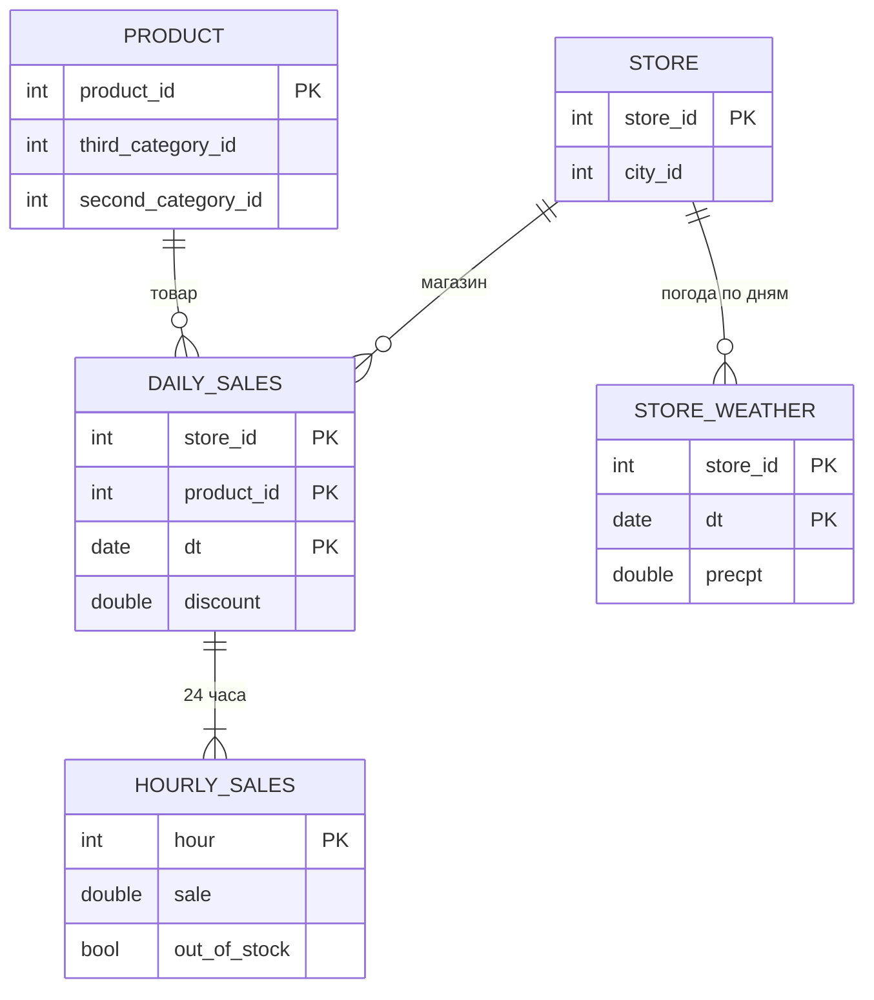
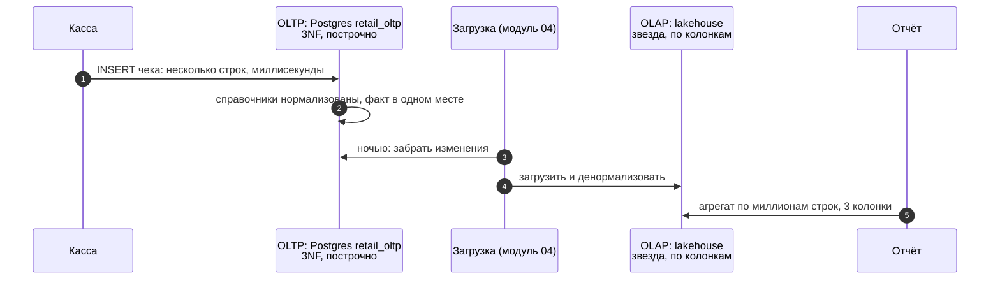

# 04 · OLTP и OLAP, нормализация: почему у учётной системы и аналитики разные таблицы

> [!info] Урок одной фразой
> Касса пробивает один чек за раз и должна делать это мгновенно и без ошибок. Аналитик раз в
> день перебирает миллионы чеков, чтобы посчитать одну сумму. Для первой работы таблицы режут на
> мелкие справочники, чтобы каждый факт хранился ровно в одном месте, и хранят построчно. Для
> второй склеивают обратно и хранят по колонкам. Одна и та же база не может быть лучшей в обоих
> делах, поэтому у компании их две.

> [!todo] Чек-лист: после урока ты сможешь
> - [ ] отличить OLTP-нагрузку от OLAP по виду запросов и объяснить, почему для них разные системы;
> - [ ] объяснить, как построчное и колоночное хранение раскладывают байты, и что из этого следует;
> - [ ] привести таблицу к 3NF и назвать аномалии, от которых защищает нормализация;
> - [ ] объяснить, зачем аналитика сознательно денормализует данные;
> - [ ] сравнить реляционную и документную модель (лаба 02.5, эссе, часть 1).

**Нужно для:** лаба [02.5](../labs/02.5_modeling_essay/README.md), часть 1 эссе; основа для уроков 05–06.
**Карта урока:** [oltp-olap.canvas](../maps/oltp-olap.canvas).

---

## Шаг 0. Азбука: две работы с данными

В сети магазинов данные используются двумя совсем разными способами.

- **Касса, склад, интернет-магазин** — **OLTP** (online transaction processing, обработка
  транзакций). Миллионы маленьких операций в день: записать чек, уменьшить остаток, найти
  товар по штрихкоду. Каждая затрагивает несколько строк и должна выполниться за миллисекунды,
  а данные должны оставаться согласованными, даже если одновременно работают сотни касс.
- **Аналитика, отчёты, прогнозы** — **OLAP** (online analytical processing, аналитическая
  обработка). Немного больших запросов: «доля пустых полок по всем магазинам за три месяца».
  Каждый читает миллионы строк, но только несколько колонок, и может идти секунды.

| В данных | В аналогии «кассовая лента и справочники» | Подробнее |
|---|---|---|
| OLTP | Касса: пробить один чек быстро и без ошибок | [OLTP и OLAP](../../../glossary/oltp-olap.md) |
| OLAP | Бухгалтер с годовой лентой: сложить всё по одной колонке | [OLTP и OLAP](../../../glossary/oltp-olap.md) |
| Построчное хранение | Чек целиком на одной бумажке | [колоночное хранение](../../../glossary/columnar-storage.md) |
| Колоночное хранение | Отдельные ленты: все суммы подряд, все даты подряд | [колоночное хранение](../../../glossary/columnar-storage.md) |
| Нормализация | Город магазина записан один раз в справочнике, а не на каждом чеке | [нормализация](../../../glossary/normalization.md) |
| Аномалия обновления | Магазин переехал — исправили на половине чеков | [нормализация](../../../glossary/normalization.md) |
| Денормализация | Переписать город на каждый чек, чтобы бухгалтеру не ходить в справочник | |

---

## Шаг 1. Почему одна база не годится для обоих дел

**Проблема.** Почему бы не считать аналитику прямо в базе касс: данные же там есть?

**Как устроено.** Две нагрузки противоположны почти по всем параметрам. Клеппман (гл. 3) сводит
их в таблицу:

| | OLTP | OLAP |
|---|---|---|
| Типичный запрос | найти или изменить несколько строк по ключу | прочитать миллионы строк, посчитать агрегат |
| Сколько колонок нужно | все колонки строки | 2–5 из десятков |
| Запись | много мелких вставок и изменений | редкая массовая загрузка |
| Кто пользуется | клиенты и программы, тысячи одновременно | аналитики, единицы–десятки |
| Что важно | задержка в миллисекундах, согласованность | пропускная способность, объём |
| Какие данные | текущее состояние | история за годы |

Отсюда две проблемы аналитики на OLTP-базе. Первая — **нагрузка**: тяжёлый запрос аналитика
занимает диск и процессор, и кассы начинают тормозить в час пик. Вторая — **устройство
хранения**: OLTP-базы хранят данные построчно, а это плохо подходит для «прочитать одну колонку
у миллиона строк» (шаг 2). Поэтому данные **копируют** из OLTP в отдельное аналитическое
хранилище — это и есть загрузка из модуля 01, урок 03.

У нас OLTP-роль играет Postgres с базой `retail_oltp` (заполнится в модуле 04), а OLAP — DuckDB
и lakehouse на Iceberg.

---

## Шаг 2. Построчное и колоночное хранение

**Проблема.** Таблица — это двумерная сетка, а диск одномерный: байты лежат друг за другом.
Сетку надо как-то вытянуть в линию, и от этого зависит, какие запросы будут быстрыми.

**Как устроено.** Два способа.

- **Построчно** (row-oriented, Postgres): значения одной строки лежат рядом, строки идут друг за
  другом. Чтобы прочитать строку целиком — один короткий кусок диска. Чтобы посчитать сумму одной
  колонки — надо прочитать **все** строки целиком, со всеми ненужными колонками.
- **По колонкам** (column-oriented, Parquet, DuckDB): все значения одной колонки лежат рядом.
  Сумма одной колонки читает только её. Зато собрать одну строку целиком — значит заглянуть в
  каждую колонку отдельно.



У колоночного хранения есть второй выигрыш — **сжатие**. Значения одной колонки однотипны и
часто повторяются: номер магазина идёт сериями, флаги — нулями и единицами. Такие последовательности
сжимаются в разы лучше, чем строки из разнородных значений.

**Замер на нашем стеке.** Загрузим продажи в Postgres (6 колонок) и сравним с Parquet-файлами
(все 19 колонок, включая массивы):

| | Postgres, 6 колонок | Parquet + DuckDB, 19 колонок |
|---|---|---|
| Размер | 354 МБ | 115 МБ |
| Найти одну строку по магазину, товару и дате, с индексом | **0,06 мс** | 67 мс (индекса нет) |
| Сумма продаж по всем строкам | 61 мс | 74 мс |
| Средние по 898 магазинам | 84–92 мс | 68–83 мс |

Как это читать:

- **Точечный поиск** — работа OLTP. С индексом Postgres находит строку в тысячу раз быстрее:
  индекс сразу указывает, где она лежит. DuckDB индекса не имеет и просматривает колонки.
- **Размер** — работа колоночного хранения. Втрое меньше места при втрое большем числе колонок.
- **Агрегаты** на 5 млн строк почти равны. Таблица в Postgres узкая (мы сами оставили 6 колонок)
  и целиком в памяти, а Postgres умеет читать её параллельно. Разница колоночного хранения
  проявляется, когда таблица **широкая** (запрос читает 3 колонки из 50) и **не помещается в
  память**. Тогда построчная база читает с диска всё, а колоночная — только нужное. На 116 млн почасовых
  строк и в модуле 07 на ×10 это станет заметно.

> [!example]- Попробуй сам: построчная база против колоночной
> В `make shell` (база `scratch_m02` временная, в конце удаляется):
> ```bash
> export PGHOST=postgres PGUSER=$POSTGRES_USER PGPASSWORD=$POSTGRES_PASSWORD
> psql -d postgres -c "CREATE DATABASE scratch_m02;"
> duckdb -c "INSTALL postgres; LOAD postgres;
>   ATTACH 'dbname=scratch_m02' AS pg (TYPE postgres);
>   CREATE TABLE pg.sales AS SELECT store_id, product_id, dt::DATE AS dt, sale_amount,
>          stock_hour6_22_cnt, discount
>   FROM read_parquet('data/raw/freshretailnet_50k/data/*.parquet');"
> psql -d scratch_m02 <<'EOF'
> \timing on
> SELECT pg_size_pretty(pg_total_relation_size('sales'));
> SELECT sale_amount FROM sales WHERE store_id = 214 AND product_id = 38 AND dt = DATE '2024-05-01';
> CREATE INDEX ON sales (store_id, product_id, dt);
> SELECT sale_amount FROM sales WHERE store_id = 214 AND product_id = 38 AND dt = DATE '2024-05-01';
> EXPLAIN SELECT sale_amount FROM sales WHERE store_id = 214 AND product_id = 38 AND dt = DATE '2024-05-01';
> EOF
> psql -d postgres -c "DROP DATABASE scratch_m02;"
> ```
> **Увидишь:** 354 МБ; поиск без индекса — десятки миллисекунд, с индексом — доли
> миллисекунды; в плане `Index Scan`. DuckDB подключается к Postgres через расширение
> `postgres`, а `PGHOST`, `PGUSER`, `PGPASSWORD` — стандартные переменные, которые читают и
> `psql`, и библиотека `libpq` внутри DuckDB.

---

## Шаг 3. Нормализация: каждый факт — в одном месте

**Проблема.** Если город магазина записан в каждой строке продаж, то при переезде магазина
придётся исправить миллионы строк. Пропустишь одну — у магазина будет два города. В OLTP, где
данные постоянно меняются, такие противоречия накапливаются.

**Как устроено.** **[Нормализация](../../../glossary/normalization.md)** — разбиение таблиц так,
чтобы каждый факт хранился **ровно один раз**. Её описывают нормальными формами. Каждая следующая
включает предыдущую. Разберём на FreshRetail.

**1NF — в каждой ячейке одно значение.** Наша исходная таблица 1NF нарушает: `hours_sale` —
массив из 24 значений в одной ячейке. Нормализованный вариант — отдельная таблица «продажи по
часам», где час — строка. Это тот самый разворот из урока 03.

**2NF — колонки зависят от всего ключа.** Ключ почасовой таблицы — магазин, товар, день, час. Но
`discount` и погода зависят только от части ключа: от магазина, товара и дня (скидка) или от
магазина и дня (погода). Повторять их 24 раза в каждом часе — нарушение 2NF. Их выносят в
таблицы со своим ключом.

**3NF — неключевые колонки не зависят друг от друга.** В строке продаж есть `store_id` и
`city_id`. Город определяется магазином, а не продажей: зависимость **транзитивная** (продажа →
магазин → город). По 3NF город уходит в справочник магазинов. Так же иерархия категорий уходит в
справочник товаров: `third_category_id` определяется товаром.



**От каких аномалий это защищает.**

| Аномалия | Пример в ненормализованной таблице | Почему нормализация лечит |
|---|---|---|
| Обновления | магазин сменил город — правим 10 тыс. строк, часть забыли | город записан один раз в справочнике |
| Вставки | нельзя завести новый магазин, пока у него нет продаж | магазин живёт в своей таблице |
| Удаления | удалили продажи магазина — потеряли, в каком он городе | справочник не зависит от продаж |

**Что из этого следует.** Нормализация — правильный выбор для OLTP: данные постоянно меняются, и
согласованность важнее скорости чтения. Цена — **соединения**: чтобы получить «продажи с городом»,
надо соединить три-четыре таблицы.

---

## Шаг 4. Денормализация для аналитики

**Проблема.** Аналитика почти ничего не изменяет, а только читает, но читает с соединениями
десятков таблиц. Каждое соединение — время и шанс ошибиться (урок 01, шаг 2). Защита от аномалий
обновления, ради которой нормализуют, здесь почти не нужна.

**Как устроено.** Аналитическое хранилище сознательно **денормализует**: дублирует атрибуты, чтобы
запросы требовали меньше соединений. Дублирование здесь безопасно по двум причинам:

1. Данные не меняются построчно: их загружают пакетами и пересчитывают целиком из сырого слоя
   (модуль 01, урок 03). Если город магазина изменился, пересобирают таблицу, а не правят строки.
2. Колоночное хранение почти не платит за повторы: колонка `city_id`, где одно значение повторено
   миллион раз подряд, сжимается почти в ничто (урок 03, шаг 4).

Насколько денормализовать — главный вопрос аналитического моделирования, и у него несколько
ответов:

| Подход | Степень денормализации | Урок |
|---|---|---|
| Звёздная схема (Kimball) | факты отдельно, справочники-измерения одним плоским столом каждое | 05 |
| Снежинка | измерения сами нормализованы: категория — отдельная таблица | 05 |
| Data Vault | нормализовано сильнее 3NF, ради истории и интеграции | 06 |
| One Big Table | всё в одной широкой таблице, соединений нет | 06 |

---

## Шаг 5. Реляционная и документная модель

**Проблема.** Кроме таблиц, данные хранят документами — JSON в MongoDB или в колонке Postgres.
Когда документ удобнее таблиц?

**Как устроено.** Клеппман (гл. 2) сравнивает две модели.

- **Документная**: объект хранится целиком, вместе со вложенными частями. Магазин — один
  документ, внутри список товаров, внутри каждого — продажи по дням. Читать «всё о магазине 214»
  — одно обращение, без соединений. Схема гибкая: у разных документов могут быть разные поля.
- **Реляционная**: объект раскладывается по таблицам и собирается соединениями. Зато любые
  связи «многие ко многим» выражаются естественно: товар во многих магазинах, магазин со многими
  товарами. Запрос может пойти с любой стороны: «все магазины, где продавался товар 38».

| | Документная | Реляционная |
|---|---|---|
| Чтение объекта целиком | одно обращение | соединения |
| Связи многие ко многим | неудобно: дублирование или ссылки вручную | естественно |
| Запросы «с другой стороны» | дорого: перебрать все документы | так же легко |
| Схема | при чтении, гибкая | при записи, строгая |

FreshRetail — пример того, как модели смешиваются: массивы `hours_sale` — это вложенная
«документная» часть внутри реляционной строки. Удобно хранить день целиком, неудобно спрашивать
«какой час самый продаваемый». Аналитике нужны запросы «с любой стороны», поэтому её основа —
реляционная модель, а вложенные структуры разворачивают.

---

## Сборка целиком: путь данных от кассы до отчёта



| Если перепутать | Что получишь |
|---|---|
| Аналитика прямо в OLTP-базе | кассы тормозят во время отчётов |
| Ненормализованные таблицы в OLTP | аномалии: два города у магазина |
| Нормализованная модель в аналитике | десятки соединений в каждом запросе, ошибки размножения |
| Построчное хранение для аналитики | чтение всех колонок ради одной |

---

## Шпаргалка

| Хочу | Как |
|---|---|
| Отличить OLTP от OLAP | мелкие операции по ключу против больших агрегатов по колонкам |
| Проверить 1NF | в ячейках нет массивов и списков |
| Проверить 2NF | неключевые колонки зависят от всего составного ключа |
| Проверить 3NF | неключевые колонки не определяются другими неключевыми |
| Найти транзитивную зависимость | `GROUP BY a HAVING count(DISTINCT b) > 1` = 0 → `b` зависит от `a` |
| Сравнить размер в Postgres | `pg_size_pretty(pg_total_relation_size('t'))` |
| План запроса в Postgres | `EXPLAIN` / `EXPLAIN ANALYZE` |

## Типичные ошибки

| Симптом | Причина | Как проверить | Как чинить |
|---|---|---|---|
| Кассы тормозят в часы отчётов | аналитика на OLTP-базе | кто нагружает базу | отдельное хранилище, загрузка |
| У магазина два города | дублирование в OLTP без нормализации | `GROUP BY store HAVING count(DISTINCT city) > 1` | справочник магазинов |
| Аналитический запрос из 12 соединений | 3NF перенесена в аналитику | число `JOIN` | денормализовать в звезду |
| Поиск строки по ключу в DuckDB медленный | у колоночной базы нет индекса | — | точечные запросы — в OLTP |

---

## Проверь себя

Карточки для интервального повторения — в [flashcards.md](../flashcards.md).

> [!question] 1. Почему поиск одной строки в Postgres с индексом в тысячу раз быстрее, чем в DuckDB, а сумма по всем строкам — примерно одинаково?
> > [!success]- Ответ
> > Индекс сразу указывает место строки, а у DuckDB индекса нет, и он просматривает колонки.
> > Для суммы оба читают всё. Узкая таблица Postgres в памяти читается параллельно так же
> > быстро. Преимущество колонок проявится на широких таблицах и объёмах больше памяти.

> [!question] 2. Какую нормальную форму нарушает `hours_sale` и какую — `city_id` в строке продаж?
> > [!success]- Ответ
> > `hours_sale` — 1NF: в ячейке массив, а не одно значение. `city_id` — 3NF: город
> > определяется магазином, а не продажей (транзитивная зависимость продажа → магазин → город).

> [!question] 3. Почему дублирование города в каждой строке опасно в OLTP, но допустимо в аналитическом хранилище?
> > [!success]- Ответ
> > В OLTP строки правят по одной, и при изменении города часть копий останется старой —
> > аномалия обновления. В аналитике таблицы не правят построчно, а пересобирают целиком из
> > сырого слоя, а колоночное сжатие почти не платит за повторы.

> [!question] 4. Когда документная модель удобнее реляционной, а когда — наоборот?
> > [!success]- Ответ
> > Документная — когда объект читают целиком и связи в основном «один ко многим» внутри него.
> > Реляционная — когда много связей «многие ко многим» и запросы идут с разных сторон, как в
> > аналитике: «все магазины товара», «все товары магазина».
