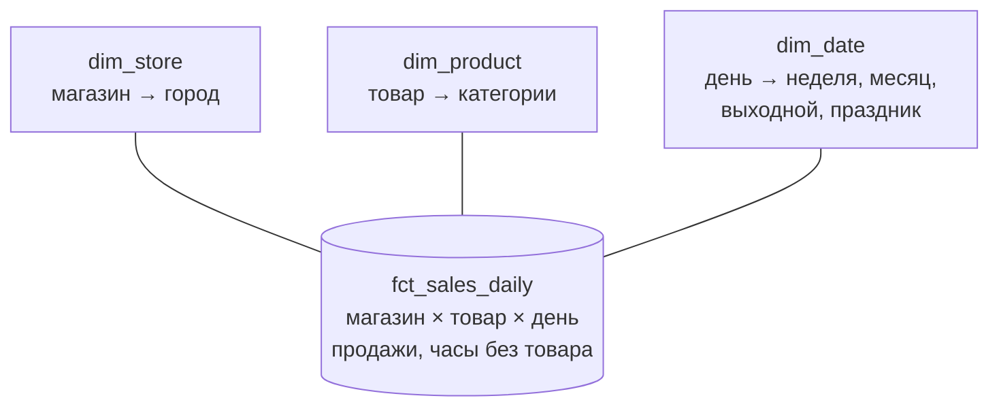
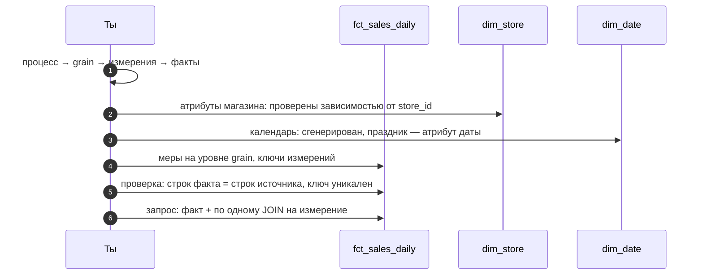

# 05 · Звёздная схема по Кимбаллу: факты, измерения, grain

> [!info] Урок одной фразой
> Звёздная схема — это кассовая лента в центре и справочники вокруг неё. Лента (таблица фактов)
> хранит события и числа: сколько продано. Справочники (измерения) хранят всё, чем эти события
> описывают: где, что, когда. Любой вопрос — «выбери из справочников, по чему резать, и сложи
> числа из ленты». Схема проектируется в четыре шага, и первый важнее всех: что именно
> описывает одна строка ленты.

> [!todo] Чек-лист: после урока ты сможешь
> - [ ] пройти четыре шага проектирования: процесс → grain → измерения → факты;
> - [ ] определить, куда положить атрибут — в факт или в измерение и в какое, — проверкой запросом;
> - [ ] выбрать тип таблицы фактов: транзакционная, периодический снимок, накопительный снимок;
> - [ ] объяснить, зачем нужны суррогатные ключи и календарное измерение;
> - [ ] нарисовать звезду в Mermaid `erDiagram` и написать DDL (лаба 02.3).

**Нужно для:** лаба [02.3](../labs/02.3_star_schema/README.md), все задачи.
**Карта урока:** [kimball.canvas](../maps/kimball.canvas).

---

## Шаг 0. Азбука: что такое многомерное моделирование

В уроке 04 было два полюса: нормализованная модель для учётной системы и денормализация для
аналитики. **Многомерное моделирование** (dimensional modeling) Ральфа Кимбалла — самый
распространённый способ денормализовать «правильно». Его идея: аналитик думает вопросами вида
«**сколько** (число) **по чему** (разрез)». «Сколько продано по городам и неделям», «какая доля
пустых часов по категориям». Значит, данные надо разложить на две роли:

- **факты** — числа, которые складывают и усредняют: продажи, часы без товара;
- **измерения** — то, по чему режут: магазин, товар, дата.

| В модели | В аналогии «кассовая лента и справочники» | Подробнее |
|---|---|---|
| Таблица фактов | Кассовая лента: события и суммы | [таблица фактов](../../../glossary/fact-table.md) |
| Мера (measure) | Число на ленте: сколько продано | [таблица фактов](../../../glossary/fact-table.md) |
| Измерение | Справочник: магазины, товары, календарь | [измерение](../../../glossary/dimension.md) |
| Атрибут измерения | Поле карточки: город магазина, категория товара | [измерение](../../../glossary/dimension.md) |
| Grain | Что такое одна строка ленты | [grain](../../../glossary/grain.md) |
| Звёздная схема | Лента в центре, справочники лучами вокруг | [звёздная схема](../../../glossary/star-schema.md) |
| Суррогатный ключ | Номер карточки, который выдал сам архив | [суррогатный ключ](../../../glossary/surrogate-key.md) |



---

## Шаг 1. Четыре шага проектирования

**Проблема.** Можно начать с таблиц, которые есть, и «как-нибудь» их соединить. Получится модель,
в которой у каждого запроса свои соединения и свои ошибки. Кимбалл предлагает начинать с
бизнеса и идти к таблицам.

**Как устроено.** Четыре шага, строго по порядку:

1. **Выбрать бизнес-процесс.** Не отдел и не систему, а действие, которое порождает события:
   «продажа товара в магазине», «смена наличия на полке». Один процесс — одна таблица фактов.
2. **Объявить grain.** Что описывает одна строка фактов, одним предложением: «продажи одного
   товара в одном магазине за один день». Это главное решение: от него зависят и измерения, и
   меры. Kimball советует брать **самый детальный** grain, который есть в данных: из детального
   можно получить агрегат, а обратно — нет.
3. **Определить измерения.** Ответ на вопросы «кто, что, где, когда» для одной строки. Каждое
   измерение описывает одну сторону события.
4. **Определить факты (меры).** Числа, которые относятся **ровно к этому grain**. Если число
   относится к другому уровню (погода — к магазину и дню, а не к товару), это сигнал: либо оно
   не мера этой таблицы, либо оно будет повторяться и неправильно складываться.


**Почему grain раньше всего.** Возьмём меру «часы без товара». При grain «товар × магазин × день»
это `stock_hour6_22_cnt` — число от 0 до 16, складывается по дням и товарам. При grain «товар ×
магазин × час» это флаг 0/1. При grain «магазин × день» это вообще другая величина. Объявив grain,
ты сразу знаешь, какие числа в таблице допустимы, а какие нет.

---

## Шаг 2. Куда положить атрибут: проверка запросом

**Проблема.** В FreshRetail все колонки лежат в одной плоской таблице. Для каждой надо решить: это
мера факта, атрибут какого-то измерения или атрибут более крупного уровня. Ошибка здесь даёт либо
размножение строк, либо неправильные суммы.

**Как устроено.** Решение принимают по **функциональной зависимости** — той же проверке, что в
модуле 00 (урок 09, шаг 7): «у каждого X одно значение Y». Атрибут кладут на уровень того
ключа, от которого он зависит.

| Если атрибут зависит от | Он принадлежит | Пример |
|---|---|---|
| только товара | измерению товара | `third_category_id` |
| только магазина | измерению магазина | `city_id` |
| только даты | измерению даты | см. разбор ниже |
| полного grain факта | факту | `sale_amount` |
| части grain (магазин × день) | ни одному из трёх измерений — решение нужно отдельно | погода |

**Разобранный пример: `holiday_flag`.** Праздник — свойство даты, или он разный в разных городах
и магазинах? Проверяем:

```sql
SELECT count(*) FROM (SELECT dt FROM sales GROUP BY dt
                      HAVING count(DISTINCT holiday_flag) > 1);   -- 0
```

Ноль нарушений: в каждый день флаг одинаков во всей сети. Значит, `holiday_flag` — атрибут
**измерения даты**. Хранить его в каждой из 50 000 строк дня избыточно и опасно: при ошибке
загрузки он может разойтись между строками одного дня.

Для погоды, скидки и флага акции проведи такую же проверку сам: это задача лабы 02.3. Подсказка
из урока 01: погода оказалась на уровне «магазин × день», а это не совпадает ни с одним
измерением. Kimball предлагает для такого случая два решения: держать её в отдельной таблице
фактов с grain «магазин × день» или как меры в основном факте, помня, что их нельзя складывать
по товарам. Выбор обоснуй в лабе.

---

## Шаг 3. Таблицы фактов: три вида и правила сложения

**Проблема.** Не все факты устроены одинаково. Продажа — событие, которое случилось и больше не
меняется. Наличие на полке — состояние, которое есть в любой момент. Заказ поставки проходит этапы
от создания до приёмки. Одна форма таблицы на всех не подходит.

**Как устроено.** Kimball различает три вида таблиц фактов:

| Вид | Что в строке | Как растёт | Пример у нас |
|---|---|---|---|
| **Транзакционная** | одно событие или их сумма за grain | новые строки, старые не меняются | продажи товара в магазине за день или час |
| **Периодический снимок** | состояние на момент или за период | строка на каждый период, даже без событий | наличие товара на полке на каждый час |
| **Накопительный снимок** | процесс с этапами, по колонке-дате на этап | строка обновляется по мере прохождения этапов | заказ поставки: создан → отгружен → принят (в FreshRetail таких данных нет) |

Главная разница транзакционной и снимка — **что значит отсутствие строки**. В транзакционной
таблице нет строки — не было события. В снимке строка есть всегда: «товар был на полке» — тоже
состояние, его надо записать.

**Меры и сложение** — то же деление, что в модуле 01 (урок 02, шаг 2), только теперь про колонки
факта:

- **аддитивные** складываются по всем измерениям: продажи;
- **полуаддитивные** — не по всем: число часов без товара за день складывается по товарам и
  магазинам, а «складывать по дням» уже другой смысл, суммарные часы, а не состояние;
- **неаддитивные** — доли, средние, скидка как коэффициент: их хранят как числитель и знаменатель
  или пересчитывают при запросе.

> [!warning] Ловушка: скидка — не аддитивная мера
> `discount` — коэффициент цены (1.0 — без скидки, 0.9 — минус 10%). Сумма скидок по магазину —
> бессмыслица. Средняя скидка без веса продаж тоже вводит в заблуждение. В факте её хранят как
> атрибут строки, а в отчётах используют для разреза («со скидкой / без»), а не для суммы.

---

## Шаг 4. Измерения: суррогатные ключи и календарь

**Проблема.** Измерение связано с фактом ключом. Какой ключ использовать — `store_id` из
источника или свой номер? И откуда взять измерение даты, если в источнике дат-справочника нет?

**Как устроено.**

**Естественный и суррогатный ключ.** `store_id` — **естественный ключ**: он пришёл из
источника (модуль 00, урок 09). Kimball рекомендует в измерении заводить ещё и **[суррогатный
ключ](../../../glossary/surrogate-key.md)** — целое число, которое выдаёт само хранилище
(`store_sk`), и связывать факт с измерением по нему. Зачем, если естественный ключ уже есть:

1. **История изменений.** Если магазин сменит формат, нужно хранить обе версии его карточки
   (урок 06, SCD2). У обеих версий один `store_id`, а суррогатные ключи разные. Факт за апрель
   ссылается на старую версию, за июнь — на новую.
2. **Независимость от источника.** Если две системы используют один `store_id` для разных
   магазинов или источник сменит нумерацию, хранилище не сломается.
3. **«Неизвестный» член.** Если в факте пришёл магазин, которого ещё нет в справочнике, факт
   ссылается на специальную строку `store_sk = -1, 'неизвестен'`, а не теряется при
   `INNER JOIN`.

**Календарное измерение.** `dim_date` строят не из данных, а **генерируют**: строка на каждый
день периода, колонки — всё, что нужно для разрезов. Так в измерении будут и дни без продаж, и
атрибуты, которых нет в источнике: неделя, выходной, квартал. Ключ даты по традиции — целое
`ГГГГММДД`: он читается глазами и сортируется как дата.

```sql
CREATE TABLE dim_date AS
SELECT CAST(strftime(d, '%Y%m%d') AS INTEGER) AS date_key,
       d::DATE                  AS full_date,
       year(d)                  AS year,
       month(d)                 AS month,
       isodow(d)                AS iso_dow,
       isodow(d) IN (6, 7)      AS is_weekend,
       date_trunc('week', d)::DATE AS week_start
FROM (SELECT unnest(generate_series(DATE '2024-03-28', DATE '2024-07-02', INTERVAL 1 DAY)) AS d);
```

`generate_series` даёт список дат, `unnest` превращает его в строки (урок 03). Получится 97 строк
— по одной на день периода.

**Иерархии в измерении.** Иерархия товара `management_group_id > first_category_id >
second_category_id > third_category_id > product_id` в звёздной схеме **разворачивается в
плоскую строку** измерения товара: каждая строка `dim_product` содержит все уровни своей
иерархии. Тогда «продажи по категории первого уровня» — одно соединение и `GROUP BY`.

---

## Шаг 5. Звезда, снежинка и согласованные измерения

**Проблема.** Иерархию можно хранить плоско в одной таблице измерения или нормализовать в цепочку
таблиц. Что выбрать и почему Kimball называет схему «звездой»?

**Как устроено.**

- **Звезда** (star schema): каждое измерение — одна плоская денормализованная таблица, связанная
  с фактом напрямую. Любой запрос — это факт плюс по одному соединению на каждое нужное
  измерение. Просто писать, быстро выполнять.
- **Снежинка** (snowflake): измерения нормализованы. `dim_product` ссылается на
  `dim_category_3`, та — на `dim_category_2` и так далее. Меньше дублирования, но больше
  соединений и шансов ошибиться. В колоночных хранилищах экономия места почти нулевая (урок 04,
  шаг 4), поэтому снежинку используют редко.

**Согласованные измерения** (conformed dimensions) — одно измерение, общее для нескольких таблиц
фактов. Если у продаж и у наличия на полке **один и тот же** `dim_store`, их можно сравнивать в
одном отчёте: «продажи и пустые часы по городам». Если у каждого факта свой справочник магазинов,
цифры разойдутся, как только справочники разойдутся. Согласованные измерения — то, что
превращает набор звёзд в единое хранилище.

### Звезда в Mermaid: erDiagram

Для ER-диаграмм в Mermaid есть отдельный тип `erDiagram`. Синтаксис:

```text
erDiagram
    DIM_STORE ||--o{ FCT_SALES_DAILY : "store_sk"
    DIM_STORE {
        int store_sk PK
        int store_id
        int city_id
    }
```

| Запись | Смысл |
|---|---|
| `A \|\|--o{ B : "подпись"` | связь «один ко многим»: одна строка A — ноль или много строк B |
| `\|\|` | ровно один |
| `o{` | ноль или много |
| `\|{` | один или много |
| `}o--o{` | многие ко многим |
| `{ … }` после имени | атрибуты: тип, имя, `PK` / `FK`, каждый на **своей строке** |

> [!warning] Ловушка: атрибуты в одну строку
> Внутри `{ … }` каждый атрибут должен стоять на отдельной строке. Запись
> `DIM_STORE { int store_sk PK int city_id }` в одну строку Mermaid не разбирает.

> [!example]- Попробуй сам: календарь и проверка атрибута
> В `make sql`:
> ```sql
> CREATE VIEW sales AS SELECT * FROM read_parquet('data/raw/freshretailnet_50k/data/*.parquet');
> CREATE TABLE dim_date AS
> SELECT CAST(strftime(d, '%Y%m%d') AS INTEGER) AS date_key, d::DATE AS full_date,
>        isodow(d) AS iso_dow, isodow(d) IN (6, 7) AS is_weekend
> FROM (SELECT unnest(generate_series(DATE '2024-03-28', DATE '2024-07-02', INTERVAL 1 DAY)) AS d);
> SELECT count(*) FROM dim_date;
> SELECT count(*) FROM (SELECT dt FROM sales GROUP BY dt HAVING count(DISTINCT holiday_flag) > 1);
> ```
> **Увидишь:** 97 дней и 0 нарушений: праздник — свойство даты. Как `holiday_flag` соотносится
> с `is_weekend`, посмотри сам: в этом соотношении есть кое-что интересное о календаре страны,
> откуда датасет.

---

## Сборка целиком: вопрос к звезде

Вопрос: «Средние продажи в выходные и будни по городам». На звезде запрос читается почти
дословно:

```sql
SELECT s.city_id, d.is_weekend, avg(f.sale_amount) AS avg_sale
FROM fct_sales_daily f
JOIN dim_store s USING (store_sk)
JOIN dim_date  d USING (date_key)
GROUP BY s.city_id, d.is_weekend;
```



| Где сломано | Шаг | Симптом |
|---|---|---|
| Grain не объявлен | 1 | непонятно, складывать ли меру; двойной счёт |
| Атрибут не той таблицы | 2 | размножение при соединении или противоречивые значения |
| В измерении дубли по ключу | 3 | суммы в отчётах больше настоящих |
| Календарь из данных, а не сгенерирован | 3 | дней без продаж нет в разрезах |
| Строк в факте больше, чем в источнике | 5 | соединение при построении факта размножило строки |

---

## Шпаргалка

| Хочу | Как |
|---|---|
| Спроектировать звезду | процесс → grain → измерения → факты |
| Понять, куда атрибут | `GROUP BY кандидат HAVING count(DISTINCT атрибут) > 1` = 0 |
| Календарь | `unnest(generate_series(a, b, INTERVAL 1 DAY))` + атрибуты |
| Ключ даты | `CAST(strftime(d, '%Y%m%d') AS INTEGER)` |
| Иерархия в звезде | плоско: все уровни в строке измерения |
| Связь в erDiagram | `DIM \|\|--o{ FCT : "ключ"` |
| Проверить факт | `count(*)` = строк источника; `count(DISTINCT ключ)` = `count(*)` |

## Типичные ошибки

| Симптом | Причина | Как проверить | Как чинить |
|---|---|---|---|
| Сумма погоды растёт с числом товаров | мера уровня «магазин × день» в факте уровня товара | зависимость атрибута | отдельный факт или не складывать по товарам |
| В отчёте нет дней без продаж | календарь собран из фактов | `count(*)` в `dim_date` против дней периода | генерировать календарь |
| Факт потерял строки после соединения с измерением | `INNER JOIN` без «неизвестного» члена | строк до и после | строка `-1 'неизвестно'`, `LEFT JOIN` при загрузке |
| Два отчёта по городам расходятся | разные справочники магазинов у фактов | сравнить измерения | одно согласованное измерение |
| erDiagram не рисуется | атрибуты в одну строку | — | по атрибуту на строку |

---

## Проверь себя

Карточки для интервального повторения — в [flashcards.md](../flashcards.md).

> [!question] 1. Почему Kimball советует брать самый детальный grain?
> > [!success]- Ответ
> > Из детальных строк агрегатом получается любой более крупный уровень, а из агрегата детали
> > не восстановить. Новые вопросы почти всегда требуют разрезов, которых не ждали заранее.

> [!question] 2. Как запросом решить, куда положить `holiday_flag`?
> > [!success]- Ответ
> > Проверить функциональную зависимость: сгруппировать по дате и посчитать дни, где у флага
> > больше одного значения. Ноль нарушений — флаг определяется датой, его место в `dim_date`.

> [!question] 3. Чем периодический снимок отличается от транзакционной таблицы фактов, если смотреть на отсутствие строки?
> > [!success]- Ответ
> > В транзакционной отсутствие строки значит «события не было». В снимке строка есть на каждый
> > период всегда, потому что он описывает состояние. «Товар был на полке» — тоже состояние.

> [!question] 4. Зачем суррогатный ключ, если у магазина уже есть `store_id`?
> > [!success]- Ответ
> > Чтобы хранить несколько версий карточки магазина (SCD2), не зависеть от нумерации
> > источника и ссылаться на строку «неизвестен», если магазина ещё нет в справочнике.

> [!question] 5. Почему звезду предпочитают снежинке в колоночных хранилищах?
> > [!success]- Ответ
> > Снежинка экономит место за счёт нормализации измерений, но колоночное сжатие и так почти не
> > платит за повторы. А соединений в снежинке больше: запросы сложнее и больше шансов на
> > ошибку.
