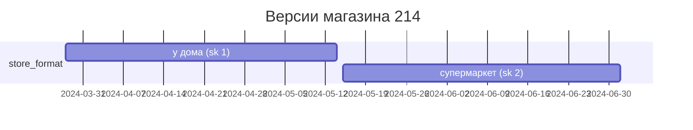
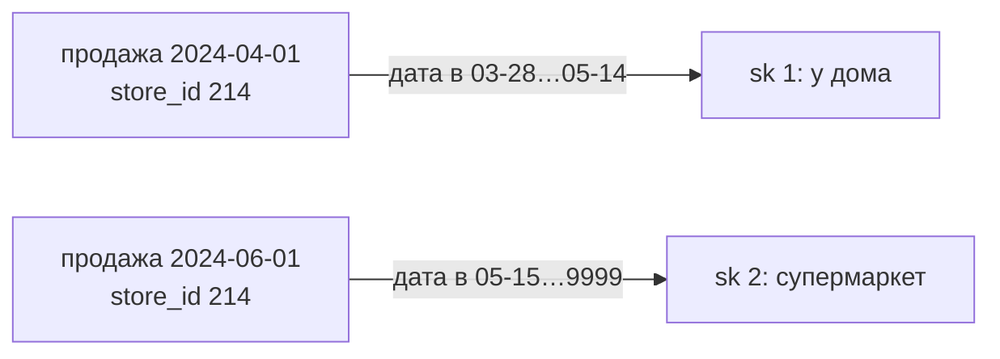
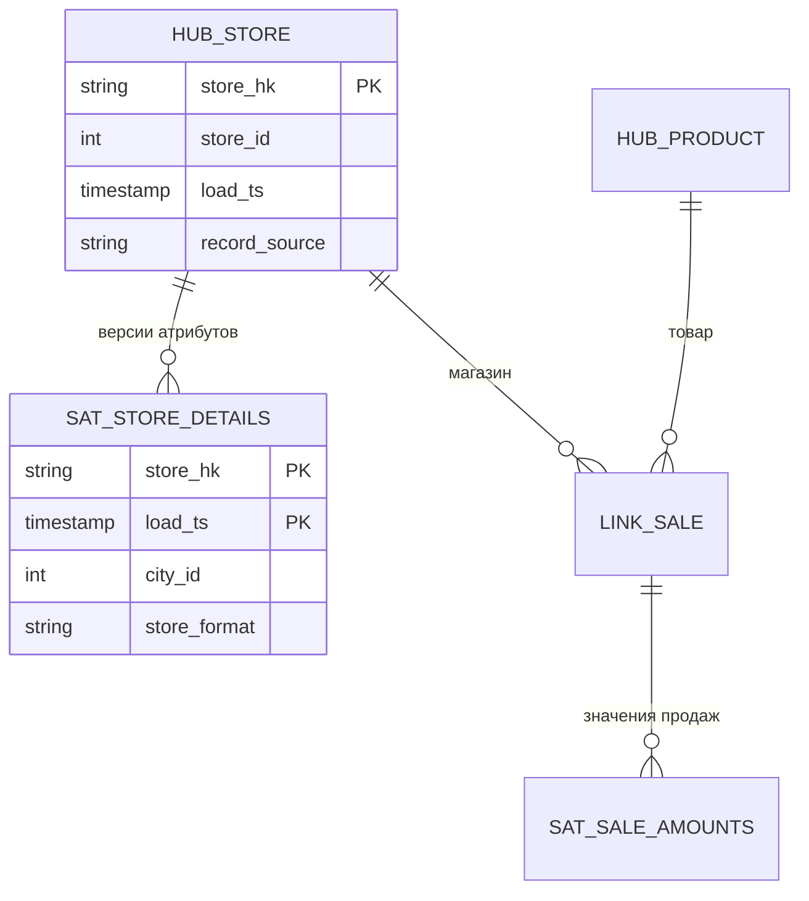
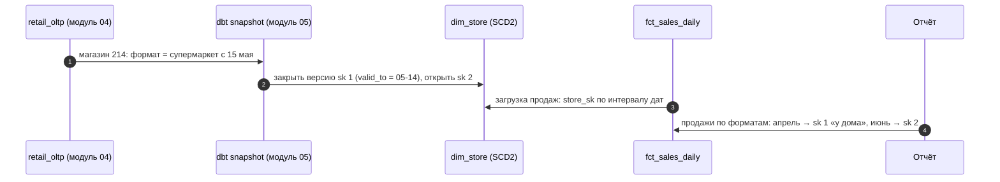

# 06 · Как хранить изменения справочников и чем заменить звезду: SCD, Data Vault, One Big Table

> [!info] Урок одной фразой
> Справочники меняются: магазин переехал, товар перевели в другую категорию. Если просто
> исправить карточку, все прошлые продажи «переедут» вместе с ней, и отчёт за март изменится
> задним числом. SCD — набор правил, что делать с изменением: не менять, перезаписать или
> хранить все версии с датами. А звезда — не единственный способ строить хранилище: Data Vault
> жертвует простотой запросов ради истории и гибкости, One Big Table — гибкостью ради скорости
> и простоты.

> [!todo] Чек-лист: после урока ты сможешь
> - [ ] выбрать тип SCD (0, 1, 2) для атрибута по тому, нужна ли история;
> - [ ] реализовать SCD2: закрыть старую версию, открыть новую, найти версию на дату;
> - [ ] соединить факт с SCD2-измерением так, чтобы прошлое не менялось;
> - [ ] объяснить устройство Data Vault (хабы, связи, сателлиты) и One Big Table;
> - [ ] сравнить Kimball, Data Vault и OBT по сценариям (лаба 02.5, эссе, части 2–3).

**Нужно для:** лаба [02.5](../labs/02.5_modeling_essay/README.md), части 2–3 эссе; модуль 05
(snapshots в dbt).
**Карта урока:** [scd-alternatives.canvas](../maps/scd-alternatives.canvas).

---

## Шаг 0. Азбука: медленно меняющиеся измерения

Факты — события прошлого, они не меняются: продажа 1 апреля уже случилась. Измерения описывают
объекты, которые живут дальше и меняются: у магазина меняется формат, у товара — категория, у
сотрудника — должность. Меняются они **медленно** — раз в месяцы, а не каждую минуту. Отсюда
название: **[slowly changing dimensions](../../../glossary/scd.md)** (SCD), медленно меняющиеся
измерения.

Вопрос SCD: когда атрибут измерения изменился, **к какой версии** относить прошлые факты?

В FreshRetail все атрибуты неизменны за 97 дней: город магазина и категории товара одни и те же.
Изменения появятся в модуле 04, когда мы заполним справочники `retail_oltp` и запустим
генератор изменений. Поэтому примеры урока используют **гипотетический** атрибут «формат
магазина», которого в датасете нет, — именно такие атрибуты будут в будущем справочнике.

| В модели | В аналогии «кассовая лента и справочники» | Подробнее |
|---|---|---|
| SCD 0 | Карточку не исправляют никогда | [SCD](../../../glossary/scd.md) |
| SCD 1 | Старое значение стирают и пишут новое | [SCD](../../../glossary/scd.md) |
| SCD 2 | Старую карточку убирают в архив с датой, заводят новую | [SCD](../../../glossary/scd.md) |
| `valid_from` / `valid_to` | «Действовала с … по …» на карточке | |
| Data Vault | Отдельно картотека номеров, отдельно связи, отдельно все версии описаний | [Data Vault](../../../glossary/data-vault.md) |
| One Big Table | Всё переписано в одну огромную ведомость | [One Big Table](../../../glossary/one-big-table.md) |

---

## Шаг 1. Три основных типа SCD

**Проблема.** Магазин 214 15 мая сменил формат с «у дома» на «супермаркет». Отчёт «продажи по
форматам за апрель» — какой формат он должен показать для магазина 214?

**Как устроено.** Ответ зависит от вопроса, поэтому типов несколько:

| Тип | Что делаем при изменении | Отчёт за апрель покажет | Когда выбирать |
|---|---|---|---|
| **SCD 0** | ничего: атрибут не меняется никогда | «у дома» навсегда | значение по определению постоянно: дата открытия, исходный город |
| **SCD 1** | перезаписываем | «супермаркет» — задним числом | история не важна или исправляем ошибку ввода |
| **SCD 2** | закрываем старую версию, добавляем новую строку | «у дома» — как было тогда | история важна для анализа |

Главный вопрос выбора: **нужно ли видеть прошлое таким, каким оно было**. Если аналитик
сравнивает «продажи супермаркетов в апреле и июне», с SCD 1 магазин 214 окажется
супермаркетом и в апреле, и рост, вызванный сменой формата, растворится. С SCD 2 апрель
останется за форматом «у дома».

Существуют и другие типы, их полезно узнавать по названию:

- **SCD 3** — колонки «текущее значение» и «предыдущее значение» в одной строке. Хранит только
  одно изменение назад.
- **SCD 4** — текущие значения в измерении, история — в отдельной таблице.
- **SCD 6** — комбинация 1 + 2 + 3: версии по SCD 2 плюс в каждой версии колонка «текущее
  значение».

Тип выбирают **для каждого атрибута отдельно**. В одном измерении город может быть SCD 2, а
исправление опечатки в названии — SCD 1.

---

## Шаг 2. Устройство SCD 2

**Проблема.** Нужно хранить все версии карточки и уметь быстро находить версию, действовавшую в
нужную дату.

**Как устроено.** Каждая версия — отдельная строка измерения со своим **суррогатным ключом**
(урок 05, шаг 4) и служебными колонками:

| Колонка | Смысл |
|---|---|
| `store_sk` | суррогатный ключ **версии**: у каждой версии свой |
| `store_id` | естественный ключ: у всех версий одного магазина одинаков |
| `valid_from` | с какой даты версия действует |
| `valid_to` | по какую дату; у текущей — далёкое будущее `9999-12-31` |
| `is_current` | флаг текущей версии для быстрых запросов «как сейчас» |

При изменении выполняются два шага:

1. **Закрыть** текущую версию: `valid_to` = день до изменения, `is_current` = false.
2. **Открыть** новую: новый `store_sk`, `valid_from` = день изменения, `valid_to` = `9999-12-31`,
   `is_current` = true.

```sql
CREATE TABLE dim_store (store_sk INTEGER, store_id INTEGER, store_format VARCHAR,
                        valid_from DATE, valid_to DATE, is_current BOOLEAN);
INSERT INTO dim_store VALUES (1, 214, 'у дома', DATE '2024-03-28', DATE '9999-12-31', true);

-- 15 мая магазин 214 сменил формат
UPDATE dim_store SET valid_to = DATE '2024-05-14', is_current = false
WHERE store_id = 214 AND is_current;
INSERT INTO dim_store VALUES (2, 214, 'супермаркет', DATE '2024-05-15', DATE '9999-12-31', true);
```

| store_sk | store_id | store_format | valid_from | valid_to | is_current |
|---|---|---|---|---|---|
| 1 | 214 | у дома | 2024-03-28 | 2024-05-14 | false |
| 2 | 214 | супермаркет | 2024-05-15 | 9999-12-31 | true |

**Почему `9999-12-31`, а не `NULL`.** С `NULL` в `valid_to` условие «дата между `valid_from` и
`valid_to`» вернёт «неизвестно» (урок 01, шаг 3), и текущая версия не найдётся. Далёкая дата
делает условие одинаковым для всех версий.

**Почему `valid_to` = день до изменения.** Интервалы версий не должны перекрываться и не должны
иметь дыр. Тогда для любой даты находится **ровно одна** версия. Перекрытие даст две версии на
дату и размножит строки при соединении, дыра — ни одной, и факт выпадет.



---

## Шаг 3. Соединение факта с SCD2-измерением

**Проблема.** В измерении у магазина 214 две строки. Соединение факта по `store_id` найдёт обе и
удвоит продажи (урок 01, шаг 2). Как связать каждую продажу с **её** версией?

**Как устроено.** Два способа, и на практике используют первый.

1. **При загрузке факта** записывать в него суррогатный ключ версии, действовавшей в дату
   события. Продажа 1 апреля получает `store_sk = 1`, продажа 1 июня — `store_sk = 2`. Дальше
   соединение — обычное равенство `f.store_sk = d.store_sk`, быстрое и без условий на даты.
   Поиск ключа при загрузке — **соединение по интервалу**:

   ```sql
   SELECT f.*, d.store_sk
   FROM staging_sales f
   JOIN dim_store d
     ON f.store_id = d.store_id
    AND f.sale_date BETWEEN d.valid_from AND d.valid_to;
   ```

2. **При запросе** соединять факт по `store_id` и тому же интервальному условию. Работает, но
   каждый запрос повторяет условие, и его легко забыть.



**«Как было» и «как сейчас».** Отчёт по суррогатному ключу показывает прошлое таким, каким оно
было. Если нужен взгляд «все продажи по **текущему** формату», соединяют по естественному ключу с
версией `is_current`. Хорошее измерение позволяет оба взгляда, и это одна из причин держать в нём
и `store_sk`, и `store_id`.

> [!example]- Попробуй сам: версия на дату
> В `make sql` выполни создание `dim_store` из шага 2, затем:
> ```sql
> SELECT * FROM dim_store ORDER BY store_sk;
> SELECT d, (SELECT store_format FROM dim_store
>            WHERE store_id = 214 AND d BETWEEN valid_from AND valid_to) AS fmt
> FROM (VALUES (DATE '2024-04-01'), (DATE '2024-06-01')) t(d);
> ```
> **Увидишь:** две версии и для двух дат — разные форматы: «у дома» в апреле, «супермаркет» в
> июне. Поменяй `valid_to` первой версии на `2024-05-20` и повтори: на 2024-05-16 найдутся две
> версии сразу, а подзапрос упадёт с ошибкой о нескольких строках. Так выглядит перекрытие
> интервалов.

В dbt SCD 2 реализуется готовым механизмом **snapshots** (модуль 05): он сам сравнивает новый
снимок справочника с прошлым, закрывает и открывает версии.

---

## Шаг 4. Data Vault: модель для истории и интеграции

**Проблема.** Большая компания загружает в хранилище десятки источников, и они постоянно
меняются: добавляются системы, меняются форматы, появляются новые атрибуты. Звезда при этом
требует перестройки: новое поле — изменение измерения, новый источник — согласование ключей. А
регулятор требует хранить **всю** историю: какое значение пришло, откуда и когда.

**Как устроено.** **[Data Vault](../../../glossary/data-vault.md)** (Дэн Линстедт) разделяет данные
на три вида таблиц.

- **Хаб** (hub) — список бизнес-ключей одной сущности и больше ничего: `hub_store` с колонками
  «хэш ключа», `store_id`, когда впервые загружен, из какого источника. Хаб почти никогда не
  меняется.
- **Связь** (link) — факт связи между хабами: `link_sale` связывает хабы магазина, товара и даты.
  Тоже только ключи.
- **Сателлит** (satellite) — описательные атрибуты одного хаба или связи с историей:
  `sat_store_details` с форматом, городом и датой загрузки. Каждое изменение — новая строка.
  Новый источник с атрибутами магазина — просто **новый сателлит**, существующие таблицы не
  трогают.

Ключи в Data Vault — обычно **хэши** бизнес-ключа, например `md5('214')`. Хэш вычисляется из
самого значения, поэтому таблицы можно грузить параллельно и независимо: не нужно ждать, пока
хаб выдаст суррогатный номер.



**Что из этого следует.**

- ➕ Гибкость и история: изменения источников затрагивают только новые сателлиты, вся история
  загрузок сохранена с указанием источника.
- ➕ Параллельная загрузка благодаря хэш-ключам.
- ➖ Запросы очень сложные: чтобы получить «продажи с городом», нужно соединить связь, два хаба и
  выбрать актуальные версии сателлитов. Поэтому аналитики к Data Vault напрямую не ходят: поверх
  него строят звёзды (так называемый **business vault** и витрины).
- ➖ Много таблиц и много инфраструктуры. Для одного датасета вроде FreshRetail Data Vault —
  избыточен.

Data Vault — это **слой интеграции**, а не слой для отчётов. В медальонной архитектуре он
занимает место silver в организациях с десятками источников и жёсткими требованиями к аудиту.

---

## Шаг 5. One Big Table: всё в одной таблице

**Проблема.** Звезда требует соединений в каждом запросе. Аналитики и BI-инструменты ошибаются в
них, а некоторые движки соединяют медленно. Можно ли обойтись совсем без соединений?

**Как устроено.** **[One Big Table](../../../glossary/one-big-table.md)** (OBT) — заранее соединённая
широкая таблица: каждая строка факта уже содержит все атрибуты всех измерений. Для FreshRetail
это почти исходный датасет: в строке продажи уже есть город, все уровни категорий, праздник и
погода. Собственно, FreshRetail и поставляется как OBT.

**Что из этого следует.**

- ➕ Запросы простейшие: `SELECT … FROM obt GROUP BY …`, без соединений и их ошибок.
- ➕ Колоночные движки читают из широкой таблицы только нужные колонки, а повторы атрибутов
  сжимаются, поэтому цена ширины невелика (урок 04).
- ➖ Изменение атрибута измерения требует переписать **все** строки, где он встречается. SCD 2 в
  OBT означает пересборку таблицы.
- ➖ Таблица под один grain. Факт с другим grain (погода по магазину и дню) либо повторяется в
  строках товаров с риском двойного счёта, либо требует второй OBT.
- ➖ Нет согласованных измерений: две OBT с «городом магазина» могут разойтись.

На практике OBT строят **поверх** звезды как последний слой для конкретного дашборда: звезда даёт
согласованность и историю, OBT — скорость и простоту для одного сценария.

---

## Шаг 6. Сравнение и выбор

| | Kimball (звезда) | Data Vault | One Big Table |
|---|---|---|---|
| Главная цель | понятные и быстрые аналитические запросы | интеграция многих источников, полная история, аудит | максимальная простота и скорость одного сценария |
| Соединений в запросе | по одному на измерение | много | ноль |
| История атрибутов | SCD 2 | встроена (сателлиты) | пересборка таблицы |
| Новый источник или атрибут | изменение измерения | новый сателлит | пересборка |
| Кто читает | аналитики, BI | инженеры; аналитики — через звёзды поверх | дашборд, аналитики |
| Место в слоях | gold | silver в больших организациях | gold, поверх звезды |

**Правило выбора.** Это не взаимоисключающие подходы, а слои. Типичная зрелая архитектура:
Data Vault или нормализованный silver для интеграции → звёзды Kimball в gold для аналитики →
несколько OBT для самых нагруженных дашбордов. Для нашего capstone с одним основным источником
достаточно silver в виде очищенных таблиц и звезды в gold, а OBT появится, если дашборду в модуле
10 будет мало скорости.

---

## Сборка целиком: изменение справочника от источника до отчёта



| Где сломано | Шаг | Симптом |
|---|---|---|
| SCD 1 вместо SCD 2 | 2 | отчёт за прошлое меняется задним числом |
| `valid_to = NULL` у текущей версии | 2 | текущие продажи не находят версию и выпадают |
| Интервалы перекрываются | 2 | продажи удваиваются на перекрытии |
| Соединение по `store_id` без интервала | 3 | все продажи магазина удвоены |

---

## Шпаргалка

| Хочу | Как |
|---|---|
| Атрибут не меняется | SCD 0 |
| Перезаписать без истории | SCD 1: `UPDATE` |
| Хранить историю | SCD 2: закрыть (`valid_to`, `is_current = false`) + вставить новую версию |
| Версия на дату | `d BETWEEN valid_from AND valid_to` |
| Текущая версия | `is_current` |
| Ключ версии в факт | соединение по `id` + интервалу при загрузке |
| Хэш-ключ Data Vault | `md5(CAST(ключ AS VARCHAR))` |

## Типичные ошибки

| Симптом | Причина | Как проверить | Как чинить |
|---|---|---|---|
| Прошлый отчёт изменился сам | атрибут перезаписан (SCD 1) | история версий | SCD 2 для этого атрибута |
| Продажи удвоились после введения SCD 2 | соединение по естественному ключу | число версий у ключа | соединять по `store_sk` или с интервалом |
| На дату нет версии | дыра между интервалами | `valid_from` следующей = `valid_to` предыдущей + 1 | без дыр |
| На дату две версии | перекрытие интервалов | `GROUP BY id, d HAVING count(*) > 1` | закрывать днём до изменения |
| Аналитики не могут писать запросы к хранилищу | Data Vault без витрин | — | звёзды поверх DV |

---

## Проверь себя

Карточки для интервального повторения — в [flashcards.md](../flashcards.md).

> [!question] 1. Город магазина ввели с опечаткой: магазин всегда был в городе 3, а записали город 30. Какой тип SCD применить при исправлении?
> > [!success]- Ответ
> > SCD 1: это исправление ошибки, а не изменение реальности. Прошлое должно показывать
> > правильный город, история неверного значения не нужна.

> [!question] 2. Почему у текущей версии `valid_to = 9999-12-31`, а не `NULL`?
> > [!success]- Ответ
> > Условие `d BETWEEN valid_from AND valid_to` с `NULL` даёт «неизвестно», и текущая версия не
> > находится. Далёкая дата делает условие одинаковым для всех версий.

> [!question] 3. В измерении SCD 2 у магазина три версии. Аналитик соединил факт с измерением по `store_id`. Что станет с суммой продаж?
> > [!success]- Ответ
> > Утроится: каждая продажа найдёт три версии. Соединять нужно по суррогатному ключу версии,
> > записанному в факт при загрузке, или по `store_id` с условием на интервал дат.

> [!question] 4. Почему аналитики не пишут отчёты прямо по Data Vault?
> > [!success]- Ответ
> > Чтобы получить простой ответ, нужно соединить хабы, связи и выбрать актуальные версии
> > сателлитов — десятки соединений. Data Vault — слой интеграции и истории. Для отчётов поверх
> > него строят звёзды.

> [!question] 5. Почему FreshRetail можно назвать One Big Table и чем это неудобно, если атрибуты магазинов начнут меняться?
> > [!success]- Ответ
> > В каждой строке продаж уже лежат все атрибуты: город, категории, праздник, погода — это
> > заранее соединённая таблица. При изменении атрибута придётся переписать все строки, где он
> > встречается, а историю версий хранить негде, кроме как пересобирая таблицу.
