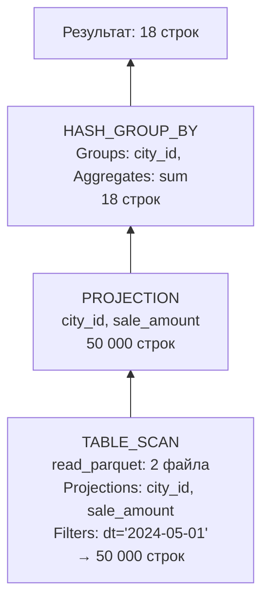
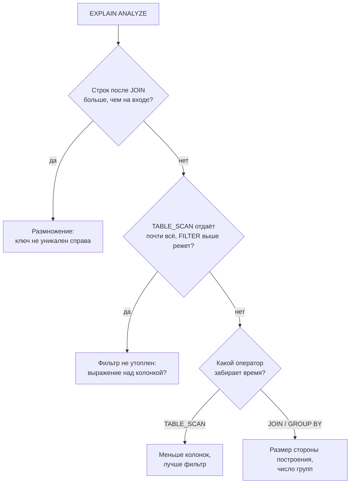
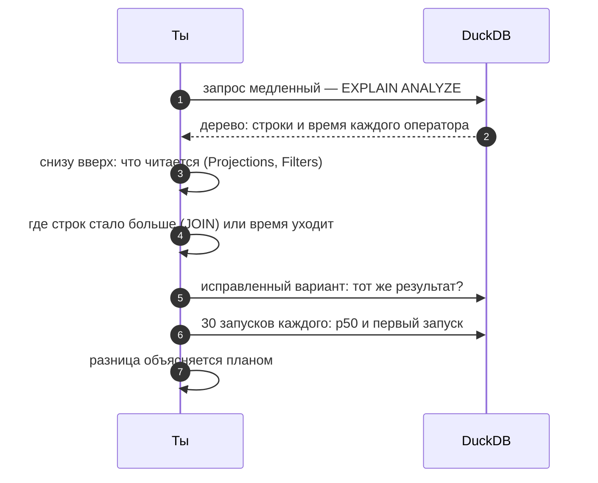

# 07 · План запроса: как СУБД на самом деле выполняет твой SQL

> [!info] Урок одной фразой
> SQL говорит, **что** получить, а не **как**. Как именно — решает оптимизатор, и его решение
> записано в плане: дерево шагов, по которому данные текут снизу вверх, от чтения файлов к
> результату. `EXPLAIN ANALYZE` показывает это дерево вместе с тем, сколько строк прошло через
> каждый шаг и сколько он занял. По этим числам видно, где запрос теряет время и где размножил
> строки.

> [!todo] Чек-лист: после урока ты сможешь
> - [ ] получить план запроса в DuckDB и Postgres и прочитать его снизу вверх;
> - [ ] узнать основные операторы: чтение, фильтр, проекция, группировка, соединение, окно;
> - [ ] проверить, что из Parquet читаются только нужные колонки и что фильтр передан в чтение;
> - [ ] найти по числу строк размножение и самый дорогой шаг;
> - [ ] честно сравнить время нескольких вариантов запроса (лаба 02.4).

> [!tip] Визуализация темы
> - Видео с озвучкой (3:16): [query_plans.mp4](../visuals/query_plans.mp4) — дерево плана снизу вверх, передача колонок и фильтра в чтение, хэш-соединение, размножение 25 811 × 219, честное сравнение.

**Нужно для:** лаба [02.4](../labs/02.4_explain_analyze/README.md), все задачи.
**Карта урока:** [query-plans.canvas](../maps/query-plans.canvas).

---

## Шаг 0. Азбука: декларативный язык и оптимизатор

SQL — **декларативный** язык: ты описываешь результат, а не алгоритм. «Сумма продаж по городам
за 1 мая» не говорит, в каком порядке читать файлы, как соединять, где фильтровать. Это решает
**оптимизатор** — часть СУБД, которая перебирает способы выполнить запрос и выбирает самый
дешёвый по своей оценке. Результат его работы — **план запроса**.

Клеппман (гл. 2) называет это главным преимуществом декларативных языков: СУБД может ускорять
твои запросы, не требуя их переписывать. Обратная сторона: если запрос медленный, причину надо
искать в плане, потому что в тексте SQL её не видно.

| В SQL | В аналогии «кассовая лента и справочники» | Подробнее |
|---|---|---|
| Запрос | Задание бухгалтеру: «сумма по городам за 1 мая» | |
| Оптимизатор | Старший бухгалтер, который решает, в каком порядке поднимать ленты и справочники | |
| План | Его рабочий план по шагам | [план запроса](../../../glossary/query-plan.md) |
| Оператор плана | Один шаг: «взять ленты за май», «сложить по городам» | |
| Projection pushdown | Брать из архива только нужные колонки ленты | |
| Filter pushdown | Отбирать нужные дни прямо в архиве, а не на столе | |

---

## Шаг 1. Как получить и читать план

**Проблема.** План — дерево, а выводится текстом. Надо знать, в каком направлении его читать и что
значат числа.

**Как устроено.** В DuckDB два варианта:

- **`EXPLAIN запрос`** — план, который оптимизатор **собирается** выполнить. Запрос не
  выполняется, поэтому это мгновенно, но фактических чисел нет.
- **`EXPLAIN ANALYZE запрос`** — запрос **выполняется**, и в план добавляются факты: сколько
  строк вышло из каждого оператора и сколько времени он занял. Наверху — общее время.

План читают **снизу вверх**: внизу листья — чтение таблиц и файлов, наверху корень — результат.
Данные текут от листьев к корню, и каждый оператор получает строки от своих детей, обрабатывает и
передаёт выше.



Это реальный план запроса «сумма продаж по городам за 1 мая»:

```sql
EXPLAIN ANALYZE
SELECT city_id, sum(sale_amount)
FROM read_parquet('data/raw/freshretailnet_50k/data/*.parquet')
WHERE dt = '2024-05-01' GROUP BY city_id;
```

Из 4,85 млн строк чтение отдало наверх только 50 000 — строки одного дня. Группировка свернула их
в 18 строк — по числу городов.

**В Postgres** то же самое: `EXPLAIN` и `EXPLAIN ANALYZE`. Вывод — текстовое дерево с отступами,
и у каждого узла оценка стоимости `cost=…` в условных единицах плюс, с `ANALYZE`, фактическое
время и строки. Ты уже видел `Index Scan` в уроке 04; без индекса там был бы `Seq Scan` —
последовательное чтение всей таблицы.

---

## Шаг 2. Основные операторы

**Проблема.** В плане десятки названий. Чтобы читать его, достаточно узнавать полтора десятка самых
частых и понимать, сколько стоит каждый.

**Как устроено.**

| Оператор DuckDB | Что делает | Чем дорог |
|---|---|---|
| `TABLE_SCAN` | читает таблицу или файлы | объёмом прочитанного: колонки × строки |
| `FILTER` | отбрасывает строки по условию | дёшев; лучше, когда фильтр «утоплен» в чтение |
| `PROJECTION` | вычисляет и выбирает колонки | дёшев |
| `HASH_GROUP_BY` | группировка через хэш-таблицу групп | памятью: хэш-таблица по числу групп |
| `PERFECT_HASH_GROUP_BY` | то же для маленьких целочисленных ключей | ещё дешевле |
| `UNGROUPED_AGGREGATE` | агрегат без `GROUP BY` (одна строка) | дёшев |
| `HASH_JOIN` | соединение: строит хэш-таблицу по одной стороне, проверяет другую | памятью стороны построения; числом выходных строк |
| `WINDOW` | оконные функции | сортировкой внутри групп окна |
| `ORDER_BY` / `TOP_N` | сортировка / первые N по порядку | сортировкой всех строк; `TOP_N` дешевле |
| `UNNEST` | разворот массивов | числом строк на выходе |

**Как работает хэш-соединение.** Оптимизатор выбирает **меньшую** сторону (обычно измерение) и
строит по ней хэш-таблицу в памяти: ключ соединения → строки. Потом читает большую сторону
(факт) и для каждой строки ищет совпадения в хэш-таблице. Поэтому важен размер **меньшей**
стороны: если она не помещается в память, соединение замедляется в разы.

> [!warning] Ловушка: план — это не текст запроса
> Сравнивай варианты запроса по плану и времени, а не по тексту. Оптимизатор переписывает запрос.
> Например, «топ-1 товар каждого магазина» через `QUALIFY row_number() … = 1` в плане DuckDB
> превращается в две обычные группировки `HASH_GROUP_BY`. Оптимизатор понял, что для одного
> лучшего значения окно не нужно.

---

## Шаг 3. Что передаётся в чтение: колонки и фильтры

**Проблема.** Самая дорогая часть аналитического запроса — чтение. Чем меньше прочитано, тем
быстрее. Нужно убедиться, что движок читает только нужное.

**Как устроено.** Два механизма, оба видны в операторе `TABLE_SCAN`.

- **Projection pushdown** (передача проекции). В строке `Projections:` перечислены колонки,
  которые чтение реально берёт из файла. В примере шага 1 — только `city_id` и `sale_amount` из
  19 колонок. Остальные 17 колонок, включая тяжёлые массивы, не читаются вовсе. Так колоночный
  формат даёт выигрыш на практике (урок 04).
- **Filter pushdown** (передача фильтра). В строке `Filters:` — условия, которые применяются
  прямо при чтении. Parquet хранит для каждого блока строк (row group) минимум и максимум каждой
  колонки. Если условие заведомо не выполняется для блока, блок пропускается целиком, не
  распаковываясь. Как сортировка данных влияет на то, сколько блоков удаётся пропустить, —
  модуль 03.

**Передача фильтра через соединение.** В плане соединения с «погодой города» (урок 01, шаг 2)
фильтр `city_id = 0 AND dt = '2024-05-01'` появился в чтении **обеих** таблиц, хотя в запросе
написан только для продаж. Оптимизатор вывел его из условия соединения: раз `s.city_id = w.city_id`
и `s.city_id = 0`, то и `w.city_id = 0`. В плане это видно как `Filters` и `Dynamic Filters` у
второй таблицы.

---

## Шаг 4. Найти проблему по числам

**Проблема.** План уже выведен. Как в нём быстро найти, что не так?

**Как устроено.** Смотрят на два числа у каждого оператора: **строки на выходе** и **время**.
Три типичных находки:

1. **Строк на выходе соединения больше, чем на входе большей стороны** — размножение. Реальный
   план соединения продаж с «погодой города»:

   | Оператор | Строк |
   |---|---|
   | `TABLE_SCAN` продаж (город 0, 1 мая) | 25 811 |
   | `TABLE_SCAN` city_weather (то же) | 219 |
   | **`HASH_JOIN`** | **5 652 609** |

   25 811 × 219 = 5 652 609: каждая продажа соединилась со всеми 219 «погодами» города. Без
   плана ты увидел бы только неправильную сумму.

2. **Чтение отдаёт наверх почти все строки, а фильтр отбрасывает их выше** — фильтр не попал в
   чтение. Повод проверить, не мешает ли выражение над колонкой передаче фильтра.

3. **Один оператор забирает почти всё время** — узкое место. Если это `TABLE_SCAN`, сокращают
   прочитанное: меньше колонок, лучше фильтр, партиционирование. Если `HASH_JOIN` или
   `HASH_GROUP_BY` — смотрят на размер стороны построения и число групп. Если `ORDER_BY` — нужна
   ли сортировка всех строк или достаточно `LIMIT`.



> [!example]- Попробуй сам: увидеть размножение в плане
> В `make sql`:
> ```sql
> CREATE VIEW sales AS SELECT * FROM read_parquet('data/raw/freshretailnet_50k/data/*.parquet');
> CREATE TABLE city_weather AS SELECT DISTINCT city_id, dt, precpt FROM sales;
> EXPLAIN ANALYZE
> SELECT sum(s.sale_amount) FROM sales s JOIN city_weather w USING (city_id, dt)
> WHERE s.city_id = 0 AND s.dt = '2024-05-01';
> ```
> **Увидишь:** два `TABLE_SCAN` внизу — 25 811 и 219 строк, над ними `HASH_JOIN` с 5 652 609
> строками. У чтения `city_weather` есть `Filters` по городу и дню, которых в запросе для неё нет:
> оптимизатор вывел их из условия соединения.

---

## Шаг 5. Как честно сравнивать варианты запроса

**Проблема.** Один и тот же вопрос можно записать по-разному, и хочется знать, какой вариант
быстрее. Один замер ничего не доказывает: в модуле 01 (урок 05) первый запуск был на треть
медленнее медианы.

**Как устроено.** Честное сравнение строится по правилам:

1. **Результаты одинаковы.** Сначала убедись, что варианты возвращают одно и то же: та же
   сумма, то же число строк. Быстрый неверный запрос бесполезен.
2. **Много запусков и перцентили.** Каждый вариант — не меньше 20–30 запусков, сравнивают
   медиану (p50), а не один замер. Первый запуск — отдельно: это холодный старт.
3. **Одинаковые условия.** Одни и те же данные, тот же движок, в одной сессии или в одинаково
   новых.
4. **Объяснение через план.** Разница во времени должна объясняться разницей в планах: больше
   прочитанных колонок, другой оператор, больше строк на шаге. Если планы одинаковы, а время
   разное — это шум измерения.

Для замера удобно использовать Python-скрипт из модуля 01 (урок 05, шаг 3): он запускает запрос N
раз и считает перцентили. В CLI DuckDB для быстрой оценки есть `.timer on` — время каждого
запроса.

---

## Сборка целиком: разбор медленного запроса



| Если пропустить шаг | Что получишь |
|---|---|
| 3 — не смотреть `Projections` | читаются лишние колонки, в том числе массивы |
| 4 — не сравнить строки до и после соединения | размножение остаётся незамеченным |
| 5 — не сверить результаты | «быстрый» вариант считает другое |
| 6 — один замер | сравниваешь шум и холодный старт |

---

## Шпаргалка

| Хочу | Как |
|---|---|
| План без выполнения | `EXPLAIN запрос` |
| План с фактами | `EXPLAIN ANALYZE запрос` |
| Время каждого запроса в CLI | `.timer on` |
| Какие колонки читаются | `Projections:` у `TABLE_SCAN` |
| Попал ли фильтр в чтение | `Filters:` у `TABLE_SCAN` |
| Найти размножение | строк у `HASH_JOIN` больше, чем на входе |
| План в Postgres | `EXPLAIN (ANALYZE) запрос`: `Seq Scan` / `Index Scan` |
| Сравнить варианты | одинаковый результат + 20–30 запусков + p50 + объяснение планом |

## Типичные ошибки

| Симптом | Причина | Как проверить | Как чинить |
|---|---|---|---|
| Запрос медленный, хотя данных «немного» | читаются все колонки (`SELECT *`) | `Projections` | перечислить нужные колонки |
| Сумма неверная, ошибок нет | размножение в соединении | строки у `HASH_JOIN` | полный ключ, уникальное измерение |
| «Вариант Б быстрее в 2 раза» по одному запуску | холодный старт, шум | 30 запусков, p50 | честный замер |
| Переписал запрос, а план тот же | оптимизатор и так делал это | сравнить планы | искать узкое место в другом месте |
| Соединение медленное | большая сторона построения | размер таблиц на входе `HASH_JOIN` | фильтровать до соединения |

---

## Проверь себя

Карточки для интервального повторения — в [flashcards.md](../flashcards.md).

> [!question] 1. Чем `EXPLAIN` отличается от `EXPLAIN ANALYZE` и когда нужен каждый?
> > [!success]- Ответ
> > `EXPLAIN` показывает план без выполнения, мгновенно, но без фактических строк и времени.
> > `EXPLAIN ANALYZE` выполняет запрос и показывает факты по каждому оператору. Для поиска
> > проблем нужен второй; первый — чтобы быстро проверить план тяжёлого запроса, не запуская его.

> [!question] 2. В плане у `TABLE_SCAN` в `Projections` перечислены все 19 колонок, хотя запрос считает сумму одной. Что не так?
> > [!success]- Ответ
> > Где-то в запросе или представлении стоит `SELECT *`, который не был отброшен, и чтение берёт
> > все колонки, включая массивы. Нужно перечислить только используемые колонки.

> [!question] 3. Как по плану понять, что соединение размножило строки?
> > [!success]- Ответ
> > У `HASH_JOIN` строк на выходе больше, чем на входе со стороны факта. При соединении «многие к
> > одному» их должно быть столько же или меньше.

> [!question] 4. Почему `QUALIFY row_number() … = 1` в плане DuckDB может не содержать оператора `WINDOW`?
> > [!success]- Ответ
> > Оптимизатор переписал запрос: для одной лучшей строки на группу окно не нужно, достаточно
> > группировки. План показывает, что выполняется на самом деле, а не текст запроса.

> [!question] 5. Вариант А выполнился за 80 мс, вариант Б — за 60 мс, по одному разу. Можно ли сказать, что Б быстрее?
> > [!success]- Ответ
> > Нет. Один замер включает шум и, возможно, холодный старт. Нужно сверить результаты, сделать
> > по 20–30 запусков, сравнить медианы и объяснить разницу различием планов.
