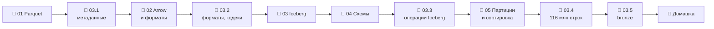

# Модуль 03 · Форматы хранения и Lakehouse

**Длительность:** ~1–2 нед. · **Статус и DoD:** см. [ROADMAP](../../ROADMAP.md)

## Бизнес-вопрос

> Как хранить почасовую историю продаж 898 магазинов дёшево, надёжно и с быстрыми запросами?

## Цели

- понимать устройство Parquet и проверять файлы по метаданным
- выбирать формат и кодек по замерам, работать с Arrow между движками
- вести Iceberg-таблицу через REST-каталог: запись, снапшоты, откат, эволюция схем, обслуживание
- выбирать партиционирование и порядок сортировки осознанно и подтверждать выбор измерением

## Темы

- Parquet: группы строк, куски колонок, страницы, подвал; словарь, RLE, кодеки; статистики и pruning
- Apache Arrow / PyArrow как общий формат в памяти; CSV, JSON, Avro, Parquet — когда что
- Iceberg: append / overwrite / delete, copy-on-write и merge-on-read, снапшоты, time travel, rollback
- compaction, expire snapshots, orphan files; Iceberg vs Delta vs Hudi; зачем REST-каталог
- эволюция схем: ID полей, обратная и прямая совместимость, допустимые изменения типов
- скрытое партиционирование и его эволюция; порядок сортировки; «платишь за прочитанные байты»

## Инструменты

PyArrow, PyIceberg (с `pyiceberg-core`), DuckDB iceberg, Polars, Silo (S3), Lakekeeper

## Маршрут прохождения

Сначала урок, потом задачи лабы по нему. Статусы: ✅ сделано · 🟨 сейчас · ⬜ впереди.

| # | Шаг | Что | Статус |
|---|---|---|---|
| 1 | 📖 [01 · Parquet изнутри](theory/01_parquet_internals.md) · [карта](maps/parquet-internals.canvas) | урок | ⬜ |
| 2 | 🧪 [Лаба 03.1 — метаданные Parquet](labs/03.1_parquet_metadata/README.md) | паспорт файла, отсечение, перезапись | ⬜ |
| 3 | 📖 [02 · Arrow и форматы](theory/02_arrow_and_formats.md) · [карта](maps/arrow-and-formats.canvas) | урок | ⬜ |
| 4 | 🧪 [Лаба 03.2 — форматы и кодеки](labs/03.2_formats_and_codecs/README.md) | размер, запись, чтение, Arrow | ⬜ |
| 5 | 📖 [03 · Iceberg на практике](theory/03_iceberg_operations.md) · [карта](maps/iceberg-operations.canvas) | урок | ⬜ |
| 6 | 📖 [04 · Эволюция схем](theory/04_schema_evolution.md) · [карта](maps/schema-evolution.canvas) | урок | ⬜ |
| 7 | 🧪 [Лаба 03.3 — операции Iceberg](labs/03.3_iceberg_operations/README.md) | снапшоты, откат, схема, обслуживание | ⬜ |
| 8 | 📖 [05 · Партиционирование и сортировка](theory/05_partitioning_and_sort_order.md) · [карта](maps/partitioning-sort.canvas) | урок | ⬜ |
| 9 | 🧪 [Лаба 03.4 — раскладка 116 млн строк](labs/03.4_partitioning_and_sort/README.md) | 4 раскладки × 3 запроса, ADR | ⬜ |
| 10 | 🧪 [Лаба 03.5 — bronze-слой](labs/03.5_bronze_layer/README.md) | мини-проект: `lakehouse.bronze.*` | ⬜ |
| 11 | 🏁 [Домашка-чекпоинт](homework.md) | 7 вопросов и одно предсказание | ⬜ |

> [!note] Изменения плана модуля
> - Мини-проект из DoD получил свою лабу 03.5: bronze-слой загружается повторяемым скриптом в
>   `capstone/ingestion/`. В модуле 04 его заменит dlt.
> - Партиции по времени в PyIceberg требуют пакет `pyiceberg-core`. Он добавлен как extra к
>   `pyiceberg` в `pyproject.toml`, образ workspace пересобран (2026-10-01).

## Чек-лист самоконтроля

Отмечай пункт, только когда можешь сделать это **без подсказки**. Подробные чек-листы — в начале
каждого урока.

**Файлы** ([01](theory/01_parquet_internals.md), [02](theory/02_arrow_and_formats.md))
- [ ] Рисую устройство Parquet и объясняю, зачем группы строк и подвал
- [ ] По метаданным нахожу проблемы файла: мелкие группы, широкие min/max, тяжёлые колонки
- [ ] Предсказываю, сколько групп отсечёт фильтр, и объясняю через порядок строк
- [ ] Передаю данные DuckDB → Arrow → Polars без лишних копий и не гоняю строки через Python
- [ ] Выбираю формат и кодек под задачу и подтверждаю замером

**Iceberg** ([03](theory/03_iceberg_operations.md), [04](theory/04_schema_evolution.md))
- [ ] Объясняю, какие снапшоты и файлы создают append, overwrite и delete
- [ ] Читаю прошлую версию в PyIceberg и DuckDB, откатываю таблицу
- [ ] Объясняю compaction, expire snapshots и orphan files
- [ ] Меняю схему безопасно и предсказываю отказ на недопустимом изменении типа

**Раскладка** ([05](theory/05_partitioning_and_sort_order.md))
- [ ] Выбираю партицию по фильтрам и объёму, не создавая мелких файлов
- [ ] Использую сортировку при записи и объясняю, почему PyIceberg её не делает сам
- [ ] Измеряю отсечение: `plan_files()`, `Total Files Read`, p50

**Закрытие модуля**
- [ ] Лабы 03.1–03.5 выполнены по Definition of Done
- [ ] [Домашка](homework.md) сдана, ошибки разобраны
- [ ] Тезисы по Клеппману, гл. 3–4, — в [`notes.md`](notes.md)

## Материалы модуля

| Что | Где |
|---|---|
| 🧠 Карточки для повторения | [flashcards.md](flashcards.md) |
| 🗺️ Карты | [maps/](maps/) |
| 📚 Термины | [glossary/](../../glossary/README.md) — раздел «Форматы и lakehouse (углублённо)» |
| 🎬 Визуализации | [Отсечение групп строк и партиций](visuals/parquet_pruning.html) |
| 📓 Заметки | [notes.md](notes.md) |

## Мини-проект (вклад в capstone)

Bronze-слой FreshRetail в Iceberg (`lakehouse.bronze.*`), загружаемый повторяемым скриптом и
читаемый из DuckDB, — лаба 03.5. Решение о раскладке `silver.sales_hourly` — ADR в
[`capstone/architecture.md`](../../capstone/architecture.md) (лаба 03.4).

## Ресурсы

- [Surfalytics: Apache Iceberg intro](https://github.com/surfalytics/data-projects/tree/main/de-projects/15_apache_iceberg_intro)
- [Surfalytics: PyArrow intro](https://github.com/surfalytics/data-projects/tree/main/de-projects/13_pyarrow_intro)
- [Parquet: формат файла](https://parquet.apache.org/docs/file-format/)
- [Iceberg spec](https://iceberg.apache.org/spec/) · [партиционирование](https://iceberg.apache.org/docs/latest/partitioning/) · [эволюция](https://iceberg.apache.org/docs/latest/evolution/)
- [PyIceberg API](https://py.iceberg.apache.org/api/)
- [DuckDB iceberg extension](https://duckdb.org/docs/stable/core_extensions/iceberg/overview)
- [Lakekeeper docs](https://docs.lakekeeper.io/)

## Книга и видео

Полная таблица с пояснениями, зачем читать и что пропустить — в [карте чтения](../../reading_map.md#03--форматы-хранения-и-lakehouse).

- 📖 Клеппман, гл. 3 — столбцовое хранение, сжатие, порядок сортировки (уроки 01, 05)
- 📖 Клеппман, гл. 4 — кодирование и эволюция схем (уроки 02, 04)
- 📖 Клеппман, гл. 6 — секционирование, перекосы (урок 05)
- 🎬 [Zoomcamp `03-data-warehouse`](https://github.com/DataTalksClub/data-engineering-zoomcamp/tree/main/03-data-warehouse) — партиционирование и кластеризация

## Домашка-чекпоинт

После всех лаб — [`homework.md`](homework.md).

## Заметки

Конспект, тезисы по книге и выводы — в [`notes.md`](notes.md).
