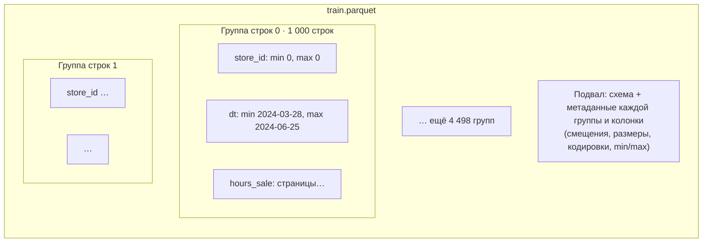
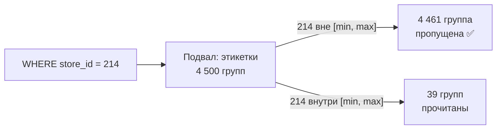
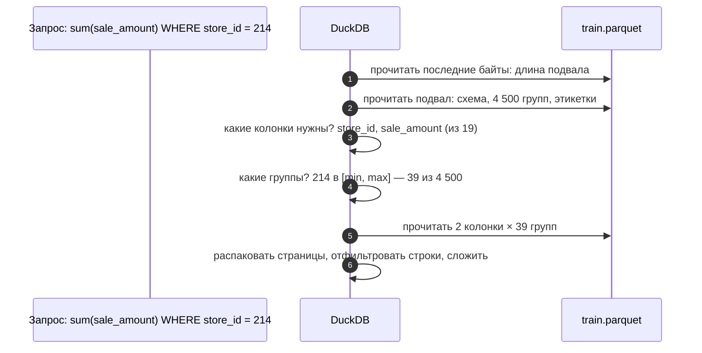

# 01 · Parquet изнутри: группы строк, кодирование, сжатие и статистики

> [!info] Урок одной фразой
> Parquet-файл — это коробка, разделённая на ящики (группы строк). В каждом ящике отсеки по
> колонкам, а на каждом отсеке этикетка: минимум, максимум и число пустых. Опись всех ящиков с
> этикетками лежит в конце коробки. Читатель сначала открывает опись, решает, какие ящики и
> отсеки ему вообще нужны, и только их распаковывает. Чем точнее этикетки и удачнее размер
> ящиков, тем меньше приходится читать.

> [!todo] Чек-лист: после урока ты сможешь
> - [ ] нарисовать устройство Parquet-файла: группы строк, куски колонок, страницы, подвал;
> - [ ] объяснить, как словарное кодирование, RLE и сжатие уменьшают файл и почему порядок строк важен;
> - [ ] предсказать по статистикам min/max, какие группы строк фильтр сможет пропустить;
> - [ ] прочитать метаданные файла в PyArrow и DuckDB и найти в них проблемы;
> - [ ] объяснить, почему наш `train.parquet` после перезаписи стал почти вдвое меньше (лаба 03.1).

> [!tip] Визуализация темы
> Интерактивная страница [parquet_pruning.html](../visuals/parquet_pruning.html). 4 500 групп строк с настоящими
> min/max: задай фильтр и раскладку и посмотри, какие группы движок пропустит.

**Нужно для:** лаба [03.1](../labs/03.1_parquet_metadata/README.md), все задачи.
**Карта урока:** [parquet-internals.canvas](../maps/parquet-internals.canvas).

---

## Шаг 0. Азбука: модуль 03 и его аналогия

В модуле 00 (урок 04) Parquet был «колоночным файлом со статистикой», а Iceberg — «описью
поверх файлов». В модуле 02 (урок 04) мы увидели, что колоночное хранение экономит место и
чтение. Модуль 03 разбирает, **как именно** это достигается, и учит управлять этим: выбирать
сжатие, размер групп, порядок строк, партиционирование. Всё это сводится к одной цели: **читать
как можно меньше байт**.

Аналогия модуля — **склад с коробками и описью**.

| В хранении | В аналогии «склад с коробками» | Подробнее |
|---|---|---|
| Parquet-файл | Коробка | [Parquet](../../../glossary/parquet.md) |
| Группа строк (row group) | Ящик в коробке: тысячи строк | [группа строк](../../../glossary/row-group.md) |
| Кусок колонки (column chunk) | Отсек ящика с одной колонкой | [группа строк](../../../glossary/row-group.md) |
| Страница (page) | Пачка внутри отсека — минимальная порция чтения | |
| Статистики min/max | Этикетка на отсеке: «магазины с 210 по 230» | [статистики Parquet](../../../glossary/parquet-statistics.md) |
| Подвал (footer) | Опись в конце коробки: где какой ящик и что на этикетках | |
| Кодирование и сжатие | Как плотно уложено внутри отсека | [кодирование и сжатие](../../../glossary/encoding-compression.md) |
| Пропуск по статистикам (pruning) | Не открывать ящик, если этикетка говорит «здесь нет нужного» | [pruning](../../../glossary/pruning.md) |

---

## Шаг 1. Устройство файла: от подвала к страницам

**Проблема.** Колоночный файл должен уметь две противоречивые вещи. Записываться потоком, строка
за строкой, как данные приходят. И читаться по колонкам, чтобы запрос брал только нужные. Если
записать сначала всю первую колонку, потом всю вторую, писатель должен держать в памяти весь
файл. Parquet решает это компромиссом.

**Как устроено.** Файл делится на уровни:

1. **Группа строк** (row group) — горизонтальный срез: следующие N строк. Писатель копит их в
   памяти, пока не наберёт N, потом сбрасывает на диск и начинает следующую группу. Так файл
   пишется потоком, а памяти нужно на одну группу.
2. **Кусок колонки** (column chunk) — внутри группы значения **каждой колонки лежат отдельно и
   подряд**. Это и делает файл колоночным: чтобы прочитать `sale_amount`, читают только его куски
   во всех группах.
3. **Страница** (page) — кусок колонки разбит на страницы по ~1 МБ. Страница — единица сжатия и
   кодирования.
4. **Подвал** (footer) — в самом конце файла: схема и **метаданные каждой группы и каждого куска
   колонки**. Для куска записано, где он лежит (смещение в байтах) и сколько весит в сжатом и
   несжатом виде. Там же — как он закодирован и какие у него статистики.



**Порядок чтения.** Читатель **сначала** читает подвал — последние байты файла. Из него он узнаёт
схему, где лежат нужные куски и что написано на их этикетках. Потом читает только нужные куски
нужных групп. Поэтому подвал должен быть маленьким: его читают при **каждом** обращении к файлу.

**Что из этого следует.** Размер группы строк — компромисс. Большие группы лучше сжимаются и дают
маленький подвал. Маленькие группы позволяют точнее пропускать ненужное, но раздувают подвал:
метаданные пишутся на каждую группу и каждую колонку. Обычно берут 100 тысяч – 1 миллион строк в
группе. DuckDB по умолчанию пишет группы по ~123 тысячи строк.

---

## Шаг 2. Кодирование и сжатие: почему колонки такие компактные

**Проблема.** В FreshRetail колонка `store_id` в каждой из 4,5 млн строк хранит 8-байтовое число.
Без хитростей это 36 МБ на одну колонку, хотя разных значений всего 898.

**Как устроено.** Parquet уменьшает данные в два этапа: сначала **кодирует** значения, потом
**сжимает** закодированные байты.

**Кодирование** использует знание о типе и распределении значений.

- **Словарное** (dictionary): разные значения колонки собираются в словарь. В данных хранятся
  номера из словаря. 4,5 млн значений `dt` превращаются в словарь из 90 дат и 4,5 млн маленьких
  номеров. Для колонок с небольшим числом разных значений это главный выигрыш.
- **RLE** (run-length encoding, кодирование длин серий): серия одинаковых значений записывается
  как «значение × сколько раз». Тысяча строк магазина 0 подряд — это «0 × 1000»,
  несколько байт.
- **Bit-packing**: маленькие числа хранятся в минимально нужном числе бит. Номера из словаря на
  898 магазинов умещаются в 10 бит вместо 64.
- **Delta**: хранятся разницы между соседними значениями — удобно для отсортированных чисел и
  меток времени.

**Сжатие** (compression) — универсальный алгоритм поверх закодированной страницы:

| Кодек | Сжатие | Скорость | Когда |
|---|---|---|---|
| `uncompressed` | нет | максимальная | почти никогда |
| `snappy` | среднее | очень быстрое | по умолчанию во многих системах |
| `zstd` | хорошее, настраиваемый уровень | быстрое | хороший выбор по умолчанию сегодня |
| `gzip` | хорошее | медленное | совместимость со старыми системами |

**Почему важен порядок строк.** RLE и словарь работают тем лучше, чем длиннее серии одинаковых
значений. Если строки отсортированы по магазину, в колонке `store_id` длинные серии, и она
кодируется почти бесплатно. Если строки перемешаны, серий нет. Клеппман (гл. 3) называет это
главной причиной сортировать данные в колоночных хранилищах: сортировка помогает и сжатию, и
пропуску ненужного (шаг 3).

**В нашем файле.** Метаданные `train.parquet` говорят: кодек `SNAPPY`, кодировки
`PLAIN, RLE, RLE_DICTIONARY` — то есть словарь с RLE. Весь файл — 88 МБ в сжатом виде против
161 МБ в несжатом. Самая тяжёлая колонка — `hours_sale`: 37 МБ, треть файла. Это 24 дробных
числа на строку, и словарь им помогает слабо.

> [!warning] Ловушка: `-0.0` в статистиках
> Не пугайся минимума `-0.0` у `sale_amount` в первой группе. Отрицательный ноль — отдельное
> значение у чисел с плавающей точкой, хотя `-0.0 = 0.0` даёт истину. Он появляется после
> вычислений вроде умножения нуля на отрицательный коэффициент нормализации. Проверка «нет
> отрицательных продаж» через `< 0` его не поймает, а `min()` покажет `-0.0`.

---

## Шаг 3. Статистики и пропуск групп

**Проблема.** Запрос `WHERE store_id = 214` нуждается в 0,2% строк файла. Хорошо бы не
распаковывать остальные 99,8%.

**Как устроено.** Для каждого куска колонки в подвале хранятся **статистики**: минимум, максимум,
число `NULL`. Перед чтением движок проверяет условие запроса по этикеткам:

- если `214` не попадает в `[min, max]` куска `store_id`, в этой группе **гарантированно** нет
  нужных строк, и группа пропускается целиком — все её колонки;
- если попадает, группа читается: нужные строки там **могут** быть.

Это называется **[pruning](../../../glossary/pruning.md)** (обрезка) или пропуск по статистикам.
Важное слово — «гарантированно»: статистики умеют только **исключать**. Если 214 внутри
`[min, max]`, это не значит, что магазин 214 там есть.

**Почему всё решает порядок строк.** У группы, где магазины перемешаны, диапазон будет `[0, 897]`
— туда попадает любое значение, и пропустить нельзя ничего. У отсортированной по магазину группы
диапазон узкий, и почти все группы отсекаются.

**В нашем файле** строки упорядочены по магазину и товару, а внутри — по дате. Посчитаем по
подвалу, сколько групп из 4 500 **могут** содержать нужные строки:

| Условие | Групп из 4 500, которые придётся читать |
|---|---|
| `store_id = 214` | 39 |
| `dt = '2024-05-01'` | 4 500 — все |

Фильтр по магазину отсекает 99% групп, фильтр по дате — ничего. В каждой группе есть все даты
от 28 марта до 25 июня. Причина: группа — это 1 000 строк нескольких товаров одного магазина за
весь период. Для запросов «за день» этот файл разложен неудачно. Как выбрать раскладку под
запросы — урок 05.



Внутри группы есть ещё один уровень: **индекс страниц** (page index) — статистики на каждую
страницу. Его используют не все писатели и читатели, но идея та же, только мельче.

---

## Шаг 4. Как посмотреть метаданные: PyArrow и DuckDB

**Проблема.** Всё описанное записано в подвале файла. Нужен инструмент, чтобы его прочитать и
проверить файл до того, как строить на нём пайплайн.

**Как устроено.** Два способа.

**PyArrow** — Python-библиотека проекта Apache Arrow (урок 02), в ней полный доступ к подвалу:

```python
import pyarrow.parquet as pq

f = pq.ParquetFile("data/raw/freshretailnet_50k/data/train.parquet")
m = f.metadata                     # подвал: FileMetaData
print(m.num_rows, m.num_row_groups, m.num_columns, m.serialized_size, m.created_by)
print(f.schema_arrow)              # схема в типах Arrow

rg = m.row_group(0)                # метаданные группы 0: RowGroupMetaData
cc = rg.column(1)                  # кусок колонки 1 (store_id): ColumnChunkMetaData
print(cc.path_in_schema, cc.compression, cc.encodings,
      cc.total_compressed_size, cc.total_uncompressed_size)
s = cc.statistics                  # Statistics: min, max, null_count
print(s.min, s.max, s.null_count)
```

| Объект | Что даёт |
|---|---|
| `metadata.num_row_groups`, `serialized_size` | число групп и размер подвала в байтах |
| `row_group(i).num_rows` | строк в группе |
| `row_group(i).column(j)` | кусок колонки: кодек, кодировки, размеры |
| `.statistics.min / .max / .null_count` | этикетка куска |
| `metadata.schema.column(j).path` | имя колонки по номеру |

**DuckDB** — те же сведения SQL-функциями, удобно для сводок:

```sql
SELECT row_group_id, path_in_schema, stats_min, stats_max, compression, total_compressed_size
FROM parquet_metadata('data/raw/freshretailnet_50k/data/train.parquet')
WHERE path_in_schema = 'store_id' LIMIT 3;

SELECT * FROM parquet_schema('data/raw/freshretailnet_50k/data/train.parquet');
```

`parquet_metadata` возвращает строку на каждый кусок колонки каждой группы — по ней удобно
считать «сколько групп попадает под фильтр» обычным `count(*) … WHERE`.

> [!example]- Попробуй сам: подвал нашего файла
> В `make shell`:
> ```bash
> python - <<'EOF'
> import pyarrow.parquet as pq
> m = pq.ParquetFile("data/raw/freshretailnet_50k/data/train.parquet").metadata
> print("rows", m.num_rows, "row groups", m.num_row_groups, "footer bytes", m.serialized_size)
> rg = m.row_group(0)
> print("rows in rg0:", rg.num_rows)
> for j in (1, 7):
>     c = rg.column(j)
>     print(c.path_in_schema, c.compression, c.encodings, c.statistics.min, c.statistics.max)
> EOF
> ```
> **Увидишь:** 4 500 000 строк, 4 500 групп, подвал около 9,5 млн байт. В группе 0 — 1 000
> строк, `store_id` от 0 до 0, `dt` от `2024-03-28` до `2024-06-25`. Кодек `SNAPPY`, кодировки
> словарные.

---

## Шаг 5. Разобранный пример: почему файл похудел вдвое

**Проблема.** Подвал нашего файла весит 9,5 МБ при размере файла 106 МБ. Почти 9% файла — одна
опись, которую читают при каждом запросе. Что с этим делать?

**Как устроено.** Причина — размер групп. Датасет записан группами по **1 000 строк**: 4 500 групп
× 19 колонок = 85 500 кусков колонок. У каждого куска своя запись в подвале со смещениями,
кодировками и статистиками. Маленькие группы вредят трижды:

1. **Подвал раздувается**: метаданные на каждый кусок.
2. **Сжатие хуже**: словарь и серии строятся заново в каждой маленькой группе, и словарь из 1 000
   значений почти не экономит.
3. **Чтение медленнее**: движок обрабатывает 4 500 групп по отдельности, каждая со своими
   накладными расходами.

Перезапишем тот же файл DuckDB с группами по умолчанию:

```sql
COPY (SELECT * FROM read_parquet('data/raw/freshretailnet_50k/data/train.parquet'))
TO '/tmp/rg_default.parquet' (FORMAT parquet);
```

| | Исходный | После перезаписи |
|---|---|---|
| Строк в группе | 1 000 | ~123 000 |
| Групп | 4 500 | 37 |
| Подвал | 9,5 МБ | 75 КБ |
| Файл | 106 МБ | 61,5 МБ |

Тот же кодек `snappy`, те же данные, а файл на 42% меньше. Выигрыш дали только размер групп и,
как следствие, лучшее кодирование. Размер группы задают при записи параметром `ROW_GROUP_SIZE`
в DuckDB или `row_group_size` в `pyarrow.parquet.write_table`.

**Что из этого следует.** Файлы из внешних источников надо проверять: они бывают записаны
неудачно для твоих запросов. Сырой слой (bronze) хранит данные как есть, но формат файлов
хранилища — твой выбор, и при загрузке в Iceberg данные будут переписаны с нормальными группами.

---

## Сборка целиком: чтение одного запроса из Parquet



| Где плохо | Шаг | Что теряем |
|---|---|---|
| Подвал огромный | 2 | время на каждом обращении к файлу |
| `SELECT *` | 3 | читаются все 19 колонок, включая массивы |
| Данные не отсортированы по колонке фильтра | 4 | этикетки широкие, ни одна группа не пропускается |
| Маленькие группы | 5 | много накладных расходов, хуже сжатие |

---

## Шпаргалка

| Хочу | Как |
|---|---|
| Метаданные в Python | `pq.ParquetFile(path).metadata` |
| Число групп, размер подвала | `.num_row_groups`, `.serialized_size` |
| Этикетка куска | `.row_group(i).column(j).statistics.min / .max / .null_count` |
| Метаданные в SQL | `parquet_metadata('file')`, `parquet_schema('file')` |
| Задать размер групп | DuckDB `COPY … (FORMAT parquet, ROW_GROUP_SIZE 122880)` |
| Задать кодек | `COPY … (FORMAT parquet, COMPRESSION zstd)` |
| Понять, отсечёт ли фильтр | доля групп, где значение внутри `[min, max]` |

## Типичные ошибки

| Симптом | Причина | Как проверить | Как чинить |
|---|---|---|---|
| Файл большой, подвал в мегабайтах | группы по сотням–тысячам строк | `num_row_groups`, `serialized_size` | перезаписать с группами ~100 тыс.+ строк |
| Фильтр не ускоряет запрос | данные не отсортированы по этой колонке | `min/max` колонки по группам — широкие диапазоны | сортировать при записи |
| Плохое сжатие колонки | перемешанный порядок, мало повторов | `total_compressed_size` / `uncompressed` | сортировка, словарь |
| «Отрицательные продажи» в `min()` | `-0.0` | `sale_amount < 0` против `min` | считать нарушением только `< 0` |
| Запрос читает массивы, хотя они не нужны | `SELECT *` | `Projections` в плане | перечислить колонки |

---

## Проверь себя

Карточки для интервального повторения — в [flashcards.md](../flashcards.md).

> [!question] 1. Зачем Parquet делит файл на группы строк, если он колоночный?
> > [!success]- Ответ
> > Чтобы писать файл потоком с памятью на одну группу, а не на весь файл. Внутри группы колонки
> > лежат отдельно, поэтому чтение остаётся колоночным.

> [!question] 2. В группе статистики `store_id`: min 200, max 260. Есть ли в ней магазин 214?
> > [!success]- Ответ
> > Неизвестно. Статистики умеют только исключать: 214 внутри диапазона, значит группу придётся
> > прочитать, но строк магазина 214 там может и не быть.

> [!question] 3. Почему фильтр по дате на нашем `train.parquet` не пропускает ни одной группы?
> > [!success]- Ответ
> > Строки упорядочены по магазину и товару, и каждая группа содержит весь диапазон дат. Любая
> > дата попадает в `[min, max]` каждой группы.

> [!question] 4. Почему перезапись с крупными группами уменьшила файл с 106 до 61,5 МБ без смены кодека?
> > [!success]- Ответ
> > Подвал сжался с 9,5 МБ до 75 КБ: метаданных стало на 37 групп вместо 4 500. И словарь с RLE
> > в больших группах кодируют длинные серии один раз, а не заново в каждой тысяче строк.

> [!question] 5. Как сортировка строк помогает и сжатию, и скорости?
> > [!success]- Ответ
> > Сортировка даёт длинные серии одинаковых значений — их дёшево кодирует RLE со словарём. И она
> > делает диапазоны `[min, max]` в группах узкими, поэтому фильтр по этой колонке отсекает почти
> > все группы.
