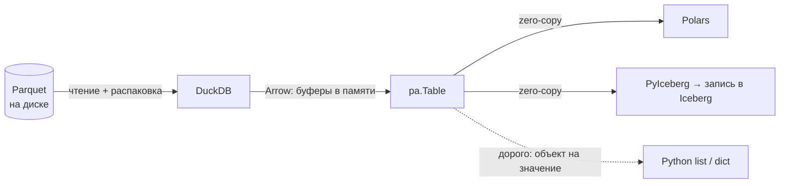
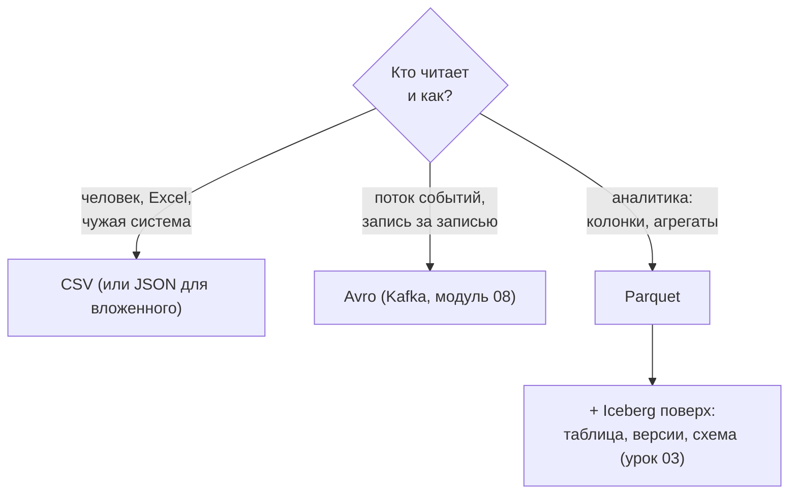
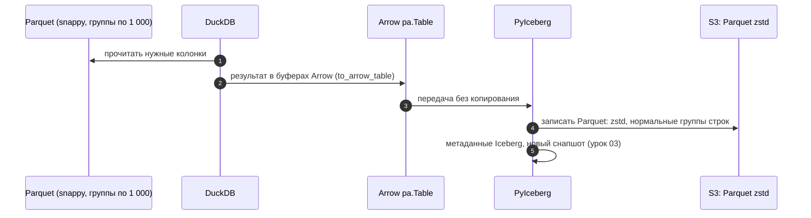

# 02 · Arrow и выбор формата: как данные живут в памяти и на диске

> [!info] Урок одной фразой
> На складе коробки лежат плотно упакованными (Parquet), а на рабочем столе их раскладывают так,
> чтобы любой работник мог сразу взять нужное (Arrow). Если все работники договорились об одной
> раскладке на столе, коробку не надо перепаковывать, передавая её от одного к другому. Формат на
> диске выбирают под задачу: CSV — для обмена с людьми, Avro — для потока сообщений, Parquet — для
> аналитики.

> [!todo] Чек-лист: после урока ты сможешь
> - [ ] объяснить, что такое Apache Arrow и почему DuckDB, Polars и PyArrow передают данные друг другу без копирования;
> - [ ] прочитать схему Arrow и назвать типичные типы;
> - [ ] выбрать формат файла под задачу: CSV, JSON, Avro, Parquet;
> - [ ] выбрать кодек сжатия, понимая компромисс размера и скорости;
> - [ ] честно сравнить форматы замером (лаба 03.2).

**Нужно для:** лаба [03.2](../labs/03.2_formats_and_codecs/README.md), все задачи.
**Карта урока:** [arrow-and-formats.canvas](../maps/arrow-and-formats.canvas).

---

## Шаг 0. Азбука: формат хранения и формат в памяти

У данных две жизни. **На диске** они должны занимать мало места и читаться выборочно — это
задача Parquet. **В памяти** их обрабатывают: фильтруют, складывают, передают из одной библиотеки
в другую. Для этого нужен формат, удобный процессору: значения лежат подряд, без распаковки, с
прямым доступом к любой ячейке.

Раньше у каждой библиотеки был свой формат в памяти. Передать таблицу из базы в Python значило
**сериализовать** её (превратить в байты своего формата), передать и **десериализовать** в чужой
формат. На больших таблицах это занимало больше времени, чем сам анализ.

| В хранении | В аналогии «склад с коробками» | Подробнее |
|---|---|---|
| Parquet | Коробка, плотно упакованная для хранения | [Parquet](../../../glossary/parquet.md) |
| Arrow | Раскладка на рабочем столе, одинаковая у всех работников | [Apache Arrow](../../../glossary/arrow.md) |
| Zero-copy | Передать стол соседу, не перекладывая вещи | [Apache Arrow](../../../glossary/arrow.md) |
| Сериализация | Упаковать вещи в посылку, чтобы отправить | |
| CSV | Список на бумаге: понятен человеку, но всё — текст | [форматы файлов](../../../glossary/file-formats.md) |
| Avro | Посылки в потоке, у каждой — опись содержимого | [форматы файлов](../../../glossary/file-formats.md) |
| Кодек сжатия | Насколько плотно утрамбовать коробку | [кодирование и сжатие](../../../glossary/encoding-compression.md) |

---

## Шаг 1. Apache Arrow: общий формат в памяти

**Проблема.** DuckDB посчитал таблицу, а дальше её нужно обработать в Polars или записать в
Iceberg через PyIceberg. Если каждая передача — это копирование и перекодирование миллионов
значений, связка нескольких инструментов становится медленнее, чем один.

**Как устроено.** **[Apache Arrow](../../../glossary/arrow.md)** — стандарт **раскладки колоночных
данных в памяти**. Он точно описывает, как лежат байты. Значения одной колонки лежат сплошным
массивом, рядом — битовая маска «где `NULL`», у строк — массив смещений и буфер символов.
Раскладка одна и та же, поэтому библиотеки, знающие Arrow, могут **просто передать указатель на
память**. DuckDB положил результат в буферы Arrow, Polars взял те же буферы и работает с ними. Это называют
**zero-copy** — без копирования.

Основные объекты PyArrow:

| Объект | Что это |
|---|---|
| `pa.Array` | одна колонка: значения + маска `NULL` |
| `pa.RecordBatch` | порция строк: несколько колонок одинаковой длины |
| `pa.Table` | таблица: колонки из нескольких порций |
| `pa.Schema` | имена и типы колонок |
| `pa.RecordBatchReader` | **поток** порций: таблица не собрана целиком в памяти |

Типы Arrow, которые встретятся: `int32`, `int64`, `double`, `string` (или `large_string`),
`date32[day]` (дата как число дней от 1970-01-01), `timestamp[us]`, `bool`, `list<element:
double>` (наши массивы часов), `struct`.

**Замер на нашем стеке.** 4,85 млн строк пяти колонок:

| Операция | Время |
|---|---|
| DuckDB считал Parquet и отдал Arrow-таблицу | 196 мс |
| Arrow → Polars DataFrame | 17 мс |
| 200 тыс. строк Arrow → список Python-словарей | 152 мс |

Передача в Polars в десять раз быстрее чтения: данные не копируются. А превращение строк в
объекты Python стоит дорого: 152 мс на 200 тысяч — это около 3,7 секунды на весь набор. Отсюда
главное правило: **не переводить данные в объекты Python построчно**. Считать надо внутри
DuckDB, Polars или функциями `pyarrow.compute`, которые работают с буферами напрямую.



> [!warning] Ловушка: `.arrow()` в DuckDB 1.5 — это поток
> Для записи в Iceberg бери таблицу целиком: `con.sql(…).to_arrow_table()`. В DuckDB 1.5
> `con.sql(…).arrow()` возвращает `RecordBatchReader` — поток порций, а не таблицу. PyIceberg
> отказывается писать поток в партиционированную таблицу:
> `Writing a pa.RecordBatchReader to a partitioned table is not yet supported`. Старое имя
> `fetch_arrow_table()` работает, но выводит предупреждение об устаревании.

> [!warning] Ловушка: имя переменной `at`
> Называй переменные содержательно, не `at`. DuckDB в Python читает Arrow-таблицу из переменной по
> её имени: `con.sql("SELECT … FROM sales_arrow")`. Переменную `at` прочитать не получится: `AT` —
> ключевое слово для чтения таблицы на момент времени (урок 03). Запрос упадёт с `Parser Error`.

> [!example]- Попробуй сам: DuckDB → Arrow → Polars
> В `make shell`:
> ```bash
> python - <<'EOF'
> import time, duckdb, polars as pl, pyarrow.compute as pc
> con = duckdb.connect()
> q = """SELECT store_id, product_id, dt::DATE AS d, sale_amount, discount
>        FROM read_parquet('data/raw/freshretailnet_50k/data/*.parquet')"""
> t = time.perf_counter(); sales_arrow = con.sql(q).to_arrow_table(); a = time.perf_counter() - t
> t = time.perf_counter(); df = pl.from_arrow(sales_arrow); b = time.perf_counter() - t
> print(sales_arrow.schema)
> print(f"{sales_arrow.num_rows} строк, {sales_arrow.nbytes / 1e6:.0f} МБ в памяти; "
>       f"DuckDB→Arrow {a * 1000:.0f} мс, Arrow→Polars {b * 1000:.1f} мс")
> print("сумма через pyarrow.compute:", pc.sum(sales_arrow["sale_amount"]).as_py())
> print("DuckDB поверх Arrow:", con.sql("SELECT count(*) FROM sales_arrow").fetchone())
> EOF
> ```
> **Увидишь:** схему с `date32[day]`, около 178 МБ в памяти, перевод в Polars за единицы–десятки
> миллисекунд. Последняя строка показывает обратное направление: DuckDB читает Arrow-таблицу из
> переменной Python прямо по имени.

---

## Шаг 2. Форматы файлов: строки, колонки, схема

**Проблема.** Данные приходят и уходят в разных форматах: выгрузка из учётной системы в CSV,
события из Kafka в Avro, ответы API в JSON. Нужно понимать, что каждый формат умеет и чего стоит,
чтобы выбрать, в чём хранить.

**Как устроено.** Форматы различаются по трём осям: **как лежат данные** (строками или
колонками), **есть ли схема внутри файла** и **текст это или двоичный формат**.

| Формат | Раскладка | Схема | Вид | Сильная сторона | Слабость |
|---|---|---|---|---|---|
| **CSV** | строки | нет: всё текст, типы угадываются | текст | читает человек и любая программа | огромный, медленный, нет типов и вложенности |
| **JSON / JSONL** | строки (объекты) | нет, только структура | текст | вложенность, API | ещё больше CSV: имена полей в каждой строке |
| **Avro** | строки | есть, в начале файла | двоичный | поток записей, эволюция схем | читать одну колонку — всё равно читать строки целиком |
| **Parquet** | колонки | есть, в подвале | двоичный | аналитика: выборочное чтение, сжатие | дописывать по одной строке нельзя |
| **ORC** | колонки | есть | двоичный | то же, что Parquet; экосистема Hive | меньше распространён вне Hadoop |

**Замер на нашем стеке.** `eval.parquet` без массивов — 350 тыс. строк, 17 колонок, записан
DuckDB в разных форматах:

| Формат | Размер | `avg(sale_amount)` |
|---|---|---|
| JSON | 116,7 МБ | — |
| CSV | 25,0 МБ | 43 мс |
| Parquet без сжатия | 3,5 МБ | — |
| Parquet snappy | 1,5 МБ | — |
| Parquet zstd | 1,1 МБ | 1 мс |

JSON в сто раз больше Parquet: в каждой строке повторяются имена всех 17 полей, а числа записаны
текстом. CSV в 20 раз больше: имена один раз в заголовке, но числа — текст, без кодирования и
сжатия. Parquet без всякого сжатия уже в 7 раз меньше CSV — это работа кодирования (урок 01, шаг
2). Запрос по Parquet в 40 раз быстрее: читается одна колонка, и её не нужно разбирать из текста.

**Почему у CSV «нет типов».** В CSV `2024-05-01` — просто текст. Читатель угадывает тип по первым
строкам: DuckDB, Polars, Excel могут угадать по-разному, а ID с ведущими нулями (`00214`)
превратятся в число `214`. Поэтому CSV хорош только на границе с людьми и чужими системами, а
внутри хранилища — Parquet со схемой.

---

## Шаг 3. Кодеки сжатия: размер против скорости

**Проблема.** Сильнее сжатие — меньше байт на диске и в сети, но больше работы процессору при
записи и чтении. Какой кодек выбрать?

**Как устроено.** Сжатие в Parquet применяется к каждой странице после кодирования (урок 01). У
кодеков разный баланс:

- **snappy** сжимает слабее, но очень быстро распаковывает. Был стандартом по умолчанию много лет.
- **zstd** сжимает заметно лучше snappy и распаковывает почти так же быстро. У него есть уровни:
  выше уровень — лучше сжатие и медленнее **запись**, а чтение почти не меняется. Сегодня это
  хороший выбор по умолчанию.
- **gzip** сжимает примерно как zstd, но медленнее и при записи, и при чтении. Нужен для
  совместимости со старыми системами.

На нашем замере zstd дал на 27% меньше файла, чем snappy (1,1 против 1,5 МБ).

**Что важно для хранилища.** Данные пишут один раз, а читают сотни раз. Поэтому более медленная
запись ради меньшего размера почти всегда окупается: меньше байт читать из S3 при каждом запросе.
А в облаке, где платят за прочитанные или хранимые байты, — окупается и деньгами. Iceberg по
умолчанию пишет Parquet с `zstd`.

Задают кодек при записи:

```sql
COPY (SELECT …) TO 'file.parquet' (FORMAT parquet, COMPRESSION zstd, COMPRESSION_LEVEL 9);
```

```python
import pyarrow.parquet as pq
pq.write_table(table, "file.parquet", compression="zstd", compression_level=9,
               row_group_size=122_880)
```

---

## Шаг 4. Когда какой формат

**Проблема.** В нашем стеке встретятся все форматы. Нужно правило, по которому выбирать.

**Как устроено.** Формат определяется тем, кто и как будет читать:



| Место в курсе | Формат | Почему |
|---|---|---|
| Сырые выгрузки в `landing` (модуль 04) | как пришло: CSV, JSON, Parquet | bronze хранит как есть |
| Таблицы lakehouse | Parquet + Iceberg | аналитическое чтение |
| Сообщения в Kafka (модуль 08) | Avro или Protobuf | запись за записью, схема в реестре |
| Обмен между DuckDB, Polars, PyIceberg | Arrow в памяти | без копирования |
| Отчёт для бизнеса | CSV / Excel | читает человек |

---

## Сборка целиком: от файла до записи в Iceberg



| Где сломано | Шаг | Симптом |
|---|---|---|
| `.arrow()` вместо `.to_arrow_table()` | 2 | `RecordBatchReader … not yet supported` при записи в партиционированную таблицу |
| Цикл по строкам в Python | 3 | минуты вместо секунд |
| Хранилище в CSV | 4 | в 20 раз больше места, типы угадываются, запросы в десятки раз медленнее |

---

## Шпаргалка

| Хочу | Как |
|---|---|
| DuckDB → Arrow-таблица | `con.sql(q).to_arrow_table()` |
| Arrow → Polars | `pl.from_arrow(table)` |
| DuckDB по Arrow-переменной | `con.sql("SELECT … FROM имя_переменной")` |
| Агрегат без Python-циклов | `pyarrow.compute`: `pc.sum`, `pc.mean` |
| Записать Parquet zstd | `COPY … (FORMAT parquet, COMPRESSION zstd)` |
| Записать в CSV / JSON | `COPY … TO 'f.csv' (HEADER)` / `(FORMAT json)` |
| Размер файла в DuckDB | `SELECT size FROM read_blob('f.parquet')` |

## Типичные ошибки

| Симптом | Причина | Как проверить | Как чинить |
|---|---|---|---|
| `Parser Error` на `FROM at` | `at` — ключевое слово | — | другое имя переменной |
| ID потеряли ведущие нули | CSV, тип угадан как число | схема после чтения | Parquet или явный тип при чтении CSV |
| Обработка в Python идёт минутами | построчный цикл, `to_pylist()` | профиль: где время | считать в DuckDB / Polars / `pyarrow.compute` |
| Хранилище растёт быстрее данных | CSV или JSON внутри lakehouse | формат файлов | Parquet |
| Kafka-сообщения ломаются при изменении полей | JSON без схемы | — | Avro / Protobuf со Schema Registry (модуль 08) |

---

## Проверь себя

Карточки для интервального повторения — в [flashcards.md](../flashcards.md).

> [!question] 1. Почему передача таблицы из DuckDB в Polars в 10 раз быстрее, чем её чтение из Parquet?
> > [!success]- Ответ
> > Оба понимают Arrow, поэтому передаётся указатель на те же буферы памяти, без копирования и
> > перекодирования. Чтение же распаковывает и декодирует данные с диска.

> [!question] 2. Почему JSON в сто раз больше Parquet на тех же данных?
> > [!success]- Ответ
> > В каждой строке JSON повторяются имена всех полей, числа записаны текстом, нет ни кодирования,
> > ни сжатия. Parquet хранит имена один раз в схеме, числа — в двоичном виде, со словарём, RLE и
> > сжатием.

> [!question] 3. Почему для хранилища выбирают zstd, хотя он медленнее snappy при записи?
> > [!success]- Ответ
> > Данные пишут один раз, а читают многократно. Меньший размер экономит чтение из S3 на каждом
> > запросе, а распаковка zstd почти так же быстра, как snappy.

> [!question] 4. Почему для сообщений Kafka выбирают Avro, а не Parquet?
> > [!success]- Ответ
> > В потоке записи приходят и обрабатываются по одной. Avro построчный, с компактной схемой и
> > правилами её эволюции. Parquet нужен для пакетов из многих строк и колоночного чтения, а
> > дописать в него одну запись нельзя.
