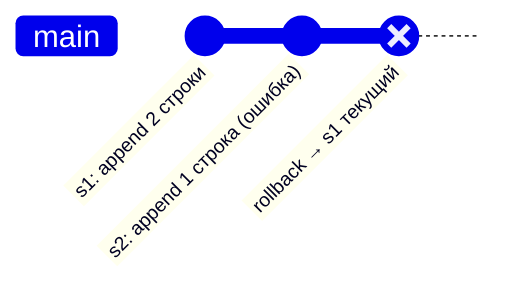
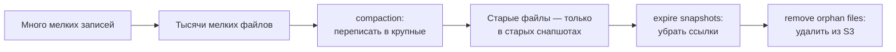
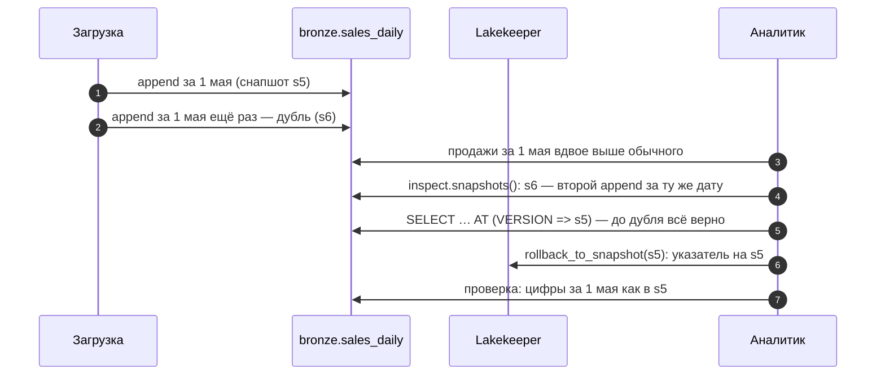

# 03 · Iceberg на практике: запись, снапшоты, время назад и обслуживание

> [!info] Урок одной фразой
> Опись склада Iceberg не правит старые страницы, а пишет новую версию описи при каждом
> изменении: добавили коробки, убрали коробки, переложили. Поэтому можно открыть опись на любую
> прошлую дату и увидеть склад таким, каким он был, или вернуть старую опись целиком. Цена этого
> — склад зарастает старыми коробками и мелкими посылками, и его надо регулярно убирать.

> [!todo] Чек-лист: после урока ты сможешь
> - [ ] создать namespace и таблицу в Lakekeeper из PyIceberg и из DuckDB;
> - [ ] выполнить append, overwrite и delete и объяснить, какие снапшоты и файлы они создают;
> - [ ] прочитать таблицу на прошлый снапшот или момент времени и откатить её;
> - [ ] посмотреть служебные таблицы: снапшоты, файлы, партиции, историю;
> - [ ] объяснить, зачем нужны compaction и expire snapshots, и что остаётся в S3;
> - [ ] сравнить Iceberg с Delta и Hudi и объяснить роль REST-каталога (лабы 03.3, 03.5).

> [!tip] Визуализация темы
> Видео с озвучкой (2:52): [iceberg_internals.mp4](../visuals/iceberg_internals.mp4) — дерево метаданных, запись и атомарный коммит, удаление copy-on-write, time travel и откат, конфликт двух писателей.

**Нужно для:** лабы [03.3](../labs/03.3_iceberg_operations/README.md) и
[03.5](../labs/03.5_bronze_layer/README.md).
**Карта урока:** [iceberg-operations.canvas](../maps/iceberg-operations.canvas).

---

## Шаг 0. Азбука: что мы уже знаем об Iceberg

Устройство Iceberg разобрано в модуле 00 (урок 04, шаг 3), здесь — короткое напоминание.
Таблица Iceberg — это Parquet-файлы с данными плюс дерево метаданных над ними:

- **metadata.json** — схема, партиционирование, список снапшотов;
- **manifest list** — список манифестов одного снапшота;
- **manifests** — списки файлов данных со статистиками;
- **data files** — сами Parquet-файлы.

**Каталог** (у нас Lakekeeper) хранит одно: имя таблицы → путь к текущему `metadata.json`. Любое
изменение пишет новые файлы и **атомарно переключает** этот указатель. Это дает транзакции:
читатель видит либо старую версию целиком, либо новую.

| В Iceberg | В аналогии «склад с коробками» | Подробнее |
|---|---|---|
| Снапшот | Версия описи склада на момент изменения | [snapshot](../../../glossary/snapshot.md) |
| Append | Добавили коробки, старые не трогали | |
| Overwrite / delete | Убрали часть коробок, положили переупакованные | [copy-on-write](../../../glossary/copy-on-write.md) |
| Time travel | Открыть опись на прошлую дату | [snapshot](../../../glossary/snapshot.md) |
| Rollback | Вернуть старую опись как текущую | |
| Мелкие файлы | Склад завален мелкими посылками | [compaction](../../../glossary/compaction.md) |
| Compaction | Переупаковать мелкие посылки в нормальные коробки | [compaction](../../../glossary/compaction.md) |
| Expire snapshots | Выбросить старые описи, которые больше не нужны | [compaction](../../../glossary/compaction.md) |
| Каталог | Картотека у входа: какая опись сейчас действующая | [Iceberg-каталог](../../../glossary/iceberg-catalog.md) |

---

## Шаг 1. Подключение, namespace и таблица

**Проблема.** Прежде чем писать данные, нужно подключиться к каталогу, выбрать пространство имён
и описать схему таблицы.

**Как устроено.** Таблицы в каталоге сгруппированы по **namespace** — аналог схемы в базе данных.
Полное имя таблицы — `namespace.table`, например `bronze.sales_daily`. В курсе namespace будут
совпадать со слоями: `bronze`, `silver`, `gold`.

**PyIceberg:**

```python
import os, pyarrow as pa
from pyiceberg.catalog import load_catalog

catalog = load_catalog("lh", type="rest",
                       uri=os.environ["ICEBERG_CATALOG_URI"],          # http://lakekeeper:8181/catalog
                       warehouse=os.environ["ICEBERG_WAREHOUSE"])      # lakehouse
catalog.create_namespace_if_not_exists("sandbox")
table = catalog.create_table("sandbox.sales",
                             schema=pa.schema([("store_id", pa.int64()),
                                               ("sale_date", pa.date32()),
                                               ("sale_amount", pa.float64())]))
```

Схему можно дать Arrow-схемой, как выше, — PyIceberg сам присвоит колонкам **идентификаторы
полей** (field id). Или объектом `pyiceberg.schema.Schema` с полями `NestedField(id, имя, тип,
required)`, если нужны свои ID или обязательные колонки. Зачем Iceberg хранит ID у каждой колонки
— урок 04.

**DuckDB** тоже умеет создавать таблицы и писать в Iceberg через REST-каталог:

```sql
INSTALL iceberg; LOAD iceberg; INSTALL httpfs; LOAD httpfs;
ATTACH 'lakehouse' AS lh (TYPE iceberg, ENDPOINT 'http://lakekeeper:8181/catalog',
                          AUTHORIZATION_TYPE 'none');
CREATE SCHEMA IF NOT EXISTS lh.sandbox;                        -- namespace
CREATE TABLE lh.sandbox.sales AS SELECT … FROM read_parquet(…);  -- создать и записать
INSERT INTO lh.sandbox.sales SELECT …;                          -- дописать
```

`ATTACH` подключает весь warehouse как базу `lh`: namespace становятся схемами, таблицы —
таблицами. `AUTHORIZATION_TYPE 'none'` — потому что в нашем Lakekeeper авторизация выключена.

| Чем писать | Когда удобно |
|---|---|
| DuckDB | данные уже в SQL: `CREATE TABLE AS SELECT`, `INSERT` |
| PyIceberg | нужны партиционирование, свойства таблицы, операции delete/overwrite по условию, служебные таблицы |

---

## Шаг 2. Операции записи и что они оставляют после себя

**Проблема.** В таблицу не только дописывают. Иногда надо заменить данные за день, удалить строки
магазина, перезаписать всё. В Parquet-файле изменить строку нельзя — файлы неизменяемы. Как тогда
Iceberg меняет данные?

**Как устроено.** Каждая операция пишет новые файлы и новый снапшот. Старые файлы не трогаются,
на них просто перестают ссылаться.

| Операция PyIceberg | Что делает | Снапшоты | Файлы |
|---|---|---|---|
| `table.append(df)` | дописывает строки | 1 снапшот `append` | новые файлы данных; старые без изменений |
| `table.delete(условие)` | удаляет строки по условию | 1 снапшот (`delete` или `overwrite`) | файлы, где все строки удалены, выкидываются из описи; файлы, где удалена часть, **переписываются целиком** без этих строк |
| `table.overwrite(df)` | заменяет всё содержимое | 2 снапшота: `delete` всего + `append` нового | все старые файлы выкинуты из описи, новые записаны |
| `table.overwrite(df, overwrite_filter=…)` | заменяет только строки под условием | `delete` по условию + `append` | как delete + append |

**Copy-on-write и merge-on-read.** Удаление части строк файла можно сделать двумя способами.

- **[Copy-on-write](../../../glossary/copy-on-write.md)** (копировать при записи): переписать файл
  без удалённых строк. Запись дорогая (переписать весь файл ради одной строки), чтение дешёвое.
  Так делает PyIceberg. На нашей проверке удаление одной строки из файла с двумя строками дало
  снапшот `overwrite`: `deleted-data-files 1`, `added-data-files 1`.
- **Merge-on-read** (сливать при чтении): записать маленький **файл удалений** (delete file) со
  списком удалённых строк, а исходный файл не трогать. Запись дешёвая, но каждое чтение должно
  применить файлы удалений. Так умеют Spark и Flink (модули 07, 08) — это часть спецификации
  Iceberg версии 2.

Выбор между ними — компромисс «частые мелкие изменения» против «частые чтения». Для CDC-потока
(модуль 08) выгоден merge-on-read, для пакетной загрузки — copy-on-write.

> [!warning] Ловушка: `overwrite` без условия
> Всегда задавай условие замены: `overwrite_filter=EqualTo("sale_date", "2024-05-01")`.
> `table.overwrite(df)` без него заменяет **всю таблицу**, а не строки с теми же ключами. Iceberg
> не знает о ключах.

---

## Шаг 3. Снапшоты, время назад и откат

**Проблема.** Вчера загрузка записала в таблицу ошибочные данные. Надо понять, что было до неё, и
вернуть таблицу назад, не перезагружая всё из источника.

**Как устроено.** Каждый снапшот — полная опись таблицы на момент своей фиксации. Старые
снапшоты остаются в `metadata.json`, пока их не удалят (шаг 5), поэтому их можно читать.

**Чтение прошлой версии** (time travel):

```python
s = table.inspect.snapshots().to_pylist()          # список снапшотов: id, время, операция
old = table.scan(snapshot_id=s[0]["snapshot_id"]).to_arrow()
```

```sql
SELECT count(*) FROM lh.sandbox.sales AT (VERSION => 7289011748280878319);
SELECT count(*) FROM lh.sandbox.sales AT (TIMESTAMP => TIMESTAMPTZ '2026-10-01 12:00:00+00');
```

`AT (VERSION => id)` читает конкретный снапшот, `AT (TIMESTAMP => …)` — тот, что был текущим в
этот момент.

**Откат** (rollback) делает старый снапшот текущим:

```python
with table.manage_snapshots() as ms:
    ms.rollback_to_snapshot(snapshot_id)
```

Откат не удаляет «плохой» снапшот, а переставляет указатель текущей версии. В истории таблицы
(`table.inspect.history()`) это видно: у отменённого снапшота `is_current_ancestor = false`. Так
можно передумать ещё раз.



> [!example]- Попробуй сам: снапшоты и время назад
> В `make shell` (namespace `sandbox` — песочница, в конце удаляется):
> ```bash
> python - <<'EOF'
> import os, pyarrow as pa
> from pyiceberg.catalog import load_catalog
> from pyiceberg.expressions import EqualTo
> c = load_catalog("lh", type="rest", uri=os.environ["ICEBERG_CATALOG_URI"],
>                  warehouse=os.environ["ICEBERG_WAREHOUSE"])
> c.create_namespace_if_not_exists("sandbox")
> t = c.create_table("sandbox.demo", schema=pa.schema([("store_id", pa.int64()), ("sale", pa.float64())]))
> t.append(pa.table({"store_id": pa.array([1, 2], pa.int64()), "sale": [1.0, 2.0]}))
> s1 = t.current_snapshot().snapshot_id
> t.delete(EqualTo("store_id", 2))
> for s in t.inspect.snapshots().to_pylist():
>     print(s["snapshot_id"], s["operation"], s["summary"])
> print("сейчас:", t.scan().to_arrow().to_pylist())
> print("на s1:", t.scan(snapshot_id=s1).to_arrow().to_pylist())
> with t.manage_snapshots() as ms:
>     ms.rollback_to_snapshot(s1)
> print("после отката:", c.load_table("sandbox.demo").scan().to_arrow().to_pylist())
> c.purge_table("sandbox.demo"); c.drop_namespace("sandbox")
> EOF
> ```
> **Увидишь:** два снапшота — `append` и `overwrite` с `deleted-data-files` и `added-data-files`
> в сводке: файл переписан без строки магазина 2. Сейчас — одна строка, на `s1` — две, после
> отката — снова две.

---

## Шаг 4. Служебные таблицы: что внутри таблицы

**Проблема.** Надо понимать, что происходит с таблицей: сколько в ней файлов, какого размера,
сколько снапшотов. Для этого нужен доступ к метаданным в виде таблиц, а не чтение JSON и Avro
вручную.

**Как устроено.** PyIceberg отдаёт метаданные как Arrow-таблицы через `table.inspect`:

| Метод | Что в строке |
|---|---|
| `snapshots()` | снапшот: id, время, операция, сводка (`added-records`, `total-data-files`…) |
| `history()` | смена текущего снапшота во времени, `is_current_ancestor` |
| `files()` | файл данных текущего снапшота: путь, число строк, размер, статистики колонок |
| `all_files()` | файлы всех снапшотов, включая выкинутые из текущей описи |
| `partitions()` | партиция: число строк и файлов (урок 05) |
| `manifests()` | манифесты текущего снапшота |
| `refs()` | ветки и теги |

В DuckDB есть `iceberg_snapshots(lh.ns.table)` и `iceberg_metadata(lh.ns.table)` — то же в SQL.

**Что из этого следует.** Служебные таблицы — главный инструмент диагностики: «почему запрос
медленный» → `files()` покажет тысячу файлов по 50 КБ; «куда делись строки» → `snapshots()`
покажет, какая операция их удалила.

---

## Шаг 5. Обслуживание: мелкие файлы и старые снапшоты

**Проблема.** Неизменяемость даёт транзакции и время назад, но у неё две цены. Каждая запись
добавляет файлы, и частые маленькие записи создают **тысячи мелких файлов**. А старые снапшоты
продолжают ссылаться на старые файлы, и хранилище **только растёт**.

**Как устроено.** Две процедуры.

**[Compaction](../../../glossary/compaction.md)** (уплотнение) переписывает много мелких файлов в
несколько крупных. Зачем: каждый файл — это отдельный запрос в S3, отдельный подвал Parquet,
отдельная строка в манифесте. Тысяча файлов по 100 КБ читается в разы медленнее одного файла на
100 МБ при том же объёме данных. Целевой размер файлов задаётся свойством таблицы
`write.target-file-size-bytes` (по умолчанию 512 МБ). В Spark compaction — встроенная процедура
`rewrite_data_files` (модуль 07). В PyIceberg 0.12 её нет, и уплотнить небольшую таблицу можно
перезаписью: прочитать и записать заново через `overwrite`.

**Expire snapshots** удаляет старые снапшоты из метаданных: после этого на них нельзя вернуться и
по ним нельзя читать.

```python
from datetime import datetime, timedelta, timezone
table.maintenance.expire_snapshots().older_than(datetime.now(timezone.utc) - timedelta(days=7)).commit()
```

> [!warning] Ловушка: после expire файлы всё ещё лежат в S3
> После `expire_snapshots` запускай и удаление сирот, иначе хранилище растёт. На нашей проверке
> после expire в таблице остался один снапшот. А в S3 по-прежнему лежали все 4 файла данных, и
> выросло число файлов метаданных.
>
> Expire убирает только **ссылки** на старые снапшоты. Файлы, на которые больше никто не
> ссылается, удаляет отдельная процедура **remove orphan files** («удалить сирот»). В PyIceberg
> 0.12 её нет; в Spark это `remove_orphan_files` (модуль 07).



**Компромисс времени назад.** Чем дольше хранить снапшоты, тем глубже можно вернуться и тем больше
платить за хранение. Типичная политика — хранить снапшоты 5–7 дней: достаточно, чтобы откатить
неудачную загрузку, но не дороже нужного.

---

## Шаг 6. Iceberg, Delta, Hudi и каталоги

**Проблема.** Iceberg — не единственный табличный формат. Почему курс выбрал его и зачем нужен
отдельный REST-каталог?

**Как устроено.** Три открытых табличных формата решают одну задачу — сделать таблицу из файлов в
S3 — и сошлись в возможностях. Различия — в происхождении и экосистеме.

| | Iceberg | Delta Lake | Hudi |
|---|---|---|---|
| Происхождение | Netflix → Apache | Databricks → Linux Foundation | Uber → Apache |
| Где метаданные | дерево metadata.json → manifests | журнал транзакций `_delta_log` (JSON + checkpoints) | timeline в `.hoodie` |
| Сильная сторона | независимость от движка, скрытое партиционирование, эволюция партиций | глубокая интеграция со Spark и Databricks | частые обновления по ключу, инкрементальное чтение |
| Каталог | REST-каталог — часть спецификации | Unity Catalog или файловый журнал | метастор Hive |

Iceberg выбран, потому что его поддерживают все движки курса (DuckDB, Spark, Trino, ClickHouse,
Flink) и у него стандартизированный **REST-протокол каталога**. Форматы сближаются: Delta и
Iceberg умеют отдавать метаданные друг для друга (Delta UniForm), так что выбор формата сегодня
менее судьбоносен, чем пять лет назад.

**Зачем REST-каталог.** Каталог хранит указатель «имя → текущий metadata.json» и атомарно его
переключает. Раньше эту роль играл Hive Metastore — база с Java-сервисом, к которой каждый движок
подключался своим клиентом. **REST-каталог** — HTTP-API, описанный в спецификации Iceberg: любой
движок на любом языке говорит с ним одинаково. Lakekeeper, кроме того, хранит права доступа и
выдаёт временные ключи к S3 (модуль 00, урок 04, шаг 5), поэтому движкам не нужны root-ключи
хранилища. Альтернативы: Apache Polaris, Nessie (с ветками как в git), AWS Glue, Unity Catalog.

---

## Сборка целиком: неудачная загрузка и откат



| Где сломано | Шаг | Симптом |
|---|---|---|
| Загрузка неидемпотентна | 2 | дубли после повторного запуска |
| Снапшот s5 уже удалён expire | 5 | откатиться некуда — перезагрузка из источника |
| `overwrite` без условия вместо замены дня | 2 | таблица содержит только 1 мая |

---

## Шпаргалка

| Хочу | Как |
|---|---|
| Подключиться (Python) | `load_catalog("lh", type="rest", uri=…, warehouse=…)` |
| Подключиться (DuckDB) | `ATTACH 'lakehouse' AS lh (TYPE iceberg, ENDPOINT '…', AUTHORIZATION_TYPE 'none')` |
| Namespace | `catalog.create_namespace_if_not_exists("ns")` / `CREATE SCHEMA lh.ns` |
| Дописать | `table.append(arrow_table)` / `INSERT INTO lh.ns.t SELECT …` |
| Удалить по условию | `table.delete(EqualTo("col", v))` |
| Заменить часть | `table.overwrite(df, overwrite_filter=…)` |
| Время назад | `table.scan(snapshot_id=…)` / `AT (VERSION => …)`, `AT (TIMESTAMP => …)` |
| Откат | `with table.manage_snapshots() as ms: ms.rollback_to_snapshot(id)` |
| Метаданные | `table.inspect.snapshots() / files() / partitions() / history()` |
| Удалить старые снапшоты | `table.maintenance.expire_snapshots().older_than(ts).commit()` |
| Удалить таблицу с файлами | `catalog.purge_table("ns.t")` |

## Типичные ошибки

| Симптом | Причина | Как проверить | Как чинить |
|---|---|---|---|
| После `overwrite` в таблице только новые строки | `overwrite` без условия заменяет всё | `inspect.snapshots()` | `overwrite_filter` |
| Запросы медленные, данных немного | тысячи мелких файлов | `inspect.files()`: число и размер | compaction |
| Хранилище растёт после expire | файлы-сироты не удалены | размер префикса таблицы в S3 | remove orphan files (Spark) |
| Откатиться некуда | снапшот удалён expire | `inspect.snapshots()` | политика хранения снапшотов |
| Удаление одной строки идёт долго | copy-on-write переписывает весь файл | `added-files-size` в сводке | merge-on-read (Spark/Flink) или пакетные удаления |
| `RecordBatchReader … not yet supported` | в `append` передан поток | `type(df)` | `to_arrow_table()` |

---

## Проверь себя

Карточки для интервального повторения — в [flashcards.md](../flashcards.md).

> [!question] 1. Как Iceberg «удаляет строку», если Parquet-файлы неизменяемы?
> > [!success]- Ответ
> > Copy-on-write: переписывает файл без этой строки и в новом снапшоте ссылается на новый файл
> > вместо старого. Или merge-on-read: пишет файл удалений, который применяется при чтении.
> > Старый файл в обоих случаях остаётся в старых снапшотах.

> [!question] 2. Чем откат к снапшоту отличается от удаления плохих данных?
> > [!success]- Ответ
> > Откат переставляет указатель текущей версии на старый снапшот — мгновенно и без переписывания
> > файлов, и его можно отменить. Удаление создаёт новый снапшот и переписывает файлы.

> [!question] 3. После `expire_snapshots` таблица показывает один снапшот, а размер префикса в S3 не уменьшился. Почему?
> > [!success]- Ответ
> > Expire убирает ссылки на старые снапшоты, но не удаляет файлы. Файлы, на которые больше никто
> > не ссылается, удаляет отдельная процедура remove orphan files.

> [!question] 4. Почему тысяча файлов по 100 КБ читается медленнее одного файла на 100 МБ?
> > [!success]- Ответ
> > На каждый файл — отдельный запрос к S3, отдельный подвал Parquet и отдельная запись в
> > манифесте. Накладные расходы растут с числом файлов, а не с объёмом данных.

> [!question] 5. Зачем REST-каталог, если метаданные Iceberg и так лежат в S3?
> > [!success]- Ответ
> > Кто-то должен хранить единственный указатель на текущий metadata.json и переключать его
> > атомарно, иначе два писателя перезапишут изменения друг друга. REST-каталог делает это через
> > стандартный HTTP-API для любого движка, а Lakekeeper ещё выдаёт временные ключи к S3.
