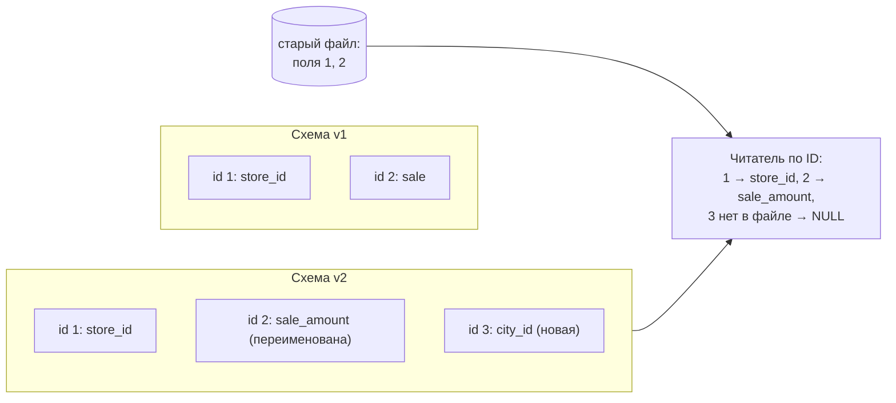
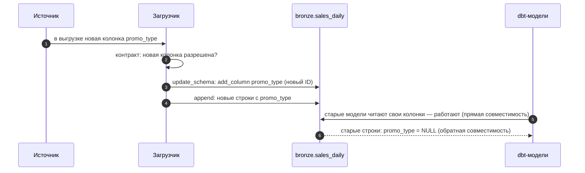

# 04 · Эволюция схем: как менять таблицу, не ломая старые данные и читателей

> [!info] Урок одной фразой
> Опись склада ссылается на колонки не по названию на этикетке, а по номеру отсека. Поэтому
> отсек можно переименовать, добавить новый или убрать старый, и старые коробки продолжат
> читаться правильно. А вот поменять тип так, что старое значение в него не влезет, нельзя: опись
> честно откажет. Правило одно: изменение допустимо, если и старые данные, и старые читатели его
> переживут.

> [!todo] Чек-лист: после урока ты сможешь
> - [ ] объяснить обратную и прямую совместимость схем на примерах;
> - [ ] объяснить, почему переименование колонки в Iceberg безопасно, а в «голом» Parquet — нет;
> - [ ] назвать допустимые изменения типов и предсказать отказ на недопустимых;
> - [ ] выполнить добавление, переименование, расширение типа и удаление колонки в PyIceberg;
> - [ ] прочитать старый снапшот после изменения схемы и объяснить результат (лаба 03.3, задача 4).

**Нужно для:** лаба [03.3](../labs/03.3_iceberg_operations/README.md), задача 4; модули 04
(schema contracts в dlt) и 08 (Schema Registry).
**Карта урока:** [schema-evolution.canvas](../maps/schema-evolution.canvas).

---

## Шаг 0. Азбука: почему схема меняется и чем это опасно

Схема таблицы не вечна. Источник добавил колонку `promo_type`, аналитики попросили
переименовать `sale` в `sale_amount`, выяснилось, что `INTEGER` мало для количества. При этом в
таблице уже лежат файлы, записанные со старой схемой, а программы, которые её читают, обновляются
не одновременно. Изменение схемы ломает две вещи: **чтение старых данных** новой схемой и
**работу старых программ** с новыми данными.

Клеппман (гл. 4) называет два свойства, которые нужно сохранить:

- **Обратная совместимость** (backward): **новый** код читает данные, записанные **старым**.
  Добавили колонку — новый читатель видит в старых строках `NULL` и не падает.
- **Прямая совместимость** (forward): **старый** код читает данные, записанные **новым**. Старый
  читатель не знает о новой колонке и просто её игнорирует.

| В хранении | В аналогии «склад с коробками» | Подробнее |
|---|---|---|
| Схема | Список отсеков на этикетке коробки | |
| ID поля (field id) | Номер отсека, который не меняется | [эволюция схем](../../../glossary/schema-evolution.md) |
| Имя колонки | Подпись на отсеке, её можно переклеить | |
| Обратная совместимость | Новый работник понимает старые коробки | [эволюция схем](../../../glossary/schema-evolution.md) |
| Прямая совместимость | Старый работник понимает новые коробки | [эволюция схем](../../../glossary/schema-evolution.md) |
| Расширение типа | Отсек сделали больше: старое содержимое влезает | |

---

## Шаг 1. Проблема имён: что ломается в «голом» Parquet

**Проблема.** Без табличного формата таблица — папка Parquet-файлов, и колонка связывает файлы
только **по имени**. Переименовали колонку — новые файлы пишутся с новым именем, старые остались
со старым.

**Как устроено.** DuckDB читает два файла: в первом колонка `sale`, во втором — `sale_amount`.

```sql
SELECT * FROM read_parquet(['v1.parquet', 'v2.parquet']);
-- Invalid Input Error: schema mismatch in glob: column "sale" was read from the original
-- file "v1.parquet", but could not be found in file "v2.parquet".

SELECT * FROM read_parquet(['v1.parquet', 'v2.parquet'], union_by_name = true);
```

| store_id | sale | sale_amount |
|---|---|---|
| 1 | 1.0 | NULL |
| 2 | NULL | 2.0 |

Без `union_by_name` чтение падает. С ним получаются **две половинчатые колонки** вместо одной.
Читатель не может знать, что `sale` и `sale_amount` — одно и то же: связь существовала только в
голове того, кто переименовывал. А системы, которые сопоставляют колонки **по позиции** (как CSV
или старые таблицы Hive), ещё хуже: удаление колонки сдвигает все следующие, и данные молча
оказываются не в своих колонках.

---

## Шаг 2. Решение Iceberg: идентификаторы полей

**Проблема.** Нужна связь между колонками разных версий схемы, которая не зависит ни от имени, ни
от позиции.

**Как устроено.** Iceberg присваивает каждой колонке **постоянный числовой ID** (field id) при её
создании и записывает этот ID в схему таблицы **и в каждый Parquet-файл**. Дальше:

1. **Переименование** меняет только имя в схеме. ID остаётся прежним. Читатель берёт из старых
   файлов колонку с тем же ID — и неважно, как она тогда называлась.
2. **Добавление** создаёт колонку с **новым** ID. В старых файлах такого ID нет, и читатель
   подставляет `NULL`.
3. **Удаление** убирает ID из схемы. Данные в старых файлах остаются, но колонка больше не
   читается. ID никогда не используется повторно: новая колонка с тем же именем получит новый
   ID и не «оживит» старые данные.
4. **Перестановка** колонок меняет только порядок в схеме — по позиции никто не читает.



**Проверено на нашем стеке.** Таблица с `store_id` и `sale`, две строки. Затем переименовали
`sale` → `sale_amount`, добавили `city_id INT`, дописали строку:

| Как читаем | Результат |
|---|---|
| текущая схема | 3 строки; у двух старых `city_id = NULL`, у всех колонка называется `sale_amount` |
| старый снапшот | 2 строки со **старой** схемой: колонка снова называется `sale` |

Схема — часть снапшота: читая прошлую версию, ты получаешь её вместе со схемой того времени.

---

## Шаг 3. Изменения типов: что можно, а что нет

**Проблема.** Тип колонки тоже меняется: количество перестало умещаться в `int`, точности `float`
не хватает. Но старые файлы физически хранят значения в старом типе, и переписывать их ради смены
типа Iceberg не будет.

**Как устроено.** Iceberg разрешает только **расширение** типа — изменения, при которых **любое**
старое значение точно представимо в новом типе. Тогда старые файлы читаются как есть, а значения
на лету расширяются.

| Изменение | Разрешено | Почему |
|---|---|---|
| `int` → `long` | ✅ | любое 32-битное число помещается в 64 бита |
| `float` → `double` | ✅ | любое число одинарной точности представимо в двойной |
| `decimal(P, S)` → `decimal(P', S)`, P' > P | ✅ | больше цифр при той же точности после запятой |
| `long` → `int` | ❌ | большие значения не поместятся |
| `string` → `long` | ❌ | не каждая строка — число |
| `double` → `float` | ❌ | теряется точность |

Проверено в PyIceberg: `int → long` и `float → double` проходят, `long → int` и `string → long`
падают с `ValidationError: Cannot change column type`.

**Что делать, если нужно «запрещённое» изменение.** Добавить **новую** колонку нужного типа,
заполнить её преобразованием из старой (перезаписью данных) и удалить старую. Это уже не
изменение схемы, а миграция данных, и её планируют отдельно.

**Обязательность.** Колонку можно сделать необязательной (`required → optional`) — старые данные
это переживут. Обратно нельзя: в старых файлах могут быть `NULL`.

---

## Шаг 4. Изменение схемы в PyIceberg

**Проблема.** Изменения схемы надо применять атомарно — несколько изменений одной фиксацией, чтобы
читатель не увидел промежуточное состояние.

**Как устроено.** `table.update_schema()` открывает транзакцию изменений. Всё, что сделано внутри
`with`, фиксируется одним новым `metadata.json` при выходе из блока:

```python
from pyiceberg.types import IntegerType, LongType

with table.update_schema() as u:
    u.add_column("city_id", IntegerType())          # новая колонка, новый ID, старые строки — NULL
    u.rename_column("sale", "sale_amount")          # тот же ID, новое имя
    u.update_column("qty", LongType())              # расширение типа
    u.delete_column("legacy_flag")                  # ID убран из схемы, данные остаются в файлах
```

Если хоть одно изменение недопустимо, исключение выбрасывается при выходе из `with`, и
**ни одно** изменение блока не применяется.

**Схема при записи.** `table.append(df)` проверяет, что схема Arrow-таблицы совместима со схемой
таблицы. Лишняя колонка в `df` — ошибка: сначала добавь её в схему, потом пиши. Недостающая
необязательная колонка — допустима, она будет `NULL`.

> [!warning] Ловушка: `delete_column` не освобождает место
> Удалённая колонка исчезает из схемы, но её значения остаются в старых файлах до их перезаписи
> (compaction, урок 03). Если колонку удаляют ради персональных данных, этого недостаточно: файлы
> нужно переписать, а старые снапшоты — удалить.

> [!example]- Попробуй сам: переименование и время назад
> В `make shell`:
> ```bash
> python - <<'EOF'
> import os, pyarrow as pa
> from pyiceberg.catalog import load_catalog
> from pyiceberg.types import IntegerType, LongType
> c = load_catalog("lh", type="rest", uri=os.environ["ICEBERG_CATALOG_URI"],
>                  warehouse=os.environ["ICEBERG_WAREHOUSE"])
> c.create_namespace_if_not_exists("sandbox")
> t = c.create_table("sandbox.evo", schema=pa.schema([("store_id", pa.int64()), ("sale", pa.float64())]))
> t.append(pa.table({"store_id": pa.array([1, 2], pa.int64()), "sale": [1.0, 2.0]}))
> s1 = t.current_snapshot().snapshot_id
> with t.update_schema() as u:
>     u.add_column("city_id", IntegerType())
>     u.rename_column("sale", "sale_amount")
> t.append(pa.table({"store_id": pa.array([3], pa.int64()), "sale_amount": [3.0],
>                    "city_id": pa.array([7], pa.int32())}))
> print([(f.field_id, f.name, str(f.field_type)) for f in t.schema().fields])
> print("сейчас:", t.scan().to_arrow().to_pylist())
> print("на s1: ", t.scan(snapshot_id=s1).to_arrow().to_pylist())
> try:
>     with t.update_schema() as u:
>         u.update_column("store_id", IntegerType())
> except Exception as e:
>     print("long → int:", type(e).__name__, e)
> c.purge_table("sandbox.evo"); c.drop_namespace("sandbox")
> EOF
> ```
> **Увидишь:** ID полей 1, 2, 3 — у `sale_amount` тот же ID 2, что был у `sale`; в старых строках
> `city_id: None`; на `s1` колонка называется `sale`; сужение типа падает с `ValidationError`.

---

## Шаг 5. Совместимость в цепочке систем

**Проблема.** Таблица не живёт одна: в неё пишет загрузчик, из неё читают dbt-модели, дашборды,
Spark. Изменение схемы, безопасное для Iceberg, может сломать соседа: dbt-модель ссылается на
`sale` по имени, а его переименовали.

**Как устроено.** Безопасный порядок изменений зависит от направления совместимости:

| Изменение | Что сломается у потребителей | Безопасный порядок |
|---|---|---|
| Добавить необязательную колонку | ничего | можно сразу |
| Удалить колонку | запросы, которые её читают | сначала убрать из всех потребителей, потом удалить |
| Переименовать | запросы по старому имени | добавить новое имя во view / потребители, затем переименовать; или переименовать и сразу обновить потребителей |
| Расширить тип | код, который ждал маленький тип (редко) | можно сразу |

Именно поэтому схемы фиксируют **контрактом**: договорённостью, какие колонки и типы гарантирует
таблица. В модуле 04 dlt будет проверять контракт при загрузке (schema contracts), в модуле 08
Schema Registry — при публикации сообщений в Kafka, а dbt-тесты в модулях 05 и 09 — на выходе
моделей.

---

## Сборка целиком: источник добавил колонку



| Где сломано | Шаг | Симптом |
|---|---|---|
| Колонку не добавили в схему перед записью | 4 | `append` падает: лишнее поле |
| Источник сменил тип `int` на `string` | 3 | `ValidationError`; нужна миграция |
| dbt-модель читает переименованное поле по старому имени | 5 | ошибка в модели после безопасного для Iceberg изменения |

---

## Шпаргалка

| Хочу | Как |
|---|---|
| Добавить колонку | `with t.update_schema() as u: u.add_column("c", Type())` |
| Переименовать | `u.rename_column("old", "new")` |
| Расширить тип | `u.update_column("c", LongType())` |
| Удалить | `u.delete_column("c")` |
| Посмотреть ID полей | `[(f.field_id, f.name) for f in t.schema().fields]` |
| Читать Parquet с разными схемами | `read_parquet([...], union_by_name = true)` — но это не эволюция |

## Типичные ошибки

| Симптом | Причина | Как проверить | Как чинить |
|---|---|---|---|
| После переименования — две половинчатые колонки | «голый» Parquet, связь по имени | `union_by_name` даёт две колонки | Iceberg с ID полей |
| `Cannot change column type` | сужение или несовместимый тип | таблица разрешённых изменений | новая колонка + миграция |
| Данные «съехали» по колонкам | связь по позиции (CSV, Hive) после удаления колонки | сравнить значения с ожидаемыми | связь по имени или ID |
| Удалили колонку с ПДн, а данные доступны | значения остались в файлах и старых снапшотах | `inspect.all_files()` | перезапись файлов + expire + remove orphans |

---

## Проверь себя

Карточки для интервального повторения — в [flashcards.md](../flashcards.md).

> [!question] 1. Почему в Iceberg переименование колонки не требует переписывать файлы?
> > [!success]- Ответ
> > Колонки связаны с файлами по постоянному ID поля, записанному и в схеме, и в Parquet. Имя
> > меняется только в схеме, а читатель ищет в файлах колонку по ID.

> [!question] 2. Добавили колонку `city_id` и удалили её, а потом снова добавили колонку `city_id`. Увидят ли новые читатели значения из старой колонки?
> > [!success]- Ответ
> > Нет. Новая колонка получает новый ID, а ID никогда не используются повторно. Старые значения
> > связаны со старым ID и не «оживут».

> [!question] 3. Почему `int → long` разрешено, а `long → int` — нет?
> > [!success]- Ответ
> > Iceberg не переписывает старые файлы при смене типа. Любое 32-битное значение представимо в
> > 64 битах, а наоборот — нет: большие значения из старых файлов не поместились бы.

> [!question] 4. Чем обратная совместимость отличается от прямой? Приведи пример для добавления колонки.
> > [!success]- Ответ
> > Обратная — новый код читает старые данные: новый читатель видит `NULL` в новой колонке старых
> > строк. Прямая — старый код читает новые данные: старый читатель просто не знает о новой
> > колонке и игнорирует её.

> [!question] 5. Аналитики просят переименовать колонку, по которой работают 20 dbt-моделей. Безопасно ли это для Iceberg? А для пайплайна?
> > [!success]- Ответ
> > Для Iceberg безопасно: ID сохранится. Для пайплайна — нет: модели ссылаются на имя и
> > сломаются. Нужно согласованно обновить модели или временно дать старое имя через view.
