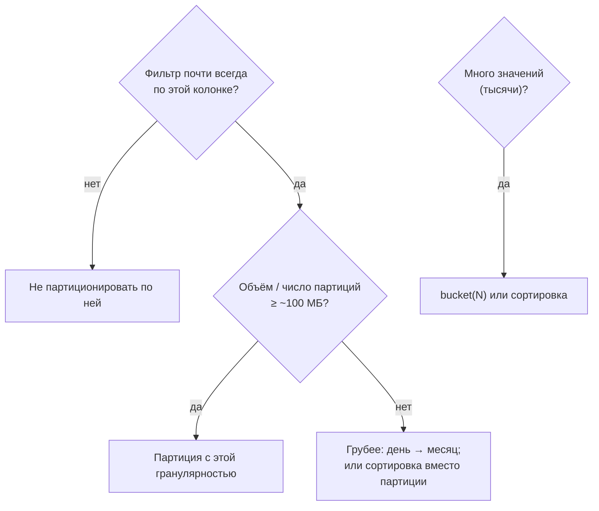
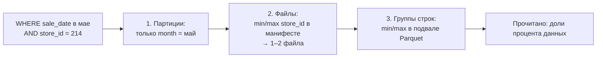

# 05 · Партиционирование и порядок сортировки: платишь за прочитанные байты

> [!info] Урок одной фразой
> Склад можно разделить на комнаты по месяцам (партиции), а внутри комнаты раскладывать коробки
> по номеру магазина (сортировка). Тогда за «маем» идут в одну комнату, а за «магазином 214» — к
> одной-двум коробкам в каждой комнате. Опись знает, что лежит в каждой комнате и коробке, и
> позволяет даже не открывать ненужные. Если комнат слишком много, склад превращается в
> лабиринт из пустых каморок.

> [!todo] Чек-лист: после урока ты сможешь
> - [ ] объяснить три уровня отсечения: партиции, файлы по статистикам, группы строк;
> - [ ] создать Iceberg-таблицу со скрытым партиционированием и объяснить, чем оно лучше Hive-стиля;
> - [ ] выбрать ключ и гранулярность партиционирования по запросам и объёму, не создав мелкие файлы;
> - [ ] объяснить, почему сортировка при записи часто даёт больше, чем партиционирование;
> - [ ] измерить отсечение: число и объём файлов в плане, `Total Files Read`, время (лаба 03.4).

> [!tip] Визуализация темы
> Интерактивная страница [parquet_pruning.html](../visuals/parquet_pruning.html). Раскладка «Партиции по месяцу»:
> сначала отсекаются партиции, потом группы строк по min/max.

**Нужно для:** лаба [03.4](../labs/03.4_partitioning_and_sort/README.md), все задачи.
**Карта урока:** [partitioning-sort.canvas](../maps/partitioning-sort.canvas).

---

## Шаг 0. Азбука: «платишь за прочитанные байты»

В облачных хранилищах вроде BigQuery цена запроса прямо зависит от **числа прочитанных байт**. В
нашем локальном стеке денег не берут, но закон тот же: время запроса почти всегда определяется
тем, сколько данных пришлось прочитать из S3 и распаковать. Поэтому вся оптимизация хранения
сводится к одному вопросу: **как сделать так, чтобы запрос не читал лишнего**.

Ненужное отсекают на трёх уровнях, от крупного к мелкому:

1. **Партиции** — целые папки файлов, которые точно не подходят под фильтр.
2. **Файлы** — по статистикам min/max каждого файла в манифестах Iceberg.
3. **Группы строк** — по статистикам внутри Parquet (урок 01, шаг 3).

| В хранении | В аналогии «склад с коробками» | Подробнее |
|---|---|---|
| Партиция | Комната склада: «март», «апрель», … | [партиционирование](../../../glossary/partitioning.md) |
| Скрытое партиционирование | Опись сама знает, в какую комнату класть по дате; работнику не надо знать про комнаты | [партиционирование](../../../glossary/partitioning.md) |
| Преобразование партиции | Правило «дата → комната по месяцу» | |
| Порядок сортировки | Внутри комнаты коробки разложены по номеру магазина | [порядок сортировки](../../../glossary/sort-order.md) |
| Отсечение (pruning) | Не заходить в комнату и не открывать коробку | [pruning](../../../glossary/pruning.md) |
| Мелкие файлы | Сотни каморок с одной посылкой | [compaction](../../../glossary/compaction.md) |

---

## Шаг 1. Партиционирование в стиле Hive и его проблемы

**Проблема.** Если таблица — это папка файлов, проще всего разложить файлы по подпапкам по
значению колонки. Так появилось партиционирование в Hive, и ты уже видел его в модуле 02 (урок
03, шаг 4): `PARTITION_BY (m)` дал папки `m=3/`, `m=4/`, …

**Как устроено.** Значение партиции записано в **имени папки**. Запрос с `WHERE m = 5` читает
только `m=5/`. Но у такого подхода три проблемы:

1. **Колонка партиции — отдельная колонка.** Чтобы разбить по месяцу, в данные добавляют `m`.
   Читатель должен знать, что фильтровать надо по `m`, а не по `sale_date`. Запрос
   `WHERE sale_date = '2024-05-01'` без условия на `m` прочитает **все** папки.
2. **Схему разбиения нельзя поменять.** Перейти с месяцев на дни — значит переписать всю таблицу.
3. **Список файлов — это листинг S3.** Чтобы найти файлы партиции, движок перечисляет объекты в
   папке, а в S3 листинг медленный и не транзакционный.

---

## Шаг 2. Скрытое партиционирование Iceberg

**Проблема.** Нужно партиционирование, о котором читатель может не знать: фильтруешь по
`sale_date`, а отсечение партиций происходит само.

**Как устроено.** В Iceberg партиционирование задаётся **спецификацией** (partition spec): «бери
колонку `sale_date`, применяй к ней преобразование `month`, результат — значение партиции». При
записи Iceberg сам вычисляет значение партиции для каждой строки и раскладывает строки по
файлам. Значение партиции хранится **в манифесте** рядом с каждым файлом, а не в имени папки и не
в отдельной колонке. При чтении движок переводит фильтр по `sale_date` в фильтр по партициям и
отбрасывает ненужные файлы. Это называют **скрытым** (hidden) партиционированием: колонки
партиции в данных нет, и пользователю не нужно о ней знать.

**Преобразования** (transforms):

| Преобразование | Значение партиции | Пример |
|---|---|---|
| `identity` | значение как есть | `city_id` |
| `year`, `month`, `day`, `hour` | номер года / месяца / дня / часа от 1970 года | `month(sale_date)` |
| `bucket(N)` | хэш значения по модулю N | `bucket(16, store_id)` — 16 корзин магазинов |
| `truncate(W)` | значение, обрезанное до ширины W | `truncate(10, store_id)` — десятки магазинов |

`month` хранит не «2024-05», а **число месяцев от января 1970**: в нашем эксперименте партиции
назывались 650…654, где 650 — март 2024. `bucket` нужен, когда значений много и они не идут
диапазонами: 898 магазинов раскладываются в фиксированное число корзин.

```python
from pyiceberg.partitioning import PartitionSpec, PartitionField
from pyiceberg.transforms import MonthTransform

spec = PartitionSpec(
    PartitionField(source_id=table_schema.find_field("sale_date").field_id,
                   field_id=1000, transform=MonthTransform(), name="sale_month"))
table = catalog.create_table("sandbox.sales_by_month", schema=table_schema, partition_spec=spec)
```

`source_id` — ID колонки-источника (урок 04), `field_id` — ID поля партиции (по соглашению от
1000), `name` — имя партиции в метаданных.

> [!warning] Ловушка: преобразования требуют `pyiceberg-core`
> Ставь `pyiceberg` с extra `pyiceberg-core`: так сделано в `pyproject.toml` образа workspace.
> `month`, `day`, `bucket` и другие преобразования PyIceberg 0.12 вычисляет через этот пакет.
> Без него запись падает с `NotInstalledError: pyiceberg_core needs to be installed`.

**Эволюция партиций.** Спецификацию можно поменять, не переписывая данные: старые файлы остаются
со старой спецификацией, новые пишутся с новой, а читатель учитывает обе. Перейти с месяцев на дни
можно с завтрашнего дня, без миграции:

```python
from pyiceberg.transforms import DayTransform

with table.update_spec() as u:
    u.remove_field("sale_month")                          # старая партиция больше не пишется
    u.add_field("sale_date", DayTransform(), "sale_day")   # новые файлы — по дням
```

Проверено: таблица с маем по месячной партиции, затем смена на дневную и запись 31 мая. Фильтр по
31 мая читает один новый файл, фильтр по 10 мая — один старый файл со всем маем: старые данные
отсекаются по своей месячной партиции.

> [!warning] Ловушка: две временные партиции на одну колонку
> Удаляй `month(sale_date)` в той же транзакции, в которой добавляешь `day(sale_date)`. День уже
> содержит месяц, поэтому одна из двух партиций лишняя. Иначе Lakekeeper откажет:
> `InvalidTableUpdate: Cannot add redundant partition with source id 3 and transform time`.

---

## Шаг 3. Сколько и каких партиций

**Проблема.** Чем мельче партиции, тем точнее отсечение. Но каждая партиция — минимум один файл,
и при мелком делении файлы становятся крошечными, а их число — огромным (урок 03, шаг 5).

**Как устроено.** Партиционирование выбирают по трём вопросам:

1. **По какой колонке фильтруют почти все запросы?** Партиция помогает только запросам с
   фильтром по её колонке. Для аналитики это почти всегда дата.
2. **Какая гранулярность?** Размер партиции = объём таблицы / число партиций. Ориентир: файлы
   данных от ~100 МБ до ~1 ГБ. Если партиция выходит меньше нескольких мегабайт, она слишком
   мелкая.
3. **Сколько различных значений?** Партиция по колонке с тысячами значений (`store_id`) создаёт
   тысячи партиций. Для таких колонок — `bucket` или сортировка (шаг 4).

**Эксперимент на нашем стеке.** Дневная таблица продаж (4,85 млн строк, 4 колонки) записана
дважды: с партицией `month(sale_date)` и без партиций (файлы по ~8 МБ в памяти):

| Таблица | Файлов всего | Фильтр «неделя мая»: файлов в плане |
|---|---|---|
| Партиция по месяцу | 5 (по одному на месяц) | **1** |
| Без партиций | 20 | 19 |

В таблице без партиций почти каждый файл содержит все даты, потому что строки шли по магазинам,
и фильтр по неделе может отсечь только один файл. Партиция по месяцу отсекает 4 из 5.

Но посмотри на размер: вся таблица — около 5 МБ, то есть **около мегабайта на месяц**. Для такого
объёма партиционирование уже на пределе разумного: деление по дням дало бы 97 файлов по 50 КБ.
Проверь, что будет с почасовой таблицей на 116 млн строк, — это задача лабы.



---

## Шаг 4. Порядок сортировки: отсечение внутри партиции

**Проблема.** Фильтр по магазину встречается не реже фильтра по дате, но партиционировать по 898
магазинам нельзя — слишком мелко. Как ускорить и его?

**Как устроено.** Iceberg хранит в манифесте **статистики min/max каждой колонки для каждого
файла**. Если строки при записи **отсортированы** по `store_id`, каждый файл содержит узкий
диапазон магазинов, и фильтр `store_id = 214` отсекает все файлы, кроме одного-двух. Если не
отсортированы, у каждого файла диапазон `[0, 897]`, и отсечь нечего. Это тот же механизм, что для
групп строк внутри Parquet (урок 01, шаг 3), только на уровне файлов.

**Эксперимент на нашем стеке.** Та же дневная таблица без партиций, 20 файлов, запрос
`sum(sale_amount) WHERE store_id = 214` через DuckDB:

| Таблица | Файлов в плане PyIceberg | `Total Files Read` в DuckDB | Время |
|---|---|---|---|
| Строки в порядке, как вернул DuckDB (без сортировки) | 11 | 11 | 49 мс |
| Отсортирована по `store_id, product_id, sale_date` при записи | **1** | **1** | **9 мс** |

Сортировка ускорила запрос в 5,5 раза, не меняя ни схемы, ни партиций.

**Порядок сортировки в метаданных.** В Iceberg можно **объявить** порядок сортировки таблицы
(`sort_order`). Это договорённость для писателей: «пиши строки в таком порядке». Spark её
соблюдает и сортирует при записи сам (модуль 07). **PyIceberg 0.12 — нет**: проверено, таблица с
объявленным порядком `store_id`, записанная из перемешанных данных, дала 20 файлов из 20 для
фильтра по магазину. Поэтому при записи из PyIceberg или DuckDB сортировать нужно самому:
`ORDER BY` в запросе, который готовит данные.

**Какой порядок выбрать.** Первой ставят колонку, по которой чаще всего фильтруют **точным
значением или узким диапазоном** и которая не стала партицией. Для FreshRetail: партиция по
времени, внутри — сортировка по магазину и товару. Сортировка по нескольким колонкам хорошо
помогает только первой из них: вторая отсортирована лишь внутри одинаковых значений первой. Для
равноправных фильтров по двум колонкам существует **Z-order** — раскладка, перемешивающая биты
обеих колонок. Она есть в Spark (модуль 07).



> [!example]- Попробуй сам: сколько файлов прочитает фильтр
> В `make shell` (песочница удаляется в конце):
> ```bash
> python - <<'EOF'
> import os, time, duckdb
> from pyiceberg.catalog import load_catalog
> from pyiceberg.expressions import EqualTo
> c = load_catalog("lh", type="rest", uri=os.environ["ICEBERG_CATALOG_URI"],
>                  warehouse=os.environ["ICEBERG_WAREHOUSE"])
> c.create_namespace_if_not_exists("sandbox")
> con = duckdb.connect()
> base = """SELECT store_id, product_id, dt::DATE AS sale_date, sale_amount
>           FROM read_parquet('data/raw/freshretailnet_50k/data/*.parquet')"""
> props = {"write.target-file-size-bytes": str(8 * 1024 * 1024)}
> for name, q in (("unsorted", base), ("sorted", base + " ORDER BY store_id, product_id, sale_date")):
>     data = con.sql(q).to_arrow_table()
>     t = c.create_table(f"sandbox.{name}", schema=data.schema, properties=props)
>     t.append(data)
>     tasks = list(t.scan(row_filter=EqualTo("store_id", 214)).plan_files())
>     print(name, "files total:", len(list(t.scan().plan_files())), "| for store 214:", len(tasks),
>           f"| bytes: {sum(x.file.file_size_in_bytes for x in tasks) / 1e6:.2f} MB")
> for name in ("unsorted", "sorted"):
>     c.purge_table(f"sandbox.{name}")
> c.drop_namespace("sandbox")
> EOF
> ```
> **Увидишь:** у обеих таблиц около 20 файлов; для магазина 214 без сортировки — около половины
> файлов, с сортировкой — один. `plan_files()` — это план чтения PyIceberg после отсечения:
> список файлов, которые придётся открыть.

---

## Шаг 5. Как измерять отсечение

**Проблема.** Партиционирование и сортировку выбирают, чтобы читать меньше. Значит, решение надо
подтверждать измерением прочитанного, а не только временем, — время шумит (модуль 01, урок 05).

**Как устроено.** Три метрики, от точной к общей:

| Метрика | Как получить | Что показывает |
|---|---|---|
| Файлов и байт в плане | `table.scan(row_filter=…).plan_files()` → `len()`, сумма `file.file_size_in_bytes` | сколько файлов останется после отсечения по партициям и статистикам манифестов |
| `Total Files Read` | `EXPLAIN ANALYZE` запроса в DuckDB к `lh.ns.table` | сколько файлов реально открыл DuckDB |
| Время | 20–30 запусков, p50 (модуль 01, урок 05) | итоговый эффект с учётом всех уровней |

Фильтр для PyIceberg записывается выражениями из `pyiceberg.expressions`: `EqualTo("store_id",
214)`, `GreaterThanOrEqual("sale_date", "2024-05-01")`, `LessThan(…)`, комбинации `And(…)`,
`Or(…)`. Это тот же фильтр, что движок передаст в план, только в явном виде.

---

## Сборка целиком: выбор раскладки для почасовой таблицы

```mermaid
sequenceDiagram
    autonumber
    participant Y as Ты
    participant Q as Карточки вопросов (модуль 01)
    participant T as Iceberg-таблица
    participant D as DuckDB
    Y->>Q: какие фильтры у частых запросов? — дата, магазин
    Y->>Y: объём / число партиций → гранулярность по времени
    Y->>T: create_table: partition spec по времени
    Y->>T: append: данные ORDER BY store_id, product_id, …
    Y->>T: plan_files() для 3 типовых фильтров: файлы и байты
    Y->>D: EXPLAIN ANALYZE: Total Files Read; 30 запусков p50
    Y->>Y: сравнить с вариантами без партиций / без сортировки
```

| Если ошибиться | Шаг | Что получишь |
|---|---|---|
| Партиция по колонке без фильтров | 1 | лишние файлы без выигрыша |
| Слишком мелкая гранулярность | 2 | тысячи крошечных файлов, запросы медленнее |
| Не отсортировать при записи из PyIceberg | 4 | объявленный порядок есть, а отсечения по нему нет |
| Судить только по времени одного запуска | 6 | выводы по шуму |

---

## Шпаргалка

| Хочу | Как |
|---|---|
| Партиция по месяцу | `PartitionField(source_id, 1000, MonthTransform(), "sale_month")` |
| Партиция по дню | `DayTransform()` |
| Корзины по магазину | `BucketTransform(16)` |
| Таблица с партициями | `catalog.create_table(…, partition_spec=spec)` |
| Целевой размер файлов | `properties={"write.target-file-size-bytes": "…"}` |
| Отсортировать при записи | `ORDER BY …` в запросе, готовящем Arrow-таблицу |
| Файлы после отсечения | `list(table.scan(row_filter=…).plan_files())` |
| Файлы, прочитанные DuckDB | `EXPLAIN ANALYZE` → `Total Files Read` |
| Партиции таблицы | `table.inspect.partitions()` |

## Типичные ошибки

| Симптом | Причина | Как проверить | Как чинить |
|---|---|---|---|
| Фильтр по дате читает все файлы | нет партиции, данные не отсортированы по дате | `plan_files()` с фильтром | партиция по времени |
| Тысячи файлов по сотне КБ | слишком мелкие партиции | `inspect.files()`, `inspect.partitions()` | грубее гранулярность, compaction |
| Объявлен `sort_order`, а отсечения нет | PyIceberg не сортирует при записи | `plan_files()` по колонке сортировки | `ORDER BY` перед `append` |
| `NotInstalledError: pyiceberg_core` | нет пакета для преобразований | — | extra `pyiceberg-core` в образе |
| Hive-партиции не помогают запросу по `sale_date` | фильтр не по колонке партиции | план: все папки | скрытое партиционирование Iceberg |

---

## Проверь себя

Карточки для интервального повторения — в [flashcards.md](../flashcards.md).

> [!question] 1. Чем скрытое партиционирование Iceberg удобнее Hive-стиля для аналитика?
> > [!success]- Ответ
> > Аналитик фильтрует по обычной колонке `sale_date`, а Iceberg сам переводит фильтр в отсечение
> > партиций. В Hive-стиле нужно знать о служебной колонке партиции и фильтровать по ней, иначе
> > читаются все папки.

> [!question] 2. Почему не стоит партиционировать по `store_id`?
> > [!success]- Ответ
> > 898 значений дадут 898 партиций с крошечными файлами. Для фильтра по магазину лучше
> > сортировка: узкие диапазоны min/max в файлах позволяют отсечь почти всё без мелких файлов.

> [!question] 3. Объявили `sort_order` по магазину, записали через PyIceberg, а фильтр по магазину читает все файлы. Почему?
> > [!success]- Ответ
> > PyIceberg 0.12 не сортирует данные при записи, объявленный порядок — лишь метаданные. Данные
> > остались в исходном порядке, и диапазоны магазинов в каждом файле широкие. Нужен `ORDER BY`
> > перед `append` или запись через Spark.

> [!question] 4. Партиция `month` хранит значение 652. Какой это месяц?
> > [!success]- Ответ
> > Число месяцев от января 1970: 652 = 54 года × 12 + 4 → май 2024 (650 — март, 651 — апрель).

> [!question] 5. Как подтвердить, что новая раскладка таблицы лучше, кроме времени запроса?
> > [!success]- Ответ
> > Посчитать файлы и байты в `plan_files()` для типовых фильтров и `Total Files Read` в плане
> > DuckDB. Меньше прочитанного — объективный выигрыш; время подтверждает его медианой по многим
> > запускам.
