# Модуль 04 · Ingestion (EL)

**Длительность:** ~1–2 нед. · **Статус и DoD:** см. [ROADMAP](../../ROADMAP.md)

## Бизнес-вопрос

> Как надёжно и инкрементально забирать данные из файлов, учётной системы и внешних API —
> ничего не теряя и ничего не задваивая?

## Цели

- выбирать между полной загрузкой, инкрементом по курсору и CDC и знать, что теряет каждый
- строить идемпотентную загрузку: повторы, повторная доставка, backfill, поздние данные
- загружать файлы, Postgres и REST API в Iceberg через dlt и сверять результат с источником
- управлять изменениями схемы источника контрактами
- выбирать движок трансформаций по замеру

## Темы

- паттерны: full load, incremental (курсор, отметка, окно перечитывания), CDC; append / replace / merge
- идемпотентность, повторы, backfill, время события и время загрузки
- dlt: ресурсы, источники, трансформеры, extract → normalize → load, состояние, Iceberg через Lakekeeper
- нормализация вложенного JSON в дочерние таблицы; строки против Arrow
- OLTP-источник: DDL, транзакции и MVCC, триггер `updated_at`, сверка
- API: HTTP, коды ответа, пагинация, лимиты, повторы с backoff и джиттером
- контракты схемы: evolve / freeze / discard; модели Pydantic; политика по слоям
- DuckDB vs Polars vs pandas: жадное и ленивое выполнение, честный замер

## Инструменты

dlt 1.30, Postgres (`retail_oltp`), учебный API `retail-api` (слой `ingestion`), Nager.Date,
DuckDB, Polars, pandas 3

## Маршрут прохождения

Сначала урок, потом задачи лабы по нему. Статусы: ✅ сделано · 🟨 сейчас · ⬜ впереди.

```mermaid
flowchart LR
    T1["📖 01 Паттерны"] --> T2["📖 02 dlt"] --> L1["🧪 04.1<br/>файлы → bronze"]
    L1 --> T3["📖 03 OLTP"] --> L2["🧪 04.2<br/>retail_oltp"] --> L3["🧪 04.3<br/>full vs incr"]
    L3 --> T4["📖 04 API"] --> T5["📖 05 Контракты"] --> L4["🧪 04.4<br/>API"]
    L4 --> T6["📖 06 Движки"] --> L5["🧪 04.5<br/>3 движка"] --> L6["🧪 04.6<br/>make ingest"] --> HW["🏁 Домашка"]
```

| # | Шаг | Что | Статус |
|---|---|---|---|
| 1 | 📖 [01 · Паттерны загрузки](theory/01_ingestion_patterns.md) · [карта](maps/ingestion-patterns.canvas) | урок | ⬜ |
| 2 | 📖 [02 · dlt изнутри](theory/02_dlt_internals.md) · [карта](maps/dlt-internals.canvas) | урок | ⬜ |
| 3 | 🧪 [Лаба 04.1 — файлы → Iceberg](labs/04.1_files_to_iceberg/README.md), задачи 1–3, 5 | инкремент, повторная доставка, backfill | ⬜ |
| 4 | 📖 [03 · Учётная система как источник](theory/03_oltp_source.md) · [карта](maps/oltp-source.canvas) | урок | ⬜ |
| 5 | 🧪 [Лаба 04.2 — retail_oltp](labs/04.2_retail_oltp/README.md) | схема, наполнение, следы изменений | ⬜ |
| 6 | 🧪 [Лаба 04.3 — Postgres → lakehouse](labs/04.3_postgres_to_lakehouse/README.md) | полная против инкремента, починка, ADR | ⬜ |
| 7 | 📖 [04 · Загрузка из API](theory/04_api_ingestion.md) · [карта](maps/api-ingestion.canvas) | урок | ⬜ |
| 8 | 📖 [05 · Схема источника и контракты](theory/05_schema_contracts.md) · [карта](maps/schema-contracts.canvas) | урок | ⬜ |
| 9 | 🧪 Лаба 04.1, задача 4 | дрейф схемы файлов | ⬜ |
| 10 | 🧪 [Лаба 04.4 — API → lakehouse](labs/04.4_api_to_lakehouse/README.md) | промо, сбои, праздники | ⬜ |
| 11 | 📖 [06 · Одна трансформация — три движка](theory/06_transform_engines.md) · [карта](maps/transform-engines.canvas) | урок | ⬜ |
| 12 | 🧪 [Лаба 04.5 — SQL / Polars / pandas](labs/04.5_one_transform_three_engines/README.md) | топ-5 магазинов города, замер | ⬜ |
| 13 | 🧪 [Лаба 04.6 — мини-проект](labs/04.6_ingestion_mini_project/README.md) | `make ingest`: три источника в bronze | ⬜ |
| 14 | 🏁 [Домашка-чекпоинт](homework.md) | 7 вопросов и одно предсказание | ⬜ |

> [!note] Инфраструктура модуля (добавлена 2026-10-01)
> - Слой `ingestion` (`infra/docker/ingestion.yaml`): учебный API `retail-api`, порт 8095.
>   Запуск — `make up PROFILES="ingestion"`. Ключ — `RETAIL_API_KEY` в `.env`.
> - Скрипты-эмуляторы источников: `scripts/landing_drop.py` (файлы в `landing`, в том числе
>   повторная доставка и дрейф схемы) и `scripts/retail_oltp_changes.py` (изменения в учётной
>   системе, долгая транзакция).
> - Настройки dlt — переменные окружения workspace (`infra/docker/core.yaml`), рабочие папки
>   пайплайнов — `data/.dlt`. pandas 3 — группа зависимостей `ingestion`.

## Чек-лист самоконтроля

Отмечай пункт, только когда можешь сделать это **без подсказки**. Подробные чек-листы — в начале
каждого урока.

**Паттерны** ([01](theory/01_ingestion_patterns.md))
- [ ] Выбираю полную загрузку, курсор или CDC для конкретной таблицы и объясняю выбор
- [ ] Называю три вида изменений, которые теряет курсор, и механизм каждого
- [ ] Предсказываю результат повторной доставки при append, replace, merge
- [ ] Делаю загрузку идемпотентной и проверяю это двумя запусками

**dlt** ([02](theory/02_dlt_internals.md), [05](theory/05_schema_contracts.md))
- [ ] Пишу ресурс, трансформер, источник; нахожу пакет загрузки и состояние
- [ ] Предсказываю раскладку вложенного JSON и выбираю между словарями и Arrow
- [ ] Пишу в Iceberg через Lakekeeper и восстанавливаю состояние из хранилища
- [ ] Задаю контракт схемы и объясняю политику для bronze и silver

**Источники** ([03](theory/03_oltp_source.md), [04](theory/04_api_ingestion.md))
- [ ] Создаю таблицы Postgres с ограничениями и триггером `updated_at`
- [ ] Объясняю, что видит загрузчик при READ COMMITTED и долгой транзакции
- [ ] Сверяю источник и копию по строкам, суммам и ключам одним запросом
- [ ] Загружаю API с пагинацией, повторами при 429/5xx и защитой от дублей

**Движки** ([06](theory/06_transform_engines.md))
- [ ] Пишу одну трансформацию на SQL, Polars и pandas
- [ ] Честно меряю время и память и проверяю равенство результатов

**Закрытие модуля**
- [ ] Лабы 04.1–04.6 выполнены по Definition of Done
- [ ] [Домашка](homework.md) сдана, ошибки разобраны
- [ ] Тезисы по Клеппману (гл. 4, гл. 7) — в [`notes.md`](notes.md)

## Материалы модуля

| Что | Где |
|---|---|
| 🧠 Карточки для повторения | [flashcards.md](flashcards.md) |
| 🗺️ Карты | [maps/](maps/) |
| 📚 Термины | [glossary/](../../glossary/README.md) — раздел «Загрузка данных (ingestion)» |
| 🎬 Визуализации | [Курсор и окно перечитывания](visuals/cursor_lookback.html) · [API: пагинация и повторы](visuals/api_retries.html) · [Курсор против журнала: видео](visuals/cursor_vs_log.mp4) |
| 📓 Заметки | [notes.md](notes.md) |

## Мини-проект (вклад в capstone)

Три источника — файлы продаж, учётная система, API промо и праздников — загружаются в bronze
одной командой `make ingest`, повторный запуск не создаёт дублей (лаба 04.6). В модуле 06 эти
загрузки станут ассетами Dagster.

## Ресурсы

- [dlt docs](https://dlthub.com/docs/intro) · [incremental](https://dlthub.com/docs/general-usage/incremental-loading) · [schema contracts](https://dlthub.com/docs/general-usage/schema-contracts) · [REST API source](https://dlthub.com/docs/dlt-ecosystem/verified-sources/rest_api/basic)
- [dlt: Iceberg через filesystem](https://dlthub.com/docs/dlt-ecosystem/destinations/iceberg)
- [Surfalytics: data ingestion patterns](https://github.com/surfalytics/data-projects/tree/main/async-projects/06-data-ingestion-patterns)
- [Surfalytics: db to db with Python](https://github.com/surfalytics/data-projects/tree/main/de-projects/08_db_to_db_python)
- [Postgres: триггеры](https://www.postgresql.org/docs/17/plpgsql-trigger.html) · [изоляция транзакций](https://www.postgresql.org/docs/17/transaction-iso.html)
- [Polars user guide](https://docs.pola.rs/user-guide/) · [Nager.Date API](https://date.nager.at/Api)

## Книга и видео

Полная таблица с пояснениями, зачем читать и что пропустить — в [карте чтения](../../reading_map.md#04--ingestion-el).

- 📖 Клеппман, гл. 4 — совместимость схем (урок 05)
- 📖 Клеппман, гл. 7 — транзакции, read committed и snapshot isolation (урок 03)
- 🎬 [Zoomcamp `workshops/dlt`](https://github.com/DataTalksClub/data-engineering-zoomcamp/blob/main/cohorts/2026/workshops/dlt.md) — воркшоп по dlt (уроки 02, 04)

## Домашка-чекпоинт

После всех лаб — [`homework.md`](homework.md).

## Заметки

Конспект, тезисы по книге и выводы — в [`notes.md`](notes.md).
