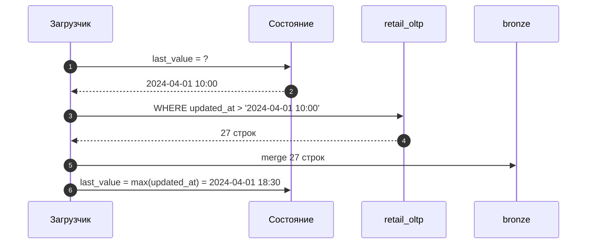
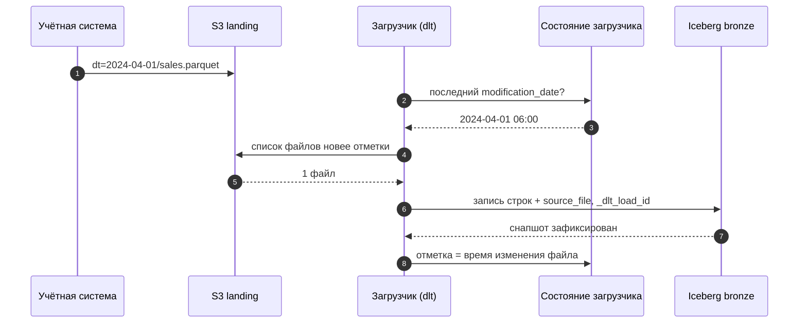

# 01 · Паттерны загрузки: полная, инкрементальная, CDC и повторы без дублей

> [!info] Урок одной фразой
> Загрузка — это приёмка товара на склад. Можно каждый раз пересчитывать весь склад (полная
> загрузка), можно принимать только новые накладные (инкремент по курсору), а можно читать журнал
> всех движений (CDC). Как бы ни принимали, одна и та же накладная, проведённая дважды, не должна
> удваивать остатки. Это и есть главное требование к загрузке — идемпотентность.

> [!todo] Чек-лист: после урока ты сможешь
> - [ ] выбрать между полной загрузкой, инкрементом по курсору и CDC для конкретного источника;
> - [ ] назвать три вида изменений, которые инкремент по `updated_at` не видит, и объяснить механизм каждого;
> - [ ] выбрать способ записи (append, replace, merge, замена партиции) и предсказать результат повторной доставки;
> - [ ] сделать загрузку идемпотентной и объяснить, почему повтор неизбежен;
> - [ ] спланировать backfill и обработку поздних данных (лабы 04.1, 04.3).

> [!tip] Визуализация темы
> Интерактивная страница [cursor_lookback.html](../visuals/cursor_lookback.html). Транзакции и запуски загрузчика на одной
> шкале: подбери окно перечитывания и способ записи так, чтобы ничего не потерять и не задвоить.

**Нужно для:** лабы [04.1](../labs/04.1_files_to_iceberg/README.md) и
[04.3](../labs/04.3_postgres_to_lakehouse/README.md).
**Карта урока:** [ingestion-patterns.canvas](../maps/ingestion-patterns.canvas).

---

## Шаг 0. Азбука: приёмка на склад

В модуле 03 мы устроили склад: Iceberg-таблицы в S3 с описью (метаданными). Теперь вопрос, как
на этот склад **привозить** товар. Источников у сети три, и они разные по природе:

| Источник | Что в нём | Как отдаёт | Где в курсе |
|---|---|---|---|
| Файлы продаж | почасовые продажи, остатки, промо, погода | раз в день файл в S3 `landing` | лаба 04.1 |
| Учётная система `retail_oltp` | справочники: магазины, товары, ассортимент | таблицы Postgres, меняются в течение дня | лабы 04.2, 04.3 |
| Маркетинговая система | промо-акции | REST API по дням | лаба 04.4 |

| В загрузке | В аналогии «приёмка на склад» | Подробнее |
|---|---|---|
| Полная загрузка (full load) | Каждый раз пересчитать весь склад заново | [паттерны загрузки](../../../glossary/load-patterns.md) |
| Инкремент по курсору | Принимать только накладные новее последней принятой | [курсор](../../../glossary/incremental-cursor.md) |
| Курсор, watermark | Номер или время последней принятой накладной | [курсор](../../../glossary/incremental-cursor.md) |
| CDC | Читать журнал всех движений: приход, расход, списание | [CDC](../../../glossary/cdc.md) |
| Append / replace / merge | Положить рядом / вынести всё и положить заново / заменить коробку с тем же артикулом | [способы записи](../../../glossary/write-disposition.md) |
| Идемпотентность | Накладную провели дважды — остатки не удвоились | [идемпотентность](../../../glossary/idempotency.md) |
| Backfill | Перепровести накладные за прошлый месяц | [backfill](../../../glossary/backfill.md) |
| Поздние данные | Накладная, пришедшая задним числом | [backfill](../../../glossary/backfill.md) |

---

## Шаг 1. Что такое ingestion и почему он отдельный шаг

**Проблема.** Данные рождаются в чужих системах: учётная база магазинов, файлы выгрузок,
API партнёров. Аналитике нужны они все, в одном месте и в одном формате. Если считать витрины
прямо по источникам, каждая витрина будет ходить в учётную базу, мешать продажам на кассах и
ломаться при любом изменении источника.

**Как устроено.** Поэтому первым шагом данные **копируют** в своё хранилище, почти не меняя.
Это и есть ingestion, буквы **E** и **L** в ELT (модуль 01, урок 03): извлечь (extract) из
источника и загрузить (load) в bronze-слой. Преобразования (T) — уже внутри хранилища, в
модуле 05. Разделение даёт три выигрыша:

1. Источник читается **один раз** за цикл, а не каждой витриной. Нагрузка на учётную систему
   предсказуема.
2. В bronze лежит **копия «как есть»**. Если в трансформации найдётся ошибка, её исправляют и
   пересчитывают из bronze, не обращаясь к источнику (который мог уже измениться или удалить
   историю).
3. Загрузку и трансформации можно **чинить и перезапускать по отдельности**.

**Что из этого следует.** От загрузчика требуется не «умная логика», а **надёжность**: забрать
всё, ничего не потерять, ничего не задвоить, пережить падение на середине. Весь урок — о том, как
этого добиться.

**У нас.** Все три источника приземляются в Iceberg, namespace `bronze`. Загрузчик — dlt
(урок 02), он работает в контейнере workspace.

---

## Шаг 2. Полная загрузка: пересчитать всё

**Проблема.** Самый простой способ узнать, что в источнике, — прочитать его целиком.

**Как устроено.** Каждый запуск читает **всю** таблицу источника и **заменяет** ею копию в
хранилище. Никакого состояния между запусками не нужно: что сейчас в источнике, то и будет у
нас.

Достоинства вытекают из простоты:

- **видны удаления**: строки, которой нет в источнике, не будет и в копии;
- **видны любые изменения**, даже те, что источник никак не пометил;
- **нечего сломать**: нет курсоров и состояния, повторный запуск даёт тот же результат.

Недостаток один, но решающий: **стоимость растёт с объёмом таблицы, а не с объёмом изменений**.
Если за день поменялись 20 строк из 50 тысяч, полная загрузка всё равно читает, передаёт и
пишет 50 тысяч.

**Что из этого следует.** Полная загрузка — правильный выбор для **маленьких справочников** и
для источников, где изменения нечем отследить. Для больших и растущих таблиц нужен инкремент.

| Таблица у нас | Строк | Полная загрузка? |
|---|---|---|
| `stores` | 898 | да, дёшево |
| `products` | 865 | да, дёшево |
| `assortment` (магазин × товар) | 50 000 | терпимо, но уже заметно |
| Продажи (дневные строки) | 4 850 000 за 97 дней, +50 000 в день | нет — каждый день перечитывать всю историю бессмысленно |

> [!tip] Полная загрузка + сравнение = поиск удалений
> Если инкремент не видит удалений (шаг 3), их можно найти редкой полной выгрузкой **только
> ключей**. Ключи, которые есть у нас, но пропали в источнике, — это удалённые строки. Ключей мало,
> поэтому это дешевле полной выгрузки всех колонок.

---

## Шаг 3. Инкремент по курсору: только новые накладные

**Проблема.** Нужно забирать только изменения, а не всё. Но источник не говорит «вот что
поменялось». Как узнать, что новое?

**Как устроено.** Выбирают колонку-**курсор** (cursor), значение которой растёт при каждом
изменении строки. Обычно это `updated_at` (время последнего изменения) или растущий `id`.
Загрузчик хранит **последнее загруженное значение** (watermark, «отметка уровня») и каждый раз
спрашивает только то, что выше отметки:

```sql
SELECT * FROM stores WHERE updated_at > :last_value ORDER BY updated_at;
```

После успешной загрузки отметка сдвигается на максимум из загруженного. Отметка — это
**состояние** загрузчика: его надо где-то хранить и не потерять (dlt хранит его и у себя, и в
хранилище — урок 02).



Порядок шагов 5 и 6 важен. Если сдвинуть отметку **до** записи и упасть, изменения пропадут
навсегда. Если сдвинуть **после**, при падении между 5 и 6 те же строки загрузятся повторно, но
с merge (шаг 5) повтор безвреден. Поэтому отметку сдвигают только после записи.

**Что требуется от курсора.** Курсор работает, только если выполнены три условия. Нарушение
любого из них — это **тихая потеря данных**: загрузка завершается успешно, а строк не хватает.

| Условие | Что будет при нарушении | У нас (генератор `retail_oltp`) |
|---|---|---|
| Курсор меняется при **каждом** изменении строки | изменение без нового `updated_at` никогда не попадёт выше отметки | операция `recategorize` меняет категорию товара и не трогает `updated_at` |
| Строка не **исчезает** | удалённой строки нет в выборке — удаление не видно | операция `delist` делает `DELETE` из ассортимента |
| Значение курсора появляется в базе **в порядке роста** | строка с маленьким курсором, ставшая видимой поздно, окажется ниже уже сдвинутой отметки | долгая транзакция `--slow-tx` |

Третье условие самое коварное, разберём его механизм. В Postgres `now()` возвращает время
**начала транзакции**, а не момент фиксации. А другие сессии видят изменения только после
фиксации (COMMIT). Получается так:

1. В 10:00:00 транзакция A начинается и пишет строку с `updated_at = 10:00:00`. Она ещё не
   зафиксирована, поэтому её никто не видит.
2. В 10:00:02 транзакция B пишет строку с `updated_at = 10:00:02` и сразу фиксируется.
3. В 10:00:03 загрузчик читает «всё новее отметки» и видит только строку B. Отметка
   сдвигается на 10:00:02.
4. В 10:00:08 транзакция A фиксируется. Её строка с `updated_at = 10:00:00` теперь видна, но
   она **ниже отметки**. Следующий запуск её не возьмёт никогда.

```mermaid
gantt
    title Курсор обгоняет долгую транзакцию
    dateFormat ss
    axisFormat %S с
    section Транзакция A
    пишет updated_at = 00, не видна   :a1, 00, 8s
    COMMIT, строка видна              :milestone, 08, 0s
    section Транзакция B
    updated_at = 02, COMMIT           :b1, 02, 1s
    section Загрузчик
    читает > отметки, отметка = 02    :milestone, 03, 0s
```



**Лекарство — окно перечитывания** (lookback, lag). Загрузчик спрашивает не «выше отметки», а
«выше отметки минус запас», например минус час: `WHERE updated_at > :last_value - interval '1
hour'`. Строки из окна читаются повторно, поэтому писать их нужно через **merge** по ключу,
тогда повтор не создаёт дублей. Запас выбирают больше самой долгой транзакции приложения.

**Что из этого следует.**

- Инкремент по курсору дешёвый, но **верит источнику на слово**. Прежде чем на него полагаться,
  проверь три условия: есть ли триггер, выставляющий `updated_at`; бывают ли физические
  удаления; какие транзакции самые долгие.
- **Строгое `>` или нестрогое `>=`?** При `>` теряются строки с тем же значением курсора, что
  у отметки, но записанные позже. При `>=` последние строки читаются повторно, но без потерь.
  dlt использует `>=` и запоминает хэши строк на границе, чтобы отбросить уже загруженные.
- Нарушения лечатся по-разному: забытый `updated_at` — триггером в источнике, удаления — мягким
  удалением (флаг `is_deleted`) или CDC, долгие транзакции — окном перечитывания.

> [!example]- Попробуй сам: долгая транзакция прячется от курсора
> В `make shell`. Создаёт песочницу `sandbox_oltp`, в конце удали её.
> ```bash
> export PGHOST=postgres PGUSER=$POSTGRES_USER PGPASSWORD=$POSTGRES_PASSWORD
> psql -d postgres -qc "CREATE DATABASE sandbox_oltp"
> export PGDATABASE=sandbox_oltp
> psql -qc "CREATE TABLE stores (store_id bigint PRIMARY KEY, status text, updated_at timestamptz);
>           INSERT INTO stores SELECT g, 'open', now() - interval '1 day' FROM generate_series(0, 9) g;"
> # Сессия 1: долгая транзакция — updated_at = now(), то есть время НАЧАЛА транзакции
> psql -qc "BEGIN; UPDATE stores SET status = 'closed', updated_at = now() WHERE store_id = 1;
>           SELECT pg_sleep(8); COMMIT;" > /dev/null &
> sleep 2
> # Сессия 2: быстрая транзакция, начатая позже
> psql -qc "UPDATE stores SET status = 'closed', updated_at = now() WHERE store_id = 2"
> echo "--- загрузчик во время долгой транзакции"
> psql -c "SELECT store_id, updated_at FROM stores WHERE updated_at > now() - interval '1 hour' ORDER BY updated_at"
> wait
> echo "--- после фиксации долгой транзакции"
> psql -c "SELECT store_id, updated_at FROM stores WHERE updated_at > now() - interval '1 hour' ORDER BY updated_at"
> psql -d postgres -qc "DROP DATABASE sandbox_oltp"
> ```
> **Увидишь:** во время транзакции — только магазин 2 с `updated_at` …:37. После фиксации
> появляется магазин 1 с `updated_at` …:35, то есть **раньше** магазина 2.
> **Почему:** `now()` — время начала транзакции, а видимость наступает при COMMIT. Загрузчик,
> сдвинувший отметку на :37 во время первого чтения, строку магазина 1 уже не возьмёт.

> [!warning] Ловушка: «загрузка прошла успешно» ≠ «данные полные»
> Сверяй загрузку с источником: `count(*)`, суммы, выборочные ключи. Все три нарушения курсора
> не дают ошибок: код выхода 0, в логе «loaded 27 rows». Узнать о потере можно только
> **сверкой**. Сверка — обязательная часть лабы 04.3 и тема модуля 09.

---

## Шаг 4. CDC: читать журнал движений

**Проблема.** Инкремент по курсору не видит удалений и зависит от дисциплины приложения. Можно
ли получать **все** изменения, не доверяя `updated_at`?

**Как устроено.** Любая серьёзная база ведёт **журнал изменений**, чтобы пережить сбой. Прежде
чем изменить данные, она записывает в журнал, что собирается сделать. В Postgres это WAL (write-
ahead log). Этот же журнал используется для репликации: реплика читает его и повторяет
изменения у себя. **CDC** (change data capture, захват изменений) подключается к журналу как
ещё одна реплика. Он превращает каждую запись в событие: «вставлена / изменена / удалена строка,
вот старые и новые значения».

| | Полная загрузка | Инкремент по курсору | CDC |
|---|---|---|---|
| Что читает | всю таблицу | строки выше отметки | журнал изменений базы |
| Видит удаления | да | нет | да |
| Видит изменения без `updated_at` | да | нет | да |
| Видит промежуточные состояния | нет (только итог) | нет (только итог) | да, каждое изменение |
| Нагрузка на источник | растёт с размером таблицы | растёт с числом изменений | почти нулевая (чтение журнала) |
| Сложность | минимальная | средняя: курсор, состояние | высокая: доступ к журналу, брокер, коннекторы |
| У нас | справочники в лабе 04.3 | справочники в лабе 04.3 | модуль 08: Debezium → Kafka → Iceberg |

**Что из этого следует.** CDC — самый полный способ, но он требует настройки базы (`wal_level =
logical`, слот репликации) и отдельной инфраструктуры. Поэтому в модуле 04 мы осознанно
используем курсор, **измеряем**, что он теряет, а в модуле 08 закрываем дыры через CDC.

---

## Шаг 5. Как записывать: append, replace, merge

**Проблема.** Данные извлечены. Как положить их в таблицу, где уже что-то лежит?

**Как устроено.** Есть три базовых способа записи (в dlt они называются **write disposition**):

| Способ | Что делает | Что будет при повторной доставке тех же данных | Когда |
|---|---|---|---|
| **append** | дописывает строки | **дубли**: строки ещё раз | события, которые никогда не меняются и гарантированно приходят один раз |
| **replace** | заменяет **всю** таблицу | ничего страшного: таблица та же | полная загрузка справочника |
| **merge** | ищет строку по ключу: есть — обновляет, нет — вставляет (upsert) | ничего страшного: строки перезаписываются собой | изменяемые сущности с ключом: магазины, товары, ассортимент |

Есть и промежуточный вариант для фактов — **замена партиции** (replace partition, delete-
insert): удалить все строки за этот день и вставить новые. Повторная доставка дня заменяет день
целиком.

**Цена merge в Iceberg.** Файлы неизменяемы (модуль 03, урок 03). Чтобы обновить строку,
Iceberg в режиме copy-on-write **переписывает файл** целиком. Для этого надо сначала найти, в
каких файлах лежат ключи. Чем больше таблица и чем мельче пачки, тем дороже merge. Мы измерили
это на dlt 1.30:

| Операция (dlt → Iceberg через Lakekeeper) | Время | Файлов | Снапшотов |
|---|---|---|---|
| append, 2 дня продаж (100 тыс. строк) | 1,7 с | 1 | 1 |
| merge (upsert) тех же 100 тыс. строк | 98 с | 100 | 100 |
| повторная доставка 1 дня: append | 1,3 с | +1 | +1 → **150 тыс. строк, дубли** |
| повторная доставка 1 дня: merge | 95 с | — | новых нет, строк 100 тыс. |

dlt делает upsert в Iceberg **пачками по 1 000 строк, и каждая пачка — отдельный коммит**:
отсюда 100 файлов и 100 снапшотов на 100 тысяч строк. Стратегию `delete-insert` (замену по
ключу) для Iceberg dlt 1.30 не поддерживает: доступны только `upsert` и `insert-only`.

**Что из этого следует.**

- **Справочники** (сотни и тысячи строк, меняются по ключу) — merge. Изменений за день мало,
  пачки маленькие, цена терпима.
- **Факты** (продажи, десятки тысяч строк в день) — append. Защиту от дублей делают иначе
  (шаг 6): не загружать один файл дважды или убирать дубли при переходе в silver.

> [!example]- Попробуй сам: три способа записи и повторная доставка
> В `make shell` (DuckDB в памяти, ничего не сохраняется):
> ```bash
> duckdb <<'EOF'
> CREATE TABLE batch AS
>   SELECT store_id, product_id, dt, sale_amount
>   FROM read_parquet('data/raw/freshretailnet_50k/data/eval.parquet') WHERE dt = '2024-06-26';
> -- три таблицы-приёмника одинаковой схемы; у merge — первичный ключ
> CREATE TABLE t_append  AS FROM batch LIMIT 0;
> CREATE TABLE t_replace AS FROM batch LIMIT 0;
> CREATE TABLE t_merge (store_id BIGINT, product_id BIGINT, dt VARCHAR, sale_amount DOUBLE,
>                       PRIMARY KEY (store_id, product_id, dt));
> -- «доставка» одного и того же дня дважды
> INSERT INTO t_append FROM batch;  INSERT INTO t_append FROM batch;
> DELETE FROM t_replace WHERE dt = '2024-06-26'; INSERT INTO t_replace FROM batch;
> DELETE FROM t_replace WHERE dt = '2024-06-26'; INSERT INTO t_replace FROM batch;
> INSERT OR REPLACE INTO t_merge FROM batch; INSERT OR REPLACE INTO t_merge FROM batch;
> SELECT (FROM batch SELECT count(*)) AS batch, (FROM t_append SELECT count(*)) AS append,
>        (FROM t_replace SELECT count(*)) AS replace_day, (FROM t_merge SELECT count(*)) AS merge;
> EOF
> ```
> **Увидишь:** `batch 50000 · append 100000 · replace_day 50000 · merge 50000`.
> **Почему:** append не знает, что эти строки уже были. Замена дня сначала удаляет день, merge
> находит строки по ключу — оба способа безопасны к повтору.

> [!warning] Ловушка: merge без настоящего ключа
> Задавай ключ merge равным естественному ключу grain (модуль 00, урок 09). Merge сравнивает
> строки по ключу, который ты ему назвал. Если ключ неуникален, разные строки **затрут друг
> друга**. Пример: `store_id, product_id` без `dt` для дневных продаж оставит в таблице один
> день.

---

## Шаг 6. Идемпотентность: повтор неизбежен, дубли — нет

**Проблема.** Загрузка упала на середине: файл прочитан, половина записана, отметка не
сдвинута. Оркестратор (модуль 06) перезапустит её. Или источник прислал тот же файл повторно.
Или ты сам запустил загрузку дважды. Что будет с данными?

**Как устроено.** В распределённой системе нельзя гарантировать, что каждое сообщение придёт
**ровно один раз**. Сеть рвётся после отправки, но до подтверждения, и отправитель не знает,
дошло ли. Надёжный отправитель повторяет. Поэтому реально достижима доставка **хотя бы один раз**
(at-least-once), а «ровно один раз» получают на стороне приёмника: делают обработку
**идемпотентной** ([идемпотентность](../../../glossary/idempotency.md), модуль 00, урок 01).
Повтор той же операции не меняет результат.

Способы сделать загрузку идемпотентной:

| Способ | Механизм | Для чего |
|---|---|---|
| **Merge по естественному ключу** | повтор перезаписывает строки собой | справочники, изменяемые сущности |
| **Замена партиции** | «удалить день — записать день» внутри одной транзакции | факты по бизнес-дате, если инструмент умеет (PyIceberg `overwrite_filter`, модуль 03) |
| **Учёт загруженных файлов** | состояние «какие файлы уже взяты» (имя + время изменения) | файлы в `landing` |
| **Дедупликация ниже по течению** | в silver оставить одну строку на ключ (`QUALIFY row_number() … = 1`) | когда bronze принимает всё как есть |

**Служебные колонки.** Чтобы повтор можно было найти и разобрать, каждая строка bronze несёт
метаданные загрузки. Это **файл** или запрос, из которого она пришла, и **запуск**, в котором
она загружена (`source_file`, `_dlt_load_id`, `_loaded_at`). Без них дубль от правильной строки не отличить.

**Что из этого следует.** Загрузка должна быть **функцией от входа**: одинаковый вход →
одинаковое состояние хранилища, сколько раз ни запускай. Проверка простая и обязательная в
лабах: запусти загрузку дважды и сравни `count(*)` и суммы.

> [!example]- Попробуй сам: повторная доставка файла меняет время изменения
> В `make shell`. Скрипт эмулирует учётную систему, которая каждый день кладёт файл продаж в
> `landing`; лаба 04.1 начинается с тех же команд.
> ```bash
> python scripts/landing_drop.py --from 2024-03-28 --to 2024-03-29
> python scripts/landing_drop.py --list
> sleep 2; python scripts/landing_drop.py --from 2024-03-29     # повторная доставка дня
> python scripts/landing_drop.py --list
> ```
> **Увидишь:** два файла `dt=…/sales.parquet` по ~590 КБ; после повтора у файла за 29 марта
> время изменения новое, а имя и содержимое те же.
> **Почему:** инкремент по времени изменения файла **возьмёт его снова**. При append это 50 000
> дублей, поэтому фактам нужна одна из защит из таблицы выше.

---

## Шаг 7. Backfill и поздние данные

**Проблема.** Загрузку запустили сегодня, а история продаж начинается 28 марта. Или нашли
ошибку в загрузке за прошлую неделю. Или источник прислал исправленный файл за 10 апреля
спустя месяц. Как загрузить или перезагрузить **прошлое**?

**Как устроено.** **Backfill** — прогон загрузки за прошлый интервал. Он прост, только если
загрузка изначально **параметризована интервалом**: «загрузи продажи за дату D», а не «загрузи
то, что появилось с прошлого раза». Тогда backfill — это просто запуск для D = 28 марта, 29
марта, … И если запуск для D идемпотентен (шаг 6), его можно повторять сколько угодно.

Отсюда различие двух времён:

- **время события** (event time) — когда продажа случилась: колонка `dt`;
- **время загрузки** (load time) — когда строка попала к нам: `_loaded_at`.

Партиционируют и заменяют данные по **времени события** (бизнес-дате), потому что поздняя
накладная за 10 апреля должна заменить 10 апреля, а не лечь в «сегодня». Время загрузки хранят
рядом, чтобы видеть, когда что пришло.

**Поздние данные** (late-arriving data) — исправления и запоздавшие записи за прошлые периоды.
У файлов это повторная доставка дня, у базы — изменение старой строки. Если загрузка заменяет
данные по бизнес-дате, позднее исправление просто перезаписывает свой день.

**Что из этого следует.** Проектируя загрузку, ответь заранее на три вопроса: как загрузить
историю (первый backfill); как перезагрузить один прошлый день; что будет, если прошлый день
придёт ещё раз. В модуле 06 оркестратор будет запускать загрузку по партициям-дням и делать
backfill кнопкой. Это работает, только если загрузка умеет «один день, идемпотентно».

> [!warning] Ловушка: инкремент по времени загрузки вместо бизнес-даты
> Держи в данных бизнес-дату и умей грузить по ней. «Загрузить всё, что пришло после прошлого
> запуска» удобно, но backfill и исправления так не сделать. Нельзя попросить «то, что пришло
> после прошлого запуска, но за 10 апреля».

---

## Сборка целиком

Один день из жизни загрузки файлов продаж (лаба 04.1): источник кладёт файл, загрузчик забирает
его по курсору времени изменения, пишет в bronze и сдвигает отметку.



| Шаг | Что может пойти не так | Симптом |
|---|---|---|
| 1 | файл не пришёл | загрузка «успешна», 0 строк — нужен контроль свежести (модуль 09) |
| 2–3 | состояние потеряно | загрузчик считает, что не брал ничего, и берёт всё заново → дубли при append |
| 4–5 | файл пришёл повторно | файл новее отметки → взят снова |
| 6–7 | падение посреди записи | снапшот не зафиксирован — Iceberg не покажет половину; повтор безопасен |
| 8 | отметка сдвинута до записи | данные пропущены навсегда |

## Шпаргалка

| Хочу | Как |
|---|---|
| Маленький справочник без меток изменений | полная загрузка, replace |
| Изменяемая таблица с `updated_at` | инкремент по курсору + merge по ключу + окно перечитывания |
| Видеть удаления | мягкое удаление в источнике, периодическая сверка ключей или CDC |
| Ежедневные файлы фактов | инкремент по времени изменения файла + защита от повторов (учёт файлов, замена дня или дедупликация в silver) |
| Перезагрузить прошлый день | загрузка параметризована бизнес-датой и идемпотентна |
| Проверить идемпотентность | два запуска подряд → `count(*)` и суммы не изменились |

## Типичные ошибки

| Симптом | Причина | Как проверить | Как чинить |
|---|---|---|---|
| В bronze строк больше, чем в источнике | append + повторная доставка или перезапуск | `count(*)` против `count(DISTINCT ключ)` | merge по ключу, учёт файлов, дедупликация в silver |
| В bronze меньше строк, ошибок нет | курсор не видит изменения: нет `updated_at`, удаления, долгие транзакции | сверка с источником по ключам и суммам | триггер `updated_at`, окно перечитывания, CDC |
| После merge в таблице «пропали» дни | ключ merge неуникален (без даты) | `count(DISTINCT ключ)` в источнике против `count(*)` | ключ merge = полный естественный ключ |
| Загрузка с нуля после пересоздания контейнера | состояние загрузчика хранилось только в контейнере | где лежит состояние (урок 02) | хранить состояние вне контейнера и в хранилище |
| Backfill невозможен | загрузка знает только «новое с прошлого раза» | есть ли параметр даты | параметризовать загрузку бизнес-датой |

## Проверь себя

Карточки — в [flashcards.md](../flashcards.md).

> [!question] 1. Справочник `assortment` (50 тысяч строк) меняется на 20–30 строк в день, строки иногда удаляются. Полная загрузка или инкремент?
> > [!success]- Ответ
> > Инкремент по `updated_at` удаления не увидит, полная загрузка 50 тысяч строк в день
> > дешевле, чем кажется: это доли секунды чтения из Postgres. Разумно так: ежедневно
> > инкремент с merge, а удаления ловить периодической полной выгрузкой ключей или перейти на
> > CDC (модуль 08). Выбор подтверждается замером, а не вкусом.

> [!question] 2. Почему отметку сдвигают после записи, а не до?
> > [!success]- Ответ
> > Если сдвинуть до и упасть при записи, следующая загрузка начнёт выше отметки, и изменения
> > потеряются навсегда. Если сдвинуть после, при падении данные загрузятся повторно, но при
> > идемпотентной записи (merge) это безвредно. Лучше повтор, чем потеря.

> [!question] 3. Окно перечитывания — 1 час. Самая долгая транзакция приложения — 2 часа. Что произойдёт?
> > [!success]- Ответ
> > Транзакции длиннее окна снова теряются: их `updated_at` (время начала) окажется ниже
> > «отметка минус 1 час», когда они станут видимы. Окно должно быть больше максимальной
> > длительности транзакции с запасом.

> [!question] 4. Источник прислал исправленный файл продаж за 10 апреля спустя месяц. Загрузка делает append по времени изменения файла. Что будет в bronze и как это исправить?
> > [!success]- Ответ
> > Файл новее отметки, его возьмут, и 10 апреля окажется в bronze дважды: старая и новая
> > версии. Исправить: заменять данные по бизнес-дате (замена партиции) или в silver
> > оставлять последнюю версию на ключ по `_dlt_load_id` / `_loaded_at`.
