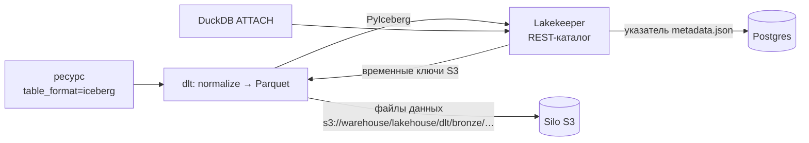
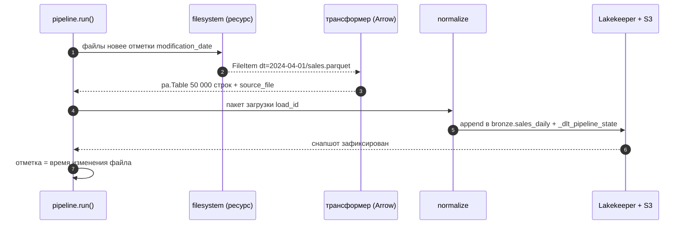

# 02 · dlt изнутри: ресурсы, нормализация, состояние и Iceberg

> [!info] Урок одной фразой
> dlt — это приёмщик склада, который делает за тебя скучную и опасную работу. Он
> распаковывает посылки любой формы в аккуратные коробки (схема и нормализация), помнит, какие
> накладные уже принял (состояние), и кладёт коробки на склад так, как ты попросил (способ
> записи). От тебя нужно одно: функция, которая отдаёт данные.

> [!todo] Чек-лист: после урока ты сможешь
> - [ ] написать ресурс, источник и трансформер dlt и запустить пайплайн;
> - [ ] объяснить три шага extract → normalize → load и найти, где лежит пакет загрузки;
> - [ ] предсказать, во что dlt превратит вложенный JSON, и управлять этим;
> - [ ] выбрать между строками-словарями и таблицами Arrow и обосновать выбор замером;
> - [ ] настроить инкремент, найти отметку в состоянии и восстановить её из хранилища;
> - [ ] передать dlt секреты через окружение и записать данные в Iceberg через Lakekeeper (лабы 04.1, 04.3, 04.4).

**Нужно для:** лаб [04.1](../labs/04.1_files_to_iceberg/README.md),
[04.3](../labs/04.3_postgres_to_lakehouse/README.md), [04.4](../labs/04.4_api_to_lakehouse/README.md).
**Карта урока:** [dlt-internals.canvas](../maps/dlt-internals.canvas).

---

## Шаг 0. Азбука: что делает dlt

**dlt** (data load tool) — Python-библиотека для загрузки данных. Это не сервис и не
оркестратор: обычный `import dlt` в скрипте, который можно запустить из терминала, из
Dagster (модуль 06) или из CI. Версия у нас — 1.30.

| В dlt | В аналогии «приёмщик склада» | Подробнее |
|---|---|---|
| Ресурс (resource) | Поставщик: откуда и какие посылки приходят | [dlt](../../../glossary/dlt.md) |
| Источник (source) | Договор с поставщиком: несколько ресурсов и общие настройки | [dlt](../../../glossary/dlt.md) |
| Пайплайн (pipeline) | Приёмка: куда класть и под каким именем | [dlt](../../../glossary/dlt.md) |
| Нормализация | Распаковать посылку в стандартные коробки | [нормализация](../../../glossary/nested-normalization.md) |
| Схема | Опись склада: какие полки и что на них лежит | [dlt](../../../glossary/dlt.md) |
| Состояние (state) | Журнал приёмщика: какие накладные уже приняты | [курсор](../../../glossary/incremental-cursor.md) |
| Пакет загрузки (load package) | Партия посылок, принятая за один раз | [dlt](../../../glossary/dlt.md) |
| Способ записи | Положить рядом / заменить всё / заменить по артикулу | [способы записи](../../../glossary/write-disposition.md) |

---

## Шаг 1. Зачем библиотека, если можно написать скрипт?

**Проблема.** Скрипт «прочитать из API, записать в базу» пишется за полчаса. Через месяц в нём
появляются: пагинация, повторы при сбоях, создание таблиц, приведение типов, новые колонки
источника, вложенные списки, запоминание отметки, восстановление после падения, отдельный код
под каждое хранилище. Это и есть 90% работы, и в каждом самописном загрузчике это делается
по-своему и с ошибками.

**Как устроено.** dlt разделяет загрузку на две части. **Твоя часть** — функция-генератор,
которая отдаёт данные (`yield`). **Часть dlt** — всё остальное: вывод схемы, нормализация,
создание и изменение таблиц, состояние, запись в нужное хранилище, повторы. Поменять хранилище
(DuckDB → Iceberg → Postgres) — значит поменять одну строку `destination=…`, а не переписать
загрузчик.

**Что из этого следует.** Бизнес-логики в загрузчике почти нет, поэтому он короткий. Сложность
переезжает в **настройку**: какой ключ у таблицы, какой способ записи, какой курсор. Ошибки
тоже там, и их видно в схеме и состоянии, а не в коде.

---

## Шаг 2. Кирпичики: ресурс, источник, трансформер, пайплайн

**Ресурс** — функция с декоратором `@dlt.resource`, которая отдаёт данные через `yield`. Отдавать
можно словари, списки словарей или таблицы Arrow (шаг 4). Имя ресурса — имя таблицы.

```python
@dlt.resource(name="stores", write_disposition="merge", primary_key="store_id")  # ①②③
def stores():
    yield from fetch_stores()        # ④ любые итерации: курсор БД, страницы API, файлы
```

| Метка | Что задаёт |
|---|---|
| ① `name` | имя таблицы в хранилище (по умолчанию — имя функции) |
| ② `write_disposition` | способ записи: `append` (по умолчанию), `replace`, `merge` (урок 01, шаг 5) |
| ③ `primary_key` | ключ для merge; может быть списком колонок |
| ④ генератор | dlt читает его лениво: память не растёт с объёмом |

**Источник** — функция с `@dlt.source`, возвращающая несколько ресурсов. Ей передают общие
настройки и секреты (шаг 6). Готовые источники dlt — тоже источники: `sql_database` (любая база
через SQLAlchemy), `filesystem` (файлы в S3 и на диске), `rest_api` (декларативный REST).

**Трансформер** — ресурс, который получает данные **от другого ресурса**. Соединяются оператором
`|`: `filesystem(...) | read_parquet()`. Первый перечисляет файлы, второй читает каждый файл.

**Подсказки** (hints) меняют настройки готового ресурса без переписывания:
`resource.apply_hints(write_disposition=…, primary_key=…, incremental=…, table_format=…)`,
`resource.with_name("sales_daily")`.

**Пайплайн** связывает данные с хранилищем:

```python
pipeline = dlt.pipeline(
    pipeline_name="freshretail_files",   # имя: по нему ищется рабочая папка и состояние
    destination=dlt.destinations.filesystem(bucket_url="s3://warehouse/lakehouse/dlt"),
    dataset_name="bronze",                # схема/namespace в хранилище
)
info = pipeline.run(stores())             # extract → normalize → load
```

> [!warning] Ловушка: имя пайплайна — это его память
> По `pipeline_name` dlt находит рабочую папку и состояние (отметки инкремента). Переименовал
> пайплайн — получил новый, «с чистого листа», и инкрементальная загрузка возьмёт всё заново.
> Два разных загрузчика с одним именем затрут состояние друг друга.

---

## Шаг 3. Три шага одного запуска: extract → normalize → load

**Проблема.** Если загрузка упала на середине, что будет при перезапуске? Что-то уже записано,
что-то нет.

**Как устроено.** `pipeline.run()` — это три шага, и между ними данные лежат **на диске** в
рабочей папке пайплайна:

```mermaid
flowchart LR
    G["Твой генератор<br/>yield"] --> E["extract<br/>сырые элементы → файлы"]
    E --> N["normalize<br/>схема, типы, вложенность →<br/>файлы по таблицам"]
    N --> L["load<br/>файлы → хранилище"]
    L --> D[("bronze")]
    E -. "пакет загрузки<br/>data/.dlt/pipelines/&lt;имя&gt;/" .- N
    N -. .- L
```

1. **Extract** читает генератор и сбрасывает элементы во временные файлы. На этом шаге
   работает инкремент: строки ниже отметки отбрасываются.
2. **Normalize** выводит схему: имена и типы колонок, вложенные структуры → дочерние таблицы
   (шаг 4). Результат — **пакет загрузки** (load package) с идентификатором `load_id`: по файлу
   на таблицу.
3. **Load** отправляет пакет в хранилище: создаёт или меняет таблицы и записывает файлы.

Пакет фиксируется в хранилище **таблицей `_dlt_loads`**: строка с `load_id` и статусом
появляется в конце успешной загрузки. Каждая строка данных несёт `_dlt_load_id`, поэтому
видно, какой загрузкой она пришла.

**Что из этого следует.**

- Если упал **load**, пакет остаётся на диске, и следующий `run()` **сначала догружает его**, а
  уже потом извлекает новые данные. В выводе это видно как «Pending packages are left in the
  pipeline and will be re-tried».
- Рабочая папка должна **переживать** перезапуск контейнера. У нас `DLT_DATA_DIR=/workspace/
  data/.dlt` (в `infra/docker/core.yaml`), то есть папка в репозитории, вне git.
- Посмотреть, что произошло: `dlt pipeline <имя> info` (состояние и пакеты), `dlt pipeline
  <имя> trace` (последний запуск по шагам), `print(info)` после `run()`.

---

## Шаг 4. Схема и нормализация: во что превращается вложенный JSON

**Проблема.** API отдаёт магазин, а внутри список товаров с акциями. В таблице хранилища нет
«списка внутри строки» (точнее, он есть не везде и неудобен в SQL). Как разложить?

**Как устроено.** Для строк-словарей normalize действует по трём правилам:

| Во входных данных | В хранилище | Пример |
|---|---|---|
| вложенный словарь | колонки через `__` | `meta: {source, page}` → `meta__source`, `meta__page` |
| вложенный список | **дочерняя таблица** `<родитель>__<поле>` | `items: [...]` → `promotions__items` |
| связь с родителем | служебные колонки дочерней таблицы | `_dlt_parent_id` = `_dlt_id` родителя, `_dlt_list_idx` = позиция в списке |

Типы колонок dlt **выводит из значений**: `int` → bigint, `float` → double, строка с датой ISO
→ timestamp. Имена приводит к `snake_case`. Глубину раскладки ограничивает
`max_table_nesting`: при `0` вложенные структуры сохраняются одной JSON-колонкой.

> [!example]- Попробуй сам: вложенная запись промо → две таблицы
> В `make shell` (хранилище — файл DuckDB во временной папке контейнера):
> ```bash
> python - <<'EOF'
> import dlt
>
> @dlt.resource(name="promotions", write_disposition="replace")
> def promotions():
>     # одна «запись» из API маркетинговой системы: магазин и вложенный список товаров
>     yield {"store_id": 0, "city_id": 0, "date": "2024-04-01",
>            "meta": {"source": "retail-api", "page": 1},
>            "items": [{"product_id": 4, "discount": 0.882}, {"product_id": 26, "discount": 0.898}]}
>
> pipeline = dlt.pipeline("sandbox_dlt", destination=dlt.destinations.duckdb("/tmp/sandbox_dlt.duckdb"),
>                         dataset_name="sandbox")
> print(pipeline.run(promotions()))
> for table in pipeline.default_schema.data_tables():
>     print(table["name"], "→", list(table["columns"]))
> EOF
> duckdb /tmp/sandbox_dlt.duckdb -c "
>   SELECT p.store_id, p.date, i.product_id, i.discount, i._dlt_list_idx
>   FROM sandbox.promotions p JOIN sandbox.promotions__items i ON i._dlt_parent_id = p._dlt_id"
> dlt pipeline sandbox_dlt info
> ```
> **Увидишь:** таблица `promotions` с колонками `meta__source`, `meta__page`, `_dlt_load_id`,
> `_dlt_id` и таблица `promotions__items` с `_dlt_parent_id`, `_dlt_list_idx`. Соединение
> возвращает 2 товара магазина 0. `info` показывает рабочую папку `/workspace/data/.dlt/
> pipelines` и завершённые пакеты.
> **Почему:** словарь раскладывается в колонки, список — в дочернюю таблицу со ссылкой на
> родителя.

**Строки или Arrow.** Если ресурс отдаёт **таблицу Arrow** (модуль 03, урок 02), dlt **не
нормализует** её построчно: схема берётся из Arrow, вложенные типы (`list<double>`) остаются
вложенными, данные копируются в файлы почти без затрат. Разница огромная:

| Как отдаём день продаж (50 тыс. строк) в DuckDB | Время | Таблиц |
|---|---|---|
| `table.to_pylist()` — список словарей | 35,6 с | 3: `sales_rows` + две дочерних по 1,2 млн строк |
| таблица Arrow целиком | 0,2 с | 1: массивы остались колонками `list` |

То же на Iceberg: встроенный трансформер `read_parquet()` из `dlt.sources.filesystem` отдаёт
**строки-словари**, и два дня продаж (100 тыс. строк) грузились 16,4 с с дочерними таблицами
по 2,4 млн строк. Свой трансформер, отдающий `pq.read_table(file)`, грузил те же данные 1,6 с.

> [!example]- Попробуй сам: строки против Arrow
> В `make shell`:
> ```bash
> python - <<'EOF'
> import time, dlt, pyarrow.parquet as pq
>
> day = pq.read_table("data/raw/freshretailnet_50k/data/eval.parquet",
>                     filters=[("dt", "=", "2024-06-26")])          # 50 000 строк, Arrow
>
> @dlt.resource(name="sales_rows")
> def as_rows():
>     yield day.to_pylist()           # список словарей Python
>
> @dlt.resource(name="sales_arrow")
> def as_arrow():
>     yield day                       # таблица Arrow целиком
>
> p = dlt.pipeline("sandbox_formats", dataset_name="sandbox",
>                  destination=dlt.destinations.duckdb("/tmp/sandbox_formats.duckdb"))
> for resource in (as_rows(), as_arrow()):
>     t = time.time(); p.run(resource)
>     print(f"{resource.name}: {time.time() - t:.1f} с", p.last_trace.last_normalize_info.row_counts)
> EOF
> ```
> **Увидишь:** `sales_rows` — около 35 с и дочерние таблицы `…__hours_sale`,
> `…__hours_stock_status` по 1 200 000 строк; `sales_arrow` — 0,2 с и одна таблица.
> **Почему:** словари проходят через Python построчно, а Arrow — колоночный формат, который
> пишется в Parquet пачками.

**Что из этого следует.**

- Для **больших табличных** данных (файлы, выгрузки из БД) отдавай Arrow. У `sql_database` для
  этого есть `backend="pyarrow"`.
- Для **вложенного JSON из API** нормализация — польза: dlt сам строит связанные таблицы.
- У таблиц Arrow dlt по умолчанию **не добавляет** `_dlt_load_id` и `_dlt_id`. Нужны служебные
  колонки — добавь свои (например, `source_file`) или задай переменную
  `NORMALIZE__PARQUET_NORMALIZER__ADD_DLT_LOAD_ID=true` — тогда появится `_dlt_load_id`.

> [!warning] Ловушка: тип меняется при выводе схемы
> Из строк-словарей dlt выводит тип по значению Python: `int32` колонки `holiday_flag` станет
> `bigint`, строка даты может стать timestamp. Из Arrow тип берётся как есть. Если bronze должен
> хранить типы источника «как есть», это аргумент за Arrow.

---

## Шаг 5. Инкремент и состояние: где dlt помнит отметку

**Проблема.** Инкремент требует хранить отметку между запусками (урок 01, шаг 3). Где её
хранить, чтобы не потерять?

**Как устроено.** Курсор объявляют аргументом ресурса или подсказкой:

```python
@dlt.resource(primary_key="store_id", write_disposition={"disposition": "merge", "strategy": "upsert"})
def stores(updated_at=dlt.sources.incremental(
        "updated_at",                         # колонка-курсор
        initial_value="2024-03-28T00:00:00Z",   # с чего начать в первый раз
        lag=3600)):                           # окно перечитывания, секунды (урок 01)
    yield from read_stores(since=updated_at.start_value)   # можно и фильтровать в источнике
```

dlt сам отбрасывает строки ниже отметки, а для `sql_database` ещё и добавляет условие в SQL-
запрос (`WHERE updated_at >= :отметка`). После загрузки отметка = максимум курсора.

**Состояние** (state) — словарь, где лежат отметки всех ресурсов. Оно хранится **в двух местах**:

1. в рабочей папке пайплайна (`data/.dlt/pipelines/<имя>/state.json`);
2. **в хранилище**, в служебной таблице `_dlt_pipeline_state`, и пишется **тем же пакетом**, что
   и данные.

Второе место важно: если рабочая папка пропала (новый компьютер, CI, очищенный контейнер),
`pipeline.sync_destination()` или первый `run()` восстановит состояние из хранилища. Поскольку
состояние пишется вместе с данными, они не расходятся: либо есть и данные, и новая отметка,
либо нет ни того, ни другого.

> [!example]- Попробуй сам: отметка, потеря рабочей папки и восстановление
> В `make shell`. Пишет в Iceberg, namespace `sandbox_ice`, — в конце урока команда очистки.
> ```bash
> python - <<'EOF'
> import dlt, os, s3fs
>
> STORES = [{"store_id": 1, "status": "open",   "updated_at": "2024-04-01T10:00:00Z"},
>           {"store_id": 2, "status": "open",   "updated_at": "2024-04-01T10:00:00Z"}]
>
> @dlt.resource(table_format="iceberg", write_disposition={"disposition": "merge", "strategy": "upsert"},
>               primary_key="store_id")
> def stores(updated_at=dlt.sources.incremental("updated_at")):
>     yield from STORES
>
> def make_pipeline():
>     return dlt.pipeline("sandbox_ice", dataset_name="sandbox_ice",
>                         destination=dlt.destinations.filesystem(bucket_url="s3://warehouse/lakehouse/dlt"))
>
> p = make_pipeline()
> p.run(stores()); print("1:", p.last_trace.last_normalize_info.row_counts)
> STORES.append({"store_id": 2, "status": "closed", "updated_at": "2024-04-02T09:00:00Z"})
> p.run(stores()); print("2:", p.last_trace.last_normalize_info.row_counts)
> state = p.state["sources"]["sandbox_ice"]["resources"]["stores"]["incremental"]["updated_at"]
> print("отметка:", state["last_value"])
>
> p.drop()                                     # стереть локальную рабочую папку пайплайна
> p = make_pipeline(); p.sync_destination()    # восстановить состояние из хранилища
> p.run(stores()); print("3 после восстановления:", p.last_trace.last_normalize_info.row_counts)
>
> fs = s3fs.S3FileSystem(endpoint_url=os.environ["S3_ENDPOINT"])
> print(sorted({path.split("/")[4] for path in fs.find("warehouse/lakehouse/dlt/sandbox_ice")}))
> EOF
> ```
> **Увидишь:** `1: stores 2`, `2: stores 1` (только изменившийся магазин), отметка
> `2024-04-02T09:00:00Z`, `3 после восстановления: {}` — ничего не загружено повторно. В S3:
> `_dlt_loads`, `_dlt_pipeline_state`, `_dlt_version`, `init`, `stores`.
> **Почему:** состояние вернулось из `_dlt_pipeline_state` в хранилище, и отметка отбросила уже
> загруженные строки.

> [!warning] Ловушка: тысячи строк с одинаковым курсором
> dlt сравнивает нестрого (`>=`) и, чтобы не загрузить граничные строки повторно, хранит в
> состоянии **хэши всех строк с последним значением курсора**. Если при начальной загрузке у
> всех 50 000 строк ассортимента одинаковый `updated_at`, состояние разрастётся до 50 000 хэшей.
> Мы видели такое на справочнике товаров: после первой загрузки в состоянии лежал хэш каждого
> из 865 товаров.
> Лечится начальной загрузкой без инкремента или курсором с большей точностью.

---

## Шаг 6. Конфигурация и секреты: откуда dlt берёт настройки

**Проблема.** Загрузчику нужны пароль к Postgres, ключи S3, ключ API. В коде им не место
(правило проекта: секреты только в `.env`).

**Как устроено.** Аргументы источников и хранилищ, у которых значение по умолчанию —
`dlt.secrets.value` или `dlt.config.value`, dlt **ищет сам**, по порядку:

1. **переменные окружения** с именем из секций через `__`: `SOURCES__<ИСТОЧНИК>__<АРГУМЕНТ>`,
   `DESTINATION__<ХРАНИЛИЩЕ>__<ПАРАМЕТР>`;
2. файл `.dlt/secrets.toml` в рабочей папке запуска (для секретов);
3. файл `.dlt/config.toml` (для несекретных настроек).

```python
@dlt.source(name="retail_api")
def retail_api(api_key: str = dlt.secrets.value):  # ← SOURCES__RETAIL_API__API_KEY
    ...
```

**У нас** переменные уже заданы в контейнере workspace из `.env` (`infra/docker/core.yaml`):

| Переменная | Для чего |
|---|---|
| `DESTINATION__FILESYSTEM__CREDENTIALS__*` | ключи S3 для записи в хранилище |
| `SOURCES__FILESYSTEM__CREDENTIALS__*` | ключи S3 для чтения `landing` |
| `SOURCES__SQL_DATABASE__CREDENTIALS` | строка подключения к `retail_oltp` |
| `SOURCES__RETAIL_API__API_KEY`, `RETAIL_API_URL` | ключ и адрес учебного API (урок 04) |
| `ICEBERG_CATALOG__ICEBERG_CATALOG_TYPE`, `…_CONFIG` | REST-каталог Lakekeeper для Iceberg (шаг 7) |
| `DLT_DATA_DIR` | рабочие папки пайплайнов в `data/.dlt` |

**Что из этого следует.** В коде загрузчика нет ни одного пароля. Тот же код работает в CI
(модуль 12), если там заданы те же переменные. `secrets.toml` удобен на ноутбуке, но у нас он не
нужен; если всё же заведёшь его, он должен быть в `.gitignore`.

---

## Шаг 7. Запись в Iceberg через Lakekeeper

**Проблема.** dlt по умолчанию пишет в «файловое хранилище» Parquet-файлы без таблиц. Нам нужен
Iceberg, зарегистрированный в Lakekeeper, чтобы таблицы читал DuckDB и любые другие движки.

**Как устроено.** Iceberg в dlt — это **формат таблицы** у хранилища `filesystem`:

```python
@dlt.resource(table_format="iceberg")            # ① формат таблицы
def sales(): ...

pipeline = dlt.pipeline(
    "freshretail_files", dataset_name="bronze",      # ② dataset → namespace bronze
    destination=dlt.destinations.filesystem(
        bucket_url="s3://warehouse/lakehouse/dlt"))  # ③ корень файлов внутри warehouse
```

| Метка | Что важно |
|---|---|
| ① | без `table_format="iceberg"` получатся просто Parquet-файлы, каталог о них не узнает |
| ② | `dataset_name` становится namespace в Lakekeeper, имя ресурса — именем таблицы |
| ③ | Lakekeeper разрешает создавать таблицы только **внутри** своего warehouse `s3://warehouse/lakehouse/`. Иначе — `InvalidLocation: Provided location … is not a valid sublocation of the storage profile s3://warehouse/lakehouse` |

Каталог dlt берёт из переменных `ICEBERG_CATALOG__…` (REST, адрес Lakekeeper, warehouse
`lakehouse`). Служебные таблицы dlt (`_dlt_loads`, `_dlt_pipeline_state`, `_dlt_version`) лежат
рядом **обычными файлами** в `s3://warehouse/lakehouse/dlt/<dataset>/`, в каталоге их нет.

**Способы записи в Iceberg** (dlt 1.30): `append`, `replace`, `merge` со стратегиями `upsert` и
`insert-only`. Upsert идёт пачками по 1 000 строк, и каждая — отдельный коммит (урок 01, шаг 5).
Поэтому для больших фактов — append с защитой от повторов.



> [!warning] Ловушка: таблица есть, а DuckDB её не видит
> Если забыть `table_format="iceberg"`, загрузка пройдёт успешно, файлы появятся в S3, но в
> каталоге таблицы не будет: `ATTACH … TYPE iceberg` покажет пустой namespace. Проверяй
> `catalog.list_tables("bronze")` после первой загрузки.

**Очистка песочниц урока.** В `make shell`:

```bash
python - <<'EOF'
import os, shutil, s3fs
from pyiceberg.catalog import load_catalog
catalog = load_catalog("lh", type="rest", uri=os.environ["ICEBERG_CATALOG_URI"],
                       warehouse=os.environ["ICEBERG_WAREHOUSE"])
for table in catalog.list_tables("sandbox_ice"):
    catalog.purge_table(table)
catalog.drop_namespace("sandbox_ice")
s3fs.S3FileSystem(endpoint_url=os.environ["S3_ENDPOINT"]).rm(
    "warehouse/lakehouse/dlt/sandbox_ice", recursive=True)
for name in ("sandbox_dlt", "sandbox_ice", "sandbox_formats"):
    shutil.rmtree(f"data/.dlt/pipelines/{name}", ignore_errors=True)
print("namespaces:", catalog.list_namespaces())
EOF
```

---

## Сборка целиком

Загрузка дневных файлов продаж из `landing` в `bronze` (каркас лабы 04.1, без деталей решения):



| Шаг | Если сломается | Симптом |
|---|---|---|
| 1 | нет ключей S3 в окружении | `ConfigFieldMissingException` с подсказкой имени переменной |
| 3 | трансформер отдаёт словари | загрузка медленная, появились `…__hours_sale` |
| 5 | путь вне `s3://warehouse/lakehouse/` | `InvalidLocation … not a valid sublocation` |
| 5 | забыт `table_format` | файлы есть, таблицы в каталоге нет |
| 7 | рабочая папка потеряна | состояние восстановится из `_dlt_pipeline_state` |

## Шпаргалка

| Хочу | Как |
|---|---|
| Ресурс | `@dlt.resource(name=…, write_disposition=…, primary_key=…)` + `yield` |
| Прочитать файлы и передать дальше | `filesystem(bucket_url, file_glob) \| мой_трансформер()` |
| Поменять настройки готового ресурса | `.apply_hints(…)`, `.with_name(…)` |
| Инкремент | `dlt.sources.incremental("колонка", initial_value=…, lag=…)` |
| Увидеть состояние | `dlt pipeline <имя> info -v`, `pipeline.state` |
| Последний запуск по шагам | `dlt pipeline <имя> trace`, `pipeline.last_trace` |
| Таблицы схемы | `pipeline.default_schema.data_tables()` |
| Писать в Iceberg | `table_format="iceberg"` + `filesystem(bucket_url="s3://warehouse/lakehouse/…")` |
| Быстро грузить таблицы | отдавать `pa.Table`; `sql_database(backend="pyarrow")` |
| Вложенное — одной JSON-колонкой | `max_table_nesting=0` |
| Секрет | аргумент `= dlt.secrets.value` + переменная `SOURCES__…` |

## Типичные ошибки

| Симптом | Причина | Как проверить | Как чинить |
|---|---|---|---|
| `ConfigFieldMissingException` | dlt не нашёл настройку | в тексте ошибки — имена переменных, где искал | задать переменную в `core.yaml` из `.env` |
| Загрузка взяла всё заново | новое имя пайплайна или потеряна рабочая папка без `sync_destination` | `dlt pipeline --list-pipelines`, `info` | вернуть имя; состояние восстановится из хранилища |
| «Pending packages … will be re-tried» | прошлая загрузка упала на шаге load | `dlt pipeline <имя> info` | запустить снова или разобрать и `abort-packages` |
| Дочерние таблицы `…__hours_sale` | ресурс отдаёт словари со списками | список таблиц схемы | отдавать Arrow или `max_table_nesting=0` |
| `InvalidLocation` | `bucket_url` вне warehouse Lakekeeper | путь в ошибке | `s3://warehouse/lakehouse/…` |
| `delete-insert … not supported` | такой стратегии для Iceberg нет | текст ошибки: доступные стратегии | `upsert`, `insert-only` или append + дедупликация |

## Проверь себя

Карточки — в [flashcards.md](../flashcards.md).

> [!question] 1. Загрузка упала на шаге load. Ты исправил причину и снова вызвал `run()` с новыми данными. Что загрузится первым?
> > [!success]- Ответ
> > Сначала незавершённый пакет с прошлого раза: он лежит на диске в рабочей папке. Только
> > потом extract возьмёт новые данные. Поэтому важно, чтобы рабочая папка не терялась.

> [!question] 2. Почему состояние пишется в хранилище тем же пакетом, что и данные?
> > [!success]- Ответ
> > Чтобы они не разошлись. Если бы отметка сохранялась отдельно, падение между записью данных
> > и записью отметки дало бы либо потерю (отметка есть, данных нет), либо повтор. В одном
> > пакете они фиксируются вместе.

> [!question] 3. API отдаёт товар с полем `prices: [{"date": …, "value": …}, …]`. Какие таблицы появятся в хранилище и как их соединить?
> > [!success]- Ответ
> > `products` и дочерняя `products__prices` с колонками `date`, `value`, `_dlt_parent_id`,
> > `_dlt_list_idx`, `_dlt_id`. Соединение: `products__prices._dlt_parent_id = products._dlt_id`.

> [!question] 4. Коллега предлагает читать файлы продаж встроенным `read_parquet()`, «потому что он готовый». Что ты возразишь, опираясь на замер?
> > [!success]- Ответ
> > Встроенный трансформер отдаёт строки-словари: загрузка в 10 раз медленнее (16,4 с против
> > 1,6 с на 100 тыс. строк), массивы разлетаются в дочерние таблицы по 2,4 млн строк, типы
> > расширяются. Свой трансформер с `pq.read_table` сохраняет схему источника как есть.
