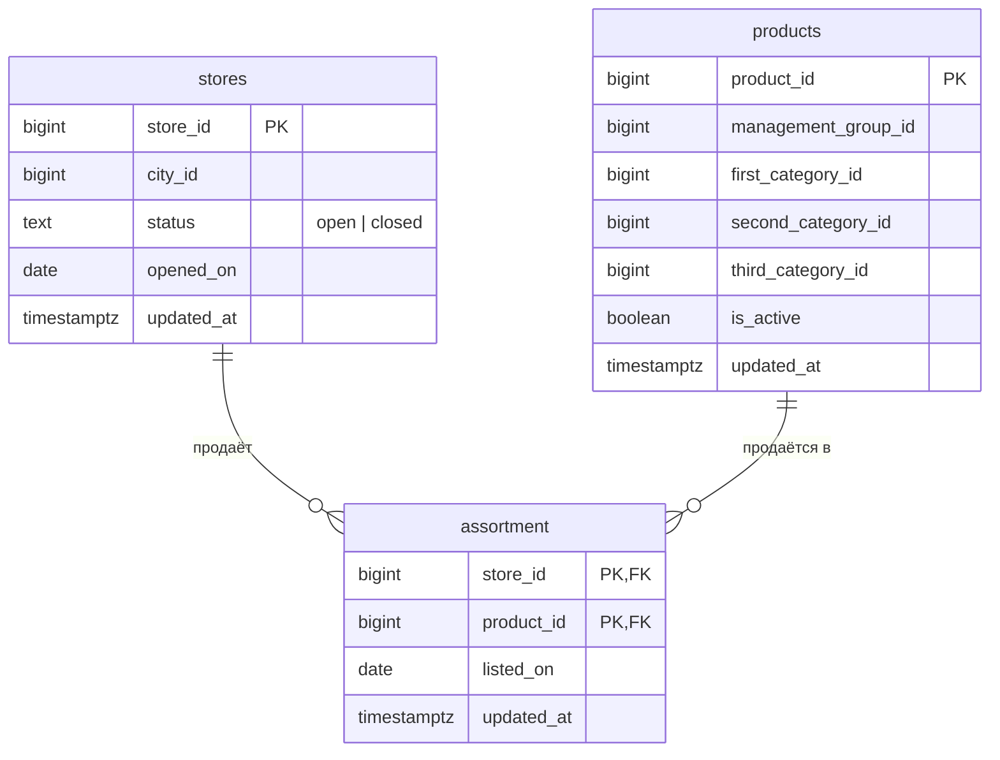
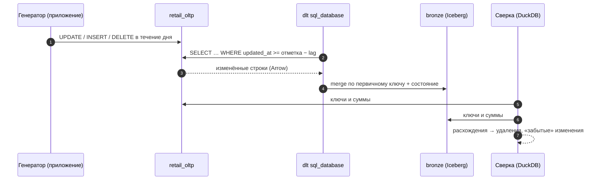

# 03 · Учётная система как источник: Postgres, транзакции и выгрузка справочников

> [!info] Урок одной фразой
> Учётная система — это кассы и бухгалтерия магазина. Им нельзя мешать, и они не обязаны
> облегчать тебе жизнь. Чтобы забирать оттуда справочники без потерь, надо понимать три вещи.
> Как база видит изменения (транзакции и снимки). Где приложение «срезает углы» (забытый
> `updated_at`, физические удаления). Как проверить, что ты забрал всё.

> [!todo] Чек-лист: после урока ты сможешь
> - [ ] описать таблицу Postgres с ключами, ограничениями и значениями по умолчанию;
> - [ ] загрузить справочник из Parquet в Postgres через DuckDB;
> - [ ] объяснить транзакцию, MVCC и уровень изоляции и предсказать, что увидит загрузчик;
> - [ ] поставить триггер, который сам выставляет `updated_at`, и объяснить, от чего он не спасает;
> - [ ] выгрузить таблицы из Postgres через dlt `sql_database` полностью и инкрементально;
> - [ ] сверить источник и копию по ключам одним запросом DuckDB (лабы 04.2, 04.3).

> [!tip] Визуализация темы
> Видео с озвучкой (3:08): [cursor_vs_log.mp4](../visuals/cursor_vs_log.mp4) — три дыры курсора `updated_at` (без штампа, удаление, долгая транзакция), окно перечитывания, журнал WAL и события Debezium.

**Нужно для:** лаб [04.2](../labs/04.2_retail_oltp/README.md) и
[04.3](../labs/04.3_postgres_to_lakehouse/README.md).
**Карта урока:** [oltp-source.canvas](../maps/oltp-source.canvas).

---

## Шаг 0. Азбука: что такое учётная система сети

В датасете FreshRetailNet нет «учётной системы», только факты продаж. Но идентификаторы в нём
описывают сущности, которые в настоящей сети живут в OLTP-базе (модуль 02, урок 04):

- магазины: `store_id` → `city_id`;
- товары: `product_id` → `management_group_id` и три уровня категорий;
- ассортимент: какие товары продаются в каком магазине.

Мы **поднимаем такую базу сами** — `retail_oltp` в нашем Postgres. Её жизнь эмулирует генератор
изменений `scripts/retail_oltp_changes.py`.



| В учётной системе | В аналогии «кассы и бухгалтерия» | Подробнее |
|---|---|---|
| OLTP-база | кассы: много мелких операций, мешать нельзя | [OLTP и OLAP](../../../glossary/oltp-olap.md) |
| Транзакция | одна операция кассира: либо пробита целиком, либо не пробита | [транзакция](../../../glossary/transaction.md) |
| MVCC, снимок | у каждого кассира свой взгляд на склад на момент начала операции | [транзакция](../../../glossary/transaction.md) |
| Триггер | правило: «при любой правке накладной ставь штамп времени» | [триггер](../../../glossary/trigger.md) |
| Физическое удаление | накладную выбросили — следов не осталось | [CDC](../../../glossary/cdc.md) |
| Сверка | инвентаризация: сравнить учёт с реальностью | [сверка](../../../glossary/reconciliation.md) |

---

## Шаг 1. Как описать таблицу в Postgres

**Проблема.** В лабе 04.2 ты создаёшь `retail_oltp` по контракту. Нужен минимум DDL: типы,
ключи, ограничения.

**Как устроено.** `CREATE TABLE` задаёт колонки с типами и **ограничения** (constraints) —
правила, которые база проверяет при каждой записи и не даст нарушить:

```sql
CREATE TABLE demo_stores (
    store_id   bigint      PRIMARY KEY,                                   -- ① уникален и не NULL
    city_id    bigint      NOT NULL,                                      -- ② обязателен
    status     text        NOT NULL CHECK (status IN ('open', 'closed')), -- ③ допустимые значения
    opened_on  date        NOT NULL,
    updated_at timestamptz NOT NULL DEFAULT now()                         -- ④ значение по умолчанию
);
CREATE TABLE demo_assortment (
    store_id   bigint REFERENCES demo_stores (store_id),                  -- ⑤ внешний ключ
    product_id bigint,
    PRIMARY KEY (store_id, product_id)                                    -- ⑥ составной ключ
);
CREATE INDEX ON demo_stores (updated_at);                                 -- ⑦ индекс для курсора
```

| Метка | Что даёт |
|---|---|
| ① `PRIMARY KEY` | уникальность и NOT NULL; по нему загрузчик делает merge. dlt `sql_database` **читает первичные ключи из базы сам** |
| ② `NOT NULL` | строку без значения база не примет |
| ③ `CHECK` | любое условие на значения строки |
| ④ `DEFAULT` | значение, если колонку не указали в INSERT. Только при вставке — при UPDATE `DEFAULT` не срабатывает |
| ⑤ `REFERENCES` | внешний ключ: нельзя сослаться на несуществующий магазин и удалить магазин, на который ссылаются |
| ⑥ составной ключ | уникальна пара значений |
| ⑦ индекс | `WHERE updated_at > …` не будет читать всю таблицу |

Типы:

- `bigint` — 64-битное целое (как `BIGINT` в DuckDB и `long` в Iceberg);
- `text` — строка любой длины;
- `date` — дата;
- `timestamptz` — момент времени с часовым поясом (хранится в UTC);
- `boolean` — истина/ложь.

> [!warning] Ловушка: `DEFAULT now()` не обновляет `updated_at`
> Не рассчитывай на `DEFAULT now()` при UPDATE: обновлять колонку умеет только триггер (шаг 3).
> `DEFAULT` срабатывает только при INSERT. При UPDATE колонка сохранит старое значение, если
> приложение само его не поменяет. Именно так ведёт себя операция `recategorize` генератора, и
> поэтому инкремент её не видит (урок 01, шаг 3).

---

## Шаг 2. Как наполнить Postgres из Parquet

**Проблема.** Справочники надо **вывести** из датасета (уникальные магазины, товары, пары
магазин × товар) и записать в Postgres.

**Как устроено.** Удобнее всего через DuckDB: у него есть расширение `postgres`, которое
подключает базу Postgres как схему. Запрос читает Parquet и пишет **прямо в Postgres** одним
SQL:

```sql
INSTALL postgres; LOAD postgres;
ATTACH 'host=postgres dbname=retail_oltp' AS pg (TYPE postgres);   -- ① подключить базу
INSERT INTO pg.public.demo_stores                                   -- ② писать в таблицу Postgres
SELECT store_id, any_value(city_id), 'open', min(dt)::date, now()   -- ③ вывести справочник
FROM read_parquet('data/raw/freshretailnet_50k/data/*.parquet')
GROUP BY store_id;
```

| Метка | Что важно |
|---|---|
| ① | Пользователь и пароль DuckDB берёт из переменных `PGUSER` и `PGPASSWORD` или из строки подключения. Переменные можно задать перед запуском, как в примере ниже. |
| ② | Создай таблицу заранее, если нужны свои ограничения. `CREATE TABLE … AS` в Postgres через ATTACH создаст таблицу **без ключей**. |
| ③ | `any_value` берёт любое значение группы. Это корректно, только если значение в группе одно. **Проверь** это (модуль 00, урок 09): у магазина один город, у товара одна категория. |

Альтернативы: `COPY` через psycopg (быстро, но больше кода) или dlt с хранилищем `postgres`.

> [!example]- Попробуй сам: песочница, загрузка через DuckDB и время в транзакции
> В `make shell`. Создаёт базу `sandbox_oltp` и в конце удаляет её.
> ```bash
> export PGHOST=postgres PGUSER=$POSTGRES_USER PGPASSWORD=$POSTGRES_PASSWORD
> psql -d postgres -qc "CREATE DATABASE sandbox_oltp"
> export PGDATABASE=sandbox_oltp
> duckdb <<'EOF'
> INSTALL postgres; LOAD postgres;
> ATTACH 'host=postgres dbname=sandbox_oltp' AS pg (TYPE postgres);
> CREATE TABLE pg.public.stores AS
>   SELECT store_id, any_value(city_id) AS city_id, 'open' AS status, now() AS updated_at
>   FROM read_parquet('data/raw/freshretailnet_50k/data/train.parquet') GROUP BY store_id;
> SELECT count(*) FROM pg.public.stores;
> EOF
> psql -c "BEGIN; SELECT now() AS tx_start, clock_timestamp() AS wall; SELECT pg_sleep(2);
>          SELECT now() AS tx_start, clock_timestamp() AS wall; COMMIT;"
> ```
> Базу **не удаляй** — она нужна в следующих «Попробуй сам» этого урока.
> **Увидишь:** 898 магазинов. Во втором SELECT `tx_start` тот же, что в первом, а `wall` ушёл
> на 2 секунды вперёд.
> **Почему:** `now()` — время начала транзакции, одно на всю транзакцию; `clock_timestamp()` —
> настоящее время в момент вызова.

---

## Шаг 3. Транзакции и снимки: что видит загрузчик

**Проблема.** Генератор меняет `retail_oltp`, пока загрузчик её читает. Что увидит загрузчик:
половину изменений? Строку ассортимента нового магазина без самого магазина?

**Как устроено.** **Транзакция** — группа операций, которая выполняется **целиком или никак**
(atomicity, буква A в ACID). Операция `new_store` генератора — одна транзакция: INSERT магазина
и INSERT его ассортимента. Если она упадёт посередине, не останется ни того, ни другого.

Чтобы читатели не ждали писателей, Postgres использует **MVCC** (multi-version concurrency
control, многоверсионность). При UPDATE старая версия строки не стирается: рядом пишется новая,
помеченная номером транзакции. Каждая транзакция читает по **снимку** (snapshot) — правилу «какие
версии мне видны». Видны только версии **зафиксированных** транзакций.

Когда делается снимок, определяет **уровень изоляции**:

| Уровень | Снимок | Что это значит для загрузчика |
|---|---|---|
| `READ COMMITTED` (по умолчанию в Postgres) | новый на **каждый запрос** | два запроса подряд могут увидеть разные данные: между ними кто-то зафиксировал изменения |
| `REPEATABLE READ` | один на **всю транзакцию** | все запросы транзакции видят базу на один момент — согласованная выгрузка нескольких таблиц |
| `SERIALIZABLE` | как REPEATABLE READ + проверка конфликтов | для выгрузки не нужен |

```mermaid
sequenceDiagram
    autonumber
    participant G as Генератор: new_store
    participant DB as Postgres
    participant L as Загрузчик (READ COMMITTED)
    L->>DB: SELECT * FROM stores
    DB-->>L: 898 магазинов
    G->>DB: BEGIN; INSERT store 898; INSERT 20 строк ассортимента; COMMIT
    L->>DB: SELECT * FROM assortment
    DB-->>L: 50 020 строк, включая магазин 898
    Note over L: ассортимент ссылается на магазин, которого нет в выгрузке stores
```

**Что из этого следует.**

- dlt `sql_database` читает каждую таблицу **своим запросом**, то есть по своему снимку.
  Выгрузка трёх таблиц не согласована между собой: ассортимент может сослаться на магазин,
  который в выгрузку магазинов не попал. Это нормально для bronze, но в silver проверку
  ссылочной целостности (модуль 05) надо делать с учётом таких «сирот», а следующая загрузка
  их исправит.
- Видимость наступает **при фиксации**, а `now()` — время начала. Отсюда потеря строк долгой
  транзакции курсором (урок 01, шаг 3) и необходимость окна перечитывания.

> [!tip] Клеппман, гл. 7
> В главе 7 «Транзакции» подробно разобраны уровни изоляции, аномалии чтения и снимки. Для
> модуля достаточно разделов про read committed и snapshot isolation.

---

## Шаг 4. Триггер: штамп времени, который не забудешь

**Проблема.** Приложение не всегда обновляет `updated_at` (операция `recategorize`). Переписать
приложение нельзя. Можно ли заставить базу ставить штамп самой?

**Как устроено.** **Триггер** — функция, которую база вызывает автоматически при событии над
таблицей. Для `updated_at` нужен триггер `BEFORE UPDATE … FOR EACH ROW`: перед записью каждой
изменённой строки функция получает новую версию строки в переменной `NEW`, меняет в ней поле и
возвращает её. Записана будет уже изменённая версия.

```sql
CREATE FUNCTION set_updated_at() RETURNS trigger LANGUAGE plpgsql AS $$   -- ① функция-триггер
BEGIN
  NEW.updated_at := clock_timestamp();   -- ② время фактического изменения строки
  RETURN NEW;                             -- ③ вернуть изменённую строку для записи
END $$;
CREATE TRIGGER stores_set_updated_at BEFORE UPDATE ON stores   -- ④ когда и на какой таблице
  FOR EACH ROW EXECUTE FUNCTION set_updated_at();               -- ⑤ для каждой строки
```

| Метка | Что важно |
|---|---|
| ① | язык `plpgsql`; тело функции между `$$ … $$`. Одну функцию можно повесить на много таблиц |
| ② | `clock_timestamp()` вместо `now()`: в долгой транзакции время ближе к моменту изменения |
| ③ | `BEFORE`-триггер обязан вернуть строку; `RETURN NULL` отменит запись |
| ④ | триггер на каждую таблицу — отдельный `CREATE TRIGGER` |
| ⑤ | `FOR EACH ROW` — вызов на каждую строку; `FOR EACH STATEMENT` — один раз на запрос, без `NEW` |

> [!example]- Попробуй сам: триггер ставит штамп за приложение
> В `make shell`, в той же песочнице `sandbox_oltp` (переменные `PG*` из прошлого примера):
> ```bash
> psql <<'SQL'
> CREATE FUNCTION set_updated_at() RETURNS trigger LANGUAGE plpgsql AS $$
> BEGIN
>   NEW.updated_at := clock_timestamp();
>   RETURN NEW;
> END $$;
> CREATE TRIGGER stores_set_updated_at BEFORE UPDATE ON stores
>   FOR EACH ROW EXECUTE FUNCTION set_updated_at();
> SELECT updated_at AS before FROM stores WHERE store_id = 5;
> UPDATE stores SET status = 'closed' WHERE store_id = 5;     -- updated_at не указан
> SELECT updated_at AS after FROM stores WHERE store_id = 5;
> SQL
> ```
> **Увидишь:** `after` позже `before`, хотя UPDATE не трогал `updated_at`.
> **Почему:** триггер подменил поле в новой версии строки перед записью.

**Что из этого следует.** Триггер закрывает дыру «забытый `updated_at`», но **не две
другие**. Удалённую строку он не вернёт: её просто нет. Время всё равно ставится до фиксации,
поэтому окно перечитывания для долгих транзакций по-прежнему нужно.

> [!warning] Ловушка: триггер в чужой базе
> Не ставь триггер в чужую базу без согласования с её командой. Триггер замедляет каждую запись
> и может сломать их миграции. В нашей учебной базе триггер ставишь ты. В настоящей учётной
> системе это аргумент в переговорах, а не действие по умолчанию.

---

## Шаг 5. dlt `sql_database`: полная и инкрементальная выгрузка

**Проблема.** Нужно забрать три таблицы в bronze и обновлять их каждый день.

**Как устроено.** Источник `sql_database` подключается к базе через SQLAlchemy, **отражает**
(reflection) схему таблиц — колонки, типы, первичные ключи — и создаёт по ресурсу на таблицу:

```python
from dlt.sources.sql_database import sql_database

source = sql_database(                       # строка подключения — из SOURCES__SQL_DATABASE__CREDENTIALS
    table_names=["stores", "products", "assortment"],
    backend="pyarrow",                        # ① читать пачками в Arrow, а не строками
    chunk_size=50_000,                        # ② размер пачки
)
source.resources["stores"].apply_hints(       # ③ настройки отдельной таблицы
    table_format="iceberg",
    write_disposition="replace",              #    полная загрузка …
    # write_disposition={"disposition": "merge", "strategy": "upsert"},
    # incremental=dlt.sources.incremental("updated_at", lag=3600),   … или инкремент
)
```

| Метка | Что важно |
|---|---|
| ① | Backend `pyarrow` даёт ту же выгоду, что и Arrow в уроке 02. |
| ② | Пачка ограничивает память. |
| ③ | Каждой таблице — свой способ. Один источник может грузить справочник целиком, а соседнюю таблицу — инкрементально. |

С инкрементом dlt **добавляет условие в SQL-запрос** (`WHERE updated_at >= :отметка`), так что
база отдаёт только новые строки, а не всю таблицу.

**Полная или инкрементальная — что дешевле у нас?** Решение зависит от размера таблицы, доли
изменений и **цены записи в хранилище**. В нашем стеке merge в Iceberg дорогой (урок 01, шаг 5):
пачки по 1 000 строк, коммит на каждую. Первая загрузка трёх справочников (52 тыс. строк)
через upsert заняла 166 с. Сколько стоит replace тех же таблиц, ты измеришь в лабе 04.3. Там
же проверишь, что каждый вариант видит после работы генератора.

> [!warning] Ловушка: инкремент на начальной загрузке
> Для большой таблицы делай первую загрузку отдельно (replace), а инкремент включай со
> следующей. Первая инкрементальная загрузка читает **всё**: отметки ещё нет. Для merge это
> самая дорогая загрузка за всю жизнь пайплайна.

---

## Шаг 6. Сверка: как убедиться, что забрал всё

**Проблема.** Ошибки курсора тихие (урок 01, шаг 3). Как их поймать?

**Как устроено.** **Сверка** (reconciliation) сравнивает источник и копию тремя уровнями
точности:

| Уровень | Запрос | Что ловит | Цена |
|---|---|---|---|
| Число строк | `count(*)` с обеих сторон | пропуски и дубли — если они не компенсируют друг друга | минимальная |
| Контрольные суммы | `sum`, `count(DISTINCT …)` по ключевым колонкам | изменения значений без изменения числа строк | низкая |
| Разница ключей | `ANTI JOIN` по ключу в обе стороны | какие именно строки пропали или лишние | средняя, читает все ключи |

DuckDB удобен тем, что подключает **обе стороны в одном запросе**: Postgres через `ATTACH …
TYPE postgres`, Iceberg через `ATTACH … TYPE iceberg` (модуль 03). Запрос с `ANTI JOIN`
возвращает ключи, которые есть слева, но нет справа.

> [!example]- Попробуй сам: сверка ключей одним запросом
> В `make shell`, в песочнице `sandbox_oltp`. Удаляем два магазина «в учётной системе» и ищем их
> сверкой с датасетом:
> ```bash
> psql -qc "DELETE FROM stores WHERE store_id IN (7, 42)"
> duckdb <<'EOF'
> INSTALL postgres; LOAD postgres;
> ATTACH 'host=postgres dbname=sandbox_oltp' AS pg (TYPE postgres, READ_ONLY);
> WITH src AS (SELECT DISTINCT store_id FROM read_parquet('data/raw/freshretailnet_50k/data/train.parquet'))
> SELECT (SELECT count(*) FROM src) AS in_dataset, (SELECT count(*) FROM pg.public.stores) AS in_oltp,
>        (SELECT list(store_id ORDER BY store_id) FROM src ANTI JOIN pg.public.stores USING (store_id)) AS missing;
> EOF
> psql -d postgres -qc "DROP DATABASE sandbox_oltp"     # песочница больше не нужна
> ```
> **Увидишь:** `in_dataset 898 · in_oltp 896 · missing [7, 42]`.
> **Почему:** `ANTI JOIN` оставляет строки слева, для которых справа нет пары по ключу.
> `READ_ONLY` защищает учётную базу от случайной записи.

**Что из этого следует.** Сверка — часть загрузки, а не ручная проверка «когда-нибудь». В лабе
04.3 ты оформишь её запросом в `queries.sql`, в модуле 09 она станет автоматической проверкой
качества.

---

## Сборка целиком

Ежедневная выгрузка справочников с инкрементом и сверкой:



| Шаг | Что теряется | Как заметить |
|---|---|---|
| 1 | UPDATE без `updated_at`, DELETE | сверка: суммы и разница ключей |
| 2 | долгие транзакции, если окно мало | сверка по ключам за последние часы |
| 4 | строки при неверном ключе merge | `count(*)` против `count(DISTINCT ключ)` |
| 5–7 | — | это и есть проверка |

## Шпаргалка

| Хочу | Как |
|---|---|
| Таблица с ключом и проверкой значений | `PRIMARY KEY`, `NOT NULL`, `CHECK (…)`, `REFERENCES` |
| Писать в Postgres из Parquet | DuckDB: `ATTACH 'host=… dbname=…' AS pg (TYPE postgres)` → `INSERT INTO pg.public.t SELECT …` |
| Штамп времени при любом UPDATE | триггер `BEFORE UPDATE … FOR EACH ROW` с `NEW.updated_at := clock_timestamp()` |
| Время начала транзакции / текущее | `now()` / `clock_timestamp()` |
| Выгрузка таблиц | `sql_database(table_names=[…], backend="pyarrow")` |
| Согласованная выгрузка нескольких таблиц | одна транзакция `REPEATABLE READ` (dlt по умолчанию так не делает) |
| Найти пропавшие ключи | `… ANTI JOIN … USING (ключ)` в DuckDB с ATTACH обеих сторон |
| Посмотреть, что делает база сейчас | `SELECT pid, state, xact_start, query FROM pg_stat_activity` |

## Типичные ошибки

| Симптом | Причина | Как проверить | Как чинить |
|---|---|---|---|
| `duplicate key value violates unique constraint` | повторная вставка того же ключа | какой ключ в тексте ошибки | загружать один раз или `INSERT … ON CONFLICT DO NOTHING` |
| `violates foreign key constraint` | ассортимент ссылается на несуществующий магазин | порядок загрузки таблиц | сначала `stores` и `products`, потом `assortment` |
| `any_value` дал «случайную» категорию | у товара в данных несколько значений | `count(DISTINCT …)` по группе | выбрать правило (последнее значение) или исправить grain |
| После UPDATE `updated_at` прежний | нет триггера, `DEFAULT` работает только при INSERT | `\d+ stores` — есть ли триггер | триггер `BEFORE UPDATE` |
| В bronze больше строк ассортимента, чем в источнике | удаления не видны инкременту | сверка ключей | полная загрузка, сверка ключей, CDC (модуль 08) |
| Загрузчик ждёт и не отвечает | долгая транзакция держит блокировку (DDL) | `pg_stat_activity`, `pg_locks` | дождаться или завершить транзакцию |

## Проверь себя

Карточки — в [flashcards.md](../flashcards.md).

> [!question] 1. Почему `DEFAULT now()` у `updated_at` не решает проблему операции `recategorize`?
> > [!success]- Ответ
> > `DEFAULT` срабатывает только при INSERT, а `recategorize` — это UPDATE без указания
> > `updated_at`. Колонка сохраняет старое значение. Обновлять при UPDATE умеет только триггер.

> [!question] 2. Загрузчик в READ COMMITTED выгрузил `stores`, потом `assortment`. Между запросами генератор открыл новый магазин. Что окажется в bronze и плохо ли это?
> > [!success]- Ответ
> > В `assortment` будут строки нового магазина, а в `stores` его не будет: каждая таблица
> > прочитана по своему снимку. Для bronze это допустимо, следующая загрузка добавит магазин. В
> > silver такие «сироты» надо учитывать при проверке ссылочной целостности.

> [!question] 3. Ты поставил триггер с `clock_timestamp()`. Нужно ли теперь окно перечитывания?
> > [!success]- Ответ
> > Да. Время ставится при изменении строки, а видимой она становится при фиксации. В долгой
> > транзакции между ними может пройти много времени, и курсор уйдёт вперёд.

> [!question] 4. Сверка показала: `count(*)` в источнике и в bronze совпадают. Значит ли это, что копия точная?
> > [!success]- Ответ
> > Нет. Одна потерянная строка и один дубль дают то же число. Изменённые значения тоже не
> > меняют число строк. Нужны контрольные суммы и разница ключей в обе стороны.
