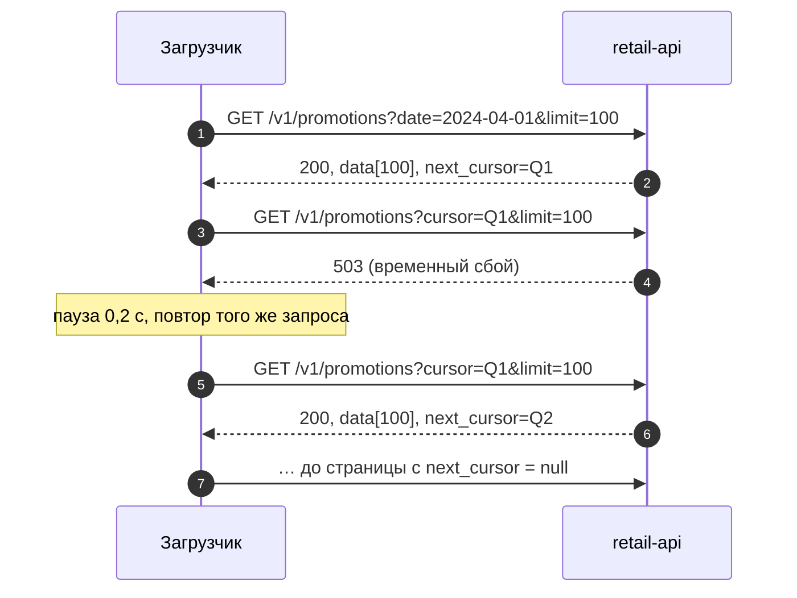
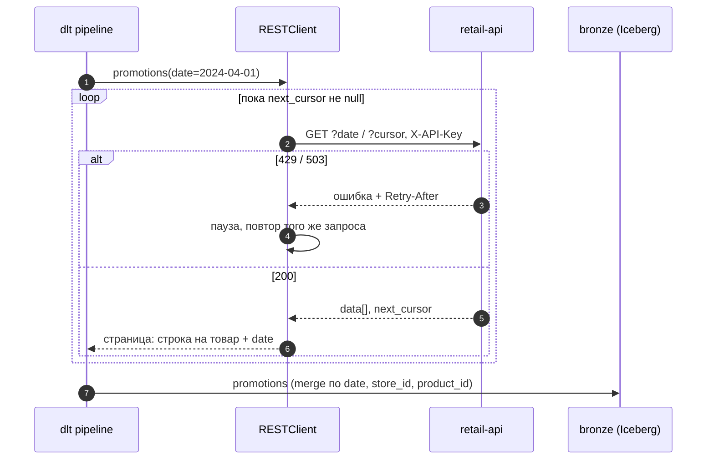

# 04 · Загрузка из API: HTTP, пагинация, лимиты и повторы

> [!info] Урок одной фразой
> API — это окошко выдачи на чужом складе. Без пропуска не обслужат (ключ), за раз выдают
> одну пачку и талончик на следующую (пагинация). Если торопишь, просят подождать (429), иногда
> окошко закрыто на минуту (503). Хороший приёмщик стоит в очереди вежливо, приходит снова через
> разумное время и не теряет талончик.

> [!todo] Чек-лист: после урока ты сможешь
> - [ ] прочитать HTTP-запрос и ответ: метод, путь, параметры, заголовки, код, тело JSON;
> - [ ] выбрать стратегию по коду ответа: повторить, подождать или упасть;
> - [ ] пройти все страницы с курсорной, offset- и page-пагинацией;
> - [ ] написать повтор с экспоненциальной задержкой и джиттером и объяснить, зачем джиттер;
> - [ ] загрузить API через dlt `RESTClient` и декларативный `rest_api`;
> - [ ] спроектировать загрузку API по дням идемпотентно (лаба 04.4).

> [!tip] Визуализация темы
> Интерактивная страница [api_retries.html](../visuals/api_retries.html). Пагинация курсором и повторы при 503;
> «стадо» клиентов на лимите 10 запросов в секунду с джиттером и без.

**Нужно для:** лабы [04.4](../labs/04.4_api_to_lakehouse/README.md).
**Карта урока:** [api-ingestion.canvas](../maps/api-ingestion.canvas).

---

## Шаг 0. Азбука: окошко выдачи

У нас два API. **Учебный `retail-api`** («маркетинговая система» сети) работает в нашем стеке:
отдаёт промо-акции из датасета по дням и специально ведёт себя неудобно. Код —
`infra/docker/retail_api/server.py`, запуск — `make up PROFILES="ingestion"`. **Публичный API
праздников** [Nager.Date](https://date.nager.at) — настоящий внешний сервис в интернете.

| В HTTP API | В аналогии «окошко выдачи» | Подробнее |
|---|---|---|
| Запрос (request) | Заявка в окошко: что выдать | [HTTP](../../../glossary/http.md) |
| Код ответа | Ответ кассира: выдано / нет пропуска / подождите / закрыто | [HTTP](../../../glossary/http.md) |
| Ключ API | Пропуск | [HTTP](../../../glossary/http.md) |
| Пагинация, курсор | Пачка за раз и талончик на следующую | [пагинация](../../../glossary/pagination.md) |
| Лимит частоты, 429 | «Не больше 10 заявок в секунду, подождите» | [повторы и backoff](../../../glossary/retry-backoff.md) |
| Повтор с задержкой | Прийти снова, каждый раз выжидая дольше | [повторы и backoff](../../../glossary/retry-backoff.md) |

---

## Шаг 1. Из чего состоят запрос и ответ

**Проблема.** Чтобы загружать из API, надо читать то, что он отвечает, в том числе ошибки.

**Как устроено.** HTTP — текстовый протокол «запрос — ответ» поверх TCP (модуль 00, урок 03).
Клиент отправляет **запрос**, сервер возвращает **ответ**.

```
GET /v1/promotions?date=2024-04-01&limit=100 HTTP/1.1      ← метод, путь, параметры запроса
Host: retail-api:8000
X-API-Key: ••••••                                          ← заголовки
```

```
HTTP/1.0 200 OK                                            ← код ответа
Content-Type: application/json; charset=utf-8              ← заголовки ответа
Content-Length: 75525

{"date": "2024-04-01", "data": [...], "next_cursor": "MjAyNC0wNC0wMXwxMDA="}   ← тело (JSON)
```

| Часть | Что это | У нас |
|---|---|---|
| Метод | что сделать: `GET` — прочитать, `POST` — создать, `PUT`/`PATCH` — изменить, `DELETE` — удалить | загрузка почти всегда `GET` |
| Путь и параметры | какой ресурс и с какими условиями: после `?` пары `имя=значение` через `&` | `date`, `limit`, `cursor` |
| Заголовки | метаданные: формат, авторизация, лимиты | `X-API-Key`, `Retry-After` |
| Код ответа | итог одним числом | таблица в шаге 2 |
| Тело | данные, чаще всего JSON | `data`, `next_cursor` |

`GET` по соглашению **безопасен и идемпотентен**: не меняет данные на сервере, поэтому его
можно повторять сколько угодно. Это и делает повторы при сбоях безопасными.

---

## Шаг 2. Коды ответа: повторить, подождать или упасть

**Проблема.** Ответ пришёл не 200. Что делать загрузчику: повторить, подождать или остановиться?

**Как устроено.** Первая цифра кода — класс ответа. Решение загрузчика зависит от того,
**поможет ли повтор**:

| Код | Значение | Поможет ли повтор | Что делать |
|---|---|---|---|
| 200 | OK | — | обработать тело |
| 400 | Bad Request — неверные параметры | нет: запрос тот же | упасть, исправить код |
| 401 / 403 | нет или не тот ключ / нет прав | нет | упасть, проверить секрет |
| 404 | ресурса нет | нет | упасть или пропустить, по смыслу |
| **429** | Too Many Requests — превышен лимит | **да, после паузы** | подождать `Retry-After` секунд и повторить |
| 500 | ошибка сервера | возможно | повторить с задержкой, ограниченно |
| 502 / 503 / 504 | шлюз, недоступен, таймаут | **да** | повторить с растущей задержкой |

Правило простое: **4xx — ошибка клиента** (повтор того же запроса даст тот же ответ), кроме 429;
**5xx и 429 — временные**, их повторяют. Сетевые ошибки (соединение оборвалось, таймаут) тоже
временные.

> [!example]- Попробуй сам: коды ответа и лимит частоты
> `make up PROFILES="ingestion"`, затем в `make shell`:
> ```bash
> KEY=$SOURCES__RETAIL_API__API_KEY        # ключ уже в окружении workspace (из .env)
> curl -s $RETAIL_API_URL/health; echo
> curl -s -i "$RETAIL_API_URL/v1/promotions?date=2024-04-01" | head -1          # без ключа
> curl -s -H "X-API-Key: $KEY" "$RETAIL_API_URL/v1/promotions?date=2024-04-01&limit=2" \
>   | python -c "import json,sys; r=json.load(sys.stdin); print('магазинов:', len(r['data']), '| товаров у первого:', len(r['data'][0]['items']), '| next_cursor:', r['next_cursor'])"
> # 25 запросов одновременно: считаем коды ответа и заголовок Retry-After
> for i in $(seq 1 25); do
>   curl -s -D - -o /dev/null -H "X-API-Key: $KEY" "$RETAIL_API_URL/v1/promotions?date=2024-04-01&limit=1" &
> done | grep -E "^HTTP|^Retry-After" | sort | uniq -c
> ```
> **Увидишь:** `{"status": "ok", "dates": 97}`; без ключа — `401 Unauthorized`; с ключом —
> `магазинов: 2 | товаров у первого: 24 | next_cursor: MjAy…`; из 25 одновременных запросов
> около половины — `429 Too Many Requests` с `Retry-After: 1` (иногда попадётся и `503`).
> **Почему:** API пропускает 10 запросов в секунду, остальным отвечает «подождите секунду».

---

## Шаг 3. Пагинация: пачками до конца

**Проблема.** За один ответ API не отдаёт тысячи записей: это тяжело для сервера и сети. Отдаёт
**страницу** и способ получить следующую. Загрузчик должен пройти все страницы и ни одной не
пропустить и не повторить.

**Как устроено.** Три распространённых вида:

| Вид | Как просить следующую | Плюс | Минус |
|---|---|---|---|
| **offset / limit** | `?offset=200&limit=100` | просто, можно прыгнуть на любую страницу | если между запросами вставили запись в начало, всё сдвинется: одна запись повторится, другая пропадёт |
| **page number** | `?page=3&per_page=100` | то же, что offset | та же проблема сдвига |
| **курсор** (cursor, token) | `?cursor=<значение из прошлого ответа>` | сервер помнит позицию, сдвигов нет | только последовательно, параллельно не скачать |
| ссылка в заголовке | `Link: <…?page=3>; rel="next"` (GitHub) | клиенту не нужно ничего вычислять | — |

Конец страниц обозначают по-разному: пустой `next_cursor` (null), пустой список `data`, общее
число записей `total`. **Признак конца — часть контракта API**, его надо прочитать в
документации, а не угадывать.

У `retail-api` курсорная пагинация: в ответе `next_cursor`; пока он не `null`, следующий
запрос — `?cursor=<next_cursor>&limit=100`. За день ~890 магазинов с акциями, то есть ~9
страниц по 100.



> [!warning] Ловушка: повтор не той страницы
> При сбое повторяй **тот же** запрос, с тем же курсором. В неудачном ответе нет «следующего
> курсора». Если начать дату заново и дописать в append, получатся дубли. Если пропустить
> страницу, получатся пропуски.

---

## Шаг 4. Повторы: экспоненциальная задержка и джиттер

**Проблема.** API ответил 503. Повторить сразу? А если сервер перегружен и тысячи клиентов
повторят сразу же, перегрузка только усилится.

**Как устроено.** Повторяют с **растущей паузой**: 0,2 с, 0,4, 0,8, 1,6, … Это
**экспоненциальная задержка** (exponential backoff): `пауза = база × 2^(попытка − 1)`. Если
сервер сам сказал, сколько ждать (`Retry-After`), — ждут столько. Число попыток ограничивают:
после N неудач загрузка падает, и это видно в мониторинге.

**Джиттер** (jitter) — случайная добавка к паузе. Без него клиенты, получившие отказ в один
момент, повторят тоже в один момент, и всплеск повторится. Случайность размазывает повторы во
времени.

```python
delay = float(retry_after) if retry_after else base * 2 ** (attempt - 1)
delay += random.uniform(0, delay / 2)    # джиттер
```

> [!example]- Попробуй сам: повторы и курсорная пагинация вручную
> В `make shell` (слой `ingestion` поднят):
> ```bash
> python - <<'EOF'
> import os, random, time
> import requests
>
> URL = os.environ["RETAIL_API_URL"] + "/v1/promotions"
> HEADERS = {"X-API-Key": os.environ["SOURCES__RETAIL_API__API_KEY"]}
> RETRYABLE = {429, 500, 502, 503, 504}          # временные ошибки — имеет смысл повторить
>
> def get_with_retry(params, max_attempts=6, base=0.2):
>     for attempt in range(1, max_attempts + 1):
>         response = requests.get(URL, params=params, headers=HEADERS, timeout=10)
>         if response.status_code not in RETRYABLE:
>             response.raise_for_status()               # 4xx кроме 429 — повтор не поможет
>             return response.json(), attempt
>         retry_after = response.headers.get("Retry-After")
>         delay = float(retry_after) if retry_after else base * 2 ** (attempt - 1)
>         delay += random.uniform(0, delay / 2)         # джиттер: клиенты не повторяют хором
>         print(f"  {response.status_code} → жду {delay:.2f} с (попытка {attempt})")
>         time.sleep(delay)
>     raise RuntimeError(f"не удалось за {max_attempts} попыток")
>
> pages = stores = retries = 0
> params = {"date": "2024-04-01", "limit": 100}
> while True:
>     body, attempts = get_with_retry(params)
>     pages += 1; stores += len(body["data"]); retries += attempts - 1
>     if body["next_cursor"] is None:
>         break
>     params = {"cursor": body["next_cursor"], "limit": 100}
> print(f"страниц: {pages}, магазинов: {stores}, повторов: {retries}")
> EOF
> ```
> Запусти 2–3 раза.
> **Увидишь:** `страниц: 9, магазинов: 897`; иногда строку `503 → жду 0.2… с` или `429 →
> жду 1.… с` и `повторов: 1`.
> **Почему:** сервер отвечает 503 в 5% запросов, а 429 — если лимит исчерпан прошлым запуском.
> Повтор того же запроса с тем же курсором даёт ту же страницу, итог не меняется.

> [!warning] Ловушка: таймаут по умолчанию — бесконечность
> Всегда задавай `timeout`: `requests.get(url, timeout=30)`. Без него запрос может ждать ответа
> вечно, если сервер принял соединение и замолчал. Загрузка «висит», и никакие ретраи не
> срабатывают. dlt `RESTClient` задаёт таймаут сам.

---

## Шаг 5. API в dlt: `RESTClient` и `rest_api`

**Проблема.** Ретраи, пагинация, авторизация, разбор JSON — всё это одинаково для любого API.
Писать каждый раз вручную долго и рискованно.

**Как устроено.** В dlt два уровня:

**`RESTClient`** — HTTP-клиент с пагинацией и повторами. Ты пишешь ресурс, а клиент ходит по
страницам:

```python
client = RESTClient(
    base_url=os.environ["RETAIL_API_URL"],
    auth=APIKeyAuth(name="X-API-Key", api_key=api_key),                                   # ①
    paginator=JSONResponseCursorPaginator(cursor_path="next_cursor", cursor_param="cursor"),  # ②
    data_selector="data",                                                                 # ③
)
for page in client.paginate("/v1/promotions", params={"date": d, "limit": 100}):           # ④
    yield page
```

| Метка | Что важно |
|---|---|
| ① | Ключ в заголовке. |
| ② | Где в ответе курсор и как его передать. |
| ③ | Где в ответе список записей. |
| ④ | `paginate` отдаёт страницы по одной и сам повторяет запросы при 429 и 5xx с учётом `Retry-After`. |

**`rest_api`** — декларативный источник: API описывается словарём, без циклов. Удобно для
простых API:

```python
holidays = rest_api_source({
    "client": {"base_url": "https://date.nager.at/api/v3/"},
    "resources": [{"name": "holidays_cn",
                   "endpoint": {"path": "PublicHolidays/2024/CN", "paginator": "single_page"}}],
})
```

Пагинаторы есть для всех видов из шага 3: `JSONResponseCursorPaginator`, `OffsetPaginator`,
`PageNumberPaginator`, `HeaderLinkPaginator`, `single_page`. Если не указать пагинатор, dlt
попробует угадать его по первому ответу. Это удобно в разведке, но в рабочей загрузке лучше
указать явно.

> [!example]- Попробуй сам: промо через `RESTClient` и праздники через `rest_api`
> В `make shell` (слой `ingestion` поднят, нужен интернет для Nager.Date):
> ```bash
> python - <<'EOF'
> import os, dlt
> from dlt.sources.helpers.rest_client import RESTClient
> from dlt.sources.helpers.rest_client.auth import APIKeyAuth
> from dlt.sources.helpers.rest_client.paginators import JSONResponseCursorPaginator
> from dlt.sources.rest_api import rest_api_source
>
> client = RESTClient(
>     base_url=os.environ["RETAIL_API_URL"],
>     auth=APIKeyAuth(name="X-API-Key", api_key=os.environ["SOURCES__RETAIL_API__API_KEY"]),
>     paginator=JSONResponseCursorPaginator(cursor_path="next_cursor", cursor_param="cursor"),
>     data_selector="data",                 # где в ответе лежит список записей
> )
>
> @dlt.resource(name="promotions", write_disposition="append")
> def promotions(date: str):
>     for page in client.paginate("/v1/promotions", params={"date": date, "limit": 100}):
>         yield [dict(record, date=date) for record in page]   # дату кладём в каждую запись
>
> holidays = rest_api_source({                # декларативно: публичный API праздников
>     "client": {"base_url": "https://date.nager.at/api/v3/"},
>     "resources": [{"name": "holidays_cn",
>                    "endpoint": {"path": "PublicHolidays/2024/CN", "paginator": "single_page"}}],
> })
>
> p = dlt.pipeline("sandbox_api", dataset_name="sandbox",
>                  destination=dlt.destinations.duckdb("/tmp/sandbox_api.duckdb"))
> p.run(promotions("2024-04-01")); print(p.last_trace.last_normalize_info.row_counts)
> p.run(holidays);                 print(p.last_trace.last_normalize_info.row_counts)
> EOF
> duckdb /tmp/sandbox_api.duckdb -c "
>   SELECT date, local_name, name FROM sandbox.holidays_cn WHERE date BETWEEN '2024-03-28' AND '2024-07-02' ORDER BY date"
> rm -rf data/.dlt/pipelines/sandbox_api
> ```
> **Увидишь:** `promotions: 897, promotions__items: 15384`; `holidays_cn: 6,
> holidays_cn__types: 6` и предупреждение, что колонки `counties` и `launch_year` не получили
> данных. В период датасета попадают два праздника: `2024-05-01 Labour Day` и `2024-06-10
> Dragon Boat Festival`.
> **Почему:** вложенный список `items` и список `types` стали дочерними таблицами (урок 02).
> Колонки, где во всех записях `null`, dlt не создаёт: тип вывести не из чего.

---

## Шаг 6. Идемпотентная загрузка API по дням

**Проблема.** API отдаёт промо **за дату**. Как грузить каждый день, делать backfill и не
задваивать при повторах?

**Как устроено.** Всё из урока 01 работает и здесь:

- **Параметр — бизнес-дата.** Загрузка «промо за дату D» — единица работы. Backfill —
  цикл по датам.
- **Дата в каждой записи.** В ответе дата одна на страницу (`"date"` на верхнем уровне), а
  записи — магазины. Без даты в записи дни в таблице не различить. Поэтому её добавляют в
  каждую запись при `yield`, как в примере выше.
- **Защита от повтора дня.** Повторная загрузка той же даты должна заменить день, а не
  дописать: merge по естественному ключу (`date`, `store_id`) или учёт загруженных дат в
  состоянии.
- **Вложенный список — осторожно с merge.** У `promotions__items` нет своего естественного
  ключа, строки привязаны к родителю через `_dlt_parent_id` и позицию в списке. При upsert в
  Iceberg dlt обновляет дочерние строки **по позиции**, но не удаляет элементы, которых в
  списке больше нет. Мы проверили: у магазина было 2 товара в акции, стал 1 — после upsert в
  `…__items` остались оба, у первого обновлена скидка, второй «висит». Надёжнее разложить
  список самому: отдавать **по строке на товар** с естественным ключом (`date`, `store_id`,
  `product_id`).

**Что из этого следует.** Перед написанием кода ответь на вопросы:

- какой естественный ключ у записи;
- как API обозначает конец страниц;
- какие коды ответа временные;
- сколько запросов в секунду можно;
- как загрузить одну дату повторно.

Ответы — в README лабы 04.4. Это и есть контракт загрузки.

> [!warning] Ловушка: публичный API ≠ полный справочник
> Сверяй внешний API с тем, что знаешь из других источников. Это чужие данные со своими
> правилами и дырами. В лабе 04.4 ты сравнишь праздники из Nager.Date с флагом
> `holiday_flag` датасета и объяснишь каждое расхождение.

---

## Сборка целиком

Загрузка промо за одну дату из `retail-api` в bronze:



| Шаг | Если сломается | Симптом |
|---|---|---|
| 2 | нет ключа | `401` → `HTTPError`, загрузка падает сразу |
| 3–4 | API лёг надолго | после N попыток — ошибка, данных за дату нет; повторить позже |
| 6 | дату не добавили в запись | дни в таблице неразличимы |
| 7 | повтор даты при append | день дважды |
| 7 | upsert с дочерней таблицей | товары, ушедшие из акции, остаются в `…__items` |

## Шпаргалка

| Хочу | Как |
|---|---|
| Посмотреть ответ с заголовками | `curl -s -i URL` или `curl -s -D - -o /dev/null URL` |
| Передать ключ | заголовок: `-H "X-API-Key: …"`; в dlt `APIKeyAuth(name=…, api_key=…)` |
| Курсорная пагинация | `JSONResponseCursorPaginator(cursor_path=…, cursor_param=…)` |
| Offset / номер страницы | `OffsetPaginator(limit=…)`, `PageNumberPaginator(…)` |
| Один ответ без страниц | `paginator="single_page"` |
| Повтор вручную | 429/5xx → пауза `Retry-After` или `база × 2^n` + джиттер, предел попыток |
| Не висеть вечно | `timeout=` в каждом запросе |
| Простой API без кода | `rest_api_source({...})` |

## Типичные ошибки

| Симптом | Причина | Как проверить | Как чинить |
|---|---|---|---|
| `401 Unauthorized` | нет ключа или имя заголовка не то | `curl -i` с ключом и без | ключ из окружения, точное имя заголовка |
| Загрузка падает на 429 | нет повторов или пауза меньше `Retry-After` | заголовки ответа | ретраи с учётом `Retry-After` (в dlt — по умолчанию) |
| Записей меньше, чем на сайте API | не дочитаны страницы: неверный признак конца | счётчик страниц, последний ответ | правильный пагинатор и признак конца |
| Дубли после перезапуска | append + повтор той же даты | `count(*)` против `count(DISTINCT date, store_id)` | merge по ключу или учёт дат |
| Загрузка «висит» без ошибок | запрос без таймаута | где стоит процесс (`py-spy`, логи) | `timeout=` |
| Нет колонки, которая есть в документации | во всех записях `null` → dlt её не создал | предупреждение «did not receive any data» | подсказка `columns={…: {"data_type": …}}` |

## Проверь себя

Карточки — в [flashcards.md](../flashcards.md).

> [!question] 1. API вернул 400 Bad Request. Сколько раз повторять?
> > [!success]- Ответ
> > Ни разу. 400 — ошибка клиента: тот же запрос даст тот же ответ. Надо падать и исправлять
> > параметры. Повторяют 429, 5xx и сетевые сбои.

> [!question] 2. Почему offset-пагинация опасна для таблицы, в которую постоянно добавляют записи?
> > [!success]- Ответ
> > Между запросами страниц новые записи сдвигают позиции: запись, бывшая 100-й, станет 101-й и
> > придёт второй раз, а какая-то запись может выпасть между страницами. Курсор привязан к
> > позиции на сервере и от вставок не страдает.

> [!question] 3. Зачем джиттер, если уже есть экспоненциальная задержка?
> > [!success]- Ответ
> > Клиенты, получившие отказ одновременно, при одинаковой формуле задержки повторят тоже
> > одновременно, и пик нагрузки повторится. Случайная добавка разносит повторы во времени.

> [!question] 4. В ответе `retail-api` дата на верхнем уровне, а не в записях. Что будет, если грузить записи как есть за неделю?
> > [!success]- Ответ
> > В таблице окажутся 7 строк на каждый магазин, и их нельзя будет отнести к дням. Дату нужно
> > добавить в каждую запись при `yield` и включить в ключ merge.
