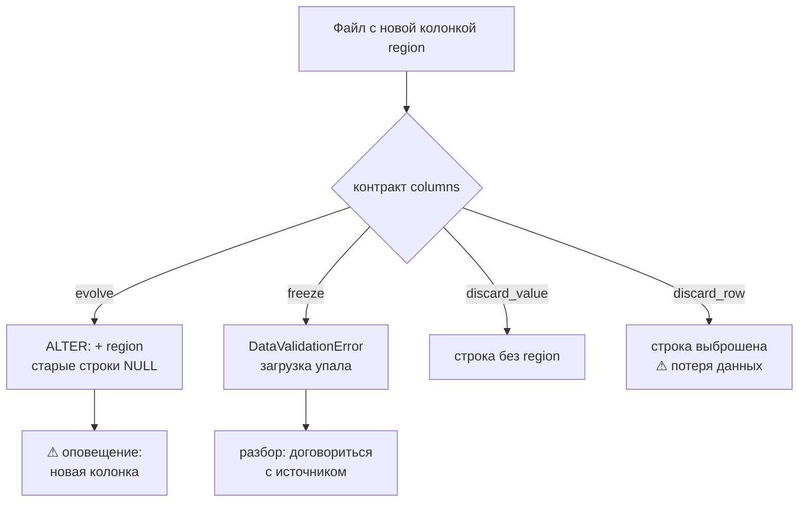

# 05 · Схема источника меняется: эволюция и контракты

> [!info] Урок одной фразой
> Поставщик однажды пришлёт коробку другой формы: с новым отделением, с подписью не там, с
> цифрой вместо слова. Приёмщик решает заранее, что делать с такой коробкой. Можно принять и
> расширить полку (эволюция) или не принять и поднять тревогу (заморозка). Можно принять, но
> выбросить лишнее (отбросить значение), или вернуть коробку поставщику (отбросить строку). Это
> решение и называется контрактом схемы.

> [!todo] Чек-лист: после урока ты сможешь
> - [ ] перечислить виды изменений схемы источника и предсказать, какие из них сломают потребителей;
> - [ ] объяснить, что dlt делает по умолчанию с новой колонкой и сменой типа;
> - [ ] задать контракт `tables` / `columns` / `data_type` с режимами `evolve`, `freeze`, `discard_value`, `discard_row`;
> - [ ] описать контракт записи моделью Pydantic и прочитать ошибку валидации;
> - [ ] выбрать политику схемы для bronze и silver и обосновать её (лабы 04.1, 04.4).

**Нужно для:** лаб [04.1](../labs/04.1_files_to_iceberg/README.md) (задача 3) и
[04.4](../labs/04.4_api_to_lakehouse/README.md).
**Карта урока:** [schema-contracts.canvas](../maps/schema-contracts.canvas).

---

## Шаг 0. Азбука: коробка другой формы

В модуле 03 (урок 04) мы разобрали эволюцию схемы **таблицы Iceberg**: ID полей, допустимые
расширения типов. Теперь вопрос с другой стороны: что делать, когда меняется **источник**, а
загрузчик об этом не знает.

| В схеме источника | В аналогии «коробка другой формы» | Подробнее |
|---|---|---|
| Дрейф схемы (schema drift) | Поставщик без предупреждения поменял коробку | [контракт схемы](../../../glossary/schema-contract.md) |
| Эволюция (`evolve`) | Принять и расширить полку под новую форму | [контракт схемы](../../../glossary/schema-contract.md) |
| Заморозка (`freeze`) | Не принять, поднять тревогу | [контракт схемы](../../../glossary/schema-contract.md) |
| Отбросить значение (`discard_value`) | Принять коробку, лишнее отделение выбросить | [контракт схемы](../../../glossary/schema-contract.md) |
| Отбросить строку (`discard_row`) | Вернуть коробку поставщику | [контракт схемы](../../../glossary/schema-contract.md) |
| Вариантная колонка | Отдельная полочка для коробок «не того» типа | [контракт схемы](../../../glossary/schema-contract.md) |
| Контракт данных | Договор с поставщиком о форме коробок | [контракт схемы](../../../glossary/schema-contract.md) |

---

## Шаг 1. Как меняется схема источника и что от этого ломается

**Проблема.** Источник принадлежит другой команде. Она добавляет поля, переименовывает их,
меняет типы, и обычно никого не предупреждает. Загрузка от этого может упасть, а может, что
хуже, **пройти**, но тихо испортить данные ниже по течению.

**Как устроено.** Изменения делятся по тому, кого они ломают (Клеппман, гл. 4: обратная и прямая
совместимость):

| Изменение | Пример у нас | Загрузка | Потребители (silver, витрины) |
|---|---|---|---|
| Новая колонка | в файлах продаж появилась `region` | обычно не ломается | не ломаются: колонку никто не читает |
| Колонка пропала | из API исчезло `city_id` | не ломается: значения станут `NULL` | **ломаются тихо**: агрегаты по городу «пустые» |
| Переименование | `discount` → `discount_ratio` | новая колонка + старая с `NULL` | ломаются тихо, как при пропаже |
| Смена типа | `city_id` пришёл строкой `"seven"` | зависит от инструмента | могут сломаться громко (ошибка приведения) или тихо |
| Новое значение | `status = 'paused'` вместо `open`/`closed` | не ломается | ломаются тихо: фильтр `status = 'open'` теперь неполон |

Видно, что самое опасное — **тихие** поломки. Загрузчик может их не заметить, а потребитель
увидит неправильные цифры.

**Что из этого следует.** У загрузки должна быть явная **политика**: какие изменения принимать
молча, какие принимать с оповещением, на каких останавливаться. Без политики решение принимает
инструмент по умолчанию.

---

## Шаг 2. Что dlt делает по умолчанию: эволюция

**Проблема.** Ты ничего не настраивал. Что произойдёт, когда источник пришлёт новую колонку или
другой тип?

**Как устроено.** По умолчанию dlt **эволюционирует** схему:

- **новая колонка** добавляется в таблицу хранилища (`ALTER TABLE ADD COLUMN`, в Iceberg —
  `update_schema().add_column`, новое ID поля), старые строки получают `NULL`;
- колонки **никогда не удаляются**: пропавшая в источнике колонка просто получает `NULL`;
- при **конфликте типов** dlt не меняет тип существующей колонки (это могло бы сломать старые
  данные), а заводит **вариантную колонку** с суффиксом `__v_<тип>`. Например, `city_id` был
  `bigint`, пришла строка, и появилась `city_id__v_text` со значением `'seven'`, а в
  `city_id` будет `NULL`;
- колонку, в которой во **всех** записях `NULL`, dlt не создаёт: тип вывести не из чего (урок
  04, предупреждение «did not receive any data»).

Каждая версия схемы сохраняется в хранилище в служебной таблице `_dlt_version`, поэтому историю
изменений можно поднять.

**Что из этого следует.** Загрузка по умолчанию **не падает** почти никогда. Для bronze это
правильно: принять всё как есть. Но вариантные колонки и `NULL` в пропавших колонках —
сигнал, который нужно **заметить**, иначе он доедет до витрин.

> [!warning] Ловушка: вариантная колонка, которую никто не читает
> Настрой оповещение на появление колонок `__v_` (модуль 09). Silver читает `city_id`. После того как источник прислал город строкой, значения уехали в
> `city_id__v_text`, а в `city_id` — `NULL`. Загрузка зелёная, витрина «по городам» молча
> потеряла часть строк.

---

## Шаг 3. Контракт схемы: три сущности × четыре режима

**Проблема.** Нужно управлять реакцией на изменения: где-то принимать, где-то
останавливаться.

**Как устроено.** Контракт в dlt — это режим для каждой из трёх **сущностей**:

| Сущность | Когда срабатывает |
|---|---|
| `tables` | пришли данные для таблицы, которой ещё нет в схеме |
| `columns` | в данных колонка, которой нет в таблице |
| `data_type` | значение не подходит к типу существующей колонки (появилась бы вариантная колонка) |

и одного из четырёх **режимов**:

| Режим | Что делает с нарушением | Загрузка |
|---|---|---|
| `evolve` | принимает: новая таблица / колонка / вариантная колонка | проходит |
| `freeze` | ошибка `DataValidationError` на шаге normalize | **падает** |
| `discard_value` | убирает нарушающее значение (поле), строка остаётся | проходит |
| `discard_row` | убирает всю строку с нарушением | проходит |

Задаётся в ресурсе, источнике или вызове `run()` (ближайший к данным побеждает):

```python
@dlt.resource(schema_contract={"tables": "evolve", "columns": "freeze", "data_type": "freeze"})
def stores(): ...

pipeline.run(source, schema_contract="freeze")      # строкой — один режим для всех сущностей
```

Важная деталь: контракт проверяется **относительно уже существующей схемы**. Первая загрузка
таблицы при `columns: freeze` проходит (таблицы ещё нет, и её создание регулирует `tables`), а
вот новая колонка во второй загрузке уже нарушит контракт. А строка `"freeze"` замораживает и
`tables`, и тогда **новую таблицу создать нельзя вообще**.

> [!example]- Попробуй сам: четыре режима на новой колонке и на смене типа
> В `make shell` (хранилище — файлы DuckDB в `/tmp` контейнера):
> ```bash
> python - <<'EOF'
> import itertools, pathlib, shutil, dlt
>
> run_no = itertools.count(1)
>
> def load(contract, *batches):
>     """Грузит пачки по очереди в новую таблицу stores; печатает итог каждой."""
>     name = f"sandbox_contract_{next(run_no)}"            # своя база и пайплайн на каждый опыт
>     pathlib.Path(f"/tmp/{name}.duckdb").unlink(missing_ok=True)
>     pipeline = dlt.pipeline(name, dataset_name="sandbox",
>                             destination=dlt.destinations.duckdb(f"/tmp/{name}.duckdb"))
>     for rows in batches:
>         @dlt.resource(name="stores", schema_contract=contract)
>         def stores():
>             yield rows
>         try:
>             pipeline.run(stores())
>             columns = [c for c in pipeline.default_schema.get_table_columns("stores")
>                        if not c.startswith("_dlt")]
>             data = pipeline.dataset().stores.select(*columns).fetchall()
>             print(f"{str(contract):38} OK   {columns} {data}")
>         except Exception as error:
>             while error.__cause__ or error.__context__:
>                 error = error.__cause__ or error.__context__
>             print(f"{str(contract):38} FAIL {type(error).__name__}: {str(error)[60:150]}")
>     shutil.rmtree(pipeline.working_dir, ignore_errors=True)   # убрать рабочую папку пайплайна
>
> first = [{"store_id": 1, "city_id": 0}]
> new_column = [{"store_id": 2, "city_id": 0, "region": "east"}]       # источник добавил колонку
> new_type = [{"store_id": 3, "city_id": "seven"}]                     # источник сменил тип
> for mode in ("evolve", "freeze", "discard_value", "discard_row"):
>     load({"columns": mode}, first, new_column)
> load({"data_type": "evolve"}, first, new_type)
> load({"data_type": "freeze"}, first, new_type)
> EOF
> ```
> **Увидишь** (по две строки на опыт: первая загрузка, затем изменение):
> - `columns: evolve` — появилась колонка `region`, у первой строки `None`;
> - `columns: freeze` — вторая загрузка `FAIL DataValidationError: … Contract on columns with contract_mode=freeze is violated`;
> - `columns: discard_value` — строка магазина 2 загружена без `region`;
> - `columns: discard_row` — строки магазина 2 нет;
> - `data_type: evolve` — колонка `city_id__v_text` со значением `'seven'`;
> - `data_type: freeze` — `FAIL DataValidationError` про `city_id__v_text`.
> **Почему:** контракт срабатывает только на расхождении с уже известной схемой, а режим
> решает, что делать с нарушением.

---

## Шаг 4. Контракт записи моделью Pydantic

**Проблема.** Режимы контракта проверяют **форму** (колонки и типы), но не **значения**:
`status = 'paused'` — строка, тип верный. А нам важно, что статус бывает только `open` или
`closed`.

**Как устроено.** Ресурсу можно передать модель **Pydantic** — класс Python, описывающий поля,
их типы и ограничения. dlt строит из неё схему таблицы и **проверяет каждую запись** моделью:

```python
from typing import Literal
from pydantic import BaseModel

class Store(BaseModel):
    store_id: int
    city_id: int
    status: Literal["open", "closed"]      # допустимые значения

@dlt.resource(name="stores", columns=Store)
def stores(): ...
```

С моделью dlt включает контракт `{"tables": "evolve", "columns": "discard_value", "data_type":
"freeze"}`. Лишние поля отбрасываются. Запись с неверным типом или значением **останавливает
загрузку** с `ValidationError` от Pydantic, где указано поле и причина.

> [!example]- Попробуй сам: модель отбрасывает лишнее и ловит неверное значение
> В `make shell`:
> ```bash
> python - <<'EOF'
> import pathlib, shutil
> from typing import Literal
> import dlt
> from pydantic import BaseModel
>
> class Store(BaseModel):              # контракт записи: имена, типы, допустимые значения
>     store_id: int
>     city_id: int
>     status: Literal["open", "closed"]
>
> def load(rows):
>     pathlib.Path("/tmp/sandbox_pydantic.duckdb").unlink(missing_ok=True)
>     @dlt.resource(name="stores", columns=Store)
>     def stores():
>         yield rows
>     p = dlt.pipeline("sandbox_pydantic", dataset_name="sandbox",
>                      destination=dlt.destinations.duckdb("/tmp/sandbox_pydantic.duckdb"))
>     try:
>         p.run(stores())
>         print("OK  ", p.dataset().stores.select("store_id", "city_id", "status").fetchall(),
>               "| контракт:", p.default_schema.tables["stores"].get("schema_contract"))
>     except Exception as error:
>         while error.__cause__ or error.__context__:
>             error = error.__cause__ or error.__context__
>         print("FAIL", type(error).__name__, " | ".join(str(error).splitlines()[:3])[:200])
>     shutil.rmtree(p.working_dir, ignore_errors=True)
>
> load([{"store_id": 1, "city_id": 0, "status": "open", "region": "east"}])   # лишнее поле
> load([{"store_id": 2, "city_id": 0, "status": "paused"}])                   # недопустимое значение
> EOF
> ```
> **Увидишь:** `OK [(1, 0, 'open')]` и контракт `{'tables': 'evolve', 'columns':
> 'discard_value', 'data_type': 'freeze'}` — поле `region` отброшено; затем `FAIL
> ValidationError … status | Input should be 'open' or 'closed' [… input_value='paused' …]`.
> **Почему:** Pydantic проверяет значения, а не только типы.

**Что из этого следует.** Модель — это и документация (какие поля и значения ожидаются), и
проверка. Её место — там, где данные **должны** соответствовать договорённости: на входе в
silver или в загрузке из источника, с которым есть **контракт данных**.

---

## Шаг 5. Политика схемы по слоям

**Проблема.** Если заморозить всё, загрузка будет падать на каждом безобидном новом поле. Если
разрешить всё, тихие поломки дойдут до витрин. Где золотая середина?

**Как устроено.** Политику выбирают **по слою**, исходя из его назначения (модуль 01, урок 04):

| Слой | Назначение | Политика схемы | Почему |
|---|---|---|---|
| bronze | копия «как есть» | `evolve` для всего + **оповещение** о новых колонках и `__v_` | потерять данные хуже, чем принять лишнее; новые поля могут понадобиться |
| silver | очищенные, согласованные данные | явная схема: `freeze` или модель | потребители опираются на имена и типы; изменение должно быть осознанным |
| gold | витрины | схема — часть контракта с бизнесом | меняется только через ревью (модуль 05) |

**Контракт данных** (data contract) — договорённость между командой-источником и командой
данных: какие поля, типы, значения, свежесть и кто отвечает за изменения. Контракт схемы в dlt —
его техническая проверка на нашей стороне. Подробнее о контрактах данных — в модуле 09.

**Что из этого следует.** В bronze загрузка не должна падать из-за нового поля, но **кто-то
должен узнать**, что оно появилось. Самое простое: после загрузки сравнивать список колонок с
ожидаемым и печатать предупреждение; в модуле 09 это станет проверкой с оповещением.

> [!warning] Ловушка: `freeze` в bronze
> В bronze останавливай загрузку только на том, что действительно портит данные. Заморозка
> превращает безобидное изменение источника (новое поле) в остановку всей загрузки, причём
> ночью. Данные за день не придут, хотя ничего не испорчено.

---

## Сборка целиком

Что происходит, когда в файле продаж появилась колонка `region`, при разных политиках:



| Политика | Данные дня | Кто узнает | Риск |
|---|---|---|---|
| evolve + оповещение | загружены | команда данных — из оповещения | почти нет |
| freeze | не загружены | дежурный — из упавшей загрузки | данные опоздают |
| discard_value | загружены без нового поля | никто | поле потеряно, пока не заметят |
| discard_row | **не все** строки загружены | никто | тихая потеря строк |

## Шпаргалка

| Хочу | Как |
|---|---|
| Принимать всё | по умолчанию (`evolve`) |
| Остановиться на новой колонке | `schema_contract={"columns": "freeze"}` |
| Остановиться на смене типа | `schema_contract={"data_type": "freeze"}` |
| Запретить новые таблицы | `schema_contract={"tables": "freeze"}` |
| Проверить значения | `columns=МодельPydantic` |
| Явный тип колонки | `columns={"store_id": {"data_type": "bigint", "nullable": False}}` |
| Найти вариантные колонки | колонки с `__v_` в `pipeline.default_schema.get_table_columns(…)` |
| История схем | таблица `_dlt_version` в хранилище; `dlt pipeline <имя> schema` |

## Типичные ошибки

| Симптом | Причина | Как проверить | Как чинить |
|---|---|---|---|
| `DataValidationError … contract_mode=freeze` | изменение нарушило контракт | имя колонки и сущность в тексте ошибки | договориться с источником или поменять контракт осознанно |
| Новая таблица не создаётся вообще | контракт строкой `"freeze"` заморозил и `tables` | `schema_contract` ресурса | задать словарь по сущностям |
| В колонке `NULL`, рядом `…__v_text` | источник прислал значения другого типа | список колонок с `__v_` | привести тип в источнике или в silver, добавить оповещение |
| Колонка из документации API не появилась | во всех записях `NULL` | предупреждение dlt «did not receive any data» | подсказка типа в `columns` |
| Строк меньше, чем в источнике, ошибок нет | `discard_row` выбросил строки | сверка `count(*)` | не использовать `discard_row` без учёта выброшенного |
| `ValidationError` от Pydantic | значение вне модели | поле и `input_value` в ошибке | исправить данные или модель |

## Проверь себя

Карточки — в [flashcards.md](../flashcards.md).

> [!question] 1. Источник переименовал `discount` в `discount_ratio`. Что сделает dlt с настройками по умолчанию и что увидит витрина «эффект промо»?
> > [!success]- Ответ
> > dlt добавит колонку `discount_ratio`, а в `discount` новые строки получат `NULL`. Загрузка
> > пройдёт. Витрина, читающая `discount`, начнёт считать эффект промо по пустым значениям:
> > тихая поломка, которую ловит только проверка или оповещение о новой колонке.

> [!question] 2. Почему контракт `{"columns": "freeze"}` не мешает первой загрузке таблицы?
> > [!success]- Ответ
> > Контракт проверяет данные относительно существующей схемы. При первой загрузке таблицы нет,
> > её создание регулирует сущность `tables` (по умолчанию `evolve`). Колонки первой загрузки
> > становятся схемой, и уже следующие новые колонки нарушат `freeze`.

> [!question] 3. Почему dlt при конфликте типов создаёт вариантную колонку, а не меняет тип существующей?
> > [!success]- Ответ
> > Смена типа ломает уже записанные данные и читателей (а Iceberg и вовсе запрещает сужение
> > типа, модуль 03, урок 04). Вариантная колонка сохраняет и старые, и новые значения без
> > потерь. Решение о приведении остаётся человеку.

> [!question] 4. Какую политику схемы ты выберешь для bronze-таблицы промо из API и почему?
> > [!success]- Ответ
> > `evolve`: bronze должен принять всё как есть, иначе изменение API остановит загрузку. Но с
> > оповещением о новых колонках и вариантных колонках, чтобы изменение заметили до того, как
> > оно доедет до silver. Строгая модель — на входе в silver.
