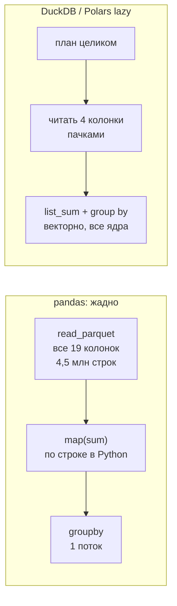
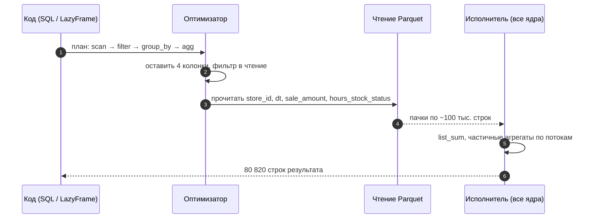

# 06 · Одна трансформация — три движка: SQL, Polars и pandas

> [!info] Урок одной фразой
> Перебрать коробки на складе можно тремя бригадами. DuckDB и ленивый Polars сначала читают
> заказ целиком, составляют план и берут с полок только нужное. pandas выносит на пол всё
> содержимое склада и потом перебирает. Результат один, а время и место на полу различаются в
> разы. Выбирать бригаду надо по замеру, а не по привычке.

> [!todo] Чек-лист: после урока ты сможешь
> - [ ] объяснить разницу между жадным (eager) и ленивым (lazy) выполнением и почему ленивое экономит память;
> - [ ] записать фильтр, новую колонку, агрегацию, соединение и окно на SQL, Polars и pandas;
> - [ ] прочитать план Polars (`explain`) и найти в нём отсечение колонок и фильтр;
> - [ ] честно измерить время и пиковую память и проверить, что результаты совпадают;
> - [ ] выбрать движок под задачу и обосновать замером (лаба 04.5).

**Нужно для:** лабы [04.5](../labs/04.5_one_transform_three_engines/README.md).
**Карта урока:** [transform-engines.canvas](../maps/transform-engines.canvas).

---

## Шаг 0. Азбука: три бригады

Все три инструмента у нас уже установлены: DuckDB 1.5 (SQL), Polars 1.44, pandas 3.0 (группа
зависимостей `ingestion` в `pyproject.toml`). С DuckDB и Polars ты работал в модулях 02–03, с
Arrow как общим форматом — в модуле 03, урок 02.

| Понятие | В аналогии «три бригады» | Подробнее |
|---|---|---|
| Жадное выполнение (eager) | Каждую команду выполнить сразу: вынести всё, потом думать | [ленивое выполнение](../../../glossary/lazy-evaluation.md) |
| Ленивое выполнение (lazy) | Сначала прочитать весь заказ, потом составить план | [ленивое выполнение](../../../glossary/lazy-evaluation.md) |
| Оптимизатор | Бригадир, который переставляет шаги плана | [план запроса](../../../glossary/query-plan.md) |
| Отсечение колонок (projection pushdown) | Брать с полки только нужные отделения коробки | [отсечение](../../../glossary/pruning.md) |
| Проталкивание фильтра (predicate pushdown) | Не брать коробки, которые не подходят по описи | [отсечение](../../../glossary/pruning.md) |
| Векторизация | Перекладывать коробки поддонами, а не по одной | [колоночное хранение](../../../glossary/columnar-storage.md) |

---

## Шаг 1. Зачем трансформировать уже при загрузке

**Проблема.** ELT говорит: сначала загрузи, потом преобразуй (модуль 01, урок 03). Зачем тогда
трансформации в модуле про загрузку?

**Как устроено.** Ingestion почти всегда делает **лёгкие** преобразования: привести типы
источника, добавить служебные колонки (`source_file`, `_loaded_at`), разложить вложенный JSON,
переименовать поля в `snake_case`. Тяжёлые преобразования с бизнес-логикой (агрегаты, соединения
справочников, витрины) — в слое T, в dbt (модуль 05). Граница: **в bronze не должно быть
бизнес-решений**, которые нельзя отменить.

Но выбор движка важен и для лёгких шагов, и для разведки данных, и для будущих моделей dbt.
Поэтому сравниваем движки на одной задаче.

**Что из этого следует.** Если в загрузчике появилась агрегация или соединение — это повод
спросить, не место ли этому в silver.

---

## Шаг 2. Жадное и ленивое выполнение

**Проблема.** Один и тот же агрегат на `train.parquet` DuckDB считает за полсекунды в 0,6 ГБ
памяти, а pandas — за 6 секунд в 3,9 ГБ. Откуда разница в 10 раз?

**Как устроено.** Важны два механизма.

**1. Когда выполняется работа.** pandas и Polars в режиме `DataFrame` — **жадные** (eager):
каждая строка кода выполняется сразу. `pd.read_parquet(file)` читает весь файл в память, ещё не
зная, что дальше понадобятся 4 колонки из 19 и только июнь. **Ленивые** движки (DuckDB SQL,
Polars `LazyFrame` через `scan_parquet`) сначала **строят план** всего запроса и только потом
выполняют. Видя план целиком, оптимизатор:

- **отсекает колонки**: читает из Parquet только нужные (модуль 03, урок 01: файл колоночный);
- **проталкивает фильтр** к чтению: использует min/max групп строк и не читает лишние;
- переставляет шаги и **стримит** данные пачками, не держа всё в памяти сразу.

**2. Как выполняется работа.** DuckDB и Polars — **векторизованные** колоночные движки на C++
и Rust: операция применяется к пачке из тысяч значений колонки за раз, в одном потоке
процессора — к непрерывному куску памяти, и пачки обрабатываются **параллельно** на всех ядрах.
pandas тоже векторизован для числовых колонок (NumPy), но **однопоточен**, а любая Python-
функция в `.map` или `.apply` выполняется **по одной строке** в интерпретаторе Python.



**Что из этого следует.**

- В pandas **ты сам** оптимизатор: читай только нужные колонки (`columns=`), фильтруй при чтении
  (`filters=`), избегай `.apply` и `.map` с Python-функциями.
- В Polars используй `scan_parquet` и `collect()` в конце, а не `read_parquet`. Иначе Polars
  становится жадным и тоже читает всё.
- Колонки-массивы (`hours_sale`, `hours_stock_status`) в pandas превращаются в тип `object`:
  по объекту Python на строку. В памяти это **515 МБ на колонку** против нескольких десятков МБ
  на диске.

> [!example]- Попробуй сам: что Polars прочитает на самом деле и сколько памяти съест pandas
> В `make shell`:
> ```bash
> python - <<'EOF'
> import polars as pl
> query = (pl.scan_parquet("data/raw/freshretailnet_50k/data/train.parquet")
>          .filter(pl.col("dt") >= "2024-06-01")
>          .group_by("store_id")
>          .agg(pl.col("sale_amount").sum()))
> print(query.explain())                       # оптимизированный план: что реально будет прочитано
> EOF
> python - <<'EOF'
> import pandas as pd
> df = pd.read_parquet("data/raw/freshretailnet_50k/data/train.parquet")
> mem = df.memory_usage(deep=True)
> print(f"всего: {mem.sum() / 2**20:.0f} МБ")
> print((mem.sort_values(ascending=False).head(4) / 2**20).round(0).to_string())
> print(df.dtypes[["dt", "hours_sale", "hours_stock_status"]].to_string())
> EOF
> ```
> **Увидишь:** в плане Polars — `PROJECT 3/19 COLUMNS` и `SELECTION: col("dt") >= "2024-06-01"`
> внутри `Parquet SCAN`. У pandas — `всего: 1605 МБ`, из них `hours_stock_status 515` и
> `hours_sale 515`; тип этих колонок — `object`, у `dt` — `str`.
> **Почему:** Polars протолкнул фильтр и выбор колонок в чтение файла. pandas прочитал всё, а
> каждый массив хранит как отдельный объект Python. Файл на диске весит 106 МБ.

> [!warning] Ловушка: `read_parquet` в Polars
> `pl.read_parquet(...)` — жадное чтение всего файла, как в pandas. Те же операции после него
> работают быстро, но памяти уходит вдвое больше, чем у `scan_parquet` (у нас 5,3 ГБ против
> 2,7 ГБ на агрегате ниже). Ленивость надо включить явно.

---

## Шаг 3. Одни и те же операции в трёх синтаксисах

**Проблема.** Лаба 04.5 — одна трансформация на трёх движках. Нужен словарь соответствий.

**Как устроено.** Таблица ниже — операции на `train.parquet` (`df` — DataFrame pandas, `lf` —
LazyFrame Polars, `t` — таблица/файл в DuckDB). Импорты: `import duckdb`, `import polars as pl`,
`import pandas as pd`.

| Операция | DuckDB SQL | Polars (lazy) | pandas |
|---|---|---|---|
| Прочитать | `FROM read_parquet('f.parquet')` | `lf = pl.scan_parquet("f.parquet")` | `df = pd.read_parquet("f.parquet", columns=[…])` |
| Выбрать колонки | `SELECT store_id, dt` | `lf.select("store_id", "dt")` | `df[["store_id", "dt"]]` |
| Фильтр | `WHERE dt >= '2024-06-01'` | `lf.filter(pl.col("dt") >= "2024-06-01")` | `df[df["dt"] >= "2024-06-01"]` |
| Новая колонка | `sale_amount * 2 AS x` | `lf.with_columns((pl.col("sale_amount") * 2).alias("x"))` | `df["x"] = df["sale_amount"] * 2` |
| Сумма элементов массива | `list_sum(hours_stock_status)` | `pl.col("hours_stock_status").list.sum()` | `df["hours_stock_status"].map(sum)` (медленно: Python) |
| Условие | `CASE WHEN discount < 1 THEN 1 ELSE 0 END` | `pl.when(pl.col("discount") < 1).then(1).otherwise(0)` | `(df["discount"] < 1).astype(int)` |
| Группировка | `GROUP BY store_id, dt` + `sum(sale_amount)` | `lf.group_by("store_id", "dt").agg(pl.col("sale_amount").sum())` | `df.groupby(["store_id", "dt"], as_index=False).agg(s=("sale_amount", "sum"))` |
| Соединение | `JOIN s USING (store_id)` | `lf.join(s, on="store_id", how="inner")` | `df.merge(s, on="store_id", how="inner")` |
| Окно: ранг в группе | `rank() OVER (PARTITION BY store_id ORDER BY sales DESC)` | `pl.col("sales").rank("min", descending=True).over("store_id")` | `df.groupby("store_id")["sales"].rank(method="min", ascending=False)` |
| Сортировка | `ORDER BY store_id, dt` | `lf.sort("store_id", "dt")` | `df.sort_values(["store_id", "dt"])` |
| Выполнить | запрос выполняется сразу | `.collect()` | выполняется сразу |
| В Arrow / Polars | `duckdb.sql(q).to_arrow_table()`, `.pl()` | `df.to_arrow()` | `pa.Table.from_pandas(df)` |
| Записать Parquet | `COPY (…) TO 'out.parquet'` | `df.write_parquet("out.parquet")` | `df.to_parquet("out.parquet")` |

Пример задачи целиком, «продажи и доля часов без остатка по магазину и дню», — в «Попробуй
сам» шага 4. Лаба 04.5 — другая трансформация, сложнее: с соединением и окном.

---

## Шаг 4. Как мерить честно

**Проблема.** «У меня pandas быстрее» — часто результат нечестного замера: второй запуск с
прогретым кэшем, один процесс на все движки, разные результаты.

**Как устроено.** Правила замера:

1. **Отдельный процесс на движок.** Пиковая память процесса (`resource.getrusage(...).
   ru_maxrss`, в КБ на Linux) не уменьшается, когда память освобождают. В одном процессе
   второй движок унаследует пик первого.
2. **Время стены** (`time.perf_counter()`) от чтения до готового результата, включая чтение
   файла: оно тоже часть работы.
3. **Несколько запусков**, медиана. Первый запуск может быть медленнее из-за холодного кэша
   диска.
4. **Результаты совпадают.** Сравни число строк и значения: отсортируй по ключу и сравни с
   допуском для дробных (`abs(a - b) < 1e-9`). Быстрый неправильный ответ не считается.
5. **Одинаковая задача.** Если один движок читает 4 колонки, а другой 19, ты сравниваешь не
   движки, а свой код.

> [!example]- Попробуй сам: замер трёх движков на одном агрегате
> В `make shell`. Каждый движок в своём процессе:
> ```bash
> bench() {           # каждый движок — в отдельном процессе, чтобы честно мерить пиковую память
> python - "$1" <<'EOF'
> import resource, sys, time
> SRC = "data/raw/freshretailnet_50k/data/train.parquet"
> engine, start = sys.argv[1], time.perf_counter()
> if engine == "duckdb":
>     import duckdb
>     result = duckdb.sql(f"""
>         SELECT store_id, dt, sum(sale_amount) AS sales,
>                avg(list_sum(hours_stock_status)) / 24 AS oos_share
>         FROM read_parquet('{SRC}') GROUP BY store_id, dt""").pl()
> elif engine == "polars":
>     import polars as pl
>     result = (pl.scan_parquet(SRC)
>               .group_by("store_id", "dt")
>               .agg(pl.col("sale_amount").sum().alias("sales"),
>                    (pl.col("hours_stock_status").list.sum().mean() / 24).alias("oos_share"))
>               .collect())
> elif engine == "pandas":
>     import pandas as pd
>     df = pd.read_parquet(SRC, columns=["store_id", "dt", "sale_amount", "hours_stock_status"])
>     df["oos"] = df["hours_stock_status"].map(sum)
>     result = (df.groupby(["store_id", "dt"], as_index=False)
>                 .agg(sales=("sale_amount", "sum"), oos_share=("oos", "mean")))
>     result["oos_share"] /= 24
> peak_mb = resource.getrusage(resource.RUSAGE_SELF).ru_maxrss / 1024
> print(f"{engine:7} {time.perf_counter() - start:5.2f} с  пик памяти {peak_mb:6.0f} МБ  строк {len(result)}")
> EOF
> }
> for engine in duckdb polars pandas; do bench $engine; done
> ```
> **Увидишь** (на нашей машине):
> ```
> duckdb   0.49 с  пик памяти    592 МБ  строк 80820
> polars   0.47 с  пик памяти   2806 МБ  строк 80820
> pandas   5.83 с  пик памяти   3850 МБ  строк 80820
> ```
> **Почему:** DuckDB и Polars векторно и параллельно читают 4 колонки. pandas уже читает только
> 4 колонки (иначе было бы 7,3 с и 7,8 ГБ), но суммирует массивы Python-функцией построчно и
> группирует в одном потоке. Polars быстр, но держит в памяти больше: колонки-массивы
> разворачиваются целиком.

---

## Шаг 5. Как выбирать движок

**Проблема.** Все три умеют одно и то же. Когда что брать?

**Как устроено.** Решают не вкус и не мода, а **объём данных, форма задачи и кто будет
поддерживать код**:

| Ситуация | Выбор | Почему |
|---|---|---|
| Аналитический запрос по файлам или Iceberg | DuckDB SQL | самый экономный по памяти, SQL читают все в команде, тот же SQL уйдёт в dbt |
| Сложная логика в Python, много шагов, функции | Polars lazy | выразительный API, скорость DuckDB, типизированные выражения |
| Маленькие данные, библиотека требует pandas (sklearn, statsmodels) | pandas | экосистема; на сотнях тысяч строк разница незаметна |
| Данные больше памяти одной машины | Spark (модуль 07) | распределённое выполнение |
| Трансформация в загрузчике dlt | Arrow + DuckDB/Polars | без конвертации в строки Python (урок 02) |

**Что из этого следует.** В нашем стеке основной инструмент трансформаций — SQL (DuckDB, dbt).
Polars — когда в Python удобнее. pandas — на границе с ML-библиотеками. Это не догма: в лабе
04.5 ты проверишь её замером на своей задаче.

> [!warning] Ловушка: сравнивать pandas, читающий весь файл, с SQL, читающим 4 колонки
> Самая частая нечестность замера. Первым делом приведи все варианты к одинаковому объёму
> чтения, потом сравнивай движки.

---

## Сборка целиком

Путь одного агрегата через ленивый движок:



| Шаг | Что может пойти не так | Симптом |
|---|---|---|
| 1 | `read_parquet` вместо `scan_parquet` | память как у pandas |
| 2 | фильтр после `collect()` | фильтр не протолкнут, читается всё |
| 5 | Python-функция внутри выражения (`map_elements`) | однопоточно, в разы медленнее |
| 6 | результат не сравнили с другими движками | «быстрый неправильный» ответ |

## Шпаргалка

| Хочу | Как |
|---|---|
| Ленивое чтение в Polars | `pl.scan_parquet(...)` … `.collect()` |
| Посмотреть план Polars / DuckDB | `lf.explain()` / `EXPLAIN` или `EXPLAIN ANALYZE` |
| Меньше памяти в pandas | `read_parquet(columns=[…], filters=[…])` |
| Пиковая память процесса | `resource.getrusage(resource.RUSAGE_SELF).ru_maxrss / 1024` (МБ) |
| Время | `time.perf_counter()` до и после |
| Сравнить результаты | отсортировать по ключу; Polars: `a.equals(b)` или `polars.testing.assert_frame_equal` |
| Передать данные без копий | Arrow: `.to_arrow_table()`, `pl.from_arrow`, `.pl()` |

## Типичные ошибки

| Симптом | Причина | Как проверить | Как чинить |
|---|---|---|---|
| `MemoryError` / контейнер убит (код 137) | жадное чтение всего файла | пиковая память, `docker stats` | читать нужные колонки, ленивый движок |
| pandas в разы медленнее | `.apply`/`.map` с Python-функцией | профиль: где время | векторная операция или DuckDB/Polars |
| Результаты движков отличаются в 10-м знаке | порядок суммирования дробных | разница меньше `1e-9` | сравнивать с допуском |
| Результаты отличаются числом строк | разная обработка `NULL` в ключах группировки | `count(*) WHERE ключ IS NULL` | одинаковые правила для `NULL` |
| Второй запуск быстрее первого | прогрет кэш диска | несколько запусков | медиана из 3–5 |

## Проверь себя

Карточки — в [flashcards.md](../flashcards.md).

> [!question] 1. Почему `pl.scan_parquet(...).filter(...).collect()` читает меньше, чем `pl.read_parquet(...).filter(...)`?
> > [!success]- Ответ
> > `scan_parquet` строит план, и оптимизатор проталкивает фильтр и выбор колонок в чтение:
> > читаются только нужные колонки, а группы строк отсекаются по min/max. `read_parquet` читает
> > весь файл сразу, а фильтр применяется уже к данным в памяти.

> [!question] 2. В pandas агрегат идёт 6 секунд. Ты добавил `columns=` — стало быстрее, но всё ещё медленно. Где искать следующую причину?
> > [!success]- Ответ
> > В построчных Python-операциях: `.map(sum)` по колонке-массиву выполняется в интерпретаторе
> > для каждой из 4,5 млн строк. Плюс `groupby` в одном потоке. Векторной суммы для массивов
> > `object` в pandas нет, это аргумент перенести шаг в DuckDB или Polars.

> [!question] 3. Polars и DuckDB одинаково быстры на агрегате, но Polars использует 2,8 ГБ, а DuckDB 0,6 ГБ. Что выберешь для ежедневной загрузки в контейнере с лимитом 2 ГБ?
> > [!success]- Ответ
> > DuckDB: при лимите памяти Polars на этой задаче упрётся в лимит, и контейнер получит
> > SIGKILL (код 137, модуль 00, урок 08). Время одинаковое, решает память.

> [!question] 4. Коллега показал замер: «pandas 0,9 с, DuckDB 1,2 с». Какие три вопроса ты задашь, прежде чем поверить?
> > [!success]- Ответ
> > Одинаковый ли объём чтения (колонки, строки)? Мерили ли в отдельных процессах и несколько
> > раз (кэш)? Совпадают ли результаты? Ещё стоит спросить, учтено ли время чтения файла.
