# Модуль 05 · Трансформации: dbt (и SQLMesh)

**Длительность:** ~2 нед. · **Статус и DoD:** см. [ROADMAP](../../ROADMAP.md)

## Бизнес-вопрос

> Как превратить сырые данные в проверенные витрины, которым доверяет бизнес?

## Цели

- построить dbt-проект по слоям поверх bronze в Iceberg
- выбирать материализации и строить инкрементальные модели, устойчивые к поздним данным
- тестировать данные и логику, документировать модели, анализировать влияние изменений
- накапливать историю справочников (SCD2) и публиковать витрины в Iceberg
- понимать альтернативный подход SQLMesh

## Темы

- модели, `ref`/`source`, граф, компиляция; слои staging / intermediate / marts; профиль нашего стека
- материализации view / table / incremental / ephemeral; стратегии инкремента, microbatch
- ограничения DuckDB + Iceberg и публикация витрин post-hook'ом
- тесты данных (generic, singular, свои) и unit-тесты; строгость и сохранение нарушений
- документация как код, `persist_docs`, сайт `dbt docs`, lineage, селекторы, exposures, `manifest.json`
- snapshots (SCD2), Jinja и макросы, пакеты (dbt_utils)
- SQLMesh: виртуальные окружения, план, классификация изменений, аудиты

## Инструменты

dbt-core 1.12 + dbt-duckdb 1.11, dbt_utils 1.4, SQLMesh 0.228, DuckDB 1.5, Iceberg (Lakekeeper)

## Маршрут прохождения

Сначала урок, потом задачи лабы по нему. Статусы: ✅ сделано · 🟨 сейчас · ⬜ впереди.

```mermaid
flowchart LR
    T1["📖 01 Проект"] --> L1["🧪 05.1<br/>staging"] --> T2["📖 02 Материализации"] --> T5["📖 05 Макросы"]
    T5 --> L2["🧪 05.2<br/>звезда"] --> T3["📖 03 Тесты"] --> L3["🧪 05.3"]
    L3 --> T4["📖 04 Docs, lineage"] --> L4["🧪 05.4"] --> L5["🧪 05.5<br/>инкремент, SCD2"]
    L5 --> T6["📖 06 SQLMesh"] --> L6["🧪 05.6"] --> L7["🧪 05.7<br/>витрины"] --> HW["🏁 Домашка"]
```

| # | Шаг | Что | Статус |
|---|---|---|---|
| 1 | 📖 [01 · dbt как проект](theory/01_dbt_project.md) · [карта](maps/dbt-project.canvas) | урок | ⬜ |
| 2 | 🧪 [Лаба 05.1 — проект и staging](labs/05.1_project_and_staging/README.md) | профиль, источники, staging | ⬜ |
| 3 | 📖 [02 · Материализации и инкремент](theory/02_materializations_incremental.md) · [карта](maps/materializations.canvas) | урок | ⬜ |
| 4 | 📖 [05 · Snapshots, макросы, пакеты](theory/05_snapshots_macros_packages.md) · [карта](maps/snapshots-macros.canvas) | урок (шаги 4–5 нужны для 05.2) | ⬜ |
| 5 | 🧪 [Лаба 05.2 — звёздная схема в marts](labs/05.2_star_schema_marts/README.md) | dim_*, fct_sales_daily | ⬜ |
| 6 | 📖 [03 · Тесты](theory/03_tests.md) · [карта](maps/dbt-tests.canvas) | урок | ⬜ |
| 7 | 🧪 [Лаба 05.3 — тесты](labs/05.3_tests/README.md) | данные, логика, инцидент | ⬜ |
| 8 | 📖 [04 · Документация и lineage](theory/04_docs_and_lineage.md) · [карта](maps/dbt-docs-lineage.canvas) | урок | ⬜ |
| 9 | 🧪 [Лаба 05.4 — docs и lineage](labs/05.4_docs_and_lineage/README.md) | сайт, влияние, проверка описаний | ⬜ |
| 10 | 🧪 [Лаба 05.5 — инкремент, SCD2, публикация](labs/05.5_incremental_and_snapshots/README.md) | поздние данные, snapshots, gold | ⬜ |
| 11 | 📖 [06 · SQLMesh](theory/06_sqlmesh.md) · [карта](maps/sqlmesh.canvas) | урок | ⬜ |
| 12 | 🧪 [Лаба 05.6 — SQLMesh](labs/05.6_sqlmesh/README.md) | одна витрина, dev → prod | ⬜ |
| 13 | 🧪 [Лаба 05.7 — мини-проект](labs/05.7_marts_mini_project/README.md) | продажи, out-of-stock, промо | ⬜ |
| 14 | 🏁 [Домашка-чекпоинт](homework.md) | 7 вопросов и одно предсказание | ⬜ |

> [!note] Учебные проекты и инфраструктура модуля (2026-10-01)
> - [`demo/`](demo/) — учебный dbt-проект уроков (погода по городам): `cd
>   modules/05_transformation_dbt/demo && dbt deps && dbt build`. База —
>   `data/demo_weather.duckdb`. Это не capstone и не ответы к лабам.
> - [`demo_sqlmesh/`](demo_sqlmesh/) — та же погода на SQLMesh (урок 06).
> - Порт **8580** у workspace — для `dbt docs serve --host 0.0.0.0 --port 8580`.
> - SQLMesh — группа зависимостей `transform` в `pyproject.toml`.
> - Архитектура: dbt строит модели в файле DuckDB, bronze читает из Iceberg через `attach`,
>   витрины публикует в Iceberg post-hook'ом (решение — `memory/decisions/stack.md`).

## Чек-лист самоконтроля

Отмечай пункт, только когда можешь сделать это **без подсказки**. Подробные чек-листы — в начале
каждого урока.

**Проект** ([01](theory/01_dbt_project.md), [02](theory/02_materializations_incremental.md))
- [ ] Настраиваю профиль с DuckDB-файлом и каталогом Iceberg; объясняю, почему модели не в Iceberg
- [ ] Пишу модели с `ref`/`source` и раскладываю их по слоям
- [ ] Выбираю материализацию и стратегию инкремента; делаю инкремент идемпотентным
- [ ] Публикую витрину в Iceberg и объясняю, что видит читатель во время публикации

**Качество и документация** ([03](theory/03_tests.md), [04](theory/04_docs_and_lineage.md))
- [ ] Навешиваю generic-тесты, пишу сингулярный и свой generic-тест
- [ ] Пишу unit-тест с граничными случаями и читаю диф
- [ ] Описываю модели, собираю сайт docs, отвечаю на «что затронет изменение» селекторами
- [ ] Читаю `manifest.json` скриптом

**История и альтернатива** ([05](theory/05_snapshots_macros_packages.md), [06](theory/06_sqlmesh.md))
- [ ] Настраиваю snapshot и делаю point-in-time join
- [ ] Пишу макрос и использую dbt_utils
- [ ] Объясняю виртуальные окружения и классификацию изменений SQLMesh

**Закрытие модуля**
- [ ] Лабы 05.1–05.7 выполнены по Definition of Done
- [ ] [Домашка](homework.md) сдана, ошибки разобраны
- [ ] Тезисы по Клеппману (гл. 3, материализованные представления) — в [`notes.md`](notes.md)

## Материалы модуля

| Что | Где |
|---|---|
| 🧠 Карточки для повторения | [flashcards.md](flashcards.md) |
| 🗺️ Карты | [maps/](maps/) |
| 📚 Термины | [glossary/](../../glossary/README.md) — раздел «Трансформации (dbt, SQLMesh)» |
| 🧪 Учебные проекты | [demo/](demo/), [demo_sqlmesh/](demo_sqlmesh/) |
| 🎬 Визуализации | [SCD2 и snapshot: версия на дату](../02_sql_and_modeling/visuals/scd2_timeline.html) |
| 📓 Заметки | [notes.md](notes.md) |

## Мини-проект (вклад в capstone)

Витрины «продажи», «out-of-stock», «эффект промо» в `capstone/transform`, проверенные тестами,
описанные и опубликованные в Iceberg `gold` (лаба 05.7).

## Ресурсы

- [dbt docs](https://docs.getdbt.com/docs/introduction) · [best practices](https://docs.getdbt.com/best-practices) · [селекторы](https://docs.getdbt.com/reference/node-selection/syntax)
- [dbt: инкрементальные модели](https://docs.getdbt.com/docs/build/incremental-models) · [microbatch](https://docs.getdbt.com/docs/build/incremental-microbatch) · [unit tests](https://docs.getdbt.com/docs/build/unit-tests) · [snapshots](https://docs.getdbt.com/docs/build/snapshots)
- [dbt: документация](https://docs.getdbt.com/docs/build/documentation)
- [dbt-duckdb](https://github.com/duckdb/dbt-duckdb) · [dbt_utils](https://github.com/dbt-labs/dbt-utils)
- [SQLMesh docs](https://sqlmesh.readthedocs.io/)
- [Data-Learn: модуль 4 — ETL/ELT и dbt](https://github.com/Data-Learn/data-engineering/blob/master/DE-101%20Modules/Module04/readme.md)
- [Surfalytics: dbt intro](https://github.com/surfalytics/data-projects/tree/main/de-projects/18_dbt_intro) · [SQLMesh intro](https://github.com/surfalytics/data-projects/tree/main/de-projects/19_sqlmesh_intro)

## Книга и видео

Полная таблица с пояснениями, зачем читать и что пропустить — в [карте чтения](../../reading_map.md#05--трансформации-dbt).

- 📖 Клеппман, гл. 3 — материализованные представления (по желанию, урок 02)
- 🎬 [Zoomcamp `04-analytics-engineering`](https://github.com/DataTalksClub/data-engineering-zoomcamp/tree/main/04-analytics-engineering) — модуль целиком: dbt + DuckDB

## Домашка-чекпоинт

После всех лаб — [`homework.md`](homework.md).

## Заметки

Конспект, тезисы по книге и выводы — в [`notes.md`](notes.md).
