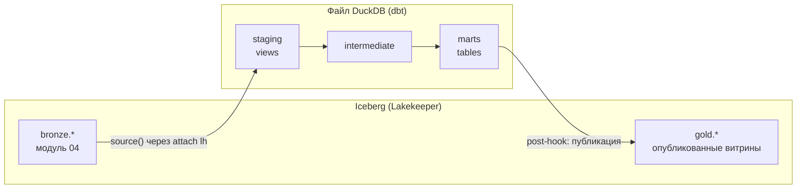
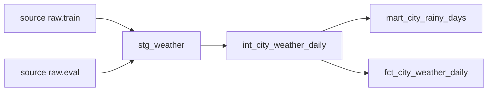
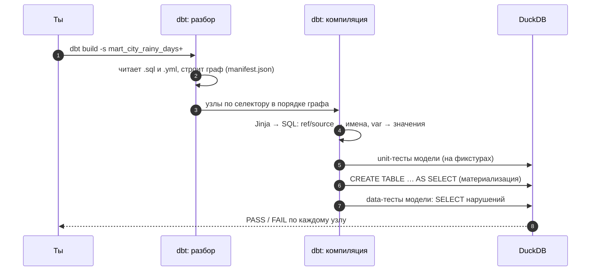

# 01 · dbt как проект: модели, ссылки, граф и слои

> [!info] Урок одной фразой
> dbt — это кухня ресторана, где каждый рецепт — отдельный файл с SELECT. Рецепт ссылается на
> заготовки по имени (`ref`), и шеф по этим ссылкам сам понимает, что готовить сначала. Сырьё с
> рынка (bronze) превращается в заготовки (staging), полуфабрикаты (intermediate) и блюда
> (marts). Повар пишет только рецепты: порядок, посуду и подачу берёт на себя кухня.

> [!todo] Чек-лист: после урока ты сможешь
> - [ ] объяснить, какую проблему решает dbt и чем модель отличается от скрипта с SQL;
> - [ ] прочитать структуру проекта и `dbt_project.yml`, найти профиль подключения;
> - [ ] написать модель с `ref` и `source` и предсказать порядок сборки по графу;
> - [ ] посмотреть скомпилированный SQL и результат модели без записи в базу;
> - [ ] разложить модели по слоям staging / intermediate / marts по правилам именования;
> - [ ] настроить профиль нашего стека: DuckDB-файл и bronze из Iceberg через `attach` (лабы 05.1, 05.2).

**Нужно для:** лаб [05.1](../labs/05.1_project_and_staging/README.md) и
[05.2](../labs/05.2_star_schema_marts/README.md).
**Карта урока:** [dbt-project.canvas](../maps/dbt-project.canvas).

---

## Шаг 0. Азбука: кухня ресторана

В модуле 02 ты писал SQL-запросы по одному и проектировал звёздную схему. В модуле 04 сырые
данные легли в bronze. Теперь из них надо **регулярно** строить проверенные витрины: десятки
запросов, которые зависят друг от друга, и их надо пересчитывать, тестировать и документировать.
Для этого и есть **dbt** (data build tool). У нас он стоит в workspace: dbt-core 1.12 и адаптер
dbt-duckdb 1.11.

Все примеры урока — в **учебном проекте** [`demo/`](../demo/) модуля: погода по городам сети.
Это не capstone и не ответы к лабам. Это маленький работающий проект, на котором видно каждую
возможность dbt.

| В dbt | В аналогии «кухня» | Подробнее |
|---|---|---|
| Модель (model) | Рецепт: один SELECT в файле `.sql` | [dbt](../../../glossary/dbt-core.md) |
| `source()` | Сырьё с рынка: таблица, которую сделал не dbt | [dbt](../../../glossary/dbt-core.md) |
| `ref()` | «Возьми заготовку №…»: ссылка на другую модель | [граф dbt](../../../glossary/dbt-dag.md) |
| Граф (DAG) | Порядок готовки, выведенный из ссылок | [граф dbt](../../../glossary/dbt-dag.md) |
| Материализация | Посуда: в чём подать — представление, таблица, инкремент | [материализация](../../../glossary/materialization.md) |
| staging / intermediate / marts | Заготовки / полуфабрикаты / блюда | [медальонная архитектура](../../../glossary/medallion.md) |
| Профиль (profile) | Адрес кухни: где плита и холодильник | [dbt](../../../glossary/dbt-core.md) |
| Компиляция | Рецепт с подставленными количествами | [dbt](../../../glossary/dbt-core.md) |

---

## Шаг 1. Какую проблему решает dbt

**Проблема.** Витрина «продажи по категориям» — это не один запрос, а цепочка: очистить продажи,
очистить справочник товаров, соединить, агрегировать. Можно написать скрипт, который выполняет
десять SQL-файлов по порядку. Через месяц файлов сорок, порядок держится в голове одного
человека, тестов нет, а при изменении одной таблицы непонятно, что ещё сломается.

**Как устроено.** dbt берёт на себя всё, кроме самой логики:

1. **Модель — это только SELECT.** Ты не пишешь `CREATE TABLE`, `INSERT`, `DROP`. Файл
   `models/marts/mart_city_rainy_days.sql` содержит запрос, а dbt сам оборачивает его в нужную
   команду (шаг 4, урок 02).
2. **Зависимости — из ссылок.** Вместо имени таблицы ты пишешь `{{ ref('int_city_weather_daily') }}`.
   По этим ссылкам dbt строит **граф** (DAG — ориентированный граф без циклов) и сам выполняет
   модели в правильном порядке, параллельно там, где можно.
3. **Окружение — из профиля.** Один и тот же код работает в dev и в prod: dbt подставляет
   нужную базу и схему (шаг 3).
4. **Тесты, документация и lineage — рядом с кодом** в YAML-файлах (уроки 03, 04).

**Что из этого следует.** dbt — это компилятор и планировщик SQL, а не движок. Считает всё
равно база: у нас DuckDB. Поэтому всё, что ты знаешь про SQL DuckDB из модуля 02, работает в
моделях как есть.

---

## Шаг 2. Структура проекта

**Проблема.** Где что лежит и как dbt находит файлы?

**Как устроено.** Проект — папка с `dbt_project.yml`. `dbt init <имя> --skip-profile-setup`
создаёт каркас:

```
demo/
├── dbt_project.yml        ← имя проекта, профиль, пути, настройки моделей по папкам
├── profiles.yml           ← подключение (у нас — внутри проекта, см. шаг 3)
├── packages.yml           ← пакеты (dbt_utils), ставятся `dbt deps` в dbt_packages/
├── models/                ← модели .sql и описания .yml
│   ├── staging/           ← _sources.yml, stg_*.sql
│   ├── intermediate/      ← int_*.sql
│   └── marts/             ← fct_*, dim_*, mart_*.sql
├── seeds/                 ← маленькие CSV, которые dbt загружает таблицами
├── snapshots/             ← SCD2-снимки (урок 05)
├── macros/                ← свои функции Jinja (урок 05)
├── tests/                 ← сингулярные тесты (урок 03)
└── target/                ← результат компиляции и запусков (не в git)
```

`dbt_project.yml` задаёт настройки **по папкам**: всё, что лежит в `models/staging`, по
умолчанию — представления, в `marts` — таблицы. Префикс `+` у ключа означает «настройка
(config)», а не имя папки:

```yaml
models:
  weather_demo:                 # ① имя проекта
    +persist_docs: {relation: true, columns: true}
    staging:                    # ② папка models/staging
      +materialized: view
    marts:
      +materialized: table      # ③ можно переопределить в самой модели через config()
```

**Что из этого следует.** Настройка ближе к модели побеждает: `{{ config(materialized='incremental') }}`
в файле модели сильнее, чем `+materialized: table` для папки.

---

## Шаг 3. Профиль: куда подключается dbt у нас

**Проблема.** dbt должен знать, в какую базу писать и откуда читать bronze. У нас bronze — в
Iceberg, а DuckDB — встраиваемая база в файле.

**Как устроено.** **Профиль** (`profiles.yml`) описывает подключения. dbt ищет его сначала в
текущей папке, потом в `~/.dbt/`. Мы держим его **в папке проекта**: секретов в нём нет, а
путь к базе — часть проекта. У профиля есть **цели** (targets): одна по умолчанию, другие
выбираются флагом `--target`.

```yaml
weather_demo:                       # ① имя = profile: в dbt_project.yml
  target: dev                       # ② цель по умолчанию
  outputs:
    dev:
      type: duckdb
      path: /workspace/data/demo_weather.duckdb    # ③ файл базы (вне git: *.duckdb)
      threads: 4                                    # ④ сколько моделей строить параллельно
    lake:
      type: duckdb
      path: /workspace/data/demo_weather.duckdb
      extensions: [httpfs, iceberg]                 # ⑤ расширения DuckDB
      attach:                                       # ⑥ ATTACH каталога Iceberg при подключении
        - path: lakehouse
          alias: lh
          type: iceberg
          options:
            endpoint: http://lakekeeper:8181/catalog
            authorization_type: none
```

| Метка | Что важно |
|---|---|
| ③ | один файл DuckDB = одна база. Писать в него может **только один процесс** одновременно |
| ⑥ | то же, что `ATTACH 'lakehouse' AS lh (TYPE iceberg, …)` из модуля 03: в моделях доступны `lh.bronze.<таблица>` |

**Архитектура слоёв у нас.** Bronze лежит в Iceberg (модуль 04). dbt **читает** его через
`attach`, а silver и gold **строит в файле DuckDB**. Почему не прямо в Iceberg — урок 02, шаг 5:
DuckDB 1.5 не умеет для Iceberg того, на что опираются материализации dbt. Готовые витрины
**публикуются** в Iceberg отдельным шагом, чтобы их читали Spark, Trino и ClickHouse (модули 07,
10).



> [!example]- Попробуй сам: проверка подключения и чтение Iceberg из dbt
> В `make shell`. Песочница `sandbox_dbt` в Iceberg — удали в конце урока 02.
> ```bash
> cd modules/05_transformation_dbt/demo
> dbt deps                                    # поставить dbt_utils (нужен интернет)
> dbt debug 2>&1 | grep -E "profiles.yml file|Connection test"
> duckdb <<'EOF'
> INSTALL iceberg; LOAD iceberg; INSTALL httpfs; LOAD httpfs;
> ATTACH 'lakehouse' AS lh (TYPE iceberg, ENDPOINT 'http://lakekeeper:8181/catalog', AUTHORIZATION_TYPE 'none');
> CREATE SCHEMA IF NOT EXISTS lh.sandbox_dbt;
> CREATE TABLE lh.sandbox_dbt.weather_sample AS
>   SELECT DISTINCT store_id, dt, precpt FROM read_parquet('/workspace/data/raw/freshretailnet_50k/data/eval.parquet');
> EOF
> time dbt debug --target lake 2>&1 | grep "Connection test"
> dbt show --target lake --inline "select count(*) as n, count(distinct store_id) as stores from lh.sandbox_dbt.weather_sample"
> ```
> **Увидишь:** `profiles.yml file [OK found and valid]` из папки проекта; `Connection test: [OK
> connection ok]` для обеих целей, но `lake` — около 8 секунд; таблица `n 6286 · stores 898`.
> **Почему:** при подключении к цели `lake` DuckDB делает ATTACH каталога Iceberg — это запросы
> к Lakekeeper. dbt видит Iceberg-таблицы как обычные: `lh.<namespace>.<таблица>`.

> [!warning] Ловушка: файл DuckDB занят
> Пока открыт `make sql` или `duckdb` на том же файле, `dbt run` упадёт с ошибкой
> `Could not set lock on file … Conflicting lock is held`. DuckDB — встраиваемая база: один
> процесс-писатель на файл. Закрой другой клиент или открывай файл только на чтение
> (`duckdb -readonly`).

---

## Шаг 4. `source()` и `ref()`: как dbt строит граф

**Проблема.** Модели зависят друг от друга. Как dbt узнаёт порядок, не разбирая SQL?

**Как устроено.** Любая ссылка в модели — вызов Jinja-функции (Jinja — язык шаблонов, текст в
`{{ … }}` вычисляется до отправки SQL в базу):

- `{{ source('raw', 'train') }}` — **источник**: таблица, которую сделал не dbt. Источники
  объявляют в YAML (`_sources.yml`): имя группы, база и схема, таблицы. Объявление даёт имя для
  ссылок, описание, тесты и проверку свежести (`freshness`, модуль 09).
- `{{ ref('stg_weather') }}` — **модель** этого проекта (или пакета).

При разборе проекта dbt собирает все вызовы `ref` и `source` и строит граф. При компиляции он
**подставляет** вместо вызова полное имя отношения в базе: `"demo_weather"."main"."stg_weather"`.

```yaml
# models/staging/_sources.yml (демо: источник — файлы, а не таблица)
sources:
  - name: raw
    meta:
      external_location: "read_parquet('/workspace/data/raw/freshretailnet_50k/data/{name}.parquet')"
    tables:
      - name: train
      - name: eval
```

`external_location` — возможность dbt-duckdb: источником может быть выражение DuckDB, а не
таблица. В capstone источник — Iceberg-таблицы bronze:

```yaml
sources:
  - name: bronze
    database: lh          # alias из attach в профиле
    schema: bronze        # namespace Iceberg
    tables:
      - name: <таблица из модуля 04>
```



**Что из этого следует.**

- Никогда не пиши имя таблицы проекта напрямую (`from main.stg_weather`): dbt не узнает о
  зависимости, порядок сборки станет случайным, а в другой цели (prod) имя будет другим.
- Сырьё — только через `source()`. Тогда граф начинается с источников, и видно, какие модели
  затронет изменение bronze (урок 04).

> [!example]- Попробуй сам: компиляция, предпросмотр и граф
> В `make shell`, в папке `modules/05_transformation_dbt/demo`:
> ```bash
> dbt compile -s mart_city_rainy_days --quiet > /dev/null
> cat target/compiled/weather_demo/models/marts/mart_city_rainy_days.sql
> dbt show -s mart_city_rainy_days --limit 3
> dbt ls -s +mart_city_rainy_days --resource-type model     # модель и всё, от чего она зависит
> dbt ls --resource-type source
> ```
> **Увидишь:** в скомпилированном SQL вместо `{{ ref(...) }}` — `"demo_weather"."main"."int_city_weather_daily"`,
> вместо `{{ var('rainy_threshold', 10.0) }}` — `10.0`. `dbt show` печатает первые строки
> витрины (города 0, 1, 2), ничего не записывая. `dbt ls` перечисляет три модели цепочки и два
> источника.
> **Почему:** `compile` только подставляет Jinja; `show` выполняет SELECT и показывает
> результат; `+модель` в селекторе — «модель и все её предки».

---

## Шаг 5. Слои и именование

**Проблема.** Через полгода в проекте сто моделей. Где очистка, где бизнес-логика, где готовые
витрины? Без правил каждая модель делает всё сразу, и изменения расползаются.

**Как устроено.** Модели раскладывают по **трём слоям** (dbt best practices; связь с
медальоном — модуль 01, урок 04):

| Слой | Префикс | Что делает | Чего не делает | Материализация |
|---|---|---|---|---|
| **staging** | `stg_<источник>__<сущность>` | одна модель на таблицу источника: переименовать, привести типы, выбрать колонки, простые вычисления | не соединяет и не агрегирует | view |
| **intermediate** | `int_<что>_<как>` | соединения, агрегации, промежуточные расчёты для нескольких витрин | не отдаёт данные потребителям | view или ephemeral |
| **marts** | `fct_*`, `dim_*` (+ `mart_*` для широких витрин) | факты и измерения звёздной схемы (модуль 02, урок 05) — то, что читают BI и аналитики | — | table или incremental |

Правила, которые держат граф чистым:

- **В staging — только один `source()`**, больше нигде `source()` не встречается.
- **Модели marts не ссылаются друг на друга по кругу**, а общие расчёты выносятся в
  intermediate.
- Имя модели = имя таблицы в базе, поэтому оно уникально в проекте.

**Что из этого следует.** Если поменялась колонка в источнике, правка — в одной staging-модели,
и все потребители получают её через `ref`. Это главная выгода слоёв.

> [!warning] Ловушка: представление поверх attach
> Staging-представление `stg_…` из bronze хранит в DuckDB-файле текст запроса с `lh.bronze.…`.
> Любой клиент, открывший файл **без** ATTACH каталога (например, `duckdb` без `--target lake`
> или BI-инструмент), получит ошибку `Catalog "lh" does not exist`. Поэтому то, что читают извне,
> материализуют таблицами (marts), а представления staging — для внутренних нужд dbt.

---

## Шаг 6. Команды dbt

**Проблема.** Какую команду запускать в каком случае?

**Как устроено.**

| Команда | Что делает |
|---|---|
| `dbt debug` | проверить профиль, проект и подключение |
| `dbt deps` | поставить пакеты из `packages.yml` |
| `dbt parse` | разобрать проект, построить граф (`target/manifest.json`) |
| `dbt compile` | подставить Jinja → `target/compiled/…` |
| `dbt show -s m` / `--inline "…"` | выполнить SELECT и показать строки, ничего не записывая |
| `dbt run` | построить модели |
| `dbt test` | выполнить тесты (урок 03) |
| `dbt seed` / `dbt snapshot` | загрузить CSV / снять снимки (урок 05) |
| `dbt build` | всё вместе в порядке графа: seed → модель → её тесты → потомки |
| `dbt ls` | перечислить узлы по селектору |
| `dbt docs generate` / `serve` | сайт документации (урок 04) |

**Селекторы** (`-s`, `--select`) выбирают часть графа: `-s stg_weather` — одна модель;
`-s +m` — с предками; `-s m+` — с потомками; `-s marts` — папка; `-s tag:daily` — по тегу;
`--exclude …` — исключить. Подробно — урок 04.

**Что из этого следует.** В работе почти всегда нужен `dbt build -s <что меняешь>+`: построить
изменённое, его потомков и сразу прогнать их тесты. Упавший тест остановит потомков, и плохие
данные не уйдут дальше.

---

## Сборка целиком

Что происходит при `dbt build -s mart_city_rainy_days+`:



| Шаг | Если сломается | Симптом |
|---|---|---|
| 2 | `ref` на несуществующую модель | `Compilation Error … depends on a node named '…' which was not found` |
| 4 | опечатка в Jinja | `Compilation Error` с номером строки |
| 6 | ошибка SQL | `Runtime Error` + `target/run/…/модель.sql` для отладки |
| 6 | файл DuckDB занят | `Could not set lock on file` |
| 7 | тест нашёл нарушения | `FAIL N`, потомки — `SKIP` |

## Шпаргалка

| Хочу | Как |
|---|---|
| Новый проект | `dbt init <имя> --skip-profile-setup`, затем свой `profiles.yml` |
| Проверить подключение | `dbt debug`, `dbt debug --target lake` |
| Сослаться на модель / источник | `{{ ref('модель') }}` / `{{ source('группа', 'таблица') }}` |
| Источник — файл | `meta: external_location: "read_parquet('…/{name}.parquet')"` |
| Источник — Iceberg | `database: lh`, `schema: bronze` + `attach` в профиле |
| Увидеть итоговый SQL | `dbt compile -s m` → `target/compiled/…` |
| Посмотреть результат | `dbt show -s m --limit 5` |
| Построить и проверить с потомками | `dbt build -s m+` |
| Параметр модели | `{{ var('имя', значение_по_умолчанию) }}`, `--vars '{имя: 1}'` |

## Типичные ошибки

| Симптом | Причина | Как проверить | Как чинить |
|---|---|---|---|
| `Could not find profile named '…'` | имя профиля ≠ `profile:` в проекте или нет `profiles.yml` | `dbt debug` | поправить имя / положить профиль в папку проекта |
| `depends on a node named '…' which was not found` | опечатка в `ref` или модель отключена | `dbt ls -s имя` | исправить имя |
| `Catalog "lh" does not exist` | нет `attach` в цели или файл открыт без ATTACH | `dbt debug --target …` | правильная цель; marts — таблицами |
| `Could not set lock on file` | файл DuckDB открыт другим процессом | `ps`, открытые `duckdb` | закрыть клиента, `-readonly` |
| Модели строятся не в том порядке | имя таблицы написано без `ref` | `dbt ls -s +модель` — нет предка | заменить на `ref()` |

## Проверь себя

Карточки — в [flashcards.md](../flashcards.md).

> [!question] 1. Модель `mart_sales` написана как `select … from main.stg_sales`. Она работает. Что с ней не так?
> > [!success]- Ответ
> > dbt не видит зависимости от `stg_sales`: в графе её нет. При полной сборке `mart_sales` может
> > построиться раньше `stg_sales` (на старых данных или с ошибкой), а в другой цели схема будет
> > не `main`. Нужен `{{ ref('stg_sales') }}`.

> [!question] 2. Почему в staging разрешён `source()`, а в marts — нет?
> > [!success]- Ответ
> > Чтобы изменение источника правилось в одном месте. Если marts читают источник напрямую, при
> > переименовании колонки придётся править все такие витрины, а staging-слой с приведением
> > типов будет обойдён.

> [!question] 3. Что выполнится при `dbt build -s int_city_weather_daily+` в демо-проекте?
> > [!success]- Ответ
> > `int_city_weather_daily`, затем его потомки `mart_city_rainy_days` и
> > `fct_city_weather_daily`, а также их unit- и data-тесты; `stg_weather` не перестраивается.
> > Проверить — `dbt ls -s int_city_weather_daily+`.

> [!question] 4. Почему у цели `lake` подключение занимает секунды, а у `dev` — мгновенно?
> > [!success]- Ответ
> > `lake` при каждом подключении ставит расширения и делает ATTACH каталога Iceberg — сетевые
> > запросы к Lakekeeper. `dev` открывает только локальный файл.
