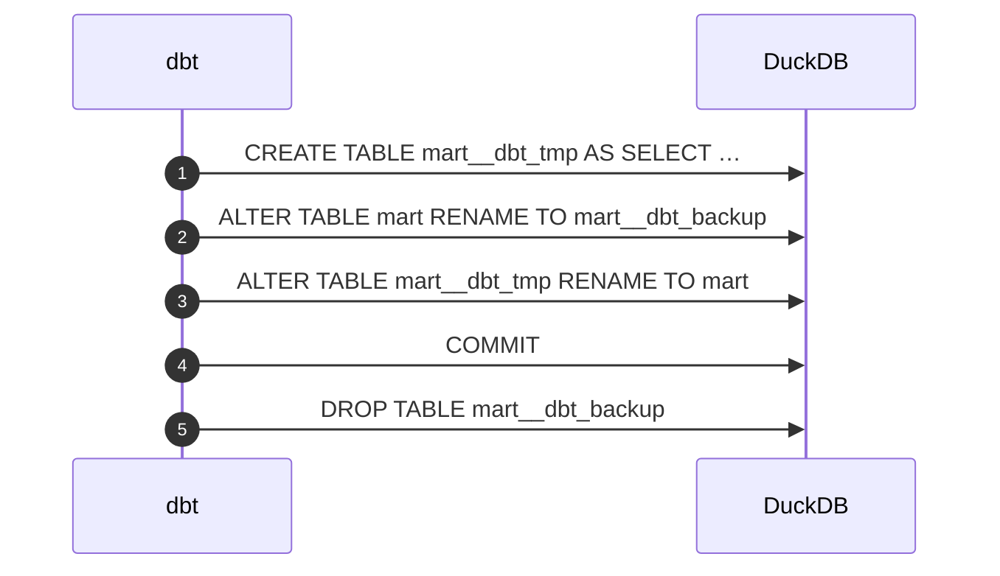

# 02 · Материализации и инкрементальные модели: как dbt пишет результат

> [!info] Урок одной фразой
> Рецепт один, а подать блюдо можно по-разному: готовить каждый раз по заказу (представление),
> приготовить заранее и держать на раздаче (таблица), каждый день доготавливать только свежую
> порцию (инкремент) или не подавать вовсе, а использовать как часть другого блюда (ephemeral).
> Выбор посуды — это выбор между скоростью приготовления, скоростью подачи и свежестью.

> [!todo] Чек-лист: после урока ты сможешь
> - [ ] назвать, какой SQL генерирует dbt для view, table, incremental, ephemeral, и выбрать материализацию по задаче;
> - [ ] объяснить, как materialization `table` подменяет таблицу и почему это атомарно;
> - [ ] написать инкрементальную модель с `is_incremental()`, ключом и окном перечитывания и предсказать её SQL;
> - [ ] выбрать стратегию `append` / `delete+insert` / `merge` / `microbatch`;
> - [ ] использовать microbatch на исторических данных, не уходя в «до сегодняшнего дня»;
> - [ ] опубликовать модель в Iceberg и объяснить, почему не строить её там напрямую (лабы 05.2, 05.5).

**Нужно для:** лаб [05.2](../labs/05.2_star_schema_marts/README.md) и
[05.5](../labs/05.5_incremental_and_snapshots/README.md).
**Карта урока:** [materializations.canvas](../maps/materializations.canvas).

---

## Шаг 0. Азбука: посуда для рецепта

**Материализация** (materialization) — способ, которым dbt превращает SELECT модели в объект
базы. Задаётся в `dbt_project.yml` по папкам или в модели: `{{ config(materialized='…') }}`.

| Материализация | В аналогии «кухня» | Подробнее |
|---|---|---|
| `view` | Готовить по заказу: каждый раз заново | [материализация](../../../glossary/materialization.md) |
| `table` | Приготовить заранее, держать на раздаче | [материализация](../../../glossary/materialization.md) |
| `incremental` | Каждый день доготавливать свежую порцию | [инкрементальная модель](../../../glossary/incremental-model.md) |
| `ephemeral` | Полуфабрикат внутри другого блюда, на раздачу не идёт | [материализация](../../../glossary/materialization.md) |
| `--full-refresh` | Выбросить всё и приготовить с нуля | [инкрементальная модель](../../../glossary/incremental-model.md) |
| Публикация в Iceberg | Отправить готовое блюдо в другой ресторан | [материализация](../../../glossary/materialization.md) |

---

## Шаг 1. Четыре материализации и что они стоят

**Проблема.** Модель можно хранить как запрос или как данные. От этого зависит, сколько стоит
сборка, сколько стоит чтение и насколько свежи данные.

**Как устроено.** dbt оборачивает SELECT модели в разные команды:

| Материализация | Что dbt выполняет | Сборка | Чтение | Свежесть |
|---|---|---|---|---|
| `view` | `CREATE VIEW … AS <select>` | мгновенно | каждый раз выполняется весь запрос | всегда свежие |
| `table` | `CREATE TABLE … AS <select>` с подменой (шаг 2) | весь запрос целиком | быстро: готовые данные | на момент сборки |
| `incremental` | первый раз — как table, дальше — дописать/заменить изменённое | только новое | быстро | на момент сборки |
| `ephemeral` | ничего: SELECT подставляется как CTE в модели, которые на неё ссылаются | — | — | — |

**Что из этого следует.**

- **view** — для staging: дёшево, всегда свежо, а читают его только другие модели dbt.
- **table** — для marts, которые часто читают: BI не должен пересчитывать соединения при каждом
  графике.
- **incremental** — когда table собирается слишком долго, а меняется малая часть (новые дни).
- **ephemeral** — чтобы не плодить объекты в базе. Цена: ephemeral не посмотреть отдельно, не
  протестировать unit-тестом (урок 03), а один и тот же CTE вычисляется в каждой модели-потребителе.

---

## Шаг 2. Как `table` подменяет таблицу

**Проблема.** Витрину читают аналитики. Если при пересборке сначала удалить таблицу, а потом
создать заново, кто-то попадёт в момент, когда таблицы нет или она наполовину пуста.

**Как устроено.** dbt-duckdb строит таблицу **под временным именем** и подменяет старую
**переименованием** в одной транзакции:



Пока строится `__dbt_tmp` (шаг 1), читатели видят старую `mart`. Переименования быстрые и
внутри транзакции: читатель видит либо старую таблицу, либо новую. Если запрос упал, старая
таблица на месте.

**Что из этого следует.** Атомарная подмена держится на `RENAME` внутри транзакции. Если база
его не умеет, материализация `table` в ней не работает (шаг 5).

---

## Шаг 3. Инкрементальная модель

**Проблема.** Факт продаж за 97 дней пересобирать целиком каждый день — расточительно: изменился
только последний день (и, может быть, пара предыдущих из-за поздних данных, модуль 04, урок 01).

**Как устроено.** Инкрементальная модель при **первом** запуске строится как таблица, а при
следующих выполняет SELECT **только для новых данных** и вливает результат в существующую
таблицу. Логика «что новое» — в самой модели, внутри условия `is_incremental()`:

```sql
{{ config(materialized='incremental',
          incremental_strategy='delete+insert',      -- ① как вливать
          unique_key=['city_id', 'weather_date'],    -- ② ключ строки
          on_schema_change='append_new_columns') }}  -- ③ новая колонка в SELECT
select city_id, weather_date, precipitation, avg_temperature, stores
from {{ ref('int_city_weather_daily') }}
                             -- ④ только при инкрементальном запуске
where weather_date > (select max(weather_date) from {{ this }})   -- ⑤ {{ this }} — сама модель
                     - interval {{ var('lookback_days', 2) }} day  -- ⑥ окно перечитывания

```

| Метка | Что важно |
|---|---|
| ① | стратегия — шаг 4 |
| ② | по ключу заменяются строки, пришедшие повторно |
| ③ | что делать, если в SELECT появилась колонка: `ignore` (по умолчанию), `append_new_columns`, `sync_all_columns`, `fail` |
| ④ | `is_incremental()` истинно, только если таблица уже есть, модель инкрементальная и не передан `--full-refresh` |
| ⑤ | `{{ this }}` — имя этой же таблицы в базе: можно спросить, докуда она уже построена |
| ⑥ | окно перечитывания из модуля 04: поздние данные за последние дни заменят старые строки |

`dbt run --full-refresh -s модель` пересобирает инкрементальную модель с нуля. Это нужно после
изменения логики: инкремент применил бы новую логику только к новым дням.

> [!example]- Попробуй сам: первый и второй запуск инкрементальной модели
> В `make shell`, папка `modules/05_transformation_dbt/demo`:
> ```bash
> dbt run -s fct_city_weather_daily --full-refresh
> head -5 target/run/weather_demo/models/marts/fct_city_weather_daily.sql
> dbt run -s fct_city_weather_daily
> cat target/run/weather_demo/models/marts/fct_city_weather_daily.sql
> dbt compile -s fct_city_weather_daily --quiet --vars "{lookback_days: 7}" > /dev/null
> tail -1 target/compiled/weather_demo/models/marts/fct_city_weather_daily.sql
> duckdb -readonly /workspace/data/demo_weather.duckdb -c "select count(*), min(weather_date), max(weather_date) from fct_city_weather_daily"
> ```
> **Увидишь:** первый запуск — `create table "demo_weather"."main"."fct_city_weather_daily"`.
> Второй — `delete from … using "fct_city_weather_daily__dbt_tmp…" where (… city_id = … and …
> weather_date = …)` и `insert into … select … from "…__dbt_tmp…"`. С `lookback_days: 7` в
> условии — `interval 7 day`. В таблице 1746 строк за 2024-03-28 … 2024-07-02.
> **Почему:** при втором запуске таблица уже есть: dbt строит временную таблицу только из окна,
> удаляет из целевой строки с теми же ключами и вставляет новые.

> [!warning] Ловушка: инкремент без ключа и окна
> `where date > (select max(date) from {{ this }})` без окна и ключа — это append «всё, что
> новее». Поздние данные за уже построенный день не попадут никогда, а повторный запуск после
> сбоя на середине может задвоить день. Окно + ключ делают инкремент идемпотентным.

---

## Шаг 4. Стратегии: append, delete+insert, merge, microbatch

**Проблема.** Как именно влить новые строки в таблицу?

**Как устроено.** В dbt-duckdb 1.11 на DuckDB 1.5 доступны четыре стратегии:

| Стратегия | Что делает | Повтор того же окна | Когда |
|---|---|---|---|
| `append` | `INSERT` всех строк окна | дубли | неизменяемые события без повторов |
| `delete+insert` | `DELETE` строк с ключами из окна, затем `INSERT` (как в примере) | безопасен | факты по дате; ключ — естественный |
| `merge` | `MERGE INTO`: совпал ключ — `UPDATE`, нет — `INSERT` | безопасен | когда нужно обновлять отдельные колонки или условия |
| `microbatch` | делит период на пачки по времени события и строит каждую отдельным запросом | безопасен (пачка заменяется целиком) | большие факты по времени, backfill по частям |

**Microbatch.** dbt (с версии 1.9) сам фильтрует входы по времени: у модели задают
`event_time` (колонка времени события), `batch_size` (`day`, `hour`, …), `begin` (с какой даты
строить при первом запуске) и `lookback` (сколько прошлых пачек перестраивать каждый раз). У
**входных** моделей тоже указывают `event_time`, и dbt подставляет в них фильтр на пачку.
Условие `is_incremental()` писать не нужно.

> [!warning] Ловушка: microbatch идёт до сегодняшнего дня
> Без указания конца microbatch строит пачки от `begin` **до текущей даты**. Наши данные
> заканчиваются 2024-07-02, а «сегодня» — 2026 год. Модель с `begin='2024-06-20'` и
> `batch_size='day'` на проверке запустила **834 пачки за 143 секунды**, из них 828 пустых. Для
> исторических данных задавай интервал явно: `dbt run -s модель --event-time-start 2024-06-24
> --event-time-end 2024-06-26` — это 2 пачки за 0,3 с.

**Что из этого следует.** Для наших фактов по дням хватает `delete+insert` с окном
перечитывания: просто и предсказуемо. Microbatch полезен, когда backfill всей истории одним
запросом не помещается в память или время: тогда он строит её по частям, и упавшую пачку можно
перезапустить отдельно (`dbt retry`).

---

## Шаг 5. Почему не строить модели прямо в Iceberg и как их туда опубликовать

**Проблема.** Витрины должны читать Trino, Spark и ClickHouse (модули 07, 10). Они читают
Iceberg, а не файл DuckDB. Почему бы не указать модели `database: lh` и не строить её прямо в
Iceberg?

**Как устроено.** Мы проверили на DuckDB 1.5, что он умеет с таблицами Iceberg:

| Операция | DuckDB 1.5 + Iceberg |
|---|---|
| `CREATE SCHEMA`, `CREATE TABLE … AS`, `INSERT`, `DELETE`, `UPDATE`, `MERGE`, `DROP` | да |
| `CREATE OR REPLACE TABLE` | нет: «Please use separate Drop and Create Statements» |
| `CREATE VIEW` | нет |
| переименовать таблицу, изменённую в этой же транзакции | нет |
| писать в две базы в одной транзакции | нет: «a single transaction can only write to a single attached database» |

Материализация `table` (шаг 2) строит `__dbt_tmp` и переименовывает его в той же транзакции,
поэтому падает: `This table (m_table__dbt_tmp) was modified already, can't be renamed!`.
Представления staging невозможны, snapshot и инкремент тоже опираются на временные таблицы.

Поэтому архитектура такая: модели строятся в **DuckDB-файле**, а готовые витрины **копируются**
в Iceberg отдельной командой. Копирование — это **post-hook**: SQL, который dbt выполняет после
построения модели. Ему нужен флаг `transaction: false`, иначе он попадёт в одну транзакцию с
записью в DuckDB-файл и упадёт с ошибкой «single transaction … single attached database».

```sql
-- macros/publish_to_iceberg.sql (демо-проект)

                                     -- ① только в цели с attach
    CREATE SCHEMA IF NOT EXISTS lh.{{ namespace }};
    DROP TABLE IF EXISTS lh.{{ namespace }}.{{ this.identifier }}; -- ② нет CREATE OR REPLACE
    CREATE TABLE lh.{{ namespace }}.{{ this.identifier }} AS SELECT * FROM {{ this }};
  

```

```yaml
# dbt_project.yml
    marts:
      +post-hook:
        - sql: "{{ publish_to_iceberg('sandbox_dbt') }}"
          transaction: false                                       # ③ отдельная транзакция
```

① В цели `dev` хук пустой: работа идёт быстро и без каталога. ② Между `DROP` и `CREATE` таблицы в
Iceberg **нет** — это неатомарная подмена, читатель может получить ошибку «table does not exist».
Для учебного стека это приемлемо, а в модуле 07 Spark умеет атомарную замену
(`CREATE OR REPLACE TABLE … USING iceberg`). ③ Без флага — ошибка транзакции.

> [!example]- Попробуй сам: публикация витрины в Iceberg
> В `make shell`, папка `modules/05_transformation_dbt/demo` (песочница `sandbox_dbt` создана в
> уроке 01):
> ```bash
> dbt run -s marts                    # dev: хук пустой
> dbt run -s marts --target lake      # lake: витрины копируются в lh.sandbox_dbt
> dbt show --target lake --inline "select count(*) as cities, sum(rainy_days) as rainy from lh.sandbox_dbt.mart_city_rainy_days"
> ```
> **Увидишь:** оба запуска `OK`; в Iceberg `cities 18 · rainy 286`.
> **Почему:** post-hook с `transaction: false` выполнился после фиксации модели, отдельной
> транзакцией в каталоге `lh`.

**Очистка песочницы модуля.** В `make shell`:

```bash
python - <<'EOF'
import os
from pyiceberg.catalog import load_catalog
catalog = load_catalog("lh", type="rest", uri=os.environ["ICEBERG_CATALOG_URI"],
                       warehouse=os.environ["ICEBERG_WAREHOUSE"])
for table in catalog.list_tables("sandbox_dbt"):
    catalog.purge_table(table)
catalog.drop_namespace("sandbox_dbt")
print(catalog.list_namespaces())
EOF
```

---

## Шаг 6. Как выбрать материализацию

| Модель | Материализация | Почему |
|---|---|---|
| `stg_*` | view | читают только модели dbt; дёшево и свежо |
| `int_*` | view или ephemeral | промежуточное; ephemeral — если не нужно смотреть и тестировать отдельно |
| `dim_*` (сотни–тысячи строк) | table | пересобрать целиком быстрее, чем думать об инкременте |
| `fct_*` по дням (миллионы строк) | incremental `delete+insert` с окном | меняются последние дни |
| огромный факт, backfill не влезает | incremental `microbatch` | история строится пачками |
| то, что читают Trino/Spark/BI | table + публикация в Iceberg | внешние движки читают Iceberg |

> [!warning] Ловушка: инкремент «на всякий случай»
> Инкремент сложнее таблицы: окно, ключ, `--full-refresh` после изменения логики, расхождение
> «полная сборка ≠ сумма инкрементов» при ошибке в условии. Делай модель инкрементальной, только
> когда полная сборка **измеримо** слишком долгая. Справочники в сотни строк — всегда table.

---

## Сборка целиком

Ежедневный запуск факта с окном перечитывания и публикацией:

```mermaid
sequenceDiagram
    autonumber
    participant D as dbt run --target lake
    participant DB as DuckDB-файл
    participant LH as Iceberg (lh)
    D->>DB: is_incremental()? таблица есть → да
    D->>DB: CREATE TEMP … AS SELECT … WHERE date > max(date) − 2 дня
    D->>DB: DELETE строки с ключами окна; INSERT окно; COMMIT
    D->>LH: post-hook (transaction false): DROP TABLE lh.gold.fct
    D->>LH: CREATE TABLE lh.gold.fct AS SELECT * FROM fct
```

| Шаг | Если сломается | Симптом |
|---|---|---|
| 1 | передан `--full-refresh` | модель собрана с нуля (дольше, но верно) |
| 2 | нет окна | поздние данные не попадают |
| 3 | ключ неуникален | лишние или потерянные строки, тест уникальности (урок 03) |
| 4 | хук в транзакции | «single transaction can only write to a single attached database» |
| 4–5 | читатель между DROP и CREATE | «table does not exist» у потребителя |

## Шпаргалка

| Хочу | Как |
|---|---|
| Материализация папки | `+materialized: view` в `dbt_project.yml` |
| Материализация модели | `{{ config(materialized='table') }}` |
| Инкремент | `materialized='incremental'`, `unique_key`, `incremental_strategy`, `` |
| Ссылка на саму модель | `{{ this }}` |
| Пересобрать с нуля | `dbt run -s m --full-refresh` |
| Новая колонка в инкременте | `on_schema_change='append_new_columns'` |
| Microbatch за интервал | `--event-time-start … --event-time-end …` |
| Хук после модели вне транзакции | `post-hook: [{sql: "…", transaction: false}]` |
| Посмотреть, что выполнилось | `target/run/<проект>/models/…sql` |

## Типичные ошибки

| Симптом | Причина | Как проверить | Как чинить |
|---|---|---|---|
| `… was modified already, can't be renamed!` | материализация `table` в Iceberg через DuckDB | `database:` модели | строить в DuckDB, публиковать хуком |
| `CREATE OR REPLACE not supported in DuckDB-Iceberg` | своя команда с `OR REPLACE` | текст хука | `DROP` + `CREATE` |
| `a single transaction can only write to a single attached database` | хук в транзакции модели | конфиг хука | `transaction: false` |
| Инкремент не подхватил поздние данные | нет окна перечитывания | `target/compiled` — условие | окно `lookback` |
| После изменения логики старые дни по-старому | инкремент применяет логику только к окну | сравнить с полной сборкой | `--full-refresh` |
| Microbatch идёт сотни пачек | `begin` без конца → до сегодня | лог `Batch N of M` | `--event-time-start/--event-time-end` |

## Проверь себя

Карточки — в [flashcards.md](../flashcards.md).

> [!question] 1. Модель `dim_store` (898 строк) сделали инкрементальной «чтобы быстрее». Что ты скажешь на ревью?
> > [!success]- Ответ
> > Полная сборка 898 строк — доли секунды. Инкремент добавляет сложность (ключ, окно, полная
> > пересборка после изменения логики) и риск расхождения, не давая выигрыша. Здесь нужна table.

> [!question] 2. Почему `is_incremental()` ложно при первом запуске, даже если в конфиге `incremental`?
> > [!success]- Ответ
> > Таблицы ещё нет: строить «только новое» не к чему. dbt строит её целиком, как table. Истинно
> > оно, когда таблица есть, модель инкрементальная и нет `--full-refresh`.

> [!question] 3. В инкрементальной модели окно 2 дня, стратегия `append`. Ты запустил её дважды подряд. Что в таблице?
> > [!success]- Ответ
> > Последние 2 дня (по максимальной дате) записаны дважды: append не удаляет строки с теми же
> > ключами. Нужна `delete+insert` или `merge` с `unique_key`.

> [!question] 4. Почему post-hook публикации нельзя оставить в транзакции модели?
> > [!success]- Ответ
> > DuckDB разрешает одной транзакции писать только в одну подключённую базу. Модель уже писала
> > в DuckDB-файл, а хук пишет в каталог `lh`. С `transaction: false` хук выполняется отдельно
> > после фиксации.
