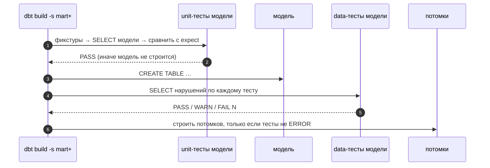

# 03 · Тесты в dbt: проверки данных и проверки логики

> [!info] Урок одной фразой
> На кухне пробуют два раза. Дегустация готового блюда (тест данных) проверяет, что на тарелке:
> не пересолено, нет лишнего. Проверка рецепта на контрольных продуктах (unit-тест) проверяет
> сам рецепт: из этих трёх яиц должен выйти такой-то омлет. Первое ловит плохое сырьё, второе —
> ошибки в рецепте, и одно другое не заменяет.

> [!todo] Чек-лист: после урока ты сможешь
> - [ ] объяснить, что такое тест данных в dbt (запрос, возвращающий нарушения);
> - [ ] навесить generic-тесты `unique`, `not_null`, `accepted_values`, `relationships` и тесты из dbt_utils;
> - [ ] написать сингулярный тест и свой generic-тест;
> - [ ] написать unit-тест модели на фикстурах и прочитать его диф;
> - [ ] управлять строгостью (`severity`, `warn_if`, `error_if`) и сохранять нарушения (`store_failures`);
> - [ ] выбрать, что проверять тестом данных, а что unit-тестом (лаба 05.3).

**Нужно для:** лабы [05.3](../labs/05.3_tests/README.md).
**Карта урока:** [dbt-tests.canvas](../maps/dbt-tests.canvas).

---

## Шаг 0. Азбука: дегустация и проверка рецепта

| В dbt | В аналогии «кухня» | Подробнее |
|---|---|---|
| Тест данных (data test) | Дегустация готового блюда | [тесты dbt](../../../glossary/dbt-tests.md) |
| Generic-тест | Типовая проверка: «не пересолено» для любого блюда | [тесты dbt](../../../glossary/dbt-tests.md) |
| Сингулярный тест | Особая проверка одного блюда | [тесты dbt](../../../glossary/dbt-tests.md) |
| Unit-тест | Рецепт на контрольных продуктах с известным результатом | [тесты dbt](../../../glossary/dbt-tests.md) |
| Фикстура (fixture) | Контрольные продукты | [тесты dbt](../../../glossary/dbt-tests.md) |
| `severity: warn` | «Чуть пересолено — подать можно, но записать» | [тесты dbt](../../../glossary/dbt-tests.md) |

---

## Шаг 1. Тест данных — это запрос, который ищет нарушения

**Проблема.** Ключ витрины должен быть уникальным, у факта не должно быть пустых магазинов, у
статуса — только допустимые значения. Как это проверять каждый раз автоматически?

**Как устроено.** В dbt **тест данных** — это SELECT, который возвращает **строки-нарушения**.
Ноль строк — тест прошёл (PASS), больше нуля — упал (FAIL N, где N — число строк). Тест
выполняется **после** построения модели и смотрит на настоящие данные в базе.

Например, тест `unique` на колонке `city_id` компилируется примерно в:

```sql
select city_id, count(*) as n_records
from "demo_weather"."main"."mart_city_rainy_days"
where city_id is not null
group by city_id
having count(*) > 1
```

**Что из этого следует.**

- Любую проверку, которую можно записать как «найди плохие строки», можно сделать тестом.
- В `dbt build` тесты модели выполняются сразу после неё. Если тест упал, **потомки модели
  пропускаются** (SKIP), и плохие данные не уходят дальше.
- Тест данных проверяет **сегодняшние данные**. Он может пройти сегодня и упасть завтра, когда
  источник пришлёт дубль. Это его назначение: ловить проблемы данных.

---

## Шаг 2. Generic-тесты: типовые проверки из YAML

**Проблема.** Проверки «уникален», «не пустой», «из списка» нужны десяткам колонок. Писать их
SQL каждый раз — копипаста.

**Как устроено.** **Generic-тест** — параметризованный тест, который навешивают на модель или
колонку в YAML. Четыре встроены в dbt:

```yaml
models:
  - name: mart_city_rainy_days
    columns:
      - name: city_id
        data_tests:
          - unique                                   # ① нет повторов
          - not_null                                 # ② нет NULL
  - name: some_model
    columns:
      - name: status
        data_tests:
          - accepted_values:                         # ③ только из списка
              arguments:
                values: ['open', 'closed']
      - name: store_id
        data_tests:
          - relationships:                           # ④ ссылочная целостность
              arguments:
                to: ref('dim_store')
                field: store_id
```

| Тест | Ловит | Пример у нас |
|---|---|---|
| ① `unique` | дубли ключа | `fct_*` после повторной загрузки |
| ② `not_null` | пустые обязательные поля | `store_id` в факте |
| ③ `accepted_values` | неожиданные значения | статус магазина `paused` (модуль 04, урок 05) |
| ④ `relationships` | «сироты»: факт ссылается на несуществующее измерение | ассортимент нового магазина без строки в `dim_store` |

Пакет **dbt_utils** (урок 05) добавляет ещё десятки: `unique_combination_of_columns` (составной
ключ), `accepted_range` (число в пределах), `expression_is_true` (любое условие),
`recency` (свежесть данных) и другие.

> [!warning] Ловушка: аргументы теста в dbt 1.12
> В dbt 1.10+ параметры generic-теста кладут под ключ `arguments:`. Старая запись без него
> (`- accepted_values: {values: […]}`) ещё работает, но выдаёт предупреждение
> `MissingArgumentsPropertyInGenericTestDeprecation` и в будущих версиях перестанет.

---

## Шаг 3. Сингулярные и свои generic-тесты

**Проблема.** Бывают проверки, которые не укладываются в типовые: «дождливых дней не больше
всех дней», «сумма по магазинам равна итогу по сети».

**Как устроено.**

**Сингулярный тест** — файл `.sql` в папке `tests/`: обычный SELECT нарушений с `ref()`. Он
относится к моделям, на которые ссылается.

```sql
-- tests/assert_rainy_days_not_more_than_days.sql
select city_id, days, rainy_days
from {{ ref('mart_city_rainy_days') }}
where rainy_days > days
```

**Свой generic-тест** — блок `` в `tests/generic/` (или `macros/`). Параметры
`model` и `column_name` dbt подставит сам из того места YAML, где тест навешен:

```sql
-- tests/generic/non_negative.sql

select {{ column_name }} from {{ model }} where {{ column_name }} < 0

```

```yaml
      - name: precipitation
        data_tests: [non_negative]
```

**Что из этого следует.** Если сингулярная проверка понадобилась второй раз — превращай её в
generic-тест с параметрами.

---

## Шаг 4. Строгость и сохранение нарушений

**Проблема.** Не всякое нарушение должно останавливать сборку. Пять «странных» температур из
1746 строк — повод разобраться, а не ронять ночной запуск. И когда тест упал, нужно увидеть
**какие** строки нарушают.

**Как устроено.** У каждого теста есть настройки (в YAML под `config:` или в сингулярном тесте
через `{{ config(...) }}`):

| Настройка | Что делает |
|---|---|
| `severity: warn` | нарушение — предупреждение (WARN), сборка продолжается |
| `warn_if: ">10"`, `error_if: ">100"` | пороги по числу нарушений: до 10 — PASS, 11–100 — WARN, больше — ERROR |
| `store_failures: true` (или флаг `--store-failures`) | строки-нарушения сохраняются в таблицу схемы `<схема>_dbt_test__audit` |
| `where: "dt >= '2024-06-01'"` | проверять только часть данных |
| `limit: 100` | вернуть не больше N нарушений |

> [!example]- Попробуй сам: тесты проходят, потом падают на строгом пороге
> В `make shell`, папка `modules/05_transformation_dbt/demo` (проект собран: `dbt build`):
> ```bash
> dbt test -s stg_weather int_city_weather_daily
> dbt test -s assert_daily_temperature_plausible --vars '{max_temp: 30}'
> duckdb -readonly /workspace/data/demo_weather.duckdb -c "select * from main_dbt_test__audit.assert_daily_temperature_plausible order by avg_temperature desc limit 3"
> ```
> **Увидишь:** 4 теста `PASS`, включая свой `non_negative_stg_weather_precipitation`. С порогом
> 30° — `FAIL 50 assert_daily_temperature_plausible` и подсказка `See test failures: select *
> from "demo_weather"."main_dbt_test__audit"…`. В таблице нарушений — самые жаркие дни: город 15,
> 2024-07-02, 31,9°.
> **Почему:** тест нашёл 50 строк вне диапазона, `store_failures: true` в его конфиге сохранил
> их для разбора.

---

## Шаг 5. Unit-тесты: проверка логики на фикстурах

**Проблема.** Тесты данных проверяют сегодняшние данные. Но если в модели ошибка в условии
(`>` вместо `>=`), а в сегодняшних данных нет значений ровно на границе, тест данных её не
заметит. Нужна проверка **логики**, не зависящая от данных.

**Как устроено.** **Unit-тест** (с dbt 1.8) задаёт в YAML: модель, **фикстуры** для её входов
(`given`) — несколько строк вместо настоящих `ref`/`source` — и **ожидаемый результат**
(`expect`). dbt подставляет фикстуры вместо входов, выполняет SELECT модели и сравнивает
результат с ожиданием. Модель в базе при этом не строится.

```yaml
unit_tests:
  - name: rainy_day_counts_threshold
    model: mart_city_rainy_days                    # ① какую модель проверяем
    overrides:
      vars: {rainy_threshold: 1.0}                 # ② фиксируем параметры
    given:
      - input: ref('int_city_weather_daily')       # ③ вход → фикстура
        rows:
          - {city_id: 0, weather_date: 2024-04-01, precipitation: 0.0, avg_temperature: 10.0}
          - {city_id: 0, weather_date: 2024-04-02, precipitation: 1.0, avg_temperature: 12.0}  # ровно порог
          - {city_id: 0, weather_date: 2024-04-03, precipitation: 5.5, avg_temperature: 14.0}
    expect:                                        # ④ ожидаемые строки
      rows:
        - {city_id: 0, days: 3, rainy_days: 2, avg_temperature: 12.0}
```

① Одна модель на тест. ② Переменные, макросы (`is_incremental`) можно подменить. ③ В фикстуре
достаточно колонок, которые использует модель. ④ Сравниваются только перечисленные колонки.

Хорошая фикстура — **граничные случаи**: ровно на пороге, NULL, пустая группа, дубль. Именно на
них ломается логика.

> [!example]- Попробуй сам: unit-тест ловит ошибку на границе
> В `make shell`, папка `modules/05_transformation_dbt/demo`. Портим условие и возвращаем обратно:
> ```bash
> sed -i 's/>= {{ var/> {{ var/' models/marts/mart_city_rainy_days.sql   # ошибка: > вместо >=
> dbt test -s "mart_city_rainy_days,test_type:unit"
> sed -i 's/> {{ var/>= {{ var/' models/marts/mart_city_rainy_days.sql   # вернуть как было
> grep -c ">= {{ var" models/marts/mart_city_rainy_days.sql            # должно быть 1
> ```
> **Увидишь:** `FAIL 1 mart_city_rainy_days::rainy_day_counts_threshold` и диф `actual differs
> from expected`: в колонке `rainy_days` `2→1`.
> **Почему:** день с осадками ровно 1.0 перестал считаться дождливым. Тест данных на настоящих
> данных этого бы не заметил: там почти нет значений ровно на пороге. Селектор
> `модель,test_type:unit` — пересечение условий: unit-тесты этой модели.

> [!warning] Ловушка: unit-тест и ephemeral-входы
> Чтобы подставить фикстуру, dbt берёт типы колонок входа **из базы**. Если вход —
> ephemeral-модель (в базе её нет), тест падает: `Not able to get columns for unit test '…' from
> relation … because the relation doesn't exist`. Решения: сделать вход view или задать фикстуру
> SQL-запросом (`format: sql`). В демо-проекте intermediate поэтому — view.

---

## Шаг 6. Что чем проверять

| Что проверить | Чем | Почему |
|---|---|---|
| Ключ уникален, не пустой | data test `unique`, `not_null` / `unique_combination_of_columns` | проблема данных: дубли приходят из источника |
| Ссылки факта на измерения | data test `relationships` | «сироты» — проблема данных |
| Значения из словаря | data test `accepted_values` | новое значение — дрейф источника |
| Условие на границе, расчёт формулы | unit test | ошибка логики, не зависит от данных |
| Поведение инкремента (`is_incremental`) | unit test с подменой макроса | логика ветвления |
| Свежесть источника | `freshness` у source (модуль 09) | данные перестали приходить |
| Сверка с источником | сингулярный тест или проверка модуля 09 | тихие потери загрузки (модуль 04) |

**Что из этого следует.** Минимум для каждой модели marts — тесты ключа. Минимум для
нетривиальной формулы — unit-тест с граничными случаями. `dbt build` запускает и те, и другие в
порядке графа: unit-тесты — до построения модели, data-тесты — после.

---

## Сборка целиком

Порядок проверок модели внутри `dbt build`:



| Шаг | Если сломается | Симптом |
|---|---|---|
| 1–2 | ошибка логики | `actual differs from expected` + диф; модель и потомки SKIP |
| 4–5 | плохие данные | `FAIL N`; `See test failures` при `store_failures` |
| 5 | порог `warn_if` | `WARN N`, сборка продолжается |
| 6 | тест ERROR | потомки SKIP: плохие данные не ушли дальше |

## Шпаргалка

| Хочу | Как |
|---|---|
| Уникальность / не NULL | `data_tests: [unique, not_null]` у колонки |
| Составной ключ | `dbt_utils.unique_combination_of_columns` с `arguments: {combination_of_columns: […]}` |
| Значения из списка | `accepted_values` с `arguments: {values: […]}` |
| Ссылочная целостность | `relationships` с `arguments: {to: ref('dim'), field: …}` |
| Особая проверка | `tests/<имя>.sql` — SELECT нарушений |
| Свой типовой тест | ` … ` |
| Не ронять сборку | `config: {severity: warn}` или `warn_if` / `error_if` |
| Увидеть нарушения | `store_failures: true` / `--store-failures` → схема `*_dbt_test__audit` |
| Только unit-тесты | `dbt test -s "test_type:unit"` |
| Тесты модели | `dbt test -s модель` |

## Типичные ошибки

| Симптом | Причина | Как проверить | Как чинить |
|---|---|---|---|
| `FAIL N unique_…` | дубли ключа | `store_failures`, запрос дублей | найти источник дублей (загрузка, соединение — fan-out, модуль 02) |
| `FAIL N relationships_…` | факт ссылается на отсутствующее измерение | нарушения теста | поправить измерение или порядок загрузки; `severity: warn` для «сирот» bronze |
| `actual differs from expected` | ошибка логики или неверное ожидание | диф в выводе | исправить модель или фикстуру |
| `Not able to get columns for unit test` | вход ephemeral или не построен | материализация входа | view / `format: sql` / сначала `dbt run` входа |
| `MissingArgumentsPropertyInGenericTestDeprecation` | параметры теста без `arguments:` | предупреждение в логе | перенести под `arguments:` |

## Проверь себя

Карточки — в [flashcards.md](../flashcards.md).

> [!question] 1. Почему тест `unique` прошёл вчера и упал сегодня, хотя код модели не менялся?
> > [!success]- Ответ
> > Тест данных проверяет сегодняшние данные. Источник прислал дубль (повторная доставка,
> > модуль 04), и он дошёл до модели. Это и есть назначение теста данных.

> [!question] 2. В модели условие `discount < 1` для «товар в акции». Какой тест поймает, если кто-то заменит его на `discount <= 1`?
> > [!success]- Ответ
> > Unit-тест с фикстурой, где есть строка с `discount = 1.0` и ожидается, что она не в акции.
> > Тест данных может не заметить: зависит от того, есть ли такие строки сегодня и что
> > проверяется.

> [!question] 3. В bronze ассортимент иногда ссылается на магазин, которого ещё нет в справочнике (модуль 04, урок 03). Какой тест и какую строгость поставишь в staging?
> > [!success]- Ответ
> > `relationships` с `severity: warn` или `warn_if`: «сироты» ожидаемы из-за несогласованной
> > выгрузки и исправляются следующей загрузкой. Ошибкой делать на уровне marts, где их быть
> > не должно.

> [!question] 4. Чем `store_failures` помогает при разборе инцидента?
> > [!success]- Ответ
> > Нарушающие строки сохраняются в таблицу аудита, и их можно разобрать запросом: какие ключи,
> > какие даты, откуда пришли. Без этого видно только число нарушений.
