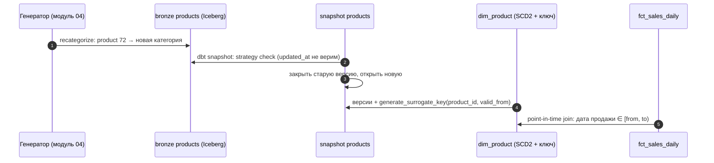

# 05 · Snapshots, макросы и пакеты: история изменений и SQL без копипасты

> [!info] Урок одной фразой
> Журнал меню хранит каждую версию блюда с датами «с — по»: когда сменился рецепт, когда блюдо
> сняли. Это snapshot. Одну и ту же нарезку повар не переписывает в двадцати рецептах. Он пишет
> её один раз как приём (макрос) и вызывает по имени. Готовые приёмы других кухонь он берёт из
> книги (пакет dbt_utils).

> [!todo] Чек-лист: после урока ты сможешь
> - [ ] объяснить, зачем снимок истории, если в источнике хранится только текущее состояние;
> - [ ] настроить snapshot со стратегией `timestamp` или `check` и обработкой удалений;
> - [ ] прочитать таблицу SCD2: `dbt_valid_from`, `dbt_valid_to`, `dbt_is_deleted` — и выбрать версию на дату;
> - [ ] написать Jinja: переменные, циклы, условия, макрос с аргументами;
> - [ ] выполнить макрос-операцию через `run-operation`;
> - [ ] подключить пакет и использовать `generate_surrogate_key`, `date_spine` (лабы 05.2, 05.5).

> [!tip] Визуализация темы
> Интерактивная страница [scd2_timeline.html](../../02_sql_and_modeling/visuals/scd2_timeline.html). Схема «dbt snapshot»: почему интервал
> `[dbt_valid_from, dbt_valid_to)` полуоткрытый и что делает с днём смены BETWEEN.

**Нужно для:** лаб [05.2](../labs/05.2_star_schema_marts/README.md) (задачи 2–3) и
[05.5](../labs/05.5_incremental_and_snapshots/README.md).
**Карта урока:** [snapshots-macros.canvas](../maps/snapshots-macros.canvas).

---

## Шаг 0. Азбука: журнал меню и кулинарные приёмы

SCD (медленно меняющиеся измерения) и тип 2 (версии с датами) разобраны в модуле 02, урок 06.
Здесь — как dbt строит SCD2 автоматически и как писать повторяемый SQL.

| В dbt | В аналогии «кухня» | Подробнее |
|---|---|---|
| Snapshot | Журнал версий меню | [SCD](../../../glossary/scd.md) |
| `dbt_valid_from` / `dbt_valid_to` | «Подавалось с … по …» | [SCD](../../../glossary/scd.md) |
| Стратегия `timestamp` / `check` | Узнавать о смене по дате правки карты / сравнивая состав | [SCD](../../../glossary/scd.md) |
| Jinja | Язык шаблонов рецептов | [Jinja и макросы](../../../glossary/jinja-macros.md) |
| Макрос | Кулинарный приём, вызываемый по имени | [Jinja и макросы](../../../glossary/jinja-macros.md) |
| Пакет | Книга чужих приёмов | [Jinja и макросы](../../../glossary/jinja-macros.md) |
| Суррогатный ключ | Номер строки измерения от хранилища | [суррогатный ключ](../../../glossary/surrogate-key.md) |

---

## Шаг 1. Зачем snapshot

**Проблема.** В учётной системе `retail_oltp` хранится **текущее** состояние: статус магазина,
категория товара. Когда генератор изменений (модуль 04) переносит товар в другую категорию,
старое значение затирается. Отчёт «продажи по категориям за апрель» через месяц покажет
апрельские продажи в **новой** категории — история переписалась.

**Как устроено.** **Snapshot** периодически сравнивает текущее состояние источника с тем, что
уже записано, и хранит **все версии** строк с интервалами действия:

| Колонка | Значение |
|---|---|
| `dbt_valid_from` | с какого момента действует версия |
| `dbt_valid_to` | до какого момента; `NULL` — действует сейчас |
| `dbt_scd_id` | уникальный ID версии |
| `dbt_updated_at` | значение `updated_at` источника (или время снимка) |
| `dbt_is_deleted` | версия, отмечающая удаление (при `hard_deletes: new_record`) |

Snapshot видит только то, что есть **в момент запуска**. Если строку изменили дважды между
запусками, сохранится только последнее изменение.

**Что из этого следует.** Snapshot — способ **накопить** историю, которой нет в источнике. Её
нельзя восстановить задним числом: если не снимать с первого дня, ранние версии потеряны
навсегда. Поэтому snapshot запускают **часто** и **с первого дня**, а для полной истории всех
изменений нужен CDC (модуль 08).

---

## Шаг 2. Как настроить snapshot

**Проблема.** Как dbt понимает, что строка изменилась?

**Как устроено.** С dbt 1.9 snapshot описывается в YAML (`snapshots/*.yml`):

```yaml
snapshots:
  - name: demo_store_status_snapshot
    relation: ref('demo_store_status')     # ① что снимаем: source() или ref()
    config:
      unique_key: store_id                 # ② ключ сущности
      strategy: timestamp                  # ③ как узнать об изменении
      updated_at: updated_at               #    колонка времени изменения
      hard_deletes: new_record             # ④ что делать с исчезнувшими строками
```

**③ Стратегии:**

| Стратегия | Как определяет изменение | Когда |
|---|---|---|
| `timestamp` | значение `updated_at` стало больше записанного | у источника надёжный `updated_at` |
| `check` | значения колонок из `check_cols` (или `all`) отличаются | `updated_at` нет или ему нельзя верить (операция `recategorize` в модуле 04!) |

**④ Удаления** (`hard_deletes`):

| Значение | Что происходит, когда строка пропала из источника |
|---|---|
| `ignore` (по умолчанию) | ничего: последняя версия остаётся «действующей» навсегда |
| `invalidate` | последней версии ставится `dbt_valid_to` |
| `new_record` | закрывается последняя версия и добавляется версия с `dbt_is_deleted = True` |

> [!example]- Попробуй сам: история статусов магазинов
> В `make shell`, папка `modules/05_transformation_dbt/demo`. Seed `demo_store_status` играет
> роль учётной системы: меняем его и снимаем снимки.
> ```bash
> duckdb /workspace/data/demo_weather.duckdb -c "DROP TABLE IF EXISTS demo_store_status_snapshot"   # начать историю заново
> cp seeds/demo_store_status.csv /tmp/demo_store_status.orig.csv                                  # сохранить исходный seed
> dbt seed -s demo_store_status --quiet && dbt snapshot --quiet                                     # день 1: три открытых магазина
> # день 2: магазин 1 закрылся 5 апреля, магазин 2 удалён из учётной системы
> printf 'store_id,status,updated_at\n0,open,2024-03-28 00:00:00\n1,closed,2024-04-05 00:00:00\n' > seeds/demo_store_status.csv
> dbt seed -s demo_store_status --quiet && dbt snapshot --quiet
> cp /tmp/demo_store_status.orig.csv seeds/demo_store_status.csv                                  # вернуть seed
> duckdb -readonly /workspace/data/demo_weather.duckdb -c "
>   SELECT store_id, status, dbt_valid_from::date AS valid_from, dbt_valid_to::date AS valid_to, dbt_is_deleted
>   FROM demo_store_status_snapshot ORDER BY store_id, dbt_valid_from"
> ```
> **Увидишь:** магазин 0 — одна версия; магазин 1 — `open 2024-03-28 → 2024-04-05` и `closed
> 2024-04-05 → NULL`; магазин 2 — `open … → <сегодня>` и версия с `dbt_is_deleted = True` с
> сегодняшней даты.
> **Почему:** для изменения `timestamp`-стратегия взяла время из `updated_at` источника, а у
> удаления такого времени нет — dbt ставит **момент запуска snapshot**.

> [!warning] Ловушка: дата удаления — это дата снимка
> Бери точное время удаления из журнала изменений (CDC, модуль 08), а не из snapshot. Строка
> пропала из источника когда-то между двумя запусками snapshot, а `dbt_valid_to` получит время
> запуска. Если snapshot идёт раз в день, точность удаления — сутки.

---

## Шаг 3. Как пользоваться таблицей SCD2

**Проблема.** В таблице несколько версий каждого магазина. Как получить «текущее состояние» и
«состояние на дату продажи»?

**Как устроено.**

```sql
-- текущее состояние
select * from {{ ref('store_status_snapshot') }} where dbt_valid_to is null and not dbt_is_deleted

-- версия на дату факта (point-in-time join)
select f.*, s.status
from {{ ref('fct_sales_daily') }} f
join {{ ref('store_status_snapshot') }} s
  on s.store_id = f.store_id
 and f.sale_date >= s.dbt_valid_from
 and f.sale_date <  coalesce(s.dbt_valid_to, '9999-12-31')
```

Интервал **полуоткрытый**: `>= from` и `< to`. Тогда день смены попадает ровно в одну версию.

**Что из этого следует.** Измерение SCD2 в marts (`dim_product` с версиями категорий) обычно
строят **моделью поверх snapshot**: переименовать колонки, добавить суррогатный ключ версии,
флаг `is_current`. Сам snapshot — это сырьё истории, а не витрина.

> [!warning] Ловушка: `dbt_is_deleted` — строка
> Сравнивай явно: `dbt_is_deleted = 'False'`, или приведи тип в модели поверх snapshot. В DuckDB
> колонка `dbt_is_deleted` получилась типа `varchar` со значениями `'True'` / `'False'`.
> Условие `not dbt_is_deleted` сработает только из-за неявного приведения.

---

## Шаг 4. Jinja: SQL, который пишет SQL

**Проблема.** Двадцать моделей считают одно и то же выражение «ведро осадков». Если порог
изменится, придётся править двадцать файлов.

**Как устроено.** Всё в `{{ … }}` и `` выполняется **до** отправки SQL в базу — это
Jinja, язык шаблонов. Результат — текст запроса.

| Конструкция | Что делает | Пример |
|---|---|---|
| `{{ выражение }}` | вставить значение | `{{ ref('stg_weather') }}`, `{{ var('x', 1) }}` |
| `` | переменная | `` |
| `…` | цикл; `loop.last` — последняя итерация | колонки списком |
| `…` | условие | `` |
| `{# … #}` | комментарий Jinja (не попадёт в SQL) | |
| `~` | склейка строк | `'a' ~ 'b'` |

**Макрос** — функция Jinja в `macros/*.sql`, возвращающая **текст SQL**:

```sql

    case
        when {{ column }} is null then 'unknown'
        when {{ column }} < {{ light }} then 'dry'
        when {{ column }} < {{ heavy }} then 'light'
        else 'heavy'
    end

```

Вызов в модели: `select {{ precipitation_bucket('precipitation') }} as bucket …` — на место
вызова подставится CASE. Аргументы со значениями по умолчанию можно не передавать.

**Макрос-операция** выполняется сам по себе, без модели: `dbt run-operation имя --args
'{…}'`. Внутри можно выполнять запросы (`run_query`) и печатать (`log(…, info=true)`) —
служебные действия вроде «показать число строк во всех таблицах».

> [!example]- Попробуй сам: цикл, макрос и операция
> В `make shell`, папка `modules/05_transformation_dbt/demo`:
> ```bash
> dbt compile --quiet --inline "select avg({{ c }}) as avg_{{ c }},  from {{ ref('stg_weather') }}"
> dbt show --inline "select {{ precipitation_bucket('precipitation') }} as bucket, count(*) as days from {{ ref('int_city_weather_daily') }} group by 1 order by 2 desc"
> dbt run-operation print_row_counts
> ```
> **Увидишь:** `select avg(precipitation) as avg_precipitation, avg(avg_temperature) as
> avg_avg_temperature from "demo_weather"."main"."stg_weather"`; распределение дней `light
> 1248 · heavy 286 · dry 212`; список таблиц схемы `main` с числом строк (`stg_weather: 87106`,
> `mart_city_rainy_days: 18`, …).
> **Почему:** Jinja развернул цикл в текст; макрос подставил CASE; операция выполнила запросы
> во время компиляции и напечатала результат.

> [!warning] Ловушка: макрос ради макроса
> Пиши макрос, только когда логика **повторяется** или **может поменяться в одном месте**. Jinja
> делает SQL короче, но труднее для чтения: на ревью видно `{{ magic(…) }}`, а не запрос. Цикл по
> трём колонкам читается хуже, чем три строки SQL.

---

## Шаг 5. Пакеты: dbt_utils

**Проблема.** Суррогатный ключ из нескольких колонок, календарь дат, тест составного ключа —
это нужно всем. Не писать же каждому свой макрос.

**Как устроено.** **Пакет** — dbt-проект с макросами (и иногда моделями), который подключают в
`packages.yml` и ставят `dbt deps` в папку `dbt_packages/` (не в git). Самый распространённый —
**dbt_utils** (у нас 1.4.1):

```yaml
# packages.yml
packages:
  - package: dbt-labs/dbt_utils
    version: [">=1.3.0", "<2.0.0"]     # диапазон версий: обновления без ломающих изменений
```

| Макрос dbt_utils | Что даёт | Где пригодится |
|---|---|---|
| `generate_surrogate_key([cols])` | хэш md5 от колонок с обработкой NULL | ключи `dim_*`, версии SCD2 (модуль 02, урок 05) |
| `date_spine(datepart, start_date, end_date)` | непрерывный ряд дат | `dim_date` без пропусков |
| `unique_combination_of_columns` | тест составного ключа | grain фактов |
| `accepted_range`, `expression_is_true` | тесты значений | доли в [0, 1] |
| `star(from, except=[…])` | список колонок отношения кроме перечисленных | staging без лишних колонок |
| `pivot`, `unpivot` | разворот (модуль 02, урок 03) | |

> [!example]- Попробуй сам: суррогатный ключ и календарь
> В `make shell`, папка `modules/05_transformation_dbt/demo` (`dbt deps` выполнен):
> ```bash
> dbt show --inline "select {{ dbt_utils.generate_surrogate_key(['store_id', 'weather_date']) }} as weather_key, store_id, weather_date from {{ ref('stg_weather') }}" --limit 2
> dbt show --inline "{{ dbt_utils.date_spine(datepart='day', start_date=\"cast('2024-03-28' as date)\", end_date=\"cast('2024-04-01' as date)\") }}"
> ```
> **Увидишь:** ключ — 32-символьный хэш (`c8b8b1eb…`); календарь — 4 строки `date_day` с
> `2024-03-28 00:00:00` по `2024-03-31 00:00:00`.
> **Почему:** `date_spine` **не включает** конечную дату и возвращает TIMESTAMP. Для `dim_date`
> по периоду 2024-03-28 … 2024-07-02 конец задают на день позже и приводят к DATE.

---

## Сборка целиком

Как история категорий товара попадает в отчёт по продажам (лабы 05.5 и 05.7):



| Шаг | Если сломается | Симптом |
|---|---|---|
| 2 | стратегия `timestamp` при «забытом» `updated_at` | смена категории не попала в историю |
| 3 | snapshot запускали редко | промежуточные версии потеряны |
| 5 | интервал `<=` с обеих сторон | день смены — в двух версиях, продажи удвоены |

## Шпаргалка

| Хочу | Как |
|---|---|
| История изменений источника | `snapshots/*.yml`: `relation`, `unique_key`, `strategy` |
| Нет надёжного `updated_at` | `strategy: check`, `check_cols: [...]` или `all` |
| Отмечать удаления | `hard_deletes: new_record` (или `invalidate`) |
| Текущая версия | `where dbt_valid_to is null` |
| Версия на дату | `date >= dbt_valid_from and date < coalesce(dbt_valid_to, '9999-12-31')` |
| Макрос | `macros/*.sql`: `…` |
| Служебная операция | `dbt run-operation имя --args '{k: v}'` |
| Посмотреть результат Jinja | `dbt compile --inline "…"` |
| Пакет | `packages.yml` → `dbt deps` |
| Суррогатный ключ | `{{ dbt_utils.generate_surrogate_key(['a', 'b']) }}` |
| Календарь | `dbt_utils.date_spine('day', start, end)` — конец не включён |

## Типичные ошибки

| Симптом | Причина | Как проверить | Как чинить |
|---|---|---|---|
| Snapshot не видит изменение | `timestamp` при неизменном `updated_at` | сравнить значения источника и snapshot | `strategy: check` или триггер в источнике |
| Удалённые строки «живут» вечно | `hard_deletes: ignore` | есть ли строки с `dbt_valid_to is null`, которых нет в источнике | `invalidate` / `new_record` |
| Факт удвоился после join с SCD2 | интервалы пересекаются (`<=` с обеих сторон) | `count(*)` до и после join | полуоткрытый интервал `[from, to)` |
| `'dbt_utils' is undefined` | не выполнен `dbt deps` | есть ли `dbt_packages/` | `dbt deps` |
| В `dim_date` нет последнего дня | `date_spine` не включает конец | max(date) | конец + 1 день |
| Макрос вставил `None` | Jinja-переменная не задана | `dbt compile` | значение по умолчанию у аргумента |

## Проверь себя

Карточки — в [flashcards.md](../flashcards.md).

> [!question] 1. Snapshot запускается раз в сутки. Товар за день сменил категорию дважды: A → B → C. Что окажется в истории?
> > [!success]- Ответ
> > Версии A и C: snapshot видит только состояние в момент запуска. Промежуточная B потеряна.
> > Полную историю даёт только журнал изменений (CDC).

> [!question] 2. Почему для `products` из `retail_oltp` (модуль 04) стратегия `check` надёжнее `timestamp`?
> > [!success]- Ответ
> > Операция `recategorize` меняет категорию, не трогая `updated_at` (если нет триггера).
> > `timestamp` такое изменение не заметит, `check` сравнит значения колонок и заметит.

> [!question] 3. Чем макрос отличается от модели?
> > [!success]- Ответ
> > Модель — SELECT, который dbt материализует объектом базы и ставит в граф. Макрос — функция,
> > возвращающая текст SQL для подстановки; объекта в базе и узла в графе у него нет
> > (кроме операций через `run-operation`).

> [!question] 4. Зачем фиксировать диапазон версий пакета, а не брать последнюю?
> > [!success]- Ответ
> > Новая мажорная версия может изменить поведение макросов, и проект сломается без изменений в
> > твоём коде. Диапазон `>=1.3, <2.0` пропускает исправления, но не ломающие изменения.
