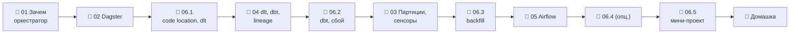

# Модуль 06 · Оркестрация: Dagster (+ Airflow)

**Длительность:** ~1 нед. · **Статус и DoD:** см. [ROADMAP](../../ROADMAP.md)

## Бизнес-вопрос

> Как запускать весь pipeline по расписанию, видеть зависимости и безопасно перезапускать?

## Цели

- описать pipeline как граф ассетов: загрузки dlt, модели dbt, проверки
- запускать по расписанию, по появлению файла и по обновлению входов; перезапускать день и
  делать backfill без дублей
- по графу решать, что пересчитать после сбоя
- понимать разницу asset- и task-ориентированной оркестрации (Dagster и Airflow 3)

## Темы

- зачем оркестратор; DAG, идемпотентность, ретраи с backoff, триггеры (время, событие, данные)
- Dagster: ассеты, `Definitions`, ресурсы и конфиг, code location, сервисы слоя, хранение истории
- партиции, расписания, backfill, сенсоры, пулы конкурентности; где состояние и секреты
- интеграции dlt и dbt, проверки ассетов, граф как lineage, «что пересчитать после сбоя»
- Airflow 3: компоненты, TaskFlow, XCom, логическая дата, Assets — для сравнения
- неизменяемые входы и перерасчёт как способ «отката» (Клеппман, гл. 10)

## Инструменты

Dagster 1.13 (dagster-dbt, dagster-dlt), слой `orchestration.yaml`; Airflow 3.3 (профиль `airflow`)

## Маршрут прохождения

Сначала урок, потом задачи лабы по нему. Статусы: ✅ сделано · 🟨 сейчас · ⬜ впереди.

| # | Шаг | Что | Статус |
|---|---|---|---|
| 1 | 📖 [01 · Зачем нужен оркестратор](theory/01_orchestration_basics.md) · [карта](maps/orchestration-basics.canvas) | урок | ⬜ |
| 2 | 📖 [02 · Как устроен Dagster](theory/02_dagster_architecture.md) · [карта](maps/dagster-architecture.canvas) | урок | ⬜ |
| 3 | 🧪 [Лаба 06.1 — code location и загрузки](labs/06.1_dagster_and_dlt_assets/README.md) | свой code-сервер, dlt как ассеты | ⬜ |
| 4 | 📖 [04 · dlt и dbt как ассеты, lineage](theory/04_dbt_dlt_lineage.md) · [карта](maps/dbt-dlt-lineage.canvas) | урок | ⬜ |
| 5 | 🧪 [Лаба 06.2 — dbt и разбор сбоя](labs/06.2_dbt_assets_and_lineage/README.md) | сквозной граф, проверка, что пересчитать | ⬜ |
| 6 | 📖 [03 · Партиции, расписания, backfill, сенсоры](theory/03_schedules_sensors_partitions.md) · [карта](maps/schedules-sensors-partitions.canvas) | урок | ⬜ |
| 7 | 🧪 [Лаба 06.3 — партиции и backfill](labs/06.3_partitions_and_backfill/README.md) | 97 дней, политика, сенсор, конкурентность | ⬜ |
| 8 | 📖 [05 · Airflow 3 для сравнения](theory/05_airflow_comparison.md) · [карта](maps/airflow-vs-dagster.canvas) | урок | ⬜ |
| 9 | 🧪 [Лаба 06.4 — тот же pipeline на Airflow](labs/06.4_airflow_comparison/README.md) | опционально; ADR | ⬜ |
| 10 | 🧪 [Лаба 06.5 — мини-проект](labs/06.5_orchestration_mini_project/README.md) | pipeline сам, runbook | ⬜ |
| 11 | 🏁 [Домашка-чекпоинт](homework.md) | 7 вопросов и одно предсказание | ⬜ |

> [!note] Учебный проект и инфраструктура модуля (2026-10-02)
> - Слой `infra/docker/orchestration.yaml`: `make up PROFILES="orchestration"`, UI
>   <http://localhost:3070> (порт 3000 на хосте занят). Настройки экземпляра —
>   `infra/docker/dagster/dagster.yaml`, code locations — `infra/docker/dagster/workspace.yaml`.
> - [`demo/`](demo/) — учебный pipeline погоды по городам: файл дня в S3 → dlt → DuckDB → dbt
>   (`demo/dbt_weather`) → отчёт; партиции по дням, ретраи, проверка, расписания, сенсор на
>   landing. Данные — `data/demo_orchestration.duckdb`. Это не capstone и не ответы к лабам.
> - `make dagster ARGS="…"` — Dagster CLI в code-сервере демо; `make dagster-shell` — оболочка в нём.
> - [`airflow_demo/`](airflow_demo/) — тот же pipeline на Airflow 3: `make up PROFILES="airflow"`,
>   UI <http://localhost:8081>.

## Чек-лист самоконтроля

Отмечай пункт, только когда можешь сделать это **без подсказки**. Подробные чек-листы — в начале
каждого урока.

**Основы** ([01](theory/01_orchestration_basics.md), [02](theory/02_dagster_architecture.md))
- [ ] Объясняю, чего не хватает cron, и рисую pipeline как DAG
- [ ] Делаю шаг идемпотентным и настраиваю ретраи с backoff
- [ ] Пишу ассет с ресурсом и конфигом, собираю `Definitions`
- [ ] Называю роль каждого сервиса слоя и добавляю свой code location

**Время и события** ([03](theory/03_schedules_sensors_partitions.md))
- [ ] Партиционирую ассет по дням, предсказываю тик расписания, запускаю backfill
- [ ] Пишу сенсор с `run_key`, который ловит повторную доставку
- [ ] Ограничиваю конкурентность пулом и читаю `Could not set lock`

**Граф** ([04](theory/04_dbt_dlt_lineage.md), [05](theory/05_airflow_comparison.md))
- [ ] Подключаю dlt и dbt как ассеты без разрывов графа
- [ ] Пишу блокирующую проверку и по графу выбираю, что пересчитать
- [ ] Сравниваю Airflow и Dagster и объясняю логическую дату

**Закрытие модуля**
- [ ] Лабы 06.1–06.3 и 06.5 выполнены по Definition of Done (06.4 — по желанию)
- [ ] [Домашка](homework.md) сдана, ошибки разобраны
- [ ] Тезисы по Клеппману (гл. 10, результаты пакетной обработки) — в [`notes.md`](notes.md)

## Материалы модуля

| Что | Где |
|---|---|
| 🧠 Карточки для повторения | [flashcards.md](flashcards.md) |
| 🗺️ Карты | [maps/](maps/) |
| 📚 Термины | [glossary/](../../glossary/README.md) — раздел «Оркестрация» |
| 🧪 Учебные проекты | [demo/](demo/), [airflow_demo/](airflow_demo/) |
| 📓 Заметки | [notes.md](notes.md) |

## Мини-проект (вклад в capstone)

Pipeline 03–05 запускается сам: загрузка по сенсору и расписанию, витрины по обновлению входов,
падения видны в UI, runbook в `capstone/README.md` (лаба 06.5).

## Ресурсы

- [Dagster docs](https://docs.dagster.io/) · [ассеты](https://docs.dagster.io/guides/build/assets) · [партиции](https://docs.dagster.io/guides/build/partitions-and-backfills) · [сенсоры](https://docs.dagster.io/guides/automate/sensors) · [asset checks](https://docs.dagster.io/guides/test/asset-checks)
- [dagster-dbt](https://docs.dagster.io/integrations/libraries/dbt) · [dagster-dlt](https://docs.dagster.io/integrations/libraries/dlt)
- [Airflow 3 docs](https://airflow.apache.org/docs/apache-airflow/stable/) · [TaskFlow](https://airflow.apache.org/docs/apache-airflow/stable/tutorial/taskflow.html) · [Assets](https://airflow.apache.org/docs/apache-airflow/stable/authoring-and-scheduling/asset-scheduling.html)
- [Surfalytics: Airflow intro](https://github.com/surfalytics/data-projects/tree/main/de-projects/22_airflow_intro)

## Книга и видео

Полная таблица с пояснениями, зачем читать и что пропустить — в [карте чтения](../../reading_map.md#06--оркестрация).

- 📖 Клеппман, гл. 10 — результаты пакетной обработки, идемпотентность (урок 01, шаг 3; урок 04, шаг 5)
- 📖 Клеппман, гл. 8 — по желанию: ненадёжные сети и таймауты (урок 01, шаг 4)
- 🎬 [Zoomcamp `02-workflow-orchestration`](https://github.com/DataTalksClub/data-engineering-zoomcamp/tree/main/02-workflow-orchestration) — Kestra: концепции расписаний и backfill

## Домашка-чекпоинт

После всех лаб — [`homework.md`](homework.md).

## Заметки

Конспект, тезисы по книге и выводы — в [`notes.md`](notes.md).
