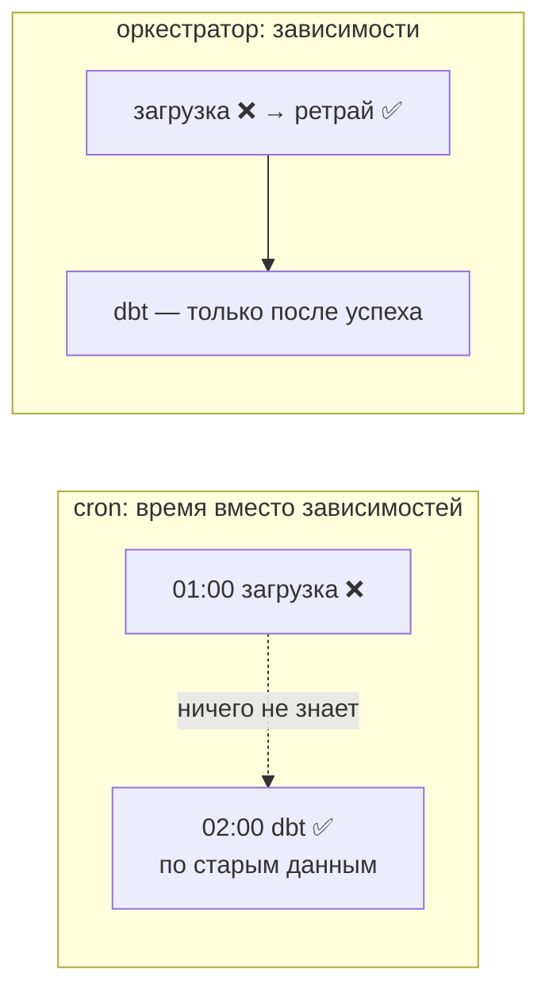
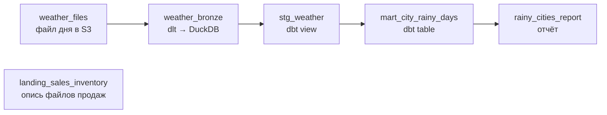
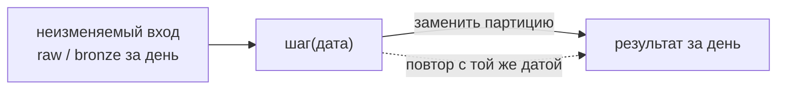
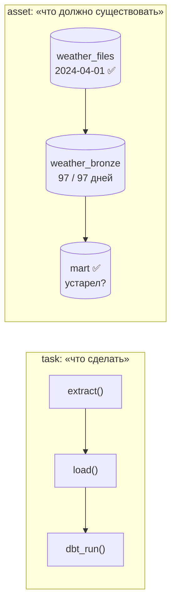
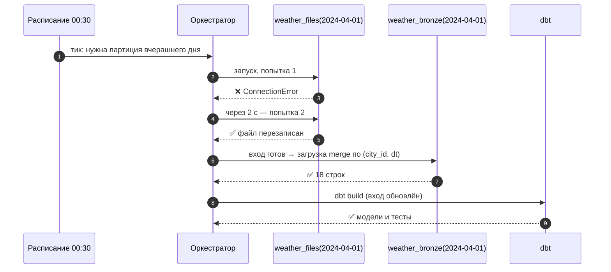

# 01 · Зачем нужен оркестратор: граф, идемпотентность, ретраи, триггеры

> [!info] Урок одной фразой
> Pipeline — это железная дорога: станции (шаги) связаны путями (зависимостями), поезда ходят по
> расписанию или по сигналу датчика, а диспетчер следит, чтобы поезд не ушёл раньше, чем пришёл
> предыдущий, и повторяет отправку после сбоя. Оркестратор и есть такой диспетчер. Сам он ничего
> не возит: грузы (данные) перевозят dlt, dbt и DuckDB.

> [!todo] Чек-лист: после урока ты сможешь
> - [ ] объяснить, чего не хватает cron, чтобы запускать pipeline из модулей 03–05;
> - [ ] нарисовать pipeline как DAG и найти, какие шаги можно выполнять параллельно;
> - [ ] сделать шаг идемпотентным через параметр-дату и запись с заменой;
> - [ ] настроить ретраи с паузой и объяснить, почему без идемпотентности они опасны;
> - [ ] выбрать триггер: время, событие или обновление данных;
> - [ ] отличить task-ориентированный оркестратор от asset-ориентированного.

**Нужно для:** лаб [06.1](../labs/06.1_dagster_and_dlt_assets/README.md),
[06.3](../labs/06.3_partitions_and_backfill/README.md),
[06.5](../labs/06.5_orchestration_mini_project/README.md).
**Карта урока:** [orchestration-basics.canvas](../maps/orchestration-basics.canvas).

---

## Шаг 0. Азбука: железная дорога и диспетчер

| В оркестрации | В аналогии «железная дорога» | Подробнее |
|---|---|---|
| Оркестратор (Dagster, Airflow) | Диспетчерская | [оркестратор](../../../glossary/orchestrator.md) |
| Шаг / задача / ассет | Станция, где что-то делают с грузом | [ассет](../../../glossary/software-defined-asset.md) |
| Зависимость | Путь между станциями: поезд дальше только после прибытия | [DAG](../../../glossary/dbt-dag.md) |
| Запуск (run) | Один рейс с журналом отправлений и прибытий | [оркестратор](../../../glossary/orchestrator.md) |
| Расписание (schedule) | Расписание поездов | [расписание и сенсор](../../../glossary/schedule-sensor.md) |
| Сенсор (sensor) | Датчик на путях: «пришёл вагон — отправляй» | [расписание и сенсор](../../../glossary/schedule-sensor.md) |
| Ретрай | Повторная отправка после сбоя на линии | [ретраи и backoff](../../../glossary/retry-backoff.md) |
| Идемпотентность | Повторный рейс не привозит двойной груз | [идемпотентность](../../../glossary/idempotency.md) |
| Backfill | Провести рейсы за прошлые дни, которые не ходили | [backfill](../../../glossary/backfill.md) |

Перед уроком подними слой оркестрации — он понадобится в «Попробуй сам»:

```bash
make up PROFILES="orchestration"     # core + Dagster; первый старт ~1 мин
make ps                               # dagster-webserver, dagster-daemon, dagster-demo — healthy
```

UI Dagster — <http://localhost:3070>. Как устроен этот слой, разберём в уроке 02; сейчас нам
нужен только учебный проект — тот же pipeline погоды по городам, что в модуле 05, но с
оркестратором.

---

## Шаг 1. Чего не хватает cron?

**Проблема.** В модулях 03–05 ты запускал шаги руками: `landing_drop.py`, потом dlt, потом
`dbt build`. Самое простое, что приходит в голову, — записать эти команды в cron:

```
0 1 * * *  python scripts/load_sales.py
0 2 * * *  cd capstone/transform && dbt build
```

Это работает до первого сбоя. Пусть загрузка в 01:00 упала из-за таймаута S3. В 02:00 dbt
честно пересоберёт витрины **по вчерашним данным** и отчитается об успехе: cron не знает, что
второй шаг зависит от первого. Утром аналитик увидит «свежую» витрину без вчерашнего дня, и
никто не получит сигнала. Если загрузка затянулась до 02:10, dbt прочитает **половину** дня.

**Как устроено.** Оркестратор решает четыре задачи, которых нет у cron:

1. **Зависимости.** Он знает граф: dbt запускается, только когда загрузка **успешно**
   завершилась, а не «в 02:00». Если загрузка упала, dbt не запускается вовсе.
2. **Повторы.** Сбой сети — обычное дело. Оркестратор повторяет упавший шаг с паузой и только
   после нескольких неудач объявляет запуск упавшим.
3. **Видимость.** У каждого запуска есть журнал: что запускалось, сколько шло, какой текст
   ошибки, какие данные получились. У cron — только письмо на почту, если её настроили.
4. **Время как параметр.** «Загрузи 10 апреля» — отдельная команда с параметром, а не правка
   скрипта. Отсюда перезапуск одного дня и backfill за месяц.



**Что из этого следует.** Оркестратор не заменяет dlt и dbt: он не читает файлы и не считает
SQL. Он решает **когда** и **в каком порядке** их запускать и что делать при сбое. Поэтому
логика загрузки остаётся в коде dlt/dbt, а в оркестраторе — только «клей»: граф, расписания,
параметры.

> [!warning] Ловушка: «оркестратор сделает всё сам»
> Если шаг пишет данные неидемпотентно (append без защиты), оркестратор сделает только хуже:
> ретрай и backfill повторят шаг и задвоят данные. Оркестратор безопасен ровно настолько,
> насколько безопасен повтор каждого шага (шаг 3).

---

## Шаг 2. Pipeline как граф (DAG)

**Проблема.** Чтобы соблюдать зависимости, оркестратору нужно знать, кто от кого зависит, и
отличать «можно параллельно» от «строго по очереди».

**Как устроено.** Pipeline описывают **направленным ациклическим графом** (DAG, directed acyclic
graph). Узлы — шаги, стрелки — «этот шаг нужен тому». «Ациклический» значит, что по стрелкам
нельзя вернуться в тот же узел: иначе шаг ждал бы сам себя. Оркестратор делает с графом то же,
что dbt со своими моделями (модуль 05, урок 01): **топологическую сортировку** — раскладывает
узлы по «волнам». Узлы одной волны не зависят друг от друга и выполняются параллельно, а
следующая волна стартует, когда готовы все её входы.

Граф учебного проекта модуля:



`landing_sales_inventory` ни с кем не связан: его можно выполнять в любой момент и параллельно
с остальными.

**Что из этого следует.** Граф — это не только порядок запуска. По нему же отвечают на вопрос
«что пересчитать, если сломался `weather_bronze`»: всё, что ниже по стрелкам (урок 04). Граф,
который видит оркестратор, — это **lineage** pipeline (модуль 05, урок 04), только от загрузки
до отчёта, а не внутри одного dbt-проекта.

> [!example]- Попробуй сам: граф учебного проекта
> ```bash
> make dagster ARGS="asset list"
> make dagster ARGS='asset list --select "weather_bronze*"'
> ```
> Открой <http://localhost:3070> → **Assets** → **View lineage**.
> **Увидишь:** в первом списке шесть ассетов; во втором четыре: `weather_bronze` и всё, что от
> него зависит (`stg_weather`, `mart_city_rainy_days`, `rainy_cities_report`). В UI — граф как
> на схеме выше, ассеты сгруппированы по слоям `landing`, `bronze`, `transform`, `report`.
> **Почему:** `*` справа от имени означает «и всех потомков». Синтаксис выбора разберём в уроке 04.

---

## Шаг 3. Идемпотентность: почему повтор должен быть безопасным

**Проблема.** Оркестратор будет повторять шаги: после сбоя, при backfill, при ручном
перезапуске. Шаг, который при повторе дописывает данные ещё раз, превращает каждый ретрай в
дубли. Ты это уже видел в модуле 04: append + повторная доставка файла дали 150 тыс. строк
вместо 100 тыс.

**Как устроено.** Шаг **идемпотентен**, если запуск два раза с теми же параметрами даёт тот же
результат, что один. В пакетной обработке этого добиваются тремя приёмами, и все они видны в
учебном проекте:

1. **Параметр — бизнес-дата, а не «сейчас».** Шаг обрабатывает «2024-04-01», переданный
   оркестратором, а не `today()`. Тогда повтор через неделю обработает тот же день, а не
   другой. В Dagster это **партиция** (урок 03).
2. **Запись с заменой по ключу партиции.** Результат дня **заменяет** прошлый результат дня:
   перезапись файла `dt=2024-04-01/weather.parquet`, `merge` по ключу `(city_id, dt)` в dlt,
   `DELETE … WHERE dt = ?` + `INSERT` в DuckDB.
3. **Неизменяемый вход.** Шаг читает исходные данные, а не свой же прошлый результат. Сырые
   файлы и bronze мы не правим: если ошибка в логике, её исправляют в коде и **пересчитывают**
   производные данные заново.

Третий приём Клеппман (гл. 10, раздел о результатах пакетной обработки) называет главным
преимуществом пакетной обработки: если вход неизменяем, а выход полностью заменяется, то откат
плохого релиза — это не «отмена изменений в базе», а повторный запуск старой (или исправленной)
версии кода по тем же входам. Ошибочный результат просто перезаписывается.



**У нас.** Ассет `weather_files` (файл `demo/weather_orchestration/assets/landing.py`):

```python
def weather_files(context, config, s3):
    day = context.partition_key                       # ① дата приходит от оркестратора
    ...
    path = f"{WEATHER_PREFIX}/dt={day}/weather.parquet"
    with s3.filesystem().open(path, "wb") as f:       # ② перезапись файла дня
        pq.write_table(table, f)
```

① День задаётся снаружи — запуск за 2024-04-01 всегда про 2024-04-01. ② Повторный запуск
перезаписывает тот же путь: файл дня один, сколько бы раз шаг ни выполнялся.

> [!example]- Попробуй сам: повторный запуск дня не задваивает данные
> ```bash
> make dagster ARGS="asset materialize --select weather_files,weather_bronze --partition 2024-04-01"
> make dagster ARGS="asset materialize --select weather_files,weather_bronze --partition 2024-04-01"
> make sql
> ```
> ```sql
> ATTACH '/workspace/data/demo_orchestration.duckdb' AS demo (READ_ONLY);
> SELECT count(*) AS rows, count(DISTINCT dt) AS days FROM demo.bronze.weather WHERE dt = '2024-04-01';
> ```
> **Увидишь:** каждый запуск заканчивается `RUN_SUCCESS`; в таблице 18 строк за день, а не 36.
> **Почему:** файл дня перезаписан, а dlt загрузил его с `write_disposition="merge"` по ключу
> `(city_id, dt)` — строки с теми же ключами заменились.

> [!warning] Ловушка: `today()` внутри шага
> Шаг, который сам берёт «вчера» от текущей даты, нельзя перезапустить за прошлую неделю: он
> всегда обработает вчера относительно момента запуска. Ретрай после полуночи обработает
> **другой** день. Дата — всегда параметр.

---

## Шаг 4. Ретраи: повторить, но с паузой

**Проблема.** Сеть ненадёжна: S3 отвечает 503, API — 429, Postgres перезапускается. Клеппман
(гл. 8) объясняет, почему отличить «сервис упал» от «сервис медленный» по таймауту нельзя.
Отсюда практическое правило: кратковременные сбои лечат повтором, а не ручным разбором.

**Как устроено.** **Политика ретраев** говорит оркестратору: если шаг упал, подождать и
повторить, но не больше N раз. Пауза растёт **экспоненциально** (backoff), чтобы не добивать
перегруженный сервис очередью одновременных повторов. В Dagster это `RetryPolicy`:

```python
retry_policy=RetryPolicy(max_retries=3, delay=2, backoff=Backoff.EXPONENTIAL)
```

| Параметр | Что значит | У нас |
|---|---|---|
| `max_retries` | сколько повторов после первой попытки | 3 → всего до 4 попыток |
| `delay` | базовая пауза, секунды | 2 |
| `backoff` | как растёт пауза | экспоненциально: 2 → 6 → 14 с |
| `jitter` | случайная добавка к паузе, чтобы повторы разных шагов не совпадали | не задан |

Пауза при экспоненциальном backoff в Dagster считается как `delay × (2^попытка − 1)`: 2 × 1,
2 × 3, 2 × 7.

**Что из этого следует.** Ретраи безопасны **только** для идемпотентных шагов: повтор шага,
который упал после частичной записи, не должен оставлять «половину плюс целое». И ретраи не
лечат постоянные ошибки: опечатка в SQL упадёт все четыре раза, только позже. Поэтому повторов
немного, а после последнего — сигнал человеку (упавший запуск в UI).

> [!example]- Попробуй сам: нестабильный источник
> У `weather_files` есть конфиг `fail_probability` — доля «падений источника» на попытку.
> ```bash
> make dagster-shell
> dagster asset materialize -m weather_orchestration.definitions --select weather_files \
>   --partition 2024-04-20 \
>   --config-json '{"ops": {"weather_files": {"config": {"fail_probability": 0.7}}}}' \
>   2>&1 | grep -E "RETRY|RESTARTED|STEP_SUCCESS|STEP_FAILURE|RUN_"
> exit
> ```
> **Увидишь:** (случайно, повтори 2–3 раза) строки `STEP_UP_FOR_RETRY … retry in 2 seconds`,
> затем `in 6 seconds`, `in 14 seconds`, между ними `STEP_RESTARTED (attempt # 2)` и т. д.
> Чаще всего запуск закончится `RUN_SUCCESS` на 2–4 попытке; иногда — `STEP_FAILURE`, если все
> четыре попытки упали (вероятность 0,7⁴ ≈ 24 %).
> **Почему:** политика разрешает три повтора с растущей паузой; запись файла идемпотентна, так
> что удачная попытка даёт тот же результат, что и без сбоев.

> [!warning] Ловушка: ретрай целого запуска вместо шага
> Если повторять весь запуск, а не упавший шаг, успешные шаги выполнятся снова. Для
> неидемпотентного шага в начале графа это дубли, для тяжёлого — лишние минуты. Dagster
> повторяет **шаг**, а после окончательного падения UI предлагает «Re-execute from failure» —
> перезапуск с упавшего шага, без уже успешных (урок 04).

---

## Шаг 5. Что запускает pipeline: время, событие или данные

**Проблема.** «Каждый день в 2:00» — не единственный повод запускать pipeline. Файл от
поставщика приходит, когда приходит; витрину нужно пересобрать, когда обновился её вход.

**Как устроено.** Есть три вида триггеров, и все три есть и в Dagster, и в Airflow:

| Триггер | Когда срабатывает | В Dagster | В Airflow 3 | Пример у нас |
|---|---|---|---|---|
| Время | по cron-выражению | schedule | `schedule="@daily"` | загрузка дня в 00:30 |
| Внешнее событие | появился файл, пришло сообщение | sensor | sensor / deferrable trigger | файл продаж в `landing` |
| Обновились данные | материализовался вход | automation condition | `schedule=[Asset(...)]` | отчёт после витрины |

**Время** — самое простое, но запуск может прийти раньше данных. **Событие** реагирует на
появление данных, но кто-то должен периодически проверять внешний мир (сенсор опрашивает S3
раз в 30 с). **Обновление данных** — внутреннее событие оркестратора: он сам знает, что вход
обновился, потому что сам его материализовал.

**Что из этого следует.** Частая комбинация: загрузку запускает событие или время, а всё,
что ниже по графу, — обновление входов. Тогда расписания не приходится подбирать «с запасом»
(«dbt в 02:00, потому что загрузка обычно до 01:40»).

---

## Шаг 6. Task или asset: что оркестратор считает главным

**Проблема.** Оркестратор может думать о pipeline двумя способами, и от этого зависит, на какие
вопросы он умеет отвечать.

**Как устроено.**

- **Task-ориентированный** (Airflow, cron, Kestra): единица — **задача**, действие. DAG —
  последовательность действий: «выполни скрипт A, потом скрипт B». Что именно получилось в
  результате, оркестратор не знает: для него задача успешна, если процесс завершился с кодом 0.
- **Asset-ориентированный** (Dagster): единица — **ассет**, объект данных (таблица, файл,
  модель). Описывают, **какие данные должны существовать** и из чего они получаются; функция —
  способ их получить. Оркестратор хранит историю каждого ассета: когда материализован, за
  какую партицию, с какими метаданными, прошли ли проверки.



**Что из этого следует.** На вопрос «какие дни `weather_bronze` загружены, а какие нет» и «какие
витрины устарели после вчерашнего сбоя» asset-оркестратор отвечает из коробки — у него есть
состояние данных. Task-оркестратору нужно восстанавливать это по истории запусков. Airflow 3
частично закрывает разрыв (`Asset` в `outlets`, запуск DAG по обновлению Asset — урок 05), но
единицей остаётся задача. Поэтому основной оркестратор курса — Dagster, а Airflow — для
сравнения.

---

## Сборка целиком

Один день pipeline под оркестратором: расписание запускает загрузку, загрузка падает и
повторяется, dbt запускается только после успеха.



| Шаг | Если сломается | Что увидим |
|---|---|---|
| 1 | шаг берёт `today()` вместо даты | ретрай после полуночи обработал другой день |
| 2–4 | все попытки упали | запуск FAILURE, dbt не запускался, сигнал в UI |
| 4 | запись — append | ретрай после частичной записи → дубли |
| 5–6 | нет `merge` по ключу | повторный запуск дня → 36 строк вместо 18 |
| 7 | dbt по времени, а не по зависимости | витрина по неполным данным |

## Шпаргалка

| Хочу | Как |
|---|---|
| Поднять Dagster | `make up PROFILES="orchestration"`, UI <http://localhost:3070> |
| Список ассетов | `make dagster ARGS="asset list"` |
| Ассет и его потомки | `make dagster ARGS='asset list --select "имя*"'` |
| Материализовать день | `make dagster ARGS="asset materialize --select a,b --partition 2024-04-01"` |
| Ретраи шага | `@asset(retry_policy=RetryPolicy(max_retries=3, delay=2, backoff=Backoff.EXPONENTIAL))` |
| Идемпотентный шаг | дата — параметр; запись с заменой партиции; вход не меняется |

## Типичные ошибки

| Симптом | Причина | Как проверить | Как чинить |
|---|---|---|---|
| Витрина «свежая», но без вчерашнего дня | шаги связаны временем, а не зависимостью | лог cron / история запусков | граф в оркестраторе |
| После ретрая дубли | шаг неидемпотентен (append) | `count(*)` по ключу партиции | замена партиции, `merge` по ключу |
| Перезапуск за прошлую неделю обработал вчера | дата внутри шага (`today()`) | код шага | дата — параметр (партиция) |
| Шаг падает 4 раза подряд одинаково | постоянная ошибка, ретраи не помогут | текст ошибки в каждой попытке | исправить код; ретраи — только от временных сбоев |
| Сервис «лёг» после сбоя ещё сильнее | повторы без паузы | паузы в логе | `delay` + экспоненциальный backoff |

## Проверь себя

Карточки — в [flashcards.md](../flashcards.md).

> [!question] 1. Загрузка дня пишет в Iceberg через append. Почему перед подключением ретраев её надо переделать?
> > [!success]- Ответ
> > Ретрай повторяет шаг. Если шаг упал после частичной записи (или успел записать, но упал на
> > отчёте), повтор допишет данные второй раз — дубли. Сначала замена партиции или merge по
> > ключу, потом ретраи.

> [!question] 2. В графе: A → B, A → C, B → D, C → D. Какие шаги могут выполняться одновременно?
> > [!success]- Ответ
> > B и C: оба зависят только от A и не зависят друг от друга. D ждёт обоих.

> [!question] 3. Политика `RetryPolicy(max_retries=2, delay=5, backoff=EXPONENTIAL)`. Сколько всего попыток и какие паузы?
> > [!success]- Ответ
> > До трёх попыток (первая + 2 повтора). Паузы: 5 × (2¹ − 1) = 5 с и 5 × (2² − 1) = 15 с.

> [!question] 4. Чем «загрузку запускает сенсор, витрину — обновление входа» лучше «загрузка в 01:00, витрина в 02:00»?
> > [!success]- Ответ
> > Витрина строится, когда вход действительно обновился, а не «по времени с запасом». Если
> > загрузка задержалась или упала, витрина не построится по неполным данным; если пришла рано —
> > витрина обновится сразу.
