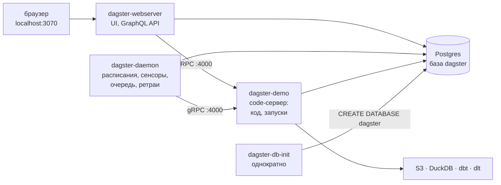
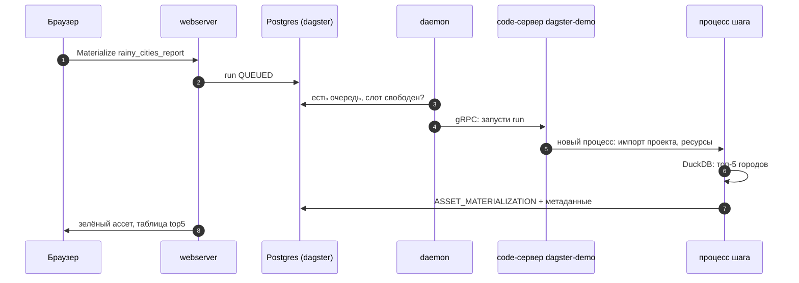

# 02 · Как устроен Dagster: ассеты, ресурсы, code location и сервисы слоя

> [!info] Урок одной фразой
> Dagster — диспетчерская из нескольких комнат: в одной табло для людей (webserver), в другой
> дежурный, который отправляет поезда по расписанию (daemon), а маршруты и составы описаны в
> отдельных депо (code locations), куда диспетчер звонит по телефону (gRPC). Журнал всех рейсов
> лежит в общем архиве (Postgres). Код ассетов — это описание станций: что на них должно
> появиться и из чего.

> [!todo] Чек-лист: после урока ты сможешь
> - [ ] написать ассет с зависимостью, метаданными и ресурсом и объяснить, что такое материализация;
> - [ ] собрать `Definitions` и объяснить, как webserver и daemon находят код через code location;
> - [ ] назвать роль каждого сервиса слоя `orchestration.yaml` и где Dagster хранит историю;
> - [ ] прочитать запуск: шаги, процессы, журнал событий, логи шага на диске;
> - [ ] передать в ассет адреса и ключи через ресурс и `EnvVar`, а параметры — через `Config`;
> - [ ] добавить в стек новый code location (лаба 06.1).

**Нужно для:** лаба [06.1](../labs/06.1_dagster_and_dlt_assets/README.md).
**Карта урока:** [dagster-architecture.canvas](../maps/dagster-architecture.canvas).

---

## Шаг 0. Азбука: комнаты диспетчерской

| В Dagster | В аналогии | Подробнее |
|---|---|---|
| Ассет (software-defined asset) | Станция: что на ней должно появиться и из чего | [ассет](../../../glossary/software-defined-asset.md) |
| Материализация | Рейс, после которого груз на станции обновлён | [ассет](../../../glossary/software-defined-asset.md) |
| Ресурс | Подключение к внешней системе: телефонная линия депо | [ресурс](../../../glossary/dagster-resource.md) |
| `Definitions` | Паспорт депо: все станции, расписания, линии | [code location](../../../glossary/code-location.md) |
| Code location / code-сервер | Депо со своим кодом и окружением | [code location](../../../glossary/code-location.md) |
| webserver | Табло и пульт для людей (UI) | [оркестратор](../../../glossary/orchestrator.md) |
| daemon | Дежурный: расписания, сенсоры, очередь, ретраи | [оркестратор](../../../glossary/orchestrator.md) |
| instance, storage | Журнал рейсов в архиве (Postgres) | [оркестратор](../../../glossary/orchestrator.md) |

---

## Шаг 1. Ассет: «что должно существовать», а не «что сделать»

**Проблема.** В уроке 01 мы договорились, что единица Dagster — объект данных. Как описать в
коде «таблица `weather_bronze` получается из файла `weather_files`»?

**Как устроено.** Ассет — это Python-функция с декоратором `@asset`. Имя функции — **ключ
ассета** (asset key), то есть имя объекта данных. Тело функции — способ его получить.
Зависимости задаются либо параметром `deps=[…]` (вход нужен, но данные из него функция читает
сама), либо аргументом функции (тогда значение приходит через IO-менеджер — у нас этот способ не
используется, потому что данные живут в S3 и DuckDB, а не в памяти Python).

**Материализация** — один успешный запуск функции ассета. После неё Dagster записывает в журнал
событие `ASSET_MATERIALIZATION` с временем, партицией и **метаданными**, которые вернула функция:
число строк, путь к файлу, таблицу в Markdown. По этим событиям UI показывает, когда ассет
обновлялся и что получилось.

```python
@asset(
    deps=[AssetKey("mart_city_rainy_days")],   # ① вход: dbt-модель (данные читаем сами)
    group_name="report",                       # ② группа = слой на графе
    kinds={"duckdb"},                          # ③ значок технологии в UI
    pool="duckdb",                             # ④ пул конкурентности (урок 03)
    description="Топ-5 городов по числу дождливых дней …",
)
def rainy_cities_report(duck: DuckDBResource) -> MaterializeResult:   # ⑤ ресурс параметром
    with duck.connect(read_only=True) as con:
        top = con.sql("SELECT city_id, rainy_days, days FROM main.mart_city_rainy_days …").fetchall()
    …
    return MaterializeResult(metadata={"top5": MetadataValue.md(table_md)})   # ⑥
```

| Метка | Что важно |
|---|---|
| ① | `deps` — только связь на графе; данные функция берёт из DuckDB сама |
| ② | группы видны в UI как рамки; удобно раскладывать по слоям landing / bronze / transform |
| ③ | `kinds` — подписи-значки; на выполнение не влияют |
| ④ | все шаги пула `duckdb` выполняются по одному (урок 03, шаг 6) |
| ⑤ | ресурс Dagster подставит по **имени параметра**: `duck` → ресурс с ключом `duck` в `Definitions` |
| ⑥ | метаданные материализации: в UI на странице ассета появится таблица |

**Что из этого следует.** Ассет — это декларация: «вот объект данных, вот откуда он берётся».
Поэтому Dagster может показать граф ещё до первого запуска, отметить, что ассет никогда не
материализовался, и выбрать ассеты для запуска по графу («этот и всех потомков»).

> [!warning] Ловушка: ключ ассета ≠ имя таблицы
> Ключ — имя объекта **для Dagster**. Где лежат данные, решает код функции. Если переименовать
> функцию, история материализаций останется у старого ключа, а новый ассет появится «пустым».
> Для dlt и dbt ключи генерируют интеграции, и их часто переопределяют (урок 04).

---

## Шаг 2. `Definitions`: паспорт проекта

**Проблема.** Ассетов, расписаний, сенсоров и ресурсов много. Как Dagster узнаёт, что входит в
проект?

**Как устроено.** Всё, что Dagster должен знать, собирается в один объект `Definitions` на уровне
модуля. Модуль, где он лежит, и есть точка входа проекта:

```python
# demo/weather_orchestration/definitions.py
defs = Definitions(
    assets=load_assets_from_modules([landing, bronze, transform, report]),  # ① все @asset из модулей
    asset_checks=[checks.weather_bronze_all_cities],                        # ② проверки (урок 04)
    jobs=[weather_daily_job, transform_job, landing_inventory_job],         # ③ наборы ассетов
    schedules=[weather_daily_schedule, transform_schedule],                 # ④ урок 03
    sensors=[landing_sales_sensor],
    resources={                                                              # ⑤ ключ → объект
        "s3": S3Resource(), "duck": DuckDBResource(),
        "dlt": DagsterDltResource(), "dbt": DbtCliResource(project_dir=transform.dbt_project),
    },
)
```

① `load_assets_from_modules` находит все объекты `@asset` в перечисленных модулях. ③ **Job** —
именованный набор ассетов для запуска целиком (по расписанию, сенсором); без него запускают
«выбранные ассеты» из UI. ⑤ Ключи словаря ресурсов совпадают с именами параметров в функциях
ассетов: ассет с параметром `duck: DuckDBResource` получит `resources["duck"]`.

**Что из этого следует.** Ошибка в любом из модулей (опечатка в импорте, падение при построении
dbt-манифеста) ломает загрузку **всего** `Definitions`. UI покажет code location с ошибкой, и
ни один ассет проекта не запустится, пока её не исправить.

> [!example]- Попробуй сам: проверить определения без UI
> ```bash
> make dagster ARGS="definitions validate -m weather_orchestration.definitions"
> ```
> **Увидишь:** `Validation successful for code location weather_orchestration.definitions.` и
> перед этим строки dbt: `Running dbt command: dbt parse --quiet` / `Finished dbt command`.
> **Почему:** Dagster импортирует модуль, собирает `Definitions` и проверяет связи. При импорте
> `transform.py` вызывается `dbt parse`, который строит `manifest.json` (урок 04).

---

## Шаг 3. Code location: почему код живёт в отдельном процессе

**Проблема.** Webserver и daemon работают постоянно. Если бы они импортировали код проектов
сами, любая ошибка в коде или конфликт версий библиотек (проекту A нужен dbt 1.10, проекту B —
1.12) ломал бы весь оркестратор, а обновление кода требовало бы его перезапуска.

**Как устроено.** Код каждого проекта загружает отдельный процесс — **code-сервер**. Webserver и
daemon спрашивают у него по **gRPC** (протокол удалённых вызовов поверх HTTP/2): «какие у тебя
ассеты, расписания, сенсоры?», «вычисли тик сенсора», «запусти run». Один проект с его
`Definitions` и окружением называется **code location**. Список code locations — в
`workspace.yaml`:

```yaml
# infra/docker/dagster/workspace.yaml
load_from:
  - grpc_server:
      host: dagster-demo        # ① имя сервиса в compose = DNS-имя в сети debd
      port: 4000
      location_name: weather_demo   # ② имя в UI
```

① Адрес — имя сервиса, а не `localhost`: webserver и code-сервер — разные контейнеры (модуль 00,
урок 03). ② В UI ассеты подписаны «weather_demo».

У нас code-сервер — сервис `dagster-demo`. Он **наследует** от `workspace` образ, том
репозитория и все переменные окружения (S3, dlt, Iceberg) через `extends`, потому что именно в
нём выполняется код ассетов:

```yaml
# infra/docker/orchestration.yaml (фрагмент)
  dagster-demo:
    extends: {file: core.yaml, service: workspace}   # ① всё от workspace…
    build: !reset null                               # ② …кроме сборки: образ уже есть
    ports: !reset []                                 # ③ …и портов: 8888 занят workspace
    working_dir: /workspace/modules/06_orchestration/demo
    command: [dagster, code-server, start, -h, 0.0.0.0, -p, "4000",
              -m, weather_orchestration.definitions]  # ④
```

① `extends` копирует настройки сервиса из другого файла, а наши ключи их дополняют или
заменяют. ②③ Тег `!reset` **удаляет** унаследованное значение: без `ports: !reset []`
code-сервер попытался бы опубликовать 8888 второй раз и не стартовал бы («port is already
allocated»). ④ `dagster code-server start` держит процесс-посредник и дочерний процесс с кодом;
кнопка **Reload** в UI перезапускает только дочерний процесс — новый код подхватывается без
перезапуска контейнера.

**Что из этого следует.** Второй проект (твой capstone в лабе 06.1) — это второй code-сервер со
своим `working_dir` и модулем, плюс строка в `workspace.yaml`. Ошибка в одном проекте не мешает
другому.

> [!warning] Ловушка: «поправил код, а в UI старое»
> Code-сервер импортировал модуль при старте. После правки кода нажми **Deployment → Reload** у
> code location (или `docker restart debd-dagster-demo-1`). Правка `orchestration.yaml` или
> `workspace.yaml` — это уже пересоздание контейнеров: `make up PROFILES="orchestration"`.

---

## Шаг 4. Сервисы слоя и где Dagster хранит состояние

**Проблема.** Кто показывает UI, кто запускает по расписанию, где лежит история запусков и что
переживёт `make down`?

**Как устроено.** Слой `orchestration.yaml` — четыре сервиса и общая база:



| Сервис | Что делает | Если остановить |
|---|---|---|
| `dagster-db-init` | однократно создаёт базу `dagster`, если её нет | ничего: `Exited (0)` — норма |
| `dagster-demo` | загружает код проекта; в нём же выполняются запуски | ассеты недоступны, запуски не стартуют |
| `dagster-webserver` | UI <http://localhost:3070> и API | нет UI, но расписания продолжают работать |
| `dagster-daemon` | тики расписаний и сенсоров, очередь запусков, ретраи | запуски из UI висят в очереди `QUEUED` |

Почему базу создаёт отдельный сервис, а не скрипт `postgres/init`? Скрипты из
`docker-entrypoint-initdb.d` выполняются **только при первой инициализации тома**
(модуль 00, урок 06). Том `postgres-data` у тебя уже есть, поэтому новая база появляется
однократным сервисом с проверкой «если нет — создать».

**Настройки экземпляра** (instance) — файл `infra/docker/dagster/dagster.yaml`, общий для всех
трёх контейнеров (монтируется в `DAGSTER_HOME=/opt/dagster/home`):

| Раздел | Что задаёт | У нас |
|---|---|---|
| `storage.postgres` | где история запусков, журнал событий, состояние расписаний и сенсоров | база `dagster` в общем Postgres |
| `concurrency.runs` | сколько запусков одновременно берёт daemon из очереди | 4 |
| `concurrency.pools` | лимит шагов одного пула во всех запусках | 1 (урок 03) |
| `local_artifact_storage` | файлы запусков на диске | `data/.dagster/storage` |
| `compute_logs` | stdout/stderr каждого шага | `data/.dagster/logs/<run_id>/` |

**Что из этого следует.** История живёт в Postgres и на диске в `data/.dagster` — она
переживает `make down` и пересоздание контейнеров. По умолчанию (без `dagster.yaml`) Dagster
хранил бы всё в SQLite-файлах внутри `DAGSTER_HOME`, и у трёх контейнеров была бы **разная**
история.

> [!example]- Попробуй сам: что лежит в базе dagster
> ```bash
> make ps | grep dagster
> curl -s http://localhost:3070/server_info; echo
> make shell
> export PGHOST=postgres PGUSER=$POSTGRES_USER PGPASSWORD=$POSTGRES_PASSWORD
> psql -d dagster -c "\dt" | head -30
> psql -d dagster -c "SELECT status, count(*) FROM runs GROUP BY status"
> exit
> ```
> **Увидишь:** `dagster-db-init` — `Exited (0)`, остальные — `Up … (healthy)`; JSON с версией
> `1.13.25`; 22 таблицы (`runs`, `event_logs`, `asset_keys`, `job_ticks`, `concurrency_slots` и
> др.); счётчик запусков по статусам `SUCCESS`, `FAILURE`.
> **Почему:** webserver, daemon и code-сервер пишут в одну базу, поэтому UI видит запуски,
> начатые из CLI, по расписанию и сенсором.

---

## Шаг 5. Ресурсы и конфиг: адреса снаружи, параметры — при запуске

**Проблема.** Ассет, который сам создаёт `s3fs.S3FileSystem(endpoint_url="http://silo:9000",
key="de-admin", …)`, нельзя ни протестировать без S3, ни перенести в другое окружение, а ключ
оказывается в git.

**Как устроено.** **Ресурс** — объект подключения к внешней системе, который Dagster передаёт в
ассет параметром. Класс ресурса наследует `ConfigurableResource`; его поля — настройки, и их
можно брать из переменных окружения через `EnvVar`:

```python
class S3Resource(ConfigurableResource):
    endpoint_url: str = EnvVar("S3_ENDPOINT")              # ① значение — при запуске, из окружения
    access_key: str = EnvVar("AWS_ACCESS_KEY_ID")
    secret_key: str = EnvVar("AWS_SECRET_ACCESS_KEY")

    def filesystem(self) -> s3fs.S3FileSystem:
        return s3fs.S3FileSystem(endpoint_url=self.endpoint_url, key=self.access_key,
                                 secret=self.secret_key, skip_instance_cache=True)   # ②
```

① `EnvVar` — не строка, а ссылка: значение подставится, когда Dagster создаст ресурс для
запуска. Поэтому в UI секрет не показывается, а только имя переменной. ② Зачем
`skip_instance_cache`, разберём в уроке 03 (сенсор).

**Конфиг** (`Config`) — параметры **конкретного запуска**, которые человек может поменять в UI
(Launchpad) или в `--config-json`. У `weather_files` это `fail_probability`. Разница простая:
ресурс — «куда подключаться» (одинаково для всех запусков окружения), конфиг — «как выполнить
этот запуск».

> [!warning] Ловушка: `EnvVar` вне Dagster
> `EnvVar` разрешается только когда ресурс создаёт Dagster. Если вызвать `S3Resource()` в
> обычном коде (например, внутри dlt-источника), поле останется ссылкой, и s3fs получит не адрес,
> а объект: `ValueError: Invalid endpoint: …` и `Attempted to directly retrieve environment
> variable EnvVar("S3_ENDPOINT")`. Поэтому dlt-источник в `bronze.py` берёт адрес из
> `os.environ` напрямую.

---

## Шаг 6. Что происходит при запуске

**Проблема.** Ты нажал **Materialize**. Где выполняется код, почему шаг из 200 мс идёт 10 секунд
и где смотреть ошибку?

**Как устроено.**

1. Webserver создаёт **run** (запуск) со статусом `QUEUED` в Postgres.
2. Daemon берёт run из очереди, если не превышен лимит `concurrency.runs`, и просит code-сервер
   его запустить.
3. Code-сервер порождает **процесс запуска**. Тот строит план: какие шаги (step) и в каком
   порядке. Шаг — это ассет или группа ассетов одной функции (`@dbt_assets` — один шаг на весь
   dbt-проект).
4. Исполнитель по умолчанию — **multiprocess executor**: каждый шаг выполняется **в отдельном
   процессе** Python. Процесс заново импортирует модуль проекта (а с ним dbt, dlt, pandas), и на
   это уходят секунды. Зато падение одного шага (даже нехватка памяти) не роняет остальные.
5. Каждое событие (`STEP_START`, `ASSET_MATERIALIZATION`, `STEP_FAILURE`…) пишется в
   `event_logs`; stdout и stderr шага — в файлы `data/.dagster/logs/<run_id>/compute_logs/`.

**Что из этого следует.** Мелкие шаги дороги: у нас запуск «файл + bronze + проверка» занимает
~25 с, из которых работа — около секунды. Поэтому не дробят pipeline на десятки крошечных
ассетов без нужды, а dbt-проект запускают одним шагом.

> [!example]- Попробуй сам: прочитать запуск
> ```bash
> make dagster ARGS="asset materialize --select weather_files --partition 2024-04-02" 2>&1 \
>   | grep -E "STEP_START|STEP_SUCCESS|ASSET_MATERIALIZATION|RUN_SUCCESS" | cut -c1-160
> ls data/.dagster/logs | tail -3
> ```
> Затем UI → **Runs** → верхний запуск → вкладки **Timeline** и **Logs**; у шага — **View logs**
> (stdout/stderr).
> **Увидишь:** `STEP_START`, `ASSET_MATERIALIZATION - Materialized value weather_files`,
> `STEP_SUCCESS … in 2xx ms`, `RUN_SUCCESS`; в `data/.dagster/logs` — папки с ID запусков. В
> stderr шага — строка `18 городов → s3://landing/demo_orchestration/weather/dt=2024-04-02/…`.
> **Почему:** CLI выполняет запуск в процессе code-сервера, но пишет события в общий instance —
> поэтому запуск виден и в UI.

---

## Сборка целиком

Материализация `rainy_cities_report` из UI:



| Шаг | Если сломается | Что увидим |
|---|---|---|
| 2–3 | daemon остановлен | запуск вечно `QUEUED` |
| 4 | code-сервер не стартовал (ошибка в коде) | в UI code location с ошибкой, кнопки Materialize нет |
| 5 | нет переменной окружения у code-сервера | `STEP_FAILURE`, `KeyError`/`EnvVar` в логе шага |
| 6 | DuckDB-файл занят другим процессом | `Could not set lock on file` (урок 03) |

## Шпаргалка

| Хочу | Как |
|---|---|
| Ассет с зависимостью | `@asset(deps=[AssetKey("вход")])` |
| Метаданные материализации | `return MaterializeResult(metadata={...})` |
| Ресурс из окружения | `class R(ConfigurableResource): x: str = EnvVar("X")` |
| Параметр запуска | `class C(Config): ...` + аргумент `config: C` |
| Проверить определения | `make dagster ARGS="definitions validate -m weather_orchestration.definitions"` |
| Подхватить новый код | UI → Deployment → Reload; или `docker restart debd-dagster-demo-1` |
| Оболочка code-сервера | `make dagster-shell` |
| Логи шага | UI → Runs → шаг → View logs; `data/.dagster/logs/<run_id>/` |

## Типичные ошибки

| Симптом | Причина | Как проверить | Как чинить |
|---|---|---|---|
| Запуски висят в `QUEUED` | daemon не работает | `make ps`, `make logs S=dagster-daemon` | поднять daemon, посмотреть его ошибку |
| `port is already allocated` у code-сервера | унаследован `ports` от workspace | `docker compose config dagster-demo` | `ports: !reset []` |
| Code location красная в UI | исключение при импорте `Definitions` | текст ошибки в UI / `definitions validate` | исправить код → Reload |
| `Invalid endpoint: …` из s3fs | `EnvVar` использован вне ресурса Dagster | где создаётся объект | `os.environ` или ресурс через параметр |
| Правка кода не видна | code-сервер не перезагружен | время загрузки location в UI | Reload |
| Разная история в UI и CLI | у CLI не тот `DAGSTER_HOME` | `echo $DAGSTER_HOME` | запускать CLI в `dagster-demo` (`make dagster`) |

## Проверь себя

Карточки — в [flashcards.md](../flashcards.md).

> [!question] 1. Webserver упал. Сработает ли расписание в 00:30?
> > [!success]- Ответ
> > Да: тики расписаний вычисляет daemon, а запуски выполняет code-сервер. Webserver нужен только
> > людям и API. Без daemon — наоборот: UI работает, а расписания и очередь стоят.

> [!question] 2. Зачем code-сервер наследует окружение workspace, а webserver — нет?
> > [!success]- Ответ
> > Код ассетов (S3, dlt, DuckDB) выполняется в процессах code-сервера: им нужны адреса и ключи.
> > Webserver и daemon код не выполняют, им нужны только база `dagster` и адрес code-сервера.

> [!question] 3. Почему базу `dagster` создаёт однократный сервис, а не `postgres/init/01-databases.sql`?
> > [!success]- Ответ
> > Скрипты `docker-entrypoint-initdb.d` выполняются только при инициализации пустого тома. Том
> > уже есть, поэтому новый скрипт не выполнился бы. Сервис с «если нет — создать» работает при
> > каждом `make up` и идемпотентен.

> [!question] 4. В проекте 40 крошечных ассетов по 100 мс. Запуск всех идёт 5 минут. Почему и что делать?
> > [!success]- Ответ
> > Multiprocess executor запускает каждый шаг в новом процессе с импортом проекта — секунды на
> > шаг. Укрупнить шаги (несколько ассетов одной функцией, `multi_asset`) или для лёгких шагов
> > использовать in-process executor.
