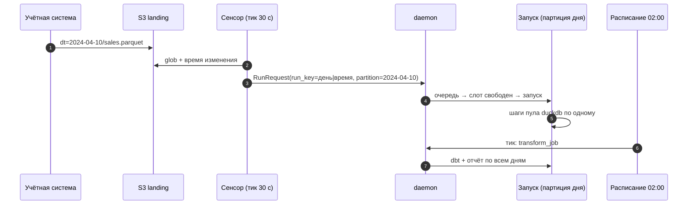

# 03 · Партиции, расписания, backfill и сенсоры: когда и за какой день запускать

> [!info] Урок одной фразой
> Партиции превращают «таблицу» в расписание поездов по дням: у каждого дня свой рейс, своё
> состояние «прибыл / нет» и свой перезапуск. Расписание отправляет рейс вчерашнего дня по часам,
> датчик на путях (сенсор) — когда пришёл вагон, а backfill — это пачка рейсов за прошлые дни.
> Стрелочник (пул конкурентности) не пускает два поезда на одноколейный участок (файл DuckDB).

> [!todo] Чек-лист: после урока ты сможешь
> - [ ] описать ассет с дневными партициями и объяснить, зачем у определения конечная дата;
> - [ ] предсказать, какую партицию запросит расписание на заданном тике, и проверить это;
> - [ ] запустить backfill диапазона и выбрать политику «партиций на запуск»;
> - [ ] написать сенсор с `run_key`, который не повторяет работу и реагирует на перезапись файла;
> - [ ] ограничить конкурентность пулом и прочитать ошибку `Could not set lock`;
> - [ ] сказать, где хранится состояние оркестратора, dlt и сенсора и где — секреты.

**Нужно для:** лаб [06.3](../labs/06.3_partitions_and_backfill/README.md),
[06.5](../labs/06.5_orchestration_mini_project/README.md).
**Карта урока:** [schedules-sensors-partitions.canvas](../maps/schedules-sensors-partitions.canvas).

---

## Шаг 0. Азбука

| В Dagster | В аналогии «железная дорога» | Подробнее |
|---|---|---|
| Партиция | Рейс конкретного дня | [партиции ассета](../../../glossary/asset-partitions.md) |
| `DailyPartitionsDefinition` | Сетка расписания: с какого по какой день ходят поезда | [партиции ассета](../../../glossary/asset-partitions.md) |
| Расписание (schedule) | Отправление по часам | [расписание и сенсор](../../../glossary/schedule-sensor.md) |
| Тик (tick) | Момент, когда диспетчер сверяется с расписанием или датчиком | [расписание и сенсор](../../../glossary/schedule-sensor.md) |
| Сенсор (sensor) | Датчик на путях | [расписание и сенсор](../../../glossary/schedule-sensor.md) |
| `run_key` | Номер накладной: один груз — одна отправка | [расписание и сенсор](../../../glossary/schedule-sensor.md) |
| Backfill | Пачка рейсов за прошлые дни | [backfill](../../../glossary/backfill.md) |
| Пул конкурентности | Одноколейный участок: по нему — по одному | [пул конкурентности](../../../glossary/concurrency-pool.md) |

---

## Шаг 1. Партиции: ассет как набор дней

**Проблема.** `weather_bronze` — это 97 дней. Без партиций у ассета одно состояние: «материализован
вчера в 14:05». Из него не понять, какие дни загружены, и нельзя перезапустить один день.

**Как устроено.** **Определение партиций** задаёт набор ключей. Для данных по дням это
`DailyPartitionsDefinition`: ключ — строка даты `2024-04-01`. Ассет с `partitions_def` в каждом
запуске обрабатывает **одну** партицию (или диапазон — шаг 3) и получает её ключ в
`context.partition_key`. Dagster хранит статус **каждой** партиции: материализована, упала,
не запускалась.

```python
# demo/weather_orchestration/partitions.py
daily = DailyPartitionsDefinition(start_date="2024-03-28", end_date="2024-07-03")  # ① ②
```

① `start_date` — первый день. ② `end_date` **не включается**: последний ключ — `2024-07-02`. Без
`end_date` Dagster считал бы, что партиции идут до **сегодняшнего** дня, и в UI было бы 900+
«пропущенных» дней 2024–2026 годов, которых в датасете нет.

Ассеты одного графа с одинаковым определением партиций связаны «день к дню»: партиция
`2024-04-01` ассета `weather_bronze` зависит от партиции `2024-04-01` ассета `weather_files`.
Непартиционированный потомок (dbt-витрина за весь период) зависит от **всех** партиций входа.

**Что из этого следует.** Партиция = единица идемпотентности (урок 01): «перезапустить 10
апреля» — это материализовать одну партицию, и шаг заменит ровно этот день.

> [!example]- Попробуй сам: сетка партиций
> UI → **Assets** → `weather_bronze` → вкладка **Partitions**.
> ```bash
> make dagster-shell
> python -c "from weather_orchestration.partitions import daily; k = daily.get_partition_keys(); print(len(k), k[0], k[-1])"
> exit
> ```
> **Увидишь:** `97 2024-03-28 2024-07-02`; в UI — полоса из 97 клеток: зелёные — загруженные дни
> (те, что ты материализовал в уроках 01–02), серые — не загруженные.
> **Почему:** статус хранится по каждой партиции отдельно, в событиях `ASSET_MATERIALIZATION` с
> тегом партиции.

---

## Шаг 2. Расписание: какой день запускать в 00:30

**Проблема.** Каждую ночь нужно загружать **вчерашний** день. Расписание должно не просто
«запустить job», а передать ему правильную партицию.

**Как устроено.** Расписание — cron-выражение плюс функция, которая на каждом **тике** решает,
что запускать. Для партиционированного job есть готовый конструктор:

```python
weather_daily_schedule = build_schedule_from_partitioned_job(
    weather_daily_job, name="weather_daily_schedule", hour_of_day=0, minute_of_hour=30)
```

Он строит cron `30 0 * * *` и на тике запрашивает партицию, которая **закончилась** к моменту
тика: в 00:30 2 апреля закончился день 1 апреля. Расписание по умолчанию **выключено**
(`STOPPED`): включают кнопкой в UI или `dagster schedule start`.

Cron-выражение — пять полей: минута, час, день месяца, месяц, день недели.

| Выражение | Когда |
|---|---|
| `30 0 * * *` | каждый день в 00:30 |
| `0 2 * * *` | каждый день в 02:00 |
| `*/15 * * * *` | каждые 15 минут |
| `0 6 * * 1` | по понедельникам в 06:00 |

Время тиков — в часовом поясе расписания (по умолчанию UTC).

**Что из этого следует.** Расписание проверяют не ожиданием полуночи, а вычислением тика на
нужную дату. В UI это **Schedules → расписание → Test schedule** с выбором времени, в коде —
`build_schedule_context(scheduled_execution_time=…)`.

> [!example]- Попробуй сам: какую партицию запросит расписание
> ```bash
> make dagster-shell
> python - <<'EOF' 2>/dev/null
> from datetime import datetime
> from dagster import build_schedule_context
> from weather_orchestration.definitions import defs
> schedule = defs.get_schedule_def("weather_daily_schedule")
> print(schedule.cron_schedule, schedule.default_status)
> for t in [datetime(2024, 4, 2, 0, 30), datetime(2026, 10, 2, 0, 30)]:
>     ctx = build_schedule_context(scheduled_execution_time=t, repository_def=defs.get_repository_def())
>     print(t, [r.partition_key for r in schedule.evaluate_tick(ctx).run_requests])
> EOF
> exit
> ```
> **Увидишь:**
> ```
> 30 0 * * * DefaultScheduleStatus.STOPPED
> 2024-04-02 00:30:00 ['2024-04-01']
> 2026-10-02 00:30:00 ['2024-07-02']
> ```
> **Почему:** в 2024 году расписание берёт вчерашний день. В 2026-м «вчера» вне сетки, и
> конструктор берёт **последнюю существующую** партицию — 2024-07-02.

> [!warning] Ловушка: включённое расписание на исторических данных
> Если включить `weather_daily_schedule` сейчас, он будет каждую ночь перезагружать
> 2024-07-02 — тихо и «успешно». Для исторического датасета расписание проверяют тиками с
> датой из периода, а в живом pipeline у определения партиций нет `end_date`.

---

## Шаг 3. Backfill: пачка прошлых дней

**Проблема.** Нужно загрузить все 97 дней или перезагрузить апрель после исправления логики.
Запускать 30 партиций по одной руками — долго и легко пропустить день.

**Как устроено.** **Backfill** — запрос «материализуй эти партиции этих ассетов». Daemon
превращает его в запуски и ведёт общий статус. Сколько партиций попадёт в один запуск, решает
**политика backfill** ассета:

| Политика | Что делает | Когда |
|---|---|---|
| `BackfillPolicy.multi_run(1)` | один запуск на партицию | шаг умеет обрабатывать только один день (`context.partition_key`) |
| `BackfillPolicy.multi_run(N)` | диапазон из N партиций на запуск | шаг умеет диапазон, запусков меньше |
| `BackfillPolicy.single_run()` | весь диапазон одним запуском | шаг читает `context.partition_key_range`, например один `DELETE … BETWEEN` + `INSERT` |

У нас все партиционированные ассеты — `multi_run(1)`: они читают `context.partition_key`, а для
диапазона этот вызов падает. В job с разными политиками Dagster берёт самую осторожную и
предупреждает об этом при загрузке кода.

**Что из этого следует.** Цена backfill по одной партиции — накладные расходы запуска (урок 02,
шаг 6): у нас 3 дня — ~90 с, 7 дней — ~180 с, при том что полезная работа — секунда на день.
Для 97 дней это 20–40 минут. Шаг, который умеет диапазон (`single_run`), загрузил бы тот же
период за один запуск — это задача для лабы 06.3.

> [!example]- Попробуй сам: backfill трёх дней
> ```bash
> make dagster ARGS="job backfill -w /opt/dagster/home/workspace.yaml -j weather_daily_job --from 2024-04-16 --to 2024-04-18 --noprompt"
> ```
> UI → **Overview → Backfills** (или **Runs**, фильтр по тегу `dagster/backfill`).
> **Увидишь:** `Launched backfill job <id>`; в UI — три запуска с тегами партиций 2024-04-16…18,
> все `SUCCESS` примерно за 1,5 минуты; в полосе партиций `weather_bronze` позеленели три клетки.
> **Почему:** политика `multi_run(1)` дала три запуска, daemon взял их из очереди.

---

## Шаг 4. Сенсор: реагировать на появление файла

**Проблема.** Учётная система кладёт файл продаж в `s3://landing/freshretail/sales/dt=…/`, когда
захочет, а иногда перекладывает исправленный (повторная доставка, модуль 04). Расписание «раз в
день» либо опоздает, либо придёт раньше файла.

**Как устроено.** **Сенсор** — функция, которую daemon вызывает раз в `minimum_interval_seconds`
(тик). Она смотрит во внешний мир и возвращает запросы на запуск (`RunRequest`) или причину
пропуска (`SkipReason`). Чтобы один и тот же файл не запускал работу на каждом тике, у запроса
есть **`run_key`**: Dagster помнит все выданные ключи сенсора и **отбрасывает** запрос с уже
виденным ключом.

```python
@sensor(job=landing_inventory_job, minimum_interval_seconds=30,
        default_status=DefaultSensorStatus.STOPPED)
def landing_sales_sensor(context, s3: S3Resource):
    fs = s3.filesystem()
    for path in sorted(fs.glob(f"{SALES_PREFIX}/dt=*/sales.parquet")):
        day = path.split("dt=")[1].split("/")[0]
        modified = fs.info(path)["LastModified"].isoformat()
        yield RunRequest(run_key=f"{day}|{modified}", partition_key=day)   # ① ②
```

① `run_key` = дата + время изменения файла. Тот же файл на следующем тике даёт тот же ключ —
запрос отброшен (тик `SKIPPED`). Перезаписанный файл — новое время изменения, новый ключ, новый
запуск. ② `partition_key` — какую партицию job материализовать.

Кроме `run_key` у сенсора есть **курсор** (`context.cursor`) — строка, которую сенсор сохраняет
между тиками сам, например «последнее увиденное время изменения». Курсор нужен, когда файлов
тысячи и перебирать их все на каждом тике дорого; `run_key` — когда важно не запустить одно и то
же дважды. Их часто используют вместе.

**Что из этого следует.** Сенсор опрашивает внешний мир — значит, он видит его с задержкой до
одного интервала, а каждый тик стоит запроса к S3. И сенсор живёт в долгоживущем процессе
code-сервера, поэтому любые кэши между тиками опасны (ловушка ниже).

> [!example]- Попробуй сам: сенсор и повторная доставка
> ```bash
> make shell
> python scripts/landing_drop.py --from 2024-04-01 --to 2024-04-02
> exit
> make dagster ARGS="sensor start landing_sales_sensor -w /opt/dagster/home/workspace.yaml"
> ```
> Подожди минуту, затем UI → **Automation → landing_sales_sensor**: список тиков. Потом повтори
> доставку одного дня и подожди ещё минуту:
> ```bash
> make shell
> python scripts/landing_drop.py --from 2024-04-02
> exit
> make dagster ARGS="sensor stop landing_sales_sensor -w /opt/dagster/home/workspace.yaml"
> make sql
> ```
> ```sql
> ATTACH '/workspace/data/demo_orchestration.duckdb' AS demo (READ_ONLY);
> FROM demo.ops.landing_inventory;
> ```
> **Увидишь:** первый тик — `SUCCESS` с двумя ключами `2024-04-01|…` и `2024-04-02|…` и двумя
> запусками `landing_inventory_job`; следующие тики — `SKIPPED` (ключи уже были). После
> повторной доставки — новый тик `SUCCESS` с одним запуском за 2024-04-02. В таблице — две строки,
> у 2024-04-02 обновилось `modified`.
> **Почему:** у перезаписанного файла новое время изменения → новый `run_key`. Опись пишет
> `INSERT OR REPLACE` по `dt`, поэтому повторная доставка обновляет строку, а не дублирует.

> [!warning] Ловушка: кэш fsspec в долгоживущем процессе
> fsspec (на нём построен s3fs) по умолчанию **переиспользует** объект файловой системы с теми же
> аргументами вместе с кэшем списков файлов. В скрипте это незаметно: процесс живёт секунды. В
> code-сервере сенсор на каждом тике получал бы тот же объект со старым кэшем и **не видел**
> перезаписанный файл. Так и было при разработке демо: тики шли `SKIPPED` с прежним временем
> изменения. Поэтому `S3Resource.filesystem()` создаёт объект с `skip_instance_cache=True`.

---

## Шаг 5. Где живёт состояние и где — секреты

**Проблема.** Оркестратор, dlt, сенсоры и DuckDB что-то помнят между запусками. Если не знать
где, после `make clean` или переезда pipeline «забудет», что уже загружено, или загрузит всё
повторно.

**Как устроено.**

| Что | Где у нас | Переживает `make down` | Переживает `make clean` |
|---|---|---|---|
| История запусков, статусы партиций, ключи сенсоров, курсоры | Postgres, база `dagster` | да | нет (том `postgres-data`) |
| Логи шагов | `data/.dagster/logs/` | да | да (папка репозитория) |
| Состояние dlt (схема, курсоры инкремента) | `data/.dlt/` и таблицы `_dlt_*` в месте назначения | да | да / зависит от места назначения |
| Данные демо | `data/demo_orchestration.duckdb`, `s3://landing/…` | да | файл да, S3 нет |
| Секреты | `.env` → переменные окружения контейнеров → `EnvVar` | — | — |

**Что из этого следует.** Состояние оркестратора и состояние данных могут **разойтись**. Если
удалить DuckDB-файл, Dagster всё равно покажет все дни `weather_bronze` зелёными — он помнит
события, а не проверяет данные. Это лечится проверками ассетов (урок 04) и повторной
материализацией. Секреты в код и в `dagster.yaml` не пишут: только имя переменной (`env:
POSTGRES_PASSWORD`, `EnvVar("AWS_SECRET_ACCESS_KEY")`).

---

## Шаг 6. Конкурентность: один писатель DuckDB

**Проблема.** Backfill запускает несколько запусков одновременно. Файл DuckDB разрешает только
**одного** процесса-писателя; второй процесс, даже только читающий, не откроет файл, пока его
держит писатель.

**Как устроено.** Есть два уровня ограничений, оба — в `dagster.yaml`:

- `concurrency.runs.max_concurrent_runs: 4` — сколько **запусков** daemon выполняет одновременно;
  остальные ждут в очереди `QUEUED`.
- `concurrency.pools.default_limit: 1` — сколько **шагов одного пула** выполняется одновременно
  во **всех** запусках. Шаг указывает пул параметром `pool="duckdb"`. Если слот занят, шаг ждёт,
  а в журнале запуска появляется `Step blocked by limit for pool duckdb`.

В демо пул `duckdb` у всех, кто открывает файл: dlt-загрузки, dbt, опись, отчёт **и проверка
ассета**.

**Что из этого следует.** Ограничение ставят на ресурс, а не на «весь pipeline»: шаги, которые
пишут только в S3 (`weather_files`), по-прежнему идут параллельно.

> [!warning] Ловушка: забытый пул у «только читающего» шага
> Первая версия демо держала в пуле только загрузки и dbt, а проверка `weather_bronze_all_cities`
> открывала файл `read_only` без пула. На backfill 7 дней три запуска упали:
> ```
> _duckdb.IOException: IO Error: Could not set lock on file
> "/workspace/data/demo_orchestration.duckdb": Conflicting lock is held in
> /usr/local/bin/python3.12 (PID 5724)
> ```
> Чтение тоже берёт блокировку файла, и она конфликтует с писателем из соседнего запуска. После
> `pool="duckdb"` у проверки тот же backfill прошёл без ошибок.

> [!example]- Попробуй сам: занятость пула
> ```bash
> make dagster ARGS="instance concurrency get --all"
> ```
> Во время backfill (шаг 3) — UI → **Deployment → Concurrency**.
> **Увидишь:** `"duckdb": 0 / 1 slots occupied` в покое; во время backfill — `1 / 1`, а в логах
> запусков — `Step blocked by limit for pool duckdb`.

---

## Сборка целиком

Ночь в живом pipeline: файл пришёл, сенсор запустил загрузку, расписание — преобразования.



| Шаг | Если сломается | Симптом |
|---|---|---|
| 2 | кэш списка файлов | новые файлы не видны, тики `SKIPPED` |
| 3 | `run_key` без времени изменения | повторная доставка не перезагружается |
| 3 | `run_key` случайный (uuid) | запуск на каждом тике по одному и тому же файлу |
| 5 | шаг без пула открывает DuckDB | `Could not set lock on file` |
| 6 | расписание без зависимости от загрузки | dbt по неполным данным (урок 04 — автоматизация по входам) |

## Шпаргалка

| Хочу | Как |
|---|---|
| Дневные партиции | `DailyPartitionsDefinition(start_date=…, end_date=…)` (конец не включается) |
| Ключ партиции в шаге | `context.partition_key` (диапазон — `context.partition_key_range`) |
| Расписание партиционированного job | `build_schedule_from_partitioned_job(job, hour_of_day=…, minute_of_hour=…)` |
| Проверить тик | UI → Test schedule; `build_schedule_context(scheduled_execution_time=…)` |
| Включить / выключить | UI; `make dagster ARGS="schedule start <имя> -w /opt/dagster/home/workspace.yaml"` |
| Backfill | UI → Materialize → диапазон; `make dagster ARGS="job backfill -w … -j <job> --from … --to … --noprompt"` |
| Один запуск на партицию | `backfill_policy=BackfillPolicy.multi_run(1)` |
| Сенсор без повторов | `RunRequest(run_key=…)`; курсор — `context.update_cursor(…)` |
| Пул конкурентности | `@asset(pool="duckdb")` + `concurrency.pools` в `dagster.yaml` |

## Типичные ошибки

| Симптом | Причина | Как проверить | Как чинить |
|---|---|---|---|
| В UI сотни «пропущенных» партиций | нет `end_date` у исторических данных | вкладка Partitions | `end_date` (для живых данных — нормально) |
| Расписание каждую ночь грузит один и тот же день | тик вне сетки → последняя партиция | Test schedule на текущую дату | не включать на исторических данных |
| `Cannot access partition_key for a partitioned run with a range of partitions` | backfill диапазоном, шаг ждёт один день | политика backfill | `multi_run(1)` или поддержать диапазон |
| Сенсор не видит перезаписанный файл | кэш fsspec / курсор только по имени | история тиков, run_key | `skip_instance_cache=True`; время изменения в ключе |
| Сенсор запускает одно и то же | нет `run_key` или он случайный | история тиков | детерминированный `run_key` |
| `Could not set lock on file …duckdb` | два процесса открыли файл | лог шага, PID в тексте | пул `duckdb` у всех, кто открывает файл |
| Запуски висят `QUEUED`, daemon жив | исчерпан `max_concurrent_runs` или слоты пула | Deployment → Concurrency | дождаться / пересмотреть лимиты |

## Проверь себя

Карточки — в [flashcards.md](../flashcards.md).

> [!question] 1. `DailyPartitionsDefinition(start_date="2024-04-01", end_date="2024-04-08")`. Сколько партиций и какая последняя?
> > [!success]- Ответ
> > 7 партиций, последняя — 2024-04-07: `end_date` не включается.

> [!question] 2. Сенсор выдаёт `run_key=day`. Учётная система переложила исправленный файл за 2024-04-02. Что произойдёт и как исправить?
> > [!success]- Ответ
> > Ничего: ключ `2024-04-02` уже был, запрос отброшен, исправление не загрузится. Добавить в
> > ключ версию файла — время изменения или ETag.

> [!question] 3. Почему шаг `weather_files` без пула, а `rainy_cities_report`, который только читает, — с пулом?
> > [!success]- Ответ
> > `weather_files` пишет в S3 — там нет блокировок файла, запуски можно вести параллельно.
> > Отчёт открывает файл DuckDB, а любая открытая сессия конфликтует с писателем другого запуска —
> > без пула будет `Could not set lock`.

> [!question] 4. Ты удалил `data/demo_orchestration.duckdb`. Что покажет UI для `weather_bronze` и как вернуть данные?
> > [!success]- Ответ
> > Все прежние партиции останутся зелёными: Dagster хранит события материализаций в Postgres и не
> > проверяет данные. Вернуть — backfill всех партиций (`weather_files` можно не трогать, файлы в
> > S3 на месте). Заметить такое расхождение помогают проверки ассетов (урок 04).
