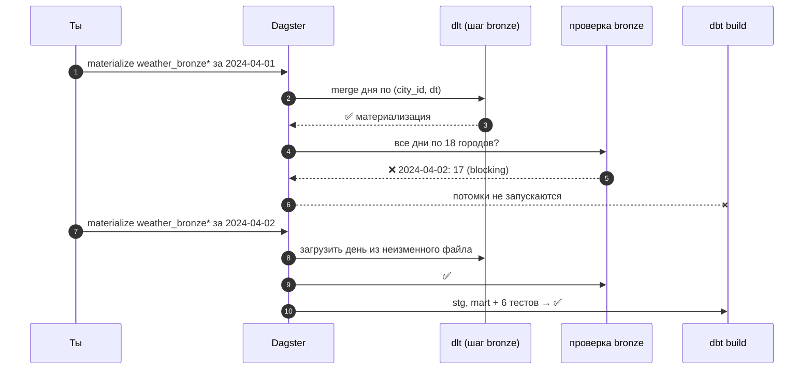

# 04 · dlt и dbt как ассеты: сквозной граф, проверки и что пересчитать после сбоя

> [!info] Урок одной фразой
> dlt и dbt — свои депо со своими маршрутами. Интеграции Dagster перерисовывают их маршруты на
> общую карту диспетчерской: каждая таблица dlt и каждая модель dbt становится станцией, тесты
> dbt — контрольными пунктами. С общей картой видно, какие станции ниже по линии надо обслужить
> заново, если на одной из них испортили груз.

> [!todo] Чек-лист: после урока ты сможешь
> - [ ] обернуть dlt-источник в `@dlt_assets` с партициями и задать ключи через транслятор;
> - [ ] обернуть dbt-проект в `@dbt_assets`, сопоставить `source()` dbt с ассетом загрузки;
> - [ ] объяснить, откуда Dagster знает модели dbt (`manifest.json`) и почему тесты стали проверками;
> - [ ] написать проверку ассета, которая блокирует потомков;
> - [ ] выбрать по графу, что пересчитать после сбоя, и сделать это одной командой;
> - [ ] объяснить «откат перерасчётом» на неизменяемых входах.

**Нужно для:** лаб [06.1](../labs/06.1_dagster_and_dlt_assets/README.md),
[06.2](../labs/06.2_dbt_assets_and_lineage/README.md),
[06.5](../labs/06.5_orchestration_mini_project/README.md).
**Карта урока:** [dbt-dlt-lineage.canvas](../maps/dbt-dlt-lineage.canvas).

---

## Шаг 0. Азбука

| В Dagster | В аналогии | Подробнее |
|---|---|---|
| `@dlt_assets` | Маршруты депо dlt на общей карте | [dlt](../../../glossary/dlt.md) |
| `@dbt_assets` | Маршруты депо dbt на общей карте | [dbt](../../../glossary/dbt-core.md) |
| Транслятор (translator) | Правила, как называть станции чужого депо на общей карте | [ассет](../../../glossary/software-defined-asset.md) |
| Проверка ассета (asset check) | Контрольный пункт на станции | [проверка ассета](../../../glossary/asset-check.md) |
| Выбор ассетов `x*`, `+x` | «Эта станция и всё ниже / выше по линии» | [lineage](../../../glossary/lineage.md) |
| Re-execute from failure | Продолжить рейс со станции, где он сломался | [оркестратор](../../../glossary/orchestrator.md) |

---

## Шаг 1. Зачем интеграции, если можно вызвать `dbt build` из ассета

**Проблема.** Самый простой путь — один ассет «dbt», который вызывает `subprocess.run(["dbt",
"build"])`. Он работает, но Dagster видит **одну** коробку: не знает, какие модели внутри, какие
упали, какие тесты не прошли и какие модели зависят от загрузки.

**Как устроено.** Интеграции `dagster-dlt` и `dagster-dbt` читают описание проекта и создают
**по ассету на каждый объект**: на каждую таблицу (ресурс) dlt и на каждую модель, seed,
snapshot dbt. Выполняется по-прежнему один шаг (один вызов dlt или dbt), но события
материализации приходят по каждой модели отдельно. Связи между ними берутся из самих
инструментов: у dbt — из графа `ref`/`source`, у dlt — из ресурсов источника.

**Что из этого следует.** Один граф от файла в landing до отчёта (урок 01, шаг 2) без ручного
описания связей: добавил модель dbt — после Reload она появилась на графе Dagster со своими
связями.

---

## Шаг 2. dlt как ассеты

**Проблема.** dlt-источник сам по себе знает, **что** загружать, но не знает, какой день: дата
должна прийти от оркестратора, а результат — оказаться на графе под понятным именем.

**Как устроено.** Декоратор `@dlt_assets` получает **экземпляр источника** (для описания ассетов)
и **pipeline** (куда грузить). Тело функции запускает загрузку через ресурс `DagsterDltResource`
и передаёт ему источник уже с параметром партиции:

```python
@dlt.source(name="landing_weather")
def landing_weather_source(day: str = "2024-03-28"):                     # ① параметр-дата
    @dlt.resource(name="weather", primary_key=["city_id", "dt"], write_disposition="merge")  # ②
    def weather():
        fs = s3fs.S3FileSystem(endpoint_url=os.environ["S3_ENDPOINT"])
        with fs.open(f"{WEATHER_PREFIX}/dt={day}/weather.parquet", "rb") as f:
            yield pq.read_table(f)                                        # ③ Arrow целиком
    return weather

@dlt_assets(
    dlt_source=landing_weather_source(),                                  # ④ для описания
    dlt_pipeline=dlt.pipeline(pipeline_name="demo_orchestration_weather",
        destination=dlt.destinations.duckdb("/workspace/data/demo_orchestration.duckdb"),
        dataset_name="bronze"),
    partitions_def=daily, backfill_policy=BackfillPolicy.multi_run(1),
    dagster_dlt_translator=WeatherTranslator(), pool="duckdb")
def weather_bronze_assets(context, dlt: DagsterDltResource):
    yield from dlt.run(context=context,
                       dlt_source=landing_weather_source(context.partition_key))  # ⑤ день
```

| Метка | Что важно |
|---|---|
| ① | дата — параметр источника, а не `today()` (урок 01, шаг 3) |
| ② | `merge` по ключу: повтор дня заменяет строки (модуль 04, урок 02) |
| ③ | Arrow-таблица целиком — в 10 раз быстрее построчной выдачи (замер модуля 04) |
| ④ | экземпляр с параметром по умолчанию нужен только чтобы узнать ресурсы и имена |
| ⑤ | настоящий запуск — с днём партиции; `dlt.run` превращает отчёт dlt в события Dagster |

**Транслятор.** По умолчанию ассет назывался бы `dlt_landing_weather_weather`, а его вход —
`landing_weather_weather`, которого на графе нет. Транслятор переименовывает:

```python
class WeatherTranslator(DagsterDltTranslator):
    def get_asset_spec(self, data):
        spec = super().get_asset_spec(data)
        return spec.replace_attributes(key=AssetKey("weather_bronze"),
                                       deps=[AssetKey("weather_files")], group_name="bronze")
```

**Что из этого следует.** Связь «файл → bronze» появилась потому, что `deps` транслятора
совпадает с ключом ассета `weather_files`. Опечатка в имени — и на графе возникнет «висящий»
внешний ассет без функции, а связь пропадёт.

> [!warning] Ловушка: состояние dlt рядом с Dagster
> У dlt своё состояние: рабочая папка pipeline (`data/.dlt/…`) и таблицы `_dlt_loads`,
> `_dlt_pipeline_state` в месте назначения. Dagster о нём не знает. Если ресурс dlt
> инкрементальный (курсор), backfill прошлых дней **не** загрузит их: курсор уже впереди
> (модуль 04, урок 02). Для партиций по дням курсор не нужен — день задаёт параметр.

---

## Шаг 3. dbt как ассеты

**Проблема.** Dagster должен знать модели dbt **до** запуска, чтобы нарисовать граф. Значит, ему
нужно прочитать проект dbt, не выполняя его.

**Как устроено.** dbt при компиляции пишет `target/manifest.json` — полное описание проекта:
модели, источники, тесты, связи (модуль 05, урок 04). `@dbt_assets` читает манифест и создаёт
ассет на каждую модель, а **тесты** — проверками ассетов (asset checks) на тех моделях, к
которым они привязаны. Сингулярный тест (`tests/*.sql`) привязывается к модели, на которую
ссылается через `ref`.

```python
DBT_DIR = Path(__file__).parents[2] / "dbt_weather"
dbt_project = DbtProject(project_dir=DBT_DIR, profiles_dir=DBT_DIR)
dbt_project.preparer.prepare(dbt_project)            # ① dbt parse при загрузке кода

class WeatherDbtTranslator(DagsterDbtTranslator):
    def get_asset_key(self, props):
        if props["resource_type"] == "source":
            return AssetKey("weather_bronze")          # ② source('bronze','weather') = ассет dlt
        return super().get_asset_key(props)

@dbt_assets(manifest=dbt_project.manifest_path, dagster_dbt_translator=WeatherDbtTranslator(), pool="duckdb")
def weather_dbt_assets(context, dbt: DbtCliResource):
    yield from dbt.cli(["build"], context=context).stream()   # ③
```

① `prepare` вызывает `dbt parse` при каждой загрузке code location — ~3 с, зато после правки
модели и Reload манифест свежий. В продакшене манифест собирают при сборке образа, а не при
старте. ② Без этого источник dbt стал бы отдельным внешним ассетом `bronze/weather`, и граф
разорвался бы между dlt и dbt. ③ `dbt build` выполняет модели и тесты; Dagster сам добавляет
`--select` по выбранным ассетам, поэтому «материализовать только `mart_city_rainy_days`»
превращается в `dbt build --select mart_city_rainy_days`.

**Что из этого следует.** Тест dbt, который упал, — это не упавший шаг, а **проваленная
проверка** на модели. По умолчанию тест с `severity: error` роняет шаг dbt, а `warn` — только
помечает проверку.

> [!example]- Попробуй сам: dbt-модели и тесты на графе
> ```bash
> make dagster ARGS='asset materialize --select "group:transform"' 2>&1 \
>   | grep -E "ASSET_CHECK_EVALUATION|STEP_SUCCESS" | cut -c95-220
> ```
> UI → **Assets** → `stg_weather` → вкладка **Checks**.
> **Увидишь:** шесть строк `Asset check '…' on '…' passed`: три на `stg_weather`
> (`assert_one_row_per_city_day`, два `not_null_…`) и три на `mart_city_rainy_days`; затем
> `STEP_SUCCESS - Finished execution of step "weather_dbt_assets" in ~7s`.
> **Почему:** один шаг `dbt build`, а события — по каждой модели и тесту из манифеста.

---

## Шаг 4. Проверки ассетов: остановить плохие данные

**Проблема.** Загрузка «успешна», если процесс не упал. Но день мог прийти неполным — 17 городов
из 18. Без проверки dbt честно соберёт витрину, где у одного города на день меньше.

**Как устроено.** **Проверка ассета** (`@asset_check`) — функция, которая смотрит на данные
ассета и возвращает `AssetCheckResult(passed=…, severity=…, metadata=…)`. Результат хранится
рядом с ассетом и виден в UI. Флаг **`blocking=True`** означает: если проверка не прошла с
`severity=ERROR`, потомки этого ассета **в том же запуске** не материализуются.

```python
@asset_check(asset=AssetKey("weather_bronze"), blocking=True, pool="duckdb")
def weather_bronze_all_cities(duck: DuckDBResource) -> AssetCheckResult:
    with duck.connect(read_only=True) as con:
        bad_days = con.sql("SELECT dt, count(*) FROM bronze.weather "
                           "GROUP BY dt HAVING count(*) <> 18").fetchall()
    return AssetCheckResult(passed=not bad_days, severity=AssetCheckSeverity.ERROR,
                            metadata={"bad_days": str(bad_days[:5])})
```

**Что из этого следует.** Проверки dbt-тестов и `@asset_check` — один механизм с разными
источниками. Проверка смотрит на **весь** ассет, а не только на загруженную партицию: испорченный
вчерашний день остановит и сегодняшний запуск. Это строже, но зато плохие данные не проходят
дальше незамеченными.

---

## Шаг 5. Что пересчитать после сбоя

**Проблема.** Сломался один ассет: загрузка дня прошла не полностью, или в bronze попали плохие
данные. Что нужно перезапустить, чтобы всё ниже по графу стало правильным, и не больше?

**Как устроено.** Граф отвечает однозначно: **сам ассет и всех его потомков**. Синтаксис выбора
ассетов Dagster:

| Выбор | Что выбирает | Пример у нас |
|---|---|---|
| `x` | только ассет | `weather_bronze` |
| `x*` | ассет и всех потомков | `weather_bronze*` → bronze, stg, mart, report |
| `x+` / `x+2` | ассет и потомков на 1 / 2 уровня | `weather_bronze+` → bronze, stg |
| `*x` | ассет и всех предков | `*rainy_cities_report` → весь путь от файла |
| `+x` | ассет и прямых родителей | `+stg_weather` → stg, bronze |
| `group:transform` | все ассеты группы | dbt-модели |
| `a,b` | объединение | `weather_files,weather_bronze` |

Для партиционированного ассета пересчитывают **испорченные партиции**, а для
непартиционированных потомков (витрина за весь период) — их целиком.

После упавшего запуска есть и второй путь: **Re-execute → From failure** в UI. Он запускает
только упавшие шаги и всё, что после них **в этом запуске**, переиспользуя успешные. Это удобно,
когда упал шаг посередине. Выбор `x*` нужен, когда плохие данные обнаружились **позже** —
например, проверкой на следующий день.

Почему перерасчёт вообще работает как «откат»? Потому что входы неизменяемы (урок 01, шаг 3):
сырой файл дня в landing не правили, и повторная загрузка дня из него заменяет испорченные
данные исходными. Клеппман (гл. 10) называет это главным свойством пакетной обработки: выход —
функция от входа, поэтому исправить выход — значит пересчитать его.

> [!example]- Попробуй сам: испортить день, увидеть блокировку, починить
> ```bash
> make sql
> ```
> ```sql
> ATTACH '/workspace/data/demo_orchestration.duckdb' AS demo;
> DELETE FROM demo.bronze.weather WHERE dt = '2024-04-02' AND city_id = 5;   -- «потеряли» город
> .quit
> ```
> ```bash
> make dagster ARGS='asset materialize --select "weather_bronze*" --partition 2024-04-01' 2>&1 \
>   | grep -E "ASSET_CHECK_EVALUATION|STEP_SUCCESS|STEP_FAILURE|RUN_" | cut -c95-220
> make dagster ARGS='asset materialize --select "weather_bronze*" --partition 2024-04-02' 2>&1 \
>   | grep -E "ASSET_CHECK_EVALUATION|STEP_SUCCESS|RUN_" | cut -c95-220
> ```
> **Увидишь:** первый запуск (за **1 апреля**!) — `weather_bronze_assets … STEP_SUCCESS`, затем
> `Asset check 'weather_bronze_all_cities' … did not pass`, `RUN_FAILURE`; шаги dbt и отчёта не
> выполнялись. Второй запуск (за **2 апреля**) — проверка `passed`, шесть проверок dbt `passed`,
> отчёт, `RUN_SUCCESS`.
> **Почему:** проверка смотрит на весь ассет и нашла 2 апреля с 17 городами — блокирующая
> проверка остановила потомков. Повторная загрузка 2 апреля из неизменного файла вернула город
> (`merge` по ключу), и потомки пересобрались.

> [!warning] Ловушка: пересчитать только упавший ассет
> Если перезагрузить `weather_bronze` за день и не пересобрать потомков, витрина останется
> построенной по старым данным. В UI такие потомки помечаются как **Unsynced / Stale** — вход
> обновился позже них. Перезапускай `x*`, а не `x`.

---

## Шаг 6. Автоматизация по входам (вместо расписаний для потомков)

**Проблема.** В уроке 03 преобразования запускало расписание в 02:00 — «с запасом» после
загрузки. Это ровно та связь «по времени», от которой оркестратор должен избавлять.

**Как устроено.** В Dagster у ассета можно задать **условие автоматизации**
(`automation_condition`). Например, `AutomationCondition.eager()`: «материализуй меня, как
только обновился любой вход и сам я не обновлялся после этого, если все входы в порядке».
Условия вычисляет daemon (сенсор `default_automation_condition_sensor`, его включают в UI). В
демо условий нет, чтобы запуски происходили только по твоей команде, — их добавишь в
мини-проекте 06.5.

**Что из этого следует.** Загрузку запускают расписание или сенсор (внешний мир), а всё ниже по
графу — обновление входов. Тогда сбой загрузки автоматически означает «витрина не
пересобирается», а не «витрина пересобралась по неполным данным».

---

## Сборка целиком

Сквозной запуск `weather_bronze*` за день с проваленной проверкой и починкой:



| Шаг | Если сломается | Симптом |
|---|---|---|
| 2 | транслятор dlt не сопоставил вход | на графе нет стрелки `weather_files → weather_bronze` |
| 4 | проверка не blocking | витрина пересобрана с неполным днём |
| 7 | перезапущен только `weather_bronze` | витрина Unsynced, данные старые |
| 9 | source dbt не сопоставлен | на графе разрыв: отдельный ассет `bronze/weather` |

## Шпаргалка

| Хочу | Как |
|---|---|
| dlt-ресурсы как ассеты | `@dlt_assets(dlt_source=…, dlt_pipeline=…)` + `dlt.run(context=…, dlt_source=…)` |
| Своё имя и вход ассета dlt | `DagsterDltTranslator.get_asset_spec` → `spec.replace_attributes(key=…, deps=…)` |
| dbt-модели как ассеты | `DbtProject` + `@dbt_assets(manifest=…)` + `dbt.cli(["build"], context=context).stream()` |
| Источник dbt = ассет загрузки | `DagsterDbtTranslator.get_asset_key` для `resource_type == "source"` |
| Проверка, блокирующая потомков | `@asset_check(asset=…, blocking=True)` + `severity=ERROR` |
| Ассет и все потомки | `--select "x*"` |
| Продолжить упавший запуск | UI → Re-execute → From failure |
| Запуск по обновлению входов | `automation_condition=AutomationCondition.eager()` |

## Типичные ошибки

| Симптом | Причина | Как проверить | Как чинить |
|---|---|---|---|
| На графе «висящий» ассет `bronze/weather` | source dbt не сопоставлен с ассетом загрузки | Lineage в UI | транслятор dbt |
| Нет стрелки от файла к bronze | `deps` транслятора dlt не совпадает с ключом | `asset list --select "+weather_bronze"` | исправить ключ в `deps` |
| Новая модель dbt не появилась | манифест не пересобран | время загрузки location | Reload (prepare → `dbt parse`) |
| Location не грузится после правки dbt | ошибка в модели → `dbt parse` падает при импорте | текст ошибки в UI | исправить модель |
| Витрина «зелёная», но со старыми данными | пересчитан вход без потомков | статус Unsynced | `x*` |
| Backfill dlt не загрузил прошлые дни | инкрементальный курсор dlt ушёл вперёд | `_dlt_pipeline_state` | дата — параметр источника, без курсора |

## Проверь себя

Карточки — в [flashcards.md](../flashcards.md).

> [!question] 1. В dbt-проекте 12 моделей и 30 тестов. Сколько шагов и сколько ассетов увидит Dagster в запуске `@dbt_assets`?
> > [!success]- Ответ
> > Один шаг (один вызов `dbt build`) и 12 ассетов; 30 тестов станут проверками на соответствующих
> > моделях.

> [!question] 2. Проверка `weather_bronze_all_cities` упала на дне, который ты сегодня не загружал. Почему она остановила сегодняшний запуск и правильно ли это?
> > [!success]- Ответ
> > Проверка смотрит на весь ассет, а не на партицию запуска. Блокировка правильная: витрина
> > строится по всем дням, и испорченный день попал бы в неё.

> [!question] 3. После сбоя ты перезагрузил партицию `weather_bronze` за 2024-04-02. Что ещё надо пересобрать?
> > [!success]- Ответ
> > Всех потомков: `stg_weather`, `mart_city_rainy_days`, `rainy_cities_report` — то есть
> > запускать `weather_bronze*` за этот день. Потомки не партиционированы и пересобираются целиком.

> [!question] 4. Почему «откат» плохого релиза витрины — это перерасчёт, а не восстановление из бэкапа?
> > [!success]- Ответ
> > Вход (bronze, файлы landing) неизменяем, а витрина — функция от входа, которая полностью
> > заменяет выход. Запуск исправленного (или старого) кода по тем же входам даёт правильный
> > результат, бэкап не нужен.
