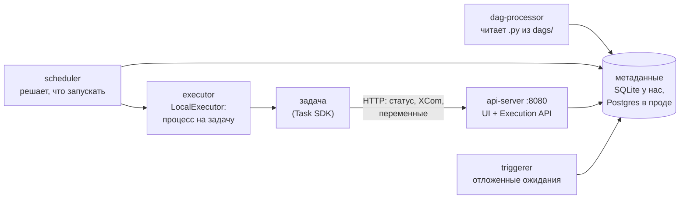
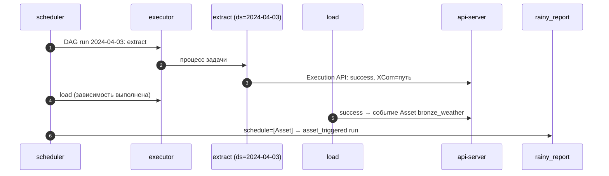

# 05 · Airflow 3 для сравнения: задачи, логическая дата и Assets

> [!info] Урок одной фразой
> Airflow — диспетчерская старой школы: она мыслит рейсами и действиями («отправить поезд A, потом
> B»), а не тем, что должно стоять на станциях. Каждый рейс привязан к дате в расписании
> (логическая дата). В Airflow 3 появились «метки груза» — Assets: рейс может объявить, что
> обновил груз, и это запустит другой рейс. Тот же pipeline погоды на Airflow помогает увидеть,
> что именно даёт asset-подход Dagster и что в Airflow устроено иначе.

> [!todo] Чек-лист: после урока ты сможешь
> - [ ] назвать компоненты Airflow 3 и объяснить, через что задача отчитывается о статусе;
> - [ ] прочитать DAG на TaskFlow: задачи, зависимости, передачу значений через XCom;
> - [ ] объяснить логическую дату, интервал данных, `catchup` и как Airflow делает backfill;
> - [ ] настроить запуск DAG по обновлению `Asset`;
> - [ ] сравнить Airflow и Dagster по таблице и выбрать инструмент под задачу.

**Нужно для:** лаба [06.4](../labs/06.4_airflow_comparison/README.md) (опционально).
**Карта урока:** [airflow-vs-dagster.canvas](../maps/airflow-vs-dagster.canvas).

---

## Шаг 0. Азбука

| В Airflow 3 | В аналогии | Ближайшее в Dagster | Подробнее |
|---|---|---|---|
| DAG | Маршрут рейса из действий | job | [Airflow](../../../glossary/airflow.md) |
| Task (оператор, `@task`) | Действие на маршруте | шаг (op) | [Airflow](../../../glossary/airflow.md) |
| DAG run | Рейс за конкретную дату | run | [логическая дата](../../../glossary/logical-date.md) |
| Logical date, data interval | Дата в расписании, за которую рейс | ключ партиции | [логическая дата](../../../glossary/logical-date.md) |
| XCom | Записка, которую задача передаёт следующей | IO-менеджер / метаданные | [Airflow](../../../glossary/airflow.md) |
| `Asset` | Метка груза: «этот рейс обновил X» | ассет (но без функции) | [Airflow](../../../glossary/airflow.md) |
| `catchup` | Догнать все пропущенные рейсы с начала расписания | backfill | [backfill](../../../glossary/backfill.md) |

Подними Airflow отдельным профилем (Dagster можно остановить, чтобы сэкономить память, или
оставить):

```bash
make up PROFILES="airflow"        # первый раз собирается образ debd/airflow:3.3.2, старт ~1 мин
```

UI — <http://localhost:8081>, вход без пароля (все пользователи — администраторы, только для
учебного стека).

---

## Шаг 1. Из чего состоит Airflow 3

**Проблема.** Чтобы понимать, почему задача «висит» или падает без логов, надо знать, кто в
Airflow за что отвечает.

**Как устроено.** У нас все компоненты запущены одним процессом `airflow standalone` в одном
контейнере, но это пять разных частей:



| Компонент | Что делает |
|---|---|
| dag-processor | периодически импортирует файлы из папки DAG и сохраняет их структуру в базу |
| scheduler | по расписанию и зависимостям создаёт DAG runs и ставит задачи в очередь executor |
| executor | запускает задачи; `LocalExecutor` — отдельный процесс на задачу на той же машине |
| api-server | UI, REST API и **Execution API**, через который задачи сообщают статус |
| triggerer | ждёт внешних событий для «отложенных» задач, не занимая слот executor |

Главное изменение Airflow 3: задача **не ходит в базу метаданных напрямую**. Она общается с
api-server по HTTP (Execution API) — так задачи можно запускать изолированно, даже на других
машинах.

**Что из этого следует.** Задаче нужен **правильный адрес** api-server. Если он неверен, задача
падает ещё до своего кода, без логов кода.

> [!warning] Ловушка: адрес Execution API — снова «чужой localhost»
> При первой настройке слоя в compose был `AIRFLOW__API__BASE_URL: http://localhost:8081` —
> адрес UI **с хоста**. Airflow вывел из него адрес Execution API, и задачи внутри контейнера
> стучались на `localhost:8081`, где никого нет (api-server слушает 8080). В логе scheduler:
> `httpx.ConnectError: [Errno 111] Connection refused`, процесс задачи убит `SIGKILL`, в логе
> задачи — только `Pre Execute`. Это та же ошибка, что в модуле 00 (урок 03): порт публикации
> существует только на хосте. Исправление — явный внутренний адрес:
> `AIRFLOW__CORE__EXECUTION_API_SERVER_URL: http://localhost:8080/execution/`.

> [!warning] Ловушка: пользователь образа и права на том
> Официальный образ работает от пользователя с UID 50000. Смонтированный репозиторий принадлежит
> тебе (UID 1000), поэтому задача падала с `PermissionError: [Errno 13] Permission denied:
> '/workspace/data/airflow_demo'`. В compose — `user: "${HOST_UID:-1000}:0"`: свой UID и группа
> 0, которую образ Airflow требует для своих папок (модуль 00, урок 06 — UID/GID и тома).

---

## Шаг 2. DAG на TaskFlow

**Проблема.** Как описать «извлечь день → загрузить в DuckDB» в Airflow?

**Как устроено.** DAG — Python-файл в папке DAG (у нас
`modules/06_orchestration/airflow_demo/dags/`). Современный стиль — **TaskFlow**: функция с
`@dag` описывает DAG, функции с `@task` — задачи. Вызов одной задачи с результатом другой
(`load(extract())`) и задаёт зависимость, и передаёт значение через **XCom** — маленькое
значение, которое Airflow сохраняет в базе метаданных между задачами.

```python
@dag(schedule="@daily",                                  # ① расписание
     start_date=datetime(2024, 3, 28), end_date=datetime(2024, 7, 2),
     catchup=False,                                      # ② не догонять прошлое само
     max_active_runs=1,                                  # ③ один DAG run одновременно (DuckDB)
     default_args={"retries": 3, "retry_delay": 2})      # ④ ретраи задач
def weather_daily():
    @task
    def extract(ds: str | None = None) -> str:           # ⑤ ds — логическая дата YYYY-MM-DD
        …  # COPY (… WHERE dt = ds …) TO '…/dt={ds}.parquet'
        return path                                      # ⑥ уйдёт в XCom

    @task(outlets=[weather_bronze])                      # ⑦ задача обновляет Asset
    def load(path: str, ds: str | None = None) -> int:
        …  # DELETE WHERE dt = ds; INSERT …
    load(extract())                                      # ⑧ зависимость + XCom
```

| Метка | Что важно |
|---|---|
| ① | `@daily` = cron `0 0 * * *`; можно cron-строку |
| ② | без `catchup=False` при включении DAG Airflow создаст runs за **все** дни с `start_date` |
| ③ | аналог пула DuckDB: два runs одновременно открыли бы файл |
| ④ | ретраи — свойство задачи; повтор задачи, а не DAG |
| ⑤ | Airflow подставляет контекст по **имени** параметра: `ds`, `logical_date`, `data_interval_start` |
| ⑥ | XCom — для маленьких значений (путь, число), не для данных: данные лежат в файлах и таблицах |
| ⑦ | `outlets` — «эта задача обновила Asset» (шаг 4) |
| ⑧ | результат `extract` передаётся в `load` через XCom |

**Что из этого следует.** Airflow знает, что `load` после `extract`, но не знает, что `load`
пишет таблицу `bronze_weather` и какие в ней дни: для него задача успешна, если функция
завершилась без исключения. Идемпотентность (`DELETE` дня + `INSERT`) — по-прежнему забота
кода.

> [!example]- Попробуй сам: прогон DAG без планировщика
> ```bash
> docker exec debd-airflow-1 airflow dags list
> docker exec debd-airflow-1 airflow dags test weather_daily 2024-04-01 2>&1 | grep -E "Returned value|DagRun Finished" | cut -c1-150
> docker exec debd-airflow-1 airflow dags test weather_daily 2024-04-01 2>&1 | grep -E "Returned value" | cut -c1-150
> ```
> **Увидишь:** два DAG — `rainy_report` и `weather_daily`; в прогоне — `Returned value was:
> /workspace/data/airflow_demo/weather/dt=2024-04-01.parquet`, затем `Returned value was: 18` и
> `DagRun Finished … state=success`. Второй прогон снова возвращает `18`.
> **Почему:** `dags test` выполняет DAG run за указанную логическую дату в одном процессе, без
> scheduler. Загрузка заменяет день, поэтому повтор даёт те же 18 строк.

---

## Шаг 3. Логическая дата, интервал и backfill

**Проблема.** В Dagster день задавала партиция. В Airflow у каждого DAG run есть дата — но какая
именно, и почему run «за 1 апреля» стартует 2 апреля?

**Как устроено.** У DAG run есть **интервал данных** (data interval): `[data_interval_start,
data_interval_end)`. Для `@daily` run за 1 апреля покрывает интервал `[04-01 00:00, 04-02
00:00)` и запускается **после** его конца — 2 апреля в 00:00, когда данные за день уже есть.
**Логическая дата** (`logical_date`, в шаблонах `ds`) — начало интервала, то есть 1 апреля. Это
та же идея, что у расписания Dagster: «в 00:30 2 апреля — партиция 1 апреля».

**Backfill** в Airflow — создание DAG runs за прошлые логические даты: кнопка **Backfill** в UI
(Airflow 3 выполняет его планировщиком) или `airflow backfill create --dag-id … --from-date …
--to-date …`. `catchup=True` — автоматический backfill: при включении DAG планировщик создаст
runs за все интервалы от `start_date` до сегодня.

**Что из этого следует.** Логическая дата — аналог ключа партиции, но статус хранится у **DAG
run**, а не у данных. Вопрос «какие дни таблицы загружены» Airflow переводит в «какие DAG runs
успешны», и после ручной правки таблицы ответ может не совпадать с данными.

> [!example]- Попробуй сам: запуск через планировщик с логической датой
> ```bash
> docker exec debd-airflow-1 airflow dags unpause weather_daily
> docker exec debd-airflow-1 airflow dags unpause rainy_report
> docker exec debd-airflow-1 airflow dags trigger weather_daily -l 2024-04-03T00:00:00+00:00
> ```
> Через ~30 с:
> ```bash
> docker exec debd-airflow-1 airflow dags list-runs weather_daily -o plain | cut -c1-120
> ```
> **Увидишь:** run `manual__…` с `logical_date` 2024-04-03 и состоянием `success` (сначала
> `queued`/`running`).
> **Почему:** `-l` задаёт логическую дату ручного запуска; задачи получили `ds=2024-04-03`.

---

## Шаг 4. Assets в Airflow 3: запуск по обновлению данных

**Проблема.** Отчёт должен строиться, когда обновилась таблица, а не «в 02:00».

**Как устроено.** `Asset("uri")` — метка объекта данных. Задача объявляет `outlets=[asset]`;
когда она **успешно** завершилась, Airflow записывает **событие Asset**. DAG с
`schedule=[asset]` запускается, когда пришли события по всем его Assets:

```python
weather_bronze = Asset("duckdb://airflow_demo/bronze_weather")

@dag(schedule=[weather_bronze], start_date=datetime(2024, 3, 28), catchup=False)
def rainy_report():
    @task
    def report() -> list: …
```

**Что из этого следует.** Airflow-Asset похож на ассет Dagster только снаружи. Это **метка**, у
которой нет функции, партиций и истории данных: Airflow не знает, как получить Asset, какие дни
в нём есть и прошли ли проверки. Связь «задача → Asset» объявляет человек, и если `load` начнёт
писать другую таблицу, метка об этом не узнает.

> [!example]- Попробуй сам: DAG по событию Asset
> После запуска из шага 3:
> ```bash
> docker exec debd-airflow-1 airflow dags list-runs rainy_report -o plain | cut -c1-110
> ```
> UI → **Assets** → `duckdb://airflow_demo/bronze_weather`.
> **Увидишь:** run `asset_triggered__…` в состоянии `success`; у Asset — событие от задачи
> `weather_daily.load` и связанный DAG `rainy_report`.
> **Почему:** успешная задача с `outlets` создала событие Asset, а `schedule=[weather_bronze]`
> поставил `rainy_report` в очередь.

---

## Шаг 5. Airflow или Dagster

| Вопрос | Airflow 3 | Dagster |
|---|---|---|
| Единица | задача (действие) | ассет (объект данных) |
| Время | логическая дата у DAG run | партиция у ассета |
| Состояние | успех DAG runs и задач | материализации и проверки каждого ассета и партиции |
| Связь с данными | `outlets` — метки, объявленные вручную | граф ассетов; dbt/dlt — из их манифестов |
| dbt | оператор / Cosmos (отдельный пакет) | `@dbt_assets`: модели — ассеты, тесты — проверки |
| Проверки данных | отдельные задачи | `@asset_check`, blocking |
| Локальный запуск, тесты | `dags test`, нужна среда Airflow | `materialize()` в pytest, ресурсы подменяются |
| Экосистема | огромная: сотни провайдеров, стандарт индустрии | меньше, но растёт; интеграции для MDS |
| Где сильнее | разнородные действия: вызвать API, запустить Spark-джоб, отправить файл | платформа данных: таблицы, слои, lineage |

**Что из этого следует.** Если pipeline — это **данные** (загрузка → слои → витрины), asset-подход
отвечает на вопросы «что устарело» и «что пересчитать» без ручной работы. Если это **процессы**
(интеграции, вызовы внешних систем без таблицы на выходе) или в компании уже есть Airflow —
он практичнее. Знать оба нужно потому, что в вакансиях Airflow встречается намного чаще.

---

## Сборка целиком

Один день в Airflow:



| Шаг | Если сломается | Симптом |
|---|---|---|
| 2–3 | неверный адрес Execution API | `Connection refused`, задача убита, лог пустой |
| 2 | нет прав на том | `PermissionError` в логе задачи |
| 4 | DAG на паузе | runs не создаются (`dags unpause`) |
| 5 | задача упала | события Asset нет, `rainy_report` не запускается |

## Шпаргалка

| Хочу | Как |
|---|---|
| Поднять Airflow | `make up PROFILES="airflow"`, UI <http://localhost:8081> |
| Список DAG | `docker exec debd-airflow-1 airflow dags list` |
| Прогнать DAG за дату без планировщика | `airflow dags test <dag> 2024-04-01` |
| Снять с паузы | `airflow dags unpause <dag>` |
| Запуск с логической датой | `airflow dags trigger <dag> -l 2024-04-03T00:00:00+00:00` |
| Runs DAG | `airflow dags list-runs <dag> -o plain` |
| Backfill | UI → DAG → Backfill; `airflow backfill create --dag-id … --from-date … --to-date …` |
| Запуск по данным | `@task(outlets=[Asset(...)])` + `@dag(schedule=[Asset(...)])` |
| Логи задач | UI → DAG run → задача → Logs; в контейнере `/opt/airflow/logs/` |

## Типичные ошибки

| Симптом | Причина | Как проверить | Как чинить |
|---|---|---|---|
| Задача убита `SIGKILL`, в логе только `Pre Execute` | задача не достучалась до Execution API | `docker logs debd-airflow-1`, `Connection refused` | `AIRFLOW__CORE__EXECUTION_API_SERVER_URL` |
| `PermissionError` на `/workspace` | UID образа ≠ владелец тома | `id` в контейнере | `user: "${HOST_UID}:0"` |
| При включении DAG появились сотни runs | `catchup=True` и старый `start_date` | список runs | `catchup=False`, backfill руками |
| DAG не появился | ошибка импорта файла | UI → Import errors; `airflow dags list-import-errors` | исправить файл |
| Asset-DAG не запускается | DAG на паузе или задача с outlets упала | события Asset в UI | `unpause`, починить задачу |
| Два runs ломают DuckDB | параллельные runs | `max_active_runs` | `max_active_runs=1` или пул |

## Проверь себя

Карточки — в [flashcards.md](../flashcards.md).

> [!question] 1. DAG `@daily`, `start_date=2024-03-28`. Когда стартует run с логической датой 2024-04-01 и какой интервал он покрывает?
> > [!success]- Ответ
> > После конца интервала — 2024-04-02 00:00. Интервал `[2024-04-01 00:00, 2024-04-02 00:00)`.

> [!question] 2. Почему `airflow dags test` прошёл, а тот же DAG через планировщик падает без логов кода?
> > [!success]- Ответ
> > `dags test` выполняет задачи в одном процессе без Execution API. Через планировщик задача —
> > отдельный процесс, который отчитывается api-серверу по HTTP; при неверном адресе он падает до
> > запуска кода.

> [!question] 3. Задача `load` с `outlets=[weather_bronze]` начала писать другую таблицу. Что узнает Airflow?
> > [!success]- Ответ
> > Ничего: Asset — объявленная вручную метка. Событие Asset по-прежнему будет приходить, и
> > `rainy_report` будет запускаться, хотя данные изменились не там.

> [!question] 4. Pipeline: 3 загрузки, 40 dbt-моделей, витрины для BI. Команда уже знает Airflow. Что выбрать и почему?
> > [!success]- Ответ
> > Аргументы есть у обоих: Dagster даст граф моделей, проверки и «что пересчитать» из коробки;
> > Airflow — знакомый инструмент и экосистема, dbt подключается через Cosmos. Решение — по
> > цене миграции и тому, насколько команде нужна видимость состояния данных; оформи его как ADR.
